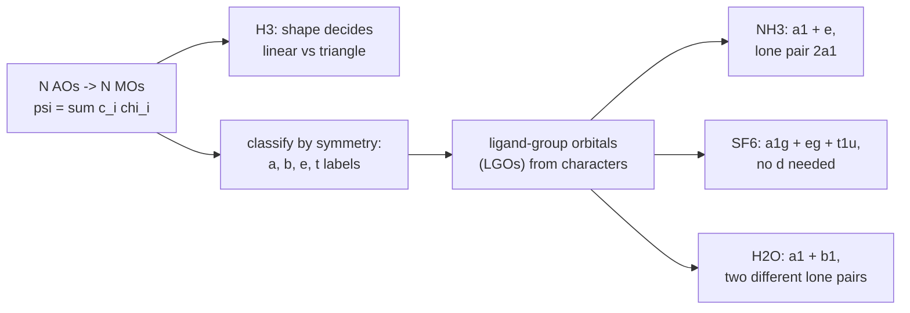

# CH03 · Molecular Orbital Theory: Polyatomics

◀ [[CH02 Molecular Orbital Theory Diatomics]] · [[Inorganic Chemistry - Course Map|Course Map]] · next: [[CH04 Acid-Base Concepts]]

taught · in syllabus extra · book extra · beyond

> [!syllabus] Syllabus map: what is in the syllabus and what is extra in this chapter
> 🟢 **Taught (CH-2113 slides 40–52, [[chem pre-ms .pdf#page=40|pre-midsem pack]])**
> - §1 from diatomics to polyatomics and the three rules (slide 40, with the slide's caveat to check below)
> - §2 the hypothetical $\mathrm H_3$, linear and triangular (slide 41)
> - §3 labels $a,b,e,t$ and why $\sigma/\pi$ survive (slide 42)
> - §4 **$\mathrm{NH_3}$**: the MOs $1a_1,2a_1,3a_1,1e,2e$, the photoelectron spectrum at 11 and 16 eV, the HOMO as the lone pair (slides 43–44)
> - §5 **hypervalence in MO language: $\mathrm{SF_6}$** (slide 45)
> - §6 **$\mathrm{H_2O}$** (slides 46–52, image-only): the $C_{2v}$ character table, the symmetry-adapted H combinations $\mathrm{H_a\pm H_b}$ and the O orbitals, the level diagram $2A_1,1B_1,3A_1,1B_2,4A_1,2B_1$
>
> 🟡 **Extra · book** (Shriver and Atkins Ch. 2: polyatomic molecules [[Shriver and Atkins Inorganic Chemistry 5th Ed.pdf#page=79|PDF pp.79–82]]; printed page = PDF − 27)
> - the book's use of symmetry-adapted orbitals and the Walsh-type argument for bent versus linear
>
> 🔵 **Extra · beyond** (my additions; numbers in `scripts/ch0209_numbers.py`)
> - §2 the Hückel solution of $\mathrm H_3$ with all coefficients and the electron-count table for $\mathrm{H_3^+}$, $\mathrm{H_3}$, $\mathrm{H_3^-}$; §4–§6 the **reduction of the ligand representation** by characters for $\mathrm{NH_3}$ ($a_1+e$) and $\mathrm{H_2O}$ ($a_1+b_1$); the $\mathrm{S–F}$ bond order $0.67$; §7 methane and linear $\mathrm{BeH_2}$ as further examples; §8 the Walsh argument for the shape of $\mathrm{AH_2}$

> [!key] After this chapter you can
> - build the MOs of $\mathrm{AH}_n$ by (1) forming **ligand-group orbitals** (LGOs) from the H 1s orbitals, (2) classifying them and the central-atom AOs by **symmetry**, (3) combining only orbitals of the **same symmetry**, (4) filling from the bottom,
> - give the shape-dependent $\mathrm H_3$ levels and say why $\mathrm{H_3^+}$ is triangular while $\mathrm H_3$ and $\mathrm{H_3^-}$ prefer other shapes,
> - assign the **photoelectron bands** of $\mathrm{NH_3}$ (11 and 16 eV) and $\mathrm{H_2O}$ (12.6, 14.7, 18.6, 32.2 eV) to MOs and say why the lone-pair electrons are the easiest to remove,
> - explain **hypervalence without $d$ orbitals** for $\mathrm{SF_6}$ (four bonding MOs hold 8 electrons over six bonds, bond order 0.67),
> - explain why the two "equivalent" VSEPR lone pairs of water are **not equivalent** in the MO picture and in the photoelectron spectrum.

> [!intuition] The one-sentence story
> A molecule with many atoms has a shape, and the shape has a **symmetry**; symmetry is a sorting machine for orbitals: orbitals of different symmetry cannot mix at all, orbitals of the same symmetry mix as strongly as their overlap and energy gap allow, so one first sorts the ligand orbitals into symmetry families, then matches each family with the central atom's orbital of the same family.

![[CH03 Molecular Orbital Theory Polyatomics.svg]]
*Diagram CH3.0. The chapter in one page: LGOs, symmetry sorting, the four worked molecules. Editable source: [[CH03 Molecular Orbital Theory Polyatomics.excalidraw]].*

*Concept map: every box is a section.*

> [!intuition] Why symmetry is not decoration
> Overlap between two orbitals of different symmetry is *exactly zero* because the positive and negative parts cancel by symmetry, however close they are in energy. So the huge $N\times N$ problem splits into small independent blocks, one per symmetry label: for $\mathrm{H_2O}$ a $6\times6$ problem becomes $3\times3$ ($a_1$), $2\times2$ ($b_1$) and $1\times1$ ($b_2$). That is why the lecture's diagrams are drawn in columns labelled $A_1,B_1,B_2$ ([[Group Theory - Course Map]]).

## 1. From diatomics to polyatomics
taught *slides 40, 42*

MOT is useful for triatomic molecules, for finite groups of atoms and for almost infinite arrays. It **resembles the diatomic case; the difference is a larger basis set**: from $N$ AOs one builds $N$ MOs, written $\psi=\sum_ic_i\chi_i$, the sum running over all AOs of the **appropriate symmetry**. Slide 40 gives three rules:
1. *The greater the number of nodes in a MO, the greater the antibonding character and higher the symmetry*;
2. *orbitals constructed from lower-energy orbitals lie lower in energy* ($s$ below $p$ in a given shell);
3. *interactions between non-nearest neighbours are weakly bonding or weakly antibonding depending on the signs of their lobes.*

> [!verify] Rule 1 as printed
> The first half is right: **more nodes means higher energy** (more curvature, more kinetic energy: [[QM04 The Particle in a Box]]). "Higher symmetry" is not a general consequence of more nodes (the totally symmetric $a_1$ MO can have nodes too: the $3a_1^*$ of $\mathrm{NH_3}$). The intended meaning is probably the contrast *between the nodeless, fully symmetric, bonding combination and the alternating, antibonding one*. Flagged for the instructor.

**Labels (slide 42).** $a,b$ denote a **non-degenerate** orbital (singly), $e$ a **doubly degenerate** pair, $t$ a **triply degenerate** set; subscripts and superscripts ($a_1,b_2,e_g,t_{1u},\dots$) record how the orbital behaves under the other symmetry operations. It is "**always not appropriate** to use $\sigma$ and $\pi$ in polyatomic systems as in linear molecules", but they are convenient to describe the *local* shape of an orbital: **the language of VBT survives in MOT.**

## 2. $\mathrm H_3$: the shape decides the levels
taught *slide 41* · extra · beyond *Hückel numbers and electron counts*

Three H 1s orbitals $\chi_A,\chi_B,\chi_C$. **Linear** (slide 41, left): the three combinations, bottom to top,
$$1\sigma=\tfrac12\chi_A+\tfrac{1}{\sqrt{2}}\chi_B+\tfrac12\chi_C,\quad 2\sigma=\tfrac1{\sqrt2}(\chi_A-\chi_C),\quad 3\sigma=\tfrac12\chi_A-\tfrac1{\sqrt2}\chi_B+\tfrac12\chi_C,$$
with $E=\alpha-\sqrt2\beta,\ \alpha,\ \alpha+\sqrt2\beta$ (the slide writes $\chi_A+\sqrt2\chi_B+\chi_C$ un-normalised). $1\sigma$ is **bonding between A–B and B–C**; $2\sigma$ has a node through B, so the central atom is not involved ("negligible interaction"): it is **non-bonding**; $3\sigma$ is antibonding between A–B and B–C.

**Triangular** (slide 41, right): $1\sigma$ becomes the totally symmetric $a$, bonding between **all three pairs**: $E=\alpha+2\beta$ (coefficients $\tfrac1{\sqrt3}(1,1,1)$). $2\sigma$ and $3\sigma$ **become degenerate** ($e$, $E=\alpha-\beta$): "$2\sigma$ = antibonding for A–C: **rise in E**; $3\sigma$ = antibonding between A–B and B–C but *bonding* for A–C: **decrease in E**".

![[fig_ch03_h3.png]]
*Figure CH3.1. $\mathrm H_3$. A: the linear MOs with the sign (blue +, orange −) and size of each coefficient: ½, √½, ½ for $1\sigma$, a node through the middle for $2\sigma$, the alternating pattern for $3\sigma$. B: the triangle: $a$ (all in phase, $E=\alpha+2\beta$) and the degenerate pair $e$ at $\alpha-\beta$. C: the electronic stabilisation (in units of $|\beta|$) for 2, 3 and 4 electrons: the triangle wins for $\mathrm{H_3^+}$ (4.0 against 2.83) and for $\mathrm H_3$ (3.0 against 2.83), but with 4 electrons the linear shape is better (2.83 against 2.0).*

> [!example] Electron counting decides the shape (🔵)
> | Species | e⁻ | linear | triangle | favoured |
> |---|---|---|---|---|
> | $\mathrm{H_3^+}$ | 2 | $2\times1.414=2.83|\beta|$ | $2\times2=4.00|\beta|$ | **triangle** (the observed ion, interstellar) |
> | $\mathrm H_3$ | 3 | 2.83 | $4-1=3.00$ | (slightly) triangle, but a Jahn–Teller-unstable $e^1$ configuration |
> | $\mathrm{H_3^-}$ | 4 | 2.83 | $4-2=2.00$ | **linear** (the three-centre four-electron bond, as in $\mathrm{I_3^-}$, $\mathrm{HF_2^-}$) |

This is the first example of the rule you will use all chapter: **the shape that gives the most bonding electrons in low orbitals wins** (Walsh's rule, §8).

## 3. Ligand-group orbitals and how to find them
taught *slides 42–52 (used implicitly)* · extra · beyond *the reduction formula*

A **ligand-group orbital** is a combination of ligand orbitals that transforms as one irreducible representation of the molecule's point group. To find which LGOs a set of $n$ ligands provides: (1) count how many ligand orbitals are **unmoved** by each symmetry operation: that is the **character** $\chi_\Gamma(R)$ of the reducible representation $\Gamma$; (2) reduce it with
$$n_i=\frac1h\sum_R\chi_\Gamma(R)\,\chi_i(R),$$
$h$ = order of the group. (3) Each $n_i$ is the number of LGOs of symmetry $i$.

> [!example] $\mathrm{NH_3}$ ($C_{3v}$, $h=6$): the three H 1s give $a_1+e$
> Characters of $\Gamma$ for $(E,2C_3,3\sigma_v)$: $(3,0,1)$. Then $n(A_1)=\tfrac16(3+0+3)=1$, $n(A_2)=\tfrac16(3+0-3)=0$, $n(E)=\tfrac16(6+0+0)=1$: **$\Gamma=a_1+e$**. N 2s and $2p_z$ are $a_1$, $2p_{x},2p_y$ are $e$.

> [!example] $\mathrm{H_2O}$ ($C_{2v}$, $h=4$): the two H 1s give $a_1+b_1$
> For $(E,C_2,\sigma_v(xz),\sigma_v'(yz))$, with the molecule in the $xz$ plane as on slides 47–48: $\Gamma=(2,0,2,0)$. Then $n(A_1)=\tfrac14(2+0+2+0)=1$, $n(A_2)=\tfrac14(2+0-2+0)=0$, $n(B_1)=\tfrac14(2-0+2-0)=1$, $n(B_2)=0$: **$\Gamma=a_1+b_1$** — the in-phase LGO $\mathrm{H_a+H_b}$ is $A_1$, the out-of-phase $\mathrm{H_a-H_b}$ is $B_1$ (slide 48's two rows of drawings). O contributes $2s$ ($a_1$), $2p_z$ ($a_1$), $2p_x$ ($b_1$, in the plane) and $2p_y$ ($b_2$, perpendicular to the plane; **no H LGO has this symmetry**).

> [!example] $\mathrm{SF_6}$ ($O_h$): the six F $\sigma$ orbitals give $a_{1g}+e_g+t_{1u}$
> $\Gamma_\sigma=(6,0,0,2,2,0,0,0,4,2)$ over the ten classes of $O_h$; the reduction gives one $a_{1g}$, one $e_g$ (two orbitals) and one $t_{1u}$ (three): $1+2+3=6$ ✓. S $3s$ is $a_{1g}$, S $3p$ is $t_{1u}$, and the S $3d$ would be $e_g+t_{2g}$ (not used on the slides).

## 4. $\mathrm{NH_3}$
taught *slides 43–44* · extra · book *S&A [[Shriver and Atkins Inorganic Chemistry 5th Ed.pdf#page=79|PDF p.79]]*

**Construction (slide 43).** N $2s$ and $2p_z$ with the three H 1s ($a_1$ LGO) give **three $\sigma$ orbitals along the axis**, labelled $1a_1,2a_1,3a_1$. N $2p_x,2p_y$ combine with the $e$ pair of H combinations (e.g. $\psi=c_1\chi_{N2p_x}+c_2(\chi_{H1sA}+\chi_{H1sB})$, and the equivalent for $p_y$) to give the **doubly degenerate bonding pair $1e$ and antibonding pair $2e$**. 7 MOs from 4 + 3 = 7 AOs. **Eight electrons fill the MOs in order of energy:** $1a_1^2\,1e^4\,2a_1^2$.

**The photoelectron spectrum (slide 44).** The actual orbital energies can be found by computation or by **photoelectron spectroscopy**: He I radiation (21.2 eV) ejects an electron from each filled MO and the ionisation energy is the orbital energy (Koopmans' theorem). **The 11 eV and 16 eV peaks are assigned to $2a_1$ and $1e$**; the $1a_1$ is out of range of the 21 eV radiation (it is near 27 eV, an N 2s-like level). The **HOMO is $2a_1$**: largely confined to the N atom and makes only a small contribution to bonding, *consistent with the fact that the lone pairs play a considerable role in determining the shape of the molecule*. The **vibrational structure** of the 11 eV band comes from the shape change on removing a lone-pair electron: NH$_3^+$ is planar, NH$_3$ pyramidal.

> [!key] What the diagram says in words
> * Three of the N–H *bonds* live in $1a_1$ (one bonding, spread over all three H) and $1e$ (the other two): **6 electrons in bonding MOs over 3 bonds: bond order 1 each**, exactly the Lewis picture.
> * The **lone pair is not a hybrid sticking out of N by decree**: it is the *occupied, nearly non-bonding $2a_1$ MO*, which mixes N $2s$, N $2p_z$ and a little H. This MO is what the VSEPR lone pair *is*.
> * The VB take-home result of CH01 (lone-pair hybrid 32 % $s$, 68 % $p$ in $\mathrm{NH_3}$) and the MO result ($2a_1$ mostly N, mixed $s$/$p_z$) tell the same story.

![[fig_ch03_polyatomics.png]]
*Figure CH3.2. Three polyatomic MO diagrams. A: $\mathrm{NH_3}$, 8 electrons in $1a_1^2\,1e^4\,2a_1^2$; the $2a_1$ lone pair is the HOMO (PES 11 eV), $1e$ at 16 eV, $1a_1$ out of reach of the 21.2 eV lamp; the antibonding $2e^*$ and $3a_1^*$ are empty. B: $\mathrm{H_2O}$ in the slide's convention ($C_{2v}$, molecule in the $xz$ plane): $2a_1$ (mostly O 2s, 32.2 eV), $1b_1$ (O–H σ bonding in the plane, 18.6 eV), $3a_1$ (an $s$–$p$ lone pair, 14.7 eV), $1b_2$ (pure O $p$, perpendicular to the plane, 12.6 eV, the HOMO). C: $\mathrm{SF_6}$ in $O_h$: $1a_{1g}$ and $1t_{1u}$ bonding (8 e⁻), $1e_g$ non-bonding on F (4 e⁻), all antibonding MOs empty.*

## 5. Hypervalence in the MO picture: $\mathrm{SF_6}$
taught *slide 45* · extra · beyond *bond order*

VBT explains hypervalence by invoking $d$ orbitals ([[Hypervalence]], CH01 §6). In MO theory it is easy *without* them. In the octahedron the six F ligands give six LGOs, one **non-degenerate** ($a_{1g}$), one **doubly degenerate** ($e_g$), one **triply degenerate** ($t_{1u}$). S $3s$ interacts with the $a_{1g}$ LGO to give **one bonding and one non-bonding** orbital in the slide's wording (strictly the second is the *antibonding* $2a_{1g}^*$); S $3p$ interacts with the $t_{1u}$ set to give **two triply degenerate sets** ($1t_{1u}$ bonding, $2t_{1u}^*$ antibonding). *There is no S orbital to match the $e_g$ LGOs, so they are non-bonding.* **The 12 valence electrons** of $\mathrm{SF_6}$ ($6$ from S + $6\times1$ from F) occupy the bonding ($1a_{1g},1t_{1u}$) and non-bonding ($1e_g$) MOs and **all antibonding MOs are empty, so the molecule is stable.** (The slide labels these $1a_1,1t_1,1e$; the standard $O_h$ labels $a_{1g},t_{1u},e_g$ are used here.)

> [!derivation] How many S–F bonds is that? (🔵)
> Electrons in the **bonding** MOs: $2$ ($1a_{1g}$) $+\,6$ ($1t_{1u}$) $=8$, shared over **six** S–F bonds: $\tfrac{8}{2\times6}=\mathbf{0.67}$ electron pairs per S–F bond. The Lewis octet-expanded picture puts 12 electrons in 6 bonds (order 1). MO theory says: **four bonding MOs (not six) hold the bonding electrons; the four-orbital limit is the octet rule**, and the "extra" bonds are three-centre $\mathrm{F{-}S{-}F}$ bonds of fractional order. Hypervalence is a **delocalisation effect**, not an expanded octet, which is why period-2 elements ($\mathrm{NF_6^-}$ does not exist; no $2d$ shell, small size) are rarely hypervalent.

## 6. $\mathrm{H_2O}$
taught *slides 46–52* (all image-only; the text below reads the pictures) · extra · beyond *the PES assignment and the lone-pair story*

**The set-up (slides 46–48).** Split the molecule into **oxygen** (one $2s$, three $2p$) and the **two hydrogens**; classify everything in $C_{2v}$ (slide 47's character table: rows $A_1$ (1,1,1,1), $A_2$ (1,1,−1,−1), $B_1$ (1,−1,1,−1), $B_2$ (1,−1,−1,1) over $E,C_2,\sigma_v(xz),\sigma_v'(yz)$). The O $2p_y$ is **$B_2$**, $2p_x$ **$B_1$**, $2p_z$ and $2s$ **$A_1$** (slide 47's coloured $p$-orbital rows); the two-hydrogen combinations are **$H_a+H_b$: $A_1$** and **$H_a-H_b$: $B_1$** (slide 48), the *LGOs*.

**The diagram (slides 49–52, built up step by step).** Slide 49 places the O orbitals (left: three $p$ levels and the $2s$ below, $A_1$) and the LGOs (right: $B_1$ above $A_1$). Slide 50 mixes the three $A_1$ orbitals (O 2s, O $2p_z$, $H_a+H_b$): three MOs **$2A_1$ (lowest), $3A_1$, $4A_1$ (highest)**; slide 51 mixes the two $B_1$ orbitals (O $2p_x$ and $H_a-H_b$): **$1B_1$ (bonding), $2B_1$ (antibonding)**; the O $2p_y$ ($B_2$) has no partner and stays as the **non-bonding $1B_2$**. Slide 52 assembles the six MOs.

| MO (slide labels) | Character | $\mathrm{IE}$ (eV, recalled) | Electrons |
|---|---|---|---|
| $4A_1$, $2B_1$ | antibonding | — | 0 |
| $1B_2$ | **non-bonding, pure O $2p$ perpendicular to the molecular plane** (HOMO) | **12.6** | 2 |
| $3A_1$ | weakly bonding/non-bonding, O $2s$–$2p_z$ mix plus a little H ("sp-type" lone pair) | **14.7** | 2 |
| $1B_1$ | O–H $\sigma$ bonding (in the plane) | **18.6** | 2 |
| $2A_1$ | O–H $\sigma$ bonding, mostly O 2s | **32.2** | 2 |

(The slides' labelling places the molecule in the $xz$ plane; the common textbook convention puts it in the $yz$ plane and **swaps the labels $b_1\leftrightarrow b_2$**: the HOMO is then called $1b_1$. The *content* is the same: the HOMO is the pure $p$ orbital perpendicular to the plane.)

> [!key] The two lone pairs of water are different
> VSEPR draws two equivalent "rabbit-ear" lone pairs ($sp^3$). The MO picture (and the photoelectron spectrum: **separate bands at 12.6 eV and 14.7 eV**) says there is one **pure-$p$ lone pair** ($1B_2$, out of the plane, symmetric about it) and one **$s$-rich lone pair** ($3A_1$, in the plane). The two descriptions are equivalent for *total* energy and density (a unitary mixing of occupied orbitals does not change them) but only the MO ones are the *energy eigenstates* seen in spectroscopy. This is the same message as CH01's Coulson analysis of water (lone-pair hybrids 30 % $s$): the lone-pair orbitals are not $p$-pure on average, because the in-plane one carries the $s$.

> [!pitfall] A lone pair is not an orbital you can "see" in the photoelectron spectrum as one peak
> Koopmans' theorem gives one band per *canonical* MO, not one per Lewis lone pair. Water has two bands for its two Lewis lone pairs, and methane (§7) has two bands for its four equivalent C–H bonds.

## 7. Two more examples: $\mathrm{CH_4}$ and $\mathrm{BeH_2}$ (🔵)
extra · beyond *not on the slides; same method*

* **Methane ($T_d$).** The four H LGOs span $a_1+t_2$; C $2s$ is $a_1$, C $2p$ is $t_2$. MOs: $1a_1$ (bonding), $1t_2$ (bonding), $2a_1^*$, $2t_2^*$. 8 electrons: **$1a_1^2\,1t_2^6$**. VB/VSEPR say four *equivalent* bonds; the PES of $\mathrm{CH_4}$ shows **two bands (≈23 eV for $1a_1$ and ≈14 eV for $1t_2$, recalled)** because the canonical MOs are *not* four-bond-like. Same density as four equivalent localised bonds; different energy eigenstates.
* **Linear $\mathrm{BeH_2}$ ($D_{\infty h}$).** The H LGOs are $\sigma_g$ ($\mathrm{H_a+H_b}$) and $\sigma_u$ ($\mathrm{H_a-H_b}$); Be $2s$ is $\sigma_g$, $2p_z$ is $\sigma_u$, and $2p_{x,y}$ are $\pi_u$ with **no H partner**. 4 electrons: $\sigma_g^2\sigma_u^2$, bond order 1 each; the **empty, non-bonding Be $2p_{x,y}$ ($\pi_u$) make $\mathrm{BeH_2}$ a strong Lewis acid** (it polymerises through bridging H: [[CH07 Main Group Cages and Clusters]]).

## 8. Why is water bent? The Walsh idea (🔵)
extra · beyond *qualitative; the figure is conceptual*

Follow the MO energies of $\mathrm{AH_2}$ as the $\mathrm{H{-}A{-}H}$ angle closes from 180° to 90°. The orbitals that gain **$s$-character** or lose antibonding overlap fall in energy; those that lose bonding overlap rise. For a 4-electron molecule ($\mathrm{BeH_2}$) the occupied $\sigma_g,\sigma_u$ are best at 180°: linear. For **8 electrons** ($\mathrm{H_2O}$) the additional pair sits in the orbital that was the pure $p_z$ (non-bonding, $\pi_u$) at 180° and becomes the $s$-mixed $3a_1$ on bending: **it drops sharply in energy**, outweighing the rise of the others: **bent**. For $\mathrm{AH_2}$ with 5–6 electrons the optimum is intermediate, 130°–120° (e.g. $\mathrm{BH_2}$, $\mathrm{CH_2}$ singlet). The bent shape and its angle follow from filling the right orbitals, **not** from lone-pair repulsion alone ([[VSEPR Model]] gets the same shape by a different route).

## Map of this chapter
> [!connection] How CH03 connects
> **Builds on:** [[CH02 Molecular Orbital Theory Diatomics]] (LCAO, bonding/antibonding), [[CH01 VSEPR and Valence Bond Theory]] (shapes, hypervalence, Coulson on water and ammonia), [[Group Theory - Course Map]] (point groups, characters, the reduction formula).
> **Leads to:** [[CH04 Acid-Base Concepts]] (the lone pair as the Lewis-base orbital, the empty $\pi_u$ as the Lewis-acid orbital), [[CH07 Main Group Cages and Clusters]] (3-centre MOs in boranes).
> **Concepts:** [[Ligand Group Orbitals]] · [[Symmetry Labels a b e t]] · [[Reduction of a Representation]] · [[H3 Molecular Orbitals]] · [[Photoelectron Spectroscopy]] · [[Walsh Diagram]] · [[Hypervalence]] · [[Lone Pair Stereochemical Activity]]
> **Other subjects:** [[Group Theory - Course Map]], [[QM04 The Particle in a Box]] (nodes and energy), [[Climate - Course Map]] (the bent H$_2$O and its vibrations: [[Greenhouse Gases and Absorption Bands]]).

## Summary
> [!summary] Cheat-sheet
> - **Method:** LGOs of the ligands → classify by symmetry → combine same-symmetry orbitals → fill. $N$ AOs → $N$ MOs; rules: more nodes = higher energy; lower AOs give lower MOs; non-nearest neighbours matter weakly.
> - **$\mathrm H_3$:** linear $E=\alpha\pm\sqrt2\beta,\alpha$ (coefficients ½, √½, ½); triangle $\alpha+2\beta$, $\alpha-\beta$ (×2). $\mathrm{H_3^+}$ triangular, $\mathrm{H_3^-}$ linear.
> - **Reduction:** $n_i=\frac1h\sum\chi_\Gamma\chi_i$. $\mathrm{NH_3}$ ($C_{3v}$): $a_1+e$. $\mathrm{H_2O}$ ($C_{2v}$): $a_1+b_1$. $\mathrm{SF_6}$ ($O_h$): $a_{1g}+e_g+t_{1u}$. $\mathrm{CH_4}$ ($T_d$): $a_1+t_2$.
> - **$\mathrm{NH_3}$:** $1a_1^21e^42a_1^2$; HOMO $2a_1$ (lone pair, 11 eV), $1e$ 16 eV.
> - **$\mathrm{SF_6}$:** 12 e⁻ in $1a_{1g}$, $1t_{1u}$ (bonding), $1e_g$ (non-bonding); S–F order 0.67; no $d$ needed.
> - **$\mathrm{H_2O}$:** $2A_1^21B_1^23A_1^21B_2^2$ (IE 32.2, 18.6, 14.7, 12.6 eV); two different lone pairs ($1B_2$ pure $p$, $3A_1$ $s$-rich); bent because the $3a_1$ drops on bending.

## Practice
1. **$\mathrm H_3$.** Which shape does $\mathrm{H_3^+}$ prefer and why? What does $\mathrm{H_3^-}$ prefer?
2. **Reduction.** Reduce the representation of the three H 1s orbitals of $\mathrm{NH_3}$ in $C_{3v}$ (characters 3, 0, 1) and of the two in $C_{2v}$ $\mathrm{H_2O}$ (2, 0, 2, 0).
3. **$\mathrm{NH_3}$ counts.** How many MOs, how many are occupied, which is the HOMO, and why is $1a_1$ missing from the 21.2 eV spectrum?
4. **$\mathrm{SF_6}$.** Count the electrons in bonding, non-bonding and antibonding MOs and give the S–F bond order.
5. **$\mathrm{H_2O}$ labels.** Name the HOMO in the lecture's axis convention and in the common textbook one.
6. **Methane.** Give the occupied MOs of $\mathrm{CH_4}$ and say how many PES bands you expect.
7. **$\mathrm{BeH_2}$.** Why is it a Lewis acid? Which orbital accepts?
8. **PES vs VSEPR.** Why does the VSEPR picture of two equivalent lone pairs not conflict with two PES bands?
9. **Rule 1.** Why is "higher symmetry" at the end of slide 40's rule 1 suspect? Give a counter-example.
10. **Walsh.** Predict the shape of $\mathrm{BH_2}$ (5 valence electrons) and of $\mathrm{H_2O}$ (8) from the Walsh argument.

> [!example]- Solutions
> 1. $\mathrm{H_3^+}$ has 2 electrons in the lowest MO: triangle $=2\times2|\beta|=4|\beta|$ against linear $2.83|\beta|$: triangular (observed). $\mathrm{H_3^-}$ has 4 electrons: filling $1\sigma^22\sigma^2$ in the linear shape ($2.83|\beta|$) beats the triangle ($a^2e^2$: $4-2=2|\beta|$): linear (three-centre four-electron bond).
> 2. $\mathrm{NH_3}$: $n(A_1)=\tfrac16(3+0+3)=1$, $n(A_2)=\tfrac16(3+0-3)=0$, $n(E)=\tfrac16(6)=1$: $a_1+e$. $\mathrm{H_2O}$: $n(A_1)=\tfrac14(2+2)=1$, $n(B_1)=\tfrac14(2+2)=1$, $n(A_2)=n(B_2)=0$: $a_1+b_1$.
> 3. 7 MOs ($1a_1,2a_1,3a_1,1e\times2,2e\times2$); 4 occupied levels (5 orbitals: $1a_1$, $1e$ (two), $2a_1$ = 4 orbitals holding 8 e⁻); HOMO $2a_1$; $1a_1$ is bound by about 27 eV, more than the 21.2 eV photon energy.
> 4. Bonding 8 ($1a_{1g}^2,1t_{1u}^6$), non-bonding 4 ($1e_g^4$), antibonding 0; bond order $\frac{8}{2\times6}=0.67$.
> 5. Lecture: $1B_2$ (perpendicular to the $xz$ plane); common convention (molecule in $yz$): $1b_1$.
> 6. $1a_1^21t_2^6$: **two** bands (≈23 and ≈14 eV), not four.
> 7. $\mathrm{BeH_2}$ has Be $2p_x,2p_y$ ($\pi_u$) empty and non-bonding: they accept a lone pair (and polymerise via 3-centre Be–H–Be bridges).
> 8. VSEPR's two lone-pair orbitals and the MO pair $\{1b_2,3a_1\}$ are related by a unitary mixing of the *occupied* orbitals; total density and energy are invariant, but only the canonical MOs are energy eigenstates, which is what PES measures.
> 9. The totally symmetric $a_1$ MO set contains both the lowest MO (no nodes) and the highest ($3a_1^*$, many nodes), so "more nodes ⇒ higher symmetry" is false; "more nodes ⇒ higher *energy*" is the content that is right.
> 10. 5 electrons: the extra electron beyond the 4 of $\mathrm{BeH_2}$ sits in the orbital that drops on bending; Walsh predicts bent, ≈131° for $\mathrm{BH_2}$ (observed ≈131°, recalled). Eight electrons: bent, 104.5°.

> [!connection] Group theory used here
> Point groups, characters, the reduction formula and symmetry labels are developed in [[GT10 Symmetry Representations and Characters]]; the groups themselves ($C_{2v}$, $C_{3v}\cong S_3$, $T_d\cong S_4$) in [[GT03 Cyclic and Abelian Groups and Direct Products]], [[GT05 Actions Conjugation and Sylow Theorems]], [[GT06 Permutation Groups]]. Full list: [[Where Groups Appear in the Vault]].

## Provenance
> [!provenance]- Source map for this chapter
> | Topic | Source | Scope |
> |---|---|---|
> | polyatomic MOT, rules 1–3, labels | [[chem pre-ms .pdf#page=40\|slides 40, 42]] | taught |
> | hypothetical $\mathrm H_3$ | [[chem pre-ms .pdf#page=41\|slide 41]] (diagram image + text) | taught |
> | $\mathrm{NH_3}$ construction and PES | [[chem pre-ms .pdf#page=43\|slides 43–44]] | taught |
> | $\mathrm{SF_6}$ and hypervalence | [[chem pre-ms .pdf#page=45\|slide 45]] | taught |
> | $\mathrm{H_2O}$ (character table, LGOs, level diagram) | [[chem pre-ms .pdf#page=46\|slides 46–52]] (images, read from the slide pictures) | taught |
> | polyatomic MO in the book | [[Shriver and Atkins Inorganic Chemistry 5th Ed.pdf#page=79\|S&A PDF pp.79–82]] | extra/book |
> | Hückel numbers, reductions, S–F bond order, $\mathrm{CH_4}$, $\mathrm{BeH_2}$, Walsh | `scripts/ch0209_numbers.py`, `scripts/fig_ch0209.py` | extra/beyond |
>
> **Notes.** (1) The $\mathrm{H_2O}$ ionisation energies (12.6, 14.7, 18.6, 32.2 eV), the $\mathrm{NH_3}$ values and the $\mathrm{CH_4}$ bands are recalled `[verify]`. (2) The slides give no energies for $\mathrm{H_2O}$; the *order* of levels is read from slide 52. (3) The lecture's labels ($1a_1$, $1t_1$, $1e$ for $\mathrm{SF_6}$) differ from the standard $O_h$ ones; the standard are used. (4) Slide 40's rule 1 wording is flagged. (5) The final axis of Figure CH3.2 is schematic: energies are positioned by IE, not drawn to scale.

**References.** Shriver, D. F. and Atkins, P. W. *Inorganic Chemistry* (5th ed.), Ch. 2 · Cotton, F. A. *Chemical Applications of Group Theory* (3rd ed.) Ch. 5 · Walsh, A. D. (1953) *J. Chem. Soc.* 2260 · Turner, D. W. et al. *Molecular Photoelectron Spectroscopy* (1970).
