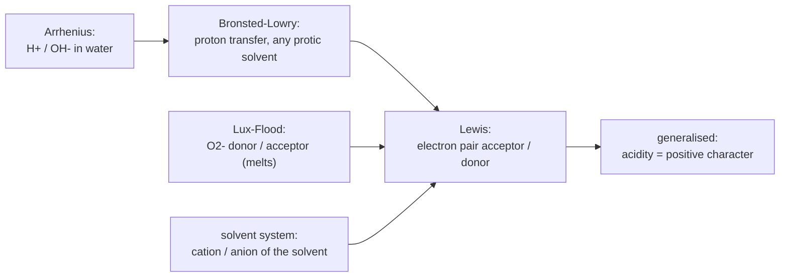

# CH04 · Acid–Base Concepts

◀ [[CH03 Molecular Orbital Theory Polyatomics]] · [[Inorganic Chemistry - Course Map|Course Map]] · next: [[CH05 Acid Strength Lewis Acidity and Reactions]]

taught · in syllabus extra · book extra · beyond

> [!syllabus] Syllabus map: what is in the syllabus and what is extra in this chapter
> 🟢 **Taught (CH-2113 slides 53–65, [[chem pre-ms .pdf#page=53|pre-midsem pack]])**
> - §1 the status of the definitions: not fundamental theories (slide 54)
> - §2 **Arrhenius**: definitions, the autoprotolysis of water and the $K_w$ table, utility and limitations (slides 55–57)
> - §3 **Brønsted–Lowry**: proton donors and acceptors, hydronium structures, conjugate pairs, amphoterism, the reaction of acetic acid with ammonia (slides 58–60)
> - §4 **Lux–Flood**: oxide ion donor/acceptor, molten oxides, geochemistry (slide 61)
> - §5 **Lewis**: electron-pair acceptor/donor, adducts, breadth (slides 62–64); the **solvent-system** definition (slide 64)
> - §6 the **generalised** acid–base concept: positive and negative character (slide 65)
>
> 🟡 **Extra · book** (Shriver and Atkins Ch. 4: [[Shriver and Atkins Inorganic Chemistry 5th Ed.pdf#page=138|PDF pp.138–149]] Brønsted acidity and periodicity; Lewis acids and bases [[Shriver and Atkins Inorganic Chemistry 5th Ed.pdf#page=159|pp.159–166]]; printed page = PDF − 27)
> - the levelling effect, the $\mathrm p K_a$ scale, the proton as the unit of acidity
>
> 🔵 **Extra · beyond** (my additions; numbers in `scripts/ch0209_numbers.py`)
> - §2 $\mathrm pK_w$ from the slide's table and its van't Hoff enthalpy (52.7 kJ/mol), the neutral pH at 100 °C (6.13), and a correction of the slide's "1 in $10^7$"; §3 pH of HF, of $\mathrm{NH_4Cl}$ and of sodium acetate (the slide-57 puzzles worked out); §5 the HOMO–LUMO picture of the Lewis adduct; §7 acidity functions of superacids

> [!key] After this chapter you can
> - state the **four definitions** (Arrhenius, Brønsted–Lowry, Lux–Flood, Lewis) plus the solvent-system definition, say what each *adds*, and name a reaction that only the wider definition describes,
> - write **conjugate acid–base pairs**, use $\mathrm pK_a+\mathrm pK_b=\mathrm pK_w$, and decide the direction of a proton-transfer equilibrium from the two $\mathrm pK_a$ values,
> - calculate the pH of a weak acid, of the salt of a weak acid, and of a salt of a weak base, and explain the two "puzzles" of slide 57 (HCl + NH$_3$ is acidic; CH$_3$COOH + NaOH is basic),
> - identify the Lewis acid and base in a reaction (adduct, displacement, ion transfer) and draw the donor–acceptor orbital interaction,
> - explain why the Lewis definition **contains** the others (and when the narrower ones are more useful).

> [!intuition] The one-sentence story
> There is no single "true" meaning of *acid*; each definition picks a different thing to count (protons, oxide ions, electron pairs), so each fits a different set of chemistry. The definitions nest: the Lewis one is the widest, the Arrhenius the narrowest, and the art is choosing the narrowest that does the job.

![[CH04 Acid-Base Concepts.svg]]
*Diagram CH4.0. The chapter in one page: four definitions, the species counted by each, and the example that forces you from one to the next. Editable source: [[CH04 Acid-Base Concepts.excalidraw]].*

*Concept map: each arrow is "wider than".*

> [!intuition] A map of when to use which
> *Aqueous solution, strength, buffers, pH*: Arrhenius/Brønsted. *Any protic solvent* (liquid NH$_3$, anhydrous H$_2$SO$_4$): Brønsted or solvent-system. *Molten oxides, slags, silicate melts, geochemistry*: Lux–Flood. *Coordination compounds, adducts, catalysis by BF$_3$ or AlCl$_3$*, organic mechanisms: Lewis. Use the narrowest definition that works: it is the most quantitative; use the widest when nothing narrower fits.

## 1. Not fundamental theories
taught *slide 54*

The slide's message: the acid–base definitions are **not fundamental theories** and they are **not rigorous theories** like VBT and MOT. *A comparison of these theories is not about which one is right or wrong; they are different theories which are convenient to use from time to time, and all are comparable with each other.* They are **classifications** that group reactions by what is exchanged, not predictions from first principles.

## 2. Arrhenius
taught *slides 55–57* · extra · beyond *the $K_w$ numbers and the correction*

An **acid** is a substance that, added to water, increases the concentration of $\mathrm H^+$ (hydronium $\mathrm{H_3O^+}$); a **base** increases the concentration of $\mathrm{OH^-}$ (slide 55). Equivalently acids *raise* the hydronium concentration or *lower* the hydroxide; bases the reverse. **Utility:** neutralisation, salt hydrolysis, the strength of acids and bases.

**Autoprotolysis of water** (slide 56): $2\,\mathrm{H_2O}\rightleftharpoons\mathrm{H_3O^+}+\mathrm{OH^-}$, $K_w=[\mathrm{H_3O^+}][\mathrm{OH^-}]\approx1.0\times10^{-14}$ at 25 °C. The slide's table, with the derived columns:

| $T$ (°C) | $K_w/10^{-14}$ | $\mathrm pK_w$ | neutral pH $=\mathrm pK_w/2$ |
|---|---|---|---|
| 0 | 0.112 | 14.95 | 7.48 |
| 25 | 1.023 | 13.99 | 7.00 |
| 50 | 5.495 | 13.26 | 6.63 |
| 75 | 19.95 | 12.70 | 6.35 |
| 100 | 56.23 | 12.25 | **6.13** |

![[fig_ch04_acidbase.png]]
*Figure CH4.1. A: $\mathrm pK_w$ (blue) and the neutral pH (orange) from the slide-56 table; $\mathrm pK_w$ falls with temperature, so **hot pure water is neutral at pH 6.13, not 7**. B: conjugate pairs on the $\mathrm pK_a$ axis: acids on the left are strong, their bases weak; the ladder gives the direction of any proton transfer (the stronger acid on the left donates to the stronger base on the right). C: the four definitions as a nesting.*

> [!derivation] What the $K_w$ table says about water (🔵)
> A van't Hoff plot of $\ln K_w$ against $1/T$ gives $\Delta H^\circ=R\cdot\text{slope}=52.7$ kJ/mol (literature ≈ 55.8): autoprotolysis is **endothermic**, so $K_w$ rises with $T$. "Pure water is neutral" means $[\mathrm H_3\mathrm O^+]=[\mathrm{OH}^-]$, i.e. pH $=\mathrm pK_w/2$, not pH 7.
> **Correction of the slide:** it says "about 1 in $10^7$ molecules are hydronium". Since $[\mathrm{H_3O^+}]=10^{-7}$ M and pure water is 55.5 M, the fraction ionised is $10^{-7}/55.5=1.8\times10^{-9}$, i.e. **1 in $5.6\times10^{8}$**; the "$10^7$" is the exponent of the concentration. `[verify]`

**Limitations (slide 57).**
* Fails for **acidic oxides without hydrogen** ($\mathrm{CO_2},\mathrm{SO_2},\mathrm{SO_3}$) and **basic substances without OH** ($\mathrm{NH_3}$, CaO, MgO).
* Predicts all salts give neutral solutions, but equal amounts of HCl and NH$_3$ give a *slightly acidic* solution and acetic acid with NaOH a *basic* one (worked below).
* The need for $\mathrm{OH^-}$ made Arrhenius write $\mathrm{NH_4OH}$ for ammonia in water, the "misunderstanding that $\mathrm{NH_4OH}$ is the actual base: the base is $\mathrm{NH_3}$".
* Cannot explain the acidic nature of $\mathrm{AlCl_3}$ in water (it is a Lewis acid that hydrolyses: [[CH05 Acid Strength Lewis Acidity and Reactions]]).

## 3. Brønsted–Lowry
taught *slides 58–60* · extra · book *S&A [[Shriver and Atkins Inorganic Chemistry 5th Ed.pdf#page=138|PDF p.138 ff.]]* · extra · beyond *worked pH examples*

**Definition (slide 58).** Brønsted and Lowry independently: **acids are proton donors, bases are proton acceptors.** In aqueous solution this does not differ from Arrhenius, but it **handles any protic solvent** (liquid NH$_3$, anhydrous H$_2$SO$_4$). Examples: $\mathrm{HF}$ ($\mathrm{HF(g)}+\mathrm{H_2O}\to\mathrm{H_3O^+}+\mathrm F^-$), the base $\mathrm{NH_3}$ ($\mathrm{H_2O}+\mathrm{NH_3}\to\mathrm{NH_4^+}+\mathrm{OH^-}$). **Water is amphoteric**: it acts as both Brønsted acid and base.

**The hydronium ion** (slide 58, images): the $\mathrm{H_3O^+}$ ion is pyramidal (as in the crystal $\mathrm{[H_3O][ClO_4]}$); in water it is H-bonded into **$\mathrm{H_9O_4^+}$** ($\mathrm{H_3O^+}$ with three $\mathrm{H_2O}$), and in the gas phase large clusters such as **$\mathrm{H^+(H_2O)_{21}}$** form.

> [!key] Only Brønsted describes acetic acid + ammonia (slide 59)
> $\mathrm{CH_3COOH+H_2O\rightleftharpoons CH_3COO^-+H_3O^+}$ is described by both definitions. $\mathrm{CH_3COOH+NH_3\rightleftharpoons CH_3COO^-+NH_4^+}$ makes **no hydronium** so it is *not* an Arrhenius acid–base reaction, yet it is proton transfer: a Brønsted one.

**Conjugate pairs (slide 60).** Proton transfer is fast in both directions, so the dynamic equilibrium describes the behaviour better than the forward reaction alone: $\mathrm{Acid_1+Base_2\rightleftharpoons Base_1+Acid_2}$ ($\mathrm{Base_1}$ is the conjugate base of $\mathrm{Acid_1}$; $\mathrm{Acid_2}$ the conjugate acid of $\mathrm{Base_2}$). *The conjugate base is what remains after a proton is lost*; *there is no fundamental distinction between an acid and a conjugate acid*: "a conjugate acid is just another acid".

> [!derivation] Strength, direction and the levelling effect (🟡)
> For a pair, $K_a K_b=K_w$, i.e. $\mathbf{p}K_a+\mathbf pK_b=\mathbf pK_w=14$ (25 °C): $\mathrm{NH_4^+/NH_3}$ $\mathrm pK_a$ 9.25 ⇒ $\mathrm{NH_3}$ $\mathrm pK_b$ 4.75; $\mathrm{CH_3COOH}$ 4.76 ⇒ acetate 9.24; $\mathrm{HF}$ 3.17 ⇒ F$^-$ 10.83. A proton moves from the stronger acid (lower $\mathrm pK_a$) to the stronger base, and the equilibrium constant is $K=10^{\Delta\mathrm pK_a}$: acetic acid + ammonia, $\Delta\mathrm pK_a=9.25-4.76=4.49$, so $K=3\times10^4$: essentially complete. **Levelling:** in water no acid stronger than $\mathrm{H_3O^+}$ ($\mathrm pK_a=0$ on this scale) and no base stronger than $\mathrm{OH^-}$ ($\mathrm pK_a=14$) can exist; HClO$_4$, HCl and H$_2$SO$_4$ (first step) all appear equally strong (Figure CH4.1 B), and to rank them one needs a less basic solvent.

> [!example] The two puzzles of slide 57 solved (🔵)
> * **HCl + NH$_3$ (equal amounts)** gives $0.1$ M $\mathrm{NH_4^+}$, a weak acid with $K_a=5.6\times10^{-10}$: $[\mathrm H^+]=\sqrt{K_aC}=7.5\times10^{-6}$ M, **pH 5.12**: slightly acidic.
> * **CH$_3$COOH + NaOH (equal amounts)** gives $0.1$ M acetate, a weak base with $K_b=5.75\times10^{-10}$: $[\mathrm{OH^-}]=\sqrt{K_bC}=7.6\times10^{-6}$ M, pOH 5.12, **pH 8.88**: basic.
> * **$0.01$ M HF** ($\mathrm pK_a=3.17$, $K_a=6.76\times10^{-4}$): $x^2/(0.01-x)=K_a$ gives $x=2.29\times10^{-3}$ M, **pH 2.64**, 23 % ionised. Weak acid *and* the strong H–F bond (the fluoride–water H bonding reduces the apparent acidity) are why HF, unlike HCl, is weak.

> [!pitfall] "Weak" and "dilute" are not the same
> A strong acid at $10^{-8}$ M does not have pH 8: water's own $10^{-7}$ M $\mathrm{H^+}$ dominates and the pH is 6.98. A weak acid at high concentration can still be dangerously corrosive.

## 4. Lux–Flood
taught *slide 61*

For the acid–base behaviour of **oxide ions** (non-protic systems): a **base is an $\mathrm{O^{2-}}$ donor** (a *basic anhydride*), an **acid is an $\mathrm{O^{2-}}$ acceptor** (an *acid anhydride*). Applies to **molten systems, modern geochemistry and the electrochemistry of molten salts**; limited to such systems and emphasises the anhydride aspect.
$$\mathrm{MgO\,(base)+CO_2\,(acid)\rightleftharpoons MgCO_3},\quad \mathrm{CaO+SiO_2\rightleftharpoons CaSiO_3},\quad \mathrm{NO_3^-+S_2O_7^{2-}\rightleftharpoons NO_2^++2\,SO_4^{2-}}\ \ (\text{melts}).$$
The blast furnace is the industrial example: basic $\mathrm{CaO}$ (from limestone) removes acidic $\mathrm{SiO_2}$ as the slag $\mathrm{CaSiO_3}$ (Tutorial 3 Q6). In water the same distinction is the familiar *acidic oxides* (non-metals: $\mathrm{CO_2,SO_3,P_4O_{10}}$) versus *basic oxides* (metals: $\mathrm{Na_2O,CaO}$) with amphoteric oxides between ($\mathrm{Al_2O_3,ZnO}$): [[CH05 Acid Strength Lewis Acidity and Reactions]].

## 5. Lewis
taught *slides 62–64* · extra · book *S&A [[Shriver and Atkins Inorganic Chemistry 5th Ed.pdf#page=159|PDF pp.159–166]]* · extra · beyond *the orbital picture*

The most widely used, "because of its simplicity and broad applicability, especially in organic chemistry" (slide 62): **a Lewis acid is an electron-pair acceptor and a Lewis base an electron-pair donor.** The product is an **adduct** with a coordinate (dative) bond: $\mathrm{BF_3+:NH_3\to F_3B{\leftarrow}NH_3}$. Beyond the earlier definitions it also includes reactions *in which no ions are formed* and in which hydrogen ions or other ions are transferred; it **encompasses all reactions involving hydrogen ions, oxide ions, solvent interactions, the formation of acid–base adducts and all coordination compounds** (slide 64).

> [!derivation] The orbital picture of a Lewis adduct (🔵)
> The base donates from its **HOMO** (a lone pair), the acid accepts into its **LUMO** (an empty orbital or an antibonding $\sigma^*,\pi^*$). Two orbitals give a bonding and an antibonding combination: the 2 electrons from the base fall into the bonding one: **net stabilisation**. The stabilisation is largest when the two frontier orbitals are **close in energy and overlap well** ([[CH06 Hard and Soft Acids and Bases]] uses exactly this to define hardness). Examples of each acceptor type appear in [[CH05 Acid Strength Lewis Acidity and Reactions]]: empty $p$ ($\mathrm{BF_3}$), cation ($\mathrm{Fe^{3+}}$), expandable shell ($\mathrm{SiF_4}$), antibonding orbital ($\mathrm{I_2}$ $\sigma^*$).

**The solvent-system definition (slide 64).** For neutralisations it is convenient to define an acid as a species that **increases the concentration of the characteristic cation of the solvent** and a base as one that increases the **anion**: in water $\mathrm{H_3O^+/OH^-}$; in liquid ammonia $\mathrm{NH_4^+/NH_2^-}$ ($2\mathrm{NH_3}\rightleftharpoons\mathrm{NH_4^+}+\mathrm{NH_2^-}$); in bromine trifluoride $\mathrm{BrF_2^+/BrF_4^-}$ ($2\mathrm{BrF_3}\rightleftharpoons\mathrm{BrF_2^+}+\mathrm{BrF_4^-}$). It is Arrhenius with the solvent changed.

## 6. A generalised concept
taught *slide 65*

All the definitions describe the acid as **donating a positive species** (hydrogen ion) or **accepting a negative species** (an electron pair or an oxide ion); the base as donating a negative species or accepting a positive one. **Generalise:** *acidity is a positive character of a species, which is decreased by reaction with a base; basicity is a negative character, decreased by reaction with an acid.* Two advantages: it **incorporates the content of all definitions** and **gives a criterion for correlating acid–base strength with electron density and molecular structure** — the idea that is applied in CH05 (oxoacid strength, Lewis acidity trends) and CH06 (hardness).

> [!extra-beyond]- 🔵 Extra (beyond): how strong can an acid be? Acidity functions
> In concentrated and non-aqueous media pH is replaced by the Hammett acidity function $H_0$. Anhydrous H$_2$SO$_4$ has $H_0\approx-12$; fluorosulfonic acid $\approx-15$; "magic acid" ($\mathrm{HSO_3F+SbF_5}$) $\approx-23$ (recalled `[verify]`). These are **Brønsted superacids made by adding a Lewis acid** ($\mathrm{SbF_5}$ withdraws F$^-$ from HSO$_3$F leaving a very weakly basic anion): the two definitions combined (CH05 §6).

## 7. Which definition for which problem?
taught (the comparison is mine, built on the slides)

| Question | Best definition | Why |
|---|---|---|
| pH of $\mathrm{NH_4Cl}$, buffers, titration curves | Brønsted | quantitative $\mathrm pK_a$ |
| why $\mathrm{CO_2}$ is acidic though it has no H | Lewis (or Lux–Flood: $\mathrm{CO_2}$ accepts $\mathrm{O^{2-}}$) | no proton involved |
| silicate slags, glass, fluxes | Lux–Flood | oxide ion transfer in a melt |
| $\mathrm{BF_3}$ catalysis, Friedel–Crafts, $\mathrm{Fe^{3+}}$ hydrolysis | Lewis | electron-pair acceptors |
| $\mathrm{NH_4Cl}$ in liquid ammonia as an "acid" | solvent system | cation of the solvent |
| comparing a proton with a metal ion as acceptor | generalised | positive character |

## Map of this chapter
> [!connection] How CH04 connects
> **Builds on:** [[CH03 Molecular Orbital Theory Polyatomics]] (lone pair = HOMO, empty orbitals = LUMO), [[CH01 VSEPR and Valence Bond Theory]] (shapes of $\mathrm{H_3O^+}$, $\mathrm{NH_3}$).
> **Leads to:** [[CH05 Acid Strength Lewis Acidity and Reactions]] (strength trends, Lewis acid periodic trends), [[CH06 Hard and Soft Acids and Bases]].
> **Concepts:** [[Arrhenius Acid-Base Definition]] · [[Bronsted-Lowry Acids and Bases]] · [[Conjugate Acid-Base Pair]] · [[Amphoterism]] · [[Lux-Flood Definition]] · [[Lewis Acids and Bases]] · [[Solvent System Definition]] · [[Autoprotolysis of Water]] · [[Levelling Effect]]
> **Other subjects:** [[Climate - Course Map]] (acid rain, the carbonate system and ocean acidification are Brønsted equilibria that start with $\mathrm{CO_2}$ acting as a Lewis acid toward water/$\mathrm{OH^-}$), [[Thermodynamics and Statistical Mechanics - Course Map]] ($K_w(T)$ and $\Delta H$ by van't Hoff), [[Eco-Evo Exam Prep]] (lake pH and eutrophication, EE06).

## Summary
> [!summary] Cheat-sheet
> - **Arrhenius:** acid raises $[\mathrm{H_3O^+}]$, base raises $[\mathrm{OH^-}]$ in water. $K_w=10^{-14}$ at 25 °C; neutral pH $=\mathrm pK_w/2$ (6.13 at 100 °C). Fails for $\mathrm{CO_2}$, $\mathrm{NH_3}$, CaO, salts, $\mathrm{AlCl_3}$.
> - **Brønsted–Lowry:** proton donor/acceptor; conjugate pairs; $\mathrm pK_a+\mathrm pK_b=14$; $K=10^{\Delta\mathrm pK_a}$; water amphoteric; $\mathrm{H_9O_4^+}$.
> - **Lux–Flood:** $\mathrm{O^{2-}}$ donor = base, acceptor = acid; $\mathrm{CaO+SiO_2\to CaSiO_3}$.
> - **Lewis:** pair acceptor/donor, adducts, HOMO→LUMO; includes everything; **solvent system:** cation/anion of the solvent.
> - **Generalised:** acidity = positive character; strength correlates with charge density and structure.
> - **Numbers:** 0.01 M HF pH 2.64; 0.1 M NH$_4$Cl pH 5.12; 0.1 M acetate pH 8.88; $K$(CH$_3$COOH+NH$_3$)=$3\times10^4$.

## Practice
1. **Definitions.** Define Brønsted, Lewis and Lux–Flood acids and bases with one example each (Tutorial 3 Q1).
2. **Conjugates.** Write the conjugate base of $\mathrm{HF}$, $\mathrm{H_2O}$, $\mathrm{NH_3}$, $\mathrm{H_3O^+}$, $\mathrm{HSO_4^-}$ and the conjugate acid of $\mathrm{NH_3}$, $\mathrm{OH^-}$, $\mathrm{CH_3COO^-}$ (Q4).
3. **Why not Arrhenius.** Explain why Arrhenius cannot account for the basicity of $\mathrm{NH_3}$ (Q3).
4. **Direction.** Which way does $\mathrm{HF+CH_3COO^-\rightleftharpoons F^-+CH_3COOH}$ go, and by how much ($\mathrm pK_a$: 3.17, 4.76)?
5. **pH.** Compute the pH of 0.01 M HF and of 0.1 M sodium acetate.
6. **Neutral water.** What is the pH of neutral water at 100 °C, and what is the pOH?
7. **Blast furnace.** Identify acid and base in $\mathrm{CaO+SiO_2\to CaSiO_3}$ in the Lux–Flood sense (Q6).
8. **Silicic acid.** Write the four successive conjugate bases of $\mathrm{Si(OH)_4}$ (Q5).
9. **Lewis.** In $\mathrm{AlCl_3+Cl^-\to AlCl_4^-}$ and $\mathrm{Ag^++2NH_3\to[Ag(NH_3)_2]^+}$ name acid and base. Why is the second not Brønsted?
10. **Frontier orbitals.** Sketch the HOMO–LUMO diagram of the adduct $\mathrm{H_3N\to BF_3}$ and say which orbital of each fragment is used.

> [!example]- Solutions
> 1. Brønsted: $\mathrm{HCl}$ (donor) / $\mathrm{NH_3}$ (acceptor); Lewis: $\mathrm{BF_3}$ (pair acceptor) / $\mathrm{NH_3}$ (pair donor); Lux–Flood: $\mathrm{SiO_2}$ ($\mathrm{O^{2-}}$ acceptor, acid) / $\mathrm{CaO}$ ($\mathrm{O^{2-}}$ donor, base).
> 2. $\mathrm F^-$, $\mathrm{OH^-}$, $\mathrm{NH_2^-}$, $\mathrm{H_2O}$, $\mathrm{SO_4^{2-}}$; $\mathrm{NH_4^+}$, $\mathrm{H_2O}$, $\mathrm{CH_3COOH}$.
> 3. $\mathrm{NH_3}$ contains no $\mathrm{OH}$ and releases no $\mathrm{OH^-}$ by itself; it makes $\mathrm{OH^-}$ only by taking a proton from water. The base is $\mathrm{NH_3}$, not "$\mathrm{NH_4OH}$".
> 4. $\Delta\mathrm pK_a=\mathrm pK_a(\mathrm{CH_3COOH})-\mathrm pK_a(\mathrm{HF})=4.76-3.17=1.59$: HF is the stronger acid, so the reaction goes to the right, $K=10^{1.59}=39$.
> 5. HF: pH 2.64 (above). Acetate: pOH 5.12, pH 8.88.
> 6. $\mathrm pK_w=12.25$: neutral pH $=6.13$, pOH $=6.13$; the solution is *neutral* although its pH is less than 7.
> 7. $\mathrm{CaO}$ gives $\mathrm{O^{2-}}$ to $\mathrm{SiO_2}$: CaO is the Lux–Flood **base**, $\mathrm{SiO_2}$ the **acid**; the product silicate is the adduct.
> 8. $[\mathrm{SiO(OH)_3}]^-$, $[\mathrm{SiO_2(OH)_2}]^{2-}$, $[\mathrm{SiO_3(OH)}]^{3-}$, $[\mathrm{SiO_4}]^{4-}$.
> 9. $\mathrm{AlCl_3}$ (acid, empty $3p$) + $\mathrm{Cl^-}$ (base); $\mathrm{Ag^+}$ (acid, empty $5s$) + $\mathrm{NH_3}$ (base). No proton is transferred in either, so Brønsted does not apply; both are pair donation, Lewis.
> 10. $\mathrm{NH_3}$ HOMO ($2a_1$ lone pair, [[CH03 Molecular Orbital Theory Polyatomics]]) donates into the $\mathrm{BF_3}$ LUMO (the empty B $2p_z$ perpendicular to the plane); the new N–B $\sigma$ bonding MO is filled; BF$_3$ pyramidalises.

## Provenance
> [!provenance]- Source map for this chapter
> | Topic | Source | Scope |
> |---|---|---|
> | status of the definitions | [[chem pre-ms .pdf#page=54\|slide 54]] | taught |
> | Arrhenius, $K_w$ table, limitations | [[chem pre-ms .pdf#page=55\|slides 55–57]] | taught |
> | Brønsted–Lowry, $\mathrm{H_3O^+}$, conjugates | [[chem pre-ms .pdf#page=58\|slides 58–60]] | taught |
> | Lux–Flood | [[chem pre-ms .pdf#page=61\|slide 61]] | taught |
> | Lewis, solvent system | [[chem pre-ms .pdf#page=62\|slides 62–64]] | taught |
> | generalised concept | [[chem pre-ms .pdf#page=65\|slide 65]] | taught |
> | acid–base in the book | [[Shriver and Atkins Inorganic Chemistry 5th Ed.pdf#page=138\|S&A PDF pp.138–149, 159–166]] | extra/book |
> | $\mathrm pK_w(T)$, $\Delta H_w$, pH examples, orbital picture | `scripts/ch0209_numbers.py`, `scripts/fig_ch0209.py` | extra/beyond |
>
> **Notes.** (1) Slide 56's "about 1 in $10^7$ molecules" is the concentration exponent; the ionised fraction is $1.8\times10^{-9}$. (2) The Tutorial 3 answers (Q1–Q6) are from [[ch2113-principles-of-inorganic-chemistry-august-20/2026-09-19-tutorial-questions-and-answers]] (a summary by another tool). (3) $\mathrm pK_a$ values are recalled `[verify]`. (4) The hydronium images (slide 58) were read as pictures.

**References.** Shriver, D. F. and Atkins, P. W. *Inorganic Chemistry* (5th ed.), Ch. 4 · Brønsted, J. N. (1923) *Rec. Trav. Chim.* 42, 718 · Lowry, T. M. (1923) *J. Soc. Chem. Ind.* 42, 43 · Lewis, G. N. (1923) *Valence and the Structure of Atoms and Molecules* · Lux, H. (1939) *Z. Elektrochem.* 45, 303 · Flood, H. and Förland, T. (1947) *Acta Chem. Scand.* 1, 592.
