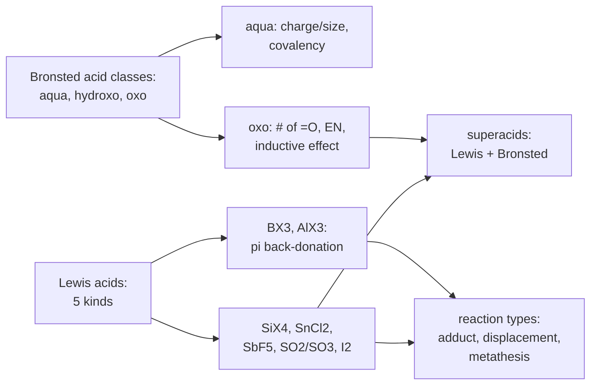

# CH05 · Acid Strength, Lewis Acidity and Reactions

◀ [[CH04 Acid-Base Concepts]] · [[Inorganic Chemistry - Course Map|Course Map]] · next: [[CH06 Hard and Soft Acids and Bases]]

taught · in syllabus extra · book extra · beyond

> [!syllabus] Syllabus map: what is in the syllabus and what is extra in this chapter
> 🟢 **Taught (CH-2113 slides 66–77, [[chem pre-ms .pdf#page=66|pre-midsem pack]])**
> - §1 the three classes of Brønsted acid: **aqua, hydroxo, oxo** (slides 66–67) and the strength of aqua acids (67)
> - §2 **oxo acids**: central-atom electronegativity, inductive effect, substituted oxo acids ($\mathrm{O_2SF(OH)}$, $\mathrm{O_2S(NH_2)(OH)}$, $\mathrm{CF_3SO_3H}$), the unanswered **$\mathrm{H_3PO_3}$** question (slides 68–69)
> - §3 **Lewis acids and bases**: the five ways a species can be an acceptor (slides 70–71)
> - §4 **periodic trends**: boron and aluminium halides ($\mathrm{BF_3<BCl_3<BBr_3}$, $\mathrm{Al_2Cl_6}$), silicon and tin ($\mathrm{[SiF_6]^{2-}}$, $\mathrm{SiX_4}$ order, $\mathrm{SnCl_3^-}$), nitrogen and oxygen groups ($\mathrm{SbF_5}$, superacids, $\mathrm{SO_2}$, $\mathrm{SO_3}$, oleum), halogens ($\mathrm{I_2}$ colours, $\mathrm{I_3^-}$) (slides 72–76)
> - §5 **fundamental reaction types**: displacement and metathesis (slide 77)
>
> 🟡 **Extra · book** (Shriver and Atkins Ch. 4: periodicity of aqua and oxoacid strength [[Shriver and Atkins Inorganic Chemistry 5th Ed.pdf#page=146|PDF pp.146–149]]; Lewis acid trends [[Shriver and Atkins Inorganic Chemistry 5th Ed.pdf#page=160|pp.160–166]]; printed page = PDF − 27)
>
> 🔵 **Extra · beyond** (my additions; numbers in `scripts/ch0209_numbers.py`)
> - §1 the $\mathrm pK_a$ versus $Z^2/r$ fit for aqua acids and the covalency outlier $\mathrm{Hg^{2+}}$; the pH of $0.01$ M $\mathrm{Fe^{3+}}$; §2 **Pauling's rules** ($\mathrm pK_a\approx8-5n$) tested on 12 acids, the **inductive series** of chloroacetic acids (×79, ×2951, ×12882), and the **answer to the $\mathrm{H_3PO_3}$ question**; §4 the frontier-orbital reading of the $\mathrm{BX_3}$ order; §6 how a Lewis acid makes a Brønsted superacid

> [!key] After this chapter you can
> - classify a Brønsted acid as aqua, hydroxo or oxo from where its acidic proton sits, and rank aqua acids by charge, size and covalency,
> - rank oxo acids using the **number of non-protonated oxygens** (Pauling) and the **electronegativity/inductive** effects of the central atom and substituents, and explain why $\mathrm{H_3PO_3}$ is only diprotic,
> - list the **five ways** a species can be a Lewis acid and give an example of each,
> - explain the **anomalous order $\mathrm{BF_3<BCl_3<BBr_3}$** and the reverse order for the silicon halides,
> - write the four reaction types: **adduct formation, displacement, metathesis, and (for oxo acids) condensation** and recognise them.

> [!intuition] The one-sentence story
> An acid is strong when its conjugate base is stable, and a base is stabilised by anything that pulls electron density away from the charge: more oxygens on the central atom, a more electronegative central atom, an electron-withdrawing substituent, a smaller and more highly charged metal. Lewis acidity is the same idea with the empty orbital instead of the proton: it is strongest where the acceptor orbital is low in energy, empty and accessible.

![[CH05 Acid Strength Lewis Acidity and Reactions.svg]]
*Diagram CH5.0. The chapter in one page: classes of Brønsted acid, what makes each strong, the five Lewis-acid types, the periodic trends and the reaction types. Editable source: [[CH05 Acid Strength Lewis Acidity and Reactions.excalidraw]].*

*Concept map: every box is a section.*

## 1. Three classes of Brønsted acid
taught *slides 66–67* · extra · book *S&A [[Shriver and Atkins Inorganic Chemistry 5th Ed.pdf#page=146|PDF pp.146–149]]*

Where is the acidic proton? (slide 66)
1. **Aqua acid:** on a water molecule bound to a metal: $[\mathrm{Fe(H_2O)_6}]^{3+}+\mathrm{H_2O}\rightleftharpoons[\mathrm{Fe(OH_2)_5(OH)}]^{2+}+\mathrm{H_3O^+}$.
2. **Hydroxo acid:** on a hydroxyl **without a neighbouring oxo group**: $\mathrm{Si(OH)_4}$.
3. **Oxo acid:** on a hydroxyl **with an oxo group on the same atom**: $\mathrm{H_2SO_4}$, $\mathrm{H_3PO_4}$.

> [!intuition] Why the same $\mathrm{O{-}H}$ can be a weak or a strong acid
> The proton leaves more easily the more the rest of the molecule can accept the left-behind electron pair on oxygen. In an aqua acid the metal pulls the O lone pairs towards itself (high charge, small size). In an oxo acid the negative charge of the anion is **delocalised over the extra O atoms** (resonance), so the anion is stable: $\mathrm{HSO_4^-}$ spreads it over three oxygens.

**Aqua acids (slide 67).** They are found for central atoms in a **low oxidation state ($s$ and $d$ block; less in the $p$ block)**. The strength **increases with increasing positive charge and decreasing ionic radius** of the metal ion: more charge density, more polarisation of the O–H bonds. **Exception:** "with increasing covalency, aqua acids increase in strength", because better overlap of M and L orbitals (increasing left to right and down the periodic table) transmits more polarisation. A later slide fragment sketches the removal of protons from water to give $\mathrm{[HO{-}E{-}OH]^{2-}}$ and $\mathrm{[HO{-}E{-}O]^{3-}}$ for an intermediate such as Ru(IV): each proton loss makes the next harder.

![[fig_ch05_acids.png]]
*Figure CH5.1. Acid strength trends. A: first $\mathrm pK_a$ of ten oxo acids against $n$, the number of non-protonated oxygens: Pauling's line $\mathrm pK_a\approx8-5n$ (orange) captures the 5-unit steps. B: the chloroacetic series: each Cl lowers $\mathrm pK_a$ by about 1.4 (the acid is ×79, ×2951, ×12882 stronger than acetic). C: aqua acids, $\mathrm pK_a$ of $[\mathrm{M(OH_2)_6}]^{n+}$ against $Z^2/r$ (radii in pm, CN 6): the line is $\mathrm pK_a=13.1-0.62\,Z^2/r$ with $r=-0.90$ (without Hg); the covalent $\mathrm{Hg^{2+}}$ lies **7 units below** the electrostatic prediction.*

> [!example] Numbers for aqua acids (🔵, recalled $\mathrm pK_a$ and Shannon radii, `[verify]`)
> $\mathrm{Na^+}$ ($Z^2/r=0.98$, $\mathrm pK_a$ 14.2), $\mathrm{Mg^{2+}}$ (5.6, 11.4), $\mathrm{Al^{3+}}$ (16.8, 5.0), $\mathrm{Fe^{3+}}$ (14.0, 2.2): acidity tracks charge density over **12 pK units**. $\mathrm{Fe^{3+}}$ is a stronger acid than $\mathrm{Al^{3+}}$ although the same charge and *larger* radius: the extra covalency of the $d^5$ ion. $\mathrm{Cu^{2+}}$ (7.5 against 9.7 predicted) and $\mathrm{Hg^{2+}}$ (3.4 against 10.7) are the clearest cases of the slide's "exception". A $0.01$ M $\mathrm{Fe(NO_3)_3}$ solution: $x^2/(0.01-x)=10^{-2.2}$ gives $[\mathrm{H^+}]=5.4\times10^{-3}$ M, **pH 2.27**: why iron(III) solutions are acidic and why $\mathrm{Fe(OH)_3}$ precipitates unless acid is added.

## 2. Oxo acids
taught *slides 68–69* · extra · beyond *Pauling's rules, the $\mathrm{H_3PO_3}$ answer*

Oxo acids occur where the central element is in a **high oxidation state**. Their strength depends on the **inductive effect of the central atom on the hydroxyl group** (slide 68):

* **(a) inherent electronegativity of the central atom:** $\mathrm{HClO_4}$, $\mathrm{HNO_3}$ strongest; $\mathrm{H_2SO_4}$ slightly weaker; $\mathrm{H_3PO_4}$ and $\mathrm{H_2CO_3}$ weak; $\mathrm{H_3BO_3}$ very weak;
* **(b) inductive effect of substituents:** $\mathrm{CH_3COOH}$ very weak; $\mathrm{ClCH_2COOH}$ and $\mathrm{Cl_2CHCOOH}$ intermediate; $\mathrm{CCl_3COOH}$ strongest.

**Substituted oxo acids (slide 69).** The OH of sulfuric acid can be replaced: **fluorosulfonic acid $\mathrm{O_2SF(OH)}$** and **aminosulfonic acid $\mathrm{O_2S(NH_2)(OH)}$**; also $\mathrm{CF_3SO_3H}$ ($\mathrm{O_2S(CF_3)(OH)}$). F is highly electronegative and gives S a **higher effective positive charge**, hence a **stronger acid**. In contrast **$\mathrm{NH_2}$ has a lone pair that can donate to S by $\pi$ bonding**, reducing the positive charge on S and weakening the acid. (CF$_3$SO$_3$H, triflic acid, is among the strongest simple acids.)

> [!derivation] Pauling's rules, tested (🔵, 12 acids)
> Write the acid as $\mathrm{XO}_n\mathrm{(OH)}_m$, with $n$ the number of **non-protonated oxygens** (oxo groups). Then
> $$\mathrm pK_a^{(1)}\approx8-5n,\qquad\mathrm pK_a^{(k+1)}\approx\mathrm pK_a^{(k)}+5.$$
>
> | $n$ | prediction | examples (observed $\mathrm pK_a$) |
> |---|---|---|
> | 0 | $\approx8$ (weak) | HOCl 7.5, $\mathrm{B(OH)_3}$ 9.2 |
> | 1 | $\approx3$ (moderate) | $\mathrm{HClO_2}$ 2.0, $\mathrm{H_3PO_4}$ 2.15, $\mathrm{H_3PO_3}$ 1.3, $\mathrm{HNO_2}$ 3.3 |
> | 2 | $\approx-2$ (strong) | $\mathrm{HNO_3}$ −1.4, $\mathrm{HClO_3}$ −1.0, $\mathrm{H_2SO_4}$ −3 |
> | 3 | $\approx-7$ (very strong) | $\mathrm{HClO_4}$ −8 |
>
> Agreement is within ±1.7 for every acid in the table (the largest miss is $\mathrm{H_3PO_3}$, 1.3 against 3); the known outliers, periodic and carbonic acid, are not in the table and are explained at the end of this box. **Successive $\mathrm pK_a$'s of $\mathrm{H_3PO_4}$: 2.15, 7.20, 12.35, steps 5.05 and 5.15**, as the second rule says. *The rule works because each additional oxo group allows the anion's charge to be delocalised over one more oxygen.* (Outliers: $\mathrm{HIO_4}$ 5-coordinate in water; $\mathrm{H_2CO_3}$ is exceptional because most dissolved $\mathrm{CO_2}$ is not $\mathrm{H_2CO_3}$.)

> [!example] The inductive series, quantified (🔵)
> | acid | $\mathrm pK_a$ | $K_a$ | × acetic |
> |---|---|---|---|
> | $\mathrm{CH_3COOH}$ | 4.76 | $1.7\times10^{-5}$ | 1 |
> | $\mathrm{ClCH_2COOH}$ | 2.86 | $1.4\times10^{-3}$ | 79 |
> | $\mathrm{Cl_2CHCOOH}$ | 1.29 | $5.1\times10^{-2}$ | 2951 |
> | $\mathrm{Cl_3CCOOH}$ | 0.65 | $2.2\times10^{-1}$ | 12882 |
>
> Average drop **1.37 $\mathrm pK_a$ units per Cl**: three electronegative atoms at the $\alpha$ carbon make the acid four orders of magnitude stronger. (The effect falls with distance: Cl on the $\beta$ carbon changes $\mathrm pK_a$ by only $\sim0.5$.)

> [!key] The unanswered question of slide 69: why is $\mathrm{H_3PO_3}$ not triprotic? (answer 🔵, `[verify]` with the instructor)
> The formula $\mathrm{H_3PO_3}$ suggests three acidic protons but the structure is **$\mathrm{HP(=O)(OH)_2}$**, phosphonic acid: **one H is bonded directly to P** (a P–H bond, nearly non-polar), only two are on oxygen. Only O–H protons are acidic: $\mathrm pK_a$ **1.3** and **6.7** (a 5.4 step, Pauling's rule with $n=1$), and the P–H proton is **not** acidic. The same logic gives **hypophosphorous acid** $\mathrm{H_2P(=O)(OH)}$ (monoprotic, $\mathrm pK_a$ 1.2). Phosphoric acid $\mathrm{O{=}P(OH)_3}$ has three O–H and three acidities. *Lesson:* count protons on **oxygen**, not in the formula. (The P–H structure is confirmed by NMR: a doublet of $J_{\mathrm{PH}}\approx700$ Hz.)

> [!pitfall] Boric acid is not a Brønsted acid
> $\mathrm{B(OH)_3}$ ($n=0$, predicted $\mathrm pK_a\approx8$, observed 9.2) acts as a **Lewis** acid: $\mathrm{B(OH)_3+2H_2O\rightleftharpoons[B(OH)_4]^-+H_3O^+}$ — it accepts $\mathrm{OH^-}$ into the empty B $2p$ orbital; it does not lose a proton from its own O–H. This is why it is titrated after adding a diol (which stabilises the borate).

## 3. Lewis acids and bases: the five kinds
taught *slides 70–71*

**Summary:** a Lewis acid is an electron-pair acceptor, a Lewis base an electron-pair donor. A species can accept a pair in five ways:
1. a molecule with an **incomplete octet** completes it: $\mathrm{BF_3}$, $\mathrm{BCl_3}$, $\mathrm{AlCl_3}$ (empty $p$ perpendicular to the plane);
2. a **metal cation** bonds to a base in a coordination compound: $\mathrm{Fe^{3+}}$, $\mathrm{Ag^+}$;
3. a molecule or ion with a **complete octet** can **rearrange** its valence electrons to accept more: $\mathrm{CO_2}$ ($\mathrm{CO_2+OH^-\to HCO_3^-}$), $\mathrm{SO_2}$;
4. a molecule or ion can **expand its valence shell** (or is large enough): $\mathrm{SiF_4}$, $\mathrm{SnCl_4}$, $\mathrm{PF_5}$, $\mathrm{SbF_5}$;
5. a closed-shell molecule can use an **unoccupied antibonding MO** ($\pi^*$ or $\sigma^*$) to take the pair: $\mathrm{I_2}$ ($\sigma^*$), $\mathrm{CO_2}$ ($\pi^*$), $\mathrm{SO_2}$.

In MO language (CH03/CH04), the acid's LUMO is an *empty non-bonding $p$* (type 1), an *empty $s/p/d$* (2), a *$\pi^*$ or $\sigma^*$* (3, 5) or an *energetically accessible hypervalent combination* (4).

## 4. Periodic trends in Lewis acidity
taught *slides 72–76* · extra · book *S&A [[Shriver and Atkins Inorganic Chemistry 5th Ed.pdf#page=160|PDF pp.160–166]]*

### 4.1 Boron and carbon groups (slides 72–73)
**$\mathrm{BX_3}$ and $\mathrm{AlX_3}$** have incomplete octets; the vacant $p$ orbital, perpendicular to the molecular plane, accepts a lone pair. **The acidity order of the boron halides (stability of the $\mathrm{:NMe_3}$ complexes) is $\mathrm{BF_3<BCl_3<BBr_3}$ — opposite to the electronegativity expectation.** The lecture's reason: fluorine, being more electronegative, would withdraw density and make B more deficient, *but* the $2p$–$2p$ overlap (orbital matching) lets F form **$\pi$ bonds** to boron ($\mathrm{F\to B}$ back-donation) that *fill* the empty B $2p$ and **partially saturate** it. Heavier halogens have larger, more diffuse $p$ orbitals that overlap the small B $2p$ poorly ($2p$–$3p$, $2p$–$4p$), so B stays electron-deficient. **Tutorial 3 Q8:** the back-donation order is $2p$–$2p>2p$–$3p>2p$–$4p$.

> [!key] The frontier-orbital reading (🔵)
> The acceptor is the B $2p_z$ LUMO. In $\mathrm{BF_3}$ it is **raised** by mixing with the filled $\pi$ lone pairs of the three F's (the $\pi$-donation pushes the empty orbital up in energy and reduces its B character), so it is a poorer acceptor. The bond itself is shortened (B–F ≈ 1.30 Å, about 0.1–0.2 Å less than a single bond, recalled `[verify]`). When $\mathrm{BF_3}$ binds a donor the molecule **pyramidalises**, which switches off the $\pi$ donation: the energy cost of that ("reorganisation", one of the three non-bonding contributions listed on slide 82; see [[CH06 Hard and Soft Acids and Bases]]) is part of $\Delta H$ and is **largest for $\mathrm{BF_3}$**. Both effects reinforce the observed order. $\mathrm{BF_3}$ remains "a good Lewis acid" (a gas, convenient as $\mathrm{BF_3\cdot OEt_2}$; the slide writes "OEt$_3$", a slip for diethyl ether).

**Aluminium halides.** Dimers in the gas phase, $\mathrm{Al_2Cl_6}$: each Al acts as an acid to a **bridging Cl** that originally belonged to the other Al. Al's larger size and $3p$ orbitals permit four-coordination without back-donation, so the halides are very strong Lewis acids and **catalysts for alkylation and acylation** (Friedel–Crafts).

**Silicon and tin (slide 73).** Expansion of the valence shell and **hypervalence**: $\mathrm{SiF_4+2HF\to[SiF_6]^{2-}+2H^+}$ ($\mathrm{Ge}$ similarly); $\mathrm F^-$ from HF can displace $\mathrm{O^{2-}}$ from Si, the chemistry of **glass corrosion**. **The acidity order $\mathrm{SiI_4<SiBr_4<SiCl_4<SiF_4}$** follows the electron-withdrawing power of the halogen — **the opposite of the boron order**, because Si has no vacant $p$ with back-donation to be saturated; its acid orbital is a $\sigma^*$/valence-shell expansion that electronegative F makes more accessible. **$\mathrm{SnCl_2}$ is both a Lewis acid and a base**: it adds $\mathrm{Cl^-}$ to give $\mathrm{SnCl_3^-}$ (acid at the Sn empty orbital), and $\mathrm{SnCl_3^-}$ then donates its Sn lone pair, e.g. in **$\mathrm{(CO)_5Mn{\leftarrow}SnCl_3}$**.

### 4.2 Nitrogen and oxygen groups (slides 74–75)
**$\mathrm{SbF_5}$** is among the most important Lewis acids: it can make **some of the strongest Brønsted acids**. A **superacid** is a mixture that can protonate almost any organic compound; made by dissolving $\mathrm{SbF_5}$ in $\mathrm{HSO_3F}$ and $\mathrm{SO_3}$. The simplest reaction is $\mathrm{SbF_5+2HF\to[SbF_6]^-+[H_2F]^+}$; in the mixture the **doubly protonated fluorosulfonate** is the powerful Brønsted acid (slide 74 pictures). The Lewis acid ($\mathrm{SbF_5}$) takes up the fluoride, leaving a very weakly basic anion and thus a proton that is almost "naked".

**$\mathrm{SO_2}$ is both acid and base** (slide 75). As a **base** it can donate **O or S lone pairs**: O-bound to $\mathrm{SbF_5}$ ($\mathrm{F_5Sb{-}OSO}$), S-bound when the acid is a soft metal such as Ru(III) (CH06). As an **acid** it takes a pair into S: $\mathrm{SO_2+OH^-\to HSO_3^-}$, $\mathrm{SO_2+H_2O\to H_2SO_3}$ (Tutorial 3 Q9). **$\mathrm{SO_3}$ is a strong Lewis acid and a weak base**; its acidity gives **oleum**: $\mathrm{SO_3+H_2SO_4\to H_2S_2O_7}$.

### 4.3 Halogens (slide 76)
$\mathrm{I_2,Br_2,Cl_2,F_2}$ are Lewis acids. **$\mathrm{I_2}$ is violet** as a solid, as a gas, and in non-donor solvents like chloroform, but **brown in water, propanol, ethanol, or in $\mathrm{CHCl_3}$ with added acetone**: the colour change is because of the **1:1 solvent–solute complex** (a donor lone pair goes into the **low-lying $\sigma^*$** of $\mathrm{I_2}$), seen as a **charge-transfer transition**. $\mathrm{I_2}$ is itself coloured because an electron in its HOMO ($\pi^*$) can be excited into the low-lying $\sigma^*$. **$\mathrm{I_3^-}$** is the complex of the halogen acid $\mathrm{I_2}$ with the halide base $\mathrm{I^-}$ (the basis of **iodometric titration**).

> [!example] How much $\mathrm{I_3^-}$? (🔵, $K\approx700$ at 25 °C, recalled `[verify]`)
> $\mathrm{I_2+I^-\rightleftharpoons I_3^-}$, $K=700$. In $0.1$ M $\mathrm{I^-}$: $[\mathrm{I_3^-}]/[\mathrm{I_2}]=K[\mathrm{I^-}]=70$, so **98.6 %** of the dissolved iodine is $\mathrm{I_3^-}$: that is why iodine dissolves readily in aqueous KI although it is scarcely soluble in water.

## 5. Fundamental reaction types of Lewis acids and bases
taught *slide 77*

* **(a) Displacement:** one Lewis base displaces another from an acid (or one acid another from a base). **All Brønsted proton transfers are displacements:** $\mathrm{HS^-(aq)+H_2O\to S^{2-}(aq)+H_3O^+(aq)}$ (the base $\mathrm{H_2O}$ displaces $\mathrm{S^{2-}}$ from the proton). The slide also draws two structure schemes, pyridine displacing a weaker base from a Lewis acid and an acid displacing another acid, which are pictures and are described here only in outline. A coordination example: $\mathrm{[Co(NH_3)_5Cl]^{2+}+H_2O\to[Co(NH_3)_5(OH_2)]^{3+}+Cl^-}$.
* **(b) Metathesis:** **$\mathrm{Me_3Si{-}I+AgBr\to Me_3Si{-}Br+AgI}$.** The base $\mathrm{Br^-}$ displaces $\mathrm{I^-}$, assisted by the leaving-group ability of $\mathrm{I^-}$ towards salt (AgI) formation: the partners swap, driven by the insolubility of AgI (**a hard-hard/soft-soft preference**, CH06: the soft $\mathrm{Ag^+}$ binds the soft $\mathrm{I^-}$).
* **(c) Adduct formation:** $\mathrm{A+:B\to A{\leftarrow}B}$ (CH04 §5), the starting point of both.

(Tutorial 3 Q10 asks the acid and base in $\mathrm{SiF_4+2HF\to[SiF_6]^{2-}+2H^+}$: $\mathrm{SiF_4}$ accepts $\mathrm F^-$ from $\mathrm{HF}$; and in the metathesis of $\mathrm{Me_3SiI}$ the answer sheet labels Si the acid and $\mathrm{AgBr}$ the base.)

## 6. Strong acids by Lewis acid + Brønsted acid
extra · beyond *combines CH04 and this chapter*

Magic acid, $\mathrm{HSO_3F+SbF_5}$: the equilibrium $\mathrm{SbF_5+HSO_3F\rightleftharpoons H^+[SbF_5(OSO_2F)]^-}$ takes the conjugate-base-forming fluoride (or fluorosulfate) out of play and leaves an anion so large and weakly basic that the proton is barely solvated. The acidity function is $H_0\approx-23$ (CH04 §7). The same principle makes **$\mathrm{AlCl_3+HCl}$ in benzene** a catalyst system ($\mathrm{H^+AlCl_4^-}$) and explains why **$\mathrm{B(OH)_3}$ solutions are more acidic with a diol**: any process that removes the conjugate base pushes the equilibrium.

<!-- interactive:start (generated by scripts/embed_interactive.py; edit the tool in scripts/interactive/tools/, not this block) -->
> [!interactive]+ Interactive: Acid–base titration curves: buffers, equivalence points and indicators
> The exact pH curve for titrating V_a mL of a weak (or strong) acid of concentration C_a with a strong base C_b, from the charge balance [Na⁺] + [H⁺] = [OH⁻] + [A⁻] with [A⁻] = C_aV_a/(V_a + V_b) · K_a/(K_a + [H⁺]).
>
> ![[ch_titration.png|720]]
>
> **Try:** Acetic acid pK_a = 4.76, 0.1 M, 25 mL, titrated with 0.1 M NaOH: pH 2.88 at the start, 4.76 at 12.5 mL (half-equivalence), 8.73 at 25 mL (equivalence), 11.96 at 30 mL. Choose pK_a < 0 (strong acid): the equivalence point is exactly at pH 7.
>
> [▶ Open the tool in your browser](../Assets/interactive/ch_titration.html) · [absolute link](file:///home/swastik/Documents/notes/Assets/interactive/ch_titration.html) · all tools and coverage: [[Interactive Tools]]

<!-- interactive:end -->

## Map of this chapter
> [!connection] How CH05 connects
> **Builds on:** [[CH04 Acid-Base Concepts]] (definitions, conjugate pairs), [[CH03 Molecular Orbital Theory Polyatomics]] (LUMOs, $\pi$ donation), [[CH01 VSEPR and Valence Bond Theory]] (hypervalence).
> **Leads to:** [[CH06 Hard and Soft Acids and Bases]] (what makes a Lewis acid prefer one base), [[CH07 Main Group Cages and Clusters]] ($\mathrm{BH_3}$ as a Lewis acid giving $\mathrm{B_2H_6}$).
> **Concepts:** [[Aqua Acid]] · [[Oxo Acid]] · [[Pauling's Rules for Oxoacids]] · [[Inductive Effect on Acidity]] · [[Lewis Acidity of BX3]] · [[Back-Donation in Boron Halides]] · [[12-Inorganic-Chemistry/Concepts/Superacid|Superacid]] · [[CH05 Acid Strength Lewis Acidity and Reactions|Displacement and Metathesis]]
> **Other subjects:** [[Climate - Course Map]] ($\mathrm{SO_2}$ and $\mathrm{SO_3}$ in acid rain: Lewis acid hydration), [[Thermodynamics and Statistical Mechanics - Course Map]] ($\Delta G$ of adduct formation).

## Summary
> [!summary] Cheat-sheet
> - **Classes:** aqua ($\mathrm{H}$ on $\mathrm{H_2O}$ on M), hydroxo ($\mathrm{Si(OH)_4}$), oxo ($\mathrm{H_2SO_4}$).
> - **Aqua acids:** stronger with charge/size and covalency; $\mathrm pK_a\approx13.1-0.62\,Z^2/r$ ($r$ in 100/pm); Hg²⁺, Cu²⁺ exceptions.
> - **Oxo acids:** $\mathrm pK_a\approx8-5n$ ($n$ = number of =O), steps of 5; EN of central atom; inductive: ×79, ×2951, ×12882 for 1, 2, 3 Cl; F raises acidity, $\mathrm{NH_2}$ (π donor) lowers it.
> - **$\mathrm{H_3PO_3}$ = HP(O)(OH)$_2$:** two acidic H; $\mathrm{H_3PO_2}$ one.
> - **Five Lewis-acid types:** incomplete octet, cation, octet rearrangement ($\mathrm{CO_2}$), shell expansion ($\mathrm{SiF_4}$), $\pi^*/\sigma^*$ ($\mathrm{I_2}$).
> - **Trends:** $\mathrm{BF_3<BCl_3<BBr_3}$ (π back-donation $2p$–$2p>2p$–$3p>2p$–$4p$); $\mathrm{SiI_4<SiBr_4<SiCl_4<SiF_4}$; $\mathrm{Al_2Cl_6}$ dimer; $\mathrm{SnCl_2}$ acid and base; $\mathrm{SbF_5}$ → superacids; $\mathrm{SO_2}$ both, $\mathrm{SO_3}$ strong acid; $\mathrm{I_2}$ violet→brown (CT), $\mathrm{I_3^-}$ $K=700$.
> - **Reactions:** displacement, metathesis ($\mathrm{Me_3SiI+AgBr}$), adduct formation.

## Practice
1. **Classify.** Aqua, hydroxo or oxo: $[\mathrm{Al(H_2O)_6}]^{3+}$, $\mathrm{Si(OH)_4}$, $\mathrm{HNO_3}$, $\mathrm{Te(OH)_6}$, $\mathrm{H_2SO_4}$.
2. **Pauling.** Predict the first $\mathrm pK_a$ of $\mathrm{HClO_4}$, $\mathrm{H_3AsO_4}$, $\mathrm{H_2SO_3}$ ($\mathrm{OS(OH)_2}$), $\mathrm{HOBr}$.
3. **Inductive effect.** Rank $\mathrm{CF_3COOH}$, $\mathrm{CCl_3COOH}$, $\mathrm{CH_3COOH}$, $\mathrm{HCOOH}$ and explain.
4. **$\mathrm{H_3PO_3}$.** Draw its structure and explain why it is diprotic.
5. **Fluorosulfonic vs aminosulfonic (Tutorial 3 Q7).** Which is stronger and why?
6. **$\mathrm{BX_3}$.** Explain $\mathrm{BF_3<BCl_3<BBr_3}$ and why the order of the $\mathrm{SiX_4}$ is reversed (Q8).
7. **$\mathrm{SO_2}$.** Show $\mathrm{SO_2}$ as an acid and as a base with an example each (Q9).
8. **Aqua acid pH.** Compute the pH of 0.01 M $\mathrm{Fe^{3+}}$ ($\mathrm pK_a=2.2$).
9. **$\mathrm{I_3^-}$.** What fraction of dissolved iodine is $\mathrm{I_3^-}$ in 0.05 M KI ($K=700$)?
10. **Reaction type.** Classify: (a) $\mathrm{NH_3+BF_3\to H_3NBF_3}$, (b) $\mathrm{Me_3SiI+AgBr\to Me_3SiBr+AgI}$, (c) $\mathrm{[Cu(NH_3)_4]^{2+}+4CN^-\to[Cu(CN)_4]^{2-}+4NH_3}$, (d) $\mathrm{H_2O+NH_3\to OH^-+NH_4^+}$.

> [!example]- Solutions
> 1. Aqua; hydroxo; oxo; hydroxo ($n=0$: all $\mathrm{OH}$, no oxo); oxo.
> 2. $\mathrm{HClO_4}$ ($n=3$): $-7$ (obs. −8); $\mathrm{H_3AsO_4}$ ($n=1$): $+3$ (obs. 2.3); $\mathrm{H_2SO_3}$ ($n=1$): $+3$ (obs. 1.8); $\mathrm{HOBr}$ ($n=0$): $+8$ (obs. 8.6).
> 3. $\mathrm{CF_3COOH}$ (0.2) $>\mathrm{CCl_3COOH}$ (0.65) $>\mathrm{HCOOH}$ (3.75) $>\mathrm{CH_3COOH}$ (4.76): F is more electronegative than Cl (stronger −I), and $\mathrm{CH_3}$ is electron-*donating* (+I), which weakens the acid, while H is neutral.
> 4. $\mathrm{HP(=O)(OH)_2}$; only the two O–H protons are acidic (pK 1.3, 6.7); the P–H proton is nearly non-polar.
> 5. $\mathrm{O_2SF(OH)}$: F is strongly $\sigma$-withdrawing, making S more positive, the anion more stable. $\mathrm{O_2S(NH_2)(OH)}$: the N lone pair donates by $\pi$ to S, reducing its positive character: weaker.
> 6. In $\mathrm{BF_3}$ F→B $2p$–$2p$ $\pi$ donation partly fills the empty B $2p$ (and costs more to undo on pyramidalising): weakest acid; the diffuse Cl, Br $p$ orbitals overlap poorly. For $\mathrm{SiX_4}$ no vacant $\pi$-acceptor orbital to saturate: acidity follows electron withdrawal, so $\mathrm{SiF_4}$ is the strongest.
> 7. Acid: $\mathrm{SO_2+OH^-\to HSO_3^-}$ (S accepts the pair); base: $\mathrm{SO_2+SbF_5\to F_5Sb{\leftarrow}OSO}$ (O donates).
> 8. $x^2/(0.01-x)=6.31\times10^{-3}$: $x=5.39\times10^{-3}$ M, pH 2.27.
> 9. $K[\mathrm{I^-}]=700\times0.05=35$; fraction $=35/36=97.2\,\%$.
> 10. (a) adduct formation; (b) metathesis (also displacement); (c) displacement of the base $\mathrm{NH_3}$ by $\mathrm{CN^-}$ (a stronger/softer donor to Cu(II)); (d) Brønsted proton transfer = displacement.

<!-- zettel:start (generated by scripts/sort_zettel.py; do not edit between the markers) -->
## Zettel notes

> [!abstract]- Zettel notes filed under this chapter (12): the other tool's concept notes from the lectures, unreviewed
> [[zettel/amphoteric-lewis-character-of-sulfur-dioxide|Amphoteric Lewis Character of Sulfur Dioxide]] · [[zettel/aqua-acid|Aqua Acid]] · [[zettel/halogen-charge-transfer-complex|Halogen Charge-Transfer Complex]] · [[zettel/hydroxo-acid|Hydroxo Acid]] · [[zettel/lewis-acid|Lewis Acid]] · [[zettel/lewis-base|Lewis Base]] · [[zettel/lewis-displacement-reaction|Lewis Displacement Reaction]] · [[zettel/lewis-metathesis-reaction|Lewis Metathesis Reaction]] · [[zettel/oxo-acid|Oxo Acid]] · [[zettel/substituted-oxo-acid|Substituted Oxo Acid]] · [[zettel/superacid|Superacid]] · [[zettel/valence-shell-expansion-in-group-14-halides|Valence Shell Expansion in Group 14 Halides]]
<!-- zettel:end -->

## Provenance
> [!provenance]- Source map for this chapter
> | Topic | Source | Scope |
> |---|---|---|
> | acid classes, aqua acids | [[chem pre-ms .pdf#page=66\|slides 66–67]] | taught |
> | oxo acids, substituents, $\mathrm{H_3PO_3}$ question | [[chem pre-ms .pdf#page=68\|slides 68–69]] | taught |
> | five Lewis-acid types | [[chem pre-ms .pdf#page=70\|slides 70–71]] | taught |
> | B, Al, Si, Sn trends | [[chem pre-ms .pdf#page=72\|slides 72–73]] | taught |
> | Sb, S, halogens | [[chem pre-ms .pdf#page=74\|slides 74–76]] | taught |
> | displacement, metathesis | [[chem pre-ms .pdf#page=77\|slide 77]] | taught |
> | periodicity in the book | [[Shriver and Atkins Inorganic Chemistry 5th Ed.pdf#page=146\|S&A PDF pp.146–149, 160–166]] | extra/book |
> | Pauling's rules table, aqua-acid fit, chloroacetic series, $\mathrm{H_3PO_3}$ answer, $\mathrm{I_3^-}$ | `scripts/ch0209_numbers.py` (§CH05), `scripts/fig_ch0209.py` | extra/beyond |
>
> **Notes.** (1) All $\mathrm pK_a$, radii and $K(\mathrm{I_3^-})$ values are recalled `[verify]`. (2) The slide-77 reaction diagrams are pictures; the pyridine/borane examples are described only in outline. (3) The $\mathrm{H_3PO_3}$ answer is mine; the Classroom summary says the question is unanswered in the material. (4) The BX₃ explanation follows the lecture; the statement about reorganisation energy is the standard extra argument and is not on the slides.

**References.** Shriver, D. F. and Atkins, P. W. *Inorganic Chemistry* (5th ed.), Ch. 4 · Pauling, L. (1960) *The Nature of the Chemical Bond* (3rd ed.), p.&nbsp;277 (oxoacid rule) · Olah, G. A. et al. *Superacid Chemistry* (2nd ed.) · Brown, H. C. and Krishnamurthy, S. (1979) *Tetrahedron* 35, 567 (BX₃ strengths).
