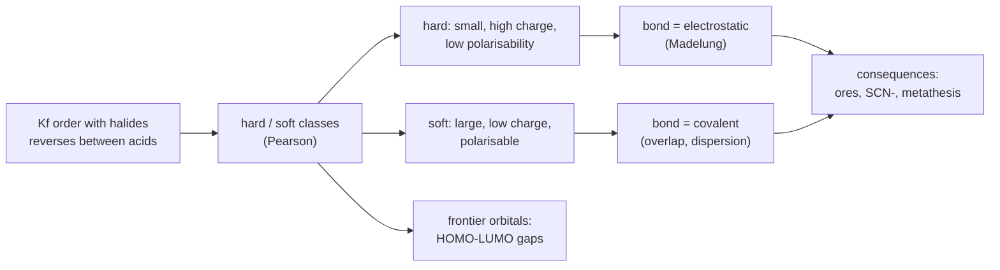

# CH06 · Hard and Soft Acids and Bases

◀ [[CH05 Acid Strength Lewis Acidity and Reactions]] · [[Inorganic Chemistry - Course Map|Course Map]] · next: [[CH07 Main Group Cages and Clusters]]

taught · in syllabus extra · book extra · beyond

> [!syllabus] Syllabus map: what is in the syllabus and what is extra in this chapter
> 🟢 **Taught (CH-2113 slides 78–89, [[chem pre-ms .pdf#page=78|pre-midsem pack]])**
> - §1 the classification: Ahrland–Chatt–Davis **class A/class B** and Pearson's **hard/soft**, defined **empirically by the opposite order of $K_f$ with the halides** (slides 78–79)
> - §2 neutral acids and bases (phenol and $\mathrm I_2$ with $\mathrm{Et_2O}$ and $\mathrm{Et_2S}$; the orders $\mathrm{R_3P\ll R_3N,R_2S\ll R_2O}$) and Pearson's table of hard/borderline/soft acids and bases (slide 80)
> - §3 characteristics of hard and soft acids (slide 81); **interpretation of hardness** (ionic/dipolar versus polarisable/covalent) and the **other contributions** to $\Delta G$ (slide 82)
> - §4 **chemical consequences**: organic chemistry and the **Goldschmidt classification** (lithophile vs chalcophile) (slides 82–83)
> - §5 the **frontier-orbital picture**, **HSAB in action**, **ambidentate $\mathrm{SCN^-}$**, the three **theoretical bases** (electrostatic/Madelung, $\pi$-bonding, electronegativity and London dispersion) (slides 84–89)
>
> 🟡 **Extra · book** (Shriver and Atkins Ch. 4: [[Shriver and Atkins Inorganic Chemistry 5th Ed.pdf#page=165|PDF pp.165–166]], printed pp.138–139; Tutorial 3 Q2, Q11, Q12)
>
> 🔵 **Extra · beyond** (my additions; numbers in `scripts/ch0209_numbers.py`)
> - §6 **Pearson's absolute hardness $\eta=(I-A)/2$ computed from ionisation energies** for 13 cations and 4 halogens (it reproduces the hard/borderline/soft classes), the charge-transfer formulas $\Delta N$ and $\Delta E$, the Coulomb pair energies behind "hard–hard is electrostatic", and the $\log K_1$ data of the slide-79 graph

> [!key] After this chapter you can
> - state the HSAB principle (**hard prefers hard, soft prefers soft**), say it is an **empirical** correlation, and give the experimental test (the order of $K_f$ with $\mathrm F^-<\mathrm{Cl}^-<\mathrm{Br}^-<\mathrm I^-$),
> - classify common ions and molecules as hard, borderline or soft from **charge, size, polarisability, electronegativity and oxidation state**,
> - explain hardness by (i) **electrostatics** (hard–hard, Madelung energy), (ii) **covalency/polarisability** (soft–soft), (iii) **frontier orbitals** (HOMO–LUMO gaps), and give the three other contributions to $\Delta G$,
> - use HSAB to predict **which end of an ambidentate ligand binds**, **which ores** an element forms (lithophile or chalcophile), and **which products** a metathesis favours,
> - compute and use **Pearson's $\eta$** from ionisation energies and electron affinities.

> [!intuition] The one-sentence story
> Some acid–base pairs bind by *electrostatics* (small, highly charged, hard-to-polarise ions that grip each other like magnets) and some by *orbital overlap* (large, polarisable, low-charge species that blend their electron clouds): the two types do not mix, so each kind of acid chooses its own kind of base.

![[CH06 Hard and Soft Acids and Bases.svg]]
*Diagram CH6.0. The chapter in one page: the empirical rule, what makes an acid or base hard or soft, the two bonding mechanisms and the three consequences (ambidentate ligands, ores, metathesis). Editable source: [[CH06 Hard and Soft Acids and Bases.excalidraw]].*

*Concept map: every box is a section.*

## 1. The empirical definition
taught *slides 78–79*

When considering the interaction of Lewis acids and bases drawn **from throughout the periodic table**, it is helpful to divide them into **two main classes**. The classification of substances as "hard" and "soft" was introduced by **Pearson**; it is a generalisation and a more evocative reasoning of the distinction between **Class A and Class B** (Ahrland, Chatt, Davis). **The two classes are identified empirically by the opposite order of strength (as measured by $K_f$, the formation constant of the complexes).** With halide ions as the bases:

* **hard acids bind in the order $\mathrm I^-<\mathrm{Br}^-<\mathrm{Cl}^-<\mathrm F^-$**,
* **soft acids bind in the order $\mathrm F^-<\mathrm{Cl}^-<\mathrm{Br}^-<\mathrm I^-$.**

> [!key] The HSAB principle (slide 79)
> **Hard acids bind hard bases and soft acids bind soft bases.** It is a *correlation*, found by comparing $K_f$ across many acids and bases, not a derived law.

![[fig_ch06_hsab.png]]
*Figure CH6.1. HSAB. A: Pearson's absolute hardness $\eta=(I-A)/2$ (eV) computed from ionisation energies for 13 acids: the hard cations ($\mathrm{Al^{3+}}$ 45.8, $\mathrm{Li^+}$ 35.1, $\mathrm{Mg^{2+}}$ 32.6, $\mathrm{Na^+}$ 21.1, $\mathrm{Ca^{2+}}$ 19.5, $\mathrm{K^+}$ 13.6) lie far above the borderline ($\mathrm{Fe^{3+}}$ 12.1, $\mathrm{Zn^{2+}}$ 10.9, $\mathrm{Fe^{2+}}$ 7.2) and the soft ones ($\mathrm{Hg^{2+}}$ 7.7, $\mathrm{Ag^+}$ 7.0, $\mathrm{Cu^+}$ 6.3, $\mathrm{Au^+}$ 5.6). B: the $\log K_1$ trend of the slide-79 graph with recalled values: soft $\mathrm{Hg^{2+}}$ (1.0 → 12.9 from F⁻ to I⁻) and $\mathrm{Ag^+}$ rise, hard $\mathrm{Fe^{3+}}$ (6.0 → 0.6 from F⁻ to Br⁻) falls. C: the frontier-orbital picture of slide 85: hard species have large HOMO–LUMO gaps, soft species small ones.*

**The slide-79 graph** ($\log K_f$ against F⁻, Cl⁻, Br⁻, I⁻ for several metal ions, drawn by hand): lines for hard ions slope **down** from F⁻ to I⁻, those for soft ions slope **up**, and borderline ions are roughly flat. The graph is the *definition* of the classes.

## 2. Neutral acids and bases, and Pearson's table
taught *slide 80*

The classification also applies to **neutral molecules**. The Lewis acid **phenol** forms a more stable complex (H-bonding) with $\mathrm{Et_2O}$ than with $\mathrm{Et_2S}$; the Lewis acid **$\mathrm I_2$** forms a more stable complex with $\mathrm{Et_2S}$. Conclusion: **phenol is hard and $\mathrm I_2$ is soft.**
* **Hard acids bind in the order** $\mathrm{R_3P\ll R_3N,\ R_2S\ll R_2O}$;
* **soft acids bind in the order** $\mathrm{R_2O\ll R_2S,\ R_3N\ll R_3P}$.

**Pearson's table** (slide 80, a picture; the classes below are from memory of the standard table and are `[verify]` against the image):

| | Hard | Borderline | Soft |
|---|---|---|---|
| **Acids** | $\mathrm{H^+,Li^+,Na^+,K^+,Be^{2+},Mg^{2+},Ca^{2+},Al^{3+},Cr^{3+},Fe^{3+},Co^{3+},Ti^{4+},Si^{4+},Sn^{4+}}$; $\mathrm{BF_3,AlCl_3,SO_3,CO_2,RCO^+}$ | $\mathrm{Fe^{2+},Co^{2+},Ni^{2+},Cu^{2+},Zn^{2+},Pb^{2+},Sn^{2+},Sb^{3+},Bi^{3+}}$; $\mathrm{B(CH_3)_3,SO_2,NO^+}$ | $\mathrm{Cu^+,Ag^+,Au^+,Tl^+,Hg_2^{2+},Hg^{2+},Cd^{2+},Pd^{2+},Pt^{2+}}$; $\mathrm{BH_3}$, $\mathrm{I_2,Br_2}$, metal atoms |
| **Bases** | $\mathrm{H_2O,OH^-,O^{2-},F^-,NH_3,RNH_2,ROH,RO^-,R_2O,CH_3COO^-,CO_3^{2-},NO_3^-,PO_4^{3-},SO_4^{2-},ClO_4^-}$ | $\mathrm{C_6H_5NH_2,C_5H_5N,N_3^-,N_2,NO_2^-,SO_3^{2-},Br^-}$ | $\mathrm{H^-,R^-,CN^-,CO,SCN^-,R_3P,R_2S,RS^-,I^-,S_2O_3^{2-},C_2H_4,C_6H_6}$ |

Within a column, a *hard base* has a **donor atom of small size, high electronegativity, low polarisability** (O, N, F); a *soft base* a **large, polarisable, less electronegative donor** (S, P, I, C).

## 3. Characteristics and interpretation
taught *slides 81–82*

**Hard acids (slide 81):** cations of **small size**; where different oxidation states are possible, the hard acids are cations of the **higher oxidation state**; they possess **fewer valence electrons**. **Soft acids:** cations of **large size**, **zero or low oxidation states**, a **large number of valence electrons**. (Tutorial 3 Q2 adds: hard acids have **high charge and high polarising power**; soft acids are less charged, large and less polarising; hard bases are small, little polarisable, strongly electronegative; soft bases large, highly polarisable, less electronegative.)

**Interpretation (slide 82).** The bonding in hard acids and bases is **ionic or dipole–dipole**. Soft acids and bases are **more polarisable** and hence more **covalent**. *But* the type of bond formation is only one reason; other contributions to the Gibbs energy of the complex are:
1. the **rearrangement of the substituents** of the acid and base needed to permit formation of the complex (reorganisation, e.g. the pyramidalisation of $\mathrm{BF_3}$ in [[CH05 Acid Strength Lewis Acidity and Reactions]]);
2. **steric repulsions** between substituents on the acid and the base;
3. **competition with the solvent** in solution.

> [!pitfall] HSAB predicts a *preference*, not an absolute strength
> HSAB says "hard prefers hard"; it does not say hard–hard complexes are *stronger* than soft–soft ones. $\mathrm{AgI}$ and $\mathrm{AlF_3}$ are both stable; what is excluded is the mismatch ($\mathrm{AgF_2^-}$, $\mathrm{AlI_3}$ in water). And the three extra contributions above can override the preference.

## 4. Chemical consequences
taught *slides 82–83, 86–87*

* **Organic chemistry.** The concepts of hardness and softness rationalise organic reactivity and are *used for choosing preparative conditions and predicting the direction of reactions*. (Example, extra: an ambident enolate is alkylated on **carbon** (soft) by a soft electrophile like $\mathrm{CH_3I}$ and on **oxygen** (hard) by a hard one such as $\mathrm{(CH_3)_2SO_4}$ or an acyl chloride.)
* **Goldschmidt's classification of the elements (slide 83).** *Lithophile elements* form **silicate/oxide minerals** and have the **hard** cations $\mathrm{Li,Mg,Al,Cr}$ with the hard bases ($\mathrm{O^{2-}}$, silicate) in their ores. *Chalcophile elements* (e.g. $\mathrm{Hg}$) occur as **sulfides, selenides and tellurides** ($\mathrm{S^{2-},Se^{2-},Te^{2-}}$, the soft bases). $\mathrm{Cd,Pb,Sb,Sn,Zn}$ are **borderline but softer than $\mathrm{Al^{3+}}$**, hence **sulfide ores**.
* **Stability of complexes (slide 86).** $\mathrm{AgI_2^-}$ is stable but $\mathrm{AgF_2^-}$ is not ($\mathrm{Ag^+}$ soft acid with $\mathrm{I^-}$ soft base: stable; with $\mathrm{F^-}$ hard base: unstable). $\mathrm{[CoF_6]^{3-}}$ is more stable than $\mathrm{[CoI_6]^{3-}}$ ($\mathrm{Co^{3+}}$ hard acid with hard $\mathrm F^-$).
* **Ambidentate ligands (slide 87).** **Thiocyanate $\mathrm{SCN^-}$** can bind through **S** or **N**: it **binds through S to softer metal ions and through N to harder ones**: $\mathrm{[Fe(NCS)]^{2+}}$ (hard $\mathrm{Fe^{3+}}$, N-bound) versus $\mathrm{[Au(SCN)_2]^-}$ (soft $\mathrm{Au^+}$, S-bound). With $\mathrm{Co^{3+}}$ one gets the linkage isomers $\mathrm{[Co(NH_3)_5(NCS)]^{2+}}$ ($\kappa N$) and $\mathrm{[Co(NH_3)_5(SCN)]^{2+}}$ ($\kappa S$) (Tutorial 3 Q11). Other ambidentate ligands: $\mathrm{NO_2^-}$ (N or O), $\mathrm{CN^-}$ (C or N), $\mathrm{SO_3^{2-}}$ (S or O). The **midsem Q2(i)** note: when HSAB was not named in the question, $\mathrm{CH_3NH_2}$ (a hard N donor) was also accepted for 1 mark.

> [!example] A metathesis predicted by HSAB (🔵)
> $\mathrm{Me_3Si{-}I+AgBr\to Me_3Si{-}Br+AgI}$ (CH05 §5): the **hard $\mathrm{Si}$ ($\mathrm{Me_3Si^+}$)** prefers the *harder* halide $\mathrm{Br^-}$ over $\mathrm{I^-}$; the **soft $\mathrm{Ag^+}$** prefers the *softer* $\mathrm{I^-}$ over $\mathrm{Br^-}$. Both preferences are satisfied by the swap, reinforced by the insolubility of AgI: the reaction *must* go to the right.

## 5. Frontier orbitals and the three theoretical bases
taught *slides 84–89*

**Frontier orbitals (slide 84).** *Hard acids and bases have comparatively low-energy HOMO levels and high-energy LUMO levels, so a high HOMO–LUMO gap.* In contrast, *soft acids and bases have comparatively high-energy HOMO and low-energy LUMO levels, giving a comparatively small HOMO–LUMO gap.*

**Hard–hard and soft–soft interactions (slide 85).** *Hard–hard interactions are mainly electrostatic*: there is **little covalent stabilisation**, but **much electrostatic stabilisation of the base lone pair by the highly charged acid centre**, drawn as a large gap between the acid LUMO and the base HOMO with *weak* orbital stabilisation but a strong dipolar attraction. *Soft–soft interactions are mainly covalent*: **significant covalent stabilisation** (the HOMO of the base and the LUMO of the acid are close, so mix strongly: a large energy lowering) and **little electrostatic stabilisation of the diffuse base lone pair**.

**Three theoretical bases (slides 88–89).**
1. **Electrostatic interactions (Madelung).** Ionic bonds between hard acids and hard bases ($\mathrm{Li^+,K^+,Na^+}$ with $\mathrm{F^-,OH^-}$): the Coulomb attraction, **inversely proportional to the internuclear distance**, quantified by the **Madelung energy**; **smaller ions give a shorter distance and a higher Madelung energy** (hard–hard). Tutorial 3 Q12: *hard–hard interactions are governed by Madelung (electrostatic) energy; soft–soft are stabilised by London dispersion.*
2. **$\pi$-bonding theory** (Mulliken 1955, Chatt 1956): soft acids have **low oxidation states and a large number of $d$ electrons**, hence a strong tendency to form **$\pi$ bonds (back-bonding)** with soft bases that are good **$\pi$-acceptors** ($\mathrm{CO}$, $\mathrm{CN^-}$, $\mathrm{R_3P}$, $\mathrm{C_2H_4}$). Typical soft metals are TM with 6 or more $d$ electrons, including the $d^{10}$ $\mathrm{Ag^+,Hg^{2+}}$ ($\mathrm{AgCl}$, $\mathrm{Hg_2Cl_2}$ are stable).
3. **Electronegativity and hardness** — *species with high electronegativity are hard, with low electronegativity soft*: this explains why **$\mathrm{CF_3}$ is considerably harder than $\mathrm{CH_3}$** and **$\mathrm{BF_3}$ harder than $\mathrm{BH_3}$**. And **Pitzer's theory**: London dispersion energies stabilise a bond between **large, more polarisable atoms** and grow with size and polarisability, *which is why soft–soft interactions are more stable than soft–hard.*

> [!connection] The one thread through all three
> Hard acids and bases are **small and hold their electrons tightly** (high $I$, high $A$-gap, low polarisability): their natural interaction is a Coulomb one. Soft acids and bases are **large and let their electrons go** (low $I$, polarisable): their natural interaction is orbital overlap and dispersion. §6 turns this into numbers.

## 6. Quantifying hardness
extra · beyond *Pearson 1988; numbers from ionisation energies in `scripts/ch0209_numbers.py`*

**Absolute hardness and electronegativity (Parr and Pearson).**
$$\boxed{\eta=\frac{I-A}{2},\qquad\chi=\frac{I+A}{2}\ \text{(Mulliken)},\qquad S=\frac1{2\eta}\ \text{(softness)}}$$
with $I$ the ionisation energy and $A$ the electron affinity of the species *as an acceptor*. For a cation $\mathrm M^{n+}$ the electron affinity is the ionisation energy of $\mathrm M^{(n-1)+}$ and the ionisation energy is that of $\mathrm M^{n+}$: $\eta=(I_{n+1}-I_n)/2$. A large gap between the HOMO-like and LUMO-like levels (slide 84) *is* a large $\eta$.

| Acid | $I_{n+1}$ (eV) | $I_n$ (eV) | $\eta$ (eV) | class |
|---|---|---|---|---|
| $\mathrm{Al^{3+}}$ | 119.99 | 28.45 | **45.8** | hard |
| $\mathrm{Li^+}$ | 75.64 | 5.39 | 35.1 | hard |
| $\mathrm{Mg^{2+}}$ | 80.14 | 15.04 | 32.6 | hard |
| $\mathrm{Na^+}$ | 47.29 | 5.14 | 21.1 | hard |
| $\mathrm{Ca^{2+}}$ | 50.91 | 11.87 | 19.5 | hard |
| $\mathrm{K^+}$ | 31.63 | 4.34 | 13.6 | hard |
| $\mathrm{Fe^{3+}}$ | 54.8 | 30.65 | 12.1 | borderline/hard |
| $\mathrm{Zn^{2+}}$ | 39.72 | 17.96 | 10.9 | borderline |
| $\mathrm{Hg^{2+}}$ | 34.2 | 18.76 | 7.7 | soft |
| $\mathrm{Fe^{2+}}$ | 30.65 | 16.19 | 7.2 | borderline |
| $\mathrm{Ag^+}$ | 21.48 | 7.58 | 7.0 | soft |
| $\mathrm{Cu^+}$ | 20.29 | 7.73 | 6.3 | soft |
| $\mathrm{Au^+}$ | 20.5 | 9.23 | **5.6** | soft |

(The ionisation energies are CRC/NIST values; the $\eta$ column reproduces Pearson's published 1988 values to 0.1 eV.) **Observe:** (i) $\eta$ falls with **decreasing charge** and **increasing size down a group**; (ii) the **$d^{10}$ ions $\mathrm{Cu^+,Ag^+,Au^+,Hg^{2+}}$ are soft** despite their charge: their *$d$ electrons are loosely held and polarisable*; (iii) the same metal in a **lower oxidation state is softer**: $\eta(\mathrm{Fe^{2+}})=7.2<\eta(\mathrm{Fe^{3+}})=12.1$ — slide 81's "where different oxidation states are possible, the hard acids are cations of higher oxidation state".

**The halogens as bases** (atomic $I$, $A$ in eV: F 17.42, 3.40; Cl 12.97, 3.61; Br 11.81, 3.36; I 10.45, 3.06):

| | $\eta$ (eV) | $\chi$ (eV) | $S=1/2\eta$ |
|---|---|---|---|
| F | **7.01** | 10.41 | 0.071 |
| Cl | 4.68 | 8.29 | 0.107 |
| Br | 4.23 | 7.59 | 0.118 |
| I | **3.70** | 6.76 | 0.135 |

so $\mathrm F^-$ is the hardest and $\mathrm I^-$ the softest halide, the empirical order of slide 79.

> [!derivation] Charge transfer and the energy lowering (🔵)
> When an acid A and a base B come together electrons flow until their electronegativities (chemical potentials) are equal; to second order
> $$\Delta N=\frac{\chi_A-\chi_B}{2(\eta_A+\eta_B)},\qquad\Delta E=-\frac{(\chi_A-\chi_B)^2}{4(\eta_A+\eta_B)}.$$
> For $\mathrm{Ag^+}$ ($\chi=14.5$, $\eta=7.0$ eV): with $\mathrm F$ ($\chi=10.4$, $\eta=7.0$): $\Delta N=0.15$, $\Delta E=-0.30$ eV; with $\mathrm I$ ($\chi=6.8$, $\eta=3.7$): $\Delta N=0.37$, $\Delta E=-1.42$ eV: **the soft–soft pair exchanges more than twice the charge and gains almost five times the stabilisation.** For the hard $\mathrm{Al^{3+}}$ ($\eta=45.8$) the large $\eta_A+\eta_B$ keeps $\Delta N$ small and the interaction must be mostly electrostatic: the covalent term has nothing to work with. (These are crude: the ions are treated as atoms and solvation is absent.)

> [!example] The electrostatic side (🔵, Coulomb pair energies $-1389.35\,z^2/d$ kJ/mol Å)
> | pair | $d$ (Å) | pair energy (kJ/mol) |
> |---|---|---|
> | $\mathrm{Li^+F^-}$ | 2.09 | **−665** |
> | $\mathrm{Ag^+F^-}$ | 2.48 | −560 |
> | $\mathrm{Na^+I^-}$ | 3.22 | −431 |
> | $\mathrm{Ag^+I^-}$ | 3.35 | −415 |
> | $\mathrm{Mg^{2+}O^{2-}}$ | 2.12 | **−2621** |
>
> For hard–hard pairs (LiF, MgO) the Coulomb term alone is 1.5–6 times larger than for the large pairs: **small and highly charged means a big electrostatic stabilisation**. The same Coulomb term for $\mathrm{AgI}$ is *smaller* than for $\mathrm{AgF}$, yet $\mathrm{AgI}$ is by far the less soluble salt: the extra stabilisation of AgI is **covalent/dispersion**, exactly Pitzer's point.

> [!example] The $\log K_1$ data behind slide 79 (🔵, recalled from standard tables, `[verify]`)
> $\mathrm{Hg^{2+}}$: F⁻ 1.0, Cl⁻ 6.7, Br⁻ 8.9, I⁻ 12.9 (**up** by 12 log units); $\mathrm{Ag^+}$: −0.4, 3.0, 4.3, 6.6 (up); $\mathrm{Fe^{3+}}$: 6.0, 1.5, 0.6 (**down**). The **soft** acid prefers I⁻ over F⁻ by a factor $10^{12}$; the **hard** acid prefers F⁻ over Br⁻ by $10^{5.4}$.

## Map of this chapter
> [!connection] How CH06 connects
> **Builds on:** [[CH05 Acid Strength Lewis Acidity and Reactions]] (Lewis acids and bases, $\pi$ donation), [[CH02 Molecular Orbital Theory Diatomics]] (HOMO and LUMO, energy mismatch, CO), [[CH04 Acid-Base Concepts]].
> **Leads to:** [[CH07 Main Group Cages and Clusters]] (boranes prepared with hard and soft bases: slide 97), [[CH09 Redox]] (complexation shifts potentials: S&A 5.10).
> **Concepts:** [[Hard and Soft Acids and Bases]] · [[Absolute Hardness]] · [[Goldschmidt Classification]] · [[Ambidentate Ligand]] · [[Madelung Energy]] · [[London Dispersion]] · [[Linkage Isomerism]] · [[Frontier Orbitals]]
> **Other subjects:** [[Climate - Course Map]] (the mineral and ore distribution, chalcophile sulfides, volcanic $\mathrm{SO_2}$), [[Landscapes and Geomorphology - Course Map]] (rock weathering: hard silicates versus soft sulfides), [[Thermodynamics - Course Map]] (Gibbs energy of complex formation).

## Summary
> [!summary] Cheat-sheet
> - **HSAB:** hard + hard, soft + soft; defined by $K_f$ order with halides (hard: F⁻>Cl⁻>Br⁻>I⁻, soft: reverse). Neutral: phenol hard, $\mathrm I_2$ soft; $\mathrm{R_3P\ll R_3N,R_2S\ll R_2O}$ for hard acids.
> - **Hard acid:** small, high charge, high oxidation state, few valence electrons, low polarisability; **soft acid:** large, low/zero charge, many $d$ electrons ($d^{10}$), polarisable. **Hard base:** O, N, F donors; **soft base:** S, P, I, C.
> - **Why:** hard–hard electrostatic (Madelung); soft–soft covalent ($\pi$ back-donation, Pitzer dispersion); hard: large HOMO–LUMO gap, soft: small. Extra $\Delta G$ terms: reorganisation, sterics, solvent.
> - **Uses:** lithophile (Li, Mg, Al, Cr: oxides) vs chalcophile (Hg, Cd, Pb, Sb, Sn, Zn: sulfides); $\mathrm{AgI_2^-}$ stable, $\mathrm{AgF_2^-}$ not; $\mathrm{[CoF_6]^{3-}}>\mathrm{[CoI_6]^{3-}}$; $\mathrm{SCN^-}$: N to hard, S to soft; metathesis directions.
> - **Numbers:** $\eta(\mathrm{Al^{3+}})=45.8$, $\eta(\mathrm{Au^+})=5.6$ eV; $\eta$: F 7.0, I 3.7 eV; $\Delta E$ for Ag⁺ with I⁻ −1.42 eV vs F⁻ −0.30 eV.

## Practice
1. **Classify.** Hard, borderline or soft: $\mathrm{Fe^{3+}}$, $\mathrm{Cu^+}$, $\mathrm{Zn^{2+}}$, $\mathrm{BF_3}$, $\mathrm{I_2}$, $\mathrm{H^-}$, $\mathrm{OH^-}$, $\mathrm{R_3P}$, $\mathrm{CN^-}$, $\mathrm{F^-}$.
2. **Which halide?** Predict whether $\mathrm{Hg^{2+}}$ or $\mathrm{Al^{3+}}$ forms the more stable complex with I⁻ and why.
3. **Ambidentate.** Predict the donor atom of $\mathrm{SCN^-}$ in $[\mathrm{Fe(H_2O)_5(NCS)}]^{2+}$, $\mathrm{[Pt(SCN)_4]^{2-}}$, $\mathrm{[Pd(SCN)_2(PPh_3)_2]}$.
4. **Ores.** Which of $\mathrm{Al}$, $\mathrm{Hg}$, $\mathrm{Mg}$, $\mathrm{Zn}$, $\mathrm{Cu}$, $\mathrm{Li}$ occur as sulfides and which as oxides or silicates?
5. **Metathesis.** Predict the direction of $\mathrm{AgF+KI\rightleftharpoons AgI+KF}$ and of $\mathrm{LiI+NaF\rightleftharpoons LiF+NaI}$ (use hardness and lattice sizes).
6. **Pearson.** Compute $\eta$ for $\mathrm{Ca^{2+}}$ ($I_2=11.87$, $I_3=50.91$ eV) and $\mathrm{Cu^+}$ ($I_1=7.73$, $I_2=20.29$ eV) and classify.
7. **$\Delta E$.** Compute $\Delta E$ for $\mathrm{Al^{3+}}+\mathrm F$ ($\chi_{\mathrm{Al^{3+}}}=74.2$, $\eta=45.8$; $\chi_{\mathrm F}=10.41$, $\eta=7.01$ eV) and comment on what the formula can and cannot say.
8. **Neutral molecules.** Why does $\mathrm{I_2}$ form a more stable complex with $\mathrm{Et_2S}$ than with $\mathrm{Et_2O}$?
9. **Midsem-style.** Which of $\mathrm{CH_3NH_2}$ and $\mathrm{CH_3SH}$ is the better ligand for $\mathrm{Fe^{3+}}$ and for $\mathrm{Hg^{2+}}$?
10. **Tutorial 3 Q12.** Explain why hard–hard interactions are controlled by the Madelung energy and soft–soft by London dispersion.

> [!example]- Solutions
> 1. $\mathrm{Fe^{3+}}$ hard, $\mathrm{Cu^+}$ soft, $\mathrm{Zn^{2+}}$ borderline, $\mathrm{BF_3}$ hard, $\mathrm I_2$ soft, $\mathrm{H^-}$ soft, $\mathrm{OH^-}$ hard, $\mathrm{R_3P}$ soft, $\mathrm{CN^-}$ soft, $\mathrm{F^-}$ hard.
> 2. $\mathrm{Hg^{2+}}$ ($\eta=7.7$, soft) binds soft $\mathrm I^-$ strongly ($\log K\approx12.9$); $\mathrm{Al^{3+}}$ (hard) does not bind $\mathrm I^-$ in water ($\mathrm{AlI_3}$ hydrolyses).
> 3. $\mathrm{Fe^{3+}}$ hard: **N** ($\mathrm{NCS}$); $\mathrm{Pt^{2+}}$ soft in $\mathrm{[Pt(SCN)_4]^{2-}}$: **S**; $\mathrm{Pd^{2+}}$ with soft $\mathrm{PPh_3}$ co-ligands: **S**, although steric and co-ligand effects (the "symbiotic" effect) can switch it to N when $\mathrm{PPh_3}$ is replaced by hard ligands.
> 4. Sulfides (chalcophile): $\mathrm{Hg}$ (cinnabar HgS), $\mathrm{Zn}$ (ZnS), $\mathrm{Cu}$ (CuFeS$_2$, Cu$_2$S); oxides/silicates (lithophile): $\mathrm{Al}$ (bauxite, Al$_2$O$_3$), $\mathrm{Mg}$ (olivine, MgO·SiO$_2$), $\mathrm{Li}$ (spodumene).
> 5. $\mathrm{AgF+KI\to AgI+KF}$ (to the right): soft–soft (Ag–I) and hard–hard (K–F) pairings, both satisfied, plus AgI insoluble. $\mathrm{LiI+NaF\to LiF+NaI}$: $\mathrm{Li^+}$ (harder, smaller) with $\mathrm F^-$ is the best Coulomb pair: to the right.
> 6. $\eta(\mathrm{Ca^{2+}})=(50.91-11.87)/2=19.5$ (hard); $\eta(\mathrm{Cu^+})=(20.29-7.73)/2=6.28$ (soft).
> 7. $\Delta N=(74.2-10.41)/(2\times52.8)=0.60$, $\Delta E=-(63.8)^2/(4\times52.8)=-19.3$ eV: the formula, which treats each as a sphere with a chemical potential, wildly overestimates because it ignores the *Coulomb* term, which is the actual hard–hard bonding; it says charge transfer is small relative to the huge $\eta_A$, i.e. the bond is not covalent: use it only for *comparisons* between similar acids.
> 8. $\mathrm I_2$ is a soft acid whose LUMO ($\sigma^*$) is low in energy; $\mathrm{Et_2S}$ is a soft base with a high, polarisable HOMO: small gap, good overlap, charge-transfer stabilisation; $\mathrm{Et_2O}$'s HOMO is low and compact.
> 9. $\mathrm{CH_3NH_2}$ (hard N donor) for $\mathrm{Fe^{3+}}$ (hard); $\mathrm{CH_3SH}$ (soft S donor) for $\mathrm{Hg^{2+}}$ (soft).
> 10. Hard ions are small and highly charged, so the Coulomb term $\propto z_1z_2/d$ (Madelung) dominates and orbital mixing is weak (large gaps). Soft species are large and polarisable; the Coulomb term is weak (long distance, low charge) so the covalent mixing and the instantaneous-dipole (London) attraction, which grows with polarisability and size, decide.

## Provenance
> [!provenance]- Source map for this chapter
> | Topic | Source | Scope |
> |---|---|---|
> | principle, $K_f$ order, classes | [[chem pre-ms .pdf#page=78\|slides 78–79]] (79 = hand-drawn graph) | taught |
> | neutral acids and bases, Pearson's table | [[chem pre-ms .pdf#page=80\|slide 80]] (table is a picture) | taught |
> | characteristics, interpretation, $\Delta G$ contributions | [[chem pre-ms .pdf#page=81\|slides 81–82]] | taught |
> | consequences, Goldschmidt | [[chem pre-ms .pdf#page=83\|slide 83]] | taught |
> | frontier orbitals, hard–hard/soft–soft | [[chem pre-ms .pdf#page=84\|slides 84–85]] | taught |
> | HSAB in action, $\mathrm{SCN^-}$ | [[chem pre-ms .pdf#page=86\|slides 86–87]] | taught |
> | theoretical bases (Madelung, $\pi$-bonding, EN, Pitzer) | [[chem pre-ms .pdf#page=88\|slides 88–89]] | taught |
> | tutorial answers (Q2, Q11, Q12) | [[ch2113-principles-of-inorganic-chemistry-august-20/2026-09-19-tutorial-questions-and-answers]] | taught (summary by another tool) |
> | HSAB in the book | [[Shriver and Atkins Inorganic Chemistry 5th Ed.pdf#page=165\|S&A PDF p.165]] | extra/book |
> | $\eta$, $\chi$, $\Delta N$, $\Delta E$, Coulomb pair energies, $\log K$ | `scripts/ch0209_numbers.py` (§CH06), `scripts/fig_ch0209.py` | extra/beyond |
>
> **Notes.** (1) The slide-80 table is an image; the class assignments in §2 are from the standard Pearson table and need checking against it. (2) The ionisation energies are standard reference values; the Pearson $\eta$ they give agree with his 1988 table. (3) The $\log K_1$ values are recalled `[verify]`. (4) The slide-86 cobalt example is given as in the lecture; the actual stability order of $\mathrm{[CoX_6]^{3-}}$ is hypothetical for the heavier halides.

**References.** Pearson, R. G. (1963) *J. Am. Chem. Soc.* 85, 3533 · Pearson, R. G. (1988) *Inorg. Chem.* 27, 734 (absolute hardness) · Ahrland, S., Chatt, J. and Davies, N. R. (1958) *Q. Rev. Chem. Soc.* 12, 265 · Parr, R. G. and Pearson, R. G. (1983) *J. Am. Chem. Soc.* 105, 7512 · Goldschmidt, V. M. (1937) *J. Chem. Soc.* 655 · Shriver, D. F. and Atkins, P. W. *Inorganic Chemistry* (5th ed.), Ch. 4.
