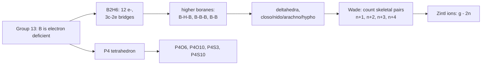

# CH07 · Main Group Chemistry: Cages and Clusters

◀ [[CH06 Hard and Soft Acids and Bases]] · [[Inorganic Chemistry - Course Map|Course Map]] · next: [[CH08 Main Group Rings and Polymers]]

taught · in syllabus extra · book extra · beyond

> [!syllabus] Syllabus map: what is in the syllabus and what is extra in this chapter
> 🟢 **Taught (CH-2113 slides 90–108, [[chem pre-ms .pdf#page=90|pre-midsem pack]]; Tutorial 4 Q1–Q4)**
> - §1 main-group chemistry: periodic trends, the **Group 13** elements (B vs Al, the diagonal relationship with Si, the inert-pair effect of Tl), the topics of interest (slides 90–92)
> - §2 **boron hydrides**: Stock, the boiling-point table, preparation of diborane, **electron deficiency** and the **3-centre-2-electron bond** (slides 93–96)
> - §3 **polyhedral boranes and Wade's rules**: closo, nido, arachno, hypho; the count of skeletal electron pairs; polyhedral relationships (slides 97–100)
> - §4 **Zintl compounds and clusters**: Joannis, polyanions, cryptand extraction, Wade's rules for ligand-free clusters, $g-2n$ (slides 101–102)
> - §5 **cages of phosphorus**: white phosphorus and its manufacture, $\mathrm{P_4O_6}$, $\mathrm{P_4O_{10}}$, $\mathrm{P_4S_3}$, $\mathrm{P_4S_{10}}$ and their reactions (slides 103–108)
>
> 🟡 **Extra · book** (Shriver and Atkins Ch. 13 (boron group), Ch. 15 (phosphorus), 5th ed., sections located by chapter title only; Wade 1971 *Chem. Commun.* 792; Greenwood and Earnshaw)
>
> 🔵 **Extra · beyond** (my additions; numbers in `scripts/ch0209_numbers.py`)
> - §2 the **Hückel solution of the B–H–B bond** (levels $\alpha\pm\sqrt2\beta,\alpha$), the diborane geometry check (B···B = 1.74 Å from 1.31 Å and 83°; rhombus angles sum 360°), Lipscomb's **styx** numbers; §3 a **Wade-counting routine** run on 15 boranes and the tutorial answers; the polyhedra (octahedron, square pyramid, butterfly, icosahedron) and the 14$n$+2 extension to metal clusters; §4 $g-2n$ for 10 Zintl ions; §5 formula masses, P fractions and the stoichiometry of the phosphorus manufacture

> [!key] After this chapter you can
> - explain why $\mathrm{B_2H_6}$ is **electron-deficient** (12 valence electrons, 8 bonds' worth of atoms) and describe its bonding with **two 3-centre-2-electron B–H–B bonds**,
> - **count skeletal electron pairs** of a borane (each BH gives 2 electrons, each additional H gives 1, add the charge) and classify it as **closo ($n+1$), nido ($n+2$), arachno ($n+3)$ or hypho ($n+4$)** pairs,
> - draw the **deltahedron** of a given cluster and say which vertices are missing,
> - apply the same rule to **ligand-free Zintl ions** by $g-2n$ (one lone pair per atom pointing outward),
> - describe $\mathrm{P_4}$, $\mathrm{P_4O_6}$, $\mathrm{P_4O_{10}}$, $\mathrm{P_4S_3}$, $\mathrm{P_4S_{10}}$ as **cages derived from the tetrahedron** and write their main reactions and the industrial route to $\mathrm{P_4}$.

> [!intuition] The one-sentence story
> When there are too few electrons for ordinary two-electron bonds, atoms share electron pairs across *three* centres and pack into triangulated polyhedra, and the polyhedron's size and how many vertices are missing depend only on the *number of electron pairs available for the skeleton*: count the pairs and the shape follows.

![[CH07 Main Group Cages and Clusters.svg]]
*Diagram CH7.0. The chapter in one page: electron deficiency, 3c-2e bonds, deltahedra, Wade's counting, Zintl ions, the phosphorus cages. Editable source: [[CH07 Main Group Cages and Clusters.excalidraw]].*

*Concept map: every box is a section.*

> [!intuition] Why a cluster is like a molecule with a "hole" in the middle
> A closed polyhedron of $n$ atoms has $n+1$ bonding skeletal orbitals (the $n$ radial ones pointing at the centre combine into one strongly bonding MO, the $n$ tangential ones give $n$ more): that is the origin of the $n+1$ pairs of a **closo** cluster. Removing a vertex leaves a bowl that can hold one more pair (nido), and so on: the pair count *grows* as the cage *opens* because the electrons now have fewer atoms to be shared among.

## 1. Main group chemistry and Group 13
taught *slides 90–92*

The challenge (slide 90) is to treat the chemistry of **non-metals and noble gases, transition metals and inner-transition metals** adequately; the tool is the **periodic table**. Down a family: size increases, ionisation energy, electron affinity and electronegativity decrease; across a period the reverse; effective nuclear charge changes smoothly but periods have different lengths (8, 18, 32). **Pronounced differences between similar elements**, e.g. between H–Ne and Na–Ar: perhaps because the lighter elements only use $1s,2s,2p$.

**Group 13 (slide 91): B, Al, Ga, In, Tl.** Boron is the only non-metal; aluminium is the most abundant of the group; metallic character rises from B to Tl; **alternation** in electronegativity (Ga more electronegative than Al); B differs from the rest but shows a **diagonal relationship with Si**: both give **acidic oxides** ($\mathrm{B_2O_3}$, $\mathrm{SiO_2}$; Al gives the amphoteric $\mathrm{Al_2O_3}$), both form many polymeric oxide structures and **glasses** (hence **borosilicate glass**), and both give **flammable, gaseous hydrides** (aluminium hydride is a solid). Most Group 13 elements adopt +3; **Tl prefers +1** because of the **inert-pair effect**.

**Topics of interest (slide 92).** The ability of main-group compounds to form **cages, clusters, rings, chains, frameworks and polymers**: *cages and clusters* (boron hydrides, Zintl compounds, phosphorus oxides and sulfides: this chapter); *rings, macrocycles and polymers* (B–N, P–N, S–N: [[CH08 Main Group Rings and Polymers]]); *chains and frameworks* (silicon compounds and silicates); low-valent and organometallic main-group compounds (not covered).

## 2. Boron hydrides
taught *slides 93–96, Tutorial 4 Q1–Q3* · extra · beyond *Hückel levels, geometry check, styx*

**History (slide 93).** **Alfred Stock** (1912, "father of boron hydrides") prepared a series of boranes, including $\mathrm{B_2H_6}$, and **separated them using the first sophisticated vacuum manifold**: before that they could not be separated because of their very high air and moisture sensitivity and flammability; published 1933. Boiling points: $\mathrm{B_2H_6}$ −92.5 °C, $\mathrm{B_4H_{10}}$ 16 °C, $\mathrm{B_5H_9}$ 58 °C, $\mathrm{B_5H_{11}}$ 65 °C, $\mathrm{B_6H_{10}}$ 108 °C, $\mathrm{B_{10}H_{14}}$ 213 °C (m.p. 99.7 °C): the volatility falls with size. Preparation of higher boranes: $\mathrm{Mg_3B_2+H_3PO_4(aq)\to B_4H_{10},B_5H_9,B_6H_{10}}$. In the 1950s the USA and USSR spent heavily on boranes as **rocket fuels**; the lower boranes are hard to handle and burn in air with a **green flame** (slide 94).

**Diborane preparation (slide 94, Tutorial 4 Q1):** $\mathrm{NaBH_4}$ with $\mathrm{I_2}$, $\mathrm{H_3PO_4}$ or $\mathrm{BF_3}$ gives $\mathrm{B_2H_6}$; $\mathrm{BF_3}$ with $\mathrm{NaH}$, $\mathrm{LiH}$ or $\mathrm{LiAlH_4}$ gives $\mathrm{B_2H_6}$ (hydride transfer to a Lewis acid, [[CH05 Acid Strength Lewis Acidity and Reactions]]).

### 2.1 Electron deficiency of diborane (slide 95)
Count: $2\times\mathrm B=6$ electrons, $6\times\mathrm H=6$ electrons: **12 valence electrons** in total. Draw $\mathrm{B_2H_6}$ with **four terminal B–H bonds** (each a 2-centre-2-electron bond, 8 electrons) and **two bridging B–H–B units**: the four bridging B–H *contacts* would need 8 electrons but **only 4 remain**. *Hence the molecule is electron deficient.* (The slide writes "4 B–H terminal bonds = 6 electrons"; four terminal 2c-2e bonds use **8** electrons, and $12-8=4$ leaves exactly the 4 of the next line. `[verify]`: a slip of 6 for 8.)

**Earlier ideas (slide 95).** A first rationalisation assumed $[\mathrm B_2\mathrm H_4]^{2-}$ is **isoelectronic with $\mathrm{C_2H_4}$** (planar, B=B) with **two $\mathrm H^+$ ions above and below the plane of the B–B bond** (a protonated double bond, the picture drawn with the ethylene and the open sandwich on the slide). It was later refined by the **3-centre-2-electron ($\mathrm{3c{-}2e^-}$) bond** model.

![[fig_ch07_diborane_zintl.png]]
*Figure CH7.1. Diborane and Zintl counts. A: the structure of $\mathrm{B_2H_6}$: a planar $\mathrm{B_2H_2}$ rhombus with the two bridging H (orange, dashed) above and below the BB axis in the plane, and the four terminal H (open) in the perpendicular plane; bond lengths B–H$_t$ 1.19 Å, B–H$_b$ 1.31 Å, B–H–B 83°. B: one bridge as a three-centre MO problem: the two B $sp^3$ hybrids and the H 1s give a bonding $\psi_1$ ($\alpha+\sqrt2\beta$), a non-bonding $\psi_2$ ($\alpha$) and an antibonding $\psi_3$ ($\alpha-\sqrt2\beta$); the two bridge electrons fill $\psi_1$. C: the skeletal pairs $(g-2n)/2$ of four Zintl ions against $n$ (hatched): the excess over $n$ is 1 (closo), 2 (nido), 3 (arachno).*

### 2.2 The three-centre-two-electron bond (slide 96)
Each B–H–B bridge is a **delocalised 3c-2e bond**: the AOs of **two B atoms and one H** (two B $sp^3$ hybrids and the H 1s) combine to give **three orbitals: one bonding, one non-bonding, one antibonding** for each B–H–B unit; each bridge accepts **two electrons in the bonding orbital**, forming the 3c-2e bond that rationalises the dimer with **four terminal B–H bonds and two bridging B–H–B bonds**. **Two other bond types matter for higher boranes: 2c-2e B–B bonds and 3c-2e B–B–B bonds** (open and closed; the slide draws the three-centre B–B–B as a triangle with a central lobe).

> [!derivation] The numbers behind the picture (🔵)
> **Hückel levels.** For the chain $\mathrm{B{-}H{-}B}$ with $\alpha_{\mathrm B}=\alpha_{\mathrm H}$ and equal coupling $\beta$: the secular matrix $\begin{pmatrix}0&1&0\\1&0&1\\0&1&0\end{pmatrix}$ has eigenvalues $-\sqrt2,0,+\sqrt2$ (in units of $\beta$), i.e. levels $\alpha+\sqrt2\beta$ (bonding, since $\beta<0$), $\alpha$ (non-bonding) and $\alpha-\sqrt2\beta$ (antibonding). The pair of electrons in the bonding MO is stabilised by $2\sqrt2|\beta|=2.83|\beta|$, **more than the $2|\beta|$ of an ordinary 2c-2e pair**: the three-centre bond is *efficient per electron*; it *holds three atoms with two electrons*, giving each B–H bridge bond a **bond order of ½**.
> **Geometry.** With B–H$_b$ = 1.31 Å and B–H–B = 83°: B···B $=2\times1.31\sin41.5^\circ=1.736$ Å (experiment 1.77 Å); the other angle of the $\mathrm B_2\mathrm H_{2}$ rhombus is H$_b$–B–H$_b$ = 97°, and the four angles of a planar rhombus add up: $2(97+83)=360^\circ$ ✓ (the slide's drawing gives exactly these two angles). The bridging B–H is **longer** (1.31 Å) than the terminal (1.19 Å): bond order ½ against 1.

> [!key] Lipscomb's styx number (🔵)
> Describe a borane $\mathrm{B}_p\mathrm{H}_{p+q}$ by $s$ = number of B–H–B bridges, $t$ = number of 3c B–B–B bonds, $y$ = number of 2c B–B bonds, $x$ = number of $\mathrm{BH_2}$ groups. Balance: $s+x=q$ and $t+y=p-q/2$. Check: $\mathrm{B_2H_6}$ ($p=2,q=4$): $s=2,t=0,y=0,x=2$ → **2002**; $\mathrm{B_4H_{10}}$ ($p=4,q=6$): **4012**; $\mathrm{B_5H_9}$ ($p=5,q=4$): **4120**; $\mathrm{B_{10}H_{14}}$ ($p=10,q=4$): **4620**. It counts bonds; Wade's rules (§3) predict the *shape*.

**Synthesis of higher boranes (slide 97, Tutorial 4 Q3).** Most higher boranes are made from diborane by **controlled pyrolysis** or by reactions **in the presence of hard and soft bases**: pyrolysis at 100–120 °C gives $\mathrm{B_4H_{10}}$, at 180–200 °C $\mathrm{B_5H_9}$, at 100–200 °C in $\mathrm{Me_2O}$ $\mathrm{B_{10}H_{14}}$. **Base cleavage** splits the $\mathrm B_2\mathrm H_6$ either **symmetrically** (soft/strong donor): $\mathrm{B_2H_6+2\,Et_3N\to2\,Et_3N{\cdot}BH_3}$, or **asymmetrically** (hard base such as $\mathrm{NH_3}$): $\mathrm{3\,B_2H_6+6\,NH_3\to3\,[BH_2(NH_3)_2][BH_4]}$ (heating this gives borazine, [[CH08 Main Group Rings and Polymers]]). The route to the closed ion: $\mathrm{B_4H_{10}\ \xrightarrow{190\,°C}}$ ... $[\mathrm{Et_3NH}]_2[\mathrm B_{12}\mathrm H_{12}]$ from $\mathrm{Et_3N{\cdot}BH_3}$ (slide 98).

## 3. Polyhedral boranes and Wade's rules
taught *slides 98–100, Tutorial 4 Q4* · extra · book *Wade 1971; S&A Ch. 13*

**Ken Wade (Durham, 1971).** For borane and carborane clusters the structures are based on **deltahedra**, polyhedra in which **every face is a triangle**. The clusters are classified by whether they represent a complete deltahedron or one with vertices missing:

| Boron hydride | Name | Skeletal electron pairs | Missing vertices | Examples |
|---|---|---|---|---|
| $[\mathrm B_n\mathrm H_n]^{2-}$ or $\mathrm B_n\mathrm H_{n+2}$ | **closo** | $n+1$ | 0 | $\mathrm{B_6H_6^{2-}},\ \mathrm{B_{12}H_{12}^{2-}}$ |
| $\mathrm B_n\mathrm H_{n+4}$ | **nido** | $n+2$ | 1 | $\mathrm{B_2H_6},\mathrm{B_5H_9},\mathrm{B_{10}H_{14}}$ |
| $\mathrm B_n\mathrm H_{n+6}$ | **arachno** | $n+3$ | 2 | $\mathrm{B_4H_{10}}$ |
| $\mathrm B_n\mathrm H_{n+8}$ | **hypho** | $n+4$ | 3 | $\mathrm{B_5H_{12}^-}$ |

> [!key] How to count (slide 98)
> **Each BH unit furnishes 2 skeletal bonding electrons; each additional H furnishes 1; ionic charges must be included in the electron count.** (A BH has 3 + 1 = 4 valence electrons; 2 of them are used for the exo B–H bond, leaving 2 for the skeleton.) For a borane $\mathrm B_n\mathrm H_m^{q-}$: skeletal electrons $=2n+(m-n)+q$ (the $q$ extra electrons of the anion; subtract for a cation), pairs = half of that, compared with $n$.

**Worked: slides 98–99 and Tutorial 4 Q4 (computed).**

| Species | $n$ | skeletal e⁻ | pairs | class |
|---|---|---|---|---|
| $[\mathrm B_6\mathrm H_6]^{2-}$ | 6 | $12+2=14$ | 7 $=n+1$ | closo |
| $[\mathrm B_{12}\mathrm H_{12}]^{2-}$ | 12 | $24+2=26$ | 13 $=n+1$ | **closo** |
| $\mathrm B_2\mathrm H_6$ | 2 | $4+4=8$ | 4 $=n+2$ | nido |
| $\mathrm B_5\mathrm H_9$ | 5 | $10+4=14$ | 7 $=n+2$ | nido |
| $\mathrm B_6\mathrm H_{10}$ | 6 | $12+4=16$ | 8 $=n+2$ | nido |
| $\mathrm B_{10}\mathrm H_{14}$ | 10 | $20+4=24$ | 12 $=n+2$ | **nido** |
| $\mathrm B_4\mathrm H_{10}$ | 4 | $8+6=14$ | 7 $=n+3$ | arachno |
| $\mathrm B_5\mathrm H_{11}$ | 5 | $10+6=16$ | 8 $=n+3$ | **arachno** |
| $[\mathrm B_5\mathrm H_{12}]^-$ / $\mathrm B_5\mathrm H_{13}$ | 5 | $10+7+1=18$ | 9 $=n+4$ | hypho |

(All 15 boranes of the check script agree with the slides and the tutorial answers: $[\mathrm{B_{12}H_{12}}]^{2-}$ closo 13 pairs, $\mathrm{B_{10}H_{14}}$ nido 12, $\mathrm{B_5H_{11}}$ arachno 8, $\mathrm{B_5H_{13}}$ hypho 9.)

![[fig_ch07_wade.png]]
*Figure CH7.2. Deltahedral families. From the left: the octahedron of closo $[\mathrm{B_6H_6}]^{2-}$ (7 pairs); nido $\mathrm{B_5H_9}$ is the octahedron with one vertex removed, a square pyramid, with the four extra H bridging the basal edges (orange dashed); arachno $\mathrm{B_4H_{10}}$ removes two adjacent vertices to leave a butterfly of four boron atoms; closo $[\mathrm{B_{12}H_{12}}]^{2-}$ is the icosahedron (12 vertices, 20 faces, 30 edges). The triangulated sphere always has $E=3n-6$ edges and $F=2n-4$ faces.*

**Polyhedral relationships (slide 100).** The nido and arachno structures are found by **removing vertices** from a closo deltahedron (a nido cluster with $n$ boron atoms comes from the closo polyhedron with $n+1$ vertices: $\mathrm B_5\mathrm H_9$ from the 6-vertex octahedron, $\mathrm B_{10}\mathrm H_{14}$ from the 11-vertex octadecahedron), and an arachno cluster from the closo polyhedron with $n+2$ vertices. The slide's page (a diagram from the literature, with a table) gives **electron counts for closed deltahedral clusters**: for the closo series $n=5$–12 the **p-block valence electron count is $4n+2$** (22, 26, 30, 34, 38, 42, 46, 50), the **d-block count is $14n+2$** (72, 86, 100, ..., 170) and the number of skeletal electron pairs is $n+1$.

| $n$ | closo polyhedron | edges $E=3n-6$ | faces $F=2n-4$ | p-block VEC $4n+2$ |
|---|---|---|---|---|
| 5 | trigonal bipyramid | 9 | 6 | 22 |
| 6 | octahedron | 12 | 8 | 26 |
| 7 | pentagonal bipyramid | 15 | 10 | 30 |
| 8 | dodecahedron (bisdisphenoid) | 18 | 12 | 34 |
| 9 | tricapped trigonal prism | 21 | 14 | 38 |
| 10 | bicapped square antiprism | 24 | 16 | 42 |
| 11 | octadecahedron | 27 | 18 | 46 |
| 12 | icosahedron | 30 | 20 | 50 |

> [!pitfall] Wade's rules count *skeletal* electrons, not all valence electrons
> Remove the electrons used for the *exo* (external) bonds first: for BH, two of the four. For a *bare* atom with a lone pair pointing outward (a Zintl ion) remove two as well (§4). Forgetting the charge or the bridging H is the most common error.

## 4. Zintl compounds and clusters
taught *slides 101–102, Tutorial 4 Q4* · extra · beyond *the $g-2n$ table*

**Zintl compounds** (slide 101): an **electropositive cationic element** (alkali or alkaline-earth metal, main-group metal) and an **anionic element of moderate electronegativity**: the product is a **polycationic or polyanionic** cluster. **The first evidence (Joannis, 1891):** reaction of sodium in liquid ammonia with a variety of metals; a **blue solution** of sodium (dissolved electrons in $\mathrm{NH_3}$) that went **green** with excess lead giving new solids of composition $\mathrm{NaPb_4}$ or $\mathrm{NaPb_2}$ depending on conditions: $(4+2x)\mathrm{Na}+x\mathrm{PbI_2}\to\mathrm{Na_4Pb_x}+2x\mathrm{NaI}$. The isolation of any *solid* derivative of the Zintl anions has been accomplished only in the last 40 years: **intact cage-like anions can be extracted from the solids by a complexing ligand for the cations**: the $\mathrm{Na^+}$ of $\mathrm{Na_2Sn_5}$ captured by **cryptand** $[\mathrm{N(C_2H_4OC_2H_4OC_2H_4)_3N}]$ gives $[\mathrm{Na(crypt)}]_2\mathrm{Sn_5}$.

**Wade's rules for ligand-free clusters (slide 102).** If one postulates **one lone electron pair pointing outward on each of the $n$ atoms**, then **$g-2n$ electrons remain for the polyhedron skeleton** ($g$ = total number of valence electrons, including the charge). The count works also if some atoms bear ligands (instead of lone pairs) and others none.

| Ion | $n$ | $g$ | $g-2n$ | $\frac{g-2n}2-n$ | class |
|---|---|---|---|---|---|
| $\mathrm{Sn_5^{2-}}$, $\mathrm{Bi_5^{3+}}$ | 5 | 22 | 12 | 1 | **closo** (trigonal bipyramid) |
| $\mathrm{Sn_6^{2-}}$ | 6 | 26 | 14 | 1 | closo (octahedron) |
| $\mathrm{Sn_9^{4-}}$, $\mathrm{Bi_9^{5+}}$, $\mathrm{Ge_9^{4-}}$ | 9 | 40 | 22 | 2 | **nido** (monocapped square antiprism) |
| $\mathrm{Bi_8^{2+}}$ | 8 | 38 | 22 | 3 | **arachno** |
| $\mathrm{As_2B_4Cl_4}$ | 6 | 26 | 14 | 1 | closo (B carry Cl, As lone pair) |

Examples from the slide: $\mathrm{Sn_5^{2-}}$ ($g=5\times4+2=22$, $g-2n=12=2n+2$: closo); $\mathrm{Sn_9^{4-}}$ ($g=40$, $g-2n=22=2n+4$: **nido**; Tutorial 4 Q4: $\mathrm{Na_4Sn_9}$ as $[\mathrm{Sn_9}]^{4-}$); $\mathrm{Bi_8^{2+}}$ ($g=38$, $22=2n+6$: arachno). The **isoelectronic cations** $\mathrm{Bi_5^{3+}}$, $\mathrm{Bi_9^{5+}}$ ($\mathrm{Bi}$ is isoelectronic with Sn$^-$) have the same shapes as the anions: Zintl ions are the main-group relatives of the boranes, with $\mathrm{Sn}^-\leftrightarrow\mathrm{BH}$. (The tutorial also lists super-hypercloso, $n-1$ pairs, and hypercloso, $n$ pairs, for clusters with *fewer* electrons than closo.)

> [!connection] Why Zintl ions look like boranes: Sn is isolobal with BH
> A bare Sn atom has 4 valence electrons; two go to the outward-pointing lone pair, leaving **2 skeletal electrons**, exactly what a BH unit contributes (4 valence electrons, 2 to the exo B–H bond). So $\mathrm{Sn_5^{2-}}$ ($g-2n=12$) and $[\mathrm{B_5H_5}]^{2-}$ ($5\times2+2=12$) have the same skeletal count, the same $n+1=6$ pairs and the same trigonal-bipyramidal shape; likewise $\mathrm{Bi^+}$ (5 − 1 = 4 valence electrons) is isoelectronic with Sn. The rule needs no new idea: Zintl ions are boranes with the BH replaced by a bare atom carrying a lone pair.

## 5. Cages of phosphorus
taught *slides 103–108* · extra · book *S&A Ch. 15* · extra · beyond *masses, strain, stoichiometry*

**White phosphorus** (slide 104) is a **tetrahedron $\mathrm P_4$** (6 P–P bonds, $60^\circ$ angles; 'strained'): stored under water, ignites in air, cubic form below −30 °C. Industrial manufacture (reduction of phosphate rock in an electric furnace with silica and coke at 1200–1500 °C):
$$2\mathrm{Ca_3(PO_4)_2}+6\mathrm{SiO_2}+10\mathrm C\to\mathrm P_4+10\mathrm{CO}+6\mathrm{CaSiO_3}$$
(slide 104 also gives the version for fluoroapatite, $4\mathrm{Ca_3(PO_4)_2F}+18\mathrm{SiO_2}+30\mathrm C\to\mathrm P_4+\dots$; both balance atom-for-atom: for the first, P 4=4, Ca 6=6, Si 6=6, C 10=10, O $16+12=28=10+18$). It is a **Lux–Flood** reaction too: the acidic $\mathrm{SiO_2}$ takes oxide from the basic $\mathrm{CaO}$ of the phosphate ([[CH04 Acid-Base Concepts]]). The scheme on the slide shows $\mathrm P_4$ and its products: **red P** (polymeric, amorphous, ignites near 300 °C), **violet/Hittorf's P**, **black P** (layered, graphite-like, from heating at high pressure), $\mathrm{PCl_3}$ ($\mathrm{Cl_2}$ in excess gives $\mathrm{PCl_5}$), $\mathrm{P_4O_6}$/$\mathrm{P_4O_{10}}$ with $\mathrm{O_2}$, $\mathrm{P_4S_{10}}$, $\mathrm{PH_3}$ with hot aqueous base.

**Oxides and sulfides (slide 105).** All are derived from the $\mathrm P_4$ tetrahedron:
* **$\mathrm{P_4O_6}$:** insert an **O atom into each of the six P–P edges**: 10 atoms, adamantane-like; each P is $\mathrm{P(OP)_3}$ with a lone pair.
* **$\mathrm{P_4O_{10}}$:** $\mathrm{P_4O_6}$ plus a **terminal $\mathrm{P=O}$ on each P** (the lone pair becomes the donor of the dative $\mathrm{P{\to}O}$ bond); the commonest drying agent.
* **$\mathrm{P_4S_3}$:** the tetrahedron with **three S inserted in the three basal edges** (apical P untouched), used in strike-anywhere matches.
* **$\mathrm{P_4S_{10}}$:** the sulfur analogue of $\mathrm{P_4O_{10}}$.

![[fig_ch07_p4.png]]
*Figure CH7.3. The phosphorus cages. $\mathrm{P_4}$ (6 edges); $\mathrm{P_4O_6}$ (one bridging O, orange, in each edge); $\mathrm{P_4O_{10}}$ (adds a terminal O on each P, dotted); $\mathrm{P_4S_3}$ (three bridging S in the basal edges, the apex P keeps three P–P bonds). All keep the $T_d$ ($\mathrm{P_4},\mathrm{P_4O_6},\mathrm{P_4O_{10}}$, $\mathrm{P_4S_{10}}$) or $C_{3v}$ ($\mathrm{P_4S_3}$) skeleton.*

| Cage | formula mass (g/mol) | P (mass %) |
|---|---|---|
| $\mathrm{P_4}$ | 123.90 | 100 |
| $\mathrm{P_4O_6}$ | 219.89 | 56.3 |
| $\mathrm{P_4O_{10}}$ | 283.89 | 43.6 |
| $\mathrm{P_4S_3}$ | 220.08 | 56.3 |
| $\mathrm{P_4S_{10}}$ | 444.50 | 27.9 |

**Reactions (slides 106–107, pictures).**
* **$\mathrm{P_4O_6}$** (slide 106: a wheel with $\mathrm{P_4O_6}$ at the centre): $\mathrm{P_4+3O_2\to P_4O_6}$ (limited oxygen), $\mathrm{P_4O_6+2O_2\to P_4O_{10}}$ (on burning in air); hydrolysis $\mathrm{P_4O_6+6H_2O\to4H_3PO_3}$ (phosphonic acid: [[CH05 Acid Strength Lewis Acidity and Reactions]], two acidic H); the other spokes show reactions with HCl and with chlorine, thermal rearrangement on heating, and **coordination to metal carbonyl fragments through P** (a soft donor) and addition of $\mathrm{BH_3}$ and similar units. The spokes are pictures and are listed here only as far as they could be read (`[verify]`).
* **$\mathrm{P_4O_{10}}$:** $\mathrm{P_4O_{10}+6H_2O\to4H_3PO_4}$ (1 g of $\mathrm{P_4O_{10}}$ gives **1.38 g $\mathrm{H_3PO_4}$**); a powerful dehydrating agent.
* **$\mathrm{P_4S_{10}}$** (slide 107): with **anisole** gives **Lawesson's reagent** ($\mathrm{[MeOC_6H_4PS_2]_2}$, a mild thionation reagent converting $\mathrm{C{=}O}$ into $\mathrm{C{=}S}$: ketones to thioketones, amides to thioamides), with **alcohols** ($\mathrm{ROH}$, rt, $-\mathrm{H_2S}$) the **dithiophosphoric acids** $\mathrm{(RO)_2P(S)SH}$, with amides thioamides, and with organometallic iron fragments (pictured, not read in detail).

> [!example] Stoichiometry of the furnace (🔵)
> To make 1 tonne of $\mathrm P_4$ (8.07 kmol): $\mathrm{Ca_3(PO_4)_2}$ needed $=2\times8.07=16.1$ kmol ($5.0$ t, $M=310.2$); $\mathrm{SiO_2}$ $=6\times8.07=48.4$ kmol (2.9 t); C $=10\times8.07=80.7$ kmol (0.97 t); and **CO $=80.7$ kmol (2.26 t)** is released: the real process uses the CO as fuel. The tonnage of slag $\mathrm{CaSiO_3}$ ($M=116.2$) is $48.4\times116.2=5.6$ t per tonne of $\mathrm P_4$: more slag than product by 5.6 times.

## Map of this chapter
> [!connection] How CH07 connects
> **Builds on:** [[CH03 Molecular Orbital Theory Polyatomics]] (3-centre MOs, LGOs), [[CH05 Acid Strength Lewis Acidity and Reactions]] (BH$_3$ as a Lewis acid, borane adducts), [[CH06 Hard and Soft Acids and Bases]] (hard/soft bases direct the cleavage of $\mathrm{B_2H_6}$), [[CH04 Acid-Base Concepts]] (Lux–Flood in the furnace).
> **Leads to:** [[CH08 Main Group Rings and Polymers]] (borazine from diborane and ammonia; polymers of B–N and P–N), [[CH09 Redox]] (the reductions that make P and B).
> **Concepts:** [[Diborane]] · [[Three-Centre Two-Electron Bond]] · [[Wade's Rules]] · [[Deltahedron]] · [[Closo Nido Arachno]] · [[Zintl Ion]] · [[Cryptand]] · [[White Phosphorus]] · [[Phosphorus Oxides and Sulfides]] · [[Styx Numbers]]
> **Other subjects:** [[Group Theory - Course Map]] (point groups of the polyhedra: $O_h$, $I_h$, $D_{3h}$, $T_d$), [[PA04 Functions and Cardinality]] / [[PA03 Relations Equivalence and Order]] (Euler's formula $V-E+F=2$ counts), [[Climate - Course Map]] (volcanic and biogenic phosphorus cycling is in the eutrophication chapter: [[EE06 Eutrophication and Alternative Stable States]]).

## Summary
> [!summary] Cheat-sheet
> - **Group 13:** B non-metal, Al amphoteric; B–Si diagonal; Tl⁺ (inert pair). **$\mathrm{B_2H_6}$:** 12 e⁻; 4 terminal 2c-2e + 2 bridging 3c-2e; B–H$_b$ 1.31 Å, B–H$_t$ 1.19 Å, 83°, 97°; made from $\mathrm{NaBH_4+I_2}$ or $\mathrm{BF_3+LiAlH_4}$.
> - **3c-2e MO:** levels $\alpha\pm\sqrt2\beta,\alpha$; bridge bond order ½. **styx:** $s+x=q$, $t+y=p-q/2$.
> - **Wade:** BH → 2 e⁻, extra H → 1, add charge; pairs $n+1$ closo, $n+2$ nido, $n+3$ arachno, $n+4$ hypho. $[\mathrm{B_{12}H_{12}}]^{2-}$ 13 pairs closo; $\mathrm{B_{10}H_{14}}$ 12 nido; $\mathrm{B_5H_{11}}$ 8 arachno; $\mathrm{B_5H_{13}}$ 9 hypho. Closo p-block VEC $4n+2$, d-block $14n+2$.
> - **Zintl:** $g-2n$: $\mathrm{Sn_5^{2-}}$ 12 closo; $\mathrm{Sn_9^{4-}}$ 22 nido; $\mathrm{Bi_8^{2+}}$ 22 arachno; cryptand extraction.
> - **Phosphorus:** $\mathrm{P_4}$ from $2\mathrm{Ca_3(PO_4)_2}+6\mathrm{SiO_2}+10\mathrm C\to\mathrm P_4+10\mathrm{CO}+6\mathrm{CaSiO_3}$ (1200–1500 °C); $\mathrm{P_4O_6}$ (O in edges), $\mathrm{P_4O_{10}}$ (+terminal O), $\mathrm{P_4S_3}$, $\mathrm{P_4S_{10}}$ (Lawesson's reagent).

## Practice
1. **Diborane.** Count the valence electrons, say how many are in terminal bonds and how many in bridges, and give the bond order of a B–H bridge.
2. **Wade.** Classify $\mathrm{B_5H_{11}}$, $\mathrm{B_6H_{10}}$, $\mathrm{B_{10}H_{14}}$, $[\mathrm{B_{12}H_{12}}]^{2-}$ and give the deltahedron they derive from (Tutorial 4 Q4).
3. **Zintl.** Classify $\mathrm{Sn_9^{4-}}$, $\mathrm{Bi_5^{3+}}$, $\mathrm{Bi_8^{2+}}$, $\mathrm{Pb_5^{2-}}$ and predict their shapes.
4. **Missing vertices.** Which deltahedron does arachno $\mathrm{B_4H_{10}}$ come from, how many vertices are missing, and which (adjacent or not)?
5. **Base cleavage.** Write the two reactions of $\mathrm{B_2H_6}$ with $\mathrm{NMe_3}$ (symmetric) and with $\mathrm{NH_3}$ (asymmetric) and explain the choice with HSAB.
6. **styx.** Check the styx number 4120 for $\mathrm{B_5H_9}$ against the two balance equations.
7. **Geometry.** From B–H$_b$ = 1.31 Å and B–H–B = 83° compute B···B and the angle H$_b$–B–H$_b$.
8. **Phosphorus furnace.** How many kilograms of $\mathrm{SiO_2}$ are needed per kg of $\mathrm P_4$?
9. **Cages.** How many P–P bonds are there in $\mathrm P_4$, $\mathrm{P_4O_6}$, $\mathrm{P_4O_{10}}$, $\mathrm{P_4S_3}$ and what is the P oxidation state in each oxide?
10. **Diagonal relationship.** Give three properties shared by B and Si and one that distinguishes B from Al.

> [!example]- Solutions
> 1. $2\times3+6\times1=12$ e⁻; 4 terminal 2c-2e bonds = 8 e⁻; 4 e⁻ for the two 3c-2e bridges; each B–H bridge bond has order ½.
> 2. $\mathrm{B_5H_{11}}$: $10+6=16$, 8 pairs $=n+3$ arachno (from the 7-vertex pentagonal bipyramid, 2 missing); $\mathrm{B_6H_{10}}$: $12+4=16$, 8 pairs $=n+2$ nido (from the 7-vertex pentagonal bipyramid); $\mathrm{B_{10}H_{14}}$: $20+4=24$, 12 pairs nido (from the 11-vertex octadecahedron); $[\mathrm{B_{12}H_{12}}]^{2-}$: 13 pairs, closo icosahedron.
> 3. $\mathrm{Sn_9^{4-}}$: $g=40$, $g-2n=22$, 11 pairs $=n+2$ nido (monocapped square antiprism); $\mathrm{Bi_5^{3+}}$: $g=22$, 12 e⁻, 6 pairs $=n+1$ closo (trigonal bipyramid); $\mathrm{Bi_8^{2+}}$: $g=38$, 22, 11 pairs $=n+3$ arachno; $\mathrm{Pb_5^{2-}}$: like $\mathrm{Sn_5^{2-}}$, closo trigonal bipyramid.
> 4. From the 6-vertex octahedron (closo $\mathrm{B_6H_6^{2-}}$, $n+2=6$) with 2 vertices missing; they are adjacent, giving the four-atom butterfly.
> 5. $\mathrm{B_2H_6+2NMe_3\to2Me_3N{\cdot}BH_3}$ (symmetrical cleavage by a bulky, softer, strongly donating tertiary amine); $3\mathrm{B_2H_6}+6\mathrm{NH_3}\to3[\mathrm{BH_2(NH_3)_2}]^+[\mathrm{BH_4}]^-$ (unsymmetrical cleavage: a *hard, small* base can attack one B to form a cation and transfer $\mathrm{H^-}$ as the soft $\mathrm{BH_4^-}$ anion; borane BH$_3$ is the *soft* acid).
> 6. $p=5$, $q=4$: $s+x=4$ with $s=4,x=0$ ✓; $t+y=5-2=3$ with $t=1,y=2$ ✓: 4120.
> 7. $2\times1.31\times\sin(41.5^\circ)=1.74$ Å; the rhombus angle $=180^\circ-83^\circ=97^\circ$.
> 8. 1 mol $\mathrm P_4$ (123.9 g) needs $6\times60.08=360.5$ g $\mathrm{SiO_2}$: **2.91 kg per kg**.
> 9. $\mathrm P_4$ 6; $\mathrm{P_4O_6}$ 0 (the P–P bonds are replaced by P–O–P); $\mathrm{P_4O_{10}}$ 0; $\mathrm{P_4S_3}$ 3 (the three bonds at the apex P); P is +3 in $\mathrm{P_4O_6}$ and +5 in $\mathrm{P_4O_{10}}$.
> 10. Shared: acidic oxides ($\mathrm{B_2O_3}$, $\mathrm{SiO_2}$), glass formation (borosilicate), volatile flammable hydrides; B differs from Al in that $\mathrm{Al_2O_3}$ is amphoteric, $\mathrm{AlH_3}$ is a solid and Al is a metal.

> [!connection] Group theory used here
> The point groups of the polyhedra ($T_d,O_h,I_h,D_{3h}$) and why the icosahedral group $I\cong A_5$ is special (simple, non-solvable): [[GT06 Permutation Groups]], [[GT08 Solvable Groups and Complements]]; see [[Where Groups Appear in the Vault]].

## Provenance
> [!provenance]- Source map for this chapter
> | Topic | Source | Scope |
> |---|---|---|
> | main group overview, Group 13 | [[chem pre-ms .pdf#page=90\|slides 90–92]] | taught |
> | boron hydrides, history, preparation | [[chem pre-ms .pdf#page=93\|slides 93–94]] | taught |
> | diborane structure and bonding | [[chem pre-ms .pdf#page=95\|slides 95–96]] | taught |
> | higher boranes, Wade, polyhedral relationships | [[chem pre-ms .pdf#page=97\|slides 97–100]] | taught |
> | Zintl compounds and clusters | [[chem pre-ms .pdf#page=101\|slides 101–102]] | taught |
> | phosphorus cages and reactions | [[chem pre-ms .pdf#page=103\|slides 103–108]] (reaction schemes are pictures) | taught |
> | Tutorial 4 Q1–Q4 | [[ch2113-principles-of-inorganic-chemistry-august-20/2026-09-19-tutorial-questions-and-answers]] | taught (summary by another tool) |
> | Hückel levels, geometry, styx, counting routine, masses, furnace stoichiometry | `scripts/ch0209_numbers.py` (§CH07), `scripts/fig_ch0209.py` | extra/beyond |
>
> **Notes.** (1) Slide 95's "4 B–H terminal bonds = 6 electrons" should read 8 (flagged). (2) The slide-97 reaction scheme (pyrolysis temperatures, $\mathrm{Me_2O}$) was read as a picture; the temperatures are given as read. (3) The phosphorus reaction wheels (slides 106–107) are pictures and only the reactions named in the images are listed; the Fe(CO)$_4$ adduct of $\mathrm{P_4O_6}$ and the ferrocene product are as read, `[verify]`. (4) The "neat check" box in §4 is a numerical aside; the formula, not the shortcut, is authoritative. (5) The chapter's S&A pointers are to chapters only: no page anchors were located for Ch. 13/15.

**References.** Wade, K. (1971) *J. Chem. Soc. D (Chem. Commun.)* 792 · Lipscomb, W. N. *Boron Hydrides* (1963) · Mingos, D. M. P. (1972) *Nature Phys. Sci.* 236, 99 · Stock, A. *Hydrides of Boron and Silicon* (1933) · Corbett, J. D. (1985) *Chem. Rev.* 85, 383 (Zintl ions) · Greenwood, N. N. and Earnshaw, A. *Chemistry of the Elements* (2nd ed.), Ch. 6 and 12.
