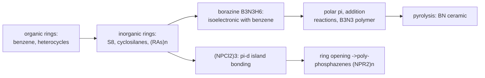

# CH08 · Main Group Chemistry: Rings and Polymers

◀ [[CH07 Main Group Cages and Clusters]] · [[Inorganic Chemistry - Course Map|Course Map]] · next: [[CH09 Redox]]

taught · in syllabus extra · book extra · beyond

> [!syllabus] Syllabus map: what is in the syllabus and what is extra in this chapter
> 🟢 **Taught (CH-2113 slides 109–119, [[chem pre-ms .pdf#page=109|pre-midsem pack]]; Tutorial 4 Q5–Q10)**
> - §1 organic ring systems and **inorganic heterocycles** ($\mathrm{S_8}$, cyclosilanes, Salvarsan) and the **historical background** (slides 109–111)
> - §2 **borazine**, "the inorganic benzene": synthesis, structure, the debate on aromaticity (slide 112) and its **addition reactions** (slide 114)
> - §3 **boron–nitrogen rings** (iminoboranes, substituted borazines) and the **B–N polymer** to **boron nitride** (slides 113, 115)
> - §4 **cyclophosphazenes** $(\mathrm{NPX_2})_n$: synthesis, **Dewar's $p\pi$–$d\pi$ model**, reactivity (slides 116–118)
> - §5 **polyphosphazenes** (slide 119)
>
> 🟡 **Extra · book** (Shriver and Atkins Ch. 14–16 for B–N, P–N, S–N systems, section pointers only; Allcock, *Phosphorus–Nitrogen Compounds*, 1972)
>
> 🔵 **Extra · beyond** (my additions; numbers in `scripts/ch0209_numbers.py`)
> - §2 the **Hückel π model of borazine** against benzene (levels, HOMO–LUMO gap 2.97 vs 2.00 $|\beta|$, π charges B 0.23 / N 1.77, π bond order 0.44 against 0.67) and a **Pauling bond-order estimate** (1.3) from the slide's B–N bond lengths; §3 the **balanced** substituted-borazine equation and the **ceramic yield** of BN (the theoretical maximum is 92.5 %, matching the slide's 85–93 %); §4 molar masses and chain length of polyphosphazenes

> [!key] After this chapter you can
> - explain how **isoelectronic replacement** ($\mathrm{C{=}C}\to\mathrm{B{-}N}$, $\mathrm{C_6H_6}\to\mathrm{B_3N_3H_6}$) leads to a ring that **looks like benzene but behaves differently**, and why,
> - write the **routes to borazine and to B- and N-substituted borazines**, and its **addition reactions** with $\mathrm{HCl}$ and $\mathrm{Br_2}$,
> - describe the polymerisation of borazine and the **pyrolysis to boron nitride**,
> - describe the bonding of $(\mathrm{NPCl_2})_3$ in the **Dewar island model** (three 3-centre π systems with nodes at P) and why its P–N bonds are all equal and short,
> - write the **ring-opening polymerisation** of $(\mathrm{NPCl_2})_3$ and the **macromolecular substitution** that turns poly(dichlorophosphazene) into stable polymers $[\mathrm{N{=}PR_2}]_n$.

> [!intuition] The one-sentence story
> Replace each pair of carbon atoms in an organic ring by a neighbouring pair in the periodic table (B–N, or P–N) and you get a ring with the same electron count but a *polar* π system: the electrons pile up on the more electronegative atom, the ring is flatter-looking than it is delocalised, and the vacant orbital on the electropositive atom gives it a reactive site that benzene does not have.

![[CH08 Main Group Rings and Polymers.svg]]
*Diagram CH8.0. The chapter in one page: isoelectronic replacement, borazine and its polymer, phosphazene rings and the polymer route. Editable source: [[CH08 Main Group Rings and Polymers.excalidraw]].*

*Concept map: every box is a section.*

## 1. Organic and inorganic ring systems
taught *slides 109–111*

**Organic rings (slide 109).** A very important branch of organic chemistry: **benzene** (the pre-eminent example, gave insight into delocalised bonding), **cycloalkanes** $(\mathrm{CH_2})_n$ ($n=3$ to $>30$, a homologous series), and **heterocycles**, in which one or more carbons are replaced by another $p$-block element (approximately half of known organic compounds contain at least one heterocyclic ring).

**Inorganic heterocycles (slide 110).** Extend the substitution to the **complete replacement of all carbon atoms**: the rings and the polymers derived from them are the subject of the lecture. **Elemental sulfur** is the quintessential inorganic ring system, **cyclo-$\mathrm S_8$** (a crown; S–S 2.05 Å, angle 108°, dihedral 98°, recalled); homocyclic sulfur rings $\mathrm{cyclo\text{-}S}_n$ range from $n=6$ to about 24 (like the cycloalkanes). **Cyclosilanes** $(\mathrm R_2\mathrm{Si})_n$ with $n=3$–35 are known. The arsenic drug **Salvarsan** (the forerunner of chemotherapy, used early in the 20th century against syphilis) was recently shown to be a mixture of **three- and five-membered rings $(\mathrm{RAs})_n$, $n=3,5$, $\mathrm R=3\text{-}\mathrm{NH_2}\text{-}4\text{-}\mathrm{OHC_6H_3}$**.

**History (slide 111).** The first inorganic heterocycle **cyclotriphosphazene $(\mathrm{NPCl_2})_3$** was described in **1834** and the second, **tetrasulfur tetranitride $\mathrm{S_4N_4}$**, a year later; their six-membered ring and folded cage structures were established about a century ago. The structure determinations raised **fundamental questions about the bonding of inorganic heterocyclic rings**. **Borazine $\mathrm{B_3N_3H_6}$** was discovered in **1926**; because it is isoelectronic with $\mathrm{C_6H_6}$ it is called **inorganic benzene**; the debate over its aromaticity continues. An extensive homologous series exists for cyclophosphazenes $(\mathrm{NPX_2})_n$ ($\mathrm X=\mathrm{Cl},\mathrm F$; $n=3$–40) but **not for borazine**.

## 2. Borazine: the inorganic benzene
taught *slides 112–114, Tutorial 4 Q5–Q6* · extra · beyond *Hückel model, bond order*

**Synthesis (slide 112).** First reported in 1926 by **Alfred Stock and Pohland**: $3\,\mathrm{B_2H_6}+6\,\mathrm{NH_3}\to2\,\mathrm{B_3N_3H_6}+12\,\mathrm{H_2}$. A more efficient route: $3\,\mathrm{LiBH_4}+3\,\mathrm{NH_4Cl}\to\mathrm{B_3N_3H_6}+3\,\mathrm{LiCl}+9\,\mathrm{H_2}$. **Slide 113 adds** $3\,\mathrm{H_3N{\cdot}BH_3}\to\mathrm{B_3N_3H_6}+6\,\mathrm{H_2}$ and $3(\mathrm{NH_4})_2\mathrm{SO_4}+6\,\mathrm{NaBH_4}\to2\,\mathrm{B_3N_3H_6}+3\,\mathrm{Na_2SO_4}+18\,\mathrm{H_2}$. The first route uses the unsymmetrical cleavage of diborane by ammonia ([[CH07 Main Group Cages and Clusters]] §2: $\mathrm{3B_2H_6+6NH_3\to3[BH_2(NH_3)_2][BH_4]}$, then heat) [Tutorial 4 Q3, Q5].

**Structure.** Borazine is **isostructural with benzene**: a planar hexagon. The six B–N bonds are **1.436 Å**; the slide quotes **1.42 Å for the C–C bond of benzene**, and notes that the B–N length lies **between the B–N single (1.51 Å) and B=N double (1.31 Å)**: *partial delocalisation of the nitrogen lone pair.* `[verify]`: the benzene C–C bond length is 1.397 Å; 1.42 Å is the graphite value.

![[fig_ch08_rings.png]]
*Figure CH8.1. Borazine and its relatives. A: Hückel π levels for six π electrons: benzene (left) has the pattern $2,1,1,-1,-1,-2$ (units $|\beta|$) with a HOMO–LUMO gap of $2.00|\beta|$; borazine (right; parameters $h_{\mathrm B}=-1$, $h_{\mathrm N}=1.5$, $k=0.8$, illustrative) has the same degeneracy pattern but a **larger gap, $2.97|\beta|$**, the reason borazine is colourless. B: the π charge distribution of borazine: 0.23 on each B and 1.77 on each N (benzene: 1.00 on every C), and a π bond order of 0.44 against 0.67: the density is concentrated on the nitrogens. C: the route from the $\mathrm{(NPCl_2)_3}$ ring to polyphosphazenes (§5).*

> [!derivation] How delocalised is borazine? Two estimates (🔵)
> **Bond order from length.** Pauling's relation $d(n)=d(1)-c\log_{10}n$ with the slide's $d(1)=1.51$ Å, $d(2)=1.31$ Å gives $c=(1.51-1.31)/\log_{10}2=0.664$ Å and for the observed $1.436$ Å: $n=10^{(1.51-1.436)/0.664}=\mathbf{1.29}$; with Pauling's usual $c=0.60$ the order is 1.33, the linear interpolation gives 1.37. **The B–N bond order is about 1.3: one σ bond plus roughly a third of a π bond.** (If the six π electrons were shared equally over six bonds each would carry $\tfrac13$ of a π bond, i.e. exactly 1.33.)
> **Hückel.** The ring has $\mathrm{B}$ with a lower electron-attracting parameter than $\mathrm{N}$ (the higher-energy B $2p_z$ orbital is empty-like, the N $2p_z$ filled): the six π electrons occupy the three lowest MOs, which are **mostly nitrogen in character**: $q_{\mathrm B}=0.23$, $q_{\mathrm N}=1.77$ electrons; each B–N π bond order is only 0.44 (benzene 0.67). *Same electron count, same shape, but the electrons sit on N*: a polar, **partially localised** π system with a large HOMO–LUMO gap. Hence **borazine "has the same colligative properties as benzene"** (similar b.p., m.p., density) **yet is chemically very different** (slide 112): *"the electron density along the B–N bond is not distributed evenly, due to the difference in electronegativities... the molecular orbitals are lumpy"*, which **makes borazine prone to addition reactions**.

**Reactions (slide 114, Tutorial 4 Q6).** Borazine **adds** reagents across the B–N bonds, unlike benzene which substitutes: $\mathrm{B_3N_3H_6}+3\,\mathrm{Br_2}$ (0 °C) gives the **addition product** (a B-tribromo-N-tribromo cyclohexane-like $\mathrm{B_3N_3H_6Br_6}$) which on **heating loses $3\,\mathrm{HBr}$** to give the B-tribromoborazine; **$\mathrm{HCl}$ adds** to give $\mathrm{B_3N_3H_9Cl_3}$ (Cl on B, H on N: the polar $\mathrm{H^{\delta+}{-}Cl^{\delta-}}$ adds in the sense $\mathrm{B^{\delta+}{-}Cl}$, $\mathrm{N^{\delta-}{-}H}$), and loses $3\,\mathrm H_2$ on heating to **B-trichloroborazine**. **Benzene under the same conditions does *not* react with HCl** (the slide's boxed "no reaction") and needs a Lewis acid for substitution ($\mathrm{Br_2/AlCl_3}\to\mathrm{C_6H_5Br}$): the contrast between the *polar, addition-prone* and the *non-polar, substitution-prone* ring. Like benzene, borazine can be a **$\pi$ ligand**: $\mathrm{Cr(CO)_6}$ with benzene gives $\mathrm{Cr(C_6H_6)(CO)_3}$, and the analogous borazine tricarbonyl forms (with a puckered ring; Tutorial 4 Q6).

> [!pitfall] "Isoelectronic" is not "identical"
> Replacing C–C by B–N preserves the electron count but not the electronegativity. The same logic makes **hexagonal BN** ("white graphite", with graphite's layered structure but an *insulator* with a 5–6 eV gap) differ from graphite (a semimetal), and makes $\mathrm{H_3N{-}BH_3}$ (ammonia–borane) a solid melting near 110 °C (the dative N→B bond is strongly polar, dipole ≈ 5 D, recalled) while its isoelectronic partner ethane is a gas.

## 3. Boron–nitrogen rings and polymers
taught *slides 113, 115, Tutorial 4 Q7* · extra · beyond *balanced equation, ceramic yield*

**Iminoboranes** $\mathrm{RB{\equiv}NR'}$ are **isoelectronic with alkynes**; however they **cyclo-oligomerise**, depending on the substituents. The rings $(\mathrm{RB{=}NR'})_n$ **analogous to cyclobutadiene, benzene and cyclooctatetraene** are commonly encountered, **the trimer (borazine) being the most prevalent**. Borazine was first prepared by thermolysis of the diborane–ammonia adduct $[(\mathrm{BH_2})(\mathrm{NH_3})_2]^+[\mathrm{BH_4}]^-$.

**Substituted borazines (slide 113).**
* $3\mathrm{BCl_3}+3\mathrm{NH_4Cl}\to\mathrm{Cl_3B_3N_3H_3}+9\,\mathrm{HCl}$ (**B-trichloroborazine**; the slide also lists "+ 3LiCl" in the equation, which has no source of Li: `[verify]` a slip),
* $2\,\mathrm{Cl_3B_3N_3H_3}+6\,\mathrm{NaBH_4}\to2\,\mathrm{B_3N_3H_6}+3\,\mathrm{B_2H_6}+6\,\mathrm{NaCl}$ (reduction of B–Cl by hydride; each B–Cl takes an H⁻ from $\mathrm{BH_4^-}$, and the leftover $\mathrm{BH_3}$ dimerises. Balance: B $6+6=6+6$, N $6=6$, H $6+24=12+18$, Na and Cl $6=6$ ✓. The version with one $\mathrm{Cl_3B_3N_3H_3}$ giving two borazines does not balance (N 3 against 6); `[verify]` against the slide's printed equation),
* **N- and B-substituted:** $3\,\mathrm{RBCl_2}+\dots\,\mathrm{R'NH_2}\to\mathrm{R_3B_3N_3R'_3}+\dots$. The slide writes $3\mathrm{RBCl_2}+6\mathrm{R'NH_2}\to\mathrm{R_3B_3N_3R'_3}+3[\mathrm{R'NH_3}]\mathrm{Cl}$, which does not balance (Cl: 6 against 3; N: 6 against 6 with H missing); **the balanced version** is
 $$3\,\mathrm{RBCl_2}+9\,\mathrm{R'NH_2}\to\mathrm{R_3B_3N_3R'_3}+6\,[\mathrm{R'NH_3}]\mathrm{Cl},$$
 (three amines build the ring, six take up the six HCl: B 3=3, R 3=3, Cl 6=6, N 9=3+6, R′ 9=3+6, H 18=18 ✓) `[verify]`.

**B–N polymer (slide 115, Tutorial 4 Q7).** **Low-temperature thermally induced dehydropolymerisation of borazine** (about 80 °C, $-\mathrm{H_2}$) gives a **cyclo-linear polymer** (polyborazylene, **$M_w\approx7600$**): rings linked para-wise by new B–N bonds; the repeat unit is $\mathrm{B_3N_3H_4}$ (78.5 g/mol) so 7600 corresponds to about **97 borazine rings**. **Pyrolysis at 1200 °C yields white boron nitride in 85–93 % yield.** Borazine can also be used to grow **B–N thin films** on surfaces. BN fibres are made by **melt extrusion followed by pyrolysis** of **polyaminoborazylenes** (borazines substituted with $\mathrm{NR_2}$ groups).

> [!example] Why 85–93 % is nearly the best possible (🔵)
> $\mathrm{B_3N_3H_6}$ has $M=80.50$ g/mol; its three BN units weigh $3\times24.82=74.45$ g/mol, so **the maximum ceramic yield (all H lost, nothing else) is $74.45/80.50=92.5$ %**. The observed 85–93 % is therefore **essentially quantitative**: the polymer is a nearly ideal *single-source precursor* to BN. By contrast a polymer carrying the extra $\mathrm{NR_2}$ groups loses mass as amine.

## 4. Cyclophosphazenes
taught *slides 116–118, Tutorial 4 Q8–Q9* · extra · book *Allcock 1972*

**Synthesis (slide 116).** $\mathrm{PCl_5+NH_4Cl}$ (about 150 °C, in 1,1,2,2-tetrachloroethane) $\to(\mathrm{NPCl_2})_3+(\mathrm{NPCl_2})_4+4\,\mathrm{HCl}$ (the trimer about 50 %); the slide gives the stepwise mechanism through the ionic intermediates $[\mathrm{Cl_3P{=}N{-}PCl_3}]^+\mathrm{PCl_6^-}$ and the **chain growth**: $[\mathrm{Cl_3P{=}NPCl_2{=}NPCl_3}]^+\dots$ closing to the ring with loss of $\mathrm{PCl_4^+}$ (the pictures were read in outline).

**Bonding: the Dewar model (slide 117, Tutorial 4 Q8).** All six P–N bonds of $\mathrm{P_3N_3Cl_6}$ are **equal and short** (about 1.58 Å, against about 1.77 Å for a P–N single bond; recalled `[verify]`): the ring is **planar with no alternation**, which a localised $\mathrm{P=N}$ alternation cannot explain. **Dewar's island model ($p\pi$–$d\pi$ overlap):** the N $2p_z$ lone pair overlaps with a **P $d$ orbital** of $\pi$ symmetry; **the $d_{xz}$ and $d_{yz}$ orbitals of P hybridise to give two orbitals directed at the two neighbouring N atoms**; this allows **three-centre π bonds** $\mathrm{N{-}P{-}N}$ around each P, with **delocalisation over three-atom segments and a node at each P** because the two hybrid orbitals are orthogonal. The result is **"islands"** of π bonding centred on the nitrogens, joined at the P atoms: the ring is **not aromatic in the benzene sense** (no continuous ring current) but is **stabilised** and flat, with a **high barrier to ring-opening** below 200 °C. (The Craig–Paddock picture instead gives a delocalised $\mathrm{d_{xz}}$-based "homomorphic" ring π system. Modern calculations assign a large part of the bond shortening to **negative hyperconjugation** ($\mathrm{N}\ \mathrm{lp}\to\sigma^*_{\mathrm{P-Cl}}$) with little $d$ participation, `[verify]`; the lecture teaches the Dewar picture.)

**Reactivity (slide 118, Tutorial 4 Q9).** The $\mathrm{P{-}Cl}$ bonds undergo **nucleophilic substitution**: $\mathrm{P_3N_3Cl_6}$ with **NaF in acetonitrile** gives $\mathrm{P_3N_3F_6}$ (halide exchange); with **excess $\mathrm{CF_3CH_2ONa}$** the fully substituted $\mathrm{P_3N_3(OCH_2CF_3)_6}$; with **amines** ($\mathrm{NH_3}$, $\mathrm{RNH_2}$) the aminophosphazenes; with **Grignard reagents** $\mathrm{RMgX}$ substitution at P (the picture is unclear: the product is drawn as a ring with P–R groups; `[verify]`); with **MeONa** the methoxy derivative; with **3,5-dimethylpyrazole** the pyrazolyl derivative (the cage-like structure drawn at the bottom left of the slide).

## 5. Polyphosphazenes
taught *slide 119, Tutorial 4 Q10*

Heating $(\mathrm{NPCl_2})_3$ at **210–250 °C** causes **ring-opening polymerisation** to the linear **poly(dichlorophosphazene) $[\mathrm{N{=}PCl_2}]_n$** (an elastomer, hydrolytically unstable because of the reactive P–Cl). The **chlorine atoms are then replaced** (**macromolecular substitution**) by nucleophiles: **$\mathrm{RONa}$** ($-\mathrm{NaCl}$) gives **poly(alkoxy/aryloxy-phosphazenes)** $[\mathrm{N{=}P(OR)_2}]_n$, **$\mathrm{RNH_2}$ or $\mathrm{R_2NH}$** ($-\mathrm{HCl}$) the **aminophosphazenes** $[\mathrm{N{=}P(NHR)_2}]_n$ or $[\mathrm{N{=}P(NR_2)_2}]_n$, and **organometallic reagents $\mathrm{RM}$** the **P–C** polymers $[\mathrm{N{=}PR_2}]_n$. They are **hybrid inorganic–organic polymers with a P–N–P–N backbone and two organic side groups on each P**, general formula $[\mathrm{N{=}PR^1R^2}]_n$. The slide's examples are poly[bis(trifluoroethoxy)phosphazene] $[\mathrm{N{=}P(OCH_2CF_3)_2}]_n$ (a **fluoroelastomer**) and the poly[bis(methoxyethoxyethoxy)phosphazene] (**MEEP**, an ion-conducting polymer); applications shown: **seals, O-rings, films**, medical and fire-resistant materials.

> [!example] The scale of the polymer (🔵)
> $\mathrm{P_3N_3Cl_6}$: $M=347.64$ g/mol; the repeat unit $\mathrm{NPCl_2}$ is 115.86 g/mol (a third of the trimer), so a polymer of $M_w=10^6$ g/mol has $n\approx8600$ repeat units; the substituted polymer $[\mathrm{N{=}P(OCH_2CF_3)_2}]_n$ has repeat mass $14.007+30.974+2\times99.03=243.0$ g/mol (the $\mathrm{OCH_2CF_3}$ group weighs 99.03), so **substituting all Cl multiplies the mass per repeat unit by 2.10**. The backbone is flexible: the $\mathrm{P{-}N{-}P}$ angle is wide (≈130–140°) and the barrier to rotation about the backbone bonds is very small, which gives the **lowest glass-transition temperatures of any polymer (about −60 to −100 °C)**; this is why the polymers stay elastic in the cold (recalled `[verify]`).

> [!connection] The same bond again, in three disguises
> $\mathrm{B{-}N}$ (borazine), $\mathrm{P{-}N}$ (phosphazene) and $\mathrm{S{-}N}$ ($\mathrm{S_4N_4}$, polymeric $(\mathrm{SN})_x$, which is a **superconductor** below 0.3 K) are the three families named on slide 92. In each the nitrogen lone pair is the source of the π system and the electropositive partner supplies the acceptor orbital ($2p$, $3d$ or negative hyperconjugation, $3p$ with $\sigma^*$), exactly the HOMO–LUMO logic of [[CH06 Hard and Soft Acids and Bases]] and [[CH03 Molecular Orbital Theory Polyatomics]].

## Map of this chapter
> [!connection] How CH08 connects
> **Builds on:** [[CH07 Main Group Cages and Clusters]] (borazine from diborane and ammonia), [[CH03 Molecular Orbital Theory Polyatomics]] (π systems, MOs), [[CH06 Hard and Soft Acids and Bases]] (polar bond, hard N donor), [[CH05 Acid Strength Lewis Acidity and Reactions]] (Lewis adducts as the start of the ring).
> **Leads to:** [[CH09 Redox]] (the hydrides and reductions that make the precursors).
> **Concepts:** [[Borazine]] · [[Inorganic Heterocycle]] · [[CH08 Main Group Rings and Polymers|Boron Nitride]] · [[Cyclophosphazene]] · [[Dewar Island Model]] · [[Polyphosphazene]] · [[Iminoborane]] · [[Hueckel Pi Model]]
> **Other subjects:** [[Group Theory - Course Map]] (the $D_{3h}$ symmetry of the rings), [[Climate - Course Map]] (hexagonal BN and phosphazene polymers have no climate role; phosphorus is a limiting nutrient: [[EE06 Eutrophication and Alternative Stable States]]), [[Probability - Course Map]] (none).

## Summary
> [!summary] Cheat-sheet
> - **Inorganic rings:** $\mathrm S_8$, cyclosilanes, $(\mathrm{RAs})_n$ ($n$ = 3, 5); $(\mathrm{NPCl_2})_3$ 1834, $\mathrm{S_4N_4}$ 1835, borazine 1926.
> - **Borazine:** $3\mathrm{B_2H_6}+6\mathrm{NH_3}\to2\mathrm{B_3N_3H_6}+12\mathrm H_2$ or $3\mathrm{LiBH_4}+3\mathrm{NH_4Cl}\to\mathrm{B_3N_3H_6}+3\mathrm{LiCl}+9\mathrm H_2$; B–N 1.436 Å (single 1.51, double 1.31); bond order ≈1.3; polar π (B 0.23, N 1.77); adds HCl, $\mathrm{Br_2}$; benzene does not.
> - **BN:** polyborazylene $M_w\approx7600$ (≈97 rings) → BN at 1200 °C, yield 85–93 % (max 92.5 %); substituted borazines: $3\mathrm{RBCl_2}+9\mathrm{R'NH_2}\to\mathrm{R_3B_3N_3R'_3}+6[\mathrm{R'NH_3}]\mathrm{Cl}$.
> - **Cyclophosphazenes:** $\mathrm{PCl_5+NH_4Cl}\to(\mathrm{NPCl_2})_{3,4}$; equal short P–N; Dewar islands ($p\pi$–$d\pi$, node at P); substitution with F⁻, RO⁻, RNH$_2$, RMgX.
> - **Polyphosphazenes:** 210–250 °C ring-opening → $[\mathrm{NPCl_2}]_n$; substitute Cl with RONa, RNH$_2$/R$_2$NH, RM → $[\mathrm{N{=}PR^1R^2}]_n$; very low $T_g$.

## Practice
1. **Isoelectronic.** Show that $\mathrm{B_3N_3H_6}$ and $\mathrm{C_6H_6}$ have the same number of valence electrons and give three similarities and three differences.
2. **Bond order.** Estimate the B–N bond order in borazine from the slide's lengths (1.51 Å single, 1.31 Å double, 1.436 Å observed).
3. **Addition.** Write the product of borazine with 3 HCl and explain the regiochemistry; why does benzene not do this?
4. **Preparation.** Balance $3\mathrm{LiBH_4}+3\mathrm{NH_4Cl}\to\mathrm{B_3N_3H_6}+\dots$ and give the volume of H$_2$ (at 25 °C, 1 bar) from 1 g of borazine.
5. **Substituted borazine.** Balance $\mathrm{RBCl_2}+\mathrm{R'NH_2}\to\mathrm{R_3B_3N_3R'_3}$ with a base that takes up all the HCl.
6. **Ceramic yield.** Compute the theoretical yield of BN from borazine and compare with 85–93 %.
7. **Polymer.** How many borazine rings are in a polyborazylene of $M_w=7600$ if the repeat unit is $\mathrm{B_3N_3H_4}$?
8. **Dewar.** Explain in a few lines the island model and why it predicts equal P–N bonds.
9. **Phosphazene reactivity.** Write the products of $\mathrm{P_3N_3Cl_6}$ with excess NaF/MeCN, with excess $\mathrm{CF_3CH_2ONa}$, and the polymer formed by heating at 230 °C.
10. **Polymer substitution.** Compute the mass of $[\mathrm{N{=}P(OCH_2CF_3)_2}]_n$ obtainable from 1 kg of $[\mathrm{NPCl_2}]_n$.

> [!example]- Solutions
> 1. B (3) + N (5) = 8 = C + C; $3\times8+6=30$ valence electrons vs $6\times4+6=30$. Similar: planar hexagon, 6 π electrons, similar b.p./m.p./density. Different: polar π (B 0.23 / N 1.77), larger HOMO–LUMO gap (colourless), adds HCl/Br$_2$, weaker π bond order (0.44 vs 0.67).
> 2. $n=10^{(1.51-1.436)/0.664}=1.29$ (≈1.3, one σ plus ~⅓ π).
> 3. $\mathrm{B_3N_3H_6+3HCl\to B_3N_3H_9Cl_3}$ (Cl on B$^{\delta+}$, H on N$^{\delta-}$). Benzene's non-polar π system does not polarise HCl; the π cloud is neither nucleophilic nor electrophilic enough, and the aromatic stabilisation is lost on addition.
> 4. $3\mathrm{LiBH_4}+3\mathrm{NH_4Cl}\to\mathrm{B_3N_3H_6}+3\mathrm{LiCl}+9\mathrm{H_2}$ (B 3, N 3, Li 3, Cl 3, H 12+12=24 = 6+18 ✓). 1 g borazine = 0.01242 mol → 0.1118 mol H$_2$ → $0.1118\times24.79$ L $=2.77$ L.
> 5. $3\mathrm{RBCl_2}+9\mathrm{R'NH_2}\to\mathrm{R_3B_3N_3R'_3}+6[\mathrm{R'NH_3}]\mathrm{Cl}$.
> 6. $74.45/80.50=92.5\,\%$: the observed 85–93 % is 92–100 % of that.
> 7. $7600/78.49=96.8\approx97$ rings.
> 8. Each P has two $d$ orbitals of π type that hybridise into two orthogonal orbitals, one pointing to each neighbouring N: each hybrid overlaps with the N $p_\pi$ on its side, forming a 3-centre π bond over $\mathrm{N{-}P{-}N}$ with a node at P (the hybrids are orthogonal so no conjugation *through* P): three equivalent islands around the ring, so all bonds are equivalent and partially double.
> 9. $\mathrm{P_3N_3F_6}$; $\mathrm{P_3N_3(OCH_2CF_3)_6}$; $[\mathrm{N{=}PCl_2}]_n$.
> 10. Repeat masses: $\mathrm{NPCl_2}$ 115.86 g/mol; $\mathrm{N{=}P(OCH_2CF_3)_2}$: $14.007+30.974+2\times99.03=243.0$ g/mol with $\mathrm{OCH_2CF_3}=99.03$ ($\mathrm{O}$ 15.999, $\mathrm{C_2}$ 24.022, $\mathrm{H_2}$ 2.016, $\mathrm{F_3}$ 56.995). Ratio $=243.0/115.86=2.10$: 1 kg gives **2.10 kg**.

> [!connection] Group theory used here
> $D_{3h}\cong S_3\times C_2$ and its semidirect structure: [[GT08 Solvable Groups and Complements]]; see [[Where Groups Appear in the Vault]].

<!-- zettel:start (generated by scripts/sort_zettel.py; do not edit between the markers) -->
## Zettel notes

> [!abstract]- Zettel notes filed under this chapter (7): the other tool's concept notes from the lectures, unreviewed
> [[zettel/borazine|Borazine]] · [[zettel/cyclophosphazenes|Cyclophosphazenes]] · [[zettel/dehydropolymerization-of-borazine|Dehydropolymerization of Borazine]] · [[zettel/inorganic-heterocycle|Inorganic Heterocycle]] · [[zettel/island-model-of-phosphazenes|Island Model of Phosphazenes]] · [[zettel/macromolecular-substitution-of-poly-dichlorophosphazene|Macromolecular Substitution of Poly(dichlorophosphazene)]] · [[zettel/ring-opening-polymerization-of-hexachlorocyclotriphosphazene|Ring-Opening Polymerization of Hexachlorocyclotriphosphazene]]
<!-- zettel:end -->

## Provenance
> [!provenance]- Source map for this chapter
> | Topic | Source | Scope |
> |---|---|---|
> | organic and inorganic rings, Salvarsan, history | [[chem pre-ms .pdf#page=109\|slides 109–111]] | taught |
> | borazine synthesis, structure, probability distributions | [[chem pre-ms .pdf#page=112\|slide 112]] | taught |
> | B–N rings, substituted borazines | [[chem pre-ms .pdf#page=113\|slide 113]] | taught |
> | reactions of borazine | [[chem pre-ms .pdf#page=114\|slide 114]] (scheme read as a picture) | taught |
> | B–N polymer, BN | [[chem pre-ms .pdf#page=115\|slide 115]] | taught |
> | cyclophosphazenes, Dewar, reactivity | [[chem pre-ms .pdf#page=116\|slides 116–118]] (pictures) | taught |
> | polyphosphazenes | [[chem pre-ms .pdf#page=119\|slide 119]] | taught |
> | Tutorial 4 Q5–Q10 | [[ch2113-principles-of-inorganic-chemistry-august-20/2026-09-19-tutorial-questions-and-answers]] | taught (summary by another tool) |
> | Hückel borazine, Pauling bond order, ceramic yield, polymer masses | `scripts/ch0209_numbers.py` (§CH08), `scripts/fig_ch0209.py` | extra/beyond |
>
> **Notes.** (1) Slide 112's C–C of benzene (1.42 Å) should be 1.397 Å. (2) Slide 113 contains an unbalanced equation ($\mathrm{RBCl_2}+\mathrm{R'NH_2}$; "+3LiCl" without Li); balanced here. (3) The addition products and the Grignard product of slide 118 are pictures; only what could be read is described. (4) The $T_g$, P–N lengths, S$_8$ geometry and $(\mathrm{SN})_x$ superconductivity are recalled, `[verify]`.

**References.** Shriver, D. F. and Atkins, P. W. *Inorganic Chemistry* (5th ed.), Ch. 14–16 · Stock, A. and Pohland, E. (1926) *Ber.* 59, 2215 · Allcock, H. R. *Phosphorus–Nitrogen Compounds* (1972) · Dewar, M. J. S., Lucken, E. A. C. and Whitehead, M. A. (1960) *J. Chem. Soc.* 2423 · Craig, D. P. and Paddock, N. L. (1958) *Nature* 181, 1052 · Paine, R. T. and Narula, C. K. (1990) *Chem. Rev.* 90, 73 (BN precursors).
