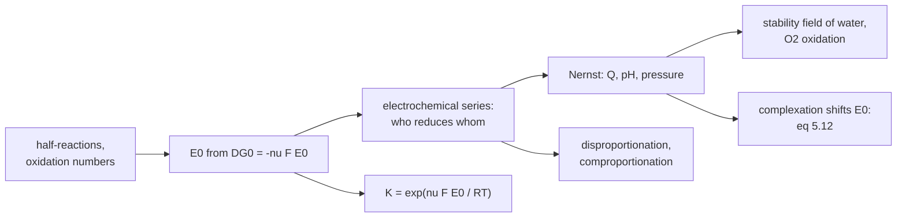

# CH09 · Redox

◀ [[CH08 Main Group Rings and Polymers]] · [[Inorganic Chemistry - Course Map|Course Map]] · end of the CH2113 block

taught · in syllabus (Quiz 2: S&A pp.147–161) extra · book extra · beyond

> [!syllabus] Syllabus map: what is in the syllabus and what is extra in this chapter
> **No lecture slides**: the redox part of CH2113 was taught from the textbook; the Classroom summaries (by another tool) give **Quiz 2 (2026-10-21) = redox up to 2026-10-14, Shriver and Atkins Ch. 5, pp.147–161 only** ([[ch2113-principles-of-inorganic-chemistry-august-20/exam-prep|exam-prep]]), with a sign typo in eq. 5.11 on p.161. Source: the excerpt [[Shriver and Atkins Inorganic Chemistry 5th Ed-174-188.pdf]] (PDF pp.174–188 = printed pp.147–161; printed page = PDF − 27) which I read in full.
> 🟢 **Taught (Quiz 2 scope; tier "book", S&A 5th ed. §5.1–§5.10)**
> - §1 half-reactions, balancing (**Example 5.1**, the seven-step recipe) (§5.1, pp.148–149)
> - §2 **standard potentials and spontaneity**: $\Delta_rG^\circ=-RT\ln K=-\nu FE^\circ$, the hydrogen reference, galvanic cells, $E^\circ_{\rm cell}$, **Example 5.2** (Cu–Zn) (§5.2, pp.149–151)
> - §3 **trends in $E^\circ$**: the thermodynamic cycle, hydration enthalpy (Table 5.1: Li, Na, Cs, Ag) (§5.3, pp.151–153)
> - §4 **the electrochemical series** (Table 5.2), Example 5.3 ($\mathrm{MnO_4^-}$) (§5.4, p.154)
> - §5 **the Nernst equation**, the $K$–$E^\circ$ table (Table 5.3), the temperature dependence $\partial E^\circ/\partial T$, the fuel-cell potential (§5.5, pp.154–156)
> - §6 the **influence of pH** (eq. 5.8), $E^{\ominus}$ at pH 7 (§5.6, pp.156–157)
> - §7 **reactions with water**: the stability field (Fig. 5.3), reduction/oxidation by water, passivation (§5.7, pp.157–159)
> - §8 **oxidation by atmospheric oxygen** (Example 5.5) (§5.8, p.159)
> - §9 **disproportionation and comproportionation** ($\mathrm{Cu^+}$, HClO, Mn(VI); Example 5.6) (§5.9, p.160)
> - §10 **the influence of complexation**, eqs 5.11–5.12 with the p.161 sign typo corrected (§5.10, p.161)
>
> 🟡 **Extra · book** (S&A §5.11–§5.18, beyond p.161: solubility and $E^\circ$, **Latimer, Frost and Pourbaix diagrams**, natural waters, extraction of the elements; only the Frost diagram of Mn is used here)
>
> 🔵 **Extra · beyond** (my additions; numbers in `scripts/ch0209_numbers.py`)
> - §3 the **Table 5.1 cycle recomputed to reproduce the four potentials** ($-3.05$, $-2.72$, $-2.92$, $+0.80$ V against the table's $-3.04$, $-2.71$, $-2.92$, $+0.80$); §5 the Daniell and permanganate–iron $K$ values; §9 the equilibrium constants of all four disproportionations; §11 a **Frost diagram** of manganese and the pH slopes of four couples

> [!key] After this chapter you can
> - **balance** a redox equation by half-reactions in acid or base and identify oxidant, reductant, cathode and anode,
> - convert between $E^\circ$, $\Delta_rG^\circ$ and $K$ ($\Delta_rG^\circ=-\nu FE^\circ$, $\ln K=\nu FE^\circ/RT$; $59.16$ mV per decade at 298 K),
> - use the **electrochemical series** to predict whether one species oxidises or reduces another, and say when kinetics can overrule thermodynamics,
> - apply the **Nernst equation** with non-standard concentrations, pressures and **pH**, and draw the **stability field of water**,
> - decide whether a species **disproportionates**, whether **O$_2$ oxidises** it, and how **complexation** shifts a potential,
> - explain the **trend in $E^\circ(\mathrm M^+/\mathrm M)$** down Group 1 from a thermodynamic cycle (hydration enthalpy dominates).

> [!intuition] The one-sentence story
> Redox is a competition for electrons and the standard potential is the score: a high $E^\circ$ means the oxidised form is hungry; two scores differ by the voltage a cell would make, and that voltage is the free energy of the reaction in electrical units, so every redox question is a thermodynamics question with $F$ as the conversion factor between joules and volts.

![[CH09 Redox.svg]]
*Diagram CH9.0. The chapter in one page: half-reactions, $E^\circ$, $\Delta G$, $K$, the series, the Nernst correction, pH, water's stability field, disproportionation and complexation. Editable source: [[CH09 Redox.excalidraw]].*

*Concept map: every box is a section.*

> [!intuition] Why volts and joules are the same thing
> Moving one mole of electrons through a potential difference $E$ does electrical work $FE$ (with $F=96485$ C/mol the charge of a mole of electrons). A cell at zero current is reversible, so that work equals the Gibbs energy released: $\Delta G=-\nu FE$. Everything else (the Nernst equation, $K$, temperature dependence) is the thermodynamics of [[TH05 Potentials Maxwell Relations Stability and the Third Law]] with $E$ in place of $G$.

## 1. Half-reactions and balancing
taught *S&A §5.1, [[Shriver and Atkins Inorganic Chemistry 5th Ed-174-188.pdf#page=2|pp.148–149]]*

Oxidation is the removal of electrons, reduction the addition of electrons; the species that supplies electrons is the **reducing agent**, the one that removes them the **oxidising agent**. A redox reaction is the **difference of two reduction half-reactions**, each written with the oxidised form and the electrons on the left; the oxidised and reduced species form a **redox couple**, written $\mathrm{Ox/Red}$ ($\mathrm{H^+/H_2}$, $\mathrm{Zn^{2+}/Zn}$). Oxidation numbers help: oxidation raises the oxidation number, reduction lowers it; if no element changes it the reaction is not redox.

> [!key] The seven-step balancing recipe (Example 5.1)
> 1. Write the unbalanced half-reactions as **reductions**. 2. Balance elements **other than H and O**. 3. Balance **O** by adding $\mathrm{H_2O}$ to the other side. 4. In **acid**, balance **H** with $\mathrm{H^+}$; in **base**, add $\mathrm{OH^-}$ to one side and $\mathrm{H_2O}$ to the other. 5. Balance **charge** with $\mathrm{e^-}$. 6. Multiply each half-reaction so the electrons match. 7. **Subtract** (reduction minus reduction) and cancel.

> [!example] Example 5.1 and its self-test (computed)
> $\mathrm{MnO_4^-+8H^++5e^-\to Mn^{2+}+4H_2O}$ and $\mathrm{Fe^{3+}+e^-\to Fe^{2+}}$: multiply the second by 5 and subtract: **$\mathrm{MnO_4^-+8H^++5Fe^{2+}\to Mn^{2+}+5Fe^{3+}+4H_2O}$**. Self-test 5.1 ($\mathrm{Zn}$ + permanganate): $\mathrm{Zn^{2+}+2e^-\to Zn}$ ×5 and the Mn half ×2: **$2\mathrm{MnO_4^-}+16\mathrm H^++5\mathrm{Zn}\to2\mathrm{Mn^{2+}}+8\mathrm{H_2O}+5\mathrm{Zn^{2+}}$** (10 electrons; charge $-2+16=+14=4+10$ ✓).

> [!example] A base-solution example (🔵)
> $\mathrm{MnO_4^-}$ oxidising $\mathrm{SO_3^{2-}}$ in base: $\mathrm{MnO_4^-+2H_2O+3e^-\to MnO_2+4OH^-}$ (×2) and $\mathrm{SO_4^{2-}+H_2O+2e^-\to SO_3^{2-}+2OH^-}$ (×3); subtract: $2\mathrm{MnO_4^-}+3\mathrm{SO_3^{2-}}+\mathrm{H_2O}\to2\mathrm{MnO_2}+3\mathrm{SO_4^{2-}}+2\mathrm{OH^-}$ (charge $-2-6=-8=-6-2$ ✓; O: $8+9+1=18=4+12+2$ ✓).

## 2. Standard potentials and spontaneity
taught *S&A §5.2, [[Shriver and Atkins Inorganic Chemistry 5th Ed-174-188.pdf#page=3|pp.149–151]]*

A reaction is favourable in the sense $K>1$ when $\Delta_rG^\circ<0$, with
$$\Delta_rG^\circ=-RT\ln K\quad(5.1),\qquad\Delta_rG^\circ=-\nu FE^\circ\quad(5.2),\qquad\Rightarrow\ \boxed{E^\circ>0\iff K>1.}$$
Only differences of $\Delta_rG^\circ$ matter, so one half-reaction is set to zero by convention: $\mathrm H^+(\mathrm{aq})+e^-\to\tfrac12\mathrm H_2(\mathrm g)$, $\Delta_rG^\circ=0$, **$E^\circ(\mathrm{H^+,H_2})=0$ at all temperatures** (standard conditions: 1 bar, unit activity, pH 0). The potential of a **galvanic cell** (a cell in which a reaction drives a current) is measured with no current flowing (reversible). The **cathode** is where reduction occurs, the **anode** where oxidation occurs. For zinc: $\mathrm{Zn^{2+}+H_2\to Zn+2H^+}$ has $\Delta_rG^\circ=+147$ kJ/mol, so $E^\circ(\mathrm{Zn^{2+},Zn})=-147000/(2\times96485)=\mathbf{-0.76}$ V; the reverse, $\mathrm{Zn+2H^+\to Zn^{2+}+H_2}$, has $E^\circ_{\rm cell}=+0.76$ V: **zinc dissolves in acid** (and so does every metal with a negative couple).

> [!example] Example 5.2: the copper–zinc cell (and its self-test)
> $E^\circ_{\rm cell}=E^\circ(\mathrm{Cu^{2+},Cu})-E^\circ(\mathrm{Zn^{2+},Zn})=0.34-(-0.76)=\mathbf{1.10}$ V (Daniell). $\nu=2$: $\Delta_rG^\circ=-2\times96485\times1.10=-212.3$ kJ/mol; $\log_{10}K=2\times1.10/0.05916=\mathbf{37.2}$. *Self-test 5.2:* does Cu dissolve in dilute HCl? $E^\circ=0-0.34=-0.34$ V: **no** (Cu is also not oxidised by the $\mathrm H^+$ of the acid); it does dissolve in HNO$_3$ or in air-saturated HCl, where $\mathrm{O_2}$ (+1.23 V) is the oxidant: $E_{\rm cell}=1.23-0.34=+0.89$ V.

## 3. Trends in standard potentials
taught *S&A §5.3, [[Shriver and Atkins Inorganic Chemistry 5th Ed-174-188.pdf#page=5|pp.151–153]], Table 5.1*

The factors in $E^\circ(\mathrm{M^+,M})$ follow from a thermodynamic cycle for $\mathrm M^+(\mathrm{aq})+\tfrac12\mathrm H_2\to\mathrm H^+(\mathrm{aq})+\mathrm M(\mathrm s)$ (Fig. 5.2): **sublimation** of M, **ionisation** of M(g) to $\mathrm M^+(\mathrm g)$, **hydration** of $\mathrm M^+$, with the entropy term $T\Delta S^\circ$ (20–40 kJ/mol) small and nearly independent of M. In the cycle the absolute enthalpy of formation of $\mathrm H^+(\mathrm{aq})$ is $\tfrac12D(\mathrm{H{-}H})$ (218) $+I(\mathrm H)$ (1312) $+\Delta_{\rm hyd}H(\mathrm H^+)$ ($-1085$) $=+445$ kJ/mol.

> [!derivation] Reproducing Table 5.1 (🔵, reproduced and checked)
> For $\mathrm M(\mathrm s)+\mathrm H^+(\mathrm{aq})\to\mathrm M^+(\mathrm{aq})+\tfrac12\mathrm H_2$: $\Delta_rH^\circ=\Delta_{\rm sub}H+I+\Delta_{\rm hyd}H(\mathrm M^+)-445$, $\Delta_rG^\circ=\Delta_rH^\circ-T\Delta S^\circ$ and $E^\circ(\mathrm{M^+,M})=\Delta_rG^\circ/F$ (the *oxidation* free energy over $F$):
>
> | | $\Delta_{\rm sub}H$ | $I_1$ | $\Delta_{\rm hyd}H$ | sum | $\Delta_rH^\circ$ | $T\Delta S^\circ$ | $\Delta_rG^\circ$ | $E^\circ$ (computed) | table |
> |---|---|---|---|---|---|---|---|---|---|
> | Li | 161 | 526 | −520 | 167 | **−278** | 16 | −294 | **−3.05** | −3.04 |
> | Na | 109 | 502 | −406 | 205 | −240 | 22 | −262 | −2.72 | −2.71 |
> | Cs | 79 | 382 | −264 | 197 | −248 | 34 | −282 | −2.92 | −2.92 |
> | Ag | 284 | 735 | −468 | 551 | **+106** | 29 | +77 | **+0.80** | +0.80 |
>
> (kJ/mol; $\Delta_rH^\circ$ in the table's fourth column is the "sum" minus 445.) Reproduced to 0.01 V.

![[fig_ch09_redox.png]]
*Figure CH9.1. Redox quantities. A: $\log_{10}K$ against $E^\circ_{\rm cell}$ for $\nu=1$ (blue) and $\nu=2$ (orange): $\pm2$ V is $K=10^{\pm34}$ for one electron, a **range of 68 decades** (Table 5.3); the Daniell cell (1.10 V, $\nu=2$) has $K=10^{37.2}$. B: the Nernst equation: $E$ against $\log Q$ for the Daniell cell (slope $-29.6$ mV per decade) and for $\mathrm{MnO_4^-}+5\mathrm{Fe^{2+}}$ (slope $-11.8$ mV per decade, $\nu=5$) falls to zero at $Q=K$ ($10^{37.2}$ and $10^{62.5}$). C: the cycle terms of Table 5.1 as stacked bars (blue: sublimation; orange: ionisation; green: hydration): the black bar is their sum; subtracting 445 kJ/mol (dashed) and $T\Delta S$ gives $\Delta G$ and $E^\circ$ above each bar.*

> [!key] Reading the trends (slide-free, S&A §5.3)
> * **Group 1:** $\mathrm{Li^+/Li}$ ($-3.04$ V) is *more* negative than $\mathrm{Cs^+/Cs}$ ($-2.92$ V, Table 5.1) although Li has the *higher* electronegativity (2.20 vs 0.79), the higher sublimation enthalpy and the higher ionisation energy: **Li's tiny ion (90 pm, against Cs 181 pm) has a huge hydration enthalpy ($-520$ against $-264$ kJ/mol) which outweighs the other two** (a $-3.04$ V potential is "hydration-driven"). Na ($-2.71$ V) is anomalously high: high sublimation, moderate hydration.
> * **Na vs Ag:** the ions have similar size (102 and 115 pm, so similar $\Delta_{\rm hyd}H$) but $E^\circ(\mathrm{Na^+/Na})=-2.71$ V and $E^\circ(\mathrm{Ag^+/Ag})=+0.80$ V because of **Ag's much higher sublimation (284) and ionisation (735 kJ/mol; poor screening by $4d$)**. Hence the contrasting behaviour with water: Na reacts explosively, Ag is inert.

## 4. The electrochemical series
taught *S&A §5.4, [[Shriver and Atkins Inorganic Chemistry 5th Ed-174-188.pdf#page=8|p.154]], Table 5.2*

Order the couples by $E^\circ$: **a couple with strongly positive $E^\circ$ has a strongly oxidising Ox form; with strongly negative $E^\circ$ the Red form is a strong reductant.** *The reduced member of a couple can reduce the oxidised member of any couple above it.* Zero potential means Red can just reduce $\mathrm H^+$ in acid.

| Couple | $E^\circ$ (V) | Couple | $E^\circ$ (V) |
|---|---|---|---|
| $\mathrm F_2/\mathrm F^-$ | +2.87 | $\mathrm{Fe(CN)_6^{3-}/Fe(CN)_6^{4-}}$ | +0.36 |
| $\mathrm{Ce^{4+}/Ce^{3+}}$ | +1.76 | $\mathrm{AgCl/Ag,Cl^-}$ | +0.22 |
| $\mathrm{MnO_4^-/Mn^{2+}}$ | +1.51 | $\mathrm H^+/\mathrm H_2$ | 0 |
| $\mathrm{Cl_2/Cl^-}$ | +1.36 | $\mathrm{AgI/Ag,I^-}$ | −0.15 |
| $\mathrm O_2/\mathrm H_2\mathrm O$ | +1.23 | $\mathrm{Zn^{2+}/Zn}$ | −0.76 |
| $\mathrm{IrCl_6^{2-}/IrCl_6^{3-}}$ | +0.87 | $\mathrm{Al^{3+}/Al}$ | −1.68 |
| $\mathrm{Fe^{3+}/Fe^{2+}}$ | +0.77 | $\mathrm{Ca^{2+}/Ca}$ | −2.84 |
| $\mathrm{PtCl_4^{2-}/Pt,4Cl^-}$ | +0.60 | $\mathrm{Li^+/Li}$ | −3.04 |
| $\mathrm{I_3^-/I^-}$ | +0.54 | | |

> [!example] Example 5.3 and its self-test
> $\mathrm{MnO_4^-/Mn^{2+}}$ is $+1.51$ V. It oxidises species whose couples lie **below** it: $\mathrm{Fe^{2+}}$ (0.77 V, $E_{\rm cell}=0.74$ V) and $\mathrm{Cl^-}$ (1.36 V, $E_{\rm cell}=0.15$ V), but not $\mathrm{Ce^{3+}}$ (1.76 V). Consequently **HCl cannot be used to acidify permanganate titrations; $\mathrm{H_2SO_4}$ is used.** *Self-test 5.3:* acidic dichromate $\mathrm{Cr_2O_7^{2-}/Cr^{3+}}=+1.38$ V: it oxidises $\mathrm{Fe^{2+}}$ ($E_{\rm cell}=+0.61$ V, $\nu=6$): **good for titrating iron(II)**; it could oxidise $\mathrm{Cl^-}$ ($E_{\rm cell}=1.38-1.36=+0.02$ V, $K\approx10^{6\times0.02/0.0592}\approx10^2$): thermodynamically marginal, kinetically slow, a possible side reaction only in concentrated HCl.

> [!pitfall] Thermodynamics says *can*, kinetics says *does*
> The classification refers only to spontaneity and $K$, not to rate. $\mathrm{MnO_4^-}$ (+1.51 V), $\mathrm{Cr_2O_7^{2-}}$ and $\mathrm{Ce^{4+}}$ all exceed the $\mathrm{O_2/H_2O}$ potential (+1.23 V) but are stable in water, because oxidising water needs four electrons and an O–O bond (a large kinetic barrier: §7).

## 5. The Nernst equation
taught *S&A §5.5, [[Shriver and Atkins Inorganic Chemistry 5th Ed-174-188.pdf#page=8|pp.154–156]], Tables 5.3, Box 5.1*

$\Delta_rG=\Delta_rG^\circ+RT\ln Q$ (5.3) with $Q$ the reaction quotient; dividing by $-\nu F$ gives
$$\boxed{E=E^\circ-\frac{RT}{\nu F}\ln Q}\quad(5.4),\qquad\text{and at equilibrium }E=0,\ Q=K:\ \boxed{\ln K=\frac{\nu FE^\circ}{RT}}\quad(5.5).$$
At 298.15 K, $RT/F=25.69$ mV and $(RT/F)\ln10=\mathbf{59.16}$ mV: **each factor of 10 in $Q$ changes $E$ by $59.16/\nu$ mV**. Each half-reaction has its own Nernst equation (5.6a). Electrons do not appear in $Q$.

| $E^\circ$/V | $K$ ($\nu=1$) | | | |
|---|---|---|---|---|
| −2 | $10^{-34}$ | −1 | $10^{-17}$ | |
| 0 | 1 | +1 | $10^{17}$ | +2: $10^{34}$ |

The narrow range $-2$ to $+2$ V therefore spans **68 orders of magnitude** in $K$ (computed: 67.6). **Temperature dependence** (eqs 5.7): $\Delta_rG^\circ=\Delta_rH^\circ-T\Delta_rS^\circ$ and $\Delta_rG^\circ=-\nu FE^\circ$ give $\partial E^\circ/\partial T=\Delta_rS^\circ/\nu F$: the slope of $E^\circ(T)$ is the reaction entropy (largely the solvation change: reduction of an ion lowers its charge, freeing solvent, a positive entropy). For $\mathrm{Zn+2H^+\to Zn^{2+}+H_2}$ with $S^\circ(\mathrm{Zn})=41.6$, $S^\circ(\mathrm H_2)=130.7$, $S^\circ(\mathrm{Zn^{2+}})=-112.1$, $S^\circ(\mathrm H^+)=0$ J/mol K: $\Delta S^\circ=(-112.1+130.7)-41.6=-23.0$ J/mol K, so $\partial E^\circ/\partial T=-23.0/(2\times96485)=-0.12$ mV/K: the cell potential falls slowly with temperature.

> [!example] Examples (🔵, all computed)
> * **Daniell cell away from standard:** $E=1.10-\tfrac{0.0592}{2}\log Q$: $Q=10$: 1.070 V; $Q=100$: 1.041 V; $Q=10^{-3}$: 1.189 V; $E=0.5$ V needs $\log Q=20.3$; $E=0$ at $Q=K=1.5\times10^{37}$.
> * **Permanganate–iron(II):** $E^\circ=0.74$ V, $\nu=5$: $\log K=5\times0.74/0.05916=\mathbf{62.5}$.
> * **The fuel cell (Example 5.4 and self-test).** $\mathrm{O_2+4H^++4e^-\to2H_2O}$ (+1.23) minus $\mathrm{2H^++2e^-\to H_2}$ (0): **$E^\circ_{\rm cell}=1.229$ V** (from $\Delta_fG^\circ(\mathrm{H_2O,l})=-237.1$ kJ/mol: $237130/(2\times96485)=1.229$ V, $\nu=2$ per mol $\mathrm{H_2}$). *Self-test 5.4* (both gases at 5.0 bar): $Q=1/(p_{\mathrm H_2}p_{\mathrm O_2}^{1/2})=5^{-1.5}$, $E=1.229+\tfrac{0.0592}{2}\log5^{1.5}=\mathbf{1.260}$ V. A real PEM cell delivers 0.7–0.9 V because the sluggish $\mathrm{O_2}$ reduction costs an **overpotential** of a few tenths of a volt (Box 5.1).

> [!connection] The sign typo of eq. 5.11 (p.161)
> The thermodynamic cycle of Fig. 5.4 sums four free-energy changes to zero. Written as terms $\Delta_rG^\circ(1)+\Delta_rG^\circ(2)+\Delta_rG^\circ(3)+\Delta_rG^\circ(4)=0$ with (1) $\mathrm M^{\nu+}+e^-\to\mathrm M^{(\nu-1)+}$: $-FE^\circ(\mathrm M)$; (2) $\mathrm L$ binding to the reduced ion: $-RT\ln K_{\rm red}$; (3) reverse of the complex's reduction: $+FE^\circ(\mathrm{ML})$; (4) reverse of $\mathrm L$ binding to the oxidised ion: $+RT\ln K_{\rm ox}$. Reordering as printed (the book's order $\mathrm M$, ox, ML, red), **the signs must read $-,\,+,\,+,\,-$**: $-FE^\circ(\mathrm M)+RT\ln K_{\rm ox}+FE^\circ(\mathrm{ML})-RT\ln K_{\rm red}=0$, which gives eq. 5.12a, $E^\circ(\mathrm{ML})=E^\circ(\mathrm M)-\tfrac{RT}{F}\ln(K_{\rm ox}/K_{\rm red})$, as the classroom note said (§10).

## 6. The influence of pH
taught *S&A §5.6, [[Shriver and Atkins Inorganic Chemistry 5th Ed-174-188.pdf#page=10|pp.156–157]]*

Reduced species are usually much stronger Brønsted bases than oxidised ones. The reason is charge: reduction lowers the central atom's oxidation state, so it pulls less on the electrons of its oxo or hydroxo ligands, and they hold protons more tightly. This is the oxidation-state trend of the aqua and oxo acids in reverse ([[CH05 Acid Strength Lewis Acidity and Reactions]] §1–2). So $\mathrm H^+$ is a reactant of the half-reaction $\mathrm{Ox}+\nu_ee^-+\nu_{\mathrm H}\mathrm H^+\to\mathrm{RedH}_{\nu_{\mathrm H}}$ and the potential depends on pH:
$$E=E'-\frac{\nu_{\mathrm H}}{\nu_e}\frac{RT\ln10}{F}\,\mathrm{pH}\ \ (5.8a),\qquad E=E'-\frac{(0.059\ \mathrm V)\,\nu_{\mathrm H}}{\nu_e}\,\mathrm{pH}\ \ (5.8b).$$
**The potential falls as the pH rises** (in proportion to the ratio of protons to electrons). **Illustrations:** $\mathrm{ClO_4^-+2H^++2e^-\to ClO_3^-+H_2O}$: $E^\circ=1.201$ V at pH 0 becomes $1.201-(2/2)(7\times0.059)=\mathbf{0.788}$ V at pH 7: perchlorate is a *stronger* oxidant in acid. **The biological standard state** $E^{\ominus}$ (pH 7, written $E_{m7}$) for $\mathrm{H^+/H_2}$: $0-(2/2)(7\times0.059)=\mathbf{-0.41}$ V.

> [!example] pH slopes of the important couples (🔵, computed)
> | couple | $\nu_{\mathrm H}/\nu_e$ | slope (mV/pH) | $E$ at pH 7 |
> |---|---|---|---|
> | $\mathrm{MnO_4^-/Mn^{2+}}$ | 8/5 | **−94.7** | 0.847 V |
> | $\mathrm{O_2/H_2O}$ | 4/4 | −59.2 | 0.815 V |
> | $\mathrm H^+/\mathrm H_2$ | 2/2 | −59.2 | −0.414 V |
> | $\mathrm{Fe^{3+}/Fe^{2+}}$ (ideal, no $\mathrm H^+$) | 0 | 0 | 0.77 V (but $\mathrm{Fe^{3+}}$ hydrolyses above pH 2, so not constant in practice) |
>
> (Figure CH9.2 C.) Why permanganate is the oxidant of choice in strong acid ($E=1.51$ V) and gives $\mathrm{MnO_2}$ in neutral solution ($\mathrm{MnO_4^-+4H^++3e^-\to MnO_2+2H_2O}$, $E^\circ=1.70$ V, slope $-79$ mV/pH).

## 7. Reactions with water and the stability field
taught *S&A §5.7, [[Shriver and Atkins Inorganic Chemistry 5th Ed-174-188.pdf#page=11|pp.157–159]], Fig. 5.3*

Water can be an **oxidant** (reduced to $\mathrm H_2$) or a **reductant** (oxidised to $\mathrm O_2$). At 1 bar: $\mathrm H^+/\mathrm H_2$: $E=-0.059\,\mathrm{pH}$ (5.9); $\mathrm O_2,\mathrm H^+/\mathrm H_2\mathrm O$: $E=1.23-0.059\,\mathrm{pH}$ (5.10). **The two lines are parallel (slope $-59$ mV/pH) and bound the stability field of water**: a couple below the lower line reduces water (liberates $\mathrm H_2$), a couple above the upper line oxidises it (liberates $\mathrm O_2$). **Natural waters** are shown by two vertical lines at pH 4 and 9 (lakes and streams): this is a **Pourbaix diagram**.

* **Oxidation of a metal by water or acid** ($\mathrm{M+H_2O\to M^+ +\tfrac12H_2+OH^-}$): favourable for $s$-block metals, 3d metals from group 3 to at least group 8–9 (Ti, V, Cr, Mn, Ni) and lanthanoids, e.g. $2\mathrm{Sc}+6\mathrm H^+\to2\mathrm{Sc^{3+}}+3\mathrm H_2$. Mg and Al survive years in moist air because of **passivation** by an impervious oxide film (anodising thickens it on Al).
* **Reduction by water (oxidation of $\mathrm{H_2O}$ to $\mathrm O_2$):** acidified water is a poor reductant except towards strong oxidants such as $\mathrm{Co^{3+}}$ ($1.92$ V): $4\mathrm{Co^{3+}}+2\mathrm{H_2O}\to4\mathrm{Co^{2+}}+\mathrm O_2+4\mathrm H^+$, $E_{\rm cell}=1.92-1.23=\mathbf{0.69}$ V; $\mathrm{Ag^{2+}}$ is another. Couples above 1.23 V that *do* exist in water ($\mathrm{Ce^{4+}}$ 1.76, $\mathrm{Cr_2O_7^{2-}}$ 1.38, $\mathrm{MnO_4^-}$ 1.51) are **kinetically stable** because producing $\mathrm O_2$ needs a four-electron transfer and an **O–O bond**; finding catalysts for this step (Co, Ru, Ir complexes; the $\mathrm{Mn_4Ca}$ cluster of photosystem II) is the central challenge of artificial photosynthesis.

> [!example] A cross-check (🔵)
> At pH 7 the stability window is $-0.414$ to $+0.815$ V: a couple that is a good *reductant* at pH 0 (say $E^\circ=-0.30$ V) is **stable** in neutral water but would be oxidised at pH 0; $\mathrm{Fe^{3+}/Fe^{2+}}$ (0.77 V) lies inside the window at pH 0 (and just inside at pH 7: $0.77<0.815$), so neither $\mathrm{Fe^{2+}}$ nor $\mathrm{Fe^{3+}}$ reacts with water itself: the relevant oxidant is dissolved $\mathrm O_2$ (§8).

## 8. Oxidation by atmospheric oxygen
taught *S&A §5.8, [[Shriver and Atkins Inorganic Chemistry 5th Ed-174-188.pdf#page=13|p.159]]*

A solution exposed to air contains $\mathrm O_2$ as well, so the solute must be tested against $\mathrm{O_2}$. $\mathrm{Fe^{2+}}$ survives under $\mathrm N_2$ ($E^\circ(\mathrm{Fe^{3+},Fe^{2+}})=0.77$ V lies inside the field and iron metal stops at Fe(II) in acid), but in air $\mathrm{4Fe^{2+}+O_2+4H^+\to4Fe^{3+}+2H_2O}$ has $E_{\rm cell}^\circ=1.23-0.77=\mathbf{0.46}$ V at pH 0 and is **spontaneous at higher pH too**: why **Fe(III) is the commonest form of iron in the Earth's crust** and why $\mathrm{Fe^{2+}}$ solutions go brown and deposit rust.

> [!example] Example 5.5 and its self-test
> **Copper roofs:** $E_{\rm cell}=[1.23-0.059\,\mathrm{pH}]-0.34=\mathbf{0.89-0.059\,pH}$: $+0.89$ V at pH 0, **+0.48 V at pH 7**, so $2\mathrm{Cu}+\mathrm O_2+4\mathrm H^+\to2\mathrm{Cu^{2+}}+2\mathrm{H_2O}$ has $K\gg1$ in both. Yet roofs last because a **passivating green layer** of hydrated basic carbonate, sulfate or (near the sea) chloride forms, in which the anion also enters the redox chemistry. *Self-test 5.5:* $\mathrm{SO_4^{2-}+4H^++2e^-\to SO_2(aq)+2H_2O}$, $E^\circ=0.16$ V. $\mathrm{SO_2}$ in fog or cloud, with $\mathrm O_2$ (1.23 V) as oxidant, gives $E_{\rm cell}=1.23-0.16=+1.07$ V: **thermodynamically, $\mathrm{SO_2}$ is oxidised to sulfate (sulfuric acid), the basis of acid rain** ([[Climate - Course Map]]).

## 9. Disproportionation and comproportionation
taught *S&A §5.9, [[Shriver and Atkins Inorganic Chemistry 5th Ed-174-188.pdf#page=14|p.160]]*

A species **disproportionates** when it is both oxidant and reductant for itself: its oxidation number is simultaneously raised and lowered. **Criterion:** the potential for reduction to the lower state must be *higher* than the potential for reduction of the upper state: $E_{\rm cell}^\circ=E^\circ(\text{to lower})-E^\circ(\text{from upper})>0$.

| Species | Reaction | $E^\circ_{\rm cell}$ | $K$ (computed, 298 K) |
|---|---|---|---|
| $\mathrm{Cu^+}$ | $2\mathrm{Cu^+}\to\mathrm{Cu^{2+}}+\mathrm{Cu}$ ($0.52-0.16$) | **0.36 V** | $1.2\times10^{6}$ (book: $1.3\times10^6$) |
| HClO | $5\mathrm{HClO}\to2\mathrm{Cl_2}+\mathrm{ClO_3^-}+2\mathrm{H_2O}+\mathrm H^+$ ($1.63-1.43$) | 0.20 V, $\nu=4$ | $3\times10^{13}$ |
| Mn(VI) $\mathrm{HMnO_4^-}$ | $5\mathrm{HMnO_4^-}+3\mathrm H^+\to4\mathrm{MnO_4^-}+\mathrm{Mn^{2+}}+4\mathrm{H_2O}$ ($1.63-0.90$) | **0.73 V**, $\nu=4$ | $10^{49.4}\approx10^{50}$ |
| $\mathrm{Fe^{2+}}$ (self-test 5.6) | $3\mathrm{Fe^{2+}}\to\mathrm{Fe}+2\mathrm{Fe^{3+}}$ ($-0.41-0.77$) | **−1.18 V**, $\nu=2$ | $10^{-39.9}$: **does not** disproportionate |

**Comproportionation** is the reverse: $\mathrm{Ag^{2+}+Ag\to2Ag^+}$, $E^\circ_{\rm cell}=+1.18$ V, $K=10^{19.9}\approx1\times10^{20}$ ($\nu=1$): Ag(II) and Ag(0) are completely converted to Ag(I). Consequence: **high concentrations of Mn(VI) cannot be had in acid**, but can in base (where $\mathrm{MnO_4^{2-}}$ is stable); $\mathrm{Cu^+}$ is stable only when insoluble ($\mathrm{CuCl}$) or complexed.

## 10. The influence of complexation
taught *S&A §5.10, [[Shriver and Atkins Inorganic Chemistry 5th Ed-174-188.pdf#page=15|p.161]], eqs 5.11–5.12*

A ligand that binds the **oxidised** form more strongly makes the potential **more negative** (oxidation easier); one that binds the **reduced** form more strongly makes it **more positive**. The reason: binding lowers the free energy of whichever form it binds. Stabilising Ox makes it less eager to take electrons, so the reduction becomes less favourable and $E$ falls. Stabilising Red does the opposite. The size of the shift is set by the ratio of the two binding constants:
$$E^\circ(\mathrm{ML})=E^\circ(\mathrm M)-\frac{RT}{F}\ln\frac{K_{\rm ox}}{K_{\rm red}}=E^\circ(\mathrm M)-(0.059\ \mathrm V)\log\frac{K_{\rm ox}}{K_{\rm red}}\quad(5.12b),$$
so **every ten-fold greater binding to the oxidised form lowers $E^\circ$ by 59 mV** (where the book's eq. 5.11 is corrected in §5).

> [!example] The book's illustrations (computed)
> * **Ferricyanide:** $[\mathrm{Fe(CN)_6}]^{3-}+e^-\to[\mathrm{Fe(CN)_6}]^{4-}$, $E^\circ=0.36$ V, i.e. $0.41$ V *below* the aqua couple $[\mathrm{Fe(OH_2)_6}]^{3+/2+}$ (0.77): $\log(K_{\rm ox}/K_{\rm red})=0.41/0.0592=6.9$: **cyanide binds Fe(III) about $10^7$ times better than Fe(II)** (ionic bonding).
> * **Example 5.7 (Ru):** $[\mathrm{Ru(OH_2)_6}]^{3+/2+}=+0.25$ V, $[\mathrm{Ru(CN)_6}]^{3-/4-}=+0.85$ V: the shift is **positive**, so **cyanide stabilises Ru(II)**, opposite to iron: Ru(II)–CN bonding is particularly strong ($\pi$ back-donation into $\mathrm{CN^-}$ $\pi^*$, the same soft-acid, soft-base logic as [[CH06 Hard and Soft Acids and Bases]]).
> * **Self-test 5.7 (bpy):** $[\mathrm{Fe(bpy)_3}]^{3+/2+}=1.02$ V, **above** the aqua 0.77 V (+0.25 V): **bpy stabilises Fe(II)** ($\pi$-acceptor ligand; $K_{\rm red}/K_{\rm ox}=10^{4.2}$).

## 11. Beyond p.161: Latimer and Frost diagrams (🟡/🔵 extra)
extra · book *S&A §5.12–§5.14* · extra · beyond *the Mn diagram computed*

A **Latimer diagram** writes the standard potentials between adjacent oxidation states. For manganese in acid (S&A Resource 3, recalled `[verify]`):
$$\underset{+7}{\mathrm{MnO_4^-}}\overset{0.56}\longrightarrow\underset{+6}{\mathrm{MnO_4^{2-}}}\overset{2.26}\longrightarrow\underset{+4}{\mathrm{MnO_2}}\overset{0.95}\longrightarrow\underset{+3}{\mathrm{Mn^{3+}}}\overset{1.51}\longrightarrow\underset{+2}{\mathrm{Mn^{2+}}}\overset{-1.18}\longrightarrow\underset{0}{\mathrm{Mn}}.$$
A **Frost diagram** plots $NE^\circ$ (the free energy per $F$ of forming each state from the element) against oxidation number $N$: Mn 0, $\mathrm{Mn^{2+}}$ $-2.36$, $\mathrm{Mn^{3+}}$ $-0.85$, $\mathrm{MnO_2}$ $+0.10$, $\mathrm{MnO_4^{2-}}$ $+4.62$, $\mathrm{MnO_4^-}$ $+5.18$ V (check: the direct couple $\mathrm{MnO_4^-/Mn^{2+}}=(5.18+2.36)/5=1.51$ V ✓).

![[fig_ch09_series_frost.png]]
*Figure CH9.2. Reading redox data. A: the electrochemical series of Table 5.2 as a ladder: the reduced form of a couple reduces the oxidised form of any couple above it; the arrow shows Zn reducing $\mathrm{MnO_4^-}$ and $\mathrm{Cu^{2+}}$ ($E_{\rm cell}=1.51+0.76=2.27$ V). B: the Frost diagram of Mn in acid: a species above the straight line joining its neighbours **disproportionates** ($\mathrm{Mn^{3+}}$, $\mathrm{MnO_4^{2-}}$); the steepest descent shows the strongest oxidant ($\mathrm{MnO_4^-}$). C: pH slopes of $\mathrm{MnO_4^-/Mn^{2+}}$ ($-94.7$ mV), $\mathrm{O_2/H_2O}$ and $\mathrm{H^+/H_2}$ ($-59.2$ mV) and the flat $\mathrm{Fe^{3+}/Fe^{2+}}$.*

* **Disproportionation from a Latimer diagram:** a species disproportionates if the potential to its right is *higher* than the one to its left. $\mathrm{Mn^{3+}}$: left 0.95, right 1.51: $2\mathrm{Mn^{3+}}+2\mathrm{H_2O}\to\mathrm{Mn^{2+}}+\mathrm{MnO_2}+4\mathrm H^+$, $E^\circ=1.51-0.95=0.56$ V, $K=10^{9.5}$. $\mathrm{MnO_4^{2-}}$ (0.56 left, 2.26 right): $3\mathrm{MnO_4^{2-}}+4\mathrm H^+\to2\mathrm{MnO_4^-}+\mathrm{MnO_2}+2\mathrm{H_2O}$, $E^\circ=1.70$ V: the reason the green manganate turns purple when acidified.
* **Frost rule:** the lowest point is the thermodynamically stable state (here $\mathrm{Mn^{2+}}$); a point on a *convex* part (above the line between neighbours) is unstable to disproportionation.

<!-- interactive:start (generated by scripts/embed_interactive.py; edit the tool in scripts/interactive/tools/, not this block) -->
> [!interactive]+ Interactive: The Nernst equation: how a cell's voltage depends on concentrations
> For the Daniell cell Zn | Zn²⁺ ‖ Cu²⁺ | Cu the cell potential E = E° − (RT/nF) ln Q with Q = [Zn²⁺]/[Cu²⁺], E° = 1.10 V and n = 2.
>
> ![[ch_nernst.png|720]]
>
> **Try:** Standard conditions (both 1 M): E = 1.10 V. Make [Zn²⁺] 10⁻³ M with 1 M Cu²⁺: E = 1.10 + 3×0.02958 = 1.189 V. Press 'discharge': Q grows toward K = 10^37.2 and E drops to 0. For n = 1 the slope is twice as large (59.2 mV per decade).
>
> [▶ Open the tool in your browser](../Assets/interactive/ch_nernst.html) · [absolute link](file:///home/swastik/Documents/notes/Assets/interactive/ch_nernst.html) · all tools and coverage: [[Interactive Tools]]

<!-- interactive:end -->

## Map of this chapter
> [!connection] How CH09 connects
> **Builds on:** [[TH02 Work Heat and the First Law]] and [[TH05 Potentials Maxwell Relations Stability and the Third Law]] ($\Delta G$, $K$, $\partial G/\partial T$), [[CH04 Acid-Base Concepts]] (the pH dependence is the Brønsted bookkeeping on the electron-transfer step), [[CH06 Hard and Soft Acids and Bases]] (complexation and $\pi$ back-donation shift $E^\circ$), [[CH07 Main Group Cages and Clusters]] and [[CH08 Main Group Rings and Polymers]] (the hydride reductions that make boranes and borazine).
> **Concepts:** [[Standard Reduction Potential]] · [[CH09 Redox|Nernst Equation]] · [[CH09 Redox|Electrochemical Series]] · [[Galvanic Cell]] · [[CH09 Redox|Disproportionation]] · [[Stability Field of Water]] · [[Latimer and Frost Diagrams]] · [[Pourbaix Diagram]] · [[Faraday Constant]]
> **Other subjects:** [[Thermodynamics and Statistical Mechanics - Course Map]] ($\Delta G=-\nu FE$, the temperature coefficient is an entropy), [[Climate - Course Map]] (iron redox in the oceans, $\mathrm{SO_2}$ oxidation to sulfate in clouds, $\mathrm{H_2S}$, the oxygenation of the atmosphere), [[Eco-Evo Exam Prep]] (anoxic bottom waters and the redox ladder of the eutrophic lake, EE06), [[Probability - Course Map]] (none), [[Quantum Mechanics - Course Map]] (tunnelling in electron transfer: [[QM08 Quantum Tunnelling]]).

## Summary
> [!summary] Cheat-sheet
> - **Half-reactions:** reduction forms; balance O with $\mathrm{H_2O}$, H with $\mathrm H^+$ (or $\mathrm{OH^-}$), charge with $e^-$; subtract.
> - **Thermodynamics:** $\Delta_rG^\circ=-RT\ln K=-\nu FE^\circ$; $E^\circ_{\rm cell}=E^\circ(\text{cathode})-E^\circ(\text{anode})$ (both written as reductions); $E^\circ>0\iff K>1$; 59.16 mV/decade; ±2 V ↔ $10^{\pm34}$.
> - **Zinc:** −0.76 V (from $\Delta G=+147$ kJ/mol); **Daniell:** 1.10 V, $K=10^{37.2}$; **fuel cell:** 1.229 V.
> - **Series:** reduced form reduces oxidised forms above it; $\mathrm{MnO_4^-}$ (1.51) oxidises $\mathrm{Fe^{2+}},\mathrm{Cl^-}$ but not $\mathrm{Ce^{3+}}$; kinetics can override.
> - **Nernst:** $E=E^\circ-(RT/\nu F)\ln Q$; pH: slope $-(\nu_{\mathrm H}/\nu_e)59$ mV; water window $-0.059\,\mathrm{pH}$ to $1.23-0.059\,\mathrm{pH}$.
> - **Li anomaly:** hydration. **Na vs Ag:** sublimation and ionisation. **$\partial E^\circ/\partial T=\Delta S^\circ/\nu F$.**
> - **Disproportionation:** $E^\circ(\text{to lower})>E^\circ(\text{from upper})$: $\mathrm{Cu^+}$ ($K=10^6$), HClO ($10^{13}$), Mn(VI) ($10^{50}$); not $\mathrm{Fe^{2+}}$.
> - **Complexation:** $E^\circ(\mathrm{ML})=E^\circ(\mathrm M)-0.059\log(K_{\rm ox}/K_{\rm red})$; CN$^-$ stabilises Fe(III) (×10$^7$) but Ru(II); bpy stabilises Fe(II).

## Practice
1. **Balance.** Balance $\mathrm{Cr_2O_7^{2-}+Fe^{2+}\to Cr^{3+}+Fe^{3+}}$ in acid and compute $E^\circ_{\rm cell}$ and $K$.
2. **Cell.** For $\mathrm{Zn|Zn^{2+}(0.01\ M)\|Cu^{2+}(1\ M)|Cu}$ compute $E$ at 25 °C.
3. **From $\Delta G$.** $\Delta_fG^\circ(\mathrm{Ag^+,aq})=+77.1$ kJ/mol: find $E^\circ(\mathrm{Ag^+/Ag})$.
4. **Series.** Which of $\mathrm{Fe^{2+}}$, $\mathrm{Cl^-}$, $\mathrm{Br^-}$ ($E^\circ(\mathrm{Br_2/Br^-})=1.09$) does acidic dichromate oxidise?
5. **pH.** What is $E$ for $\mathrm{MnO_4^-/Mn^{2+}}$ at pH 3 with all other species at unit activity?
6. **Stability field.** Give the limits of water's stability at pH 4 and pH 9 and say whether $\mathrm{Fe^{2+}}$ (aq) is stable in each.
7. **Disproportionation.** Test whether $\mathrm{HClO_2}$ disproportionates, using the Latimer data $\mathrm{ClO_3^-\overset{1.18}\longrightarrow HClO_2\overset{1.67}\longrightarrow HClO}$.
8. **Complexation.** A ligand L gives $[\mathrm{ML}]^{3+/2+}=0.41$ V while the aqua couple is 0.77 V. Which oxidation state does L prefer, and by what factor?
9. **Temperature.** $\Delta_rS^\circ=-120$ J/mol K for a $\nu=2$ cell: find $\partial E^\circ/\partial T$.
10. **Cu roof.** Find the value of $E_{\rm cell}$ for $\mathrm{Cu+O_2}$ at pH 5 and say why roofs survive.

> [!example]- Solutions
> 1. $\mathrm{Cr_2O_7^{2-}+14H^++6e^-\to2Cr^{3+}+7H_2O}$ with 6 $\times$ ($\mathrm{Fe^{3+}+e^-\to Fe^{2+}}$): $\mathrm{Cr_2O_7^{2-}+14H^++6Fe^{2+}\to2Cr^{3+}+6Fe^{3+}+7H_2O}$; $E^\circ=1.38-0.77=0.61$ V; $\log K=6\times0.61/0.05916=61.9$.
> 2. $E=1.10-\tfrac{0.05916}{2}\log\frac{[\mathrm{Zn^{2+}}]}{[\mathrm{Cu^{2+}}]}=1.10-0.02958\log0.01=1.10+0.059=1.159$ V.
> 3. $\mathrm{Ag^+(aq)+\tfrac12H_2\to Ag+H^+}$: $\Delta G=-77.1$ kJ/mol, so $E^\circ=77100/96485=+0.80$ V.
> 4. $\mathrm{Fe^{2+}}$ (0.77): yes ($+0.61$ V); $\mathrm{Cl^-}$ (1.36): marginal ($+0.02$ V); $\mathrm{Br^-}$ (1.09): $E_{\rm cell}=0.29$ V, thermodynamically yes (though slowly).
> 5. $E=1.51-\tfrac85(0.05916)(3)=1.51-0.284=1.226$ V.
> 6. Window $E_{\rm low}=-0.059\,\mathrm{pH}$, $E_{\rm high}=1.23-0.059\,\mathrm{pH}$: pH 4: $-0.24$ to $+0.99$ V; pH 9: $-0.53$ to $+0.70$ V. $\mathrm{Fe^{3+}/Fe^{2+}}$ at $0.77$ V is inside at pH 4 and **above** the window at pH 9 ($\mathrm{Fe^{3+}}$ would then be able to oxidise water to $\mathrm O_2$): in practice $\mathrm{Fe^{2+}}$ is oxidised by $\mathrm{O_2}$ in either (§8) and Fe(III) precipitates as hydroxide at pH 9, so the 0.77 V figure no longer applies.
> 7. Left potential (to $\mathrm{HClO_2}$) 1.18 V, right (to HClO) 1.67 V: right > left, so $\mathrm{HClO_2}$ **does** disproportionate: $E^\circ=1.67-1.18=0.49$ V. 
> 8. $0.41-0.77=-0.36$ V: **Fe(III)** is preferred; $K_{\rm ox}/K_{\rm red}=10^{0.36/0.0592}=10^{6.1}$ (×1.2 million).
> 9. $\partial E^\circ/\partial T=\Delta S^\circ/\nu F=-120/(2\times96485)=-6.2\times10^{-4}$ V/K $=-0.62$ mV/K.
> 10. $E_{\rm cell}=0.89-0.059\times5=+0.595$ V: strongly favourable, but passivation by basic copper carbonate/sulfate (the green patina) protects the metal.

<!-- zettel:start (generated by scripts/sort_zettel.py; do not edit between the markers) -->
## Zettel notes

> [!abstract]- Zettel notes filed under this chapter (1): the other tool's concept notes from the lectures, unreviewed
> [[zettel/oxidation-number|Oxidation Number]]
<!-- zettel:end -->

## Provenance
> [!provenance]- Source map for this chapter
> | Topic | Source | Scope |
> |---|---|---|
> | half-reactions, balancing | S&A §5.1, [[Shriver and Atkins Inorganic Chemistry 5th Ed-174-188.pdf#page=2\|excerpt pp.148–149]] | taught (Quiz 2) |
> | $E^\circ$, $\Delta G$, cells | S&A §5.2, pp.149–151 | taught (Quiz 2) |
> | trends, thermodynamic cycle, Table 5.1 | S&A §5.3, pp.151–153 | taught (Quiz 2) |
> | electrochemical series, Table 5.2 | S&A §5.4, p.154 | taught (Quiz 2) |
> | Nernst, Table 5.3, $\partial E^\circ/\partial T$, fuel cells | S&A §5.5 and Box 5.1, pp.152, 154–156 | taught (Quiz 2) |
> | pH, water, atmospheric O$_2$, disproportionation, complexation | S&A §5.6–§5.10, pp.156–161 | taught (Quiz 2) |
> | Latimer and Frost diagrams, Pourbaix | S&A §5.12–§5.14 (beyond the excerpt); Mn data recalled `[verify]` | extra/book |
> | Table 5.1 reproduction, $K$ values, pH slopes, Frost numbers | `scripts/ch0209_numbers.py` (§CH09), `scripts/fig_ch0209.py` | extra/beyond |
> | assessments (Quiz 2 date, scope, typo) | [[ch2113-principles-of-inorganic-chemistry-august-20/exam-prep]] (another tool, `agent_written`) | secondary |
> | AI notes | `redox_notes.pdf` (not used except as a cross-check; no discrepancies found) | secondary |
>
> **Notes.** (1) **No lecture slides** exist for redox in the folder; the excerpt is the only primary source. (2) The text layer of the excerpt lost minus signs and Greek letters ($\nu$, $\Delta$) in places; every number above was re-derived (e.g. $E^\circ(\mathrm{Zn^{2+}/Zn})$ from $\Delta_rG^\circ=147$ kJ/mol, Table 5.1 by the cycle) or checked against the surrounding text. (3) The book's $K$ for $\mathrm{Cu^+}$ disproportionation is $1.3\times10^6$; $0.36$ V gives $1.2\times10^6$ (rounding). (4) $E^\circ(\mathrm{HMnO_4^-}/\mathrm{Mn^{2+}})$ and $E^\circ(\mathrm{MnO_4^-}/\mathrm{HMnO_4^-})$ are the book's (Example 5.6). (5) The eq. 5.11 sign pattern is as given in the Classroom summary and verified by the cycle.

**References.** Shriver, D. F. and Atkins, P. W. *Inorganic Chemistry* (5th ed.), Ch. 5 · Latimer, W. M. *The Oxidation States of the Elements and their Potentials in Aqueous Solutions* (2nd ed., 1952) · Frost, A. A. (1951) *J. Am. Chem. Soc.* 73, 2680 · Pourbaix, M. *Atlas of Electrochemical Equilibria in Aqueous Solutions* (1966) · Bard, A. J. and Faulkner, L. R. *Electrochemical Methods* (2nd ed.).

## Across subjects
- [[LS11 Weathering and Regolith]] (Landscapes): oxidation of Fe$^{2+}$ minerals and of sulfides is a redox reaction whose standard potentials decide which weathering reactions run; the rust-coloured regolith is an Fe(III) product.

## Continued in the vault (added 2026-11-12): the class notes (OneNote pages of 5, 7, 12 and 14 October 2026)
*Source: [[1.pdf]], [[2.pdf]], [[3.pdf]], [[4.pdf]] (the four pages of the previously unread [[1-4.pdf]], one page per file, handwritten on OneNote; all four read from page images at 200 dpi this session; the date stamps on the pages are Mon 5 Oct, Wed 7 Oct, Mon 12 Oct and Wed 14 Oct 2026, i.e. within the **Quiz 2 scope**, redox up to 14 October). They are class notes (the pages follow S&A §5.1–§5.10), so almost everything is **already in §1–§10 above** and is only cross-referenced here: the half-reaction balancing (p. 1; §1), standard reduction potentials, $\Delta G=-nFE$, the Nernst equation, the Cu–Zn cell (p. 2; §2, §4, §5), water as oxidant and reductant, the stability field (p. 3; §6, §7), complexation and the disproportionation of $\mathrm{Cu^+}$ (p. 4; §9, §10; the notes' $\mathrm{Fe(CN)_6}$, $\mathrm{Ru(CN)_6}$ and $\mathrm{Cu^+}$ numbers are the ones computed above). **What is new** is the **lithium-ion battery**, the **calcium-battery remark**, the **overpotential** and **passivation versus anodising** remarks, the **kinetic caveat on reduction by water**, and a **numerical check** of every equation and number on the pages (`scripts/ch09_onenote_numbers.py`).*

> [!example] Page 1: the exercises are balanced (checked by atom and charge counting)
> $2\mathrm{NO}+\mathrm O_2\to2\mathrm{NO_2}$; $2\mathrm{C_4H_{10}}+13\mathrm O_2\to8\mathrm{CO_2}+10\mathrm{H_2O}$; $\mathrm{Fe^{3+}}+\mathrm{Cr^{2+}}\to\mathrm{Fe^{2+}}+\mathrm{Cr^{3+}}$; $3\,\mathrm{CH_3CH_2OH}+2\,\mathrm{CrO_4^{2-}}+10\,\mathrm H^+\to3\,\mathrm{CH_3CHO}+2\,\mathrm{Cr^{3+}}+8\,\mathrm{H_2O}$ (each Cr(VI) gains $3$ e$^-$, each ethanol loses $2$ e$^-$: $2\times3=3\times2$). All balance **if the chromium product is $\mathrm{Cr^{3+}}$**; the handwriting of the product can be read as $\mathrm{Cr^{2+}}$, with which the equation is **not** balanced in charge ($+6\ne+4$), so $\mathrm{Cr^{3+}}$ is meant.
> **Two solid-state redox equations.** $\mathrm{LiCoO_2}+\mathrm C\to\mathrm{Li@C}+\mathrm{CoO_2}$ ($\mathrm{Li@C}$ = lithium intercalated in graphite) is the **charging** direction of a lithium-ion cell; and the **oxygen-evolving complex** of photosynthesis: $\mathrm{Mn_4(V,IV,IV,IV)}+2\mathrm{H_2O}\to\mathrm{Mn_4(IV,III,III,III)}+4\mathrm H^++\mathrm O_2$ (the page also sketches the $\mathrm{Mn_4Ca}$ cubane, "OEC"): the four manganese centres take up $17-13=4$ electrons from $2\mathrm{H_2O}\to\mathrm O_2+4\mathrm H^++4e^-$.

> [!key] The lithium-ion cell (page 2, discharge)
> - **Anode (oxidation):** $\mathrm{Li@C_6}\to\mathrm C_6+\mathrm{Li^+}+e^-$ (graphite layers holding Li). **Cathode (reduction):** $\mathrm{Co(IV)O_2}+\mathrm{Li^+}+e^-\to\mathrm{LiCo(III)O_2}$. The page's drawing: a graphite anode, a porous plastic **separator** through which $\mathrm{Li^+}$ moves, the electrolyte $\mathrm{LiPF_6}$, and a layered $\mathrm{CoO_2}$ cathode. Charging runs both reactions backwards (page 1).
> - **Layers are the key to holding Li**, so a failure mode is the **collapse of the layers** (the notes); **X-ray diffraction** checks that the optimum layered structure has formed, and **X-ray photoelectron spectroscopy** is element-specific.
> - **Why $E^\circ(\mathrm{Li^+/Li})=-3.04$ V is exploited:** the page's table $\mathrm{Li^+}$ $-3.04$, $\mathrm{Na^+}$ $-2.71$, $\mathrm{Ca^{2+}}$ $-2.84$, $\mathrm H^+$ $0$, $\mathrm{Cu^{2+}}$ $+0.34$, $\mathrm F_2$ $+2.87$ V. **"No calcium battery?"** The notes' answer: it is hard to handle a charge higher than $+1$, calcium reacts aggressively with the standard battery electrolytes, and it is not good for a high power-to-weight ratio. *Numbers* (my additions, from $nF/3.6M$): theoretical capacity per mass of metal anode: **Li $3862$, Ca $1337$, Na $1166$, Zn $820$ mAh g$^{-1}$**, so although each Ca delivers two electrons its capacity per gram is only $35\%$ of Li's (its larger mass), and its potential is only $0.20$ V above Li's. In practice the anode is **graphite** ($\mathrm{LiC_6}$: $372$ mAh g$^{-1}$ of $\mathrm C_6$) and the cathode $\mathrm{LiCoO_2}$ ($274$ mAh g$^{-1}$ if all the Li is removed; $\approx137$ mAh g$^{-1}$ for the usual half-delithiation $x=0.5$, a recalled practical limit).

> [!key] Page 3: three points not spelled out above
> - **Overpotential.** "Excess voltage = **overpotential**: the potential beyond the thermodynamic potential"; with a **catalyst** one wants to minimise it "so that making $\mathrm H_2+\mathrm O_2$ doesn't use too much potential". Thermodynamically water electrolysis needs $E_{\rm cell}=1.229$ V at every pH ($E_{\rm OER}=1.229-0.0592\,\mathrm{pH}$, $E_{\rm HER}=-0.0592\,\mathrm{pH}$; at pH 7: $0.815$ and $-0.414$ V; the page's "$1.23\ \mathrm V-0.059\ \mathrm V\times\mathrm{pH}$" and "$-0.059\ \mathrm V\times\mathrm{pH}$" with $(RT/F)\ln10=0.05916$ V at 298.15 K); anything beyond is overpotential.
> - **Passivation versus anodising.** *Passivation* is a surface or interface phenomenon, a chemical process: as soon as $\mathrm H_2$ starts to be produced a thin oxide layer ($\mathrm{Al_2O_3}$, $\mathrm{MgO}$) forms and makes the metal less reactive (it has a higher thermodynamic affinity but is slow kinetically). *Anodising* is **electrolytic passivation**: the oxide is grown by oxidation at the anode.
> - **Reduction by water is a kinetic problem.** $\mathrm{Co^{3+}}$ ($E^\circ=1.92$ V) should oxidise water: $4\mathrm{Co^{3+}}+2\mathrm{H_2O}\to4\mathrm{Co^{2+}}+\mathrm O_2+4\mathrm H^+$, $E^\circ_{\rm cell}=1.92-1.229=0.69$ V (the page's value is hard to read; $0.69$ is the difference), $\Delta G^\circ=-4F(0.69)=-267$ kJ per mol $\mathrm O_2$; yet "formation of the O–O bond is kinetically slow". Likewise $\mathrm{Ce^{4+}/Ce^{3+}}$ ($1.76$ V, $0.53$ V above $\mathrm O_2/\mathrm{H_2O}$), $\mathrm{MnO_4^-/Mn^{2+}}$ ($1.51$ V) and $\mathrm{Cr_2O_7^{2-}/Cr^{3+}}$ (the page: $1.38$ V; the usual tabulated value $1.33$ V is recalled, not from this folder) survive in water for kinetic reasons. The sketch of the **Pourbaix diagram** marks the stability field of $\mathrm{H_2O}$ as "the range of values of potential and pH for which $\mathrm{H_2O}$ is thermodynamically stable towards both oxidation and reduction", with a shaded ellipse labelled "safe to drink/consume" between roughly pH 4 and 8 ([[Stability Field of Water]], [[Pourbaix Diagram]]).

*Provenance of this addition.* The class notes are the source of the battery, overpotential and passivation statements and of the page-1 equations; the numbers marked "my additions" (capacities, $\Delta G^\circ$, driving forces) are mine and recomputed in `scripts/ch09_onenote_numbers.py`; the recalled values are marked. Illegible or ambiguous handwriting (the $\mathrm{Cr}$ charge, the $\mathrm{Co^{3+}}$ $E^\circ_{\rm cell}$, the pH limits of the drinking-water band, part of the notes' comment on photoelectron spectroscopy) is flagged above rather than guessed.
