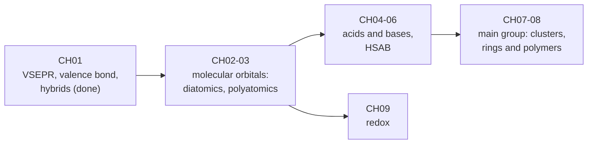

# Inorganic Chemistry: Course Map (CH2113)

<span class="scope-taught">taught · in syllabus</span> <span class="scope-extra-book">extra · book</span>

*CH2113 Principles of Inorganic Chemistry (August 2026), instructor R. Boomi Shankar.* The syllabus has four blocks: **models of covalent bonding** (VSEPR, valence bond, molecular orbital theory), **acids and bases** (four definitions, trends, hard and soft acids and bases), **main-group chemistry** (boron hydrides and Wade's rules, Zintl ions, phosphorus cages, borazine and phosphazenes) and **redox** (Shriver and Atkins Ch. 5). All nine chapters are now drafted (CH01 was the pilot; CH02–CH09 written 2026-10-28 after the user's go-ahead).

> [!warning] What is and is not in the sources
> The **pre-midsem pack** [[chem pre-ms .pdf]] (119 slides with a text layer, instructor's own) covers slides 1–119: VSEPR (1–7), valence bond theory (8–26), molecular orbital theory (27–52), acids and bases (53–82) and main-group chemistry (83–119). Many diagrams (the $\mathrm{H_2O}$ MO slides 46–52, the $\mathrm{H_3}$ and $\mathrm{NH_3}$ level diagrams) are **images only**. **Redox** (Quiz 2) has no lecture slides in the folder, only a textbook excerpt and AI notes. Everything about assessments below is taken from summaries of Google Classroom posts written by another tool (`agent_written`), not from an official syllabus. Details in *Gaps*.

## The storyline

Central thread: **how electrons are shared (models of bonding) $\to$ which species give or accept them (acids and bases, hard and soft) $\to$ what happens when many atoms share them (clusters, rings, polymers) $\to$ and when electrons are transferred (redox).**

## Chapters
| # | Chapter | Slide pages and sources | Status |
|---|---|---|---|
| 01 | [[CH01 VSEPR and Valence Bond Theory]] | slides 1–26; Shriver and Atkins Ch. 2 | **draft** |
| 02 | [[CH02 Molecular Orbital Theory Diatomics]] | slides 27–39 (LCAO, $\mathrm{H_2}$, $\mathrm{N_2}$, HF, CO, ICl); S&A Ch.2 | **draft** |
| 03 | [[CH03 Molecular Orbital Theory Polyatomics]] | slides 40–52 ($\mathrm{H_3}$, $\mathrm{NH_3}$, $\mathrm{SF_6}$, $\mathrm{H_2O}$, read from images); "MOT Part 2" note | **draft** |
| 04 | [[CH04 Acid-Base Concepts]] | slides 53–65 (Arrhenius, Brønsted–Lowry, Lux–Flood, Lewis, generalised) | **draft** |
| 05 | [[CH05 Acid Strength Lewis Acidity and Reactions]] | slides 66–77 (aqua/oxo acids, Lewis trends, reaction types); Tutorial 3 | **draft** |
| 06 | [[CH06 Hard and Soft Acids and Bases]] | slides 78–89; Tutorial 3 Q2, Q11, Q12 | **draft** |
| 07 | [[CH07 Main Group Cages and Clusters]] | slides 90–108 (boranes, Wade, Zintl, P cages); Tutorial 4 Q1–Q4 | **draft** |
| 08 | [[CH08 Main Group Rings and Polymers]] | slides 109–119 (borazine, B–N polymers, phosphazenes); Tutorial 4 Q5–Q10 | **draft** |
| 09 | [[CH09 Redox]] | Shriver and Atkins Ch. 5, pp.147–161 (excerpt PDF pp.174–188): Quiz 2 scope | **draft** (book tier; no slides) |
| 10 | [[CH10 Crystal Field Theory]] + [[Crystal Field Theory Quiz Prep]] | S&A §20.1 pp.473–483; Huheey Ch. 11 pp.394–413 (Quiz 3 scope); lectures 2, 4, 9 Nov and TA 3 Nov **not yet in the folder** | **draft** (book tier; 2026-11-04) |

```dataview
TABLE chapter AS "#", scope AS "Scope", status AS "Status"
FROM #subject/chemistry AND #type/chapter
SORT chapter ASC
```

## Assessments (from the Classroom summaries, `agent_written`)
- **Quiz 1:** 2026-09-08, 12:00, topics up to and including molecular orbital theory.
- **Midsem:** date not stated; Q2(i): when HSAB was not mentioned in the question, CH$_3$NH$_2$ also earned 1 mark (announcement 2026-10-08).
- **Quiz 3:** **2026-11-10 (Tuesday), 12–1 pm, TA session**: crystal field theory and related, **not** MOT; lectures 2 Nov, 4 Nov, 9 Nov and TA session 3 Nov; reading S&A pp.473–483 and Huheey (4th ed.) pp.394–413 (announcement of 2026-11-04). Revision: [[Crystal Field Theory Quiz Prep]].
- **Quiz 2:** 2026-10-21, redox up to 2026-10-14, Shriver and Atkins Ch. 5 **pp.147–161 only**; sign typo in eq. 5.11 on p.161 (signs should be −, +, +, −).
- **End-semester:** not announced. Source: [[ch2113-principles-of-inorganic-chemistry-august-20/exam-prep|exam-prep]].

## Sources and what they are
| ID | File | What it is | Role |
|---|---|---|---|
| PK | [[chem pre-ms .pdf]] | pre-midsem slide pack, 119 pp. (text layer; diagrams as images) | taught: CH01–CH08 |
| OL | [[1-4.pdf]] | 4 pp. OneNote export, no usable text layer; not read yet | unknown |
| KR | [[ch2113-principles-of-inorganic-chemistry-august-20/2026-08-26-molecular-orbital-theory-part-2\|MOT Part 2]], [[ch2113-principles-of-inorganic-chemistry-august-20/2026-09-03-acids-and-bases-lecture-1\|Acids and bases 1]], [[ch2113-principles-of-inorganic-chemistry-august-20/2026-09-03-acids-and-bases-lecture-2\|2]], [[ch2113-principles-of-inorganic-chemistry-august-20/2026-09-14-hard-and-soft-acids-and-bases\|HSAB]], [[ch2113-principles-of-inorganic-chemistry-august-20/2026-09-16-main-group-chemistry-cages-and-clusters\|cages]], [[ch2113-principles-of-inorganic-chemistry-august-20/2026-09-17-main-group-chemistry-rings-and-polymers\|rings]], [[ch2113-principles-of-inorganic-chemistry-august-20/2026-09-19-tutorial-questions-and-answers\|Tutorials 3–4]] | summaries of Classroom lecture posts and tutorials by another tool (`agent_written`) | secondary: dates, tutorial answers |
| SA | [[Shriver and Atkins Inorganic Chemistry 5th Ed.pdf]] and the excerpt [[Shriver and Atkins Inorganic Chemistry 5th Ed-174-188.pdf]] | the course textbook (book page = PDF − 27) | extra/book; redox excerpt = taught |
| HK | [[7_Inorganic_Chemistry_by_Huheey_E_Keiter_and_R_Keiter.pdf]] (**scanned**, OCR; printed page = PDF − 17; pp.394–413 = PDF 411–430) | Quiz 3 reading with S&A pp.473–483 (PDF 500–510) | taught (CH10) |
| BK | `Lee`, `Huheey` (other chapters), `Cotton and Wilkinson`, `B.Sc. 1st year` | other textbooks | extra/book (not opened) |
| AI | `inorganic-chemistry-notes*.pdf`, `inorganicchemmaster/*` (MOT group theory, structural diagrams), `redox_notes.pdf` | AI-written notes | secondary, cross-check only |

## Gaps (to ask the instructor / supply later)
- **CH10 (crystal field theory):** no slides or notes of the 2, 3, 4, 9 Nov sessions; built from the assigned book pages. Book slips found: Huheey p.399 "338 kJ/mol" should be 389; Huheey VCl$_4$ 7900 vs S&A 9010 cm$^{-1}$.
- **Redox** has no lecture material; only the book excerpt (S&A Ch.5 pp.147–161) and AI notes.
- **Slides that are images:** the $\mathrm{H_2O}$ MO sequence (slides 46–52), the $\mathrm{H_3}$ and $\mathrm{NH_3}$ diagrams, the three trigonal-bipyramid structures on slide 6 (unlabelled): **now read from contact sheets** and written up in CH03; the HSAB table (slide 80), the reaction wheels of $\mathrm{P_4O_6}$/$\mathrm{P_4S_{10}}$ (slides 106–107) and the borazine reaction schemes (slide 114) remain pictures read in outline.
- **Slide statements to verify:** MOT rule 1 reads "the greater the number of nodes in a M.O., the greater the anti-bonding character and **higher the symmetry**" (more nodes means higher energy; "higher symmetry" is not generally true); the $\mathrm{SF_6}$ orbital labels ($1a_1$, $1t_1$, $1e$ for $a_{1g}$, $t_{1u}$, $e_g$); the hybrid-set table on slide 15 ("angular" with $sp$, "trigonal pyramidal" with $sp^2$).
- **Unanswered in the material, answered in the notes:** why $\mathrm{H_3PO_3}$ has a non-acidic proton (CH05: it is $\mathrm{HP(O)(OH)_2}$, `[verify]` with the instructor); the RMgX product in Tutorial 4 Q9 is still unclear.
- **New slide slips flagged** (each marked `[verify]` in the chapter): slide 56 "1 in $10^7$" (the ionised fraction is $1.8\times10^{-9}$); slide 95 "4 B–H terminal bonds = 6 electrons" (8); slide 112 benzene C–C 1.42 Å (1.397); slide 113's unbalanced $\mathrm{RBCl_2+R'NH_2}$ equation and "+3LiCl" (balanced in CH08).
- **Dates:** midsem and end-semester not in the notes.

## Why this subject is linked to the others
- **Quantum mechanics:** LCAO and the variational idea are the particle-in-a-box and oscillator ideas applied to molecules; the $\mathrm{H_2}$ valence-bond function uses indistinguishability and orthonormality ([[Quantum Mechanics - Course Map]], [[QM06 The Oscillator Toolbox]]).
- **Group theory:** ligand-group orbitals ($a_{1g}$, $e_g$, $t_{1u}$), point groups and character tables carry the MO diagrams of polyatomics ([[Group Theory - Course Map]]).
- **Thermodynamics:** redox potentials, $\Delta G=-nFE$, the Nernst equation ([[Thermodynamics and Statistical Mechanics - Course Map]]).
- **Climate:** oxidation states of N, S and C in the atmosphere, acid rain (acid–base chemistry), the carbonate system ([[Climate - Course Map]], [[Greenhouse Gases and Absorption Bands]] for vibrations).
- **Probability and counting:** the 90° repulsion counts of VSEPR are small enumerations ([[Probability - Course Map]]).

See [[Subject Map]] for how this subject relates to the others and [[Roadmap]] for its place in the plan.

<!-- graph-spine:start (generated by scripts/graph_spine.py; do not edit between the markers) -->
## Atlas: every note in this subject
The graph view draws only real links, so this block links **every** note of the subject (the map is the hub of its cluster; [[Home]] is the hub of all maps).

> [!abstract]- Atlas (generated): 10 chapters · 80 concept notes · 62 zettel notes (the other tool's, filed in the vault) · 1 other notes in the vault · 12 notes from the other tool (source layer)
> **Chapters (10):** [[CH01 VSEPR and Valence Bond Theory]] · [[CH02 Molecular Orbital Theory Diatomics]] · [[CH03 Molecular Orbital Theory Polyatomics]] · [[CH04 Acid-Base Concepts]] · [[CH05 Acid Strength Lewis Acidity and Reactions]] · [[CH06 Hard and Soft Acids and Bases]] · [[CH07 Main Group Cages and Clusters]] · [[CH08 Main Group Rings and Polymers]] · [[CH09 Redox]] · [[CH10 Crystal Field Theory]]
>
> **Concept notes (80):** [[Absolute Hardness]] · [[Ambidentate Ligand]] · [[Amphoterism]] · [[Aqua Acid]] · [[Arrhenius Acid-Base Definition]] · [[Autoprotolysis of Water]] · [[Back-Donation in Boron Halides]] · [[Bent's Rule]] · [[Bond Order]] · [[Bonding and Antibonding Orbitals]] · [[Bronsted-Lowry Acids and Bases]] · [[CO Back-Donation]] · [[Conjugate Acid-Base Pair]] · [[Coulson's Theorem]] · [[Cryptand]] · [[Crystal Field Splitting Parameter]] · [[Crystal Field Theory]] · [[Cyclophosphazene]] · [[d Orbitals in Complexes]] · [[12-Inorganic-Chemistry/Concepts/Deltahedron|Deltahedron]] · [[Dewar Island Model]] · [[Equivalent and Non-Equivalent Hybrids]] · [[Faraday Constant]] · [[Frontier Orbitals]] · [[Galvanic Cell]] · [[H3 Molecular Orbitals]] · [[Heitler-London Wavefunction]] · [[Heteronuclear Diatomic MOs]] · [[High-Spin and Low-Spin Complexes]] · [[Hueckel Pi Model]] · [[Hybridisation]] · [[12-Inorganic-Chemistry/Concepts/Hypervalence|Hypervalence]] · [[Iminoborane]] · [[Inductive Effect on Acidity]] · [[Inorganic Heterocycle]] · [[Irving-Williams Series]] · [[Jahn-Teller Effect]] · [[Latimer and Frost Diagrams]] · [[LCAO Approximation]] · [[Levelling Effect]] · [[Lewis Acidity of BX3]] · [[Lewis Acids and Bases]] · [[Ligand Field Stabilization Energy]] · [[Ligand Group Orbitals]] · [[Linkage Isomerism]] · [[London Dispersion]] · [[Lone Pair Stereochemical Activity]] · [[Lux-Flood Definition]] · [[Madelung Energy]] · [[Molecular Orbital Theory]] · [[Nephelauxetic Effect]] · [[Octahedral Site Preference Energy]] · [[Octet Rule and Its Limits]] · [[Oxo Acid]] · [[Pairing Energy]] · [[Pauling's Rules for Oxoacids]] · [[Phosphorus Oxides and Sulfides]] · [[Photoelectron Spectroscopy]] · [[Polyphosphazene]] · [[Pourbaix Diagram]] · [[Promotion Energy]] · [[Reduction of a Representation]] · [[Solvent System Definition]] · [[sp Mixing]] · [[Spectrochemical Series]] · [[Spinel Structure]] · [[Square-Planar Complexes]] · [[Stability Field of Water]] · [[Standard Reduction Potential]] · [[Steric Number]] · [[Styx Numbers]] · [[12-Inorganic-Chemistry/Concepts/Superacid|Superacid]] · [[Symmetry Labels a b e t]] · [[Tetrahedral Crystal Field]] · [[Three-Centre Two-Electron Bond]] · [[Trigonal Bipyramid Site Preference]] · [[Valence Bond Theory]] · [[VSEPR Model]] · [[Walsh Diagram]] · [[Zintl Ion]]
>
> **Zettel notes (the other tool's, filed in the vault) (62):** [[amphoteric-lewis-character-of-sulfur-dioxide]] · [[antibonding-molecular-orbital]] · [[aqua-acid]] · [[arrhenius-acid-base-concept]] · [[bent-s-rule]] · [[bonding-molecular-orbital]] · [[borazine]] · [[conjugate-acid-base-pair]] · [[construction-of-lewis-structures]] · [[coulson-type-hybridization-bond-angle-relation]] · [[cyclophosphazenes]] · [[dehydropolymerization-of-borazine]] · [[12-Inorganic-Chemistry/Concepts/zettel/deltahedron|deltahedron]] · [[electron-pair-repulsion-hierarchy]] · [[formal-charge]] · [[generalized-acid-base-concept]] · [[goldschmidt-geochemical-classification]] · [[halogen-charge-transfer-complex]] · [[hard-acid]] · [[hard-and-soft-acids-and-bases-principle]] · [[hard-base]] · [[heteronuclear-diatomic-molecular-orbital-scheme]] · [[homonuclear-diatomic-molecular-orbital-scheme]] · [[hybridization]] · [[hydroxo-acid]] · [[12-Inorganic-Chemistry/Concepts/zettel/hypervalence|hypervalence]] · [[inorganic-heterocycle]] · [[island-model-of-phosphazenes]] · [[lewis-acid-base-concept]] · [[lewis-acid]] · [[lewis-base]] · [[lewis-displacement-reaction]] · [[lewis-metathesis-reaction]] · [[lewis-theory-of-covalent-bonding]] · [[linear-combination-of-atomic-orbitals]] · [[lux-flood-acid-base-concept]] · [[macromolecular-substitution-of-poly-dichlorophosphazene]] · [[molecular-orbital-model-of-ammonia]] · [[molecular-orbital-model-of-carbon-monoxide]] · [[molecular-orbital-model-of-hydrogen-fluoride]] · [[molecular-orbital-model-of-hypervalence-in-sulfur-hexafluoride]] · [[non-equivalent-hybrids]] · [[non-nearest-neighbor-interaction-in-molecular-orbitals]] · [[octet-rule]] · [[orbital-approximation]] · [[oxidation-number]] · [[oxo-acid]] · [[promotion]] · [[resonance]] · [[ring-opening-polymerization-of-hexachlorocyclotriphosphazene]] · [[soft-acid]] · [[soft-base]] · [[solvent-system-acid-base-concept]] · [[stereochemically-inert-lone-pair]] · [[steric-number-formula]] · [[substituted-oxo-acid]] · [[12-Inorganic-Chemistry/Concepts/zettel/superacid|superacid]] · [[three-center-two-electron-bond-in-diborane]] · [[valence-bond-theory]] · [[valence-shell-expansion-in-group-14-halides]] · [[wade-s-rules]] · [[zintl-compounds-and-clusters]]
>
> **Other notes in the vault (1):** [[Crystal Field Theory Quiz Prep]]
>
> **Notes from the other tool (source layer) (12):** [[2026-08-10-lecture-notes-1-and-2]] · [[2026-08-22-teaching-material-mot]] · [[2026-08-22-teaching-material-vbt]] · [[2026-08-26-molecular-orbital-theory-part-2]] · [[2026-09-03-acids-and-bases-lecture-1]] · [[2026-09-03-acids-and-bases-lecture-2]] · [[2026-09-14-hard-and-soft-acids-and-bases]] · [[2026-09-16-main-group-chemistry-cages-and-clusters]] · [[2026-09-17-main-group-chemistry-rings-and-polymers]] · [[2026-09-19-tutorial-questions-and-answers]] · [[ch2113-principles-of-inorganic-chemistry-august-20]] · [[ch2113-principles-of-inorganic-chemistry-august-20/exam-prep|exam-prep]]
<!-- graph-spine:end -->
