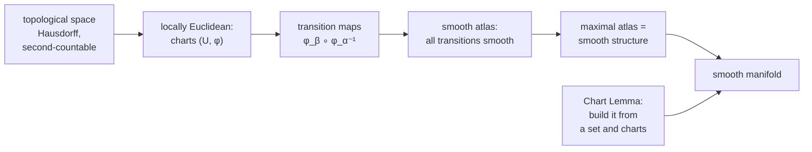

# DM01 · Smooth Manifolds

◀ [[Differential Geometry - Course Map]] · [[DM02 Smooth Maps and Partitions of Unity]] ▶

taught · in syllabus extra · book extra · beyond

> [!warning] What the lecture source says and does not say
> This chapter is MT3184 **week 1** (Aug 3–7, slides DG1–DG3) plus the Chart Lemma of week 3 (DG8). **The slides DG1–DG3 are scans with no readable text** ([[mt3184-differential-geometry-and-lie-groups/2026-08-07-august-3-7|notes of the other tool]]): "taught" below is inferred from the weekly post (*"we defined smooth manifolds and smooth maps, and talked about the partition of unity"*), the syllabus outline and **Homework 1** ([[mt3184-differential-geometry-and-lie-groups/2026-08-07-hw1|HW1]]), which examined: maximal atlases and compatibility (Q1), the graph and stereographic atlases of $S^2$ (Q2), smoothness in charts (Q3, see [[DM02 Smooth Maps and Partitions of Unity]]) and infinitely many smooth structures (Q4). The **Chart Lemma 1.35** is readable (slide DG8). The text follows Lee, *Introduction to Smooth Manifolds* Ch. 1 ([[John M. Lee - Introduction to Smooth Manifolds.pdf#page=19|Lee Ch. 1, pp. 1–29]]; printed page = PDF page − 18).

> [!syllabus] Syllabus map: what is in the syllabus and what is extra in this chapter
> 🟢 **In syllabus (taught, by weekly post, HW1 and DG8)**
> - §2 smooth atlases, maximal atlases, compatibility (HW1 Q1); §3 $S^2$ with the graph and stereographic atlases (HW1 Q2), product manifolds (HW2 Q2a); §4 the Smooth Manifold Chart Lemma 1.35; §5 distinct smooth structures (HW1 Q4)
>
> 🟡 **Extra · book** (Lee Ch. 1; Tu §5; Kumaresan Ch. 1)
> - §1 topological manifolds, countable basis of precompact charts, manifolds are locally compact and paracompact, countable $\pi_1$; projective spaces and Grassmannians; manifolds with boundary (statement)
>
> 🔵 **Extra · beyond** (my additions, labelled)
> - numbers: the transition maps of $S^2$ and $\mathbb{RP}^2$ with their Jacobian determinants checked; the explicit incompatibility of the chart $x\mapsto x^3$ ($y^{-2/3}/3=33,\,3333,\,3.3\times10^5$ at $y=10^{-3},10^{-6},10^{-9}$); the two-copies-of-$\mathbb R^n$ construction of $S^n$ as a worked use of the Chart Lemma, and why the line with two origins fails it

> [!key] After this chapter you can
> - state the three axioms of a **topological manifold** and test examples (the line with two origins, the long line),
> - build a **smooth structure** from an atlas, and prove that two atlases define the same structure iff their union is an atlas,
> - verify that the **graph** and **stereographic** atlases of $S^2$ are smooth and compatible by computing **transition maps**,
> - use the **Smooth Manifold Chart Lemma** to put a manifold structure on a set,
> - explain why **a topological manifold can carry many smooth structures** and why that is rarely a problem.

> [!intuition] The one-sentence story
> A smooth manifold is a space that *locally looks like $\mathbb R^n$ in a way that lets you do calculus*, and "does calculus" means only this: every point lies in a **chart**, a coordinate system identifying a neighbourhood with an open piece of $\mathbb R^n$, and wherever two charts overlap the **change of coordinates** is a smooth map of $\mathbb R^n$ with smooth inverse. A manifold is therefore a map-book (atlas) whose overlapping pages agree smoothly, exactly as the pages of a world atlas agree on their overlaps, except that no single page may be able to show the whole world (the sphere has no global chart).

*Concept map: the two layers of a manifold, topology (Hausdorff, second-countable, locally Euclidean) and smooth structure (atlas with smooth transitions).*

![[fig_dm01_charts.png]]
*A: two stereographic charts cover the circle; the transition is $w\mapsto1/w$. B: for $S^2$ the transition is the inversion $w\mapsto w/|w|^2$, smooth on $\mathbb R^2\setminus0$, sending vertical lines to circles through $0$. C: the chart $x\mapsto x^3$ is not smoothly compatible with the identity chart (its inverse $y^{1/3}$ has an infinite slope at $0$). Sections 3, 3 and 5.*

## 1. Topological manifolds
extra · book *Lee Ch. 1, Thm 1.2, Example 1.3–1.9, Lemma 1.10, Props. 1.11–1.16, Thm 1.15*

> [!key] Definition
> A **topological $n$-manifold** is a topological space $M$ that is (i) **Hausdorff**, (ii) **second-countable**, and (iii) **locally Euclidean of dimension $n$**: every $p\in M$ has an open neighbourhood $U$ homeomorphic to an open subset of $\mathbb R^n$. Such a homeomorphism $\varphi:U\to\widehat U\subseteq\mathbb R^n$ is a **(coordinate) chart**; $U$ is a **coordinate domain** and $\varphi=(x^1,\dots,x^n)$ gives the **local coordinates** of the points of $U$.

> [!intuition] Why each axiom
> *Locally Euclidean* is the point of the definition. *Hausdorff* excludes spaces where two points cannot be separated (so that limits of sequences are unique and compact sets are closed). *Second-countable* excludes spaces that are too big to be covered by countably many charts (the same condition that gives partitions of unity). Without (i) or (ii) most of the theory below is false ([[PA12 Separation, Countability and Local Compactness]] §5).

Examples: $\mathbb R^n$ and every open subset of a manifold; the graph of a continuous function $f:U\to\mathbb R^k$ (the single chart $(x,f(x))\mapsto x$, Example 1.3); the **sphere** $S^n$ (graph charts); **real projective space** $\mathbb{RP}^n=S^n/\{\pm1\}$ ([[PA11 Subspaces, Products and Quotients]]); **products** $M_1\times\cdots\times M_k$ and the **torus** $T^n=(S^1)^n$.

Non-examples. The **line with two origins** ([[Line with Two Origins]]) is locally Euclidean and second-countable but **not Hausdorff**; the **long line** and an uncountable disjoint union of copies of $\mathbb R$ are locally Euclidean and Hausdorff but **not second-countable**. The cross $\{xy=0\}\subset\mathbb R^2$ and a closed disc are not locally Euclidean of a single dimension (the second is a manifold *with boundary*, §6).

**Topological properties (PA12 in action).** Every manifold is *locally compact* with a countable basis of **precompact coordinate balls** (Lee Lemma 1.10, Prop. 1.12), **paracompact** (Thm 1.15), has **countably many components** (each component is open and path-connected), and has a countable fundamental group (Prop. 1.16). **Invariance of dimension** (Thm 1.2): $\mathbb R^n\not\cong\mathbb R^m$ for $n\ne m$, so "dimension" is well defined; this is a hard theorem of algebraic topology and is quoted.

## 2. Smooth structures
taught *Source: HW1 Q1 (week 1); DG1–DG3 unreadable* · extra · book *Lee Prop. 1.17*

Two charts $(U,\varphi)$ and $(V,\psi)$ of an $n$-manifold with $U\cap V\neq\varnothing$ are **smoothly compatible** if the **transition maps**
$$\psi\circ\varphi^{-1}:\varphi(U\cap V)\to\psi(U\cap V),\qquad \varphi\circ\psi^{-1}:\psi(U\cap V)\to\varphi(U\cap V)$$
are smooth (i.e. $C^\infty$ maps between open subsets of $\mathbb R^n$); charts with disjoint domains are automatically compatible. A transition map is a homeomorphism between open subsets of $\mathbb R^n$ whose inverse is also a transition map, so *both* directions smooth means each is a **diffeomorphism** and $\det D(\psi\circ\varphi^{-1})\neq0$ everywhere ([[PA13 The Derivative and the Inverse Function Theorem]], chain rule).

> [!key] Atlas, maximal atlas, smooth structure
> A **smooth atlas** is a family of pairwise compatible charts whose domains cover $M$. It is **maximal** if it contains every chart compatible with all of its charts. A **smooth structure** on a topological manifold $M$ is a maximal smooth atlas; a **smooth manifold** is a topological manifold together with a smooth structure, and the charts of the maximal atlas are the **smooth charts**.

> [!intuition] Why "maximal"?
> One does not want a smooth structure to depend on which particular collection of maps you wrote down. If a chart is compatible with every page of the atlas, adding it changes nothing about what is smooth, so we add all of them; the maximal atlas is the *complete* list of admissible coordinate systems, and any smooth atlas is just a convenient set of generators.

> [!key] Proposition (HW1 Q1; Lee Prop. 1.17)
> Let $M$ be a topological manifold. (a) Every smooth atlas $\mathcal A$ is contained in a **unique** maximal smooth atlas, namely $\mathcal A_{\max}=\{\text{charts compatible with every chart of }\mathcal A\}$. (b) Two smooth atlases $\mathcal A_1,\mathcal A_2$ determine the **same** smooth structure iff $\mathcal A_1\cup\mathcal A_2$ is a smooth atlas.

> [!derivation]- Proof
> (a) *$\mathcal A_{\max}$ is an atlas:* given charts $(V,\psi),(W,\chi)\in\mathcal A_{\max}$ and $p\in V\cap W$, pick $(U,\varphi)\in\mathcal A$ with $p\in U$. Near $\varphi(p)$ (on $\varphi(U\cap V\cap W)$) the transition is a composite $\chi\circ\psi^{-1}=(\chi\circ\varphi^{-1})\circ(\varphi\circ\psi^{-1})$ of smooth maps, hence smooth near $\psi(p)$; $p$ was arbitrary, so $\chi\circ\psi^{-1}$ is smooth on $\psi(V\cap W)$. *Maximal:* a chart compatible with every chart of $\mathcal A_{\max}$ is compatible with those of $\mathcal A\subseteq\mathcal A_{\max}$, so it lies in $\mathcal A_{\max}$. *Unique:* any maximal atlas $\mathcal B\supseteq\mathcal A$ consists of charts compatible with $\mathcal A$, so $\mathcal B\subseteq\mathcal A_{\max}$, and maximality of $\mathcal B$ gives equality.
> (b) If $\mathcal A_1\cup\mathcal A_2$ is a smooth atlas then $\mathcal A_1,\mathcal A_2$ lie in its maximal atlas, which therefore equals both $(\mathcal A_1)_{\max}$ and $(\mathcal A_2)_{\max}$. Conversely if $(\mathcal A_1)_{\max}=(\mathcal A_2)_{\max}$ then every chart of $\mathcal A_2$ is compatible with every chart of $\mathcal A_1$, so the union is a smooth atlas. $\square$

> [!pitfall] A smooth structure is extra data
> The *same* topological manifold can have several smooth structures (§5), and "this atlas is smooth" refers to **a choice**. One checks smoothness of an atlas by computing its transition maps, never by a property of the space alone.

## 3. Examples, with the computations
taught *Source: HW1 Q2, HW2 Q2(a)* · extra · book *Lee Examples 1.22–1.34*

**Euclidean spaces, open subsets, vector spaces, matrices.** $\mathbb R^n$ has the single chart $\mathrm{id}$; an open subset $U\subseteq\mathbb R^n$ (or of any manifold) inherits the charts restricted to $U$ (**open submanifold**). A real $n$-dimensional vector space $V$ is a manifold via any linear isomorphism $V\cong\mathbb R^n$ (all are compatible: transition maps are linear). The space $M(m\times n,\mathbb R)\cong\mathbb R^{mn}$ is a manifold, and $GL(n,\mathbb R)=\{\det\neq0\}$ is an **open submanifold** of $M(n,\mathbb R)$ of dimension $n^2$ (the seed of [[DM08 Lie Groups]]).

**The sphere: two atlases (HW1 Q2).** $S^2=\{x^2+y^2+z^2=1\}$.

* **Graph atlas** $\mathcal A_g=\{(U_i^\pm,\varphi_i^\pm)\}_{i=1}^3$, $U_i^\pm=\{\pm x^i>0\}$, $\varphi_i^\pm$ deleting the $i$-th coordinate. For instance $\varphi_1^+(x,y,z)=(y,z)$ on $\{x>0\}$ and $\varphi_3^+(x,y,z)=(x,y)$ on $\{z>0\}$. The overlap $U_1^+\cap U_3^+=\{x>0,z>0\}$ and
$$\varphi_3^+\circ(\varphi_1^+)^{-1}(y,z)=\Big(\sqrt{1-y^2-z^2},\ y\Big)\qquad\text{on }\{y^2+z^2<1,\ z>0\},$$
smooth because the radicand is positive on the overlap; the inverse transition $(x,y)\mapsto(y,\sqrt{1-x^2-y^2})$ is likewise smooth. Its Jacobian is $\begin{pmatrix}-y/x&-z/x\\1&0\end{pmatrix}$ with $\det=z/x\ne0$: at $(y,z)=(0.3,0.5)$ the finite-difference determinant is $0.615457$ and $z/x=0.5/0.8124=0.615457$ (`dm_numbers.py`). The other overlapping pairs (12 of the 15 pairs overlap; $U_i^+\cap U_i^-=\varnothing$) are the same computation up to signs and permutations of coordinates, so $\mathcal A_g$ is a smooth atlas.
* **Stereographic atlas** $\mathcal A_s=\{(V_1,\psi_1),(V_2,\psi_2)\}$, $V_1=S^2\setminus\{(0,0,1)\}$, $V_2=S^2\setminus\{(0,0,-1)\}$,
$$\psi_1(x,y,z)=\frac{(x,y)}{1-z},\qquad\psi_2(x,y,z)=\frac{(x,y)}{1+z},\qquad\psi_1^{-1}(w)=\frac{(2w,\ |w|^2-1)}{|w|^2+1}.$$
Then **$\psi_2\circ\psi_1^{-1}(w)=w/|w|^2$** on $\mathbb R^2\setminus\{0\}$, the inversion in the unit circle: smooth, its own inverse, with $\det D=-1/|w|^4$ (at $w=(0.7,-1.3)$: $-0.210420$ numerically and by the formula; $|\psi_2\psi_1^{-1}(w)-w/|w|^2|<6\times10^{-13}$ over 1000 random $w$). Figure A is the circle case ($w\mapsto1/w$) and B the picture for $S^2$.
* **They define the same smooth structure** (HW1 Q2c): by the Proposition it suffices that $\mathcal A_g\cup\mathcal A_s$ is a smooth atlas, i.e. each stereographic chart is compatible with each graph chart; e.g. $\psi_1\circ(\varphi_3^+)^{-1}(x,y)=\dfrac{(x,y)}{1-\sqrt{1-x^2-y^2}}$ on $\{0<x^2+y^2<1\}$ (the overlap excludes the north pole $(x,y)=0$), smooth because $1-\sqrt{1-x^2-y^2}>0$ there.

> [!intuition] Why two charts and no fewer
> A single chart would be a homeomorphism $S^2\to$ an open subset of $\mathbb R^2$, impossible: $S^2$ is compact and nonempty open subsets of $\mathbb R^2$ are not. Two charts suffice because the sphere minus a point is a plane; the transition map then records how "the plane seen from the north" relates to "the plane seen from the south", an inversion.

**Products (HW2 Q2a).** If $(U,\varphi)$, $(V,\psi)$ are charts of $M^m,N^n$ then $(U\times V,\varphi\times\psi)$ is a chart of $M\times N$ (product topology, PA11), and the transition maps are products of transition maps, smooth. So $M\times N$ is an $(m+n)$-manifold; the **torus** $T^n=(S^1)^n$ and the **cylinder** $S^1\times\mathbb R$ are examples.

**Real projective space.** $\mathbb{RP}^n$ = lines through $0$ in $\mathbb R^{n+1}$; charts $U_i=\{[x]:x^i\ne0\}$, $\varphi_i[x]=(x^0/x^i,\dots,\widehat{x^i/x^i},\dots,x^n/x^i)$. For $\mathbb{RP}^2$ the transition from $\varphi_0$ to $\varphi_1$ is $(a,b)\mapsto(1/a,\,b/a)$ on $a\ne0$, with $\det=-1/a^3$ (at $(a,b)=(1.7,-0.4)$: $-0.203542$ in both computations). It is Hausdorff and second-countable as a quotient of $S^n$ (PA11), compact, and $n+1$ charts cover it. Grassmannians $G_k(V)$ are built the same way (Lee Ex. 1.36).

## 4. The Smooth Manifold Chart Lemma
taught *Source: DG8 (Lemma 1.35 stated; used for $TM$ in HW3 Q2)* · extra · book *Lee Lemma 1.35, Example 1.36*

> [!intuition] Build a manifold from charts, not from a topology
> Often the *set* is given (all tangent vectors, all $k$-planes) together with natural "coordinate" maps, but no topology. The lemma says that if the coordinate maps overlap smoothly and satisfy two mild finiteness/separation conditions, there is exactly one topology and smooth structure making them charts.

> [!key] Smooth Manifold Chart Lemma (Lee Lemma 1.35)
> Let $M$ be a **set**, and suppose we are given subsets $U_\alpha\subseteq M$ and maps $\varphi_\alpha:U_\alpha\to\mathbb R^n$ such that
> (i) each $\varphi_\alpha$ is a bijection of $U_\alpha$ onto an **open** subset of $\mathbb R^n$;
> (ii) each $\varphi_\alpha(U_\alpha\cap U_\beta)$ is open in $\mathbb R^n$;
> (iii) if $U_\alpha\cap U_\beta\ne\varnothing$ the transition $\varphi_\beta\circ\varphi_\alpha^{-1}$ is smooth;
> (iv) **countably many** of the $U_\alpha$ cover $M$;
> (v) for $p\ne q$ in $M$, either both lie in some $U_\alpha$, or there are **disjoint** $U_\alpha\ni p$, $U_\beta\ni q$.
> Then $M$ has a **unique** smooth manifold structure for which each $(U_\alpha,\varphi_\alpha)$ is a smooth chart.

> [!derivation]- Idea of the proof
> Declare the sets $\varphi_\alpha^{-1}(W)$, $W\subseteq\varphi_\alpha(U_\alpha)$ open, to be a basis (they satisfy the basis conditions because of (i)–(ii)); each $\varphi_\alpha$ is then a homeomorphism onto its image. (iv) gives second-countability (countably many $U_\alpha$, each with a countable basis), (v) gives Hausdorff, (iii) says the $\varphi_\alpha$ form a smooth atlas, and uniqueness holds because a topology and smooth structure making the $\varphi_\alpha$ smooth charts is forced to contain these basis sets. $\square$

> [!example] A worked use of the lemma: $S^n$ from two copies of $\mathbb R^n$, and why the line with two origins fails
> Let $M=(\mathbb R^n\times\{N,S\})/\!\sim$ with $(w,N)\sim(w/|w|^2,S)$ for $w\neq0$ (glue two copies of $\mathbb R^n$ by the inversion). Take $U_N=\mathbb R^n\times\{N\}$, $U_S=\mathbb R^n\times\{S\}$, $\varphi_N,\varphi_S$ the obvious coordinates, together with the two **unit balls** $B_N=\{|w|<1\}\subset U_N$ and $B_S\subset U_S$ as extra (restricted) charts. (i), (ii): $\varphi_N(U_N\cap U_S)=\mathbb R^n\setminus0$ is open. (iii): the transition is $w\mapsto w/|w|^2$, smooth on $\mathbb R^n\setminus0$. (iv): two sets cover $M$. (v): the copy $U_N$ misses only the origin $0_S$ of the other copy and $U_S$ misses only $0_N$; so any pair of points lies in one chart unless it is $\{0_N,0_S\}$, and $0_N\in B_N$, $0_S\in B_S$ are **disjoint**: a point $[(w,N)]$ in both would need $|w|<1$ and $|w/|w|^2|=1/|w|<1$, impossible (20 000 random samples agree, `dm_numbers.py`). So $M$ is a smooth $n$-manifold: it is $S^n$.
> Now glue by the **identity** instead, $(w,N)\sim(w,S)$ for $w\ne0$. (i)–(iv) still hold (the transition is $\mathrm{id}$), but (v) fails for $0_N,0_S$: every neighbourhood of one meets every neighbourhood of the other. This is exactly the **line with two origins** ([[PA11 Subspaces, Products and Quotients]] §5); axiom (v) is the Hausdorff condition in disguise.

Further uses: the **tangent bundle** $TM$ is a manifold of dimension $2n$ by this lemma (DG8, [[DM04 The Tangent Bundle and the Rank Theorem]]), and so is the **Grassmannian** of $k$-planes.

## 5. Smooth structures are not unique
taught *Source: HW1 Q4* · extra · book *Lee Example 1.23* · extra · beyond *literature*

The chart $\varphi(x)=x^3$ is a homeomorphism $\mathbb R\to\mathbb R$, so $\{(\mathbb R,\varphi)\}$ is a smooth atlas, but it is **not** compatible with the standard chart $\mathrm{id}$: the transition $\mathrm{id}\circ\varphi^{-1}(y)=y^{1/3}$ is not smooth at $0$ (its derivative $\tfrac13y^{-2/3}$ equals $33.3,\ 3333,\ 3.3\times10^5$ at $y=10^{-3},10^{-6},10^{-9}$; figure C). So $\mathbb R$ carries **two different smooth structures** on the same topological space. They are, however, **diffeomorphic** (the map $F(x)=x^3$ is a diffeomorphism from the structure of the chart $\varphi$ to the standard one, since in the charts it is the identity of $\mathbb R$).

> [!key] Infinitely many distinct structures (HW1 Q4)
> Let $M$ be a smooth $m$-manifold, $m\ge1$, $p\in M$, $(U,\varphi)$ a smooth chart with $\varphi(p)=0$. For $s>0$ put $F_s(x)=|x|^{s-1}x$ on $\mathbb R^m$ (a homeomorphism with inverse $F_{1/s}$, smooth away from $0$) and consider the atlas
> $$\mathcal A_s=\{(U,F_s\circ\varphi)\}\cup\{(V,\chi)\ \text{smooth charts with }p\notin V\}.$$
> It is a smooth atlas (transitions between $F_s\varphi$ and a chart avoiding $p$ are smooth since $F_s$ is smooth off $0$). Two atlases $\mathcal A_s,\mathcal A_t$ define the same structure iff $F_s\circ\varphi\circ(F_t\circ\varphi)^{-1}=F_{s/t}$ is a **diffeomorphism**, which happens iff $s=t$ ($F_r$ is smooth at $0$ only for odd integers $r$, and then $F_{1/r}$ is not, unless $r=1$). So the topological manifold $M$ has **uncountably many distinct** smooth structures.

> [!extra-beyond]- 🔵 Extra (beyond): diffeomorphism classes of smooth structures (stated, not proved)
> "Distinct" is cheap; the right question is *diffeomorphism classes*. Every topological manifold of dimension $\le3$ has a unique smooth structure up to diffeomorphism (Moise). The sphere $S^7$ has **28** oriented diffeomorphism classes (Milnor 1956, Kervaire–Milnor 1963: *exotic spheres*). $\mathbb R^n$ has a unique smooth structure up to diffeomorphism for $n\ne4$, while $\mathbb R^4$ has uncountably many (Donaldson, Freedman, Taubes; *exotic $\mathbb R^4$*). Whether $S^4$ has an exotic structure is open. This is why the definition asks for a smooth *structure*, not just a topology.

## 6. Manifolds with boundary
extra · book *Lee pp. 24–29, Thm 1.37*

A **manifold with boundary** is a second-countable Hausdorff space locally homeomorphic to open subsets of the **closed upper half-space** $\mathbb H^n=\{x^n\ge0\}$. A point is a **boundary point** if some (hence, by Thm 1.37, every) chart sends it to $\partial\mathbb H^n=\{x^n=0\}$. The closed ball, closed hemisphere and $[0,1]\times M$ are examples; smooth charts need transition maps that extend to smooth maps on open sets of $\mathbb R^n$. The boundary of a smooth $n$-manifold with boundary is a properly embedded $(n-1)$-dimensional submanifold without boundary (Lee Thm 5.11; invariance of the boundary: Thm 1.46). Manifolds with boundary play a role in flows ([[DM12 Integral Curves, Flows and Flowouts]], Lee Ch. 9 §4) and integration; here they are only recorded.

## Map of this chapter
> [!connection] How DM01 connects
> **Builds on:** [[PA11 Subspaces, Products and Quotients]] (products, quotients, line with two origins), [[PA12 Separation, Countability and Local Compactness]] (Hausdorff, second-countable, paracompact), [[PA13 The Derivative and the Inverse Function Theorem]] (diffeomorphism, chain rule, Jacobian determinant).
> **Leads to:** [[DM02 Smooth Maps and Partitions of Unity]] (smooth maps, bump functions, partitions of unity), [[DM03 Tangent Vectors and the Differential]], [[DM04 The Tangent Bundle and the Rank Theorem]] (Chart Lemma again), [[DM08 Lie Groups]] ($GL(n,\mathbb R)$ and $T^n$ are manifolds).
> **Concepts:** [[Topological Manifold]] · [[Coordinate Chart]] · [[Transition Map]] · [[Smooth Atlas]] · [[Smooth Structure]] · [[Smooth Manifold]] · [[Smooth Manifold Chart Lemma]] · [[Stereographic Projection]] · [[Real Projective Space]] · [[Product Manifold]] · [[Exotic Smooth Structure]] · [[Manifold with Boundary]]
> **Other subjects:** [[Group Theory - Course Map]] ($GL(n,\mathbb R)$, $O(n)$ as manifolds), [[Quantum Mechanics - Course Map]] (the Bloch sphere $S^2=\mathbb{CP}^1$, [[QM09 The Stern-Gerlach Experiment and Spin]]), [[Thermodynamics and Statistical Mechanics - Course Map]] (state spaces as manifolds)

## Summary
> [!summary] Cheat-sheet
> - **Topological $n$-manifold** = Hausdorff + second-countable + locally Euclidean of dimension $n$. Consequences: locally compact, paracompact, countably many components. Non-examples: line with two origins (not Hausdorff), long line (not second-countable).
> - **Transition map** $\psi\circ\varphi^{-1}$; **smooth atlas** = pairwise compatible charts covering $M$; **maximal atlas** = smooth structure.
> - Every smooth atlas lies in a unique maximal one; **two atlases give the same structure iff their union is an atlas**.
> - $S^2$: graph charts ($\varphi_3^+\varphi_1^{+\,-1}(y,z)=(\sqrt{1-y^2-z^2},y)$, $\det=z/x$) and stereographic charts (transition $w\mapsto w/|w|^2$, $\det=-1/|w|^4$): smooth, compatible. $\mathbb{RP}^2$: $(a,b)\mapsto(1/a,b/a)$, $\det=-1/a^3$.
> - **Chart Lemma 1.35:** set + bijective charts with open smooth overlaps + countable cover + separation ⇒ unique manifold structure. Gluing $\mathbb R^n\sqcup\mathbb R^n$ by inversion gives $S^n$; by the identity it fails (v) (two origins).
> - $x\mapsto x^3$ is a chart incompatible with $\mathrm{id}$: **distinct** smooth structures (uncountably many via $F_s$), but not necessarily non-diffeomorphic; exotic $S^7$, $\mathbb R^4$ are 🔵 facts.

## Practice
1. **Maximal atlases (HW1 Q1).** Show that a chart compatible with every chart of a smooth atlas $\mathcal A$ belongs to the maximal atlas $\mathcal A_{\max}$, and that $\mathcal A_{\max}$ is itself an atlas.
2. **Graph atlas.** Compute the transition map $\varphi_2^+\circ(\varphi_3^-)^{-1}$ of the graph atlas of $S^2$, state its domain, and compute its Jacobian determinant.
3. **Stereographic atlas.** Derive $\psi_1^{-1}$ and $\psi_2\circ\psi_1^{-1}$ from the geometry of the projection from the north pole, and verify $\det D(\psi_2\circ\psi_1^{-1})=-1/|w|^4$.
4. **Same structure.** Show that the stereographic atlas and the graph atlas of $S^2$ are compatible by checking one pair of charts, and explain why one pair is enough up to symmetry.
5. **Not a manifold.** Show the figure-eight $\{(\sin2t,\sin t)\}$ with the subspace topology is not locally Euclidean at the origin, and that $\{xy=0\}\subset\mathbb R^2$ is not a manifold.
6. **Projective plane.** Compute all six transition maps of the three standard charts of $\mathbb{RP}^2$ and check that the Jacobian determinants are never zero.
7. **Chart Lemma.** Use the Chart Lemma to give $S^1=\mathbb R\cup\{\infty\}$ a manifold structure by gluing two copies of $\mathbb R$ with $w\mapsto1/w$; check axiom (v).
8. **Non-example.** Glue two copies of $\mathbb R$ by $w\mapsto w$ ($w\neq0$) and show (i)–(iv) hold but the result is not Hausdorff.
9. **Another structure on $\mathbb R$.** Show that $x\mapsto x^3$ and $x\mapsto x^5$ define the *same* smooth structure iff the transition $y\mapsto y^{5/3}$ is a diffeomorphism; decide.
10. **Infinitely many structures.** Fill in the proof that $F_s\circ\varphi\circ(F_t\circ\varphi)^{-1}=F_{s/t}$ and that $F_r$ ($r>0$) is a diffeomorphism of $\mathbb R^m$ only for $r=1$.

> [!example]- Solutions
> 1. If $(V,\psi)$ is compatible with all of $\mathcal A$ it belongs to $\mathcal A_{\max}$ by definition. For $\mathcal A_{\max}$ an atlas: for $(V,\psi),(W,\chi)\in\mathcal A_{\max}$ and $p\in V\cap W$ pick $(U,\varphi)\in\mathcal A\ni p$; $\chi\circ\psi^{-1}=(\chi\circ\varphi^{-1})\circ(\varphi\circ\psi^{-1})$ is smooth near $\psi(p)$. (See the proof in §2.)
> 2. $U_3^-=\{z<0\}$ and $U_2^+=\{y>0\}$; overlap $\{y>0,z<0\}$. $(\varphi_3^-)^{-1}(x,y)=(x,y,-\sqrt{1-x^2-y^2})$ and $\varphi_2^+(x,y,z)=(x,z)$, so $\varphi_2^+\circ(\varphi_3^-)^{-1}(x,y)=(x,-\sqrt{1-x^2-y^2})$ on $\{x^2+y^2<1,\,y>0\}$. Jacobian $\begin{pmatrix}1&0\\ x/\sqrt{1-x^2-y^2}&\ y/\sqrt{1-x^2-y^2}\end{pmatrix}$, so $\det=y/\sqrt{1-x^2-y^2}\ne0$ since $y>0$.
> 3. The line from $N=(0,0,1)$ through $q=(x,y,z)$ meets $z=0$ at $N+t(q-N)$ with $1+t(z-1)=0$, $t=1/(1-z)$: $\psi_1(q)=(x,y)/(1-z)$. Inverting with $|w|^2=(x^2+y^2)/(1-z)^2=(1+z)/(1-z)$ gives $z=(|w|^2-1)/(|w|^2+1)$ and $(x,y)=w(1-z)=2w/(|w|^2+1)$. $\psi_2=(x,y)/(1+z)$ gives $\psi_2\psi_1^{-1}(w)=\dfrac{2w/(|w|^2+1)}{1+(|w|^2-1)/(|w|^2+1)}=\dfrac{2w}{2|w|^2}=w/|w|^2$. The Jacobian of $w\mapsto w/|w|^2$ is $\dfrac1{|w|^2}\big(I-2\hat w\hat w^T\big)$, a reflection scaled by $1/|w|^2$, so $\det=-1/|w|^4$.
> 4. $\psi_1\circ(\varphi_3^+)^{-1}(x,y)=(x,y)/(1-\sqrt{1-x^2-y^2})$ is smooth where $\sqrt{\cdot}\ne1$, i.e. off the north pole; and $\varphi_3^+\circ\psi_1^{-1}(w)=2w/(|w|^2+1)$ is smooth on its (open) domain $\{z>0\}=\{|w|>1\}$. The rotation symmetries of $S^2$ (permuting and negating coordinates) map each chart to another one, so checking one pair of each type suffices.
> 5. Near $\beta(0)$ the image looks like two crossing arcs; removing the origin disconnects any small neighbourhood into 4 pieces, whereas removing a point from a neighbourhood in $\mathbb R$ gives 2. The cross $xy=0$ has the same defect at $0$ (4 branches).
> 6. $\varphi_i$ as in §3. $\varphi_1\circ\varphi_0^{-1}(a,b)=(1/a,b/a)$; $\varphi_0\circ\varphi_1^{-1}(a,b)=(1/a,b/a)$ (same formula: involution); $\varphi_2\circ\varphi_0^{-1}(a,b)=(1/b,a/b)$ ($b\ne0$); $\varphi_0\circ\varphi_2^{-1}(a,b)=(b/a,1/a)$; $\varphi_2\circ\varphi_1^{-1}(a,b)=(a/b,1/b)$; $\varphi_1\circ\varphi_2^{-1}(a,b)=(a/b,1/b)$. Each has $\det=\pm1/(\text{denominator})^3\ne0$ (e.g. $-1/a^3$ for the first, $+1/b^3$ for the third).
> 7. $U_N=\mathbb R\times\{N\}$, $U_S=\mathbb R\times\{S\}$, $(w,N)\sim(1/w,S)$, $w\ne0$. (i)–(iv) as in §4. (v): $0_N\in B_N=(-1,1)$, $0_S\in B_S$ are disjoint since $|w|<1$ and $|1/w|<1$ cannot both hold. Result: $S^1$.
> 8. $U_N,U_S$ glued by the identity: transition $\mathrm{id}$, (i)–(iv) hold; for $0_N,0_S$ no common chart and no disjoint chart domains ($(-\varepsilon,\varepsilon)_N\cap(-\varepsilon',\varepsilon')_S\ne\varnothing$). Not Hausdorff.
> 9. The transition is $y\mapsto y^{5/3}$ (from the chart $x^3$ to the chart $x^5$: $\varphi_2\circ\varphi_1^{-1}(y)=(y^{1/3})^5=y^{5/3}$), which is $C^1$ but not $C^2$ at $0$ ($y^{-1/3}$ second derivative blows up), and its inverse $y^{3/5}$ is not differentiable at $0$. So **different** structures, though each is diffeomorphic to the standard one.
> 10. $F_s\circ F_{1/t}(x)=|F_{1/t}(x)|^{s-1}F_{1/t}(x)=\big(|x|^{1/t}\big)^{s-1}|x|^{(1-t)/t}\hat x\cdots$ compute with $|F_r(x)|=|x|^r$ and $F_r(x)=|x|^{r-1}x$: $F_s(F_{1/t}(x))=|x|^{(1/t)(s-1)}|x|^{1/t-1}x=|x|^{s/t-1}x=F_{s/t}(x)$ ✓. $F_r$ is smooth at $0$ iff $|x|^{r-1}=(|x|^2)^{(r-1)/2}$ is smooth iff $(r-1)/2\in\mathbb N$ (odd integer $r$); then $F_r^{-1}=F_{1/r}$ is smooth iff $1/r$ is also an odd integer, i.e. $r=1$.

<!-- zettel:start (generated by scripts/sort_zettel.py; do not edit between the markers) -->
## Zettel notes

> [!abstract]- Zettel notes filed under this chapter (4): the other tool's concept notes from the lectures, unreviewed
> [[zettel/existence-of-infinitely-many-smooth-structures|Existence of Infinitely Many Smooth Structures]] · [[zettel/graph-coordinate-atlas-of-the-2-sphere|Graph Coordinate Atlas of the 2-Sphere]] · [[zettel/maximal-smooth-atlas|Maximal Smooth Atlas]] · [[zettel/smooth-structure-compatibility|Smooth Structure Compatibility]]
<!-- zettel:end -->

## Provenance
> [!provenance]- Source map for this chapter
> | Topic | Source | Scope |
> |---|---|---|
> | smooth manifolds and smooth maps defined, partitions of unity discussed (post only; slides unreadable) | [[mt3184-differential-geometry-and-lie-groups/2026-08-07-august-3-7\|MT3184 Aug 3–7 note]] (DG1–DG3) | taught |
> | maximal atlas, compatibility, $S^2$ atlases, same smooth structure, infinitely many structures | [[mt3184-differential-geometry-and-lie-groups/2026-08-07-hw1\|HW1]] Q1, Q2, Q4 | taught (via homework) |
> | product manifolds | [[mt3184-differential-geometry-and-lie-groups/2026-08-14-hw2\|HW2]] Q2(a) | taught (via homework) |
> | Smooth Manifold Chart Lemma | slide DG8 (via [[mt3184-differential-geometry-and-lie-groups/2026-08-20-august-17-21\|Aug 17–21 note]]); Lee Lemma 1.35 | taught |
> | topological manifolds, locally compact, paracompact, countable $\pi_1$, examples, Prop. 1.17, projective spaces, Grassmannians, boundary | Lee Ch. 1 (Thm 1.2, Lemma 1.10, Props. 1.11–1.17, Examples 1.22–1.36, Thms 1.37, 1.46); Tu §5; Kumaresan Ch. 1 | extra/book |
> | numbers: transitions and Jacobian determinants of $S^2$, $\mathbb{RP}^2$; $x^3$ chart; two-copies-of-$\mathbb R^n$ construction; exotic structures | `scripts/dm_numbers.py` (DM01), `fig_dm01_charts.py`; Kervaire–Milnor 1963, Moise, Donaldson–Freedman (literature, not opened) | extra/beyond |
>
> **Notes.** [!verify] The slides DG1–DG3 were not readable: the exact definitions the instructor used (e.g. whether "smooth manifold" includes second-countability explicitly, whether partitions of unity were proved) are **not** confirmed; the chapter follows Lee, whose numbering the later slides use. HW1 Q4's hint in the folder indexes the homeomorphism by an integer ($F_n(x)=|x|^{n-1}x$ on $B^n$); the family $F_s$, $s>0$, above covers it.
