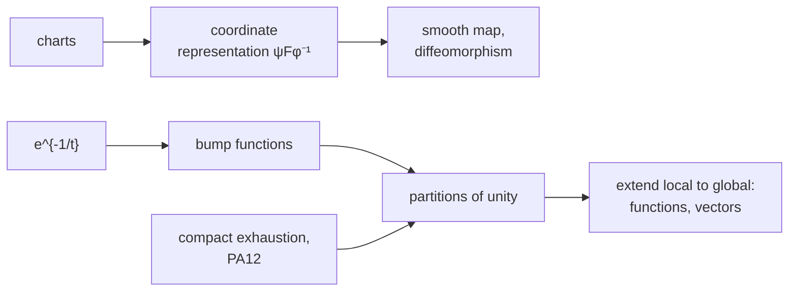

# DM02 · Smooth Maps and Partitions of Unity

◀ [[DM01 Smooth Manifolds]] · [[Differential Geometry - Course Map]] · [[DM03 Tangent Vectors and the Differential]] ▶

taught · in syllabus extra · book extra · beyond

> [!warning] What the lecture source says and does not say
> Week 1 of MT3184 (slides DG1–DG3, **unreadable scans**) "defined smooth manifolds and smooth maps, and talked about the partition of unity" ([[mt3184-differential-geometry-and-lie-groups/2026-08-07-august-3-7|Aug 3–7 note]]). What is certain about this chapter comes from the **homework and Test 1**: smoothness checked in one pair of charts (HW1 Q3), the antipodal map and the differential in local coordinates (HW2 Q4, Test 1 Q2), **bump functions** used to prove locality of tangent vectors (HW2 Q1, Test 1 Q1) and to extend a vector to a vector field (HW4 Q2). Whether the existence theorem for partitions of unity was *proved* in class is not confirmed (`[!verify]`); the proof here follows Lee Thm 2.23 and uses the exhaustion by compact sets of [[PA12 Separation, Countability and Local Compactness]]. Primary source: Lee Ch. 2 ([[John M. Lee - Introduction to Smooth Manifolds.pdf#page=51|Lee Ch. 2, pp. 33–50]]; printed page = PDF page − 18).

> [!syllabus] Syllabus map: what is in the syllabus and what is extra in this chapter
> 🟢 **In syllabus (taught, by post, homework and Test 1)**
> - §1 smooth functions and maps, smoothness in charts at one point (HW1 Q3), local expressions, diffeomorphisms; §2 bump functions (used in locality of tangent vectors); §3 partitions of unity (discussed, existence quoted)
>
> 🟡 **Extra · book** (Lee Ch. 2; Tu §§5–13; Kumaresan Ch. 1; Warner Ch. 1)
> - the proof of existence of partitions of unity; §4 smooth bump functions for closed sets, the extension lemma, the smooth Urysohn lemma
>
> 🔵 **Extra · beyond** (my additions, labelled)
> - numbers: $f(t)/t^{20}=3.7\times10^{-4}$ at $t=0.01$ (flatness); the step $h(0.25)=0.0650$, $h(0.75)=0.9350$; an explicit partition of unity on $\mathbb R$ and on $S^1$; the antipodal map equals $u\mapsto-u$ in stereographic charts (error $5\times10^{-14}$)

> [!key] After this chapter you can
> - decide whether a map between manifolds is **smooth** by computing its **coordinate representation**, and know that **one pair of charts at each point** is enough,
> - construct a **smooth bump function** from $e^{-1/t}$,
> - state and **prove existence of partitions of unity** subordinate to any open cover,
> - use them to **extend** locally defined smooth functions and to separate closed sets by smooth functions.

> [!intuition] The one-sentence story
> Smoothness on a manifold is *defined by coordinates but does not depend on them*: a map is smooth when it is smooth after composing with charts. Local smooth objects (a function near a point, a vector at a point) are then glued into global ones using **partitions of unity**, smooth functions that add up to $1$ and each live in one chart, the manifold analogue of cutting a quilt into patches and blending them smoothly across their seams.

*Concept map: bump functions come from one flat function; PA12's exhaustion makes them locally finite; the sum is the partition of unity.*

![[fig_dm02_bump.png]]
*A: $f(t)=e^{-1/t}$, the smooth step $h$ and the bump $b(x)=h(2-|x|)$. B: a partition of unity on $\mathbb R$ subordinate to $\{(-\infty,1),(0,\infty)\}$. C: a partition of unity on $S^1$ subordinate to the two stereographic domains (§2–§3).*

## 1. Smooth functions and smooth maps
taught *Source: HW1 Q3, HW2 Q4, Test 1 Q2* · extra · book *Lee Ch. 2 pp. 33–40*

> [!key] Definition
> Let $M,N$ be smooth manifolds. A map $F:M\to N$ is **smooth** if every $p\in M$ has smooth charts $(U,\varphi)\ni p$ and $(V,\psi)\ni F(p)$ with $F(U)\subseteq V$ such that the **coordinate representation**
> $$\widehat F=\psi\circ F\circ\varphi^{-1}:\varphi(U)\to\psi(V)$$
> is smooth as a map between open subsets of Euclidean spaces. A **smooth function** is a smooth map $M\to\mathbb R$; $C^\infty(M)$ is the ring of them. A **diffeomorphism** is a smooth bijection with smooth inverse; $M,N$ are **diffeomorphic** if one exists.

> [!intuition] Smooth means smooth in every coordinate system, because the coordinate changes are
> The definition asks for *some* good charts around each point, but the next proposition says that then *all* charts work: coordinates are only a way of writing the map, and the transition maps are smooth, so the property cannot depend on them.

> [!key] Smoothness can be checked in one pair of charts (HW1 Q3; Lee Prop. 2.5)
> Let $F:M\to N$ be **continuous** and $p\in M$. If $\psi\circ F\circ\varphi^{-1}$ is smooth near $\varphi(p)$ for **one** pair of smooth charts $(U,\varphi)\ni p$, $(V,\psi)\ni F(p)$, then it is smooth for **every** such pair, and $F$ is smooth near $p$.
>
> *Proof.* Let $(\widetilde U,\widetilde\varphi)\ni p$, $(\widetilde V,\widetilde\psi)\ni F(p)$ be other smooth charts. By continuity $W=U\cap\widetilde U\cap F^{-1}(V\cap\widetilde V)$ is an open neighbourhood of $p$, and on $\widetilde\varphi(W)$
> $$\widetilde\psi\circ F\circ\widetilde\varphi^{-1}=(\widetilde\psi\circ\psi^{-1})\circ(\psi\circ F\circ\varphi^{-1})\circ(\varphi\circ\widetilde\varphi^{-1}),$$
> a composition of smooth maps (transition maps of the smooth structure, and the hypothesis). $\square$

> [!pitfall] Where continuity enters
> A smooth map is automatically continuous (the representation is continuous and $F(U)\subseteq V$ forces $F|_U=\psi^{-1}\widehat F\varphi$). But *checking* smoothness of a map of unknown regularity in one chart pair presupposes $F$ continuous so that $F^{-1}(V)$ is a neighbourhood of $p$. A step function $F:\mathbb R\to\mathbb R$ ($0$ for $x\le0$, $1$ for $x>0$) has smooth coordinate representations away from $0$ but is not smooth.

**Consequences.** Smoothness is a **local** property ($F$ is smooth iff it is smooth on each open set of an open cover). Identities and constant maps are smooth; **compositions** of smooth maps are smooth (chain rule in charts); inclusions of open subsets, the coordinate maps $\varphi:U\to\varphi(U)$ (a chart is a diffeomorphism onto its image), the projections $M\times N\to M$ and the maps $p\mapsto(p,q)$ are smooth; a map $Z\to M\times N$ is smooth iff both components are. Matrix multiplication and inversion on $GL(n,\mathbb R)$ are smooth (polynomial, resp. rational with nonvanishing denominator $\det$), which will make $GL(n,\mathbb R)$ a Lie group ([[DM08 Lie Groups]]).

> [!example] The antipodal map, in stereographic charts (HW2 Q4)
> $F:S^2\to S^2$, $F(x,y,z)=(-x,-y,-z)$, at $p=(0,0,1)$ (north pole, so $F(p)=(0,0,-1)$). Use $\psi_2$ at $p$ (valid at $N$: $\psi_2(N)=(0,0)$) and $\psi_1$ at $F(p)$ (valid at $S$). With $\psi_2^{-1}(u)=\dfrac{(2u,\,1-|u|^2)}{1+|u|^2}$ one gets $F(\psi_2^{-1}(u))=\dfrac{(-2u,\,|u|^2-1)}{1+|u|^2}$, hence
> $$\psi_1\circ F\circ\psi_2^{-1}(u)=\frac{-2u/(1+|u|^2)}{1-\frac{|u|^2-1}{1+|u|^2}}=-u .$$
> So **$F$ is smooth** and in these charts it is the linear map $u\mapsto-u$ with derivative $-I_2$ everywhere (checked: $\max|\psi_1(F(\psi_2^{-1}(u)))+u|=5\times10^{-14}$ over 2000 random $u$, `dm_numbers.py`).

> [!example] A smooth bijection that is not a diffeomorphism
> Let $M'=\mathbb R$ with the smooth structure of the single chart $\varphi(x)=x^3$ and $\mathbb R$ standard ([[DM01 Smooth Manifolds]] §5). The identity $M'\to\mathbb R$ is a homeomorphism that is **not** smooth (its representation is $y\mapsto y^{1/3}$), while $F(x)=x^3$, $M'\to\mathbb R$ is a **diffeomorphism** (representation $y\mapsto y$). And $G:\mathbb R\to\mathbb R$, $G(x)=x^3$, between the *standard* structures is a smooth bijection but not a diffeomorphism ($G^{-1}$ is not smooth at $0$, because $G'(0)=0$). Moral: **a smooth bijection with invertible differential everywhere is a diffeomorphism** (inverse function theorem, [[PA13 The Derivative and the Inverse Function Theorem]] §4); without the condition it need not be.

## 2. Bump functions
taught (as a tool) *Source: HW2 Q1, Test 1 Q1, HW4 Q2* · extra · book *Lee Lemmas 2.20–2.22 (pp. 41–42), Prop. 2.25 (p. 44)*

> [!intuition] A smooth function can be exactly zero and still become nonzero
> Polynomials and analytic functions cannot vanish on an interval without vanishing everywhere, but smooth functions can: the function $e^{-1/t}$ is smooth, identically $0$ for $t\le0$ and positive for $t>0$, because it approaches $0$ faster than every power of $t$. This one flat function is the seed of all cut-off constructions.

> [!key] The flat function, the step, the bump
> $$f(t)=\begin{cases}e^{-1/t}&t>0\\0&t\le0\end{cases},\qquad h(t)=\frac{f(t)}{f(t)+f(1-t)},\qquad b(x)=h(2-|x|)\ (x\in\mathbb R^n).$$
> $f$ is smooth (every derivative has the form $P(1/t)e^{-1/t}\to0$ as $t\to0^+$, so all derivatives at $0$ are $0$). $h$ is smooth with $h=0$ for $t\le0$, $h=1$ for $t\ge1$ and $0<h<1$ in between (the denominator never vanishes). $b$ is smooth ($|x|$ is smooth off $0$ and $b\equiv1$ near $0$), $b=1$ on the closed ball $\overline B_1$, $b=0$ outside $B_2$, $0\le b\le1$.

Numbers (`dm_numbers.py`): $f(0.01)=3.7\times10^{-44}$ and $f(t)/t^k$ at $t=0.01$ is $3.7\times10^{-34},\ 3.7\times10^{-24},\ 3.7\times10^{-4}$ for $k=5,10,20$ (flat: smaller than every power); $h(0.25)=0.0650$, $h(0.5)=0.5$, $h(0.75)=0.9350$; $b(0.5)=b(1)=1$, $b(1.5)=0.5$, $b(1.9)=1.4\times10^{-4}$, $b(2)=b(3)=0$ (figure A).

**On a manifold.** A *regular coordinate ball* $B=\varphi^{-1}(B_r(x_0))$ has $\overline{B_r}$ inside a larger coordinate ball $B_{r'}(x_0)\subseteq\varphi(U)$ ($r'>r$). The function $b_{x_0,r}(x)=b((x-x_0)/r)$ pulled back by $\varphi$ and **extended by zero** to $M$ is a smooth function with compact support in $U$ (smooth because the support is a compact subset of the chart domain, closed in $M$ by the Hausdorff property, [[PA12 Separation, Countability and Local Compactness]]).

> [!key] Locality of tangent vectors (HW2 Q1, Test 1 Q1: preview of [[DM03 Tangent Vectors and the Differential]])
> If $f,g$ agree on a neighbourhood $U$ of $p$ and $X$ is a derivation at $p$ ($X(fg)=f(p)Xg+g(p)Xf$), then $Xf=Xg$. *Proof.* Put $u=f-g$, $u\equiv0$ on $U$. Take a bump $\psi$ with $\psi(p)=1$, $\operatorname{supp}\psi\subseteq U$. Then $\psi u=0$ on $M$, so $0=X(\psi u)=\psi(p)Xu+u(p)X\psi=Xu$, giving $Xf=Xg$. $\square$

## 3. Partitions of unity
taught (discussed) *Source: Aug 3–7 post* · extra · book *Lee Thm 2.23, Prop. 1.19*

> [!key] Definition
> A **partition of unity** on $M$ is a family of smooth functions $\{\psi_\alpha\}_{\alpha\in A}$, $\psi_\alpha:M\to[0,1]$, such that (i) the supports $\{\operatorname{supp}\psi_\alpha\}$ are a **locally finite** family; (ii) $\sum_\alpha\psi_\alpha\equiv1$. It is **subordinate to** an open cover $\{U_\alpha\}_{\alpha\in A}$ if $\operatorname{supp}\psi_\alpha\subseteq U_\alpha$ for every $\alpha$. (Local finiteness makes the sum finite near each point, hence smooth.)

> [!key] Theorem (Lee Thm 2.23)
> For every smooth manifold $M$ and every open cover $\mathcal U=\{U_\alpha\}_{\alpha\in A}$ there is a partition of unity $\{\psi_\alpha\}_{\alpha\in A}$ subordinate to $\mathcal U$.

> [!derivation]- Proof (compact exhaustion + bump functions)
> Let $K_1\subseteq K_2\subseteq\cdots$ be a compact exhaustion of $M$ ([[PA12 Separation, Countability and Local Compactness]] §4; exists because $M$ is second-countable, locally compact, Hausdorff), $K_0=K_{-1}=\varnothing$.
> *Step 1 (many small bumps).* For $j\ge1$ the set $A_j=K_j\setminus\operatorname{int}K_{j-1}$ is compact and lies in the open set $W_j=\operatorname{int}K_{j+1}\setminus K_{j-2}$. For each $p\in A_j$ pick $\alpha(p)$ with $p\in U_{\alpha(p)}$, and a regular coordinate ball $B_p$ around $p$ with $\overline{B_p}\subseteq U_{\alpha(p)}\cap W_j$. Let $f_p\ge0$ be a smooth bump function with $f_p>0$ exactly on $B_p$ and $\operatorname{supp}f_p=\overline{B_p}$ (§2). The open sets $B_p$ cover the compact $A_j$; choose finitely many, $f_{j,1},\dots,f_{j,N_j}$, with supports in $W_j\cap U_{\alpha(j,k)}$.
> *Step 2 (locally finite sum).* The collection $\{f_{j,k}\}_{j,k}$ has locally finite supports: $\operatorname{int}K_m$ meets $W_j$ only for $j\le m+1$ (because $K_{j-2}\supseteq K_m$ for $j\ge m+2$), and each $j$ contributes finitely many. So $f=\sum_{j,k}f_{j,k}$ is a smooth function, and $f>0$ everywhere since each $x\in A_j$ lies in some $B_p$ with $f_{j,k}>0$ there.
> *Step 3 (normalise and group).* Put $\psi_{j,k}=f_{j,k}/f$ and, for $\alpha\in A$, $\psi_\alpha=\sum_{(j,k):\,\alpha(j,k)=\alpha}\psi_{j,k}$ (a locally finite sum; $=0$ if the index set is empty). Then $0\le\psi_\alpha\le1$, $\sum_\alpha\psi_\alpha=\sum\psi_{j,k}=1$, the family of supports is locally finite, and $\operatorname{supp}\psi_\alpha=\bigcup\operatorname{supp}\psi_{j,k}\subseteq U_\alpha$ (a locally finite union of closed sets is closed). $\square$

> [!example] A partition of unity on $\mathbb R$, with numbers
> Cover $\mathbb R$ by $U_1=(-\infty,1)$ and $U_2=(0,\infty)$. Put $\psi_2(x)=h(3x-1)$ and $\psi_1=1-\psi_2$. Then $\psi_2=0$ for $x\le\tfrac13$, $=1$ for $x\ge\tfrac23$, so $\operatorname{supp}\psi_2=[\tfrac13,\infty)\subseteq U_2$ and $\operatorname{supp}\psi_1=(-\infty,\tfrac23]\subseteq U_1$. Values: $\psi_2(0.4)=0.0230$, $\psi_2(0.5)=0.5000$, $\psi_2(0.6)=0.9770$ (and $\psi_1$ the complements); $\psi_1+\psi_2=1$ exactly (figure B). Note that $h(x)$ itself would *not* do: $\operatorname{supp}h=[0,\infty)\not\subseteq(0,\infty)$.
>
> **On the circle:** for the covering of $S^1$ by $V_1=S^1\setminus\{N\}$, $V_2=S^1\setminus\{S\}$ take $\psi_1(x,y)=h(\tfrac12-y)$, $\psi_2=1-\psi_1$: $\psi_1=0$ where $y\ge\tfrac12$ (a neighbourhood of $N$) and $=1$ where $y\le-\tfrac12$; $\operatorname{supp}\psi_1\subseteq\{y\le\tfrac12\}\subseteq V_1$ and $\operatorname{supp}\psi_2\subseteq\{y\ge-\tfrac12\}\subseteq V_2$ (verified on a grid, figure C).

> [!pitfall] Supports, not zero sets
> The support is the **closure** of $\{\psi\neq0\}$. A function positive on $(0,\infty)$ has support $[0,\infty)$, which touches $0$. "Subordinate" must be checked on supports, as the example shows.

## 4. Gluing local objects: the standard uses
extra · book *Lee Prop. 2.25 (p. 44), Lemma 2.26 (p. 45); compare Thm 2.29*

> [!key] Bump functions for closed sets (Lee Prop. 2.25)
> If $A\subseteq M$ is closed and $U\supseteq A$ is open, there is a smooth $\psi:M\to[0,1]$ with $\psi\equiv1$ on $A$ and $\operatorname{supp}\psi\subseteq U$.
> *Proof.* $\{U,\,M\setminus A\}$ is an open cover; take a subordinate partition $\{\psi_U,\psi_B\}$. Then $\psi_B=0$ on $A$ (its support lies in $M\setminus A$), so $\psi=\psi_U=1-\psi_B=1$ on $A$ and $\operatorname{supp}\psi_U\subseteq U$. $\square$

> [!key] Extension lemma for smooth functions (Lee Lemma 2.26)
> Let $A\subseteq M$ be closed and $f:A\to\mathbb R^k$ a function that extends smoothly *near each point of $A$* (i.e. $f$ is smooth in the sense that each $p\in A$ has a neighbourhood $W_p$ and a smooth $\tilde f_p:W_p\to\mathbb R^k$ with $\tilde f_p|_{W_p\cap A}=f|_{W_p\cap A}$). For every open $U\supseteq A$ there is a smooth $\tilde f:M\to\mathbb R^k$ with $\tilde f|_A=f$ and $\operatorname{supp}\tilde f\subseteq U$.
> *Proof.* Cover $A$ by the $W_p\cap U$ and $M$ by adding $M\setminus A$ (where define $\tilde f_0=0$). A subordinate partition of unity $\{\psi_p,\psi_0\}$ gives $\tilde f=\sum\psi_p\tilde f_p$ (extended by $0$ off $\operatorname{supp}\psi_p$); on $A$, $\psi_0=0$, $\sum\psi_p=1$ and each $\tilde f_p=f$ on $A\cap W_p$, so $\tilde f=f$. $\square$

> [!key] Smooth Urysohn lemma (a consequence of partitions of unity; compare Lee Thm 2.29: every closed set is the zero set of a smooth function)
> Disjoint closed sets $A,B\subseteq M$ are **separated by a smooth function**: there is a smooth $f:M\to[0,1]$ with $f=0$ on $A$ and $f=1$ on $B$.
> *Proof.* The sets $U_1=M\setminus B$, $U_2=M\setminus A$ cover $M$ ($A\cap B=\varnothing$). With a subordinate partition $\{\psi_1,\psi_2\}$, $\psi_1=0$ on $B$ and $\psi_2=0$ on $A$; $f=\psi_2$ equals $0$ on $A$ and $1-\psi_1=1$ on $B$. $\square$

These three results are what turns "there is a smooth function/vector near $p$" into "there is a global one": for instance **every tangent vector $v\in T_pM$ extends to a global vector field** (HW4 Q2, [[DM10 Vector Fields and Lie Brackets]]), local flows can be cut off to complete ones, and a **smooth function on a closed submanifold extends to the whole manifold** ([[DM06 Submanifolds]]).

<!-- interactive:start (generated by scripts/embed_interactive.py; edit the tool in scripts/interactive/tools/, not this block) -->
> [!interactive]+ Interactive: Charts on the sphere: stereographic projection and the transition map
> The 2-sphere cannot be covered by a single chart, but two stereographic charts do it: φ_N projects from the north pole onto the equatorial plane, φ_S from the south pole.
>
> ![[dm_stereographic.png|720]]
>
> **Try:** Move p toward the north pole: its north-chart coordinate u runs off to infinity while the south-chart coordinate v → 0. At the equator (z = 0) the two charts agree (|u| = |v| = 1). Check |u||v| = 1 and that u and v point in the same direction.
>
> [▶ Open the tool in your browser](../Assets/interactive/dm_stereographic.html) · [absolute link](file:///home/swastik/Documents/notes/Assets/interactive/dm_stereographic.html) · all tools and coverage: [[Interactive Tools]]

<!-- interactive:end -->

## Map of this chapter
> [!connection] How DM02 connects
> **Builds on:** [[DM01 Smooth Manifolds]] (charts, transitions), [[PA12 Separation, Countability and Local Compactness]] (compact exhaustion, locally finite refinement), [[PA13 The Derivative and the Inverse Function Theorem]] (chain rule, diffeomorphism), [[PA11 Subspaces, Products and Quotients]] (gluing lemma, closed map lemma).
> **Leads to:** [[DM03 Tangent Vectors and the Differential]] (locality via bump functions; $dF$ in coordinates), [[DM06 Submanifolds]] (extension from submanifolds), [[DM07 Sard Whitney and Transversality]] (smooth approximation, exhaustion functions), [[DM10 Vector Fields and Lie Brackets]] (extension of vectors to vector fields).
> **Concepts:** [[Smooth Function]] · [[Smooth Map]] · [[Diffeomorphism]] · [[Coordinate Representation of a Map]] · [[Bump Function]] · [[Partition of Unity]] · [[Smooth Extension Lemma]] · [[Smooth Urysohn Lemma]]
> **Other subjects:** [[Group Theory - Course Map]] ($GL(n,\mathbb R)$, matrix groups: smooth operations), [[Quantum Mechanics - Course Map]] (cut-off functions in wave packets)

## Summary
> [!summary] Cheat-sheet
> - $F$ **smooth** $\iff$ smooth coordinate representation $\psi F\varphi^{-1}$ near each point; **one chart pair suffices** (for continuous $F$); smooth $\Rightarrow$ continuous; compositions, products, projections, charts are smooth; smoothness is local.
> - **Diffeomorphism** = smooth with smooth inverse; smooth bijection with $dF$ invertible $\Rightarrow$ diffeomorphism; $x\mapsto x^3$ is a smooth bijection of $\mathbb R$ that is not. Antipodal map of $S^2$ is $u\mapsto-u$ in stereographic charts.
> - $f=e^{-1/t}$ (flat), $h=f(t)/(f(t)+f(1-t))$ (smooth step), $b=h(2-|x|)$ (bump, $=1$ on $\overline B_1$, supp $\overline B_2$).
> - **Partition of unity** subordinate to $\{U_\alpha\}$: $\psi_\alpha\in C^\infty(M,[0,1])$, $\operatorname{supp}\psi_\alpha\subseteq U_\alpha$, locally finite, $\sum\psi_\alpha=1$. Exists on every manifold (exhaustion + bumps). Check **supports**, not zero sets.
> - Consequences: bump $\psi=1$ on closed $A$, supp $\subseteq U$; **extension lemma**; **smooth Urysohn** ($f=0$ on $A$, $1$ on $B$).

## Practice
1. **One chart pair (HW1 Q3).** Let $F:M\to N$ be continuous and suppose $\psi F\varphi^{-1}$ is smooth for one pair of charts at each point. Prove it is smooth for all pairs.
2. **Antipodal map.** Verify that $F(x,y,z)=-(x,y,z)$ on $S^2$ has coordinate representation $u\mapsto-u$ with respect to $\psi_2$ at the north pole and $\psi_1$ at the south pole, and compute $dF$ at $N$.
3. **Product maps.** Show that the projections $\pi_1:M\times N\to M$ and the maps $\iota_q:M\to M\times N$, $p\mapsto(p,q)$ are smooth, and that $F=(F_1,F_2):Z\to M\times N$ is smooth iff $F_1,F_2$ are.
4. **Two structures on $\mathbb R$.** With $M'=(\mathbb R,\ \text{chart }x^3)$ decide which of $\mathrm{id}:M'\to\mathbb R$, $x\mapsto x^3:M'\to\mathbb R$, $x\mapsto x^3:\mathbb R\to\mathbb R$ are smooth, diffeomorphisms.
5. **Smooth step.** Prove $h(t)=f(t)/(f(t)+f(1-t))$ is smooth with $h=0$ for $t\le0$, $h=1$ for $t\ge1$, and increasing; compute $h(0.25),h(0.5),h(0.75)$.
6. **Bump on $\mathbb R^n$.** Prove $b(x)=h(2-|x|)$ is smooth, equal to $1$ on $\overline B_1$ and supported in $\overline B_2$; why is it smooth at $x=0$ although $|x|$ is not?
7. **Partition of unity on $\mathbb R$.** Construct a partition of unity subordinate to $\{(-\infty,2),(1,\infty)\}$.
8. **Partition of unity on $S^1$.** Verify that $\psi_1=h(\tfrac12-y)$, $\psi_2=1-\psi_1$ is subordinate to $\{V_1=S^1\setminus N,\,V_2=S^1\setminus S\}$.
9. **Extension.** Prove the extension lemma in the simplest case: a smooth $f$ defined on an open $W\supseteq A$ ($A$ closed) extends to a global smooth function equal to $f$ on $A$.
10. **Smooth Urysohn.** Derive from partitions of unity a smooth $f:M\to[0,1]$ with $f^{-1}(0)\supseteq A$ and $f^{-1}(1)\supseteq B$ for disjoint closed $A,B$ (as in §4) and give an explicit $f$ for $A=\{x\le0\}$, $B=\{x\ge1\}$ in $M=\mathbb R$.

> [!example]- Solutions
> 1. §1, proof: $\widetilde\psi F\widetilde\varphi^{-1}=(\widetilde\psi\psi^{-1})(\psi F\varphi^{-1})(\varphi\widetilde\varphi^{-1})$ on $\widetilde\varphi(U\cap\widetilde U\cap F^{-1}(V\cap\widetilde V))$, an open set because $F$ is continuous.
> 2. $\psi_2^{-1}(u)=(2u,1-|u|^2)/(1+|u|^2)$, so $F\psi_2^{-1}(u)=(-2u,|u|^2-1)/(1+|u|^2)$ and $\psi_1$ of this is $\dfrac{-2u/(1+|u|^2)}{1-(|u|^2-1)/(1+|u|^2)}=\dfrac{-2u}{2}=-u$. Hence $dF_N$ in these coordinates is $-I_2$.
> 3. In product charts $\varphi\times\psi$: $\pi_1\circ(\varphi\times\psi)^{-1}(x,y)=x$, $\iota_q$ in charts is $x\mapsto(x,\psi(q))$ (affine). $Z\to M\times N$: representation $(\varphi\times\psi)\circ F\circ\chi^{-1}=(\varphi F_1\chi^{-1},\psi F_2\chi^{-1})$, smooth iff both components are; continuity of $F$ iff components continuous (product topology).
> 4. In the charts $(M',x^3)$ and $(\mathbb R,\mathrm{id})$: $\mathrm{id}_{M'}$ has representation $y\mapsto y^{1/3}$ (not smooth), so not smooth. $x\mapsto x^3:M'\to\mathbb R$ has representation $y\mapsto y$ (a diffeomorphism). $x\mapsto x^3$ between standard structures is smooth and bijective but its inverse $y^{1/3}$ is not smooth at $0$: not a diffeomorphism.
> 5. $f$ is smooth with all derivatives of the form $P(1/t)e^{-1/t}$, which tend to $0$ as $t\to0^+$, so all derivatives vanish at $0$ and $f\in C^\infty$. $f(t)+f(1-t)>0$ for all $t$ (at least one argument is positive), so $h\in C^\infty$. $h=0$ for $t\le0$ ($f(t)=0$) and $h=1$ for $t\ge1$ ($f(1-t)=0$). $h'\ge0$ by differentiating (or: $h=1/(1+f(1-t)/f(t))$ and $f(1-t)/f(t)$ is decreasing for $0<t<1$). Values $0.0650,0.5,0.9350$ (`dm_numbers.py`).
> 6. $h(2-|x|)$ is smooth where $x\ne0$ (composition of smooth maps); for $|x|<1$ it equals $h(2-|x|)=1$ identically, so it is constant near $0$ and hence smooth there. It is $1$ for $|x|\le1$ and $0$ for $|x|\ge2$.
> 7. Put $\psi_2(x)=h(3x-3.5)$ and $\psi_1=1-\psi_2$. $h(3x-3.5)=0$ for $3x-3.5\le0$, i.e. $x\le\tfrac76$, and $=1$ for $x\ge\tfrac32$. So $\operatorname{supp}\psi_2=[\tfrac76,\infty)\subseteq(1,\infty)$ and $\operatorname{supp}\psi_1=(-\infty,\tfrac32]\subseteq(-\infty,2)$, and $\psi_1+\psi_2=1$.
> 8. $y\ge\tfrac12$ gives $\tfrac12-y\le0$, $\psi_1=0$; $y\le-\tfrac12$ gives $\tfrac12-y\ge1$, $\psi_1=1$ so $\psi_2=0$. Hence $\operatorname{supp}\psi_1\subseteq\{y\le\tfrac12\}$, which misses $N=(0,1)$, so $\subseteq V_1$; $\operatorname{supp}\psi_2\subseteq\{y\ge-\tfrac12\}$ misses $S$, so $\subseteq V_2$. (Numerically $\max\psi_1$ over $\{y\ge\tfrac12\}$ is $0$.)
> 9. Take $U=W$ and a bump $\psi$ for $A$ in $W$ (§4); $\tilde f=\psi f$ (extended by $0$) is smooth, equals $f$ on $A$ where $\psi=1$.
> 10. §4 gives $f=\psi_2$. For $M=\mathbb R$, $A=\{x\le0\}$, $B=\{x\ge1\}$: $f(x)=h(x)$ (step) works: $h=0$ for $x\le0$, $h=1$ for $x\ge1$.

<!-- zettel:start (generated by scripts/sort_zettel.py; do not edit between the markers) -->
## Zettel notes

> [!abstract]- Zettel notes filed under this chapter (2): the other tool's concept notes from the lectures, unreviewed
> [[zettel/antipodal-map-on-s2|Antipodal Map on S2]] · [[zettel/smooth-map-between-smooth-manifolds|Smooth Map Between Smooth Manifolds]]
<!-- zettel:end -->

## Provenance
> [!provenance]- Source map for this chapter
> | Topic | Source | Scope |
> |---|---|---|
> | smooth maps defined, partitions of unity discussed (post only; slides unreadable) | [[mt3184-differential-geometry-and-lie-groups/2026-08-07-august-3-7\|Aug 3–7 note]] (DG1–DG3) | taught |
> | smoothness at a point in one chart pair | [[mt3184-differential-geometry-and-lie-groups/2026-08-07-hw1\|HW1]] Q3 | taught (via homework) |
> | local expression of $F$ and $dF$; antipodal map | [[mt3184-differential-geometry-and-lie-groups/2026-08-14-hw2\|HW2]] Q4; [[mt3184-differential-geometry-and-lie-groups/2026-09-03-test-i\|Test 1]] Q2 | taught (via homework/test) |
> | bump functions used for locality of tangent vectors and extension of vectors | HW2 Q1, Test 1 Q1, [[mt3184-differential-geometry-and-lie-groups/2026-08-27-hw4\|HW4]] Q2 | taught (as a tool) |
> | proofs of partitions of unity, bump function for closed sets, extension lemma, smooth Urysohn | Lee Thm 2.23, Prop. 2.25, Lemma 2.26, Thm 2.29; Tu §13; Warner Ch. 1 | extra/book |
> | numbers: flatness of $e^{-1/t}$, $h$, $b$, explicit partitions of unity, antipodal map error | `scripts/dm_numbers.py` (DM02), `fig_dm02_bump.py` | extra/beyond |
>
> **Notes.** [!verify] DG1–DG3 are unreadable; whether partitions of unity were *proved* in class (via exhaustion as here, or via Lee's other route) is not confirmed.
