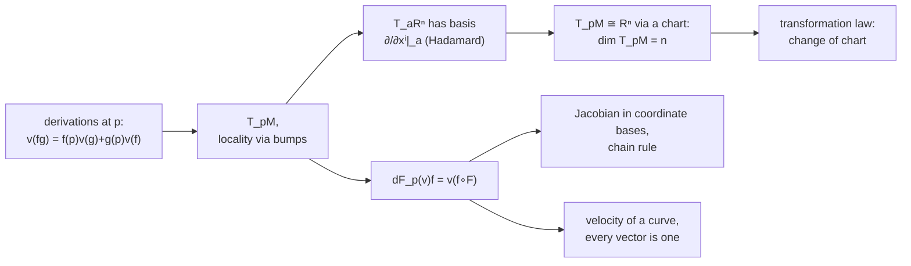

# DM03 · Tangent Vectors and the Differential

◀ [[DM02 Smooth Maps and Partitions of Unity]] · [[Differential Geometry - Course Map]] · [[DM04 The Tangent Bundle and the Rank Theorem]] ▶

taught · in syllabus extra · book extra · beyond

> [!warning] What the lecture source says and does not say
> This is MT3184 **week 2** (Aug 10–14, slides DG4–DG6). The slides are **unreadable scans**; the weekly post says *"we introduced tangent spaces and differentials of smooth functions, computed both in local coordinates, and saw how these change when the coordinates change"*, and the syllabus outline lists "tangent vectors, the differential of a smooth map, computations in coordinates, the tangent bundle" ([[mt3184-differential-geometry-and-lie-groups/2026-08-14-august-10-14|Aug 10–14 note]]). The content is therefore taken from what was **examined**: [[mt3184-differential-geometry-and-lie-groups/2026-08-14-hw2|HW2]] (locality, product manifolds, change of basis, the antipodal map, curves realising a vector), [[mt3184-differential-geometry-and-lie-groups/2026-08-20-hw3|HW3]] Q1, and [[mt3184-differential-geometry-and-lie-groups/2026-09-03-test-i|Test 1]], and is written on Lee Ch. 3 ([[John M. Lee - Introduction to Smooth Manifolds.pdf#page=69|Lee Ch. 3, pp. 51–70]]; printed page = PDF page − 18). Whether the lecture defined tangent vectors by **derivations** (as here, which matches HW2 Q1 and Test 1 Q1) or by curves is not confirmed (`[!verify]`).

> [!syllabus] Syllabus map: what is in the syllabus and what is extra in this chapter
> 🟢 **In syllabus (taught, by post, HW2, HW3, Test 1)**
> - §1 tangent vectors as derivations, locality; §2 the differential; §3 coordinate bases, transformation law, the worked examples; §4 curves and velocity vectors; §5 tangent space of a product
>
> 🟡 **Extra · book** (Lee Ch. 3; Tu §§2–8; Kumaresan Ch. 2)
> - the full proof that $T_a\mathbb R^n$ has basis $\partial/\partial x^i|_a$ (Hadamard's lemma); tangent vectors via equivalence classes of curves; $T_pM$ for vector spaces
>
> 🔵 **Extra · beyond** (my additions, labelled)
> - every number of the HW2 Q3, HW3 Q1, Test 1 Q4 computations recomputed independently by pushing curves through the charts; the Leibniz rule for directional derivatives checked numerically; $\alpha'(\tfrac14)\perp p$ on $S^2$

> [!key] After this chapter you can
> - define $T_pM$ as the space of **derivations at $p$**, prove it has dimension $n$ with basis $\partial/\partial x^i|_p$,
> - define and compute the **differential** $dF_p$ (as a Jacobian in coordinate bases) and use the **chain rule**,
> - convert components between charts with the **transformation law** $\tilde v^j=\sum_i\frac{\partial\tilde x^j}{\partial x^i}v^i$,
> - compute **velocity vectors** of curves and realise every tangent vector as one,
> - identify $T_{(p,q)}(M\times N)\cong T_pM\oplus T_qN$.

> [!intuition] The one-sentence story
> A tangent vector at $p$ is *a way of differentiating functions at $p$*: it takes a smooth function $f$ and returns "the rate of change of $f$ in some direction". On $\mathbb R^n$ every such rule is a directional derivative, so tangent vectors are arrows; on a manifold there are no ambient arrows, but the *differentiation rules* still make sense, and they form an $n$-dimensional vector space $T_pM$. The **differential** of a smooth map is "how the map stretches directions", the linear map that best approximates $F$ at $p$ (PA13's total derivative, now between tangent spaces).

*Concept map: derivations ⇒ tangent space ⇒ differential ⇒ everything computed in coordinates.*

![[fig_dm03_tangent.png]]
*A: one tangent line to $S^1$, two bases (graph chart and stereographic chart), related by $dx/dw$. B: HW2 Q3: the same tangent vector $X$ in the two bases of the stereographic atlas of $S^2$, related by the Jacobian of $w\mapsto w/|w|^2$. C: the velocity of the curve of HW3 Q1 (§3, §4).*

## 1. Tangent vectors as derivations
taught *Source: HW2 Q1, Test 1 Q1* · extra · book *Lee Lemma 3.1, Prop. 3.2, Cor. 3.3*

> [!intuition] Why not "arrows"?
> On a sphere, an arrow at $p$ pointing "outwards" is not tangent; and an arrow "tangent to the sphere" exists only because the sphere sits in $\mathbb R^3$. A manifold has no ambient space, so we must say what a direction *is* intrinsically. The answer: a direction is a way of **differentiating**: $f\mapsto\frac{d}{dt}f(p+tw)|_{t=0}$ in $\mathbb R^n$. Two properties characterise such rules, linearity and the product rule, and these make sense on any manifold.

> [!key] Definition
> Let $M$ be a smooth manifold and $p\in M$. A **tangent vector** (a *derivation at $p$*) is a linear map $v:C^\infty(M)\to\mathbb R$ satisfying
> $$v(fg)=f(p)\,v(g)+g(p)\,v(f)\qquad(f,g\in C^\infty(M)).$$
> The set $T_pM$ of all of them is a real vector space, the **tangent space** of $M$ at $p$.

**Elementary properties** (Lee Lemma 3.1). $v(c)=0$ for every constant $c$ (apply the rule to $1\cdot1$: $v(1)=2v(1)$); and $v(fg)=0$ if $f(p)=g(p)=0$.

> [!key] Locality (HW2 Q1, Test 1 Q1)
> If $f=g$ on a neighbourhood of $p$, then $vf=vg$ for every $v\in T_pM$. *Proof.* Put $u=f-g$ and take a bump function $\psi$ with $\psi(p)=1$, $\operatorname{supp}\psi\subseteq\{u=0\}$ ([[DM02 Smooth Maps and Partitions of Unity]] §2). Then $\psi u\equiv0$, so $0=v(\psi u)=\psi(p)vu+u(p)v\psi=vu$. $\square$ Hence $v$ depends only on the germ of $f$ at $p$, and for an open set $U\ni p$ one may regard $T_pU=T_pM$ (Lee Prop. 3.9).

> [!key] $T_a\mathbb R^n$ has basis $\partial/\partial x^i|_a$ (Lee Prop. 3.2, Cor. 3.3)
> The derivations $\dfrac{\partial}{\partial x^i}\Big|_a f=\dfrac{\partial f}{\partial x^i}(a)$, $i=1,\dots,n$, form a basis of $T_a\mathbb R^n$; every $v$ equals $\sum_iv(x^i)\,\partial/\partial x^i|_a$. In particular $\dim T_a\mathbb R^n=n$.
>
> *Proof.* Let $f\in C^\infty(\mathbb R^n)$ (by locality one may work on a convex neighbourhood). **Hadamard's lemma:** $f(x)=f(a)+\sum_i(x^i-a^i)g_i(x)$ with $g_i(x)=\int_0^1\partial_if(a+t(x-a))\,dt$ smooth and $g_i(a)=\partial_if(a)$ (fundamental theorem of calculus along the segment). Apply the derivation $v$: constants die, and for each product $(x^i-a^i)g_i$ the rule gives $v\big((x^i-a^i)g_i\big)=(a^i-a^i)v(g_i)+g_i(a)\,v(x^i-a^i)=\partial_if(a)\,v(x^i)$. Hence $vf=\sum_iv(x^i)\,\partial_if(a)$. So the $\partial_i|_a$ span; they are independent since $\partial_i|_a(x^j)=\delta_i^j$. $\square$

## 2. The differential
taught *Source: HW2 Q4, HW3 Q1, Test 1 Q2* · extra · book *Lee Prop. 3.6*

> [!key] Definition
> For a smooth map $F:M\to N$ and $p\in M$, the **differential** (pushforward) is
> $$dF_p:T_pM\to T_{F(p)}N,\qquad dF_p(v)(f)=v(f\circ F)\quad(f\in C^\infty(N)).$$
> (Well defined: $f\mapsto v(f\circ F)$ is linear and satisfies the product rule at $F(p)$ since $(fg)\circ F=(f\circ F)(g\circ F)$.)

> [!key] Properties (Lee Prop. 3.6)
> (a) $dF_p$ is **linear**. (b) **Chain rule:** $d(G\circ F)_p=dG_{F(p)}\circ dF_p$. (c) $d(\mathrm{id}_M)_p=\mathrm{id}_{T_pM}$. (d) If $F$ is a **diffeomorphism**, $dF_p$ is a linear isomorphism with inverse $d(F^{-1})_{F(p)}$. (e) If $F$ is constant, $dF_p=0$.

> [!intuition] The differential is PA13's derivative, coordinate-free
> For $F:\mathbb R^n\to\mathbb R^m$ the formula $dF_a(v)(f)=v(f\circ F)$, with $v=\partial_j|_a$, is the chain rule $\partial_j(f\circ F)=\sum_i\frac{\partial f}{\partial y^i}\frac{\partial F^i}{\partial x^j}$: so $dF_a(\partial_j|_a)=\sum_i\frac{\partial F^i}{\partial x^j}(a)\,\partial_{y^i}|_{F(a)}$, and $dF_a$ has the **Jacobian** as its matrix ([[PA13 The Derivative and the Inverse Function Theorem]] §1).

**Dimension.** A chart $\varphi:U\to\widehat U\subseteq\mathbb R^n$ is a diffeomorphism onto an open set, so $d\varphi_p:T_pM=T_pU\to T_{\varphi(p)}\mathbb R^n$ is an isomorphism: **$\dim T_pM=n=\dim M$** (Lee Prop. 3.10).

## 3. Computations in coordinates
taught *Source: post (computations in local coordinates, change of coordinates), HW2 Q3, Test 1 Q2–Q4* · extra · book *Lee Prop. 3.15*

> [!key] Coordinate basis and components
> For a chart $(U,\varphi=(x^1,\dots,x^n))$ define $\dfrac{\partial}{\partial x^i}\Big|_p=(d\varphi_p)^{-1}\Big(\dfrac{\partial}{\partial x^i}\Big|_{\varphi(p)}\Big)$, i.e.
> $$\frac{\partial}{\partial x^i}\Big|_pf=\frac{\partial(f\circ\varphi^{-1})}{\partial x^i}\big(\varphi(p)\big).$$
> These $n$ vectors form a basis of $T_pM$ and every $v\in T_pM$ is $v=\sum_iv^i\,\partial/\partial x^i|_p$ with **components** $v^i=v(x^i)$. If $F:M\to N$ is smooth with representation $\widehat F=\psi\circ F\circ\varphi^{-1}$, then
> $$dF_p\Big(\frac{\partial}{\partial x^j}\Big|_p\Big)=\sum_i\frac{\partial\widehat F^i}{\partial x^j}\big(\varphi(p)\big)\,\frac{\partial}{\partial y^i}\Big|_{F(p)}:$$
> the matrix of $dF_p$ in the coordinate bases is the **Jacobian of the coordinate representation**.

> [!key] Transformation law (change of coordinates; Lee Prop. 3.15)
> Let $(x^i)$ and $(\tilde x^j)$ be two charts at $p$ with transition $\tilde x=\tilde\varphi\circ\varphi^{-1}(x)$. If $v=\sum_iv^i\partial/\partial x^i|_p=\sum_j\tilde v^j\partial/\partial\tilde x^j|_p$, then
> $$\tilde v^j=\sum_i\frac{\partial\tilde x^j}{\partial x^i}(\varphi(p))\,v^i,\qquad\frac{\partial}{\partial x^i}\Big|_p=\sum_j\frac{\partial\tilde x^j}{\partial x^i}\frac{\partial}{\partial\tilde x^j}\Big|_p .$$
> The component vector is multiplied by the **Jacobian of the transition map** (the differential of $\tilde\varphi\circ\varphi^{-1}$).

> [!example] HW2 Q3, completely worked, with numbers
> Stereographic atlas of $S^2$: $\varphi=\psi_1$ (from the north pole), $\psi=\psi_2$ (from the south pole); $p=(\tfrac{\sqrt3}2,\tfrac12,0)$, so $\varphi(p)=u=(\tfrac{\sqrt3}2,\tfrac12)$ (on the equator $\psi_1=\psi_2$). Let $X=1\cdot\partial/\partial u^1+2\cdot\partial/\partial u^2$ at $p$ and $f$ the function with $f\circ\varphi^{-1}(u^1,u^2)=u^1+2(u^2)^2$.
> **(a)** $Xf=X^1\frac{\partial\widehat f}{\partial u^1}+X^2\frac{\partial\widehat f}{\partial u^2}=1\cdot1+2\cdot(4u^2)=1+2\cdot2=\mathbf5$. (Independent check: differentiating $f$ along the curve $t\mapsto\varphi^{-1}(u+tX)$ numerically gives $5.000000$.)
> **(b)** The transition is $w\mapsto w/|w|^2$ with Jacobian $J(u)=\dfrac1{|u|^2}\big(I-2\hat u\hat u^T\big)$; here $|u|=1$, so $J=I-2uu^T=\begin{pmatrix}-\frac12&-\frac{\sqrt3}2\\-\frac{\sqrt3}2&\frac12\end{pmatrix}$ and
> $$\widetilde X=JX=\Big(-\tfrac12-\sqrt3,\ 1-\tfrac{\sqrt3}2\Big)=(-2.232051,\ 0.133975)$$
> in the $\psi$-basis (the finite-difference derivative of $t\mapsto\psi(\varphi^{-1}(u+tX))$ gives the same two numbers). Check by another route: $\widetilde Xf$ must also be $5$ if one rewrites $f$ in the $\psi$ coordinates ($f\circ\psi^{-1}(\tilde u)=\tilde u^1/|\tilde u|^2+2(\tilde u^2)^2/|\tilde u|^4$ since $u=\tilde u/|\tilde u|^2$).

> [!example] Test 1 Q4: stereographic basis $\to$ graph basis at the north pole
> At $p=N=(0,0,1)$ the stereographic chart containing $N$ is $\psi=\psi_2$, $\psi(N)=(0,0)$; the graph chart is $\varphi_3^+(x,y,z)=(x,y)$. The transition $\varphi_3^+\circ\psi^{-1}(w)=\dfrac{2w}{1+|w|^2}$ has Jacobian $2I$ at $w=0$ (finite difference: $[[2,0],[0,2]]$). So $X=(1,2)$ in the stereographic basis becomes $(2,4)$ in the graph basis.

> [!example] The antipodal map (HW2 Q4)
> In the charts $\psi_2$ at $N$ and $\psi_1$ at $S$ the antipodal map is $u\mapsto-u$ ([[DM02 Smooth Maps and Partitions of Unity]] §1), so $dF_N=-I_2$ in coordinate bases: it reverses every tangent vector at the pole.

## 4. Curves and velocity vectors
taught *Source: HW2 Q5, HW3 Q1* · extra · book *Lee Props. 3.23–3.24, Cor. 3.25*

> [!key] Velocity
> For a smooth curve $\gamma:J\to M$ ($J\subseteq\mathbb R$ an interval) the **velocity** at $t_0$ is $\gamma'(t_0)=d\gamma_{t_0}\big(\tfrac{d}{dt}\big|_{t_0}\big)\in T_{\gamma(t_0)}M$, i.e. $\gamma'(t_0)f=(f\circ\gamma)'(t_0)$. In a chart its components are the derivatives of the coordinate functions: $\gamma'(t_0)=\sum_i(x^i\circ\gamma)'(t_0)\,\partial/\partial x^i|_{\gamma(t_0)}$.

> [!key] Every tangent vector is a velocity vector (HW2 Q5; Lee Prop. 3.23)
> For $v\in T_pM$ there are $\varepsilon>0$ and a smooth curve $\gamma:(-\varepsilon,\varepsilon)\to M$ with $\gamma(0)=p$, $\gamma'(0)=v$. *Proof.* In a chart centred at $p$ with $v=\sum v^i\partial_i|_p$ take $\gamma(t)=\varphi^{-1}(tv^1,\dots,tv^n)$ for $|t|$ small. $\square$ And **differentials are computed along curves** (Lee Cor. 3.25): $dF_p(v)=(F\circ\gamma)'(0)$ for any $\gamma$ with $\gamma'(0)=v$.

> [!example] HW3 Q1, completely worked, with numbers
> $\alpha(t)=(t,2t,\sqrt{1-5t^2})$ lies on $S^2$; $p=\alpha(\tfrac14)=(\tfrac14,\tfrac12,\tfrac{\sqrt{11}}4)=(0.25,\,0.5,\,0.829156)$.
> **(a)** In the graph chart $\varphi_3^+=(x,y)$: $\varphi_3^+(\alpha(t))=(t,2t)$, so $\alpha'(\tfrac14)=(1,\,2)$ (numerical: $(1.000000,2.000000)$).
> **(c)** In the chart $\varphi_2^+=(x,z)$: $\varphi_2^+(\alpha(t))=(t,\sqrt{1-5t^2})$, derivative $(1,\,-5t/\sqrt{1-5t^2})$ at $t=\tfrac14$: $\big(1,-\dfrac{5/4}{\sqrt{11}/4}\big)=(1,\,-\tfrac5{\sqrt{11}})=(1,-1.507557)$ (numerical: $-1.507557$). This agrees with the transformation law: the transition $\varphi_2^+\circ(\varphi_3^+)^{-1}(x,y)=(x,\sqrt{1-x^2-y^2})$ has Jacobian $\begin{pmatrix}1&0\\-x/z&-y/z\end{pmatrix}$ and $\begin{pmatrix}1&0\\-0.25/0.829&-0.5/0.829\end{pmatrix}\begin{pmatrix}1\\2\end{pmatrix}=(1,-1.5076)$.
> **(b)** $F$ = rotation by $60^\circ$ about the $z$-axis, $F(x,y,z)=(\tfrac12(x-\sqrt3y),\tfrac12(\sqrt3x+y),z)$. In the chart $\varphi_3^+$ on both sides (note $z$ is unchanged, so $F(p)\in U_3^+$) it is the linear rotation $(x,y)\mapsto(\tfrac12(x-\sqrt3y),\tfrac12(\sqrt3x+y))$, so $dF_p\,\alpha'(\tfrac14)=\tfrac12(1-2\sqrt3,\ \sqrt3+2)=(-1.232051,\ 1.866025)$ (numerical derivative of $\varphi_3^+\circ F\circ\alpha$: same).
> **Geometric check:** as a vector in $\mathbb R^3$, $\alpha'(\tfrac14)=(1,2,-\tfrac5{\sqrt{11}})$ is orthogonal to $p$: $\tfrac14+1-\tfrac54=0$, i.e. tangent to $S^2$ (figure C).

## 5. Products, open sets, vector spaces
taught *Source: HW2 Q2(b)* · extra · book *Lee Props. 3.9, 3.13, 3.14*

> [!key] Tangent space of a product (HW2 Q2b; Lee Prop. 3.14)
> The map $\alpha:T_{(p,q)}(M\times N)\to T_pM\oplus T_qN$, $\alpha(v)=(d(\pi_1)_{(p,q)}v,\ d(\pi_2)_{(p,q)}v)$, is an **isomorphism**.
> *Proof.* Take charts $(x^i)$ at $p$, $(y^j)$ at $q$, and the product chart $(x^i,y^j)$ on $M\times N$. The projection $\pi_1$ has representation $(x,y)\mapsto x$, so $d\pi_1(\partial/\partial x^i)=\partial/\partial x^i$ and $d\pi_1(\partial/\partial y^j)=0$; likewise for $\pi_2$. Thus $\alpha$ sends the basis $\{\partial_{x^i},\partial_{y^j}\}$ to the basis $\{(\partial_{x^i},0),(0,\partial_{y^j})\}$. $\square$

This identification is used everywhere a **product** appears, for instance for the multiplication $m:G\times G\to G$ of a Lie group, $dm_{(e,e)}(X,Y)=X+Y$ (HW4 Q6, [[DM08 Lie Groups]]). **Open subsets:** $T_pU=T_pM$ for $U\subseteq M$ open. **Vector spaces:** $T_aV\cong V$ canonically ($v\mapsto D_v|_a$, Lee Prop. 3.13), the reason why on $\mathbb R^n$ "tangent vectors are arrows" and why $T_I\,GL(n,\mathbb R)\cong M(n,\mathbb R)$.

> [!extra-book]- 🟡 Extra (book): other definitions of $T_pM$
> *Equivalence classes of curves:* $\gamma_1\sim\gamma_2$ iff $(\varphi\circ\gamma_1)'(0)=(\varphi\circ\gamma_2)'(0)$ in one (hence every) chart. *Physicists' definition:* a vector is an $n$-tuple $(v^i)$ per chart transforming by the Jacobian (the transformation law above). All three agree (Lee pp. 66–70; Tu §2). The derivation definition needs no choices and gives a vector space for free.

> [!pitfall] Pushforward is not defined for functions alone
> $dF_p(v)(f)=v(f\circ F)$ takes a function on $N$ and returns a number via a vector at $p\in M$: vectors go *forward* with $F$, functions go *backward*. A vector *field* on $M$ does not in general push forward to $N$ (that needs $F$ injective-ish, or a diffeomorphism), [[DM10 Vector Fields and Lie Brackets]].

<!-- interactive:start (generated by scripts/embed_interactive.py; edit the tool in scripts/interactive/tools/, not this block) -->
> [!interactive]+ Interactive: The inverse function theorem: when a smooth map is locally invertible
> A smooth map F: R² → R² and a point p.
>
> ![[pa_inverse_function.png|720]]
>
> **Try:** Squaring map z ↦ z²: invertible away from 0, but 2-to-1 (points z and −z share an image), so only a LOCAL inverse exists. Fold map (x, y²): drag p across the line y = 0 and watch the image fold over itself. Polar map (r, θ): singular at r = 0.
>
> [▶ Open the tool in your browser](../Assets/interactive/pa_inverse_function.html) · [absolute link](file:///home/swastik/Documents/notes/Assets/interactive/pa_inverse_function.html) · all tools and coverage: [[Interactive Tools]]

<!-- interactive:end -->

## Map of this chapter
> [!connection] How DM03 connects
> **Builds on:** [[DM02 Smooth Maps and Partitions of Unity]] (bump functions for locality, smooth maps), [[PA13 The Derivative and the Inverse Function Theorem]] (total derivative, chain rule, Jacobian).
> **Leads to:** [[DM04 The Tangent Bundle and the Rank Theorem]] (the differential assembled into $dF:TM\to TN$; rank of $dF$), [[DM05 Immersions, Embeddings, Submersions and Coverings]], [[DM06 Submanifolds]] ($T_pS\subseteq T_pM$), [[DM10 Vector Fields and Lie Brackets]], [[DM08 Lie Groups]] ($dm_{(e,e)}$, $T_eG$).
> **Concepts:** [[Tangent Vector]] · [[Tangent Space]] · [[Differential of a Smooth Map]] · [[Coordinate Basis]] · [[Transformation Law for Tangent Vectors]] · [[Velocity of a Curve]] · [[Tangent Space of a Product]]
> **Other subjects:** [[Quantum Mechanics - Course Map]] (momentum as $-i\hbar\,\partial/\partial x$: a derivation), [[Thermodynamics and Statistical Mechanics - Course Map]] (differentials of state functions)

## Summary
> [!summary] Cheat-sheet
> - $T_pM$ = **derivations at $p$**: $v(fg)=f(p)vg+g(p)vf$. $v(\text{const})=0$; **local** (bump functions). $\dim T_pM=n$.
> - $T_a\mathbb R^n=\operatorname{span}\{\partial/\partial x^i|_a\}$, $v=\sum v(x^i)\partial_i$ (Hadamard's lemma).
> - $dF_p(v)f=v(f\circ F)$; chain rule; diffeo $\Rightarrow$ isomorphism. In coordinate bases $dF_p$ has the **Jacobian of $\widehat F=\psi F\varphi^{-1}$**.
> - **Transformation law:** $\tilde v=J_{\text{transition}}\,v$. HW2 Q3: $Xf=5$, $\widetilde X=(-\tfrac12-\sqrt3,\,1-\tfrac{\sqrt3}2)=(-2.232,\,0.134)$. Test 1 Q4: Jacobian $2I$, $(1,2)\mapsto(2,4)$. HW3 Q1: $\alpha'(\tfrac14)=(1,2)$ and $(1,-5/\sqrt{11})$; $dF\alpha'=(-1.232,1.866)$.
> - **Velocity** $\gamma'(t_0)f=(f\circ\gamma)'(t_0)$; every vector is a velocity; $dF_p(v)=(F\circ\gamma)'(0)$.
> - $T_{(p,q)}(M\times N)\cong T_pM\oplus T_qN$; $T_pU=T_pM$; $T_aV\cong V$.

## Practice
1. **Derivation basics.** Show $v(1)=0$ for any derivation at $p$, and $v(fg)=0$ when $f(p)=g(p)=0$.
2. **A basis computation.** In $\mathbb R^2$ let $v=3\partial_x-\partial_y$ at $a=(1,2)$ and $f(x,y)=x^2y$. Compute $vf$ and verify the product rule with $g(x,y)=x+y$.
3. **Locality (Test 1 Q1).** Prove that $f=g$ near $p$ implies $vf=vg$.
4. **A differential.** $F:\mathbb R^2\to\mathbb R^3$, $F(x,y)=(x^2,xy,y^2)$. Find the matrix of $dF_{(1,2)}$ and compute $dF(v)$ for $v=\partial_x-\partial_y$ acting on $f(u,v,w)=u+vw$.
5. **Change of basis (HW2 Q3).** Redo HW2 Q3 for $p=(\tfrac{\sqrt3}2,\tfrac12,0)$, $X=(1,2)$, $f=u^1+2(u^2)^2$: compute $Xf$ and $X$ in the $\psi$-basis.
6. **Velocity of a curve (HW3 Q1).** For $\alpha(t)=(t,2t,\sqrt{1-5t^2})$ compute $\alpha'(\tfrac14)$ in the bases of $\varphi_3^+$ and $\varphi_2^+$ and check they are related by the transformation law.
7. **Test 1 Q4.** A vector $X=(1,2)$ at $p=(0,0,1)$ is given in the stereographic chart containing $p$. Express it in the graph chart $\varphi_3^+$.
8. **Realising vectors by curves (HW2 Q5).** Given $v\in T_pM$ construct a curve with $\gamma(0)=p$, $\gamma'(0)=v$, and for $S^2$ give one for $v=(0,1,0)\in T_{(1,0,0)}S^2$.
9. **Product manifolds (HW2 Q2b).** Prove $\alpha:T_{(p,q)}(M\times N)\to T_pM\oplus T_qN$ is an isomorphism, and describe the kernel of $d(\pi_1)_{(p,q)}$.
10. **Tangent space of the sphere.** Show that for $p\in S^2$ every velocity vector of a curve in $S^2$ through $p$ is orthogonal to $p$ and that these vectors fill $p^\perp$; deduce $\dim T_pS^2=2$.

> [!example]- Solutions
> 1. $v(1)=v(1\cdot1)=1\cdot v(1)+1\cdot v(1)=2v(1)$, so $v(1)=0$. If $f(p)=g(p)=0$ then $v(fg)=f(p)v(g)+g(p)v(f)=0$.
> 2. $vf=3\,\partial_xf(1,2)-\partial_yf(1,2)=3\cdot(2xy)|_{(1,2)}-x^2|_{(1,2)}=3\cdot4-1=11$. $v(fg)$: $fg=x^2y(x+y)=x^3y+x^2y^2$, $\partial_x=3x^2y+2xy^2=6+8=14$, $\partial_y=x^3+2x^2y=1+4=5$, so $v(fg)=3\cdot14-5=37$. Product rule: $f(a)v(g)+g(a)v(f)=2\cdot(3\cdot1-1\cdot1)+3\cdot11=2\cdot2+33=37$ ✓ ($f(a)=1\cdot2=2$, $g(a)=3$, $vg=3-1=2$).
> 3. §1.
> 4. $DF=\begin{pmatrix}2x&0\\y&x\\0&2y\end{pmatrix}$, at $(1,2)$: $\begin{pmatrix}2&0\\2&1\\0&4\end{pmatrix}$. $dF(v)=(2,\,2-1,\,-4)=(2,1,-4)$ in the basis $\partial_u,\partial_v,\partial_w$ at $F(1,2)=(1,2,4)$. On $f(u,v,w)=u+vw$: $\partial_uf=1$, $\partial_vf=w=4$, $\partial_wf=v=2$, so $dF(v)f=2\cdot1+1\cdot4+(-4)\cdot2=-2$. Check: $f\circ F=x^2+xy\cdot y^2=x^2+xy^3$, $v(f\circ F)=\partial_x-\partial_y=(2x+y^3)-(3xy^2)=(2+8)-(3\cdot4)=10-12=-2$ ✓.
> 5. §3: $Xf=5$; $\widetilde X=JX=(-\tfrac12-\sqrt3,1-\tfrac{\sqrt3}2)\approx(-2.2320508,0.1339746)$.
> 6. §4: $(1,2)$ and $(1,-5/\sqrt{11})=(1,-1.507557)$; Jacobian of $\varphi_2^+\circ(\varphi_3^+)^{-1}$ at $(x,y)=(0.25,0.5)$ with $z=\sqrt{1-x^2-y^2}=0.829156$ is $\begin{pmatrix}1&0\\-x/z&-y/z\end{pmatrix}=\begin{pmatrix}1&0\\-0.30151&-0.60302\end{pmatrix}$ and applied to $(1,2)$ gives $(1,\,-0.30151-1.20605)=(1,-1.50756)$ ✓.
> 7. §3: $(1,2)\mapsto(2,4)$.
> 8. In a chart centred at $p$, $\gamma(t)=\varphi^{-1}(t\,d\varphi_p(v))$ for $|t|<\varepsilon$. On $S^2$: $v=(0,1,0)\in T_{(1,0,0)}S^2$, $\gamma(t)=(\cos t,\sin t,0)$, $\gamma(0)=(1,0,0)$, $\gamma'(0)=(0,1,0)$.
> 9. §5. The kernel of $d(\pi_1)_{(p,q)}$ is $\{0\}\oplus T_qN$ under $\alpha$, i.e. the span of the $\partial/\partial y^j$: tangent vectors to the slice $\{p\}\times N$.
> 10. If $\gamma(t)\in S^2$ then $|\gamma|^2=1$, so $2\gamma\cdot\gamma'=0$: $\gamma'(0)\perp p$. Conversely for $w\perp p$, $|w|=1$, $\gamma(t)=\cos t\,p+\sin t\,w$ is a curve on $S^2$ with $\gamma'(0)=w$; rescaling covers all $w\in p^\perp$. So $T_pS^2\cong p^\perp$, dimension $2$ (as also $\dim T_pM=\dim M$).

<!-- zettel:start (generated by scripts/sort_zettel.py; do not edit between the markers) -->
## Zettel notes

> [!abstract]- Zettel notes filed under this chapter (2): the other tool's concept notes from the lectures, unreviewed
> [[zettel/locality-of-derivations|Locality of Derivations]] · [[zettel/product-manifold-tangent-space-isomorphism|Product Manifold Tangent Space Isomorphism]]
<!-- zettel:end -->

## Provenance
> [!provenance]- Source map for this chapter
> | Topic | Source | Scope |
> |---|---|---|
> | tangent spaces and differentials computed in local coordinates, change of coordinates (post only; slides unreadable) | [[mt3184-differential-geometry-and-lie-groups/2026-08-14-august-10-14\|Aug 10–14 note]] (DG4–DG6) | taught |
> | locality, products, change of basis, antipodal map, curves realising vectors | [[mt3184-differential-geometry-and-lie-groups/2026-08-14-hw2\|HW2]] Q1–Q5 | taught (via homework) |
> | velocity in charts, differential in charts, change of basis | [[mt3184-differential-geometry-and-lie-groups/2026-08-20-hw3\|HW3]] Q1; [[mt3184-differential-geometry-and-lie-groups/2026-09-03-test-i\|Test 1]] Q1–Q4 | taught (via homework/test) |
> | Hadamard-lemma proof, definitions of $T_pM$, vector spaces, open submanifolds | Lee Lemma 3.1, Props. 3.2, 3.6, 3.9, 3.10, 3.13–3.15, 3.23–3.25, Cor. 3.3, Cor. 3.25; Tu §§2–8 | extra/book |
> | every number of the worked examples recomputed by pushing curves | `scripts/dm_numbers.py` (DM03), `fig_dm03_tangent.py` | extra/beyond |
>
> **Notes.** [!verify] DG4–DG6 unreadable: the lecture's *definition* of tangent vectors (derivations vs. equivalence classes of curves) is inferred from HW2 Q1 and Test 1 Q1, which prove locality with bump functions (a derivation argument), and from HW2 Q5, which realises vectors by curves. HW3 Q1's printed formulas were OCR'd and "checked for consistency" in the other tool's note; the numbers here were recomputed from the stated curve and map.
