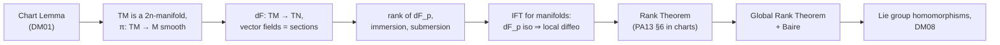

# DM04 · The Tangent Bundle and the Rank Theorem

◀ [[DM03 Tangent Vectors and the Differential]] · [[Differential Geometry - Course Map]] · [[DM05 Immersions, Embeddings, Submersions and Coverings]] ▶

taught · in syllabus extra · book extra · beyond

> [!warning] What the lecture source says
> The tangent bundle is MT3184 **week 3** (Aug 17–21, slide DG8: **readable**: Chart Lemma, Prop 3.18, vector fields, the Hairy Ball statement); the rank theorems are **week 4** (Aug 24–28, slide DG11: **readable**: Thm 4.12, Thm 4.14, the linear-algebra model, nowhere dense sets, the Baire Category Theorem) and week 5 (DG12). Sources: [[mt3184-differential-geometry-and-lie-groups/2026-08-20-august-17-21|Aug 17–21 note]], [[mt3184-differential-geometry-and-lie-groups/2026-08-27-august-24-28|Aug 24–28 note]], [[mt3184-differential-geometry-and-lie-groups/2026-08-20-hw3|HW3]] Q2–Q3, [[mt3184-differential-geometry-and-lie-groups/2026-08-27-hw4|HW4]] Q1, Q4. Book: Lee Ch. 3 (§ The Tangent Bundle) and Ch. 4 (§ Maps of Constant Rank), [[John M. Lee - Introduction to Smooth Manifolds.pdf#page=84|Lee pp. 65–70]] and [[John M. Lee - Introduction to Smooth Manifolds.pdf#page=95|pp. 77–84]] (printed page = PDF page − 18). The slide's proof of the Global Rank Theorem is only an outline in the OCR (surjective case); the injective and bijective cases are completed here from the standard argument.

> [!syllabus] Syllabus map: what is in the syllabus and what is extra in this chapter
> 🟢 **In syllabus (taught: DG8, DG11, HW3, HW4)**
> - §1 $TM$ is a $2n$-manifold (Chart Lemma, HW3 Q2), vector fields as sections, global frames (HW4 Q4); §2–§3 rank, the Rank Theorem 4.12; §4 the Global Rank Theorem 4.14 and nowhere dense sets/Baire
>
> 🟡 **Extra · book** (Lee Ch. 3–4; Tu §8; Kumaresan Ch. 2)
> - the global differential $dF:TM\to TN$; the inverse function theorem for manifolds; the Hairy Ball Theorem statement; a proof of Baire for complete metric spaces
>
> 🔵 **Extra · beyond** (my additions, labelled)
> - the closed form $\widetilde Y(u)=(u_2^2-u_1^2,\,-2u_1u_2)$ of the HW3 Q3 vector field, $|\widetilde Y|=|u|^2$ (checked at 500 random points, error $4\times10^{-10}$); the transition $(w,v)\mapsto(1/w,-v/w^2)$ for $TS^1$ checked on the circle; rank of $dz$ on $S^2$ and the normal form of $F(u,v)=(u+v,(u+v)^2)$ (error $9\times10^{-16}$)

> [!key] After this chapter you can
> - construct the **smooth structure on $TM$** with the Chart Lemma and write $dF$ as a smooth map $TM\to TN$,
> - write a **vector field** as a section of $TM$ and recognise global frames (**parallelizable** manifolds),
> - state and prove the **Rank Theorem** for manifolds from its Euclidean version,
> - prove the **Global Rank Theorem** (surjective $\Rightarrow$ submersion, injective $\Rightarrow$ immersion, bijective $\Rightarrow$ diffeomorphism) using **Baire**.

> [!intuition] The one-sentence story
> All the tangent spaces of $M$, glued together, form a new manifold $TM$ of dimension $2n$ (a point is "a position $p$ and a velocity $v$ there"): the *phase space* of motion on $M$. A smooth map $F$ then has a smooth differential $dF:TM\to TN$. If the rank of $dF_p$ is the same $r$ at every point, $F$ is, in suitable coordinates on both sides, the standard map $(x^1,\dots,x^m)\mapsto(x^1,\dots,x^r,0,\dots,0)$; the global consequences (a surjective constant-rank map must be a submersion, an injective one an immersion) are the engine of the whole theory of Lie groups.

*Concept map: the Chart Lemma builds $TM$; PA13's Euclidean theorems, transported by charts, give the rank theorem; Baire turns it into global statements.*

![[fig_dm04_bundle.png]]
*A: $TS^1=S^1\times\mathbb R$ with the transition $(w,v)\mapsto(1/w,-v/w^2)$. B: the vector field of HW3 Q3 in the south-pole chart: exactly one zero. C: a constant-rank-1 map collapses lines to points; in suitable charts it is $(s,t)\mapsto(s,0)$ (§1, §1, §3).*

## 1. The tangent bundle
taught *Source: DG8, HW3 Q2, Q3, HW4 Q4* · extra · book *Lee Props. 3.18, 3.20, 3.21*

> [!key] Definition and Proposition 3.18 (DG8, HW3 Q2)
> The **tangent bundle** of a smooth $n$-manifold $M$ is the disjoint union $TM=\bigsqcup_{p\in M}T_pM$ with the projection $\pi:TM\to M$, $\pi(v)=p$ for $v\in T_pM$. Then $TM$ has a natural topology and smooth structure making it a smooth **$2n$-manifold** and $\pi$ a smooth map. For a smooth chart $(U,\varphi=(x^i))$ the **natural chart** is
> $$\tilde\varphi:\pi^{-1}(U)\to\varphi(U)\times\mathbb R^n,\qquad\tilde\varphi\Big(\sum_iv^i\frac{\partial}{\partial x^i}\Big|_p\Big)=(\varphi(p);\,v^1,\dots,v^n).$$

> [!derivation]- Proof with the Chart Lemma (HW3 Q2)
> Take a smooth atlas $\{(U_\alpha,\varphi_\alpha)\}$ with **countably many** charts (second-countable). Apply [[Smooth Manifold Chart Lemma]] to the set $TM$ with the sets $\pi^{-1}(U_\alpha)$ and maps $\tilde\varphi_\alpha$.
> (i) $\tilde\varphi_\alpha$ is a bijection onto $\varphi_\alpha(U_\alpha)\times\mathbb R^n$, open in $\mathbb R^{2n}$ (a vector in $T_pM$ is determined by its $n$ components in the coordinate basis). (ii) $\tilde\varphi_\alpha(\pi^{-1}(U_\alpha\cap U_\beta))=\varphi_\alpha(U_\alpha\cap U_\beta)\times\mathbb R^n$ is open. (iii) **Transition maps:** by the transformation law ([[DM03 Tangent Vectors and the Differential]] §3), 
> $$\tilde\varphi_\beta\circ\tilde\varphi_\alpha^{-1}(x;v)=\Big(\varphi_\beta\varphi_\alpha^{-1}(x);\ D\big(\varphi_\beta\varphi_\alpha^{-1}\big)(x)\,v\Big),$$
> smooth in $(x,v)$ because the transition $\varphi_\beta\varphi_\alpha^{-1}$ is smooth (its Jacobian entries are smooth in $x$ and the expression is linear in $v$). (iv) countably many $\pi^{-1}(U_\alpha)$ cover $TM$. (v) If $v\in T_pM$, $w\in T_qM$ are distinct: if $p=q$ both lie in $\pi^{-1}(U_\alpha)$ for a chart $U_\alpha\ni p$; if $p\ne q$, Hausdorffness of $M$ gives disjoint $U_\alpha\ni p$, $U_\beta\ni q$ (shrinking charts), and $\pi^{-1}(U_\alpha)\cap\pi^{-1}(U_\beta)=\varnothing$. So $TM$ is a smooth $2n$-manifold with the $\tilde\varphi_\alpha$ as charts, and $\pi$ is smooth since in these charts it is $(x;v)\mapsto x$. $\square$

> [!example] $TS^1$, with the transition checked
> In the stereographic charts of the circle (coordinate $w$ from the north pole, $1/w$ from the south pole), a tangent vector $v\,\partial/\partial w$ becomes $-(v/w^2)\,\partial/\partial\tilde w$ in the other chart, so $\tilde\varphi_S\tilde\varphi_N^{-1}(w;v)=(1/w;\,-v/w^2)$. Check on the circle: for $(w,v)=(1.70,0.90)$ the formula gives $(0.588235,\,-0.311419)$ and differentiating $\psi_S\circ\psi_N^{-1}(w+tv)$ numerically gives the same pair (`dm_numbers.py`, DM04). In fact $TS^1\cong S^1\times\mathbb R$ (figure A): the rotation field $\partial_\theta$ is a global nowhere-zero vector field.

> [!key] The global differential (Lee Prop. 3.21)
> For a smooth $F:M\to N$ the map $dF:TM\to TN$, $dF(v)=dF_p(v)$ for $v\in T_pM$, is smooth: in natural charts it reads $(x;v)\mapsto(\widehat F(x);\,D\widehat F(x)v)$. It satisfies $d(G\circ F)=dG\circ dF$, so $T$ is a **functor** from smooth manifolds to smooth manifolds.

**Vector fields and frames.** A **vector field** is a smooth map $X:M\to TM$ with $\pi\circ X=\mathrm{id}_M$ (a *section* of $\pi$): in a chart $X=\sum X^i\partial/\partial x^i$ with smooth components $X^i$ (DG8, [[DM10 Vector Fields and Lie Brackets]]). A **local frame** on $U$ is $n$ vector fields $E_1,\dots,E_n$ forming a basis of $T_pM$ at each $p\in U$; a **global frame** exists iff $M$ is **parallelizable**. In that case $TM\cong M\times\mathbb R^n$ (HW4 Q4): the map $(p,c)\mapsto\sum c^iE_i(p)$ is a smooth bijection that is linear on fibres with inverse $v\mapsto(\pi(v),\text{components of }v\text{ in the frame})$, smooth because the components are smooth.

> [!example] A vector field on $S^2$ with exactly one zero (HW3 Q3), in closed form
> Take the constant field $X=\partial/\partial u^1$ on $\mathbb R^2$ and let $Y=(\varphi^{-1})_*X$ on $U=S^2\setminus\{N\}$, where $\varphi=\psi_1$ is the stereographic chart from $N$. In the chart $\psi=\psi_2$ the Jacobian of the transition $\tilde u=u/|u|^2$ applied to $e_1$ gives, after substituting $u=\tilde u/|\tilde u|^2$,
> $$\widetilde Y(\tilde u)=\big(\tilde u_2^2-\tilde u_1^2,\ -2\tilde u_1\tilde u_2\big),\qquad|\widetilde Y|=|\tilde u|^2 .$$
> This is a **polynomial** in $\tilde u$ (so it extends smoothly across $\tilde u=0$, i.e. over $N$, by $Y_N=0$) and it vanishes **only at $\tilde u=0$**, the north pole. Numerically the pushforward $(\psi\circ\varphi^{-1})_*e_1$ agrees with this formula at 500 random points to $4\times10^{-10}$ (figure B). So $S^2$ has a smooth vector field with exactly one zero; by the **Hairy Ball Theorem** (stated in DG8, not proved: $S^n$ has a nowhere-vanishing vector field iff $n$ is odd) it cannot have none, so $S^2$ is **not** parallelizable. By contrast Lie groups are ([[DM11 The Lie Algebra of a Lie Group]]): $S^1$, $S^3=SU(2)$ and, as an exception without a group structure, $S^7$ are parallelizable.

## 2. Rank, immersions, submersions, and the inverse function theorem
taught *Source: DG11, DG12* · extra · book *Lee Prop. 4.1, Thm 4.5, Prop. 4.6*

The **rank** of a smooth map $F$ at $p$ is $\operatorname{rank}dF_p$ (the rank of the Jacobian in any charts). $F$ has **constant rank** $r$ if the rank is $r$ at every point. It is an **immersion** if $dF_p$ is injective for all $p$ (rank $=m=\dim M$), a **submersion** if $dF_p$ is surjective for all $p$ (rank $=n=\dim N$), and a **local diffeomorphism** if every point has a neighbourhood mapped diffeomorphically onto an open set.

> [!key] Inverse Function Theorem for manifolds (Lee Thm 4.5)
> If $F:M\to N$ is smooth and $dF_p$ is an isomorphism, then $F$ restricts to a diffeomorphism of a neighbourhood of $p$ onto a neighbourhood of $F(p)$. Hence $F$ is a local diffeomorphism iff $dF_p$ is an isomorphism for all $p$.
> *Proof.* In charts $\widehat F=\psi F\varphi^{-1}$ has invertible Jacobian at $\varphi(p)$ ($dF_p$ is represented by it); apply the Euclidean IFT ([[PA13 The Derivative and the Inverse Function Theorem]] §4) and compose with the chart diffeomorphisms. $\square$

> [!example] Rank can jump
> $F(x)=x^2$ on $\mathbb R$ has rank $1$ except at $0$ (rank $0$). The height function $z:S^2\to\mathbb R$ has $dz\neq0$ except at the two poles: in the stereographic chart $z=(|w|^2-1)/(|w|^2+1)$ and $|\nabla z|=4|w|/(|w|^2+1)^2$, numerically $0,\ 4.0\times10^{-3},\ 1.0,\ 4.0\times10^{-9}$ at $|w|=0,\,10^{-3},\,1,\,10^3$: rank $0$ at the poles, rank $1$ elsewhere. The rank theorem below needs **constant** rank.

## 3. The Rank Theorem
taught *Source: DG11 (Thm 4.12 and the linear-algebra model)* · extra · book *Lee Thm 4.12, Cor. 4.13*

> [!key] Rank Theorem (Lee Thm 4.12; DG11)
> Let $F:M^m\to N^n$ be smooth of **constant rank $r$**. For each $p\in M$ there are smooth charts $(U,\varphi)$ centred at $p$ and $(V,\psi)$ centred at $F(p)$ with $F(U)\subseteq V$ and
> $$\psi\circ F\circ\varphi^{-1}(x^1,\dots,x^r,x^{r+1},\dots,x^m)=(x^1,\dots,x^r,0,\dots,0).$$

> [!intuition] The linear-algebra model (DG11)
> A linear map $A:\mathbb R^m\to\mathbb R^n$ of rank $r$ has a basis $v_1,\dots,v_m$ of $\mathbb R^m$ ($v_{r+1},\dots,v_m$ a basis of $\ker A$, extended by $v_1,\dots,v_r$) such that $Av_1,\dots,Av_r$ are independent; extending these to a basis of $\mathbb R^n$ makes $A=\begin{pmatrix}I_r&0\\0&0\end{pmatrix}$. The Rank Theorem says a *nonlinear* constant-rank map has the same normal form after nonlinear coordinate changes. **Constancy of the rank** is exactly what lets the coordinates be chosen uniformly in a neighbourhood.

> [!derivation]- Proof: reduce to the Euclidean theorem
> Choose smooth charts $(U_0,\varphi_0)$ centred at $p$ and $(V_0,\psi_0)$ centred at $F(p)$ with $F(U_0)\subseteq V_0$ (shrink $U_0$ using continuity). The coordinate representation $\widehat F_0=\psi_0F\varphi_0^{-1}$ is a smooth map of constant rank $r$ on the open set $\varphi_0(U_0)\subseteq\mathbb R^m$. By the Euclidean Constant Rank Theorem ([[PA13 The Derivative and the Inverse Function Theorem]] §6) there are diffeomorphisms $\Phi$ (near $0\in\mathbb R^m$) and $\Psi$ (near $0\in\mathbb R^n$) with $\Psi\widehat F_0\Phi^{-1}(x)=(x^1,\dots,x^r,0,\dots,0)$. Put $\varphi=\Phi\circ\varphi_0$, $\psi=\Psi\circ\psi_0$ on suitable neighbourhoods: these are **smooth charts** (their transitions with the charts of the smooth structure are the diffeomorphisms $\Phi,\Psi$ composed with transitions) and $\psi F\varphi^{-1}$ is the normal form. $\square$

**Two extreme cases.** *Submersion* ($r=n$): in suitable charts $F(x^1,\dots,x^m)=(x^1,\dots,x^n)$, a **projection**. *Immersion* ($r=m$): $F(x^1,\dots,x^m)=(x^1,\dots,x^m,0,\dots,0)$, an **inclusion**. **Corollary (Lee 4.13):** a smooth map is a submersion (resp. immersion) iff it is locally a projection (resp. inclusion).

> [!example] The normal form, checked
> $F(u,v)=(u+v,(u+v)^2):\mathbb R^2\to\mathbb R^2$ has rank $1$ at all 200 sampled points (rows of $DF$ proportional). With $\varphi(u,v)=(u+v,v)$ and $\psi(a,b)=(a,b-a^2)$: $\psi\circ F\circ\varphi^{-1}(s,t)=(s,0)$, verified to $9\times10^{-16}$ at 200 random points (figure C). The fibres $\{u+v=c\}$ are lines and the image is the parabola $b=a^2$: a *rank-one map collapses each line to a point.*

## 4. The Global Rank Theorem
taught *Source: DG11 (statement and the surjective case outline), DG12 (restated)* · extra · book *Lee Thm 4.14; Thm A.58 (Baire)*

> [!key] Global Rank Theorem (Lee Thm 4.14; DG11, DG12)
> Let $F:M\to N$ be a smooth map of **constant rank**. (a) If $F$ is **surjective**, it is a **submersion**. (b) If $F$ is **injective**, it is an **immersion**. (c) If $F$ is **bijective**, it is a **diffeomorphism**.

> [!key] Baire Category Theorem (DG11; Lee Thm A.58)
> In a **locally compact Hausdorff space** or a **complete metric space** $X$, a countable union of closed sets with empty interior (**nowhere dense** sets) has empty interior. In particular a nonempty such $X$ is not a countable union of nowhere dense sets. (Examples from DG11: $\mathbb Q\subset\mathbb R$ is not nowhere dense; the Cantor set is; $\mathbb R^k\times\{0\}\subset\mathbb R^n$ is for $k<n$.)

> [!derivation]- Proof of Baire for a complete metric space (🟡)
> Let $A_1,A_2,\dots$ be closed with empty interior and $B_0=B(x_0,r_0)$ any ball; we find a point of $B_0$ outside every $A_n$. Since $A_1$ has empty interior, $B_0\not\subseteq A_1$; pick $x_1\in B_0\setminus A_1$ and (as $A_1$ is closed) a closed ball $\overline B(x_1,r_1)\subseteq B_0\setminus A_1$ with $r_1<1$. Inductively choose $\overline B(x_n,r_n)\subseteq B(x_{n-1},r_{n-1})\setminus A_n$ with $r_n<1/n$. The centres form a Cauchy sequence (nested balls of radii $\to0$), which converges (completeness) to a point $x$ lying in every $\overline B(x_n,r_n)$, hence in $B_0$ and outside every $A_n$. $\square$ For locally compact Hausdorff $X$ run the same argument with nested compact neighbourhoods (intersection of a nested sequence of nonempty compact sets is nonempty).

> [!derivation]- Proof of the Global Rank Theorem
> *(a) Surjective $\Rightarrow$ submersion.* Suppose $F$ has constant rank $r<n$. By the Rank Theorem every $p\in M$ has a chart pair in which $F=(x^1,\dots,x^r,0,\dots,0)$; shrink $U$ to a coordinate ball $B_p$ whose closure $K_p=\overline{B_p}\subseteq U$ is **compact**. Then $F(K_p)$ is compact, hence **closed** in the Hausdorff space $N$, and $\psi(F(K_p))\subseteq\mathbb R^r\times\{0\}$, a proper subspace of $\mathbb R^n$ with empty interior; so $F(K_p)$ has empty interior in $N$ (a diffeomorphic image). Since $M$ is second-countable (Lindelöf, [[PA12 Separation, Countability and Local Compactness]] §2) **countably many** $B_{p_i}$ cover $M$, so $N=F(M)=\bigcup_iF(K_{p_i})$ is a countable union of nowhere dense sets, contradicting Baire for the locally compact Hausdorff space $N$. Hence $r=n$.
> *(b) Injective $\Rightarrow$ immersion.* If $r<m$, choose charts as in the Rank Theorem at $p$; the two distinct points $\varphi^{-1}(0,\dots,0)$ and $\varphi^{-1}(0,\dots,0,\varepsilon)$ ($\varepsilon$ small, last coordinate index $m>r$) both map to $\psi^{-1}(0,\dots,0)$, contradicting injectivity. So $r=m$.
> *(c) Bijective $\Rightarrow$ diffeomorphism.* By (a) and (b) $r=n=m$, so $dF_p$ is an isomorphism for all $p$; by the Inverse Function Theorem $F$ is a local diffeomorphism, and a bijective local diffeomorphism has smooth inverse (locally the inverse is the local inverse). $\square$

> [!pitfall] Constancy of the rank is essential
> $x\mapsto x^3:\mathbb R\to\mathbb R$ is a smooth bijection whose rank drops to $0$ at $x=0$: it is not a diffeomorphism. $t\mapsto(t^2,t^3)$ is an injective smooth map $\mathbb R\to\mathbb R^2$ with a rank-$0$ point at $t=0$; its image is a cusp, not a submanifold. In both cases the rank is **not constant**, so the theorem does not apply. The theorem is used in [[DM05 Immersions, Embeddings, Submersions and Coverings]] and, crucially, for **Lie group homomorphisms**, which always have constant rank ([[DM08 Lie Groups]], Thm 7.5): a bijective Lie group homomorphism is an isomorphism.

## Map of this chapter
> [!connection] How DM04 connects
> **Builds on:** [[DM01 Smooth Manifolds]] (Chart Lemma), [[DM03 Tangent Vectors and the Differential]] (differential, transformation law), [[PA13 The Derivative and the Inverse Function Theorem]] (IFT, Euclidean rank theorem), [[PA12 Separation, Countability and Local Compactness]] (Lindelöf, local compactness), [[DM02 Smooth Maps and Partitions of Unity]].
> **Leads to:** [[DM05 Immersions, Embeddings, Submersions and Coverings]], [[DM06 Submanifolds]] (regular level sets), [[DM08 Lie Groups]] (homomorphisms have constant rank), [[DM10 Vector Fields and Lie Brackets]] (vector fields = sections of $TM$), [[DM09 Group Actions and Semidirect Products]] (equivariant rank theorem).
> **Concepts:** [[Tangent Bundle]] · [[Global Differential]] · [[Local Frame]] · [[Rank of a Smooth Map]] · [[Immersion and Submersion]] · [[Rank Theorem]] · [[Global Rank Theorem]] · [[Baire Category Theorem]] · [[Hairy Ball Theorem]]
> **Other subjects:** [[Phase Plane and Isoclines]] (the phase space $TM$ of mechanics), [[QM09 The Stern-Gerlach Experiment and Spin]] (parallelizability of $S^3=SU(2)$), [[Group Theory - Course Map]]

## Summary
> [!summary] Cheat-sheet
> - $TM=\bigsqcup T_pM$ is a smooth $2n$-manifold (Chart Lemma, natural charts $(x;v)$, transition $(x;v)\mapsto(\tau(x);D\tau(x)v)$); $\pi$ smooth; $dF:TM\to TN$ smooth, $(x;v)\mapsto(\widehat F(x);D\widehat F(x)v)$.
> - Vector field = section of $\pi$; global frame $\iff$ $TM\cong M\times\mathbb R^n$. $S^1$ yes; $S^2$ no (Hairy Ball: $S^n$ has a nowhere-zero field iff $n$ odd); HW3 Q3 field $\widetilde Y=(\tilde u_2^2-\tilde u_1^2,-2\tilde u_1\tilde u_2)$ has one zero.
> - **IFT (manifolds):** $dF_p$ iso $\Rightarrow$ local diffeo. **Rank Theorem:** constant rank $r$ $\Rightarrow$ $F=(x^1,\dots,x^r,0,\dots,0)$ in charts (submersion = projection, immersion = inclusion).
> - **Global Rank Theorem:** constant rank + surjective $\Rightarrow$ submersion (Baire!), + injective $\Rightarrow$ immersion, + bijective $\Rightarrow$ diffeomorphism. **Baire:** locally compact Hausdorff or complete metric spaces are not countable unions of nowhere dense sets.
> - Rank can jump ($x^2$, height on $S^2$); then no normal form.

## Practice
1. **$TS^1$.** Derive $(w,v)\mapsto(1/w,-v/w^2)$ for $TS^1$ from the transition $w\mapsto1/w$ and the transformation law, and give a global trivialisation $TS^1\cong S^1\times\mathbb R$.
2. **Chart Lemma for $TM$ (HW3 Q2).** Verify conditions (i)–(v) of the Chart Lemma for the sets $\pi^{-1}(U_\alpha)$ and the maps $\tilde\varphi_\alpha$ for $M=\mathbb R^n$ with its single chart, and show $T\mathbb R^n=\mathbb R^n\times\mathbb R^n$.
3. **A vector field with one zero (HW3 Q3).** Reproduce the computation of $\widetilde Y$ and verify $|\widetilde Y|=|\tilde u|^2$ and that $\widetilde Y$ extends smoothly by $0$ at $\tilde u=0$.
4. **Trivial bundle (HW4 Q4).** Show that if $M$ has a global frame then $TM\cong M\times\mathbb R^m$ as manifolds.
5. **Rank.** Compute the rank of $F(x,y,z)=(x+y,\,y+z,\,x-z)$ and of $G(x,y)=(x^2,\,xy,\,y^2)$ at each point; for which is the rank constant?
6. **Normal form.** Put $F(u,v)=(e^{u+v},\sinh(u+v))$ ([[PA13 The Derivative and the Inverse Function Theorem]] Practice 8) in the form of the Rank Theorem near any point.
7. **IFT for manifolds.** Show $F:S^1\to S^1$, $z\mapsto z^k$, is a local diffeomorphism and not injective for $|k|\ge2$; which part of the Global Rank Theorem does this illustrate?
8. **Baire.** Use Baire to show that $\mathbb R$ is not a countable union of closed sets with empty interior; then use the Global Rank Theorem (a) to show that no smooth map $\mathbb R\to\mathbb R^2$ of constant rank is surjective.
9. **Global Rank Theorem (c).** Show that $F:\mathbb R\to\mathbb R$, $F(x)=x+x^3$ is a diffeomorphism and that $G(x)=x^3$ is a smooth bijection that is not, and explain via the theorem.
10. **Injective, constant rank.** Show an injective smooth map of constant rank is an immersion, and give an injective smooth map $\mathbb R\to\mathbb R^2$ that is not an immersion (so constant rank cannot be dropped).

> [!example]- Solutions
> 1. Transition $\tau(w)=1/w$, $D\tau=-1/w^2$, so $\tilde\varphi_S\tilde\varphi_N^{-1}(w;v)=(1/w;-v/w^2)$ (checked numerically in §1). Trivialisation: the rotation field $\partial_\theta$ is a nowhere-zero vector field, a global frame; $(p,c)\mapsto c\,\partial_\theta|_p$ is a diffeomorphism $S^1\times\mathbb R\to TS^1$.
> 2. One chart $\varphi=\mathrm{id}$; $\tilde\varphi:T\mathbb R^n\to\mathbb R^n\times\mathbb R^n$, $\sum v^i\partial_i|_a\mapsto(a;v)$ is a bijection onto an open set; (ii) trivial, (iii) vacuous (one chart), (iv) one set, (v) any two points lie in the same chart. The topology and smooth structure make $\tilde\varphi$ a diffeomorphism: $T\mathbb R^n\cong\mathbb R^{2n}$.
> 3. $J(u)=|u|^{-2}(I-2\hat u\hat u^T)$ is the Jacobian of $u\mapsto u/|u|^2$; on $e_1$: $J(u)e_1=|u|^{-2}\big(1-2u_1^2/|u|^2,\,-2u_1u_2/|u|^2\big)$. Substitute $u=\tilde u/|\tilde u|^2$ ($|u|^2=1/|\tilde u|^2$, $u_i=\tilde u_i/|\tilde u|^2$): $\widetilde Y=|\tilde u|^2\big(1-2\tilde u_1^2/|\tilde u|^2,\,-2\tilde u_1\tilde u_2/|\tilde u|^2\big)=(|\tilde u|^2-2\tilde u_1^2,\,-2\tilde u_1\tilde u_2)=(\tilde u_2^2-\tilde u_1^2,\,-2\tilde u_1\tilde u_2)$. Norm$^2=(\tilde u_2^2-\tilde u_1^2)^2+4\tilde u_1^2\tilde u_2^2=(\tilde u_1^2+\tilde u_2^2)^2$. Polynomial components, so smooth through $\tilde u=0$ with value $0$ there.
> 4. $\Phi:M\times\mathbb R^m\to TM$, $\Phi(p,c)=\sum c^iE_i(p)$. In a chart $E_i=\sum_jE_i^j\partial_j$ with smooth $E_i^j$, so in natural charts $\Phi(x,c)=(x;E(x)c)$ with $E(x)$ the invertible matrix $(E_i^j)$: smooth, with inverse $(x;v)\mapsto(x;E(x)^{-1}v)$ smooth (matrix inversion is smooth). So $\Phi$ is a diffeomorphism.
> 5. $DF=\begin{pmatrix}1&1&0\\0&1&1\\1&0&-1\end{pmatrix}$ has $\det=1(-1-0)-1(0-1)+0=0$, and the third row equals row 1 minus row 2, so the rank is $2$ **everywhere** (constant). $DG=\begin{pmatrix}2x&0\\y&x\\0&2y\end{pmatrix}$: at the origin it is the zero matrix (rank $0$); for $x\ne0,y=0$ the rows are $(2x,0),(0,x),(0,0)$ (rank $2$); for $x=0,y\ne0$ the rows are $(0,0),(y,0),(0,2y)$ (rank $2$); in general rank $2$ away from the origin. So $G$ does **not** have constant rank.
> 6. §3 / PA13 Practice 8: $\varphi(u,v)=(e^{u+v},v)$, $\psi(a,b)=(a,b-\tfrac12(a-1/a))$ ($a>0$).
> 7. $d(z^k)$ in the chart $\theta$: $\theta\mapsto k\theta$, derivative $k\ne0$: local diffeomorphism. Not injective for $|k|\ge2$; it has constant rank $1=n=m$, is surjective, hence a submersion (consistent with (a)); it is not injective so (b)/(c) cannot apply.
> 8. If $\mathbb R=\bigcup A_n$ with $A_n$ closed of empty interior, Baire (complete metric space) says $\bigcup A_n$ has empty interior, but it equals $\mathbb R$: contradiction. A smooth map $F:\mathbb R\to\mathbb R^2$ of constant rank has rank $r\le\dim\mathbb R=1<2$; if it were surjective, Thm 4.14(a) would make it a submersion, i.e. $r=2$: impossible.
> 9. $F'(x)=1+3x^2>0$: strictly increasing smooth bijection with invertible differential, hence a diffeomorphism (also: constant rank $1$, bijective, Thm 4.14(c)). $G'(0)=0$: rank drops at $0$, so Thm 4.14 does not apply and $G^{-1}=y^{1/3}$ is not smooth.
> 10. By Rank Theorem (b). Example: $t\mapsto(t^2,t^3)$ is injective, smooth, with $dF_0=0$ (rank $0$ at $t=0$, rank $1$ elsewhere), not an immersion; rank is not constant.

## Provenance
> [!provenance]- Source map for this chapter
> | Topic | Source | Scope |
> |---|---|---|
> | Chart Lemma used for $TM$; Prop 3.18; vector fields; Hairy Ball statement | slide DG8 via [[mt3184-differential-geometry-and-lie-groups/2026-08-20-august-17-21\|Aug 17–21 note]]; [[mt3184-differential-geometry-and-lie-groups/2026-08-20-hw3\|HW3]] Q2, Q3 | taught |
> | Rank Theorem 4.12, Global Rank Theorem 4.14, linear-algebra model, nowhere dense sets, Baire | slides DG11–DG12 via [[mt3184-differential-geometry-and-lie-groups/2026-08-27-august-24-28\|Aug 24–28]] and [[mt3184-differential-geometry-and-lie-groups/2026-09-03-august-31-september-4\|Aug 31–Sep 4]] notes; [[mt3184-differential-geometry-and-lie-groups/2026-08-27-hw4\|HW4]] Q1, Q4 | taught |
> | global differential, IFT for manifolds, parallelizability, proof of Baire for complete metric spaces | Lee Props. 3.18, 3.20, 3.21, Thms 4.5, 4.12, 4.14, Cor. 4.13, Thm A.58; Tu §8 | extra/book |
> | closed form of the HW3 Q3 field, $TS^1$ transition check, rank of $dz$, normal form check | `scripts/dm_numbers.py` (DM04), `fig_dm04_bundle.py` | extra/beyond |
>
> **Notes.** [!verify] The slide DG11 gives only an *outline* of the surjective case of the Global Rank Theorem (precompact neighbourhoods, closed nowhere dense images, Baire); parts (b) and (c) and the details above are my completion from Lee Thm 4.14. The Hairy Ball Theorem is **stated** in DG8 and not proved here.
