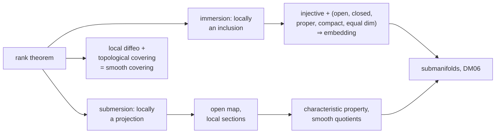

# DM05 · Immersions, Embeddings, Submersions and Coverings

◀ [[DM04 The Tangent Bundle and the Rank Theorem]] · [[Differential Geometry - Course Map]] · [[DM06 Submanifolds]] ▶

taught · in syllabus extra · book extra · beyond

> [!warning] What the lecture source says
> MT3184 **weeks 4–5** (slides DG11–DG12, readable): consequences of the rank theorem, "a submersion is an open map", the examples of an **injective immersion that is not an embedding** (the figure-eight and the **dense line on the torus** $t\mapsto(e^{it},e^{i\alpha t})$), and immersed submanifolds ([[mt3184-differential-geometry-and-lie-groups/2026-09-03-august-31-september-4|Aug 31–Sep 4 note]]); **HW5 Q1** (immersion $\Rightarrow$ embedding if $\dim S=\dim M$, proper, or compact). **Smooth covering maps** are *not* in the slides as such (they appear implicitly in $\mathbb R\to S^1$, $\mathbb C\to\mathbb C^\times$ in the Lie group examples), so §3 is 🟡. Book: Lee Ch. 4 §§ Embeddings, Submersions, Smooth Covering Maps ([[John M. Lee - Introduction to Smooth Manifolds.pdf#page=103|Lee pp. 85–94]]; printed page = PDF page − 18).

> [!syllabus] Syllabus map: what is in the syllabus and what is extra in this chapter
> 🟢 **In syllabus (taught: DG11–DG12, HW5)**
> - §1 immersions, the figure-eight and the dense line on the torus, when an injective immersion is an embedding (HW5 Q1); §2 submersions are open maps
>
> 🟡 **Extra · book** (Lee Ch. 4; Tu §§8–9; Kumaresan Ch. 2)
> - the Local Embedding Theorem, the Local Section Theorem and the characteristic property of surjective submersions; §3 smooth covering maps and universal covering manifolds
>
> 🔵 **Extra · beyond** (my additions, labelled)
> - numbers: the return distances of the dense line ($1.5,\ 0.107,\ 0.0183,\ 0.00153$ for $t\le10,10^2,10^3,10^4$; $2.3\times10^{-3}$ at $t=2\pi\cdot985$); $d(\det)_X(X)=n\det X$ ($92.91$ for a random $3\times3$); the fibre of $z\mapsto z^3$; the cusp $(t^2,t^3)$

> [!key] After this chapter you can
> - classify maps as **immersions, submersions, embeddings, local diffeomorphisms** and give the standard examples and counter-examples,
> - decide when an **injective immersion is a smooth embedding** (open/closed map, proper, compact, equal dimension),
> - prove that **submersions are open** and have **local sections**, and use the characteristic property to prove smoothness of induced maps,
> - recognise **smooth covering maps**, lift maps through them, and state the **universal covering manifold**.

> [!intuition] The one-sentence story
> The rank theorem says an immersion is locally an inclusion and a submersion locally a projection. *Locally* is the key word: an immersion can still wrap around and come arbitrarily close to itself far away (a line winding densely on a torus), so its image need not be a nice subset. An **embedding** is an immersion that is also a homeomorphism onto its image; a **submersion** is a map with a smooth family of local sections, hence open; a **covering** is a submersion that is a local diffeomorphism with uniform sheets.

*Concept map: the rank theorem gives local normal forms; the global behaviour (embedding, openness, sheets) needs extra hypotheses.*

![[fig_dm05_immersion.png]]
*A: the line $t\mapsto(e^{it},e^{i\sqrt2t})$ on the torus for $t\le6$ (orange) and $t\le60$ (blue). B: its distance from $F(0)$ at $t=2\pi q$ ($q$ the denominators of the continued fraction of $\sqrt2$) tends to $0$. C: the cusp is injective but not an immersion at $0$ (§1).*

## 1. Immersions and embeddings
taught *Source: DG12, HW5 Q1* · extra · book *Lee Examples 4.17–4.20, Lemma 4.21, Prop. 4.22, Thm 4.25*

> [!key] Definitions
> A smooth map $F:M\to N$ is an **immersion** if $dF_p$ is injective for all $p$ (rank $m$); a **submersion** if $dF_p$ is surjective for all $p$ (rank $n$). A **smooth embedding** is an immersion that is also a **topological embedding**, i.e. a homeomorphism onto its image $F(M)$ with the subspace topology ([[PA11 Subspaces, Products and Quotients]] §2).

> [!intuition] Immersion versus embedding
> An immersion has no *corners or cusps* (the velocity never vanishes), but it may cross itself or accumulate on itself. An embedding additionally forbids any such behaviour: the image looks exactly like the domain, with the same open sets. Two requirements: **no singular points** (immersion) and **no global accumulation** (topological embedding).

> [!example] Examples and counter-examples
> * **Embeddings:** inclusions of open subsets; the maps $M_j\to M_1\times\dots\times M_k$, $x\mapsto(p_1,\dots,x,\dots,p_k)$; the graph map $x\mapsto(x,f(x))$; $t\mapsto(t^3,t)$ (it has a global left inverse, the second coordinate, which is continuous).
> * **Topological but not smooth embedding:** $t\mapsto(t^3,0)$, $\mathbb R\to\mathbb R^2$ (Lee Ex. 4.18): a homeomorphism onto the axis, but $F'(0)=0$.
> * **Injective, smooth, not an immersion:** the cusp $t\mapsto(t^2,t^3)$, velocity $(2t,3t^2)$ vanishing at $t=0$ (figure C).
> * **Injective immersion, not an embedding (1): the figure-eight** $\beta(t)=(\sin2t,\sin t)$, $t\in(-\pi,\pi)$: $\beta(\pi-\delta)\to\beta(0)$ as $\delta\to0$ ([[PA11 Subspaces, Products and Quotients]] §2: $2.2\times10^{-3}$ at $\delta=10^{-3}$).
> * **(2): the dense line on the torus** (DG12, Lee Ex. 4.20): $F(t)=(e^{it},e^{i\alpha t})$, $\alpha=\sqrt2$.

> [!example] The dense line on the torus, with numbers
> $F:\mathbb R\to T^2$ is a smooth immersion ($F'(t)=(ie^{it},i\alpha e^{i\alpha t})\ne0$) and **injective** ($F(t)=F(s)$ forces $t-s\in2\pi\mathbb Z$ and $\alpha(t-s)\in2\pi\mathbb Z$, hence $\alpha\in\mathbb Q$ unless $t=s$). It is **not** an embedding: by Dirichlet's approximation theorem (Lee Lemma 4.21) there are integers $p,q$ with $|\alpha q-p|$ arbitrarily small, so $F(2\pi q)=(1,e^{2\pi i\alpha q})$ gets arbitrarily close to $F(0)=(1,1)$ while $2\pi q\to\infty$; $F^{-1}$ is not continuous at $F(0)$. Numerically (`dm_numbers.py`, DM05) the smallest distance $|F(t)-F(0)|$ on the torus for $1\le t\le T$ is $1.50,\ 0.107,\ 0.0183,\ 0.00153$ for $T=10,10^2,10^3,10^4$ (at $t=5.06,\,75.5,\,439.8,\,6188.9$), and at $t=2\pi q$ with $q=1,2,5,12,29,70,169,408,985$ (denominators of the convergents of $\sqrt2$) it is $2.6,\ 1.1,\ 0.45,\ 0.18,\ 0.077,\ 0.032,\ 0.013,\ 0.0054,\ \mathbf{0.0023}$, decaying like $2\pi/(2\sqrt2q)$ (figure B). The image is **dense** in $T^2$: an immersed, dense, one-dimensional "submanifold" of a two-dimensional manifold, the standard example of a **Lie subgroup that is not closed** ([[DM08 Lie Groups]], [[DM15 Closed Subgroups and the Lie Correspondence]]).

> [!key] When is an injective immersion an embedding? (HW5 Q1; Lee Prop. 4.22)
> Let $F:M\to N$ be an **injective immersion**. If any one of (a) $F$ is an **open** or **closed** map, (b) $F$ is **proper**, (c) $M$ is **compact**, (d) $\dim M=\dim N$, holds, then $F$ is a smooth embedding.
>
> *Proof.* An injective continuous map $M\to F(M)$ that is open or closed is a homeomorphism onto its image, so (a) is the case. (d): an immersion between manifolds of equal dimension has invertible $dF_p$, so is a local diffeomorphism (IFT) and in particular open; apply (a). (b): a proper continuous map into a locally compact Hausdorff space is **closed**: if $C\subseteq M$ is closed and $y\in\overline{F(C)}$, take a compact neighbourhood $K$ of $y$; $F^{-1}(K)\cap C$ is compact, so $F(F^{-1}(K)\cap C)=K\cap F(C)$ is compact, hence closed in $N$, and $y$ lies in its closure, so $y\in F(C)$; apply (a). (c) a compact $M$ makes $F$ proper (closed subsets of $M$ are compact), or use the closed map lemma ([[PA11 Subspaces, Products and Quotients]] §6). $\square$

> [!key] Immersions are locally embeddings (Lee Thm 4.25; the homework after DG12)
> $F:M\to N$ is an immersion iff every point $p\in M$ has a neighbourhood $U$ such that $F|_U:U\to N$ is a smooth embedding.
> *Proof.* ($\Rightarrow$) By the Rank Theorem ([[DM04 The Tangent Bundle and the Rank Theorem]] §3) there are charts with $F=(x^1,\dots,x^m,0,\dots,0)$ on $U$, which is the inclusion of a slice: a smooth embedding. ($\Leftarrow$) an embedding is an immersion by definition. $\square$

## 2. Submersions
taught *Source: DG12 (a submersion is an open map)* · extra · book *Lee Thm 4.26, Prop. 4.28, Thms 4.29–4.31*

> [!key] Submersions are open (DG12; Lee Prop. 4.28)
> A submersion $\pi:M\to N$ is an **open map**; if surjective it is a **quotient map**. In particular $\pi(M)$ is open in $N$. *Proof.* By the Rank Theorem $\pi$ is locally $(x^1,\dots,x^m)\mapsto(x^1,\dots,x^n)$, and projections are open, so $\pi$ maps small open sets to open sets. $\square$

> [!key] Local Section Theorem (Lee Thm 4.26)
> A smooth map $\pi:M\to N$ is a submersion iff every point of $M$ lies in the image of a **smooth local section** $\sigma:V\to M$ ($V\subseteq N$ open, $\pi\circ\sigma=\mathrm{id}_V$).
> *Proof.* ($\Rightarrow$) In rank-theorem charts $\pi$ is the projection and $\sigma(x^1,\dots,x^n)=(x^1,\dots,x^n,0,\dots,0)$ is a section through the given point. ($\Leftarrow$) $\pi\circ\sigma=\mathrm{id}$ gives $d\pi\circ d\sigma=\mathrm{id}$, so $d\pi$ is onto. $\square$

> [!key] Characteristic property of surjective submersions (Lee Thms. 4.29–4.30)
> Let $\pi:M\to N$ be a surjective submersion. A map $F:N\to P$ is **smooth iff $F\circ\pi$ is smooth**; and a smooth $G:M\to P$ that is **constant on each fibre** $\pi^{-1}(q)$ descends to a unique smooth $\widehat G:N\to P$ with $\widehat G\circ\pi=G$ ("passing smoothly to the quotient").
> *Proof.* Locally $F=(F\circ\pi)\circ\sigma$ with a smooth local section $\sigma$; and $\widehat G(q)=G(\sigma(q))$ is smooth and independent of the section. $\square$

> [!example] Examples of submersions, with numbers
> Projections $M\times N\to M$ (rank $=\dim M$). **The determinant** $\det:GL(n,\mathbb R)\to\mathbb R^\times$ is a submersion: $d(\det)_X(B)=\det X\,\mathrm{tr}(X^{-1}B)$ ([[PA13 The Derivative and the Inverse Function Theorem]] §1), and $B=X$ gives $d(\det)_X(X)=n\det X\ne0$ (for a random $3\times3$ matrix: $92.910318$ by finite difference and by the formula), so $d(\det)_X$ is onto $\mathbb R$ at every $X$ (HW5 Q3, HW6 Q7); hence every fibre, e.g. $SL(n,\mathbb R)=\det^{-1}(1)$, is a submanifold of dimension $n^2-1$ ([[DM06 Submanifolds]]). The quotient map $S^n\to\mathbb{RP}^n$ is a local diffeomorphism. A submersion cannot lower dimension: $\dim M\ge\dim N$.

> [!pitfall] Openness needs full rank in the target
> An **immersion** $\mathbb R\to\mathbb R^2$ (rank $1<2$) is never open, and a smooth map whose differential drops rank can fail to be open: $F(x,y)=x^2+y^2$ sends the ball $B_r(0)$ to $[0,r^2)$, not open in $\mathbb R$, because $dF_{(0,0)}=0$. Submersions are open *because* $dF_p$ is onto at every point.

## 3. Smooth covering maps
extra · book *Lee Props. 4.33, 4.36, 4.40, Cor. 4.43*

> [!key] Definition (Lee p. 91)
> A smooth surjective map $\pi:E\to M$ between **connected** smooth manifolds is a **smooth covering map** if every point of $M$ has a neighbourhood $U$ such that every component of $\pi^{-1}(U)$ is mapped **diffeomorphically** onto $U$ by $\pi$ ($U$ is **evenly covered**; [[PA15 Covering Spaces and the Fundamental Group]] §2 for the topological notion).

> [!key] Properties (Lee Prop. 4.33)
> (a) Every smooth covering map is a **local diffeomorphism**, a **submersion**, an **open** map and a **quotient map**. (b) An **injective** smooth covering map is a diffeomorphism. (c) A **topological covering map** is a smooth covering map iff it is a **local diffeomorphism**. *Proof of (c):* each sheet $\widetilde U\to U$ is a homeomorphism and a local diffeomorphism, hence a diffeomorphism (its inverse is smooth locally). $\square$

> [!key] Smooth structure on a cover (Lee Prop. 4.40, Cor. 4.43)
> If $M$ is a connected smooth $n$-manifold and $\pi:E\to M$ is a **topological covering** with $E$ connected, then $E$ is a topological $n$-manifold with a **unique smooth structure** making $\pi$ a smooth covering. In particular, **every connected smooth manifold has a universal covering manifold** $\widetilde M\to M$ ([[PA15 Covering Spaces and the Fundamental Group]] §5). **Lifting:** a continuous lift of a smooth map through a smooth covering is smooth (locally it is $F=\sigma^{-1}\circ f$ with a smooth local inverse of $\pi$).

> [!example] Smooth coverings, with numbers
> $p:\mathbb R\to S^1$, $t\mapsto e^{it}$ (velocity $ie^{it}\ne0$); $\mathbb R^n\to T^n$; $z\mapsto z^k$ on $S^1$ ($k$ sheets; derivative $k$ in the angle coordinate): the fibre of $z\mapsto z^3$ over $e^{0.7i}$ is the three points with arguments $0.2333,\ 2.3277,\ -1.8611$, and each cubes back to $e^{0.7i}$ to $10^{-15}$; $S^n\to\mathbb{RP}^n$ (2 sheets); $\exp:\mathbb C\to\mathbb C^\times$ ($\det D\exp=e^{2x}\neq0$, [[PA13 The Derivative and the Inverse Function Theorem]] §4); and, anticipating [[DM08 Lie Groups]], $SU(2)\to SO(3)$, a smooth covering *homomorphism* with kernel $\{\pm1\}$ ([[PA15 Covering Spaces and the Fundamental Group]] §5). **Non-example:** $(0,2)\to S^1$ is a local diffeomorphism but not evenly covered.

<!-- interactive:start (generated by scripts/embed_interactive.py; edit the tool in scripts/interactive/tools/, not this block) -->
> [!interactive]+ Interactive: The inverse function theorem: when a smooth map is locally invertible
> A smooth map F: R² → R² and a point p.
>
> ![[pa_inverse_function.png|720]]
>
> **Try:** Squaring map z ↦ z²: invertible away from 0, but 2-to-1 (points z and −z share an image), so only a LOCAL inverse exists. Fold map (x, y²): drag p across the line y = 0 and watch the image fold over itself. Polar map (r, θ): singular at r = 0.
>
> [▶ Open the tool in your browser](../Assets/interactive/pa_inverse_function.html) · [absolute link](file:///home/swastik/Documents/notes/Assets/interactive/pa_inverse_function.html) · all tools and coverage: [[Interactive Tools]]

<!-- interactive:end -->

## Map of this chapter
> [!connection] How DM05 connects
> **Builds on:** [[DM04 The Tangent Bundle and the Rank Theorem]] (rank theorem, IFT), [[PA11 Subspaces, Products and Quotients]] (embeddings, closed map lemma, quotients), [[PA12 Separation, Countability and Local Compactness]] (proper maps), [[PA15 Covering Spaces and the Fundamental Group]] (coverings).
> **Leads to:** [[DM06 Submanifolds]] (images of embeddings, regular level sets, immersed submanifolds), [[DM08 Lie Groups]] (Lie subgroups, covering homomorphisms), [[DM09 Group Actions and Semidirect Products]] (orbit maps, quotients), [[DM15 Closed Subgroups and the Lie Correspondence]].
> **Concepts:** [[Immersion and Submersion]] · [[Smooth Embedding]] · [[Proper Map]] · [[Local Section Theorem]] · [[Characteristic Property of Surjective Submersions]] · [[Smooth Covering Map]] · [[Dense Line on the Torus]]
> **Other subjects:** [[Group Theory - Course Map]] (quotient maps), [[Quantum Mechanics - Course Map]] ($SU(2)\to SO(3)$ and spin)

## Summary
> [!summary] Cheat-sheet
> - **Immersion** ($dF_p$ injective; locally an inclusion), **submersion** ($dF_p$ surjective; locally a projection), **smooth embedding** = immersion + homeomorphism onto image.
> - Injective immersion $\Rightarrow$ embedding if $F$ is **open/closed**, **proper**, $M$ **compact**, or $\dim M=\dim N$ (HW5 Q1). Counter-examples: figure-eight, **dense line $t\mapsto(e^{it},e^{i\sqrt2t})$** on $T^2$ (returns $\to0$: $0.0023$ at $t=2\pi\cdot985$), $t\mapsto(t^3,0)$ (topological but not smooth embedding), cusp (not immersion).
> - Immersions are **locally embeddings** (Thm 4.25). Submersions are **open**, have **local sections** (Thm 4.26), and satisfy the **characteristic property** ($F\circ\pi$ smooth $\Rightarrow F$ smooth).
> - $\det:GL(n,\mathbb R)\to\mathbb R^\times$ is a submersion ($d(\det)_X(X)=n\det X$).
> - **Smooth covering** = topological covering + local diffeomorphism; covers are open, quotient maps; every connected manifold has a universal covering manifold; lifts of smooth maps are smooth.

## Practice
1. **Equal dimension (HW5 Q1a).** Show an injective immersion $F:M\to N$ with $\dim M=\dim N$ is a diffeomorphism onto an open subset of $N$.
2. **Proper maps (HW5 Q1b, c).** Prove that a proper injective immersion is an embedding, and deduce that every injective immersion of a compact manifold is an embedding.
3. **Classify.** For each map say whether it is an immersion, an injective immersion, a topological embedding, a smooth embedding: (a) $t\mapsto(t^2,t^3)$, (b) $t\mapsto(t^3,0)$, (c) $t\mapsto(t^3,t)$, (d) $\theta\mapsto(\cos\theta,\sin\theta)$ on $(0,2\pi)$, (e) $\beta(t)=(\sin2t,\sin t)$ on $(-\pi,\pi)$.
4. **Dense line.** Show $F(t)=(e^{2\pi it},e^{2\pi i\alpha t})$ is an injective immersion for irrational $\alpha$ and not an embedding; find $q_n\to\infty$ with $F(q_n)\to F(0)$.
5. **Submersions are open.** Prove that a surjective submersion is a quotient map and that $\pi(M)$ is open for any submersion.
6. **The determinant.** Show $\det:GL(n,\mathbb R)\to\mathbb R^\times$ is a submersion by computing $d(\det)_X(B)$; what is the dimension of the fibre $\det^{-1}(1)$?
7. **Local sections.** For $\pi:\mathbb R^2\to\mathbb R$, $\pi(x,y)=x+y^2$, show $\pi$ is a submersion and give a smooth local section through any point $(x_0,y_0)$; is there a global section?
8. **Smooth covering.** Show $z\mapsto z^k$ is a smooth covering $S^1\to S^1$ with $k$ sheets and that it induces multiplication by $k$ on $\pi_1$ ([[PA15 Covering Spaces and the Fundamental Group]]).
9. **Lifting is smooth.** If $\pi:E\to M$ is a smooth covering and $F:Y\to M$ smooth has a continuous lift $\tilde F$, prove $\tilde F$ is smooth.
10. **Non-covering.** Show that $p|_{(0,3)}$, $p(t)=e^{2\pi it}$, is a surjective local diffeomorphism $(0,3)\to S^1$, find a point that is not evenly covered, and conclude it is not a smooth covering map.

> [!example]- Solutions
> 1. $dF_p$ is injective between spaces of equal dimension, so bijective; by the IFT $F$ is a local diffeomorphism, hence open; $F:M\to F(M)$ is an open bijection onto the open set $F(M)$, so a diffeomorphism (its inverse is locally the inverse of the local diffeomorphisms).
> 2. §1, Prop. 4.22(b)/(c): proper $\Rightarrow$ closed (proof above), injective closed continuous $\Rightarrow$ homeomorphism onto image; compact domain makes any continuous map proper.
> 3. (a) injective, smooth, not an immersion at $0$ ($F'(0)=0$), image a cusp. (b) a topological embedding (homeomorphism onto the axis) but not an immersion at $0$ so not a smooth embedding. (c) an embedding (graph of $x=y^3$; global left inverse $(x,y)\mapsto y$). (d) an injective immersion; it is an embedding onto the open arc $S^1\setminus\{(1,0)\}$ (a homeomorphism onto its image: the inverse is $\arg$ on the slit circle, continuous). (e) injective immersion, **not** a topological embedding (image the figure-eight, $\beta(\pi-\delta)\to\beta(0)$).
> 4. Injective: $F(t)=F(s)$ implies $t-s\in\mathbb Z$ and $\alpha(t-s)\in\mathbb Z$; if $t\ne s$ then $\alpha\in\mathbb Q$. Immersion: $F'(t)=2\pi(ie^{2\pi it},i\alpha e^{2\pi i\alpha t})\ne0$. By Dirichlet there are integers $q_n\to\infty$, $p_n$ with $|\alpha q_n-p_n|<1/q_n$, so $F(q_n)=(1,e^{2\pi i(\alpha q_n-p_n)})\to(1,1)=F(0)$ while $q_n\not\to0$: $F^{-1}$ is not continuous at $F(0)$. (Numerically the return distance at $t=2\pi\cdot985$ for $\alpha=\sqrt2$ in the normalisation $e^{it}$ is $2.3\times10^{-3}$.)
> 5. Locally $\pi=(x^1,..,x^m)\mapsto(x^1,..,x^n)$, open. A surjective open continuous map is a quotient map ($V\subseteq N$ with $\pi^{-1}(V)$ open has $V=\pi(\pi^{-1}V)$ open).
> 6. $d(\det)_X(B)=\det X\operatorname{tr}(X^{-1}B)$, surjective onto $\mathbb R$ (take $B=cX$, giving $cn\det X$); so rank $1$ and $\dim\det^{-1}(1)=n^2-1$.
> 7. $d\pi=(1,2y)\neq0$ everywhere (its first entry is $1$), so $d\pi$ is onto $\mathbb R$: a submersion. Through $(x_0,y_0)$ the map $\sigma(s)=(s-y_0^2,\,y_0)$ satisfies $\pi(\sigma(s))=s$ and $\sigma(x_0+y_0^2)=(x_0,y_0)$. It is even a global section (defined for all $s\in\mathbb R$).
> 8. $z\mapsto z^k$: in the angle coordinate $\theta\mapsto k\theta$, derivative $k\neq0$, so a local diffeomorphism; evenly covered arcs have $k$ sheets (the $k$ roots). On $\pi_1(S^1)=\mathbb Z$ the generator $\omega_1$ maps to $\omega_k$ (class $k$, numerically checked in PA15).
> 9. Near $y\in Y$ choose an evenly covered $U\ni F(y)$ and the sheet $\widetilde U$ containing $\tilde F(y)$; by continuity $\tilde F=(\pi|_{\widetilde U})^{-1}\circ F$ on a neighbourhood of $y$, a composition of smooth maps (the inverse of $\pi|_{\widetilde U}$ is smooth).
> 10. $p|_{(0,3)}$ is smooth with velocity $2\pi ie^{2\pi it}\ne0$ (a local diffeomorphism) and surjective. The arc $U$ around $1$ has preimage $(0,\delta)\cup(1-\delta,1+\delta)\cup(2-\delta,2+\delta)\cup(3-\delta,3)$, whose components $(0,\delta)$ and $(3-\delta,3)$ map onto *half* of $U$ only, not diffeomorphically onto $U$. So $1$ is not evenly covered and $p|_{(0,3)}$ is not a covering map.

<!-- zettel:start (generated by scripts/sort_zettel.py; do not edit between the markers) -->
## Zettel notes

> [!abstract]- Zettel notes filed under this chapter (2): the other tool's concept notes from the lectures, unreviewed
> [[zettel/image-of-injective-immersion|Image of Injective Immersion]] · [[zettel/immersed-submanifold|Immersed Submanifold]]
<!-- zettel:end -->

## Provenance
> [!provenance]- Source map for this chapter
> | Topic | Source | Scope |
> |---|---|---|
> | immersions, injective immersion not an embedding (figure-eight, dense line), immersed submanifolds, a submersion is an open map | slides DG12 via [[mt3184-differential-geometry-and-lie-groups/2026-09-03-august-31-september-4\|Aug 31–Sep 4 note]] | taught |
> | when an injective immersion is an embedding (open/closed, proper, compact, equal dimension) | [[mt3184-differential-geometry-and-lie-groups/2026-09-04-hw5\|HW5]] Q1; Lee Prop. 4.22 | taught (via homework) |
> | $d(\det)$, $\det$ as a submersion | HW5 Q3, [[mt3184-differential-geometry-and-lie-groups/2026-09-11-hw6\|HW6]] Q7 | taught (via homework) |
> | Local Embedding Thm, Local Section Thm, characteristic property, smooth coverings, universal covering manifold | Lee Thm 4.25, Thm 4.26, Prop. 4.28, Thms 4.29–4.31, Props. 4.33, 4.36, 4.40, Cor. 4.43; Tu §9 | extra/book |
> | numbers: dense-line returns, $d(\det)_X(X)$, fibre of $z^3$, cusp velocity | `scripts/dm_numbers.py` (DM05), `fig_dm05_immersion.py` | extra/beyond |
>
> **Notes.** The slide DG12 states: "an injective immersion need not have an embedded image", with the figure-eight and the torus example; its proof that a submersion is open is only outlined (finish left as an exercise). Smooth covering maps do not appear in the readable slides; §3 is 🟡.
