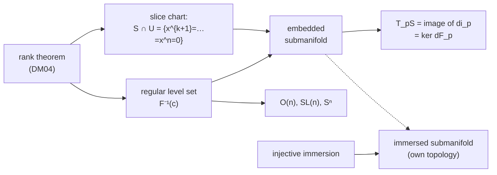

# DM06 · Submanifolds

◀ [[DM05 Immersions, Embeddings, Submersions and Coverings]] · [[Differential Geometry - Course Map]] · [[DM07 Sard Whitney and Transversality]] ▶

taught · in syllabus extra · book extra · beyond

> [!warning] What the lecture source says
> Submanifolds appear in MT3184 in three places: **week 3** (slide DG8, *partly readable*: $T_pS\subset T_pM$ via a slice chart, $T_pS^2$ as a plane orthogonal to $p$), **week 4** (DG10: Prop 5.37, $T_pS=\{v:vf=0\text{ whenever }f|_S\equiv0\}$, with the converse inclusion "set as homework"), and **weeks 5–6** (DG12: **immersed submanifolds**, Prop 5.18; DG14–DG16: stabilisers and kernels are embedded submanifolds; DG19–DG20: $SL(n)$, $O(n)$ and $\mathrm{Lie}(O(n))=\{A+A^T=0\}$). Homework: **HW4 Q1** (regular value $\Rightarrow$ submanifold, $T_pS=\ker dF_p$), HW5 Q1. Sources: [[mt3184-differential-geometry-and-lie-groups/2026-08-20-august-17-21|Aug 17–21]], [[mt3184-differential-geometry-and-lie-groups/2026-08-27-august-24-28|Aug 24–28]], [[mt3184-differential-geometry-and-lie-groups/2026-09-03-august-31-september-4|Aug 31–Sep 4]] notes. Book: Lee Ch. 5 ([[John M. Lee - Introduction to Smooth Manifolds.pdf#page=116|Lee pp. 98–123]]; printed page = PDF page − 18). The slides' statement of the local slice criterion is only partly legible (`[!verify]`).

> [!syllabus] Syllabus map: what is in the syllabus and what is extra in this chapter
> 🟢 **In syllabus (taught: DG8, DG10, DG12, DG14–DG20, HW4, HW5)**
> - §1 embedded submanifolds and slice charts; §2 regular level sets (HW4 Q1), $O(n)$, $SL(n)$; §3 tangent spaces $T_pS$ and Prop 5.37; §4 immersed submanifolds (Prop 5.18)
>
> 🟡 **Extra · book** (Lee Ch. 5; Tu §9; Kumaresan Ch. 2; Warner Ch. 1)
> - the Local Slice Criterion with proof; restricting maps to submanifolds; uniqueness of the smooth structure on an embedded submanifold; the extension lemma for functions on submanifolds
>
> 🔵 **Extra · beyond** (my additions, labelled)
> - numerical checks: $\operatorname{rank}d\Phi_A=n(n+1)/2$ at random orthogonal *and* random invertible $A$ for $n=2,\dots,5$ (so $\dim O(n)=n(n-1)/2=1,3,6,10$); the kernel of $d\Phi_I$ is skew to $10^{-16}$; $\dim T_ISL(4)=15$; the slice chart of the circle; critical vs regular levels of $x^2-y^2$

> [!key] After this chapter you can
> - recognise an **embedded submanifold** by a **slice chart**, and know when the image of an embedding or a level set is one,
> - apply the **Regular Level Set Theorem** to show $S^n$, $SL(n,\mathbb R)$, $O(n)$ are submanifolds and compute their dimensions and tangent spaces,
> - identify $T_pS$ inside $T_pM$ in three ways (image of $di_p$, $\ker dF_p$, derivations killing functions vanishing on $S$),
> - distinguish **embedded** from **immersed** submanifolds and say what changes (topology, restricting maps).

> [!intuition] The one-sentence story
> A submanifold is a *subset that is itself a manifold in a way compatible with the ambient one*: near each of its points one can choose coordinates on the big manifold in which the subset is a flat coordinate plane (a **slice**), the way a great circle is a straight line in suitable coordinates. Level sets of regular values are the main source: whenever an equation $F=c$ has $dF\neq0$-type regularity, its solution set is a manifold of the expected dimension, and its tangent space is the kernel of $dF$ (the directions in which $F$ does not change).

*Concept map: slice charts (from the rank theorem) define embedded submanifolds; regular level sets are the main examples; immersed submanifolds relax the topology.*

![[fig_dm06_submanifold.png]]
*A: the slice chart $\varphi(x,y)=(x,y-\sqrt{1-x^2})$ straightens the circle near $(0,1)$. B: levels of $F=x^2-y^2$: regular levels are hyperbolas; the critical level $0$ is a cross. C: $T_pS^2=\ker dF_p$ for $F=|x|^2$ at $p=(\tfrac14,\tfrac12,\tfrac{\sqrt{11}}4)$, containing the velocity of the HW3 curve (§1, §2, §3).*

## 1. Embedded submanifolds and slice charts
taught *Source: DG8 (slice chart), HW5 Q1* · extra · book *Lee Props. 5.1–5.7, Thm 5.8, Example 5.9*

> [!key] Definition
> A subset $S\subseteq M$ of a smooth $n$-manifold is an **embedded (regular) submanifold of dimension $k$** if it is a topological manifold in the **subspace topology** with a smooth structure making the inclusion $\iota:S\hookrightarrow M$ a smooth **embedding** (immersion + subspace topology, [[DM05 Immersions, Embeddings, Submersions and Coverings]]). The number $n-k$ is the **codimension**. Images of smooth embeddings are embedded submanifolds (Lee Prop. 5.2).

> [!key] Local Slice Criterion (Lee Thm 5.8; DG8)
> $S\subseteq M$ is an embedded $k$-submanifold iff every $p\in S$ lies in the domain of a smooth chart $(U,\varphi=(x^1,\dots,x^n))$ of $M$ with
> $$\varphi(S\cap U)=\{x\in\varphi(U):x^{k+1}=\cdots=x^n=0\}\quad(\text{a } k\text{-slice}).$$
> Such a chart is a **slice chart**.

> [!derivation]- Proof
> ($\Leftarrow$) The restrictions of $(x^1,\dots,x^k)$ to $S\cap U$ are homeomorphisms onto open subsets of $\mathbb R^k$ and the transition maps are restrictions of smooth maps to slices, hence smooth; with this smooth structure $\iota$ is in these coordinates $(x^1,\dots,x^k)\mapsto(x^1,\dots,x^k,0,\dots,0)$, a smooth embedding. ($\Rightarrow$) Let $S$ be an embedded submanifold and $p\in S$. The inclusion is an immersion, so by the Rank Theorem there are charts in which $\iota$ is $(x^1,\dots,x^k)\mapsto(x^1,\dots,x^k,0,\dots,0)$ on a neighbourhood $V$ of $p$ in $S$; **because $S$ has the subspace topology** $V=S\cap W$ for some open $W\subseteq M$, and shrinking $W$ to the domain of the chart gives $S\cap W$ = a slice. $\square$

> [!intuition] Where the subspace topology is used
> The figure-eight and the dense line of DM05 are images of immersions; the rank theorem still gives a *piece of the image* that is flat, but that piece is **not** $S\cap W$ for an open $W$ of the plane (other branches come back into $W$). That is exactly the failure of the slice condition and of the subspace topology.

> [!example] Examples
> Open subsets (codimension $0$); the graph $\{(x,f(x))\}$ of a smooth $f:U\to\mathbb R^k$ (slice chart $(x,y)\mapsto(x,y-f(x))$; Lee Prop. 5.4, 5.7: a closed, properly embedded submanifold); slices $M\times\{q\}\subseteq M\times N$ (Prop. 5.3); the circle: near $(0,1)$ the chart $\varphi(x,y)=(x,\,y-\sqrt{1-x^2})$ has $S^1\cap U=\{\text{second coordinate}=0\}$ and $\det D\varphi=1$ (numerically: second coordinate $\le2\times10^{-16}$ on the arc, figure A); the **sphere** $S^n$ (Example 5.9, or §2); every compact embedded submanifold is *properly* embedded (Cor. 5.6). **Non-examples:** the figure-eight and the cross $\{xy=0\}$ at $0$ (four branches meet: no slice chart); the cusp $\{y^2=x^3\}$; a subset like $\{x\ge0\}\subset\mathbb R$ (a manifold *with boundary*).

## 2. Regular level sets
taught *Source: HW4 Q1; DG16, DG19–DG20 (examples $O(n)$, $SL(n)$)* · extra · book *Lee Thm 5.12, Cors. 5.13–5.14, Example 5.15*

> [!key] Regular Level Set Theorem (HW4 Q1; Lee Cor. 5.14)
> Let $F:M^m\to N^n$ be smooth and $q\in N$ a **regular value**: $dF_p$ is surjective at every $p\in S=F^{-1}(q)$. Then $S$ is an **embedded submanifold of dimension $m-n$** (if nonempty) and $T_pS=\ker dF_p$.
>
> *Proof.* The set $\{p:dF_p\text{ surjective}\}$ is **open** (surjectivity means some $n\times n$ minor of the Jacobian is nonzero, an open condition), so $F$ restricted to an open $U\supseteq S$ is a submersion, of constant rank $n$. By the Rank Theorem, around each $p\in S$ there are charts with $F(x^1,\dots,x^m)=(x^1,\dots,x^n)$ and $q=(0,\dots,0)$; hence $S\cap U=\{x^1=\dots=x^n=0\}$, a slice (after reordering coordinates) of dimension $m-n$: a slice chart. Tangent space: $F\circ\iota$ is constant, so $dF_p\circ d\iota_p=0$ and $d\iota_p(T_pS)\subseteq\ker dF_p$; both have dimension $m-n$ (Rank–Nullity: $\dim\ker dF_p=m-n$), so equal. $\square$

> [!example] The sphere
> $F(x)=|x|^2:\mathbb R^{n+1}\to\mathbb R$, $dF_x=2x^T\ne0$ for $x\ne0$, so $1$ is a regular value and $S^n=F^{-1}(1)$ is an embedded $n$-submanifold with $T_pS^n=\ker dF_p=p^\perp$. At $p=(\tfrac14,\tfrac12,\tfrac{\sqrt{11}}4)$ the velocity $\alpha'(\tfrac14)=(1,2,-\tfrac5{\sqrt{11}})$ of the curve of HW3 Q1 satisfies $dF_p(\alpha'(\tfrac14))=2(\tfrac14+1-\tfrac54)=0$: it lies in $T_pS^2$ (figure C).

> [!example] $SL(n,\mathbb R)$ and $O(n)$, with numbers
> * $SL(n,\mathbb R)=\det^{-1}(1)$: $d(\det)_X(B)=\det X\operatorname{tr}(X^{-1}B)$ is onto $\mathbb R$ for every $X\in GL(n)$ (DM05 §2), so $1$ is a regular value: **$SL(n,\mathbb R)$ is an embedded submanifold of dimension $n^2-1$**, $T_ISL(n)=\ker(\operatorname{tr})$ (for $n=4$: $\operatorname{tr}$ is a $1\times16$ matrix of rank $1$, kernel of dimension $15$).
> * $O(n)=\Phi^{-1}(I)$ with $\Phi(A)=AA^T:GL(n,\mathbb R)\to\operatorname{Sym}(n)$ (the space of symmetric matrices, $\dim=n(n+1)/2$). $d\Phi_A(B)=BA^T+AB^T$ is onto $\operatorname{Sym}(n)$ **for every invertible $A$**: given symmetric $C$ take $B=\tfrac12C(A^T)^{-1}$, then $BA^T=\tfrac12C$ and $AB^T=\tfrac12C$. So $I$ is a regular value and **$O(n)$ is an embedded submanifold of dimension $n^2-\tfrac{n(n+1)}2=\tfrac{n(n-1)}2$**. Numerically the rank of $d\Phi_A$ is $3,6,10,15$ for $n=2,3,4,5$ at a random orthogonal and at a random invertible $A$ alike, giving $\dim O(n)=1,3,6,10$ (`dm_numbers.py`, DM06). $T_IO(n)=\ker d\Phi_I=\{B:B+B^T=0\}$, the **skew-symmetric** matrices: for $n=4$ the kernel has dimension $6$ and all its vectors satisfy $B+B^T=0$ to $2\times10^{-16}$. This is the computation $\operatorname{Lie}(O(n))=\{A+A^T=0\}$ of DG20 and HW7 Q3 ([[DM11 The Lie Algebra of a Lie Group]]). $O(n)$ is compact (closed and bounded), and $SO(n)$, the component of $I$, has the same dimension.

> [!pitfall] Critical values are not regular
> $F(x,y)=x^2-y^2$: for $c=1$ the smallest $|\nabla F|$ on the level set is $2$, for $c=\tfrac14$ it is $1$ (hyperbolas: regular); for $c=0$ it is $0$ at the origin, and $F^{-1}(0)=\{y=\pm x\}$ is a **cross**, not a submanifold (figure B). Regularity of the value is *sufficient*, not necessary: $F(x,y)=y^3$ has $F^{-1}(0)=\{y=0\}$, a submanifold, although $dF=0$ on it (the Constant-Rank Level Set Theorem 5.12 covers constant-rank cases).

## 3. The tangent space of a submanifold
taught *Source: DG8, DG10* · extra · book *Lee Props. 5.37–5.38, Cor. 5.39*

For an embedded submanifold $S\subseteq M$ the differential of the inclusion $d\iota_p:T_pS\to T_pM$ is **injective** (an immersion), so $T_pS$ is identified with a $k$-dimensional subspace of $T_pM$ (DG8: *"$T_pS$ is a $k$-dimensional subspace of $T_pM$, with $v=\sum_{i\le k}v^i\partial/\partial x^i|_p$ in a slice chart"*). Three descriptions:

> [!key] Three descriptions of $T_pS$
> (a) **Image of $d\iota_p$**: in a slice chart $T_pS=\operatorname{span}\{\partial/\partial x^1,\dots,\partial/\partial x^k\}|_p$.
> (b) **Kernel**: if $S=F^{-1}(q)$ is a regular level set, $T_pS=\ker dF_p$ (§2); for $S^n$: $p^\perp$.
> (c) **Annihilator of functions vanishing on $S$ (Prop. 5.37; DG10):**
> $$T_pS=\{v\in T_pM:\ vf=0\ \text{whenever }f\in C^\infty(M)\text{ and }f|_S\equiv0\}.$$

> [!derivation]- Proof of (c), including the converse the lecture left as homework
> ($\subseteq$) If $v=d\iota_p(v')$ and $f|_S\equiv0$, then $vf=v'(f\circ\iota)=v'(0)=0$. ($\supseteq$) Let $v=\sum v^i\partial/\partial x^i|_p\in T_pM$ in a slice chart with $\varphi(S\cap U)=\{x^{k+1}=\dots=x^n=0\}$ and suppose $vf=0$ for all $f$ vanishing on $S$. For $j>k$ the function $f_j=\psi\,x^j$ (with a bump function $\psi$, $\psi=1$ near $p$, supported in $U$, [[DM02 Smooth Maps and Partitions of Unity]] §2) is smooth on $M$ and vanishes on $S$, so $0=vf_j=v(x^j)=v^j$. Hence $v^j=0$ for $j>k$, i.e. $v\in\operatorname{span}\{\partial_1,\dots,\partial_k\}=T_pS$. $\square$

> [!example] A vector field tangent to a submanifold (DG10, Prop 8.22)
> Using (c): a vector field $X$ on $M$ is **tangent to $S$** iff $(Xf)|_S=0$ whenever $f|_S=0$. This is how one checks that a vector field is tangent to a sphere: the rotation field $X=x\partial_y-y\partial_x$ on $\mathbb R^3$ kills $|x|^2$, so it is tangent to every level $S^2_r$ ([[DM10 Vector Fields and Lie Brackets]]).

## 4. Immersed submanifolds
taught *Source: DG12, HW5* · extra · book *Lee Props. 5.18, 5.21–5.23, Thms 5.27, 5.29, Cor. 5.30, Thm 5.31*

> [!key] Definition and Prop. 5.18 (DG12)
> An **immersed submanifold** of $M$ is a subset $S\subseteq M$ with a topology (**not necessarily the subspace topology**) and a smooth structure making it a smooth manifold such that the inclusion $S\hookrightarrow M$ is an **immersion**. **Proposition 5.18:** if $F:P\to M$ is an injective immersion, then $S=F(P)$ with the topology "$U$ open iff $F^{-1}(U)$ open" and the smooth structure making $F:P\to S$ a diffeomorphism is an immersed submanifold of $M$.
> *Proof.* By construction $F:P\to S$ is a homeomorphism for the new topology and, with the transported charts, a diffeomorphism; the inclusion $S\to M$ is $F\circ(F:P\to S)^{-1}$, which is the immersion $F$ read on $S$. $\square$

Examples: the figure-eight (with the topology of $(-\pi,\pi)$) and the **dense line on the torus** are immersed, not embedded; they are immersed submanifolds of dimension $1$ in the dimension-2 spaces $\mathbb R^2$ and $T^2$, whose images are *not* closed or not locally flat ([[DM05 Immersions, Embeddings, Submersions and Coverings]]). **Immersed submanifolds are locally embedded** (Prop. 5.22, from the Local Embedding Theorem): each point has a neighbourhood in $S$ that is an embedded submanifold. An immersed submanifold is embedded iff its own topology is the subspace topology (Prop. 5.21).

> [!pitfall] Restricting maps to submanifolds
> If $S$ is **embedded** and $F:N\to M$ is smooth with $F(N)\subseteq S$, then $F$ is **automatically smooth as a map into $S$** (Lee Cor. 5.30: in a slice chart the first $k$ components of $F$ are smooth). If $S$ is only **immersed**, $F$ need not even be continuous into $S$ (Thm 5.29 requires continuity): a smooth curve in $\mathbb R^2$ running along the figure-eight, switching from one branch to the other at the crossing, is smooth in $\mathbb R^2$ but not continuous for the topology of $(-\pi,\pi)$. This is why *Lie subgroups* (immersed) need care ([[DM08 Lie Groups]], [[DM15 Closed Subgroups and the Lie Correspondence]]). Also, an embedded submanifold has a **unique** smooth structure (Thm 5.31), while an immersed one carries one tied to its topology.

> [!key] Extension of functions from submanifolds (Lee Lemma 5.34)
> If $S\subseteq M$ is an embedded submanifold, **closed** in $M$, every smooth $f:S\to\mathbb R$ extends to a smooth function on $M$ (slice charts + partition of unity, [[DM02 Smooth Maps and Partitions of Unity]] §4). Without "closed" it extends to a neighbourhood of $S$.

<!-- interactive:start (generated by scripts/embed_interactive.py; edit the tool in scripts/interactive/tools/, not this block) -->
> [!interactive]+ Interactive: Regular level sets: when f = c is a submanifold
> For a smooth function f: R² → R, the level set f⁻¹(c) is an embedded 1-dimensional submanifold whenever c is a regular value, i.e.
>
> ![[dm_level_sets.png|720]]
>
> **Try:** f = x³ − 3x + y²: critical points (±1, 0) with critical values f = −2 and f = 2. For |c| < 2 the level set has two components (an oval and an unbounded branch); at c = 2 it pinches into a figure with a node; for c > 2 it is one connected curve. f = x² − y²: c = 0 is a cross (not a manifold). f = x² + y²: c = 0 is a single point (dimension drop).
>
> [▶ Open the tool in your browser](../Assets/interactive/dm_level_sets.html) · [absolute link](file:///home/swastik/Documents/notes/Assets/interactive/dm_level_sets.html) · all tools and coverage: [[Interactive Tools]]

<!-- interactive:end -->

## Map of this chapter
> [!connection] How DM06 connects
> **Builds on:** [[DM05 Immersions, Embeddings, Submersions and Coverings]] (embeddings, submersions, local embedding), [[DM04 The Tangent Bundle and the Rank Theorem]] (rank theorem), [[DM03 Tangent Vectors and the Differential]] ($T_pM$), [[PA13 The Derivative and the Inverse Function Theorem]] (implicit function theorem as local graphs).
> **Leads to:** [[DM07 Sard Whitney and Transversality]], [[DM08 Lie Groups]] ($SL(n)$, $O(n)$, kernels of homomorphisms are Lie subgroups), [[DM09 Group Actions and Semidirect Products]] (stabilisers, orbits), [[DM10 Vector Fields and Lie Brackets]] (vector fields tangent to submanifolds), [[DM15 Closed Subgroups and the Lie Correspondence]].
> **Concepts:** [[Embedded Submanifold]] · [[Slice Chart]] · [[Regular Level Set Theorem]] · [[Regular Value]] · [[Tangent Space of a Submanifold]] · [[Immersed Submanifold]] · [[Orthogonal Group]] · [[Special Linear Group]]
> **Other subjects:** [[Group Theory - Course Map]] ($O(n)$, $SL(n)$ as matrix groups), [[Thermodynamics and Statistical Mechanics - Course Map]] (constraint surfaces and Lagrange multipliers: $T_pS=\ker dF_p$), [[Quantum Mechanics - Course Map]] ($U(n)$, $SU(2)$ as level sets)

## Summary
> [!summary] Cheat-sheet
> - **Embedded $k$-submanifold** $\iff$ **slice charts** $\{x^{k+1}=\dots=x^n=0\}$ (Lee 5.8); needs the **subspace topology**.
> - **Regular Level Set Theorem:** $q$ regular value $\Rightarrow$ $F^{-1}(q)$ embedded, $\dim=m-n$, $T_pS=\ker dF_p$ (proof: surjectivity is open $\Rightarrow$ submersion near $S$ $\Rightarrow$ rank theorem).
> - $S^n$ ($F=|x|^2$, $T_pS^n=p^\perp$); $SL(n)$ ($\dim n^2-1$, $T_I=\ker\operatorname{tr}$); $O(n)$ ($\Phi=AA^T$, $d\Phi_A$ onto $\operatorname{Sym}(n)$, $\dim n(n-1)/2$, $T_IO(n)=$ skew matrices).
> - $T_pS$ = image of $d\iota_p$ = $\ker dF_p$ = $\{v:vf=0\ \forall f|_S=0\}$ (Prop 5.37).
> - **Immersed submanifold** = injective-immersion image with its own topology (Prop 5.18); locally embedded; embedded iff topology is the subspace topology. Maps into an **embedded** $S$ are smooth iff smooth into $M$; not for immersed.

## Practice
1. **Spheres.** Show $S^n$ is a regular level set of $|x|^2$ and compute $T_pS^n$; give a slice chart of $S^2$ near the north pole.
2. **HW4 Q1.** Let $F:M\to N$ be smooth, $q\in N$, $S=F^{-1}(q)$ with $dF_p$ surjective for all $p\in S$. Prove, using the rank theorem, that $S$ is a submanifold of dimension $m-n$ and $T_pS=\ker dF_p$.
3. **$O(n)$.** Show that $d\Phi_A(B)=BA^T+AB^T$ maps onto $\operatorname{Sym}(n)$ for all invertible $A$; compute $\dim O(n)$ and $T_IO(n)$; verify $T_IO(2)$ explicitly.
4. **$SL(n)$.** Compute $\dim SL(n,\mathbb R)$ and $T_ISL(n,\mathbb R)$; is $\mathfrak{sl}(2,\mathbb R)=\ker\operatorname{tr}$ closed under $[A,B]=AB-BA$?
5. **No slice chart.** Show the image of the figure-eight $\beta(t)=(\sin2t,\sin t)$ is not an embedded submanifold of $\mathbb R^2$ near the origin.
6. **Slice chart.** Give a slice chart for the circle $S^1\subset\mathbb R^2$ near $(1,0)$ and for the graph of $f(x)=\sin3x$.
7. **Tangent vectors via functions (Prop 5.37).** Prove $T_pS=\{v:vf=0\ \forall f|_S=0\}$ and use it to decide whether $X=\partial_x$ is tangent to the circle at $(0,1)$.
8. **Critical value.** For $F=x^2-y^2$ list the regular and critical values and describe $F^{-1}(c)$ for each.
9. **Restricting the codomain.** Show that if $S$ is embedded and $F:N\to M$ is smooth with image in $S$, then $F:N\to S$ is smooth.
10. **Graphs.** Show the graph of a smooth $f:\mathbb R^n\to\mathbb R^k$ is a closed embedded $n$-submanifold of $\mathbb R^{n+k}$ and that its tangent space at $(a,f(a))$ is the graph of $Df(a)$.

> [!example]- Solutions
> 1. $dF_x=2x^T\ne0$ on $S^n$, so $1$ is regular; $T_pS^n=\{v:p\cdot v=0\}$. Near $N=(0,0,1)$ on $S^2$: $\varphi(x,y,z)=(x,y,z-\sqrt{1-x^2-y^2})$ is a chart (invertible, $D\varphi$ has determinant $1$) with $S^2\cap U=\{\varphi^3=0\}$.
> 2. See §2. Reordering coordinates so that the first $n$ components are the free ones (the rank theorem charts) turns $\{x^1=\dots=x^n=0\}$ into a slice.
> 3. Given $C\in\operatorname{Sym}(n)$ and $A\in GL(n)$, $B=\tfrac12C(A^T)^{-1}$ gives $d\Phi_A(B)=\tfrac12C+\tfrac12A\,A^{-1}C^T=\tfrac12C+\tfrac12C=C$ (using $C^T=C$). So $\dim O(n)=n^2-n(n+1)/2=n(n-1)/2$ and $T_IO(n)=\ker d\Phi_I=\{B+B^T=0\}$. For $n=2$: $B=\begin{pmatrix}0&-\theta\\\theta&0\end{pmatrix}$ spans a $1$-dimensional space ✓ (rotations).
> 4. $\dim=n^2-1$; $T_I=\{B:\operatorname{tr}B=0\}$. $\operatorname{tr}[A,B]=\operatorname{tr}(AB)-\operatorname{tr}(BA)=0$, so $\ker\operatorname{tr}$ is closed under the bracket: $\mathfrak{sl}(n,\mathbb R)$ is a Lie subalgebra of $\mathfrak{gl}(n,\mathbb R)$ ([[DM11 The Lie Algebra of a Lie Group]]).
> 5. At $0$ four arcs of the figure-eight meet; a slice chart would map $S\cap U$ onto a segment (an interval through $0$), which minus a point has two components, whereas $S\cap U$ minus the origin has four.
> 6. Near $(1,0)$: $\varphi(x,y)=(y,\,x-\sqrt{1-y^2})$ (swap roles of the coordinates); $S^1\cap U=\{\text{second coordinate}=0\}$. Graph of $f$: $(x,y)\mapsto(x,y-\sin3x)$.
> 7. §3. For $X=\partial_x$ at $(0,1)$ and $f=x^2+y^2-1$ (zero on $S^1$): $Xf=2x=0$ at $(0,1)$; and $\partial_x$ is indeed tangent to the circle at $(0,1)$ (the tangent line is horizontal). At $(1,0)$ it is not tangent: $Xf=2\ne0$.
> 8. $dF=(2x,-2y)$ vanishes only at the origin, where $F=0$: critical value $0$ only; all $c\ne0$ are regular. $F^{-1}(c)$ is a hyperbola (two branches) for $c\ne0$, the cross $\{y=\pm x\}$ for $c=0$ (not a manifold at $0$).
> 9. Take a slice chart $(U,\varphi)$ of $M$ at $F(p)$ with $S\cap U$ the slice; in coordinates $F|_{F^{-1}(U)}=(F^1,\dots,F^k,0,\dots,0)$ with the $F^j$ smooth; these are the coordinates of $F$ as a map into $S$ with the slice chart $(x^1,\dots,x^k)$, hence smooth.
> 10. $\Gamma_f=\{(x,y):y-f(x)=0\}=G^{-1}(0)$ for $G(x,y)=y-f(x)$, $dG=(-Df,I)$ onto: regular value, closed (preimage of a closed point), $\dim n$. $T_{(a,f(a))}\Gamma_f=\ker dG=\{(v,w):w=Df(a)v\}$, the graph of $Df(a)$.

<!-- zettel:start (generated by scripts/sort_zettel.py; do not edit between the markers) -->
## Zettel notes

> [!abstract]- Zettel notes filed under this chapter (2): the other tool's concept notes from the lectures, unreviewed
> [[zettel/slice-chart|Slice Chart]] · [[zettel/submanifold-tangent-space-via-slice-chart|Submanifold Tangent Space via Slice Chart]]
<!-- zettel:end -->

## Provenance
> [!provenance]- Source map for this chapter
> | Topic | Source | Scope |
> |---|---|---|
> | slice chart, $T_pS\subset T_pM$, tangent bundle context | slide DG8 via [[mt3184-differential-geometry-and-lie-groups/2026-08-20-august-17-21\|Aug 17–21 note]] | taught |
> | Prop 5.37: $T_pS=\{v:vf=0\ \forall f|_S=0\}$ (converse set as homework) | slide DG10 via [[mt3184-differential-geometry-and-lie-groups/2026-08-27-august-24-28\|Aug 24–28 note]] | taught |
> | regular level set, $T_pS=\ker dF_p$ | [[mt3184-differential-geometry-and-lie-groups/2026-08-27-hw4\|HW4]] Q1 | taught (via homework) |
> | immersed submanifolds (Prop 5.18), locally embedded; $\ker F$, stabilisers; $SL(n)$, $O(n)$ | slides DG12–DG16, DG19–DG20 via [[mt3184-differential-geometry-and-lie-groups/2026-09-03-august-31-september-4\|Aug 31–Sep 4]], [[mt3184-differential-geometry-and-lie-groups/2026-09-10-september-7-12\|Sep 7–12]], [[mt3184-differential-geometry-and-lie-groups/2026-10-10-october-5-9\|Oct 5–9]] notes; [[mt3184-differential-geometry-and-lie-groups/2026-09-04-hw5\|HW5]] Q1 | taught |
> | local slice criterion, restricting maps, uniqueness of structure, extension lemma | Lee Thm 5.8, Props. 5.2–5.7, Thms 5.12–5.14, 5.27–5.31, Lemma 5.34, Props. 5.18, 5.21–5.23, 5.37–5.38; Tu §9 | extra/book |
> | numerical checks of $\dim O(n)$, $T_IO(n)$, $\dim T_ISL(4)$, slice chart, regular/critical levels | `scripts/dm_numbers.py` (DM06), `fig_dm06_submanifold.py` | extra/beyond |
>
> **Notes.** [!verify] The OCR of DG8 states the slice-chart fact only partly (the injectivity proof "uses a slice chart"); the full Local Slice Criterion with proof above is Lee Thm 5.8. For Prop 5.37 the slide proves $\subseteq$ and sets the converse as homework; the converse proof here is mine.
