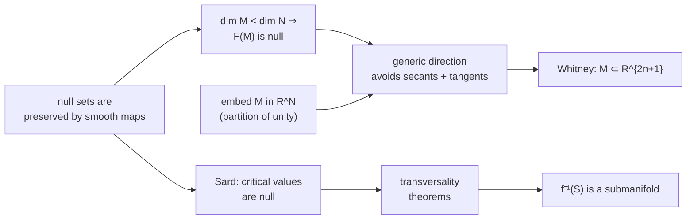

# DM07 · Sard, Whitney and Transversality

◀ [[DM06 Submanifolds]] · [[Differential Geometry - Course Map]] · [[DM08 Lie Groups]] ▶

extra · book extra · beyond

> [!warning] What the lecture source says
> **No MT3184 slide, homework or test covers this chapter.** The lectures prove the global consequences of the rank theorem with the **Baire Category Theorem** ([[DM04 The Tangent Bundle and the Rank Theorem]] §4), not with Sard's theorem. This chapter is in the vault because the course-aligned scope (Lee Ch. 1–9, 20) includes Lee Ch. 6 as *extra*; everything is 🟡/🔵. Whether Sard, Whitney or transversality is examinable is **not** known (see the Gaps in the [[Differential Geometry - Course Map]]). Source: Lee Ch. 6 ([[John M. Lee - Introduction to Smooth Manifolds.pdf#page=143|Lee pp. 125–147]]; printed page = PDF page − 18) with Guillemin–Pollack Ch. 1 and Milnor *Topology from the Differentiable Viewpoint* §§2–3 as companions. Sard's theorem and the strong Whitney theorems are **stated, not proved** here; the easy cases and the weak Whitney theorem are proved.

> [!syllabus] Syllabus map: what is in the syllabus and what is extra in this chapter
> 🟡 **Extra · book** (Lee Ch. 6; Guillemin–Pollack Ch. 1; Milnor §§2–3; Tu §6)
> - §1 measure zero on manifolds, **Sard's theorem** (statement), regular values are dense; §2 the **Whitney embedding theorem** ($2n+1$), the strong version; §3 **transversality**, Whitney approximation (statements)
>
> 🔵 **Extra · beyond** (my additions, labelled)
> - numerical illustrations: critical values $\pm2$ of $x^3-3x$ (all 5000 random levels regular); the $\varepsilon$-neighbourhood area of a parabola arc $=0.605,\ 0.180,\ 0.059$ for $\varepsilon=0.1,\,0.03,\,0.01$ ($\approx2\varepsilon L$, $L=2.958$); the secant directions of a trefoil knot cover all $648$ equal-area bins of $S^2$; transversality of $y=x^2-c$ to the axis

> [!key] After this chapter you can
> - state **Sard's theorem** and use it (regular values are dense; a smooth map from a lower-dimensional manifold has image of measure zero),
> - explain how a **dimension count** gives the **Whitney embedding theorem** (compact case) into $\mathbb R^{2n+1}$,
> - define **transversality** and state that transverse preimages of submanifolds are submanifolds.

> [!intuition] The one-sentence story
> A smooth map can only produce "thin" sets in the target when it lowers dimension, and it can only have "rare" critical values: *almost every* level set is a manifold (Sard). Counting dimensions then says that when the ambient space $\mathbb R^N$ is big enough, a *generic* direction misses all the secants and tangents of an $n$-manifold, so one can project down to $\mathbb R^{2n+1}$ without creating self-intersections or singular points: every manifold is a submanifold of Euclidean space. Transversality extends "regular value" to "generic intersection".

*Concept map: Sard's measure-zero statements drive the dimension counts of Whitney and the genericity of transversality.*

![[fig_dm07_sard.png]]
*A: $f=x^3-3x$ has exactly two critical values $\pm2$. B: the secant directions of a trefoil knot in $\mathbb R^3$ fill the sphere $S^2$, so no projection to a plane is injective: $n=1$ needs $2n+1=3$. C: $y=x^2-c$ is transverse to the $x$-axis exactly for $c\ne0$ (§1–§3).*

## 1. Measure zero and Sard's theorem
extra · book *Lee Lemma 6.2, Props. 6.3–6.8, Thms 6.9–6.10, Cor. 6.11*

> [!key] Definition
> $A\subseteq\mathbb R^n$ has **measure zero** if for every $\varepsilon>0$ it is covered by countably many cubes of total volume $<\varepsilon$. Countable unions of null sets are null; a proper affine subspace has measure zero (Lee Cor. 6.4), and a null set has empty interior. A subset $A$ of a smooth $n$-manifold has **measure zero** if $\varphi(A\cap U)$ is null for every smooth chart $(U,\varphi)$ (it suffices to check an atlas, by the next lemma).

> [!key] Smooth maps preserve null sets (Lee Prop. 6.5)
> If $A\subseteq\mathbb R^n$ has measure zero and $F:A\to\mathbb R^n$ is the restriction of a $C^1$ map on an open set, then $F(A)$ has measure zero. Consequently the notion "measure zero" on manifolds is **chart independent**, and diffeomorphisms preserve it.
> *Proof.* Cover the domain by countably many closed cubes $C_j$ on each of which $\|DF\|\le M_j$ ([[PA13 The Derivative and the Inverse Function Theorem]] §2: Lipschitz estimate), so $F|_{C_j}$ is $M_j$-Lipschitz. A cube of side $s$ inside $C_j$ is mapped into a ball of radius $M_j\sqrt n\,s$ around the image of its centre, hence into a cube of side $2M_j\sqrt n\,s$ and volume $(2M_j\sqrt n)^ns^n$. If cubes $Q_i\subseteq C_j$ of sides $s_i$ cover $A\cap C_j$ with $\sum s_i^n<\varepsilon_j$, the images are covered by cubes of total volume $<(2M_j\sqrt n)^n\varepsilon_j$, as small as we like. Choosing $\varepsilon_j=\varepsilon\,2^{-j}/(2M_j\sqrt n)^n$ and summing over $j$ gives a cover of $F(A)$ of total volume $<\varepsilon$. $\square$

> [!key] The easy half of Sard: lowering dimension (Lee Prop. 6.8 / Cor. 6.11)
> If $F:M^m\to N^n$ is smooth and $m<n$, then $F(M)$ has measure zero in $N$. In particular **a smooth map from a lower-dimensional manifold is never surjective**, and $F:M\to N$ cannot be onto if $\dim M<\dim N$.
> *Proof.* By second-countability it suffices to treat $F:U\to\mathbb R^n$, $U\subseteq\mathbb R^m$ open. Put $\widetilde F(x,y)=F(x)$ on $U\times\mathbb R^{n-m}$: a smooth map between open subsets of $\mathbb R^n$, and $F(U)=\widetilde F(U\times\{0\})$ is the image of a null set (a proper affine subspace), hence null by the previous lemma. $\square$

> [!example] A parabola has no area, numerically
> The arc $\{(t,t^2):|t|\le1\}$ has length $L=\sqrt5+\tfrac12\operatorname{arcsinh}2=2.958$. The area of its $\varepsilon$-neighbourhood (nearest-neighbour search on $20\,001$ points, `dm_numbers.py`, DM07) is $0.605,\ 0.180,\ 0.059$ for $\varepsilon=0.1,\,0.03,\,0.01$, against $2\varepsilon L=0.592,\ 0.178,\ 0.059$: it tends to $0$ linearly, i.e. the arc has measure zero (figure illustrates the same idea for critical values in A).

> [!key] Sard's Theorem (Lee Thm 6.10; stated)
> Let $F:M\to N$ be a smooth map between smooth manifolds (second-countable, as always). Then the set of **critical values** of $F$, i.e. $F(\{p:dF_p\text{ not surjective}\})$, has **measure zero** in $N$.
> **Corollary (Lee 6.11):** the **regular values** of $F$ are dense in $N$ (a null set has empty interior). The *Regular Level Set Theorem* therefore applies to *almost every* level $F^{-1}(q)$ ([[DM06 Submanifolds]] §2).

> [!example] Sard for $f(x)=x^3-3x$, and a random check
> $f'=3x^2-3$ vanishes at $x=\pm1$, with critical values $f(\pm1)=\mp2$: a finite (hence null) set. Of $5000$ random levels $c\in[-6,6]$ **all** were regular values (the cubic $x^3-3x=c$ has no root with $f'=0$), as Sard predicts (figure A). Sard's theorem is *false* for finite smoothness in general ($C^k$ with $k<\max(m-n+1,1)$ fails), which is why *smooth* ($C^\infty$) is assumed, and the preimage of a critical value can be very large: for the constant map every point is critical and the single critical value is a point.

> [!pitfall] Critical *points* can be a large set
> Sard says the *values* are rare, not the points: a smooth $F:\mathbb R\to\mathbb R$ can have a Cantor set of critical points, or be constant on an interval (every point critical), while the set of critical *values* is still null (Whitney's example of a non-constant $C^1$ function constant on a connected set of critical points shows $C^1$ is not enough in dimension $\ge2$).

## 2. The Whitney embedding theorem
extra · book *Lee Lemmas 6.13–6.14, Thm 6.15, Cors. 6.16–6.17, Thms 6.18–6.20*

> [!key] Whitney Embedding Theorem (weak form; Lee Thm 6.15)
> Every smooth $n$-manifold $M$ admits a smooth embedding into $\mathbb R^{2n+1}$ (with image closed: a properly embedded submanifold). **Strong form** (Thm 6.19, stated): $\mathbb R^{2n}$ suffices for $n>0$. **Immersions** (Thms 6.18, 6.20): $\mathbb R^{2n}$, resp. $\mathbb R^{2n-1}$ for $n>1$.

> [!derivation]- Proof for compact $M$ (dimension count with Sard)
> **Step 1 (embed in some $\mathbb R^N$).** Cover $M$ by finitely many charts $(U_i,\varphi_i)$, $i=1,\dots,k$ (compact), and take a partition of unity $\{\psi_i\}$ subordinate to $\{U_i\}$ ([[DM02 Smooth Maps and Partitions of Unity]] §3) and bump functions $\rho_i\in C^\infty(M)$ with $\rho_i=1$ on a **neighbourhood** of $\operatorname{supp}\psi_i$ and $\operatorname{supp}\rho_i\subseteq U_i$. Define $F:M\to\mathbb R^{k(n+1)}$, $F=(\rho_1\varphi_1,\dots,\rho_k\varphi_k,\ \rho_1,\dots,\rho_k)$ (each $\rho_i\varphi_i$ extended by $0$). $F$ is an **injective immersion**: if $F(p)=F(q)$ then some $\rho_i(p)=\rho_i(q)=1$, so $p,q\in U_i$ and $\varphi_i(p)=\varphi_i(q)$, so $p=q$; and $dF_p$ is injective because $\rho_i\varphi_i=\varphi_i$ near $p$ for a suitable $i$. $M$ compact $\Rightarrow$ $F$ is an embedding ([[DM05 Immersions, Embeddings, Submersions and Coverings]] §1).
> **Step 2 (project down).** Suppose $M\subseteq\mathbb R^N$ is an embedded $n$-submanifold with $N>2n+1$. Consider the two smooth maps
> $$\alpha:M\times M\setminus\Delta\to S^{N-1},\ \ (p,q)\mapsto\frac{p-q}{|p-q|},\qquad\beta:\{v\in TM:|v|=1\}\to S^{N-1},\ \ v\mapsto v,$$
> from manifolds of dimensions $2n$ and $2n-1$. Both are $<N-1$ ($N-1>2n$), so by §1 their images (the **secant** and **tangent** directions) have measure zero in $S^{N-1}$: there is a unit vector $u$ lying in neither. The orthogonal projection $\pi_u:\mathbb R^N\to u^\perp\cong\mathbb R^{N-1}$ restricted to $M$ is **injective** ($u$ is not a secant direction) and an **immersion** ($u$ is not a tangent direction); $M$ compact makes it an embedding. Repeat until $N=2n+1$. $\square$ (The non-compact case replaces compactness by a proper function: exhaustion function, Lee Prop. 2.28, and a countable atlas; Lee Thm 6.15.)

> [!example] Why $2n+1$ and not fewer *by this method*: the trefoil
> A closed curve is a compact $1$-manifold; Step 2 needs $N-1>2n=2$, i.e. it stops at $\mathbb R^3=\mathbb R^{2n+1}$. The secant directions of the **trefoil knot** $x(t)=(\sin t+2\sin2t,\ \cos t-2\cos2t,\ -\sin3t)$ (computed from $\binom{1500}2$ pairs of points) cover **all $648$ equal-area bins** of $S^2$ (figure B): the set of secant directions is $2$-dimensional and fills the sphere, so no direction in $\mathbb R^3$ avoids it, i.e. **no projection of the trefoil to a plane is injective** (every knot diagram of a nontrivial knot has crossings). The *strong* Whitney theorem gets down to $\mathbb R^{2n}$ by a subtler argument (it fails by this counting for $\mathbb R^{2n}$ because $\dim=2n$ images can fill $S^{2n-1}$); it is sharp: $\mathbb{RP}^2$ embeds in $\mathbb R^4$ but not in $\mathbb R^3$.

## 3. Transversality
extra · book *Lee Thms 6.21, 6.24, 6.26, 6.29–6.30, 6.35–6.36; Guillemin–Pollack Ch. 2*

> [!key] Definition
> A smooth map $f:N\to M$ is **transverse** to an embedded submanifold $S\subseteq M$ ($f\pitchfork S$) if for every $p\in f^{-1}(S)$
> $$df_p(T_pN)+T_{f(p)}S=T_{f(p)}M .$$
> Two submanifolds $S_1,S_2$ are transverse if the inclusion of $S_1$ is transverse to $S_2$.

> [!key] Transverse preimages are submanifolds (Lee Thm 6.30)
> If $f\pitchfork S$ then $f^{-1}(S)$ is an embedded submanifold of $N$ of **codimension $=\operatorname{codim}S$** (possibly empty), with $T_p(f^{-1}S)=df_p^{-1}(T_{f(p)}S)$. *Idea.* Locally $S$ is a regular level set $\{G=0\}$ of a submersion $G$ (slice chart), and transversality says exactly that $G\circ f$ has $0$ as a regular value. The **Regular Level Set Theorem is the case $S=\{q\}$.** $\square$

> [!example] Transverse and not, with numbers
> $f_c(x)=(x,\,x^2-c)$ parametrises the parabola $y=x^2-c$, and $S$ = the $x$-axis. For $c=0.25$ it meets the axis at $x=\pm0.5$ with slope angles $\pm45^\circ$ (transverse: the tangent line of the parabola plus the axis span $\mathbb R^2$); for $c=0$ it touches at $x=0$ with slope angle $0^\circ$ (**tangent**, not transverse); for $c=-0.25$ it misses the axis. Transversality is **stable and generic**: a small change of $c$ from $0$ makes the intersection transverse or empty (figure C).

> [!key] Statements to remember (not proved here)
> * **Whitney approximation** (Lee Thm 6.21, 6.26): continuous maps (functions) are homotopic (close) to smooth ones; smooth maps homotopic through continuous maps are smoothly homotopic.
> * **Transversality Homotopy / Parametric Transversality** (Lee Thms 6.35–6.36): any smooth $f:N\to M$ is homotopic to a map transverse to a given closed $S$ (generic perturbation), by applying Sard to a family $F_s$.
> * **Tubular Neighbourhood Theorem** (Lee Thm 6.24): an embedded submanifold of $\mathbb R^n$ has a neighbourhood diffeomorphic to its normal bundle.

## Map of this chapter
> [!connection] How DM07 connects
> **Builds on:** [[DM06 Submanifolds]] (regular level sets, embeddings), [[DM05 Immersions, Embeddings, Submersions and Coverings]] (injective immersion of a compact manifold is an embedding), [[DM02 Smooth Maps and Partitions of Unity]] (partition of unity, bump functions), [[PA13 The Derivative and the Inverse Function Theorem]] (Lipschitz estimate, rank theorem).
> **Leads to:** applications in Lie theory ([[DM08 Lie Groups]]: every Lie group is a submanifold of Euclidean space, embedding results), degree theory and de Rham cohomology (not covered).
> **Concepts:** [[Sard's Theorem]] · [[Set of Measure Zero]] · [[Whitney Embedding Theorem]] · [[Transversality]]
> **Other subjects:** [[Thermodynamics and Statistical Mechanics - Course Map]] (generic level sets of state functions), [[Proofs, Analysis and Topology - Course Map]] (measure zero)

## Summary
> [!summary] Cheat-sheet
> - **Measure zero**: countably many cubes of total volume $<\varepsilon$; preserved by $C^1$ maps (Lipschitz estimate); chart independent on manifolds.
> - $\dim M<\dim N\Rightarrow F(M)$ null (not onto). **Sard:** the set of critical values of a smooth map is null; **regular values are dense**.
> - **Whitney (weak):** every compact (indeed every) smooth $n$-manifold embeds in $\mathbb R^{2n+1}$: embed in $\mathbb R^N$ by a partition of unity, then project along a direction missing the secant ($\dim2n$) and tangent ($\dim2n-1$) directions in $S^{N-1}$, $N-1>2n$. Strong: $\mathbb R^{2n}$.
> - **Transversality** $df_p(T_pN)+T_{f(p)}S=T_{f(p)}M$; transverse preimages are submanifolds of codimension $\operatorname{codim}S$; generic.

## Practice
1. **Null sets.** Show a countable union of null sets is null and that a proper affine subspace of $\mathbb R^n$ is null (e.g. a line in $\mathbb R^2$).
2. **Lowering dimension.** Prove that a smooth map $\mathbb R^2\to\mathbb R^3$ cannot be onto, and that there is no smooth surjection $S^1\to S^2$.
3. **Sard in 1D.** Find the critical values of $f(x)=x^3-3x$ and of $g(x)=\sin x$. For which levels $c$ is $f^{-1}(c)$ a $0$-manifold of exactly $3$ points?
4. **Regular values.** For $F(x,y)=x^2+y^2$ list the critical values; which level sets are manifolds?
5. **Dimension count.** For a compact $n$-manifold in $\mathbb R^N$ compute the dimension of the secant-direction map and the tangent-direction map into $S^{N-1}$, and the smallest $N$ for which Step 2 of the Whitney proof still applies.
6. **A projection that fails.** Show the circle $S^1\subset\mathbb R^2$ cannot be projected injectively to $\mathbb R^1$, and find the directions $u\in S^1$ that are secant directions.
7. **Immersion theorem.** A map $F:M^n\to\mathbb R^N$, $N\ge2n$ can be perturbed to be an immersion: which direction count gives $2n$ (tangent directions only)?
8. **Transversality.** Decide whether the circle $x^2+y^2=1$ is transverse to the line $y=c$ for $c=0,\ \tfrac12,\ 1,\ 2$.
9. **Preimage submanifold.** If $f\pitchfork S$ and $S=G^{-1}(0)$ for a submersion $G$ near $f(p)$, show $f^{-1}(S)$ is locally $(G\circ f)^{-1}(0)$ with $0$ a regular value.
10. **Regular Level Set Theorem as a case.** Show that for $S=\{q\}$ transversality of $f$ to $S$ means exactly that $q$ is a regular value.

> [!example]- Solutions
> 1. Countable union: cover the $j$-th set with cubes of total volume $<\varepsilon2^{-j}$. A line in $\mathbb R^2$: $[−R,R]\times\{0\}$ is covered by $2R/s$ squares of side $s$ and total area $2Rs\to0$; countably many $R$.
> 2. $\mathbb R^2\to\mathbb R^3$: by the lowering-dimension lemma the image is null, so it cannot be all of $\mathbb R^3$. $S^1\to S^2$: the image has measure zero in $S^2$ (charts), so not onto.
> 3. $f'=3x^2-3=0$ at $\pm1$, critical values $f(\pm1)=\mp2$. $g=\sin x$: $g'=\cos x=0$ at $\pi/2+k\pi$, critical values $\pm1$. $f^{-1}(c)$ has exactly $3$ points for $-2<c<2$ (a regular range); $1$ point for $|c|>2$; $2$ points for $c=\pm2$ (critical).
> 4. $dF=(2x,2y)$ vanishes only at $0$, critical value $0$. $F^{-1}(c)$: empty for $c<0$, a circle (manifold) for $c>0$; the level $0$ is the point $\{0\}$ (a $0$-manifold, even though $0$ is critical; critical does not mean "not a manifold").
> 5. $\alpha$ is defined on $M\times M\setminus\Delta$ of dimension $2n$; $\beta$ on the unit tangent bundle of dimension $2n-1$; both map to $S^{N-1}$ of dimension $N-1$; the images are null if $N-1>2n$, i.e. $N>2n+1$, i.e. $N\ge2n+2$, reducing to $N=2n+1$.
> 6. A projection $\mathbb R^2\to\mathbb R^1$ onto the line $u^\perp$ identifies $p,q$ whenever $p-q\parallel u$. Every $u\in S^1$ is a secant direction of the circle (take the chord parallel to $u$), so no projection is injective. In the dimension count: $N=2=2n$, so $N-1=1<2n=2$ and the secant map $S^1\times S^1\setminus\Delta\to S^1$ can be onto: the hypothesis $N-1>2n$ of Step 2 fails.
> 7. Only the tangent-direction map $\beta$ (dimension $2n-1$) matters for immersions: $N-1>2n-1$, i.e. $N>2n$, so $N\ge2n+1$ for this argument, with finer arguments reaching $2n$ (Lee Thm 6.18).
> 8. The tangent line of the circle at $(x,y)$ is orthogonal to $(x,y)$. The line $y=c$ has direction $(1,0)$. Transverse at a point iff the circle's tangent is not horizontal there, i.e. $x\neq0$. $c=0$: intersection points $(\pm1,0)$, tangent vertical: transverse. $c=\tfrac12$: $(\pm\tfrac{\sqrt3}2,\tfrac12)$, $x\ne0$: transverse. $c=1$: the point $(0,1)$ has horizontal tangent: **tangent, not transverse**. $c=2$: empty (vacuously transverse).
> 9. In a neighbourhood $S=\{G=0\}$ with $dG$ onto. $f$ transverse to $S$: $df_p(T_pN)+\ker dG_{f(p)}=T_{f(p)}M$, which means $dG_{f(p)}\circ df_p$ is onto, i.e. $0$ is a regular value of $G\circ f$ near $p$. Then apply the Regular Level Set Theorem.
> 10. $T_qS=0$ for $S=\{q\}$, so transversality says $df_p(T_pN)=T_qM$, i.e. $df_p$ onto at every $p\in f^{-1}(q)$: $q$ is a regular value.

## Provenance
> [!provenance]- Source map for this chapter
> | Topic | Source | Scope |
> |---|---|---|
> | measure zero, smooth maps preserve it, lowering dimension, Sard's theorem (stated), regular values dense | Lee Lemma 6.2, Props. 6.3–6.8, Thms 6.9–6.10, Cors. 6.11–6.12; Milnor §3; Guillemin–Pollack Ch. 1 | extra/book |
> | Whitney embedding (weak, proof for compact $M$), strong forms (stated), immersion theorems | Lee Lemmas 6.13–6.14, Thms 6.15, 6.18–6.20, Cors. 6.16–6.17 | extra/book |
> | transversality, preimages of submanifolds, approximation theorems (stated) | Lee Thms 6.21, 6.24, 6.26, 6.29–6.30, 6.35–6.36; Guillemin–Pollack Ch. 2 | extra/book |
> | critical values of $x^3-3x$, null area of a parabola arc, secant directions of the trefoil, transversality of a parabola | `scripts/dm_numbers.py` (DM07), `fig_dm07_sard.py` | extra/beyond |
>
> **Notes.** The remark about $C^k$ versions of Sard's theorem and Whitney's counterexample is quoted from the literature (Whitney 1935), not checked here. Sard's theorem itself is stated without proof.
