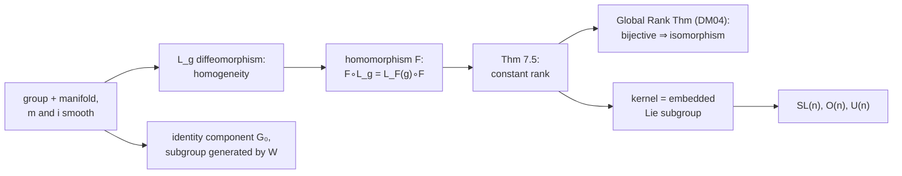

# DM08 · Lie Groups

◀ [[DM07 Sard Whitney and Transversality]] · [[Differential Geometry - Course Map]] · [[DM09 Group Actions and Semidirect Products]] ▶

taught · in syllabus extra · book extra · beyond

> [!warning] What the lecture source says
> Lie groups enter MT3184 in **week 4** (slides DG10–DG11: definition, examples, homomorphisms, **Thm 7.5**, Cor 7.6) and are developed in **weeks 5–6** (DG12–DG13: Lie subgroups, Lemma 7.12, Props 7.14–7.17, kernels; DG14: Closed Subgroup Theorem; DG19: revision, representations). Homework: **HW4 Q5–Q6** (multiplication is a submersion; $dm_{(e,e)}=X+Y$, $di_e=-\mathrm{id}$), **HW5 Q2, Q4** (inversion is smooth automatically; a neighbourhood with $gh^{-1}\in U$), **HW6 Q2** ($U(n)$). Sources: [[mt3184-differential-geometry-and-lie-groups/2026-08-27-august-24-28|Aug 24–28]], [[mt3184-differential-geometry-and-lie-groups/2026-09-03-august-31-september-4|Aug 31–Sep 4]], [[mt3184-differential-geometry-and-lie-groups/2026-10-10-october-5-9|Oct 5–9]] notes. Book: Lee Ch. 7 §§ Basic Definitions, Lie Group Homomorphisms, Lie Subgroups ([[John M. Lee - Introduction to Smooth Manifolds.pdf#page=168|Lee pp. 150–161]]; printed page = PDF page − 18). Some slide statements (Prop 7.14 (b),(c), Example $SL(n,\mathbb C)$ dimension) are partly illegible (`[!verify]`).

> [!syllabus] Syllabus map: what is in the syllabus and what is extra in this chapter
> 🟢 **In syllabus (taught: DG10–DG13, DG19, HW4–HW6)**
> - §1 Lie groups, left translations, examples, $dm_{(e,e)}$ and $di_e$, inversion is automatic; §2 homomorphisms have constant rank (Thm 7.5), isomorphism criterion, kernels; §3 Lie subgroups, open $\Rightarrow$ closed, the subgroup generated by a neighbourhood, the identity component
>
> 🟡 **Extra · book** (Lee Ch. 7; Tu §§15–16; Kumaresan Ch. 3; Warner Ch. 3)
> - universal covering groups (Thm 7.7, 7.9: statements); closed subgroups $\Leftrightarrow$ embedded (Thm 7.21, with its proof in DM15)
>
> 🔵 **Extra · beyond** (my additions, labelled)
> - numerical checks: $dm_{(e,e)}(X,Y)=X+Y$ and $di_e=-\mathrm{id}$ on $GL(3)$ (errors $10^{-10}$); $\det D\!\big[(g,h)\mapsto(g,gh)\big]=\det(g)^2$ on $GL(2)$; ranks of $\det$, $\mathbb R\to T^2$, $SU(2)\to SO(3)$ at random points (constant $1,1,3$); $50\%/50\%$ signs of $\det$ on $GL(3,\mathbb R)$ and on $O(3)$

> [!key] After this chapter you can
> - define a **Lie group** and verify it for $GL(n)$, $SL(n)$, $O(n)$, $U(n)$, $T^n$, $SU(2)$,
> - compute the differentials of **multiplication and inversion** at the identity,
> - prove that **every Lie group homomorphism has constant rank**, hence that bijective homomorphisms are isomorphisms and kernels are embedded Lie subgroups,
> - use **left translations** to move local information around, and describe the **identity component** and the **subgroup generated by a neighbourhood of $e$**.

> [!intuition] The one-sentence story
> A Lie group is a group that is also a manifold, with the two structures compatible: the group operations are smooth. Because every element $g$ acts by a diffeomorphism $L_g$, the geometry near $g$ is the geometry near $e$ transported, so *everything about a Lie group is determined at the identity*: the tangent space $T_eG$, and (next chapters) the Lie algebra. Homomorphisms respect translations, so they look the same everywhere, which is why they have *constant rank*, and the Global Rank Theorem then gives the algebraic statements for free.

*Concept map: homogeneity ⇒ constant rank ⇒ the algebraic and geometric statements about kernels, images and isomorphisms.*

![[fig_dm08_liegroup.png]]
*A: on $S^1=U(1)$ left translation is a rotation and carries a tangent vector at $e$ to one at every $g$. B: $O(2)$ has two components. C: dimensions and constant ranks of four homomorphisms (§1, §3, §2).*

## 1. Lie groups
taught *Source: DG10–DG11, HW4 Q5–Q6, HW5 Q2, Q4* · extra · book *Lee Prop. 7.1 and Examples 7.2–7.3*

> [!key] Definition
> A **Lie group** is a smooth manifold $G$ that is also a group such that **multiplication** $m:G\times G\to G$, $(g,h)\mapsto gh$, and **inversion** $i:G\to G$, $g\mapsto g^{-1}$, are smooth. For $g\in G$: **left translation** $L_g(h)=gh$, **right translation** $R_g(h)=hg$, **conjugation** $c_g(h)=ghg^{-1}$. A **Lie group homomorphism** is a smooth group homomorphism; an **isomorphism** is a diffeomorphism that is a homomorphism.

**Left translation is a diffeomorphism** (DG10): $L_g=m\circ(g,\cdot)$ is smooth with smooth inverse $L_{g^{-1}}$. So for any $g,h$ the diffeomorphism $L_{hg^{-1}}$ carries $g$ to $h$: **a Lie group looks the same near every point** (homogeneous), and the differentials $d(L_g)_e:T_eG\to T_gG$ are isomorphisms.

> [!example] Examples (all taught in DG10–DG13 and HW6 except where marked)
> $(\mathbb R^n,+)$ and $(M(m\times n,\mathbb R),+)$; $(\mathbb R^\times,\cdot)$, $(\mathbb R_{>0},\cdot)$; $S^1\cong U(1)\cong\mathbb R/\mathbb Z$ and the **torus** $T^n=(S^1)^n$ (products of Lie groups); $GL(n,\mathbb R)$, open in $M(n,\mathbb R)$ (inversion is smooth by Cramer: $A^{-1}=\operatorname{adj}A/\det A$), of dimension $n^2$; $GL(n,\mathbb C)$ of dimension $2n^2$; $\mathbb C^\times\cong GL(1,\mathbb C)$; $SL(n,\mathbb R)=\ker\det$ (dimension $n^2-1$), $O(n)$ (dimension $n(n-1)/2$), $SO(n)$ ([[DM06 Submanifolds]] §2: embedded subgroups); $U(n)\subset GL(n,\mathbb C)$ of dimension $n^2$ (HW6 Q2, stabiliser of $I$ under $A\cdot X=AXA^*$); 🟡 $SU(2)\cong S^3$, the unit quaternions. $S^3$ and $S^1$ are Lie groups, $S^2$ is not (not parallelizable, [[DM04 The Tangent Bundle and the Rank Theorem]] §1).

> [!key] Inversion is automatically smooth (HW5 Q2; Lee Prop. 7.1)
> If $G$ is a smooth manifold with a group structure such that **multiplication is smooth**, then $G$ is a Lie group.
>
> *Proof.* $F:G\times G\to G\times G$, $F(g,h)=(g,gh)$ is a smooth **bijection** with smooth inverse **candidate** $(g,k)\mapsto(g,g^{-1}k)$ (not yet known smooth). Its differential at $(g,h)$ is $(X,Y)\mapsto(X,\,d(R_h)_gX+d(L_g)_hY)$, which is invertible (given $(X,Z)$ solve $Y=d(L_g)_h^{-1}(Z-d(R_h)_gX)$; $L_g,R_h$ are diffeomorphisms). So $F$ is a bijective local diffeomorphism, hence a diffeomorphism (IFT). Then $i(g)=\pi_2\big(F^{-1}(g,e)\big)$ is smooth. $\square$ (Check on $GL(2)$: the $8\times8$ Jacobian of $F$ has rank $8$ and determinant $\det(g)^2$, $2.2315$ numerically and by formula.)

> [!key] Differentials of the group operations at the identity (HW4 Q5–Q6)
> (a) **$m$ is a submersion**: with $a_g(h)=(g,h)$, $m\circ a_g=L_g$, so $dm\circ da_g=dL_g$ is onto. (b) Using $T_{(e,e)}(G\times G)\cong T_eG\oplus T_eG$ ([[DM03 Tangent Vectors and the Differential]] §5):
> $$dm_{(e,e)}(X,Y)=X+Y,\qquad di_e(X)=-X.$$
> *Proof.* $m(g,e)=g=m(e,g)$ gives $dm_{(e,e)}(X,0)=X$ and $dm_{(e,e)}(0,Y)=Y$, so by linearity $X+Y$. Then $m\circ(\mathrm{id},i)\equiv e$ is constant, so $0=dm(X,di_eX)=X+di_e(X)$. $\square$ (Numerically on $GL(3)$: $m(I+tX,I+tY)=I+t(X+Y)+O(t^2)$ and $(I+tX)^{-1}=I-tX+O(t^2)$: errors $9.6\times10^{-11}$ and $6.9\times10^{-11}$.)

> [!key] A neighbourhood with $gh^{-1}\in U$ (HW5 Q4)
> For every neighbourhood $U$ of $e$ there is a neighbourhood $V\subseteq U$ of $e$ with $gh^{-1}\in U$ for all $g,h\in V$. *Proof.* $\mu(g,h)=gh^{-1}$ is continuous with $\mu(e,e)=e$, so $\mu^{-1}(U)\supseteq V_1\times V_2$ for neighbourhoods $V_i\ni e$; take $V=V_1\cap V_2\cap U$. $\square$ In $(\mathbb R_{>0},\cdot)$ with $U=(0.95,1.05)$ the largest $V=(1-\delta,1+\delta)$ has $\delta=0.02439$ ($g/h\in[0.95238,1.05]$).

## 2. Lie group homomorphisms have constant rank
taught *Source: DG11 (Thm 7.5, Cor 7.6), DG12–DG13 (Props 7.16–7.17)* · extra · book *Lee Thm 7.5, Cor. 7.6, Props. 7.16–7.17*

> [!key] Theorem 7.5 (DG11)
> Every Lie group homomorphism $F:G\to H$ has **constant rank**.
>
> *Proof.* $F(gh)=F(g)F(h)$ means $F\circ L_g=L_{F(g)}\circ F$. Differentiating at $e$: $dF_g\circ d(L_g)_e=d(L_{F(g)})_e\circ dF_e$. Both $d(L_g)_e$ and $d(L_{F(g)})_e$ are isomorphisms, so $\operatorname{rank}dF_g=\operatorname{rank}dF_e$ for every $g$. $\square$

> [!intuition] Why this is the right statement
> A homomorphism is "the same map everywhere" in the sense that translating the source by $g$ and the target by $F(g)$ turns the neighbourhood of $e$ into that of $g$. So its rank cannot vary. This is the entire reason the *Global Rank Theorem* ([[DM04 The Tangent Bundle and the Rank Theorem]] §4) is so powerful for groups: constant rank is automatic.

> [!key] Consequences (DG11–DG13; Lee Cor. 7.6, Props. 7.16, 7.17)
> (a) **A Lie group homomorphism is an isomorphism iff it is bijective** (constant rank + bijective $\Rightarrow$ diffeomorphism, Thm 4.14(c)). (b) **The kernel** $\ker F=F^{-1}(e)$ is an **embedded Lie subgroup** of $G$ of dimension $\dim G-\operatorname{rank}dF$ (the level set of the constant-rank map $F$; [[DM06 Submanifolds]]; Prop. 7.16). (c) If $F$ is **injective**, $F:G\to F(G)$ makes $F(G)$ a Lie subgroup of $H$ (an immersed submanifold) and $F:G\to F(G)$ an isomorphism (Prop. 7.17).

> [!example] Examples with numbers
> * $\det:GL(n,\mathbb R)\to\mathbb R^\times$: rank $1$ at every point (checked at 20 random $3\times3$ matrices), kernel $SL(n,\mathbb R)$ of dimension $n^2-1$ ($8$ for $n=3$): this is the proof that $SL(n)$ is an embedded Lie subgroup, a second way to see [[DM06 Submanifolds]].
> * $\exp:\mathbb R\to\mathbb R^\times$, $t\mapsto e^t$: a bijective homomorphism onto $\mathbb R_{>0}$, hence an isomorphism $\mathbb R\cong\mathbb R_{>0}$ with inverse $\log$ (not onto $\mathbb R^\times$); $\varepsilon:\mathbb R\to S^1$, $t\mapsto e^{2\pi it}$, kernel $\mathbb Z$ (rank $1$, dimension $0$ kernel); $\mathbb C\to\mathbb C^\times$, $z\mapsto e^z$, kernel $2\pi i\mathbb Z$; $c_g:G\to G$ is an isomorphism.
> * $F:\mathbb R\to T^2$, $F(t)=(e^{it},e^{i\sqrt2t})$: injective, rank $1$ (constant, 20 points), so $F(\mathbb R)$ is a **Lie subgroup of $T^2$** (an immersed submanifold) that is **dense**, not embedded ([[DM05 Immersions, Embeddings, Submersions and Coverings]]).
> * $SU(2)\to SO(3)$ ($q\mapsto R(q)$, [[PA15 Covering Spaces and the Fundamental Group]] §5): rank $3=\dim SU(2)$ at every sampled point (40 random $q$), so a local diffeomorphism with $0$-dimensional kernel $\{\pm1\}$: a 2-sheeted **covering homomorphism**.

## 3. Lie subgroups, the identity component, the subgroup generated by a neighbourhood
taught *Source: DG12–DG13 (Lemma 7.12, Props 7.14–7.15), DG14* · extra · book *Lee Props. 7.11–7.15, Thm 7.21*

> [!key] Definition (DG13)
> A **Lie subgroup** of $G$ is a subgroup $H\subseteq G$ endowed with a topology and smooth structure making it a Lie group and an **immersed** submanifold of $G$. It is **embedded** if it is an embedded submanifold; **Thm 7.21 (DG13–DG14)**: a Lie subgroup is closed iff it is embedded; the **Closed Subgroup Theorem** (Thm 20.12: a subgroup is closed iff it is an embedded Lie subgroup) is proved in [[DM15 Closed Subgroups and the Lie Correspondence]].

> [!key] An open subgroup is closed (Lemma 7.12; DG13)
> If $H\le G$ is an **open** subgroup of a Lie group (or topological group), then $H$ is also **closed**.
> *Proof.* Each coset $gH=L_g(H)$ is open ($L_g$ is a diffeomorphism), so $G\setminus H=\bigcup_{g\notin H}gH$ is open. $\square$ Hence an open subgroup is a union of connected components of $G$.

> [!key] The subgroup generated by a neighbourhood (Prop. 7.14; DG13)
> Let $W$ be a neighbourhood of $e$ with $W=W^{-1}$ (replace $W$ by $W\cap W^{-1}$), and $\langle W\rangle=\bigcup_kW^k$ the subgroup it generates. Then (a) if $W$ is **open**, $\langle W\rangle$ is **open**; (b) if $W$ is **connected**, $\langle W\rangle$ is **connected**; (c) if $G$ is **connected**, $\langle W\rangle=G$.
> *Proof.* (a) $W^k=\bigcup_{w\in W^{k-1}}L_w(W)$ is open, as a union of translates of open sets. (b) $W^k$ is the continuous image of the connected $W\times\dots\times W$ under multiplication; all $W^k$ contain $e$, so their union is connected. (c) By (a) $\langle W\rangle$ is an open subgroup, hence also closed by the previous lemma; $G$ connected forces $\langle W\rangle=G$ (a nonempty clopen set). $\square$

> [!key] The identity component (Prop. 7.15; DG13)
> The identity component $G_0$ is a **normal, open, connected subgroup**; it is the **only** connected open subgroup, and the connected components of $G$ are exactly the **cosets** $gG_0$ (each diffeomorphic to $G_0$ by $L_g$).
> *Proof.* Take $W$ a connected open neighbourhood of $e$ (a coordinate ball) with $W=W^{-1}$; by Prop. 7.14, $\langle W\rangle$ is connected and open, contained in and open in $G_0$, hence $=G_0$ (as $G_0$ is the largest connected set containing $e$ and $\langle W\rangle$ is also closed). So $G_0$ is a subgroup; it is normal because $c_g(G_0)$ is connected and contains $e$. Components are cosets since $gG_0$ is connected, open and closed. $\square$

> [!example] Components, with numbers
> $GL(n,\mathbb R)$ has **two** components, $\det>0$ (the identity component $GL^+(n)$) and $\det<0$: among $10^5$ random $3\times3$ matrices $49.9\%$ have $\det>0$ and $50.1\%$ have $\det<0$ (a connected set cannot contain both, since $\det$ is continuous with values in $\mathbb R^\times$). $O(n)$ has two components, $SO(n)=\{\det=+1\}$ being the identity component: $\det$ of $2000$ random orthogonal $3\times3$ matrices is $+1$ for $49.6\%$ and $-1$ for $50.3\%$ (with $|\det|=1$ to $10^{-15}$), figure B for $n=2$. $\mathbb R^\times$ has components $(0,\infty)$ and $(-\infty,0)$; $GL(n,\mathbb C)$ and $SL(n,\mathbb R)$ are connected. $SO(n)$ is open and closed in $O(n)$, compact and of the same dimension $n(n-1)/2$.

> [!pitfall] A Lie subgroup need not be closed or embedded
> The dense line on $T^2$ is a Lie subgroup (image of an injective homomorphism) whose closure is all of $T^2$: it is **not closed**. Immersed Lie subgroups can behave badly with respect to restriction of maps ([[DM06 Submanifolds]] §4): this is the content of the Closed Subgroup Theorem and of HW9 Q6 (the closure of a Lie subgroup is a Lie subgroup).

<!-- interactive:start (generated by scripts/embed_interactive.py; edit the tool in scripts/interactive/tools/, not this block) -->
> [!interactive]+ Interactive: The exponential map: one-parameter subgroups e^{tA} of GL(2,R)
> For a 2×2 matrix A, the curve t ↦ e^{tA} is a one-parameter subgroup (e^{(s+t)A} = e^{sA}e^{tA}) and x(t) = e^{tA}x₀ solves x′ = Ax.
>
> ![[dm_matrix_exp.png|720]]
>
> **Try:** Rotation generator [[0,−1],[1,0]]: e^{tA} is rotation by t (a closed circle subgroup ≅ S¹). Trace-zero A, e.g. [[1,0],[0,−1]]: the area stays 1 (the subgroup lies in SL(2,R)). Nilpotent [[0,1],[0,0]]: e^{tA} = [[1,t],[0,1]]. Move t and check area = e^{t·tr A}.
>
> [▶ Open the tool in your browser](../Assets/interactive/dm_matrix_exp.html) · [absolute link](file:///home/swastik/Documents/notes/Assets/interactive/dm_matrix_exp.html) · all tools and coverage: [[Interactive Tools]]

<!-- interactive:end -->

## Map of this chapter
> [!connection] How DM08 connects
> **Builds on:** [[DM04 The Tangent Bundle and the Rank Theorem]] (constant rank, Global Rank Theorem), [[DM06 Submanifolds]] (level sets, $SL(n)$, $O(n)$), [[DM05 Immersions, Embeddings, Submersions and Coverings]] (immersed subgroups), [[DM03 Tangent Vectors and the Differential]] ($T_{(e,e)}(G\times G)$), [[GT01 Groups Subgroups and Cosets]]–[[GT02 Homomorphisms Normal Subgroups and Quotients]] (groups, homomorphisms, kernels).
> **Leads to:** [[DM09 Group Actions and Semidirect Products]], [[DM10 Vector Fields and Lie Brackets]] and [[DM11 The Lie Algebra of a Lie Group]] (left-invariant fields), [[DM14 One-Parameter Subgroups and the Exponential Map]], [[DM15 Closed Subgroups and the Lie Correspondence]].
> **Concepts:** [[Lie Group]] · [[Left Translation]] · [[Lie Group Homomorphism]] · [[Lie Subgroup]] · [[Identity Component]] · [[General Linear Group]] · [[Unitary Group]]
> **Other subjects:** [[Group Theory - Course Map]] ([[GT01 Groups Subgroups and Cosets]]: subgroup, coset, normal; [[GT10 Symmetry Representations and Characters]] §6), [[Quantum Mechanics - Course Map]] ($SU(2)$, $SO(3)$, spin), [[Inorganic Chemistry - Course Map]] (point groups as finite subgroups of $O(3)$)

## Summary
> [!summary] Cheat-sheet
> - **Lie group:** manifold + group, $m,i$ smooth (smooth $m$ suffices, Prop 7.1: $F(g,h)=(g,gh)$ is a bijective local diffeo). $L_g$ is a diffeomorphism; $T_eG$ determines everything.
> - $dm_{(e,e)}(X,Y)=X+Y$, $di_e=-\mathrm{id}$; $m$ is a submersion.
> - **Thm 7.5:** a homomorphism has **constant rank** ($F\circ L_g=L_{F(g)}\circ F$). Hence bijective $\Rightarrow$ isomorphism; $\ker F$ embedded Lie subgroup of dimension $\dim G-\operatorname{rank}$; injective $\Rightarrow$ image is a Lie subgroup.
> - **Open subgroup is closed; $\langle W\rangle$ for $W$ open/connected is open/connected, $=G$ if $G$ connected; $G_0$ normal open connected, components = cosets.**
> - Examples: $\det:GL\to\mathbb R^\times$ (rank 1, kernel $SL$, $\dim n^2-1$); $GL$, $O$ have two components; $SU(2)\to SO(3)$ 2-sheeted covering homomorphism; dense line = non-closed Lie subgroup.

## Practice
1. **Lie group check.** Show $GL(n,\mathbb R)$ is a Lie group (smoothness of inversion) and $(\mathbb C^\times,\cdot)\cong GL(1,\mathbb C)$; give $T^n$ and $S^3$ as examples.
2. **Inversion is automatic (HW5 Q2).** Prove it using $F(g,h)=(g,gh)$ and compute $dF_{(g,h)}$.
3. **Differentials at $e$ (HW4 Q5–Q6).** Show $m$ is a submersion and $dm_{(e,e)}(X,Y)=X+Y$, $di_e=-\mathrm{id}$.
4. **A neighbourhood (HW5 Q4).** Given a neighbourhood $U$ of $e$ prove there is $V\subseteq U$ with $gh^{-1}\in U$ for $g,h\in V$.
5. **Constant rank (Thm 7.5).** Prove homomorphisms have constant rank and decide the rank of $F:GL(n,\mathbb R)\to GL(n,\mathbb R)$, $F(A)=A^{-T}$ and of $c_g$.
6. **Bijective homomorphisms.** Show $\mathbb R\to S^1$, $t\mapsto e^{2\pi it}$ is a surjective homomorphism that is not an isomorphism and find its kernel; show $\exp:\mathbb R\to\mathbb R_{>0}$ is an isomorphism.
7. **Open subgroups (Lemma 7.12).** Prove an open subgroup of a Lie group is closed; give an open subgroup of $GL(n,\mathbb R)$.
8. **Subgroup generated by $W$ (Prop 7.14).** Prove (a), (b), (c).
9. **Identity component (Prop 7.15).** Prove $G_0$ is a normal subgroup and the components are its cosets; identify $O(n)_0$ and $GL(n,\mathbb R)_0$.
10. **Dimension of the kernel.** Compute $\dim\ker F$ and rank for $F=\det:GL(n,\mathbb C)\to\mathbb C^\times$ and for $F:S^3\to SO(3)$.

> [!example]- Solutions
> 1. $m$ is polynomial in the matrix entries, smooth; $i(A)=\operatorname{adj}A/\det A$ is rational with nonvanishing denominator on $GL$, smooth. $\mathbb C^\times=\{z\ne0\}$ open in $\mathbb C=\mathbb R^2$ with smooth multiplication and inversion $1/z=\bar z/|z|^2$. $T^n=(S^1)^n$ and $S^3$ (unit quaternions, multiplication polynomial) are Lie groups.
> 2. §1: $dF_{(g,h)}(X,Y)=(X,\,dR_h X+dL_gY)$ is invertible; bijective local diffeomorphism $\Rightarrow$ diffeomorphism; $i(g)=\pi_2F^{-1}(g,e)$.
> 3. §1.
> 4. §1.
> 5. §2: $\operatorname{rank}dF_g=\operatorname{rank}dF_e$. $F(A)=A^{-T}$ is an automorphism of $GL(n)$ ($F(AB)=(AB)^{-T}=A^{-T}B^{-T}$ since $(AB)^{-T}=A^{-T}B^{-T}$): a diffeomorphism, so $dF$ is an isomorphism, rank $n^2$. $c_g$: also an automorphism, rank $=\dim G$.
> 6. $\varepsilon(s+t)=\varepsilon(s)\varepsilon(t)$, smooth, onto $S^1$, kernel $\mathbb Z$; not injective so not an isomorphism. $\exp(s+t)=\exp s\exp t$, bijective onto $\mathbb R_{>0}$ with smooth inverse $\log$: an isomorphism of Lie groups.
> 7. §3. In $GL(n,\mathbb R)$ the subgroup $GL^+(n)=\{\det>0\}$ is open (preimage of the open $(0,\infty)$) and hence closed.
> 8. §3.
> 9. §3. $O(n)_0=SO(n)$, $GL(n,\mathbb R)_0=GL^+(n,\mathbb R)=\{\det>0\}$.
> 10. $\det:GL(n,\mathbb C)\to\mathbb C^\times$ is a surjective homomorphism of rank $2$ (real dimension of $\mathbb C^\times$), so $\dim\ker=\dim_{\mathbb R}GL(n,\mathbb C)-2=2n^2-2$: the kernel is $SL(n,\mathbb C)$ (this is the DG19 figure, flagged for checking). $F:S^3\to SO(3)$: rank $3$ (numerical), $\dim\ker=3-3=0$ (the kernel $\{\pm1\}$ is discrete).

<!-- zettel:start (generated by scripts/sort_zettel.py; do not edit between the markers) -->
## Zettel notes

> [!abstract]- Zettel notes filed under this chapter (5): the other tool's concept notes from the lectures, unreviewed
> [[zettel/constant-rank-of-lie-group-homomorphisms|Constant Rank of Lie Group Homomorphisms]] · [[zettel/left-translation-map|Left Translation Map]] · [[zettel/lie-group|Lie Group]] · [[zettel/lie-group-homomorphism|Lie Group Homomorphism]] · [[zettel/lie-subgroup|Lie Subgroup]]
<!-- zettel:end -->

## Provenance
> [!provenance]- Source map for this chapter
> | Topic | Source | Scope |
> |---|---|---|
> | Lie groups, examples, homomorphisms, Thm 7.5, Cor 7.6, left translations | slides DG10–DG11 via [[mt3184-differential-geometry-and-lie-groups/2026-08-27-august-24-28\|Aug 24–28 note]] | taught |
> | Lie subgroups, Lemma 7.12, Props 7.14–7.17, kernels, Thm 7.21, Closed Subgroup statement | slides DG12–DG14 via [[mt3184-differential-geometry-and-lie-groups/2026-09-03-august-31-september-4\|Aug 31–Sep 4]] and [[mt3184-differential-geometry-and-lie-groups/2026-09-10-september-7-12\|Sep 7–12]] notes; revision DG19 via [[mt3184-differential-geometry-and-lie-groups/2026-10-10-october-5-9\|Oct 5–9]] | taught |
> | multiplication a submersion, $dm_{(e,e)}$, $di_e$; inversion automatic; neighbourhood $V$; $U(n)$ | [[mt3184-differential-geometry-and-lie-groups/2026-08-27-hw4\|HW4]] Q5–Q6, [[mt3184-differential-geometry-and-lie-groups/2026-09-04-hw5\|HW5]] Q2, Q4, [[mt3184-differential-geometry-and-lie-groups/2026-09-11-hw6\|HW6]] Q2 | taught (via homework) |
> | proofs of Prop 7.1, Props 7.14–7.17, Thm 7.21; universal covering group statements | Lee Prop. 7.1, Thm 7.5, Cor. 7.6, Thms 7.7, 7.9, Lemma 7.12, Props. 7.11, 7.14–7.17, Thm 7.21; Tu §§15–16 | extra/book |
> | numerical checks (differentials, ranks, signs of $\det$, $\delta=0.02439$) | `scripts/dm_numbers.py` (DM08), `fig_dm08_liegroup.py` | extra/beyond |
>
> **Notes.** [!verify] On slide DG19 the dimension of $SL(n,\mathbb C)$ is read as $2n^2-2$ ("the slide's figure; check"); it is derived here from $\det:GL(n,\mathbb C)\to\mathbb C^\times$ of real rank $2$. Parts (b),(c) of Prop 7.14 are partly illegible on DG13; the proofs above are the standard ones.
