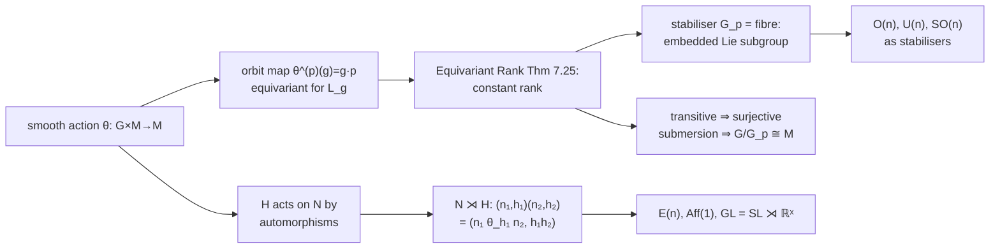

# DM09 · Group Actions and Semidirect Products

◀ [[DM08 Lie Groups]] · [[Differential Geometry - Course Map]] · [[DM10 Vector Fields and Lie Brackets]] ▶

taught · in syllabus extra · book extra · beyond

> [!warning] What the lecture source says
> Smooth actions, orbit maps and the **Equivariant Rank Theorem** (Lee Thm 7.25) are on slides **DG14–DG15** (week 6), orbits, stabilisers and the first semidirect products on **DG15–DG16**, with the handout *DG Semidirect products*. Homework: **HW6 Q1** (stabilisers are embedded Lie subgroups), **HW6 Q2** ($U(n)$ is an embedded $n^2$-dimensional subgroup), **HW6 Q3** (recognising semidirect products: $G\cong N\rtimes H$ iff a split exact sequence, $O(n)\cong SO(n)\rtimes O(1)$, $GL(n,\mathbb C)\cong SL(n,\mathbb C)\rtimes\mathbb C^\times$). Sources: [[mt3184-differential-geometry-and-lie-groups/2026-09-10-september-7-12|Sep 7–12 note]], [[mt3184-differential-geometry-and-lie-groups/2026-09-11-hw6|HW6 note]]. Book: Lee Ch. 7 §"Group Actions and Equivariant Maps" and §"Semidirect Products" ([[John M. Lee - Introduction to Smooth Manifolds.pdf#page=183|Lee pp. 165–169]]; printed page = PDF page − 18). The semidirect-product handout and DG16 were only partly legible to the note-taking tool (`[!verify]`).

> [!syllabus] Syllabus map: what is in the syllabus and what is extra in this chapter
> 🟢 **In syllabus (taught: DG14–DG16, HW6 Q1–Q3)**
> - §1 smooth actions, orbit, stabiliser, transitive and free actions, equivariant maps; §2 the Equivariant Rank Theorem, the orbit map has constant rank, stabilisers are embedded Lie subgroups, $O(n)$ and $U(n)$ as stabilisers; §3 semidirect products, the split-sequence criterion, $O(n)\cong SO(n)\rtimes O(1)$, $GL(n,\mathbb C)\cong SL(n,\mathbb C)\rtimes\mathbb C^\times$
>
> 🟡 **Extra · book** (Lee Ch. 7, 21; Tu §§15–16; Kumaresan Ch. 3; Warner Ch. 3)
> - the Euclidean group $E(n)=\mathbb R^n\rtimes O(n)$ (Lee Ex. 7.32); every orbit is an immersed submanifold (Lee Problem 21-17, remark after Prop. 7.26); §4 **homogeneous spaces** $G/G_p\cong M$ (Lee Thms 21.17–21.18, previewed)
>
> 🔵 **Extra · beyond** (my additions, labelled)
> - numerical ranks of the orbit maps for $O(n)$ ($n=2,3,4$), $U(n)$ ($n=1,2,3$) and $SO(3)\curvearrowright S^2$; dimension counts for $S^n$, $S^{2n+1}$, $S^2=SU(2)/U(1)$, $\mathbb{RP}^n$; machine-precision checks of the three semidirect decompositions, $\mathrm{Aff}(1)$ and $E(2)$; the argument that $SU(2)\to SO(3)$ does **not** split

> [!key] After this chapter you can
> - define a **smooth action**, its **orbit map**, **stabiliser**, **transitive** and **free** actions, and **equivariant maps**,
> - prove the **Equivariant Rank Theorem** and use it to show that every **stabiliser is an embedded Lie subgroup** of dimension $\dim G-\operatorname{rank}d\theta^{(p)}$,
> - realise $O(n)$ and $U(n)$ as stabilisers and compute their dimensions from a rank,
> - build the **semidirect product** $N\rtimes_\theta H$, show $N$ is normal and $H$ a complement, and **recognise** semidirect products by a split exact sequence,
> - describe **homogeneous spaces** $G/G_p$ and count their dimensions.

> [!intuition] The one-sentence story
> A group *acts* when its elements move the points of a space. Moving $p$ to every other point of its orbit costs the same everywhere, because the action itself carries any point of the orbit to any other: so any map that respects the action has **constant rank**, and the rank of the orbit map alone tells you the **dimension of the stabiliser** (the elements that fail to move $p$). Semidirect products are what you get when one group acts on another by automorphisms: the Euclidean group is "translations, twisted by rotations".

*Concept map: equivariance ⇒ constant rank ⇒ stabilisers and homogeneous spaces; actions by automorphisms ⇒ semidirect products.*

![[fig_dm09_actions.png]]
*A: $\dim G=\dim G_p+\dim(\text{orbit})$ for six actions (§2, §4). B: the semidirect law $(t_1,R_1)(t_2,R_2)=(t_1+R_1t_2,R_1R_2)$ on $E(2)$ composes two rigid motions of a triangle (§3). C: the same for the $ax+b$ group (§3).*

## 1. Smooth actions and equivariant maps
taught *Source: DG14–DG15* · extra · book *Lee §"Group Actions and Equivariant Maps", Examples 7.22–7.24*

> [!key] Definition (DG15)
> A **smooth left action** of a Lie group $G$ on a manifold $M$ is a smooth map $\theta:G\times M\to M$, $\theta(g,p)=g\cdot p$, with
> $$g_1\cdot(g_2\cdot p)=(g_1g_2)\cdot p,\qquad e\cdot p=p.$$
> For $g\in G$ the map $\theta_g:M\to M$, $p\mapsto g\cdot p$, is a **diffeomorphism** (inverse $\theta_{g^{-1}}$). For $p\in M$ the **orbit map** is $\theta^{(p)}:G\to M$, $g\mapsto g\cdot p$. The **orbit** of $p$ is $G\cdot p=\theta^{(p)}(G)$; the **stabiliser** (isotropy group) is $G_p=\{g:g\cdot p=p\}=(\theta^{(p)})^{-1}(p)$. The action is **transitive** if $G\cdot p=M$ (one orbit) and **free** if $G_p=\{e\}$ for every $p$.

> [!example] Examples (DG15, HW6, and the standard ones)
> * $G$ acts on itself by **left translation** $g\cdot h=gh$: free and transitive. By **conjugation** $g\cdot h=ghg^{-1}$: the stabiliser of $h$ is its centraliser.
> * $GL(n,\mathbb R)$ acts on $\mathbb R^n$ by $A\cdot x=Ax$ (smooth: polynomial in $a_{ij},x_j$); it is **transitive** on $\mathbb R^n\setminus\{0\}$, and the stabiliser of $e_1$ is the set of matrices with first column $e_1$.
> * $O(n)$ and $SO(n)$ act on $\mathbb R^n$ and on $S^{n-1}$; $SO(n)$ is transitive on $S^{n-1}$ for $n\ge2$.
> * $GL(n,\mathbb R)$ acts on $M(n,\mathbb R)$ by **congruence** $A\cdot X=AXA^T$ (DG16): the stabiliser of $I$ is $O(n)$. Likewise $GL(n,\mathbb C)$ acts on $M(n,\mathbb C)$ by $A\cdot X=AXA^*$ with stabiliser $U(n)$ of $I$ (HW6 Q2).
> * $\mathbb R$ acts on the torus $T^2$ by the irrational flow $t\cdot(x,y)=(x+t,\,y+\sqrt2\,t)\bmod\mathbb Z^2$: free, with **dense** orbits (cf. [[DM08 Lie Groups]] §2).

> [!key] Equivariant maps (DG15)
> If $G$ acts on $M$ by $\theta$ and on $N$ by $\varphi$, a smooth map $F:M\to N$ is **equivariant** if $F(g\cdot p)=g\cdot F(p)$, i.e. $F\circ\theta_g=\varphi_g\circ F$ for all $g$.
>
> * A Lie group homomorphism $F:G\to H$ is equivariant for the action of $G$ on itself by left multiplication and on $H$ by $g\cdot h=F(g)h$ (this is $F\circ L_g=L_{F(g)}\circ F$, the identity behind Thm 7.5).
> * Every **orbit map** $\theta^{(p)}$ is equivariant for left translation on $G$ and $\theta$ on $M$: $\theta^{(p)}(g'g)=g'\cdot\theta^{(p)}(g)$.
> * The radial projection $x\mapsto x/|x|$, $\mathbb R^n\setminus\{0\}\to S^{n-1}$ is $O(n)$-equivariant, since $|Ax|=|x|$.

> [!pitfall] Stabilisers move along an orbit by conjugation
> $G_{g\cdot p}=g\,G_p\,g^{-1}$, because $h\cdot(g\cdot p)=g\cdot p\iff g^{-1}hg\in G_p$. So stabilisers of points in one orbit are **isomorphic** but not equal: for $SO(3)$ acting on $S^2$ the stabiliser of the north pole $e_3$ is the rotations about the $z$-axis, and that of $p=ge_3$ is the rotations about the axis $p$. If $G$ is **abelian** the stabilisers along an orbit coincide.

## 2. The Equivariant Rank Theorem
taught *Source: DG15–DG16, HW6 Q1–Q2* · extra · book *[[John M. Lee - Introduction to Smooth Manifolds.pdf#page=183|Lee Thm 7.25, p. 165]], [[John M. Lee - Introduction to Smooth Manifolds.pdf#page=184|Lee Prop. 7.26, p. 166]]*

> [!key] Equivariant Rank Theorem (DG15; Lee Thm 7.25)
> Let $F:M\to N$ be smooth and **equivariant** with respect to a **transitive** smooth $G$-action on $M$ and any smooth $G$-action on $N$. Then $F$ has **constant rank**. Hence if $F$ is surjective it is a submersion, if injective an immersion, if bijective a diffeomorphism.
>
> *Proof.* Let $p,q\in M$; choose $g$ with $g\cdot p=q$ (transitivity). From $\varphi_g\circ F=F\circ\theta_g$,
> $$d(\varphi_g)_{F(p)}\circ dF_p=dF_q\circ d(\theta_g)_p.$$
> Both $d(\theta_g)_p:T_pM\to T_qM$ and $d(\varphi_g)_{F(p)}:T_{F(p)}N\to T_{F(q)}N$ are isomorphisms, so $\operatorname{rank}dF_p=\operatorname{rank}dF_q$. The last sentence is the Global Rank Theorem ([[DM04 The Tangent Bundle and the Rank Theorem]] §4, Thm 4.14). $\square$

> [!intuition] Same proof as Thm 7.5
> Theorem 7.5 ([[DM08 Lie Groups]] §2) is the special case $M=G$ acting on itself by left translation. The mechanism is always the same: **if the group can carry any point to any other and the map is compatible with that motion, its rank cannot vary.**

> [!key] Orbit maps and stabilisers (DG15–DG16; HW6 Q1; Lee Prop. 7.26)
> Let $\theta$ be a smooth left action of $G$ on $M$ and $p\in M$. Then the orbit map $\theta^{(p)}:G\to M$ is smooth of **constant rank**, so the stabiliser
> $$G_p=(\theta^{(p)})^{-1}(p)$$
> is a **properly embedded Lie subgroup** of $G$ of dimension $\dim G-\operatorname{rank}d(\theta^{(p)})_e$. If $G_p=\{e\}$ then $\theta^{(p)}$ is an injective immersion, so the orbit $G\cdot p$ is an immersed submanifold of $M$.
>
> *Proof.* $\theta^{(p)}$ is the composite $G\to G\times M\to M$, $g\mapsto(g,p)\mapsto g\cdot p$, hence smooth. It is equivariant for left translation (§1) and $G$ acts transitively on itself, so by Thm 7.25 it has constant rank $r$. Then $G_p$, the level set of a constant-rank map, is a properly embedded submanifold of dimension $\dim G-r$ ([[DM06 Submanifolds]], Constant-Rank Level Set Theorem, Lee Thm 5.12); it is a subgroup, hence (Lee Prop. 7.11) an embedded Lie subgroup. If $G_p=\{e\}$ and $g'\cdot p=g\cdot p$ then $g^{-1}g'\in G_p$, so $g=g'$: injective, and an injective constant-rank map is an immersion. $\square$

> [!example] The stabilisers that make the classical groups (DG16, HW6 Q1–Q2)
> **$O(n)$.** $GL(n,\mathbb R)$ acts on $M(n,\mathbb R)$ by $A\cdot X=AXA^T$; the stabiliser of $I$ is $O(n)$ (HW6 Q1 gives that it is an embedded Lie subgroup *for free*). The orbit map is $A\mapsto AA^T$ with differential $B\mapsto B+B^T$ at $I$, whose image is the space of **symmetric** matrices, of dimension $n(n+1)/2$. Hence
> $$\dim O(n)=n^2-\tfrac{n(n+1)}2=\tfrac{n(n-1)}2.$$
> Numerically the rank of the orbit map at $I$ is $3,6,10$ for $n=2,3,4$, giving $\dim O(n)=1,3,6$ ✓. (Compare [[DM06 Submanifolds]] §2: there one has to check that $I$ is a regular value of $A\mapsto A^TA$ at every point; the Equivariant Rank Theorem makes constant rank automatic, so the check at $I$ suffices.)
>
> **$U(n)$ (HW6 Q2).** $GL(n,\mathbb C)$ acts on $M(n,\mathbb C)$ by $A\cdot X=AXA^*$ (a smooth action of a real Lie group); the stabiliser of $I$ is $U(n)=\{A:AA^*=I\}$. The differential of $A\mapsto AA^*$ at $I$ is $B\mapsto B+B^*$ with image the **Hermitian** matrices (any Hermitian $H$ equals $B+B^*$ for $B=H/2$), a real vector space of dimension $n^2$. So $\dim U(n)=2n^2-n^2=n^2$: the real rank of $B\mapsto B+B^*$ is $1,4,9$ for $n=1,2,3$ ✓, an embedded $n^2$-dimensional Lie subgroup of $GL(n,\mathbb C)$.
>
> **$SO(3)$ on $S^2$.** The orbit map of $e_3$ is $g\mapsto ge_3$; at $I$ its differential is $B\mapsto Be_3$ on skew $B$ (the tangent space $T_ISO(3)$, three-dimensional). It has rank $2=\dim S^2$ (the action is transitive), so the stabiliser $SO(2)$ has dimension $3-2=1$ ✓.

> [!pitfall] An orbit is immersed, not necessarily embedded
> Even a free action can have orbits that are **not embedded**: the irrational flow of $\mathbb R$ on $T^2$ is free, its orbit map $t\mapsto(t,\sqrt2t)\bmod\mathbb Z^2$ is an injective immersion, and every orbit is a **dense** line. (Lee proves that *every* orbit is an immersed submanifold, also when $G_p\ne\{e\}$, in Problem 21-17.) Orbits of **proper** actions are embedded (Lee Prop. 21.7, Ch. 21).

## 3. Semidirect products
taught *Source: DG16, handout "DG Semidirect products", HW6 Q3* · extra · book *[[John M. Lee - Introduction to Smooth Manifolds.pdf#page=186|Lee Ex. 7.32, Prop. 7.33, p. 168]], [[John M. Lee - Introduction to Smooth Manifolds.pdf#page=187|Lee Thm 7.35, p. 169]]*

> [!key] Definition (DG16; Lee Ex. 7.31)
> Let $N,H$ be Lie groups and $\theta:H\times N\to N$ a **smooth action of $H$ on $N$ by automorphisms** (each $\theta_h:N\to N$ is a Lie group automorphism). The **semidirect product** $N\rtimes_\theta H$ is the manifold $N\times H$ with
> $$(n_1,h_1)(n_2,h_2)=\big(n_1\,\theta_{h_1}(n_2),\ h_1h_2\big).$$
> Identity $(e,e)$; inverse $(n,h)^{-1}=\big(\theta_{h^{-1}}(n^{-1}),\,h^{-1}\big)$. It is a Lie group.
>
> *Proof.* Associativity: both $\big((n_1,h_1)(n_2,h_2)\big)(n_3,h_3)$ and $(n_1,h_1)\big((n_2,h_2)(n_3,h_3)\big)$ equal $\big(n_1\theta_{h_1}(n_2)\theta_{h_1h_2}(n_3),h_1h_2h_3\big)$, using that $\theta_{h_1}$ is a homomorphism and $\theta_{h_1}\circ\theta_{h_2}=\theta_{h_1h_2}$. The product and inverse are built from the group operations of $N,H$ and the smooth map $\theta$, so are smooth. $\square$ If $\theta$ is trivial, $N\rtimes H=N\times H$ is the direct product.

> [!key] Proposition 7.33 (Lee; DG16)
> In $G=N\rtimes_\theta H$: (a) $\tilde N=N\times\{e\}$ and $\tilde H=\{e\}\times H$ are **closed Lie subgroups** isomorphic to $N$ and $H$; (b) $\tilde N$ is **normal**; (c) $\tilde N\cap\tilde H=\{(e,e)\}$ and $\tilde N\tilde H=G$.
>
> *Proof.* The projection $\pi:G\to H$, $(n,h)\mapsto h$, is a Lie group homomorphism ($\pi$ of the product is $h_1h_2$) with kernel $\tilde N$, so $\tilde N$ is a **normal, embedded** Lie subgroup (kernel, [[DM08 Lie Groups]] §2). The map $\psi:H\to G$, $h\mapsto(e,h)$ is a homomorphism with $\pi\circ\psi=\mathrm{id}_H$ and image $\tilde H$. Finally $(n,e)(e,h)=(n\,\theta_e(e),h)=(n,h)$ gives (c). $\square$ Conjugation by $\tilde H$ acts on $\tilde N$ as $\theta$: $(e,h)(n,e)(e,h)^{-1}=(\theta_h(n),e)$.

> [!key] Theorem 7.35, the internal semidirect product (Lee; HW6 Q3)
> Let $G$ be a Lie group and $N,H\le G$ **closed** Lie subgroups with $N$ normal, $N\cap H=\{e\}$ and $NH=G$. Then $(n,h)\mapsto nh$ is a Lie group **isomorphism** $N\rtimes_\theta H\to G$, where $\theta_h(n)=hnh^{-1}$ is conjugation.
>
> *Proof.* $\theta_h$ is an automorphism of $N$ ($N$ is normal and embedded, so conjugation restricts smoothly to $N$), so the semidirect product is defined. $\Phi(n,h)=nh$ is smooth (a restriction of multiplication to embedded submanifolds) and a homomorphism: $\Phi\big((n_1,h_1)(n_2,h_2)\big)=n_1(h_1n_2h_1^{-1})h_1h_2=(n_1h_1)(n_2h_2)$. It is onto since $NH=G$, and injective since $nh=e$ forces $n=h^{-1}\in N\cap H=\{e\}$. A **bijective** homomorphism is an isomorphism (constant rank, Thm 7.5 and Thm 4.14; [[DM08 Lie Groups]] §2). $\square$

> [!key] HW6 Q3(a): the split-sequence criterion
> $G\cong N\rtimes H$ for some action $\theta$ **iff** there are Lie group homomorphisms $\varphi:G\to H$ and $\psi:H\to G$ with
> $$\varphi\circ\psi=\mathrm{Id}_H,\qquad\ker\varphi\cong N.$$
> *Proof.* ($\Rightarrow$) $\varphi=\pi$, $\psi(h)=(e,h)$ as above. ($\Leftarrow$) Put $K=\ker\varphi$ (a closed normal subgroup, embedded). The homomorphism $\psi$ is a smooth immersion ($d\varphi\circ d\psi=\mathrm{id}$) and a homeomorphism onto $\psi(H)$ (inverse $\varphi|_{\psi(H)}$), so $\psi(H)\cong H$ is an embedded subgroup; it is **closed**, being $\{g:\psi(\varphi(g))=g\}$, the equaliser of two continuous maps into a Hausdorff space. Next $K\cap\psi(H)=\{e\}$ (if $\psi(h)\in K$ then $h=\varphi\psi(h)=e$) and $K\,\psi(H)=G$, since $g=\big(g\,\psi(\varphi(g))^{-1}\big)\psi(\varphi(g))$ and $\varphi\big(g\,\psi(\varphi(g))^{-1}\big)=e$. Theorem 7.35 gives $G\cong K\rtimes\psi(H)\cong N\rtimes H$. $\square$

> [!example] Semidirect products with numbers (HW6 Q3, Lee Ex. 7.32)
> * **$O(n)\cong SO(n)\rtimes O(1)$ (Q3b).** Take $\varphi=\det:O(n)\to O(1)=\{\pm1\}$, with kernel $SO(n)$, and $\psi(s)=\operatorname{diag}(s,1,\dots,1)$. Then $A=N\,\psi(\det A)$ with $N=A\,\psi(\det A)^{-1}\in SO(n)$, and $O(1)$ acts on $SO(n)$ by conjugation $\theta_s(N)=\psi(s)N\psi(s)^{-1}$. Check on $500$ random $A\in O(4)$: $\det N=1$ and $A=N\psi(\det A)$ to $1.0\times10^{-15}$; the semidirect law $(N_1,s_1)(N_2,s_2)=(N_1\theta_{s_1}(N_2),s_1s_2)$ reproduces matrix multiplication exactly. For $n=2$ the action $\theta_{-1}$ is $R\mapsto R^{-1}$ on $SO(2)$: $O(2)$ is **non-abelian**, though $SO(2)$ and $O(1)$ are abelian.
> * **$GL(n,\mathbb C)\cong SL(n,\mathbb C)\rtimes\mathbb C^\times$ (Q3c).** $\varphi=\det:GL(n,\mathbb C)\to\mathbb C^\times$, $\psi(z)=\operatorname{diag}(z,1,\dots,1)$, $\ker\varphi=SL(n,\mathbb C)$. For $A\in GL(3,\mathbb C)$: $S=A\,\psi(\det A)^{-1}$ has $\det S=1+1.1\times10^{-16}i$ and $A=S\psi(\det A)$ to $4.6\times10^{-16}$. Dimensions: $\dim_{\mathbb R}SL(n,\mathbb C)+\dim_{\mathbb R}\mathbb C^\times=(2n^2-2)+2=2n^2$ ✓. The same with $\mathbb R$ gives $GL(n,\mathbb R)\cong SL(n,\mathbb R)\rtimes\mathbb R^\times$.
> * **The Euclidean group** $E(n)=\mathbb R^n\rtimes O(n)$, $(b,A)(b',A')=(b+Ab',AA')$ (Lee Ex. 7.32), acting on $\mathbb R^n$ by rigid motions $x\mapsto b+Ax$; as matrices $\begin{pmatrix}A&b\\0&1\end{pmatrix}$. For $E(2)$ the matrix product agrees with the semidirect law to $1.1\times10^{-16}$ (figure B). It is **not** a direct product: $\mathbb R^2\times SO(2)$ is abelian, $E(2)$ is not.
> * **The affine group of the line** $\mathrm{Aff}(1)=\mathbb R\rtimes\mathbb R^\times$: $f_{b,a}(x)=ax+b$ satisfies $f_{b_1,a_1}\circ f_{b_2,a_2}=f_{b_1+a_1b_2,\;a_1a_2}$, the semidirect law. For $f_1=1.9x+0.7$ and $f_2=0.4x-1.3$ at $x_0=0.55$ both sides give $-1.352000$ (figure C).

> [!pitfall] Not every extension splits: $SU(2)\to SO(3)$
> The double cover $q:SU(2)\to SO(3)$ is a surjective homomorphism with kernel $\{\pm1\}$, but there is **no** homomorphism $\psi:SO(3)\to SU(2)$ with $q\circ\psi=\mathrm{id}$. If there were, Q3(a) would give $SU(2)\cong\{\pm1\}\rtimes SO(3)$, a manifold $\{\pm1\}\times SO(3)$ with **two** components; but $SU(2)\cong S^3$ is connected. (Equivalently, the 2-sheeted cover is non-trivial: $\pi_1(SO(3))=\mathbb Z/2$, [[PA15 Covering Spaces and the Fundamental Group]] §5.) So "kernel + surjection" is not enough; the section $\psi$ is the essential extra datum.

## 4. Homogeneous spaces (preview)
extra · book *[[John M. Lee - Introduction to Smooth Manifolds.pdf#page=569|Lee Thm 21.17, p. 551]], [[John M. Lee - Introduction to Smooth Manifolds.pdf#page=570|Lee Thm 21.18, p. 552]]* · extra · beyond *dimension counts*

> [!key] Transitive actions give quotients
> If $G$ acts **transitively** on $M$ and $p\in M$, then $\theta^{(p)}:G\to M$ is a **surjective submersion** (constant rank by Thm 7.25, surjective by transitivity, so a submersion by the Global Rank Theorem), with fibre $(\theta^{(p)})^{-1}(g_0\cdot p)=g_0G_p$ a left coset. For a closed subgroup $H\le G$ the coset space $G/H$ is a manifold of dimension $\dim G-\dim H$ with a unique smooth structure making $G\to G/H$ a submersion (Lee Thm 21.17), and (Lee Thm 21.18) the induced bijection $G/G_p\to M$, $gG_p\mapsto g\cdot p$, is a **diffeomorphism**: every manifold with a transitive Lie group action is a **homogeneous space** $G/G_p$.

> [!example] Homogeneous spaces, with dimension counts
> * $S^n=O(n+1)/O(n)=SO(n+1)/SO(n)$: $\dim=\tfrac{n(n+1)}2-\tfrac{n(n-1)}2=n$ ✓.
> * $S^{2n+1}=U(n+1)/U(n)$: $(n+1)^2-n^2=2n+1$ (for $n=3$: $7$) ✓.
> * $S^2=SU(2)/U(1)$: $3-1=2$ ✓ (the quotient map $S^3\to S^2$ is the Hopf fibration with fibre $U(1)=S^1$).
> * $\mathbb{RP}^n=O(n+1)/(O(n)\times O(1))$: $n$ ✓ ([[DM01 Smooth Manifolds]]).
> * $\mathbb R^n=E(n)/O(n)$ (the stabiliser of $0$ is $O(n)$): $\dim E(n)=n+\tfrac{n(n-1)}2$, so $\dim E(n)/O(n)=n$ ✓.

<!-- interactive:start (generated by scripts/embed_interactive.py; edit the tool in scripts/interactive/tools/, not this block) -->
> [!interactive]+ Interactive: The Euclidean group as a semidirect product: rotations and translations
> Rigid motions of the plane form the group E(2) = SO(2) ⋉ R²: an element g = (R_θ, t) acts by x ↦ R_θ x + t and (R₁, t₁)(R₂, t₂) = (R₁R₂, t₁ + R₁t₂).
>
> ![[dm_euclidean_group.png|720]]
>
> **Try:** Take g₁ = rotation by 90° about the origin, g₂ = translation by (1, 0): g₁g₂ ≠ g₂g₁ (the first sends the polygon to x = 0 line shifted, the second shifts it elsewhere). Set both rotations to 0: only translations: the motions commute. The commutator g₁g₂g₁⁻¹g₂⁻¹ is a translation whenever the rotation parts commute (always, for SO(2)).
>
> [▶ Open the tool in your browser](../Assets/interactive/dm_euclidean_group.html) · [absolute link](file:///home/swastik/Documents/notes/Assets/interactive/dm_euclidean_group.html) · all tools and coverage: [[Interactive Tools]]

<!-- interactive:end -->

## Map of this chapter
> [!connection] How DM09 connects
> **Builds on:** [[DM08 Lie Groups]] (homomorphisms, constant rank, kernels), [[DM04 The Tangent Bundle and the Rank Theorem]] (Global Rank Theorem), [[DM06 Submanifolds]] (level sets, $O(n)$), [[DM05 Immersions, Embeddings, Submersions and Coverings]] (immersed orbits, surjective submersions), [[GT05 Actions Conjugation and Sylow Theorems]] (actions, orbit–stabiliser in the finite case).
> **Leads to:** [[DM10 Vector Fields and Lie Brackets]] (a Lie group acts on itself by left translation: left-invariant fields), [[DM12 Integral Curves, Flows and Flowouts]] (a flow is an $\mathbb R$-action), [[DM15 Closed Subgroups and the Lie Correspondence]] (Closed Subgroup Theorem, quotients).
> **Concepts:** [[Smooth Action]] · [[Orbit Map and Stabiliser]] · [[Equivariant Map]] · [[Equivariant Rank Theorem]] · [[Semidirect Product of Lie Groups]] · [[Euclidean Group]] · [[Homogeneous Space]]
> **Other subjects:** [[Group Action]], [[Orbit-Stabiliser Theorem]], [[Transitive Action]], [[Semidirect Product]], [[Affine Group]] and [[Complement of a Normal Subgroup]] in [[Group Theory - Course Map]]; [[Quantum Mechanics - Course Map]] ($SU(2)\to SO(3)$ and spin, $E(3)$ symmetries); [[Inorganic Chemistry - Course Map]] (point groups as finite stabilisers in $O(3)$)

## Summary
> [!summary] Cheat-sheet
> - **Smooth action** $\theta:G\times M\to M$; $\theta_g$ diffeo; orbit map $\theta^{(p)}(g)=g\cdot p$ is equivariant for left translation; orbit $G\cdot p$, stabiliser $G_p=(\theta^{(p)})^{-1}(p)$; $G_{g\cdot p}=gG_pg^{-1}$.
> - **Equivariant Rank Theorem (Thm 7.25):** $F$ equivariant w.r.t. a transitive action on $M$ $\Rightarrow$ constant rank (surjective $\Rightarrow$ submersion, injective $\Rightarrow$ immersion, bijective $\Rightarrow$ diffeo).
> - **Orbit map (Prop 7.26):** constant rank; $G_p$ is a properly embedded Lie subgroup of dimension $\dim G-\operatorname{rank}d\theta^{(p)}_e$; free $\Rightarrow$ orbit is an immersed submanifold (maybe dense).
> - $O(n)=$ stabiliser of $I$ for $A\cdot X=AXA^T$: $\dim=n^2-\tfrac{n(n+1)}2$; $U(n)=$ stabiliser for $A\cdot X=AXA^*$: $\dim=2n^2-n^2=n^2$.
> - **Semidirect product** $N\rtimes_\theta H$: $(n_1,h_1)(n_2,h_2)=(n_1\theta_{h_1}(n_2),h_1h_2)$; $N$ normal, $H$ complement. **Criterion:** $G\cong N\rtimes H$ iff $\varphi:G\to H$, $\psi:H\to G$ with $\varphi\psi=\mathrm{id}$, $\ker\varphi\cong N$ (Thm 7.35 for the internal version). $O(n)=SO(n)\rtimes O(1)$, $GL(n,\mathbb C)=SL(n,\mathbb C)\rtimes\mathbb C^\times$, $E(n)=\mathbb R^n\rtimes O(n)$, $\mathrm{Aff}(1)=\mathbb R\rtimes\mathbb R^\times$; $SU(2)\to SO(3)$ does **not** split.
> - **Homogeneous spaces:** transitive $\Rightarrow$ $\theta^{(p)}$ surjective submersion, $M\cong G/G_p$, $\dim M=\dim G-\dim G_p$.

## Practice
1. **Actions basics.** Prove $\theta_g$ is a diffeomorphism, the orbit map is smooth and equivariant, and $G_{g\cdot p}=gG_pg^{-1}$.
2. **Stabilisers (HW6 Q1).** Let $\theta$ be a smooth action of $G$ on $M$. Show $G_p$ is an embedded Lie subgroup of $G$ and give its dimension in terms of the rank of $d\theta^{(p)}_e$.
3. **$O(n)$ as a stabiliser.** Use $A\cdot X=AXA^T$ to show $O(n)$ is an embedded Lie subgroup of $GL(n,\mathbb R)$ and compute $\dim O(3)$ from a rank.
4. **$U(n)$ (HW6 Q2).** Prove $U(n)$ is an embedded $n^2$-dimensional Lie subgroup of $GL(n,\mathbb C)$.
5. **$SO(3)$ on $S^2$.** Show the action is transitive, find the rank of the orbit map at $I$ and identify the stabiliser of $e_3$.
6. **$GL(n,\mathbb R)$ on $\mathbb R^n\setminus\{0\}$.** Show $A\mapsto Ae_1$ is a surjective submersion and find the dimension of its fibre.
7. **Split criterion (HW6 Q3a).** Prove $G\cong N\rtimes H\iff$ there exist $\varphi,\psi$ with $\varphi\psi=\mathrm{Id}_H$ and $\ker\varphi\cong N$.
8. **$O(n)$ (HW6 Q3b).** Prove $O(n)\cong SO(n)\rtimes O(1)$ and write the action explicitly; show $O(2)$ is non-abelian.
9. **$GL(n,\mathbb C)$ (HW6 Q3c).** Prove $GL(n,\mathbb C)\cong SL(n,\mathbb C)\rtimes\mathbb C^\times$ and check dimensions.
10. **Euclidean and affine groups.** Verify that $(b,A)\mapsto\begin{pmatrix}A&b\\0&1\end{pmatrix}$ is an injective homomorphism $E(n)\to GL(n+1,\mathbb R)$, derive the composition law for $\mathrm{Aff}(1)$, and show that $SU(2)\to SO(3)$ does not split.

> [!example]- Solutions
> 1. $\theta_g$ is smooth (restriction of $\theta$ to $\{g\}\times M$) with smooth inverse $\theta_{g^{-1}}$ since $\theta_{g^{-1}}\theta_g=\theta_e=\mathrm{id}$. The orbit map is $G\to G\times M\to M$; equivariance is $\theta^{(p)}(g'g)=(g'g)\cdot p=g'\cdot(g\cdot p)$. For the stabilisers see §1.
> 2. §2: $\theta^{(p)}$ has constant rank $r=\operatorname{rank}d\theta^{(p)}_e$ by Thm 7.25, so $G_p$, its level set at $p$, is a properly embedded submanifold of dimension $\dim G-r$ (Thm 5.12); it is a subgroup, hence an embedded Lie subgroup (Prop 7.11).
> 3. $\theta^{(I)}(A)=AA^T$, constant rank, stabiliser $\{A:AA^T=I\}=O(n)$. $d\theta^{(I)}_I(B)=B+B^T$ with image $\operatorname{Sym}(n)$ (take $B=S/2$), so $\operatorname{rank}=n(n+1)/2$ and $\dim O(n)=n^2-n(n+1)/2=n(n-1)/2$. For $n=3$: rank $6$ (numerically $6$), $\dim O(3)=9-6=3$.
> 4. As in §2: $A\cdot X=AXA^*$ is smooth; stabiliser of $I$ is $U(n)$; $d\theta^{(I)}_I(B)=B+B^*$ with image the Hermitian matrices, of real dimension $n^2$; $\dim_{\mathbb R}GL(n,\mathbb C)=2n^2$, so $\dim U(n)=n^2$. (Numerical real ranks $1,4,9$.)
> 5. Transitive: for $v\in S^2$ pick a rotation taking $e_3$ to $v$ (a rotation about $e_3\times v$ by $\angle(e_3,v)$; the identity or a rotation by $\pi$ about a perpendicular axis if $v=\pm e_3$). $T_ISO(3)$ is the space of skew matrices $B$; $Be_3=(b_{13},b_{23},0)^T$ takes all values in the $xy$-plane, so the rank is $2=\dim S^2$ (numerically $2$) and $\dim G_{e_3}=3-2=1$. The stabiliser is $\{g:ge_3=e_3\}$, rotations of the $xy$-plane: $SO(2)$.
> 6. Transitive by §1, so $\theta^{(e_1)}(A)=Ae_1$ is a surjective submersion (Thm 7.25, 4.14). The fibre over $e_1$ is $\{A:Ae_1=e_1\}$ ($A$ with first column $e_1$), of dimension $n^2-n$; its elements are $\begin{pmatrix}1&v^T\\0&B\end{pmatrix}$, $B\in GL(n-1)$: $(n-1)+(n-1)^2=n^2-n$ ✓.
> 7. §3 (both directions).
> 8. §3. $\det:O(n)\to O(1)=\{\pm1\}$ is a homomorphism with kernel $SO(n)$ and $\det\circ\psi=\mathrm{id}$, since $\det\psi(s)=s$; the action is $\theta_s(N)=\psi(s)N\psi(s)^{-1}$. For $n=2$, $\psi(-1)=\operatorname{diag}(-1,1)$ gives $\psi(-1)R_\alpha\psi(-1)^{-1}=R_{-\alpha}$, so a reflection and a rotation do not commute unless $\alpha\in\{0,\pi\}$.
> 9. §3. $\det\psi(z)=z$; $\ker\det=SL(n,\mathbb C)$; both $\varphi,\psi$ are smooth homomorphisms. $\dim=(2n^2-2)+2=2n^2$.
> 10. $\begin{pmatrix}A&b\\0&1\end{pmatrix}\begin{pmatrix}A'&b'\\0&1\end{pmatrix}=\begin{pmatrix}AA'&Ab'+b\\0&1\end{pmatrix}$, which is the product $(b+Ab',AA')$, injective since $(b,A)$ can be read off. $f_{b_1,a_1}(f_{b_2,a_2}(x))=a_1(a_2x+b_2)+b_1=(a_1a_2)x+(b_1+a_1b_2)$. Non-splitting: §3 pitfall.

<!-- zettel:start (generated by scripts/sort_zettel.py; do not edit between the markers) -->
## Zettel notes

> [!abstract]- Zettel notes filed under this chapter (4): the other tool's concept notes from the lectures, unreviewed
> [[zettel/euclidean-group|Euclidean Group]] · [[zettel/orbit-map|Orbit Map]] · [[zettel/semidirect-product-of-lie-groups|Semidirect Product of Lie Groups]] · [[zettel/smooth-group-action|Smooth Group Action]]
<!-- zettel:end -->

## Provenance
> [!provenance]- Source map for this chapter
> | Topic | Source | Scope |
> |---|---|---|
> | smooth actions, orbit map, stabiliser, transitive/free, equivariant maps, Equivariant Rank Theorem | slides DG14–DG15 via [[mt3184-differential-geometry-and-lie-groups/2026-09-10-september-7-12\|Sep 7–12 note]] | taught |
> | orbit map has constant rank, stabiliser embedded; $O(n)$ via congruence; semidirect-product definition | slides DG15–DG16 and the handout "DG Semidirect products" via [[mt3184-differential-geometry-and-lie-groups/2026-09-10-september-7-12\|Sep 7–12 note]] | taught |
> | HW6 Q1 (stabiliser), Q2 ($U(n)$), Q3a–c (split criterion, $O(n)$, $GL(n,\mathbb C)$) | [[mt3184-differential-geometry-and-lie-groups/2026-09-11-hw6\|HW6]] | taught (via homework) |
> | proofs of Thm 7.25, Prop 7.26, Examples 7.27–7.30, Ex. 7.31–7.32, Prop 7.33, Thm 7.35 | Lee Thm 7.25, Prop. 7.26, Prop. 7.33, Thm 7.35; Tu §§15–16 | extra/book |
> | homogeneous spaces $G/G_p\cong M$; every orbit is immersed | Lee Thm 21.17, Thm 21.18, Prop. 21.7, Problem 21-17 | extra/book |
> | numerical ranks, semidirect checks, dimension counts, the non-splitting of $SU(2)\to SO(3)$ | `scripts/dm_numbers.py` (DM09), `fig_dm09_actions.py` | extra/beyond |
>
> **Notes.** [!verify] DG16 and the semidirect-product handout were only partly legible to the note-taking tool; the definition of $N\rtimes_\theta H$ is the standard one, and the slide's final figure for $\dim O(n)$ is garbled there (here derived from the printed rank $n(n+1)/2$). The attribution of the split-sequence criterion to the handout comes from HW6 Q3(a) only.
