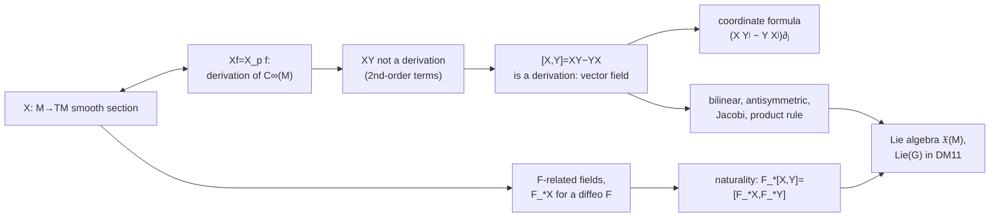

# DM10 · Vector Fields and Lie Brackets

◀ [[DM09 Group Actions and Semidirect Products]] · [[Differential Geometry - Course Map]] · [[DM11 The Lie Algebra of a Lie Group]] ▶

taught · in syllabus extra · book extra · beyond

> [!warning] What the lecture source says
> Vector fields appear in **week 3** (slide DG8: sections of $TM$, Hairy Ball) and are developed in **week 4** (slides DG9–DG10: components, $\mathfrak X(M)$ as a $C^\infty(M)$-module, **Prop 8.14** smoothness criterion, derivations of $C^\infty(M)$, **$F$-related fields**, **Prop 8.19** pushforward by a diffeomorphism, tangency to a submanifold). The **Lie bracket** $[X,Y]=XY-YX$ is introduced in **week 6** (slides DG16–DG17) and used in **HW6 Q4–Q5**; earlier homework: **HW3 Q3** (a field with one zero, in [[DM04 The Tangent Bundle and the Rank Theorem]]), **HW4 Q2–Q4** (extension of a vector to a field, pushing a field forward, global frames). Sources: [[mt3184-differential-geometry-and-lie-groups/2026-08-20-august-17-21|Aug 17–21]], [[mt3184-differential-geometry-and-lie-groups/2026-08-27-august-24-28|Aug 24–28]], [[mt3184-differential-geometry-and-lie-groups/2026-09-10-september-7-12|Sep 7–12]] notes. Book: Lee Ch. 8 §§ Vector Fields on Manifolds, Vector Fields and Smooth Maps, Lie Brackets ([[John M. Lee - Introduction to Smooth Manifolds.pdf#page=192|Lee pp. 174–189]]; printed page = PDF page − 18). The weeks 3–4 slides were readable only by OCR and the DG16 slide only in part (`[!verify]`).

> [!syllabus] Syllabus map: what is in the syllabus and what is extra in this chapter
> 🟢 **In syllabus (taught: DG8–DG10, DG16–DG17, HW4 Q2–Q4, HW6 Q4–Q5)**
> - §1 smooth vector fields, the smoothness criterion Prop 8.14, vector fields as derivations of $C^\infty(M)$; §2 $F$-related fields, pushforward by a diffeomorphism (Prop 8.19, HW4 Q3), tangency to a submanifold; §3 the Lie bracket: definition, **it is a vector field** (HW6 Q4), the coordinate formula, HW6 Q5, bilinearity, antisymmetry, Jacobi
>
> 🟡 **Extra · book** (Lee Ch. 8; Tu §§14, 16; Kumaresan Ch. 3; Warner §1.4)
> - the product rule $[fX,gY]=fg[X,Y]+f(Xg)Y-g(Yf)X$ (Prop 8.28(d)); **naturality of the bracket** (Prop 8.30, Cor 8.31, Cor 8.32), used in DM11 for $F_*$ to preserve brackets; proof that $\mathfrak X(M)$ is a Lie algebra
>
> 🔵 **Extra · beyond** (my additions, labelled)
> - exact symbolic checks (Jacobi, product rule, naturality for $F(x,y)=(xy,y/x)$); the commutator quadrilateral $\Phi^Y_{-\varepsilon}\Phi^X_{-\varepsilon}\Phi^Y_\varepsilon\Phi^X_\varepsilon$ whose gap is $\varepsilon^2[X,Y]$ (computed exactly in two examples, derived formally in general, proved in DM13); the sign $[L_x,L_y]=-L_z$ for the rotation fields

> [!key] After this chapter you can
> - decide **smoothness of a vector field** by testing it on functions, and identify vector fields with **derivations** of $C^\infty(M)$,
> - **push a vector field forward** by a diffeomorphism (and know when it is only $F$-related),
> - compute the **Lie bracket** from the definition and from the **coordinate formula**, and prove $[X,Y]$ is a vector field,
> - use **bilinearity, antisymmetry, Jacobi, the product rule** and **naturality** of the bracket.

> [!intuition] The one-sentence story
> A smooth vector field is the same thing as a way of **differentiating functions** ($f\mapsto Xf$, a derivation). Two derivations can be composed, but the composition $XY$ is no longer a derivation (it involves second derivatives); its **antisymmetric part** $XY-YX$ cancels all second derivatives and is again a vector field. That is the Lie bracket: it measures the failure of the two derivatives to commute, which is the failure of the two flows to commute (DM13).

*Concept map: sections ⇔ derivations ⇒ bracket ⇒ Lie algebra; pushforward ⇒ naturality.*

![[fig_dm10_fields.png]]
*A: the pushforward $F_*X=2u\,\partial_u$ of the Euler field under $F(x,y)=(xy,y/x)$ (HW4 Q3, §2). B, C: the commutator quadrilateral: a non-zero gap $\varepsilon^2\partial_y$ for $[\partial_x,x\partial_y]=\partial_y$, none for the commuting pair $[r\partial_r,\partial_\theta]=0$ (§3).*

## 1. Smooth vector fields and derivations
taught *Source: DG8–DG10, HW4 Q2* · extra · book *[[John M. Lee - Introduction to Smooth Manifolds.pdf#page=198|Lee Prop. 8.14, p. 180]], [[John M. Lee - Introduction to Smooth Manifolds.pdf#page=199|Lee Prop. 8.15, p. 181]]*

Recall ([[DM04 The Tangent Bundle and the Rank Theorem]] §1): a **vector field** is a smooth map $X:M\to TM$ with $\pi\circ X=\mathrm{id}_M$; in a chart $X=\sum_iX^i\,\partial/\partial x^i$ and $X$ is smooth iff all $X^i$ are. $\mathfrak X(M)$ denotes the set of smooth vector fields; it is a **module over $C^\infty(M)$**: $(fX)_p=f(p)X_p$. A vector field acts on functions by
$$(Xf)(p)=X_pf,\qquad X(fg)=f\,Xg+g\,Xf,\quad X(af+bg)=aXf+bXg.$$

> [!key] Smoothness criterion (DG10; Lee Prop. 8.14)
> For a **rough** vector field $X$ ($X_p\in T_pM$ chosen for every $p$, with no continuity assumed) the following are equivalent: (a) $X$ is smooth; (b) $Xf\in C^\infty(M)$ for every $f\in C^\infty(M)$; (c) $Xf\in C^\infty(U)$ for every open $U$ and $f\in C^\infty(U)$.
>
> *Proof.* (a)$\Rightarrow$(c): in a chart $Xf=\sum_iX^i\,\partial f/\partial x^i$, a sum of products of smooth functions. (c)$\Rightarrow$(b) is a special case. (b)$\Rightarrow$(a): fix $p$ and a chart $(U,x^i)$ about $p$; choose a bump function $\psi$ supported in $U$ with $\psi\equiv1$ on a neighbourhood $W$ of $p$, and let $f^i=\psi x^i$ (extended by $0$) $\in C^\infty(M)$. On $W$, $X^i=X(x^i)=X(f^i)$ is smooth (locality, [[DM03 Tangent Vectors and the Differential]] §1). Hence all components are smooth near $p$. $\square$

> [!key] Vector fields = derivations of $C^\infty(M)$ (DG10; Lee Prop. 8.15)
> A map $D:C^\infty(M)\to C^\infty(M)$ that is $\mathbb R$-linear and satisfies $D(fg)=f\,Dg+g\,Df$ (a **derivation of $C^\infty(M)$**) equals $f\mapsto Xf$ for a **unique** $X\in\mathfrak X(M)$.
>
> *Proof.* For each $p$, $f\mapsto(Df)(p)$ is a derivation *at* $p$, i.e. a tangent vector $X_p\in T_pM$ (DM03). The resulting rough field has $Xf=Df\in C^\infty(M)$ for all $f$, so $X$ is smooth by Prop 8.14. Uniqueness: a tangent vector is determined by its action on functions. $\square$

> [!example] Examples (DG9–DG10, HW4 Q2)
> * **Coordinate fields** $\partial/\partial x^i$ on the domain of a chart; **Euler field** $E=\sum x^i\partial_i$ on $\mathbb R^n$; **rotation fields** $x\partial_y-y\partial_x$ on $\mathbb R^2$, the angle field $\partial_\theta$ on $S^1$ and on the torus $T^n$.
> * **Extension of a vector (HW4 Q2).** For $v\in T_pM$ there is $X\in\mathfrak X(M)$ with $X_p=v$: write $v=\sum v^i\partial_i|_p$ in a chart, put $X=\psi\sum v^i\partial_i$ (constant components) with a bump $\psi$ supported in the chart and $\psi(p)=1$, extended by $0$ ([[DM02 Smooth Maps and Partitions of Unity]] §3; Lee Lemma 8.6).
> * **Not smooth:** $X=|x|\,\partial_x$ on $\mathbb R$ is a rough field with continuous components, but $Xf=|x|f'$ is not smooth for $f=x$: by Prop 8.14 $X\notin\mathfrak X(\mathbb R)$.

> [!pitfall] Derivations of $C^\infty(M)$ must map into $C^\infty(M)$
> The criterion (b) is *about the output*. A rough field with discontinuous components still defines a derivation at each point; it fails to be a derivation of $C^\infty(M)$ only because $Xf$ can leave $C^\infty(M)$. This is also why the **composite** $XY$ of two vector fields is not a vector field (§3): it maps $C^\infty(M)\to C^\infty(M)$ but violates the Leibniz rule.

## 2. Vector fields and smooth maps
taught *Source: DG10, HW4 Q3* · extra · book *[[John M. Lee - Introduction to Smooth Manifolds.pdf#page=200|Lee Prop. 8.16, p. 182]], [[John M. Lee - Introduction to Smooth Manifolds.pdf#page=201|Lee Prop. 8.19, p. 183]], [[John M. Lee - Introduction to Smooth Manifolds.pdf#page=202|Lee Prop. 8.22, p. 184]]*

> [!key] $F$-related fields (DG10)
> Let $F:M\to N$ be smooth. $X\in\mathfrak X(M)$ and $Y\in\mathfrak X(N)$ are **$F$-related** if $dF_p(X_p)=Y_{F(p)}$ for all $p\in M$. **Prop 8.16:** this holds iff
> $$X(f\circ F)=(Yf)\circ F\quad\text{for every }f\in C^\infty(N).$$
> *Proof.* $\big(X(f\circ F)\big)(p)=X_p(f\circ F)=\big(dF_pX_p\big)f$ and $\big((Yf)\circ F\big)(p)=Y_{F(p)}f$; the two agree for all $f$ iff $dF_pX_p=Y_{F(p)}$. $\square$

A field on $M$ need **not** have an $F$-related field on $N$ (if $F$ is not injective two points of a fibre may need different values; if $F$ is not surjective nothing is prescribed off the image). Example (Lee Ex. 8.17): $F:\mathbb R\to\mathbb R^2$, $F(t)=(\cos t,\sin t)$; $\partial_t$ is $F$-related to $-y\,\partial_x+x\,\partial_y$ since $dF(\partial_t)=(-\sin t,\cos t)=(-y,x)$.

> [!key] Pushforward by a diffeomorphism (DG10; Lee Prop. 8.19)
> If $F:M\to N$ is a **diffeomorphism**, every $X\in\mathfrak X(M)$ has a **unique** $F$-related field $F_*X\in\mathfrak X(N)$, namely
> $$(F_*X)_q=dF_{F^{-1}(q)}\big(X_{F^{-1}(q)}\big),\qquad\text{i.e. }F_*X=dF\circ X\circ F^{-1}.$$
> *Proof.* The formula is the composite $N\xrightarrow{F^{-1}}M\xrightarrow{X}TM\xrightarrow{dF}TN$ of smooth maps, a section of $TN$; uniqueness because $F$ is bijective. $\square$

> [!example] HW4 Q3, with the computation
> On the open quadrant $M=\{x,y>0\}$ let $F(x,y)=(xy,\,y/x)$ and $X=x\partial_x+y\partial_y$. $F$ is a bijection of $M$ onto itself with smooth inverse $(u,v)\mapsto(\sqrt{u/v},\sqrt{uv})$, and $DF=\begin{pmatrix}y&x\\-y/x^2&1/x\end{pmatrix}$, $\det DF=2y/x\neq0$, so $F$ is a diffeomorphism. Then
> $$dF(X)=\begin{pmatrix}y&x\\-y/x^2&1/x\end{pmatrix}\begin{pmatrix}x\\y\end{pmatrix}=\begin{pmatrix}2xy\\0\end{pmatrix}\quad\Longrightarrow\quad Y=F_*X=2u\,\partial_u\ \ (\text{no }\partial_v\text{ part}).$$
> Numerically (finite differences along curves with velocity $X$ at 200 random points) the image velocity equals $(2u,0)$ to $1.8\times10^{-9}$. *Why:* the flow lines of $X$ are the rays $y=cx$ on which $v=y/x=c$ is constant while $u=cx^2$ grows like $x^2$, so dilation $x\mapsto\lambda x$ becomes $u\mapsto\lambda^2u$ (figure A).

> [!key] Tangency to a submanifold (DG10; Lee Prop. 8.22)
> Let $S\subseteq M$ be an embedded submanifold and $X\in\mathfrak X(M)$. Then $X_p\in T_pS$ for all $p\in S$ iff $(Xf)|_S=0$ for every $f\in C^\infty(M)$ with $f|_S=0$.
> *Proof.* This is the characterisation $T_pS=\{v\in T_pM: vf=0\ \forall f\text{ with }f|_S=0\}$ ([[DM06 Submanifolds]], Lee Prop. 5.37) applied at each point of $S$. $\square$ **Example:** for $S=S^{n-1}$ defined by $\rho=|x|^2-1=0$, a field $X$ is tangent iff $X\rho=0$ on $S$: the rotation field $L=x\partial_y-y\partial_x$ has $L\rho=2xy-2yx=0$, so is tangent to *every* circle; the Euler field has $E\rho=2|x|^2=2\ne0$ on $S^1$ (it is normal); $\partial_x\rho=2x\not\equiv0$.

## 3. The Lie bracket
taught *Source: DG16–DG17, HW6 Q4–Q5* · extra · book *[[John M. Lee - Introduction to Smooth Manifolds.pdf#page=204|Lee Ex. 8.24, Lemma 8.25, Prop. 8.26, p. 186]], [[John M. Lee - Introduction to Smooth Manifolds.pdf#page=205|Lee Prop. 8.28, p. 187]]*

> [!key] Definition and the key lemma (DG16; HW6 Q4; Lee Lemma 8.25)
> For $X,Y\in\mathfrak X(M)$ define $[X,Y]:C^\infty(M)\to C^\infty(M)$ by
> $$[X,Y]f=X(Yf)-Y(Xf).$$
> **$[X,Y]$ is a smooth vector field.**
>
> *Proof.* By Prop 8.15 it suffices to check the Leibniz rule:
> $$\begin{aligned}[X,Y](fg)&=X(fYg+gYf)-Y(fXg+gXf)\\&=Xf\,Yg+f\,XYg+Xg\,Yf+g\,XYf-Yf\,Xg-f\,YXg-Yg\,Xf-g\,YXf\\&=f\,[X,Y]g+g\,[X,Y]f.\ \square\end{aligned}$$
> (The four cross terms $Xf\,Yg$, $Xg\,Yf$, $Yf\,Xg$, $Yg\,Xf$ cancel pairwise.)

> [!pitfall] The composite $XY$ alone is **not** a vector field
> Take $X=\partial_x$, $Y=x\partial_y$ on $\mathbb R^2$, $f=x$, $g=y$: $XY(fg)=\partial_x\big(x\cdot\partial_y(xy)\big)=\partial_x(x^2)=2x$ but $f\,XYg+g\,XYf=x\cdot1+y\cdot0=x$ (Lee Ex. 8.24). The second-order terms that spoil the Leibniz rule for $XY$ occur identically in $YX$ and cancel in $XY-YX$; here $[X,Y]=\partial_y$.

> [!key] Coordinate formula (DG16; Lee Prop. 8.26)
> If $X=X^i\partial_i$ and $Y=Y^j\partial_j$ in a chart then
> $$[X,Y]=\big(X(Y^j)-Y(X^j)\big)\frac{\partial}{\partial x^j}=\Big(X^i\frac{\partial Y^j}{\partial x^i}-Y^i\frac{\partial X^j}{\partial x^i}\Big)\frac{\partial}{\partial x^j}.$$
> *Proof.* $[X,Y]f=X^i\partial_i(Y^j\partial_jf)-Y^j\partial_j(X^i\partial_if)$; the second-derivative terms $X^iY^j\partial_i\partial_jf$ and $Y^jX^i\partial_j\partial_if$ cancel (equality of mixed partials), leaving $(X^i\partial_iY^j-Y^i\partial_iX^j)\partial_jf$. $\square$ In particular **coordinate fields commute**: $[\partial_i,\partial_j]=0$.

> [!example] HW6 Q5, with the computation
> $X=x\partial_y-y\partial_x=(-y,x,0)$ and $Y=y\partial_z-z\partial_y=(0,-z,y)$ on $\mathbb R^3$. Then $X(Y^j)=\big(0,\,0,\,x\big)$ (only $X(y)=x$ is non-zero) and $Y(X^j)=\big(Y(-y),Y(x),Y(0)\big)=(z,0,0)$, so
> $$[X,Y]=(0-z)\,\partial_x+0\cdot\partial_y+(x-0)\,\partial_z=x\,\partial_z-z\,\partial_x.$$
> The three rotation fields $L_x=y\partial_z-z\partial_y$, $L_y=z\partial_x-x\partial_z$, $L_z=x\partial_y-y\partial_x$ satisfy (exact symbolic check) $[L_x,L_y]=-L_z$, $[L_y,L_z]=-L_x$, $[L_z,L_x]=-L_y$. Note the **minus signs**: the matrix commutator of the corresponding skew matrices is $+$ (DM11 explains this: the fields of the action are *anti*-homomorphic).

> [!key] Properties (DG17; Lee Prop. 8.28)
> For $X,Y,Z\in\mathfrak X(M)$, $a,b\in\mathbb R$, $f,g\in C^\infty(M)$:
> 1. **Bilinear:** $[aX+bY,Z]=a[X,Z]+b[Y,Z]$ (and in the second slot).
> 2. **Antisymmetric:** $[X,Y]=-[Y,X]$.
> 3. **Jacobi:** $[X,[Y,Z]]+[Y,[Z,X]]+[Z,[X,Y]]=0$.
> 4. **Product rule:** $[fX,gY]=fg\,[X,Y]+f\,(Xg)\,Y-g\,(Yf)\,X$.
>
> *Proof.* (1) and (2) are clear from the definition. (3): expanding each of the three terms on a function $h$ gives twelve terms of the form $XYZh$; they cancel in pairs. (4): $[fX,gY]h=fX(gYh)-gY(fXh)=fg\,XYh+f(Xg)Yh-gf\,YXh-g(Yf)Xh$. $\square$ (Checked exactly on three fields on $\mathbb R^3$ with polynomial and trigonometric components: both sides of (3) and of (4) agree identically.)

> [!intuition] The second-order cancellation, in a picture
> Flow along $X$ for time $\varepsilon$, then along $Y$, then back along $-X$ and $-Y$. If the vector fields commute you return to the start; otherwise you are off by $\varepsilon^2[X,Y]$ to leading order. For $X=\partial_x$, $Y=x\partial_y$ (flows $(x,y)\mapsto(x+t,y)$ and $(x,y)\mapsto(x,y+tx)$) the exact end point from $(0,0)$ with $\varepsilon=\tfrac12$ is $(0,\tfrac14)=\varepsilon^2\partial_y$ (figure B). For $E=r\partial_r$ and $R=\partial_\theta$ (dilation and rotation) the quadrilateral closes (figure C): $[E,R]=0$. *Formal derivation:* the operator of the composite is $e^{\varepsilon X}e^{\varepsilon Y}e^{-\varepsilon X}e^{-\varepsilon Y}=1+\varepsilon^2[X,Y]+O(\varepsilon^3)$. This is made rigorous with flows in [[DM13 Lie Derivatives and Commuting Vector Fields]].

## 4. Naturality of the bracket
extra · book *[[John M. Lee - Introduction to Smooth Manifolds.pdf#page=206|Lee Prop. 8.30, p. 188]], [[John M. Lee - Introduction to Smooth Manifolds.pdf#page=207|Lee Cor. 8.31, Cor. 8.32, p. 189]]* · taught as a tool in DG17 (the induced map $F_*$ preserves brackets)

> [!key] Naturality (Lee Prop. 8.30)
> Let $F:M\to N$ be smooth and let $X_i\in\mathfrak X(M)$ be $F$-related to $Y_i\in\mathfrak X(N)$ for $i=1,2$. Then $[X_1,X_2]$ is $F$-related to $[Y_1,Y_2]$.
>
> *Proof.* By Prop 8.16, $X_1X_2(f\circ F)=X_1\big((Y_2f)\circ F\big)=(Y_1Y_2f)\circ F$, and likewise $X_2X_1(f\circ F)=(Y_2Y_1f)\circ F$. Subtracting, $[X_1,X_2](f\circ F)=\big([Y_1,Y_2]f\big)\circ F$, which is the $F$-relatedness of Prop 8.16. $\square$

> [!key] Corollaries (DG17; Lee Cor. 8.31, 8.32)
> (a) **Diffeomorphism:** $F_*[X_1,X_2]=[F_*X_1,F_*X_2]$; thus $F_*:\mathfrak X(M)\to\mathfrak X(N)$ preserves brackets. This is what makes $F_*:\mathrm{Lie}(G)\to\mathrm{Lie}(H)$ a Lie algebra homomorphism ([[DM11 The Lie Algebra of a Lie Group]]) and shows left-invariant fields are closed under brackets. (b) **Submanifolds:** if $Y_1,Y_2\in\mathfrak X(M)$ are tangent to an immersed submanifold $S$, so is $[Y_1,Y_2]$ (apply Prop 8.30 to the inclusion). This is the *necessity* half of the Frobenius theorem ([[DM15 Closed Subgroups and the Lie Correspondence]], statement only).

> [!example] Naturality with numbers
> With the $F(x,y)=(xy,y/x)$ of §2 take $X_1=x\partial_x+y\partial_y$, $X_2=y\partial_x+x^2\partial_y$. By the coordinate formula $[X_1,X_2]=\big(X_1(y)-X_2(x),\,X_1(x^2)-X_2(y)\big)=(0,x^2)=x^2\partial_y$. Then
> $$F_*[X_1,X_2]=dF\,(0,x^2)^T=(x^3,\,x)=\big((u/v)^{3/2},\,(u/v)^{1/2}\big),$$
> and symbolically $[F_*X_1,F_*X_2]$ (with $F_*X_1=2u\partial_u$, $F_*X_2$ computed from $dF$) gives exactly the same field: difference $0$ ✓. Also $[E,R]=0$ for the Euler and rotation fields on $\mathbb R^2$ and $[E,\partial_x]=-\partial_x$ (dilations do not commute with translations).

<!-- interactive:start (generated by scripts/embed_interactive.py; edit the tool in scripts/interactive/tools/, not this block) -->
> [!interactive]+ Interactive: The Lie bracket as the failure of flows to commute
> Flow along X for time t, then along Y for t, then back along X for −t and back along Y for −t.
>
> ![[dm_lie_bracket.png|720]]
>
> **Try:** X = ∂ₓ, Y = x∂ᵧ: [X, Y] = ∂ᵧ, the rectangle fails to close by exactly t² vertically. X = ∂ₓ, Y = ∂ᵧ commute: the path closes (that is the criterion of DM13). Halve t and the gap quarters.
>
> [▶ Open the tool in your browser](../Assets/interactive/dm_lie_bracket.html) · [absolute link](file:///home/swastik/Documents/notes/Assets/interactive/dm_lie_bracket.html) · all tools and coverage: [[Interactive Tools]]

<!-- interactive:end -->

## Map of this chapter
> [!connection] How DM10 connects
> **Builds on:** [[DM03 Tangent Vectors and the Differential]] (derivations), [[DM04 The Tangent Bundle and the Rank Theorem]] (sections, frames), [[DM02 Smooth Maps and Partitions of Unity]] (bump functions, extension), [[DM06 Submanifolds]] (tangent spaces as annihilators).
> **Leads to:** [[DM11 The Lie Algebra of a Lie Group]] (left-invariant fields are closed under the bracket; $F_*$ preserves it), [[DM12 Integral Curves, Flows and Flowouts]] (flows of vector fields), [[DM13 Lie Derivatives and Commuting Vector Fields]] ($[X,Y]=\mathcal L_XY$; commuting fields have commuting flows), [[DM15 Closed Subgroups and the Lie Correspondence]] (Frobenius).
> **Concepts:** [[Vector Field]] · [[F-Related Vector Fields]] · [[Lie Bracket of Vector Fields]] · [[Jacobi Identity]] · [[Naturality of the Lie Bracket]]
> **Other subjects:** [[Quantum Mechanics - Course Map]] (the commutator $[\hat A,\hat B]=\hat A\hat B-\hat B\hat A$ of observables, $[\hat x,\hat p]=i\hbar$; angular-momentum commutators), [[Group Theory - Course Map]] (Lie algebras as linearised groups), [[Thermodynamics and Statistical Mechanics - Course Map]] (Poisson brackets, Hamiltonian vector fields)

## Summary
> [!summary] Cheat-sheet
> - **Smoothness:** a rough field $X$ is smooth $\iff Xf\in C^\infty$ for all smooth $f$ (Prop 8.14); vector fields $\leftrightarrow$ derivations of $C^\infty(M)$ (Prop 8.15).
> - **$F$-related:** $dF(X)=Y\circ F\iff X(f\circ F)=(Yf)\circ F$ (Prop 8.16). $F$ a diffeo: $F_*X=dF\circ X\circ F^{-1}$ (Prop 8.19). HW4 Q3: $F=(xy,y/x)$ sends $x\partial_x+y\partial_y$ to $2u\partial_u$.
> - **Bracket:** $[X,Y]f=X(Yf)-Y(Xf)$ is a vector field (derivation: second-order terms cancel); coordinates $[X,Y]=(X Y^j-Y X^j)\partial_j$; $[\partial_i,\partial_j]=0$. HW6 Q5: $[x\partial_y-y\partial_x,\,y\partial_z-z\partial_y]=x\partial_z-z\partial_x$.
> - **Identities:** bilinear, antisymmetric, Jacobi, $[fX,gY]=fg[X,Y]+f(Xg)Y-g(Yf)X$. $(\mathfrak X(M),[\,,])$ is a Lie algebra.
> - **Naturality:** $X_i\sim_FY_i\Rightarrow[X_1,X_2]\sim_F[Y_1,Y_2]$; diffeo: $F_*[X,Y]=[F_*X,F_*Y]$.
> - **Geometry:** the gap in the commutator quadrilateral is $\varepsilon^2[X,Y]$; $[X,Y]=0$ $\Leftrightarrow$ flows commute (DM13).

## Practice
1. **Smoothness criterion.** Show $X=|x|\partial_x$ on $\mathbb R$ is not smooth, and that $X=x^2\partial_x$ is.
2. **Extension (HW4 Q2).** Given $v\in T_pM$ construct $X\in\mathfrak X(M)$ with $X_p=v$.
3. **Pushforward (HW4 Q3).** For $F(x,y)=(xy,y/x)$ on the quadrant show $F$ is a diffeomorphism and compute $F_*(x\partial_x+y\partial_y)$.
4. **Derivations.** Decide which of $D_1f=f'$, $D_2f=f''$, $D_3f=xf'$ on $C^\infty(\mathbb R)$ are derivations, and identify the corresponding vector fields.
5. **Tangency.** Which of $E=x\partial_x+y\partial_y$, $R=x\partial_y-y\partial_x$, $\partial_x$ are tangent to the unit circle? Use Prop 8.22 with $\rho=x^2+y^2-1$.
6. **Bracket is a field (HW6 Q4).** Prove $[X,Y]$ is a derivation of $C^\infty(M)$ and show $XY$ is not (give the counterexample).
7. **A bracket (HW6 Q5).** Compute $[x\partial_y-y\partial_x,\ y\partial_z-z\partial_y]$ on $\mathbb R^3$.
8. **Coordinate computations.** Compute $[x\partial_x,\partial_x]$, $[x\partial_x,\,y\partial_y]$ and $[\partial_x,\,e^x\partial_y]$ on $\mathbb R^2$.
9. **Product rule.** Prove $[fX,gY]=fg[X,Y]+f(Xg)Y-g(Yf)X$ and deduce $[fX,Y]$ when $Yf=0$.
10. **Naturality.** For the $F$ of Q3 and $X_1=x\partial_x+y\partial_y$, $X_2=y\partial_x+x^2\partial_y$ verify $F_*[X_1,X_2]=[F_*X_1,F_*X_2]$.

> [!example]- Solutions
> 1. $X(x)=|x|$ is not smooth at $0$, so by Prop 8.14 $X\notin\mathfrak X(\mathbb R)$. For $x^2\partial_x$, $Xf=x^2f'$ is smooth for every smooth $f$, and the component $x^2$ is smooth.
> 2. §1: in a chart $v=\sum v^i\partial_i|_p$; $X=\psi\sum v^i\partial_i$ with a bump $\psi$, $\psi(p)=1$, supported in the chart domain, extended by $0$; smooth and $X_p=v$.
> 3. §2: $F$ is bijective with smooth inverse $(\sqrt{u/v},\sqrt{uv})$ ($\det DF=2y/x\ne0$); $dF(x,y)(x,y)^T=(2xy,0)$, so $F_*X=2u\partial_u$.
> 4. $D_1=\partial_x$ is a derivation; $D_3=x\partial_x$ is a derivation (the Euler field); $D_2f=f''$ is not: $D_2(fg)=f''g+2f'g'+fg''\neq fD_2g+gD_2f$ (the cross term $2f'g'$).
> 5. $\rho=x^2+y^2-1$. $E\rho=2x^2+2y^2=2\neq0$ on the circle: not tangent. $R\rho=x\cdot2y-y\cdot2x=0$: tangent. $\partial_x\rho=2x\ne0$ at e.g. $(1,0)$: not tangent.
> 6. §3: the Leibniz computation (the cross terms cancel). Counterexample: $X=\partial_x$, $Y=x\partial_y$, $f=x$, $g=y$: $XY(fg)=2x\ne x=fXYg+gXYf$.
> 7. §3: $x\partial_z-z\partial_x$ (hand computation and exact symbolic check agree).
> 8. $[x\partial_x,\partial_x]=(x\partial_x(1)-\partial_x(x))\partial_x=-\partial_x$. $[x\partial_x,y\partial_y]=0$ (each coefficient depends only on its own variable: $x\partial_x(y)=0$ and $y\partial_y(x)=0$). $[\partial_x,e^x\partial_y]=\partial_x(e^x)\partial_y=e^x\partial_y$.
> 9. §3 property 4. If $Yf=0$: $[fX,Y]=f[X,Y]-(Yf)X=f[X,Y]$.
> 10. §4: both sides equal $\big((u/v)^{3/2},(u/v)^{1/2}\big)$ (symbolic check, difference $0$).

<!-- zettel:start (generated by scripts/sort_zettel.py; do not edit between the markers) -->
## Zettel notes

> [!abstract]- Zettel notes filed under this chapter (2): the other tool's concept notes from the lectures, unreviewed
> [[zettel/lie-bracket-of-vector-fields|Lie Bracket of Vector Fields]] · [[zettel/vector-field|Vector Field]]
<!-- zettel:end -->

## Provenance
> [!provenance]- Source map for this chapter
> | Topic | Source | Scope |
> |---|---|---|
> | vector fields as sections, components, $\mathfrak X(M)$, local/global frames | slides DG8–DG9 via [[mt3184-differential-geometry-and-lie-groups/2026-08-20-august-17-21\|Aug 17–21]], [[mt3184-differential-geometry-and-lie-groups/2026-08-27-august-24-28\|Aug 24–28]] notes | taught |
> | Prop 8.14, derivations of $C^\infty(M)$, $F$-related fields, Prop 8.19, tangency to $S$ | slide DG10 via [[mt3184-differential-geometry-and-lie-groups/2026-08-27-august-24-28\|Aug 24–28 note]] | taught |
> | HW4 Q2 (extension), Q3 (pushforward by $F=(xy,y/x)$), Q4 (global frame) | [[mt3184-differential-geometry-and-lie-groups/2026-08-27-hw4\|HW4]] | taught (via homework) |
> | Lie bracket, derivation argument, Lie algebra definition | slides DG16–DG17 via [[mt3184-differential-geometry-and-lie-groups/2026-09-10-september-7-12\|Sep 7–12 note]] | taught |
> | HW6 Q4 ($[X,Y]$ is a field), Q5 (bracket on $\mathbb R^3$) | [[mt3184-differential-geometry-and-lie-groups/2026-09-11-hw6\|HW6]] | taught (via homework) |
> | proofs of Props 8.14–8.16, 8.19, 8.22, Lemma 8.25, Props 8.26, 8.28, 8.30, Cors 8.31–8.32; Ex. 8.17, 8.24 | Lee Prop. 8.14, Prop. 8.15, Prop. 8.16, Prop. 8.19, Prop. 8.22, Lemma 8.25, Prop. 8.26, Prop. 8.28, Prop. 8.30, Cor. 8.31, Cor. 8.32; Tu §§14, 16 | extra/book |
> | symbolic checks (Jacobi, product rule, naturality), $[L_x,L_y]=-L_z$, commutator quadrilateral | `scripts/dm_numbers.py` (DM10), `fig_dm10_fields.py` | extra/beyond |
>
> **Notes.** [!verify] DG9–DG10 were read by OCR (garbled in places) and DG16 only in part; the bracket's definition and the proof that it is a vector field are the standard ones. The slide statement of Prop 8.22 is quoted for embedded submanifolds. The weekly note lists the Hairy Ball statement under DG8; it is treated in [[DM04 The Tangent Bundle and the Rank Theorem]].
