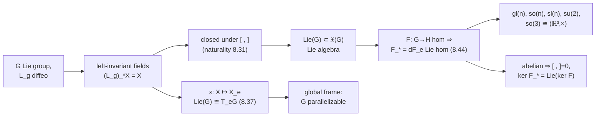

# DM11 · The Lie Algebra of a Lie Group

◀ [[DM10 Vector Fields and Lie Brackets]] · [[Differential Geometry - Course Map]] · [[DM12 Integral Curves, Flows and Flowouts]] ▶

taught · in syllabus extra · book extra · beyond

> [!warning] What the lecture source says
> Lie algebras and $\mathrm{Lie}(G)$ are introduced in **week 6** (slide DG17: definition, examples, $\mathfrak X(M)$, **Thm 8.37**, **Thm 8.44**) and revisited in **week 7** (DG18: the correspondence $G\mapsto\mathrm{Lie}(G)$) and **week 10** (DG19–DG20: left-invariant fields, $\mathfrak{gl}(n,\mathbb R)$, $\mathrm{Lie}(O(n))$, representations, **Ado's theorem**). Homework: **HW5 Q3** ($d(\det)_I=\operatorname{tr}$, in [[DM05 Immersions, Embeddings, Submersions and Coverings]]), **HW6 Q6–Q7** (abelian groups, $\det_*=\operatorname{tr}$), **HW7 Q1–Q3** (low-dimensional Lie algebras, $\ker F_*=\mathrm{Lie}(\ker F)$, $\mathrm{Lie}(SO(n))$ and $\mathrm{Lie}(SO(3))\cong(\mathbb R^3,\times)$). Sources: [[mt3184-differential-geometry-and-lie-groups/2026-09-10-september-7-12|Sep 7–12]], [[mt3184-differential-geometry-and-lie-groups/2026-09-15-september-14-18|Sep 14–18]], [[mt3184-differential-geometry-and-lie-groups/2026-10-10-october-5-9|Oct 5–9]] notes. Book: Lee Ch. 8 §§ The Lie Algebra of a Lie Group, Induced Lie Algebra Homomorphisms, Ado ([[John M. Lee - Introduction to Smooth Manifolds.pdf#page=207|Lee pp. 189–199]]; printed page = PDF page − 18). DG19–DG20 were read by noisy OCR and the last example on DG20 is cut off (`[!verify]`).

> [!syllabus] Syllabus map: what is in the syllabus and what is extra in this chapter
> 🟢 **In syllabus (taught: DG17–DG20, HW5 Q3, HW6 Q6–Q7, HW7 Q1–Q3)**
> - §1 Lie algebras, subalgebras, homomorphisms, examples; §2 left-invariant fields, $\mathrm{Lie}(G)$ is a subalgebra, $\varepsilon:\mathrm{Lie}(G)\cong T_eG$ (Thm 8.37), global frames; §3 $\mathrm{Lie}(GL(n,\mathbb R))=\mathfrak{gl}(n,\mathbb R)$, $\mathfrak{so}(n)$; §4 induced homomorphisms $F_*$ (Thm 8.44), HW6 Q6–Q7, HW7 Q2; §5 $\mathfrak{so}(3)\cong(\mathbb R^3,\times)$; §6 low-dimensional Lie algebras (HW7 Q1), representations, Ado's theorem (statement)
>
> 🟡 **Extra · book** (Lee Ch. 8; Tu §§15–16; Kumaresan Ch. 3; Warner Ch. 3)
> - Lie algebra of a Lie subgroup (Thm 8.46), $\mathfrak{gl}(n,\mathbb C)$ (Prop 8.48), $\mathfrak{su}(2)$ and the spin commutators; Lee's proof of Ado (Thm 8.49) is not given
>
> 🔵 **Extra · beyond** (my additions, labelled)
> - exact symbolic check of $[\tilde A,\tilde B]=\widetilde{[A,B]}$ on $GL(2)$ and $GL(3)$; kernel dimensions of $\mathfrak{so},\mathfrak{sl},\mathfrak u,\mathfrak{su}$ for $n=2,3,4$; the left-invariant frame of $\mathrm{Aff}(1)$; $\mathrm{d}\mathrm{Ad}(\tau_k)=E_k$ for $SU(2)\to SO(3)$ (error $10^{-13}$)

> [!key] After this chapter you can
> - define a **Lie algebra**, and compute with the three standard examples $\mathfrak X(M)$, $\mathfrak{gl}(n)$ and $(\mathbb R^3,\times)$,
> - define $\mathrm{Lie}(G)$ as the **left-invariant vector fields**, prove it is a subalgebra and that **$\varepsilon:\mathrm{Lie}(G)\to T_eG$ is an isomorphism**, and so equip $T_eG$ with a bracket,
> - identify $\mathrm{Lie}(GL(n,\mathbb R))=\mathfrak{gl}(n,\mathbb R)$ with the commutator and read off $\mathfrak{sl},\mathfrak{so},\mathfrak u,\mathfrak{su}$ as tangent spaces,
> - prove that a Lie group homomorphism **induces a Lie algebra homomorphism** $F_*=dF_e$, and use it (HW6 Q6–Q7, HW7 Q2),
> - recognise **$\mathfrak{so}(3)\cong\mathfrak{su}(2)\cong(\mathbb R^3,\times)$** and classify Lie algebras of dimension $\le2$.

> [!intuition] The one-sentence story
> A Lie group is homogeneous, so a vector at the identity can be carried to every point by left translation: this produces the **left-invariant vector fields**, and a single tangent vector $v\in T_eG$ determines a whole global field. The bracket of two such fields is again left-invariant (naturality of the bracket, [[DM10 Vector Fields and Lie Brackets]] §4), so $T_eG$ inherits an algebraic structure, the **Lie algebra** $\mathfrak g$: the group's infinitesimal multiplication table. Homomorphisms of groups differentiate to homomorphisms of Lie algebras, and for simply connected groups no information is lost (DM15).

*Concept map: homogeneity ⇒ left-invariant fields ⇒ $\mathfrak g\cong T_eG$ with a bracket; homomorphisms differentiate.*

![[fig_dm11_liealgebra.png]]
*A: the left-invariant frame $X_1=a\partial_b$, $X_2=a\partial_a$ on $\mathrm{Aff}(1)=\{(b,a):a>0\}$, with $[X_1,X_2]=-X_1$ (§2, §6). B: $\dim\mathrm{Lie}(G)=\dim G$ for the classical groups (§3). C: $\mathfrak{su}(2)\cong\mathfrak{so}(3)$ but $SU(2)\to SO(3)$ is $2:1$ (§5).*

## 1. Lie algebras
taught *Source: DG17, DG19* · extra · book *Lee Example 8.36*

> [!key] Definition (DG17)
> A **Lie algebra** is a real vector space $\mathfrak g$ with a map $[\cdot,\cdot]:\mathfrak g\times\mathfrak g\to\mathfrak g$ that is (i) **bilinear**, (ii) **antisymmetric** $[X,Y]=-[Y,X]$, (iii) satisfies the **Jacobi identity** $[X,[Y,Z]]+[Y,[Z,X]]+[Z,[X,Y]]=0$. A **subalgebra** is a subspace closed under the bracket; a **Lie algebra homomorphism** is a linear map $A:\mathfrak g_1\to\mathfrak g_2$ with $A[X,Y]=[AX,AY]$; an **isomorphism** is a bijective homomorphism.

> [!example] The standard examples (DG17)
> * $\mathbb R^n$ with $[X,Y]=0$ (**abelian**).
> * $\mathfrak X(M)$ with $[X,Y]=XY-YX$ (infinite-dimensional; [[DM10 Vector Fields and Lie Brackets]] §3).
> * $M(n,\mathbb R)$ with the **commutator** $[A,B]=AB-BA$, denoted $\mathfrak{gl}(n,\mathbb R)$. Jacobi: expanding the three double commutators gives twelve words $ABC,\dots$ which cancel in pairs, exactly as for vector fields.
> * $\mathbb R^3$ with the **cross product** $[v,w]=v\times w$ (Jacobi is the identity $u\times(v\times w)=v(u\cdot w)-w(u\cdot v)$ summed cyclically).
> * Any subspace of $\mathfrak{gl}(n)$ closed under the commutator: e.g. the skew-symmetric matrices, the trace-free matrices, the upper-triangular matrices.

## 2. Left-invariant vector fields and $\mathrm{Lie}(G)$
taught *Source: DG17, DG19–DG20* · extra · book *[[John M. Lee - Introduction to Smooth Manifolds.pdf#page=207|Lee Prop. 8.33, p. 189]], [[John M. Lee - Introduction to Smooth Manifolds.pdf#page=209|Lee Thm 8.37, p. 191]], [[John M. Lee - Introduction to Smooth Manifolds.pdf#page=210|Lee Cor. 8.38–8.39, p. 192]]*

> [!key] Definition and closure (DG17; Lee Prop. 8.33)
> A vector field $X$ on a Lie group $G$ is **left-invariant** if it is $L_g$-related to itself for every $g$, i.e. $d(L_g)_{g'}(X_{g'})=X_{gg'}$ for all $g,g'$ (equivalently $(L_g)_*X=X$). $\mathrm{Lie}(G)$ is the set of **smooth** left-invariant fields; it is a linear subspace of $\mathfrak X(G)$.
>
> **$\mathrm{Lie}(G)$ is a Lie subalgebra of $\mathfrak X(G)$.** *Proof.* If $X,Y$ are left-invariant, then by naturality ([[DM10 Vector Fields and Lie Brackets]] §4, Cor. 8.31) $(L_g)_*[X,Y]=[(L_g)_*X,(L_g)_*Y]=[X,Y]$. $\square$

> [!key] Theorem 8.37 (DG17): the evaluation map
> $\varepsilon:\mathrm{Lie}(G)\to T_eG$, $X\mapsto X_e$, is a **linear isomorphism**. In particular $\dim\mathrm{Lie}(G)=\dim G$, and $T_eG$ carries the Lie bracket $[v,w]=[\tilde v,\tilde w]_e$, where $\tilde v_g=d(L_g)_e(v)$.
>
> *Proof.* *Linear* and *injective:* a left-invariant $X$ satisfies $X_g=d(L_g)_e(X_e)$, so $X_e=0$ forces $X=0$. *Surjective:* for $v\in T_eG$ put $V_g=d(L_g)_e(v)$. It is left-invariant: $d(L_h)_g(V_g)=d(L_{hg})_e(v)=V_{hg}$. It is **smooth**: choose a curve $\gamma$ with $\gamma'(0)=v$; for $f\in C^\infty(G)$,
> $$(Vf)(g)=d(L_g)_e(v)\,f=v(f\circ L_g)=\frac{d}{dt}\Big|_{t=0}f\big(g\gamma(t)\big),$$
> and $(t,g)\mapsto f(g\gamma(t))$ is smooth, so its $t$-derivative at $0$ is smooth in $g$. By the smoothness criterion ([[DM10 Vector Fields and Lie Brackets]] §1, Prop 8.14), $V$ is smooth. $\square$

> [!key] Consequences (Lee Cor. 8.38–8.39)
> (a) Every left-invariant *rough* field on $G$ is smooth (the argument above shows $V$ smooth for every $v$). (b) If $E_1,\dots,E_n$ is a basis of $\mathrm{Lie}(G)$ then $(E_i)$ is a **global frame** (the values at $e$ are a basis and left translation preserves linear independence), so **every Lie group is parallelizable**: $TG\cong G\times\mathbb R^n$ ([[DM04 The Tangent Bundle and the Rank Theorem]] §1, HW4 Q4). Hence **$S^2$ (indeed every even-dimensional sphere) is not a Lie group** (Hairy Ball); $S^1$ and $S^3$ are. *Remark:* $S^7$ is parallelizable but not a Lie group (the slide DG19 asserts this; `[!verify]`).

> [!example] A left-invariant frame computed: $\mathrm{Aff}(1)$
> On $G=\{(b,a):a>0\}$ with $(b_1,a_1)(b_2,a_2)=(b_1+a_1b_2,\,a_1a_2)$ ([[DM09 Group Actions and Semidirect Products]] §3), identity $e=(0,1)$ and $L_{(b_1,a_1)}(b,a)=(b_1+a_1b,\,a_1a)$ has differential $\mathrm{diag}(a_1,a_1)$. So $d(L_g)_e(\partial_b)=a_1\partial_b$ and $d(L_g)_e(\partial_a)=a_1\partial_a$: the left-invariant fields are
> $$X_1=a\,\partial_b,\qquad X_2=a\,\partial_a,\qquad [X_1,X_2]=\big(X_1(0)-X_2(a)\big)\partial_b+\big(X_1(a)-X_2(0)\big)\partial_a=-a\,\partial_b=-X_1$$
> (exact symbolic check; figure A). Hence $\mathrm{Lie}(\mathrm{Aff}(1))$ is the non-abelian two-dimensional Lie algebra (§6). On $(\mathbb R^n,+)$ the left-invariant fields are the **constant** fields, so $\mathrm{Lie}(\mathbb R^n)$ is abelian; on $S^1$ it is spanned by $\partial_\theta$.

> [!pitfall] Left versus right, and a sign
> One can equally use right-invariant fields; the two Lie algebras are isomorphic via $X\mapsto -X$ composed with inversion. The vector fields *generated by an action* (e.g. the rotation fields $L_x,L_y,L_z$ of [[DM10 Vector Fields and Lie Brackets]] §3, with $[L_x,L_y]=-L_z$) are naturally **right**-type and satisfy the commutation relations with the opposite sign; the left-invariant fields of $SO(3)$ correspond to the matrices $E_k$ with $[E_x,E_y]=+E_z$ (§5).

## 3. $\mathrm{Lie}(GL(n,\mathbb R))=\mathfrak{gl}(n,\mathbb R)$ and the classical Lie algebras
taught *Source: DG19–DG20, HW5 Q3, HW7 Q3a* · extra · book *[[John M. Lee - Introduction to Smooth Manifolds.pdf#page=211|Lee Prop. 8.41, p. 193]], [[John M. Lee - Introduction to Smooth Manifolds.pdf#page=215|Lee Thm 8.46, Ex. 8.47, p. 197]], [[John M. Lee - Introduction to Smooth Manifolds.pdf#page=216|Lee Prop. 8.48, p. 198]]*

> [!key] Proposition 8.41 (DG20)
> The composition $\mathrm{Lie}(GL(n,\mathbb R))\xrightarrow{\varepsilon}T_IGL(n,\mathbb R)\cong M(n,\mathbb R)$ is a **Lie algebra isomorphism** when $M(n,\mathbb R)$ carries the commutator $[A,B]=AB-BA$.
>
> *Proof.* Use the global coordinates $x^{ij}$ on $M(n,\mathbb R)\supset GL(n)$. Left translation $L_X(Y)=XY$ is linear in $Y$, so $d(L_X)_I(A)=XA$ and the left-invariant field with $\tilde A_I=A$ is $\tilde A_X=XA=\sum_{i,j,k}x^{ik}A^{kj}\,\partial/\partial x^{ij}$. By the coordinate formula, the $(i,j)$ component of $[\tilde A,\tilde B]$ at $X$ is $\tilde A\big((XB)_{ij}\big)-\tilde B\big((XA)_{ij}\big)=(XAB)_{ij}-(XBA)_{ij}$, i.e. $[\tilde A,\tilde B]_X=X(AB-BA)$: the left-invariant field of $AB-BA$. $\square$ (Checked exactly with symbolic $2\times2$ entries and for specific integer $3\times3$ matrices.)

> [!key] The classical Lie algebras as tangent spaces (HW5 Q3, HW7 Q3a; Lee Thm 8.46, Ex. 8.47)
> If $H\le G$ is a Lie subgroup, the inclusion is an injective homomorphism, so $\mathrm{Lie}(H)\cong\{X\in\mathrm{Lie}(G):X_e\in T_eH\}$ is a **subalgebra** of $\mathfrak g$ (Thm 8.46; by Thm 8.44 below). For the embedded subgroups obtained as level sets, $T_IH$ is the **kernel of the differential at $I$** ([[DM06 Submanifolds]], [[DM09 Group Actions and Semidirect Products]]):
>
> | group | defining map | Lie algebra $=\ker d(\cdot)_I$ | dimension |
> |---|---|---|---|
> | $SL(n,\mathbb R)$ | $\det$, $d\det_I=\operatorname{tr}$ | $\mathfrak{sl}(n,\mathbb R)=\{\operatorname{tr}A=0\}$ | $n^2-1$ |
> | $O(n),SO(n)$ | $A\mapsto A^TA$, $dA_I=B+B^T$ | $\mathfrak{o}(n)=\mathfrak{so}(n)=\{A+A^T=0\}$ | $n(n-1)/2$ |
> | $U(n)$ | $A\mapsto A^*A$, $B\mapsto B+B^*$ | $\mathfrak u(n)=\{A+A^*=0\}$ | $n^2$ |
> | $SU(n)$ | $\det$ on $U(n)$ | $\mathfrak{su}(n)=\mathfrak u(n)\cap\{\operatorname{tr}A=0\}$ | $n^2-1$ |
>
> Numerically (kernel dimensions by rank): $\dim\mathfrak{so}(n)=1,3,6$, $\dim\mathfrak{sl}(n)=3,8,15$, $\dim\mathfrak u(n)=4,9,16$, $\dim\mathfrak{su}(n)=3,8,15$ for $n=2,3,4$ ✓ (figure B). *Closure under the commutator is direct:* $[A,B]^T=B^TA^T-A^TB^T=BA-AB=-[A,B]$ for skew $A,B$; $\operatorname{tr}[A,B]=0$ always; $[A,B]^*=-[A,B]$ for skew-Hermitian $A,B$. Likewise $\mathrm{Lie}(GL(n,\mathbb C))=\mathfrak{gl}(n,\mathbb C)$ (Lee Prop. 8.48). **$d(\det)_I(A)=\operatorname{tr}A$** (HW5 Q3a): $\frac d{dt}\det(I+tA)|_0=\operatorname{tr}A$, confirmed numerically on a random $4\times4$ matrix ($-2.151591$ both ways).

## 4. Induced Lie algebra homomorphisms
taught *Source: DG17–DG19, HW6 Q6–Q7, HW7 Q2* · extra · book *[[John M. Lee - Introduction to Smooth Manifolds.pdf#page=213|Lee Thm 8.44, p. 195]], [[John M. Lee - Introduction to Smooth Manifolds.pdf#page=214|Lee Prop. 8.45, p. 196]]*

> [!key] Theorem 8.44 (DG17, DG19)
> Let $F:G\to H$ be a Lie group homomorphism. For every $X\in\mathrm{Lie}(G)$ there is a **unique** $Y\in\mathrm{Lie}(H)$ that is $F$-related to $X$; the map $F_*:X\mapsto Y$ is a **Lie algebra homomorphism**, and under $\varepsilon$ it is the differential: $(F_*X)_e=dF_e(X_e)$.
>
> *Proof.* Let $Y$ be the left-invariant field on $H$ with $Y_e=dF_e(X_e)$. $F$-relatedness: from $F\circ L_g=L_{F(g)}\circ F$, $dF_g(X_g)=dF_g\,d(L_g)_e(X_e)=d(L_{F(g)})_e\,dF_e(X_e)=Y_{F(g)}$. Uniqueness: an $F$-related $Y'\in\mathrm{Lie}(H)$ has $Y'_e=Y'_{F(e)}=dF_e(X_e)$, and a left-invariant field is determined by its value at $e$. Homomorphism: if $X_i\sim_FY_i$ then $[X_1,X_2]\sim_F[Y_1,Y_2]$ (naturality, Prop 8.30) and $[Y_1,Y_2]\in\mathrm{Lie}(H)$, so by uniqueness $F_*[X_1,X_2]=[Y_1,Y_2]$. $\square$

> [!key] Functoriality (Lee Prop. 8.45) and consequences
> $(G\xrightarrow{F}H\xrightarrow{F'}K)_*=F'_*\circ F_*$ and $(\mathrm{Id}_G)_*=\mathrm{Id}$; hence **an isomorphism of Lie groups induces an isomorphism of Lie algebras** (DG18). Three applications:
>
> * **HW6 Q6 (abelian $\Rightarrow$ abelian).** If $G$ is abelian, inversion $i:G\to G$ is a Lie group homomorphism, so $i_*$ is a Lie algebra homomorphism; but $di_e=-\mathrm{id}$ ([[DM08 Lie Groups]] §1), so $i_*=-\mathrm{id}$ and $-[X,Y]=i_*[X,Y]=[i_*X,i_*Y]=[X,Y]$, whence $[X,Y]=0$. (The converse for connected $G$ is DG17's "$G$ abelian $\iff\mathfrak g$ abelian"; proved with the exponential map in [[DM14 One-Parameter Subgroups and the Exponential Map]].)
> * **HW6 Q7 ($\det_*=\operatorname{tr}$).** $\det:GL(n,\mathbb R)\to\mathbb R^\times$ is a Lie group homomorphism and $\mathrm{Lie}(\mathbb R^\times)=T_1\mathbb R^\times=\mathbb R$ (abelian), so $\det_*=d(\det)_I=\operatorname{tr}:\mathfrak{gl}(n,\mathbb R)\to\mathbb R$ (HW5 Q3a). It is indeed a Lie algebra homomorphism: $\operatorname{tr}[A,B]=0=[\operatorname{tr}A,\operatorname{tr}B]$.
> * **HW7 Q2 ($\ker F_*=\mathrm{Lie}(\ker F)$).** $K=\ker F$ is an embedded Lie subgroup with $T_eK=\ker dF_e$ ($F|_K$ is constant, so $T_eK\subseteq\ker dF_e$, and $\dim K=\dim G-\operatorname{rank}dF_e$ by constant rank, [[DM08 Lie Groups]] §2). Under $\varepsilon$, $\mathrm{Lie}(K)=\{X:X_e\in T_eK\}=\{X:dF_e(X_e)=0\}=\ker F_*$. *Example:* $K=SL(n)=\ker\det$ gives $\mathfrak{sl}(n)=\ker\operatorname{tr}$ of dimension $n^2-1$ ✓.

## 5. $\mathfrak{so}(3)\cong(\mathbb R^3,\times)\cong\mathfrak{su}(2)$
taught *Source: HW7 Q3b* · extra · book *Lee Ex. 8.47; spin: [[QM09 The Stern-Gerlach Experiment and Spin]]* · extra · beyond *numerics*

> [!key] HW7 Q3b
> The map $\hat{\ }:\mathbb R^3\to\mathfrak{so}(3)$, $\omega\mapsto\hat\omega$ with $\hat\omega v=\omega\times v$ (the skew matrix $\begin{pmatrix}0&-\omega_3&\omega_2\\\omega_3&0&-\omega_1\\-\omega_2&\omega_1&0\end{pmatrix}$) is a linear isomorphism onto the skew matrices (dimension $3$), and
> $$[\hat\omega,\hat\eta]=\widehat{\omega\times\eta}.$$
> *Proof.* $[\hat\omega,\hat\eta]v=\omega\times(\eta\times v)-\eta\times(\omega\times v)=(\omega\times\eta)\times v$ by the Jacobi identity for $\times$. $\square$ So $\mathrm{Lie}(SO(3))\cong(\mathbb R^3,\times)$; with $E_k=\hat e_k$: $[E_x,E_y]=E_z$, $[E_y,E_z]=E_x$, $[E_z,E_x]=E_y$ (exact; checked also for $1000$ random pairs $\omega,\eta$, and skewness of every commutator).

> [!example] $\mathfrak{su}(2)$ and the double cover
> $\mathfrak{su}(2)$ has basis $\tau_k=-\tfrac i2\sigma_k$ (Pauli matrices) with $[\tau_1,\tau_2]=\tau_3$ and cyclic: exactly the relations of $E_x,E_y,E_z$. The covering homomorphism $\mathrm{Ad}:SU(2)\to SO(3)$, $R(U)_{jk}=\tfrac12\operatorname{tr}(\sigma_jU\sigma_kU^*)$, has $d\mathrm{Ad}_I(\tau_k)=E_k$ (numerically to $1.7\times10^{-13}$), so $\mathrm{Ad}_*:\mathfrak{su}(2)\to\mathfrak{so}(3)$ is an **isomorphism** (kernel $\{\pm1\}$ is discrete, $\mathrm{Lie}(\ker)=0$ by HW7 Q2). Yet the groups differ: $t\mapsto\exp(t\tau_3)=\operatorname{diag}(e^{-it/2},e^{it/2})$ has period $4\pi$, its image rotation by angle $t$ has period $2\pi$ (figure C). *Physics:* $S_k=i\hbar\tau_k=\tfrac\hbar2\sigma_k$ satisfy $[S_j,S_k]=i\hbar\,\epsilon_{jkl}S_l$.

> [!pitfall] Same Lie algebra does not mean same group
> $SU(2)$ and $SO(3)$ have isomorphic Lie algebras but are not isomorphic ($S^3$ versus $\mathbb{RP}^3$, [[PA15 Covering Spaces and the Fundamental Group]] §5). The correct statement (DG18, DM15): $G\mapsto\mathrm{Lie}(G)$ is a bijection **only on simply connected groups**.

## 6. Low-dimensional Lie algebras, representations, Ado
taught *Source: HW7 Q1, DG19–DG20* · extra · book *[[John M. Lee - Introduction to Smooth Manifolds.pdf#page=217|Lee Thm 8.49, Cor. 8.50, p. 199]]*

> [!key] HW7 Q1: dimensions 1 and 2
> Up to isomorphism there is exactly **one** one-dimensional real Lie algebra (abelian) and **two** two-dimensional ones: the abelian $\mathbb R^2$ and the algebra with basis $f_1,f_2$ and $[f_1,f_2]=f_2$.
>
> *Proof.* A bracket on a $1$-dimensional space is antisymmetric bilinear, hence $0$. In dimension 2, antisymmetry and bilinearity make $[\,,]$ determined by $w=[e_1,e_2]$. If $w=0$ the algebra is abelian. If $w\ne0$ put $f_2=w$ and pick any $f_1$ with $f_1,f_2$ independent; then $[f_1,f_2]=c\,w=c\,f_2$ with $c=\det$ of the change of basis $\ne0$; replace $f_1$ by $f_1/c$. $\square$ (Verified on $100$ random structure constants.)
>
> **Realisation in $\mathfrak{gl}(2,\mathbb R)$ without Ado:** $\mathbb R\cdot I$ (dimension 1); the diagonal matrices (abelian, dimension 2); $\mathrm{span}\{E_{11},E_{12}\}$ with $[E_{11},E_{12}]=E_{12}$ ✓ (the non-abelian one: $\mathrm{Lie}(\mathrm{Aff}(1))$, §2).

> [!key] Representations and Ado (DG19–DG20; Lee Thm 8.49)
> A **representation** of a Lie algebra $\mathfrak g$ is a Lie algebra homomorphism $\mathfrak g\to\mathfrak{gl}(V)$; if $\rho:G\to GL(V)$ is a representation of a Lie group then $\rho_*:\mathfrak g\to\mathfrak{gl}(V)$ is one (Thm 8.44). A representation is **faithful** if it is injective. **Ado's theorem** (stated, not proved): every finite-dimensional real Lie algebra has a **faithful** finite-dimensional representation; equivalently it is isomorphic to a subalgebra of $\mathfrak{gl}(n,\mathbb R)$ (Cor. 8.50). *Warning* (DG19): not every Lie *group* has a faithful representation: the universal cover of $SL(2,\mathbb R)$ has none (Lee Problem 21-26, statement only).

## Map of this chapter
> [!connection] How DM11 connects
> **Builds on:** [[DM10 Vector Fields and Lie Brackets]] (bracket, naturality), [[DM08 Lie Groups]] ($L_g$, constant rank, $di_e=-\mathrm{id}$), [[DM06 Submanifolds]] and [[DM09 Group Actions and Semidirect Products]] (tangent spaces as kernels, $O(n)$, $U(n)$), [[DM04 The Tangent Bundle and the Rank Theorem]] (frames, parallelizability), [[DM05 Immersions, Embeddings, Submersions and Coverings]] ($d\det$).
> **Leads to:** [[DM12 Integral Curves, Flows and Flowouts]] (a left-invariant field generates a one-parameter group), [[DM14 One-Parameter Subgroups and the Exponential Map]] ($\exp:\mathfrak g\to G$), [[DM15 Closed Subgroups and the Lie Correspondence]] (Homomorphism Theorem, Lie's third theorem, Closed Subgroup Theorem).
> **Concepts:** [[Lie Algebra]] · [[Left-Invariant Vector Field]] · [[Lie Algebra of a Lie Group]] · [[Induced Lie Algebra Homomorphism]] · [[Matrix Lie Algebras]] · [[Lie Algebra Representation]]
> **Other subjects:** [[Group Theory - Course Map]] ([[GT10 Symmetry Representations and Characters]] §6: Lie groups, $\mathfrak{so}(3)$ and $\mathfrak{su}(2)$ in physics), [[Quantum Mechanics - Course Map]] (angular momentum $[L_j,L_k]=i\hbar\epsilon_{jkl}L_l$, spin), [[Inorganic Chemistry - Course Map]] (continuous groups behind the point-group classification)

## Summary
> [!summary] Cheat-sheet
> - **Lie algebra:** bilinear, antisymmetric, Jacobi. Examples: $\mathfrak X(M)$, $\mathfrak{gl}(n)$ with $AB-BA$, $(\mathbb R^3,\times)$.
> - **$\mathrm{Lie}(G)$** = left-invariant fields, a subalgebra of $\mathfrak X(G)$ (naturality). **$\varepsilon:X\mapsto X_e$ is an isomorphism** (Thm 8.37); $\dim\mathfrak g=\dim G$; $G$ is parallelizable ($S^2$ is not a Lie group).
> - $\mathrm{Lie}(GL(n))=\mathfrak{gl}(n)$: $\tilde A_X=XA$ and $[\tilde A,\tilde B]=\widetilde{AB-BA}$. $\mathfrak{sl}=\{\operatorname{tr}=0\}$, $\mathfrak{so}=\{A+A^T=0\}$, $\mathfrak u=\{A+A^*=0\}$, $\mathfrak{su}=\mathfrak u\cap\{\operatorname{tr}=0\}$.
> - **Thm 8.44:** $F:G\to H$ homomorphism $\Rightarrow$ $F_*=dF_e:\mathfrak g\to\mathfrak h$ Lie algebra homomorphism; functorial. $G$ abelian $\Rightarrow\mathfrak g$ abelian ($i_*=-\mathrm{id}$); $\det_*=\operatorname{tr}$; $\ker F_*=\mathrm{Lie}(\ker F)$.
> - $\mathfrak{so}(3)\cong(\mathbb R^3,\times)\cong\mathfrak{su}(2)$ ($[E_x,E_y]=E_z$, $[\tau_1,\tau_2]=\tau_3$) but $SU(2)\to SO(3)$ is $2:1$.
> - **Dimension $\le2$:** $\mathbb R$; $\mathbb R^2$ and $[f_1,f_2]=f_2$ ($=\mathrm{Lie}(\mathrm{Aff}(1))$). **Ado:** every finite-dimensional real Lie algebra $\subseteq\mathfrak{gl}(n,\mathbb R)$.

## Practice
1. **Axioms.** Verify the Jacobi identity for $\mathfrak{gl}(n)$ and for $(\mathbb R^3,\times)$.
2. **Left-invariant fields.** Find $\mathrm{Lie}(\mathbb R^n)$ and $\mathrm{Lie}(S^1)$ and their brackets.
3. **Smoothness (Thm 8.37).** Prove every left-invariant rough field on $G$ is smooth, and that $G$ is parallelizable. Why is $S^2$ not a Lie group?
4. **$\mathfrak{gl}(n)$.** Show $\tilde A_X=XA$ and $[\tilde A,\tilde B]=\widetilde{[A,B]}$ for $n=2$.
5. **$\mathrm{Aff}(1)$.** Compute $\mathrm{Lie}(\mathrm{Aff}(1))$ and identify it among the algebras of dimension $2$.
6. **$\mathfrak{so}(n)$ (HW7 Q3a).** Show $\mathrm{Lie}(SO(n))=\{A:A+A^T=0\}$ and its dimension, and that it is closed under the commutator.
7. **$\mathfrak{so}(3)$ (HW7 Q3b).** Prove $\mathrm{Lie}(SO(3))\cong(\mathbb R^3,\times)$.
8. **Abelian and trace (HW6 Q6–Q7).** Prove $G$ abelian implies $\mathrm{Lie}(G)$ abelian; show $\det_*=\operatorname{tr}$.
9. **Kernels (HW7 Q2).** Show $\ker F_*=\mathrm{Lie}(\ker F)$; compute $\mathfrak{sl}(n)$, and $\ker\mathrm{Ad}_*$ for $SU(2)\to SO(3)$.
10. **Low dimensions (HW7 Q1).** Classify Lie algebras of dimension $1$ and $2$ and realise each in $\mathfrak{gl}(2,\mathbb R)$.

> [!example]- Solutions
> 1. $\mathfrak{gl}(n)$: expand $[A,[B,C]]+[B,[C,A]]+[C,[A,B]]$; the twelve words $ABC,ACB,BCA,\dots$ cancel in pairs. $(\mathbb R^3,\times)$: $u\times(v\times w)=v(u\cdot w)-w(u\cdot v)$; the cyclic sum vanishes.
> 2. On $\mathbb R^n$, $d(L_g)=\mathrm{id}$, so left-invariant fields are the constant fields $\sum c^i\partial_i$; $[\,,]=0$. On $S^1\cong\mathbb R/2\pi\mathbb Z$, $\mathrm{Lie}(S^1)=\mathbb R\,\partial_\theta$ (one-dimensional, hence abelian).
> 3. §2 (the smoothness proof works for every $v$, hence every rough left-invariant field is $V$ for some $v=X_e$). A basis $E_i$ of $\mathrm{Lie}(G)$ is a global frame, so $TG\cong G\times\mathbb R^n$. $S^2$ has no nowhere-vanishing field (Hairy Ball), but a frame would give one.
> 4. $L_X(Y)=XY$ linear in $Y$ so $d(L_X)_I(A)=XA$; the bracket follows from the coordinate formula (§3 proof); symbolic check gives $0$.
> 5. §2: $X_1=a\partial_b$, $X_2=a\partial_a$, $[X_1,X_2]=-X_1$, so $[X_2,X_1]=X_1$: the non-abelian algebra with $[f_1,f_2]=f_2$ ($f_1=X_2$, $f_2=X_1$).
> 6. $T_ISO(n)=\ker d\Phi_I$ for $\Phi(A)=A^TA$ ($d\Phi_I(B)=B+B^T$, constant rank by the Equivariant Rank Theorem): skew matrices, of dimension $n^2-n(n+1)/2=n(n-1)/2$; $[A,B]^T=-[A,B]$ for skew $A,B$.
> 7. §5: $[\hat\omega,\hat\eta]v=(\omega\times\eta)\times v$ by Jacobi for $\times$.
> 8. §4: $i_*=-\mathrm{id}$ forces $[X,Y]=-[X,Y]$. $\det_*=d(\det)_I=\operatorname{tr}$ (HW5 Q3a).
> 9. §4. $\mathfrak{sl}(n)=\ker\operatorname{tr}$, $\dim n^2-1$. $\ker\mathrm{Ad}=\{\pm1\}$ is discrete, so its Lie algebra is $0$ and $\mathrm{Ad}_*$ is injective; both sides have dimension $3$ so $\mathrm{Ad}_*$ is an isomorphism.
> 10. §6.

## Provenance
> [!provenance]- Source map for this chapter
> | Topic | Source | Scope |
> |---|---|---|
> | Lie algebra definition, examples, $\mathfrak X(M)$, subalgebra, homomorphism | slide DG17 via [[mt3184-differential-geometry-and-lie-groups/2026-09-10-september-7-12\|Sep 7–12 note]] | taught |
> | $\mathrm{Lie}(G)$, evaluation map Thm 8.37, induced homomorphism Thm 8.44 | slides DG17–DG18 via [[mt3184-differential-geometry-and-lie-groups/2026-09-10-september-7-12\|Sep 7–12]], [[mt3184-differential-geometry-and-lie-groups/2026-09-15-september-14-18\|Sep 14–18]] notes | taught |
> | left-invariant fields, parallelizability, $\mathfrak{gl}(n)$, $\mathrm{Lie}(O(n))$, representations, Ado | slides DG19–DG20 via [[mt3184-differential-geometry-and-lie-groups/2026-10-10-october-5-9\|Oct 5–9 note]] | taught (OCR noisy) |
> | HW5 Q3 ($d\det_I=\operatorname{tr}$) | [[mt3184-differential-geometry-and-lie-groups/2026-09-04-hw5\|HW5]] | taught (via homework) |
> | HW6 Q6–Q7 (abelian, $\det_*$) | [[mt3184-differential-geometry-and-lie-groups/2026-09-11-hw6\|HW6]] | taught (via homework) |
> | HW7 Q1–Q3 (low-dim algebras, $\ker F_*$, $\mathfrak{so}(n)$, $\mathfrak{so}(3)$) | [[mt3184-differential-geometry-and-lie-groups/2026-10-10-hw7\|HW7]] | taught (via homework) |
> | proofs of Prop 8.33, Thm 8.37, Cors 8.38–8.39, Prop 8.41, Thm 8.44, Prop 8.45, Thm 8.46, Ex. 8.47, Prop 8.48; Ado (statement) | Lee Prop. 8.33, Thm 8.37, Cor. 8.38, Prop. 8.41, Thm 8.44, Prop. 8.45, Thm 8.46, Example 8.47, Prop. 8.48, Thm 8.49; Tu §§15–16 | extra/book |
> | symbolic and numerical checks, $\mathrm{Aff}(1)$ frame, $\mathfrak{su}(2)\to\mathfrak{so}(3)$, kernel dimensions | `scripts/dm_numbers.py` (DM11), `fig_dm11_liealgebra.py` | extra/beyond |
>
> **Notes.** [!verify] DG19–DG20 are noisy OCR and the last example on DG20 (the Lie algebra of an explicit group) is cut off; DG18's "Thm 20.19" label for the Homomorphism Theorem is checked in DM15. The slide's claim that $S^7$ is parallelizable but not a Lie group is quoted, not proved here. The spin remark $S_k=i\hbar\tau_k$ is my addition.
