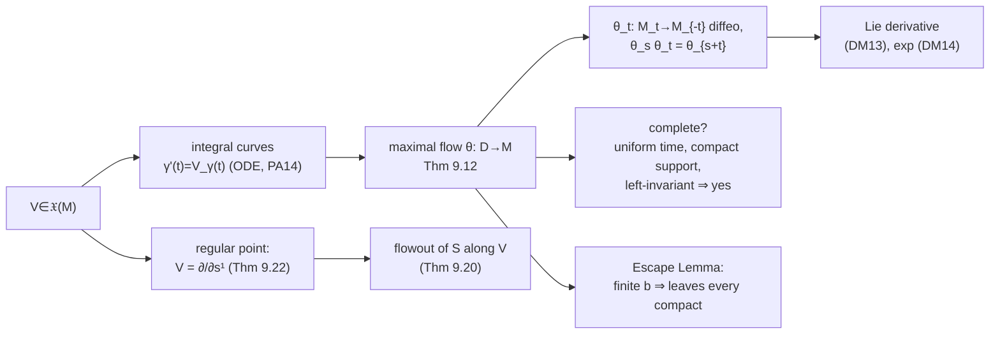

# DM12 · Integral Curves, Flows and Flowouts

◀ [[DM11 The Lie Algebra of a Lie Group]] · [[Differential Geometry - Course Map]] · [[DM13 Lie Derivatives and Commuting Vector Fields]] ▶

taught · in syllabus extra · book extra · beyond

> [!warning] What the lecture source says
> Integral curves and flows start in **week 10** (slide DG21: integral curves, global flows, flow domains, **Thm 9.12**) and are developed in **week 11** (DG22–DG24: naturality (**Props 9.6, 9.13**), complete fields (**Lemma 9.15** Uniform Time, **Thm 9.16**, **Thm 9.18**), the **Flowout Theorem 9.20**, regular/singular points (**Prop 9.21**), **canonical form Thm 9.22**). Homework: **HW7 Q4–Q6** (trichotomy of maximal integral curves, the flow of $y\partial_x+\partial_y$, a fixed-point-free map homotopic to the identity) and **HW8 Q1–Q4** (rescaling, compact support $\Rightarrow$ complete, escape lemma, flowout from a compact submanifold). Sources: [[mt3184-differential-geometry-and-lie-groups/2026-10-10-october-5-9|Oct 5–9]], [[mt3184-differential-geometry-and-lie-groups/2026-10-16-october-12-16|Oct 12–16]] notes. Book: Lee Ch. 9 §§ Integral Curves, Flows, Complete Vector Fields, Flowouts, Regular and Singular Points ([[John M. Lee - Introduction to Smooth Manifolds.pdf#page=224|Lee pp. 206–221]]; printed page = PDF page − 18). The slides DG21–DG24 are noisy OCR and the Flowout proof is partly illegible (`[!verify]`).

> [!syllabus] Syllabus map: what is in the syllabus and what is extra in this chapter
> 🟢 **In syllabus (taught: DG21–DG24, HW7 Q4–Q6, HW8 Q1–Q4)**
> - §1 integral curves, rescaling and naturality (Prop 9.6); §2 flows, the Fundamental Theorem on Flows (statement), naturality of flows; §3 completeness: Uniform Time Lemma, compact support, left-invariant fields, the Escape Lemma; §4 singular and regular points, the trichotomy, canonical form $V=\partial/\partial s^1$; §5 the Flowout Theorem and the compact case (HW8 Q4)
>
> 🟡 **Extra · book** (Lee Ch. 9; Tu §§14, 17; Kumaresan Ch. 3; Warner §1.5)
> - proof of the Fundamental Theorem on Flows from ODE theory ([[PA14 ODE Existence Uniqueness and Smooth Dependence]]); the proof that the flowout is injective for small time (partition of unity)
>
> 🔵 **Extra · beyond** (my additions, labelled)
> - numerical checks (flow of $y\partial_x+\partial_y$ to $2\times10^{-15}$, finite-time blow-up times $0.4999990$ and $1.9999990$, the $GL(2)$ integral curve $X_0e^{tA}$, the helicoid flowout with $\sigma_{\min}(d\Phi)=1$); the quick proof of HW7 Q6 using the canonical form

> [!key] After this chapter you can
> - solve for **integral curves** and **flows**, and apply rescaling and naturality,
> - state the **Fundamental Theorem on Flows** and read off the **group law**, the **domain** $\mathcal D$ and the diffeomorphisms $\theta_t:M_t\to M_{-t}$,
> - decide **completeness**: compact support, Uniform Time Lemma, left-invariant fields; use the **Escape Lemma** for incomplete fields,
> - classify maximal integral curves (**constant, injective, periodic**) and straighten a field near a regular point,
> - build submanifolds by **flowout** from a hypersurface or a submanifold.

> [!intuition] The one-sentence story
> A vector field is a velocity prescription; an integral curve is a particle obeying it; the **flow** collects all particles at once into a one-parameter family of diffeomorphisms $\theta_t$, a smooth action of the group $(\mathbb R,+)$ ([[DM09 Group Actions and Semidirect Products]]) that may only be *partially* defined because particles can escape to infinity in finite time. Near any point where the field is non-zero the flow lines look like parallel straight lines: one can choose coordinates in which $V=\partial/\partial s^1$.

*Concept map: ODE $\Rightarrow$ maximal flow $\Rightarrow$ completeness criteria, canonical form, flowouts.*

![[fig_dm12_flows.png]]
*A: the diffeomorphisms $\theta_1,\theta_2$ of $V=y\partial_x+\partial_y$ applied to the unit square (§1–§2). B: $x^2\partial_x$ blows up in finite time, so is not complete (§3). C: the helicoid is the flowout of the half-axis $S$ along $-y\partial_x+x\partial_y+\partial_z$ (§5).*

## 1. Integral curves
taught *Source: DG21–DG22, HW7 Q5, HW8 Q1* · extra · book *[[John M. Lee - Introduction to Smooth Manifolds.pdf#page=225|Lee Prop. 9.2, p. 207]], [[John M. Lee - Introduction to Smooth Manifolds.pdf#page=226|Lee Lemmas 9.3–9.4, Prop. 9.6, p. 208]]*

> [!key] Definition (DG21)
> Let $V\in\mathfrak X(M)$. An **integral curve** of $V$ is a smooth curve $\gamma:J\to M$ ($J\subseteq\mathbb R$ an interval) with $\gamma'(t)=V_{\gamma(t)}$ for all $t\in J$. In a chart this is the first-order ODE system $\dot x^i=V^i(x)$.
>
> **Existence and uniqueness (Prop 9.2).** For every $p\in M$ and $t_0\in\mathbb R$ there is an integral curve starting at $p$ at time $t_0$; two integral curves starting at the same point agree on their common domain. This is the Picard–Lindelöf theorem plus smoothness ([[PA14 ODE Existence Uniqueness and Smooth Dependence]]) transported to manifolds by charts.

> [!key] Rescaling and translation (Lee Lemmas 9.3–9.4; HW8 Q1)
> If $\gamma:J\to M$ is an integral curve of $V$ then (a) $\tilde\gamma(t)=\gamma(at)$ is an integral curve of $aV$ on $\{t:at\in J\}$; (b) $\hat\gamma(t)=\gamma(t+b)$ is an integral curve of $V$ on $J-b$. *Proof.* Chain rule: $\tilde\gamma'(t)=a\gamma'(at)=aV_{\gamma(at)}$; $\hat\gamma'(t)=\gamma'(t+b)=V_{\hat\gamma(t)}$. $\square$ (Numerically for $V=-y\partial_x+x\partial_y$, $a=2.5$: $\tilde\gamma'-aV=6\times10^{-11}$.)

> [!key] Naturality of integral curves (DG22; Lee Prop. 9.6)
> If $X\in\mathfrak X(M)$ and $Y\in\mathfrak X(N)$ are $F$-related and $\gamma$ is an integral curve of $X$, then $F\circ\gamma$ is an integral curve of $Y$. *Proof.* $(F\circ\gamma)'(t)=dF(\gamma'(t))=dF(X_{\gamma(t)})=Y_{F(\gamma(t))}$. $\square$

> [!example] Examples (DG21, HW7 Q5)
> * $V=-y\partial_x+x\partial_y$: from $(a,b)$, $\gamma(t)=(a\cos t-b\sin t,\;a\sin t+b\cos t)$, a rotation, defined for all $t$.
> * $V=x\partial_x$ on $\mathbb R$: $x_0e^t$ (complete). **$W=x^2\partial_x$:** $x(t)=x_0/(1-x_0t)$, defined only for $t<1/x_0$ (if $x_0>0$): the integral curve **escapes to infinity in finite time** ([[John M. Lee - Introduction to Smooth Manifolds.pdf#page=229|Lee Ex. 9.10, p. 211]]). Numerically, from $x_0=2$ the solution reaches $10^6$ at $t=0.4999990$ (exact blow-up time $0.5$), from $x_0=\tfrac12$ at $t=1.9999990$ (exact $2$); from $x_0=-2$ it exists for all $t>-\tfrac12$.
> * **HW7 Q5.** $V=y\partial_x+\partial_y$ on $\mathbb R^2$: $\dot x=y$, $\dot y=1$ give $y=y_0+t$, $x=x_0+y_0t+t^2/2$, so $\theta_t(x_0,y_0)=(x_0+y_0t+\tfrac{t^2}2,\;y_0+t)$. Checked against a Runge–Kutta solution at $50$ random points and times: error $1.8\times10^{-15}$ (figure A). The flow lines are parabolas $x=x_0+\tfrac12(y^2-y_0^2)$.
> * On $\mathbb R^2\setminus\{0\}$ the field $\partial_x$ has the integral curve $t\mapsto(t-1,0)$ from $(-1,0)$ which reaches the missing origin at $t=1$: incompleteness can come from the *manifold*, not only from growth (Lee Ex. 9.9).

## 2. Flows and the Fundamental Theorem
taught *Source: DG21–DG22* · extra · book *[[John M. Lee - Introduction to Smooth Manifolds.pdf#page=228|Lee Prop. 9.7, p. 210]], [[John M. Lee - Introduction to Smooth Manifolds.pdf#page=230|Lee Thm 9.12, p. 212]], [[John M. Lee - Introduction to Smooth Manifolds.pdf#page=233|Lee Prop. 9.13, Cor. 9.14, p. 215]]*

> [!key] Global flows and generators (DG21; Lee Prop. 9.7)
> A **global flow** is a smooth action $\theta:\mathbb R\times M\to M$ of $(\mathbb R,+)$: $\theta_0=\mathrm{id}$, $\theta_s\circ\theta_t=\theta_{s+t}$ ([[DM09 Group Actions and Semidirect Products]] §1). Its **infinitesimal generator** is $V_p=\dfrac d{dt}\Big|_{t=0}\theta(t,p)$; $V$ is smooth and each orbit curve $\theta^{(p)}$ is an integral curve of $V$ starting at $p$. *Proof.* $V=\partial\theta/\partial t|_{t=0}$ is smooth; $\frac d{dt}\theta(t,p)=\frac d{ds}|_0\theta(s,\theta(t,p))=V_{\theta(t,p)}$ by the group law. $\square$

A general (possibly partial) **flow** is a smooth $\theta:\mathcal D\to M$ on a **flow domain** $\mathcal D\subseteq\mathbb R\times M$, open, with $\mathcal D^{(p)}=\{t:(t,p)\in\mathcal D\}$ an open interval containing $0$, satisfying $\theta(0,p)=p$ and $\theta(s,\theta(t,p))=\theta(s+t,p)$ whenever the left side is defined.

> [!key] Fundamental Theorem on Flows (DG21–DG22; Lee Thm 9.12)
> Every $V\in\mathfrak X(M)$ is the infinitesimal generator of a **unique smooth maximal flow** $\theta:\mathcal D\to M$. Moreover:
> (a) for each $p$, $\theta^{(p)}:\mathcal D^{(p)}\to M$ is the **unique maximal integral curve** of $V$ starting at $p$;
> (b) if $s\in\mathcal D^{(p)}$ then $\mathcal D^{(\theta(s,p))}=\mathcal D^{(p)}-s$;
> (c) for each $t$, $M_t=\{p:(t,p)\in\mathcal D\}$ is **open** and $\theta_t:M_t\to M_{-t}$ is a **diffeomorphism** with inverse $\theta_{-t}$.
>
> *Sketch of proof.* Define $\mathcal D^{(p)}$ as the union of the domains of integral curves from $p$ and $\theta(t,p)=\gamma_p(t)$ for the maximal one (uniqueness, Prop 9.2). The group law follows from the translation lemma and uniqueness; openness of $\mathcal D$ and smoothness of $\theta$ come from the **smooth dependence of ODE solutions on initial data** ([[PA14 ODE Existence Uniqueness and Smooth Dependence]]), applied chart by chart and propagated along curves by the group law. (c): $\theta_{-t}$ is the inverse of $\theta_t$ by the group law, and both are smooth. $\square$ *(Full proof: Lee pp. 212–214.)*

> [!key] Naturality of flows (DG22; Lee Prop. 9.13, Cor. 9.14)
> If $X\in\mathfrak X(M)$ and $Y\in\mathfrak X(N)$ are $F$-related with flows $\theta,\eta$, then $F(M_t)\subseteq N_t$ and $\eta_t\circ F=F\circ\theta_t$ on $M_t$. *Proof.* $F\circ\theta^{(p)}$ is an integral curve of $Y$ from $F(p)$ (Prop 9.6), so by maximality it is a restriction of $\eta^{(F(p))}$. $\square$ If $F$ is a diffeomorphism, the flow of $F_*X$ is $F\circ\theta_t\circ F^{-1}$. This is the mechanism by which flows of left-invariant fields commute with left translations ([[DM14 One-Parameter Subgroups and the Exponential Map]]).

> [!example] The time-$t$ maps (HW7 Q5 continued)
> For $V=y\partial_x+\partial_y$, $\theta_1(x,y)=(x+y+\tfrac12,y+1)$ and $\theta_2(x,y)=(x+2y+2,y+2)$ map the unit square to parallelograms of the same area (figure A: $\det d\theta_t=1$); $\theta_s\circ\theta_t=\theta_{s+t}$ holds to $8.9\times10^{-16}$ at random $(s,t,p)$. The **free $\mathbb R$-action** on $T^2$ of [[DM09 Group Actions and Semidirect Products]] §1, $t\cdot(x,y)=(x+t,y+\sqrt2t)$, is the flow of the constant field $\partial_x+\sqrt2\partial_y$.

## 3. Complete vector fields
taught *Source: DG22–DG23, HW8 Q2–Q3* · extra · book *[[John M. Lee - Introduction to Smooth Manifolds.pdf#page=234|Lee Lemma 9.15, Thm 9.16, Cor. 9.17, Thm 9.18, p. 216]], [[John M. Lee - Introduction to Smooth Manifolds.pdf#page=235|Lee Lemma 9.19, p. 217]]*

> [!key] Definition and the Uniform Time Lemma (DG22; Lee Lemma 9.15)
> $V$ is **complete** if its flow is global ($\mathcal D=\mathbb R\times M$), i.e. every maximal integral curve is defined on all of $\mathbb R$.
>
> **Uniform Time Lemma.** If there is $\varepsilon>0$ with $(-\varepsilon,\varepsilon)\subseteq\mathcal D^{(p)}$ for **every** $p\in M$, then $V$ is complete.
>
> *Proof.* Suppose $b=\sup\mathcal D^{(p)}<\infty$. Pick $t_0\in(b-\varepsilon,b)$ and $q=\theta^{(p)}(t_0)$; $\theta^{(q)}$ is defined on $(-\varepsilon,\varepsilon)$. The curve equal to $\theta^{(p)}$ on $(-\varepsilon,b)$ and to $\theta^{(q)}(t-t_0)$ on $(t_0-\varepsilon,t_0+\varepsilon)$ is well defined (the two agree on the overlap by the group law and the translation lemma), is an integral curve from $p$, and is defined past $b$ since $t_0+\varepsilon>b$: contradiction with maximality. $\square$

> [!key] Three completeness criteria (DG22–DG23; HW8 Q2)
> * **Compact support (Thm 9.16; HW8 Q2).** A compactly supported smooth vector field is complete. *Proof.* Cover $K=\operatorname{supp}V$ by finitely many $U_{p_i}$ on which the flow exists for $|t|<\varepsilon_i$; let $\varepsilon=\min\varepsilon_i$. Integral curves from $K$ exist on $(-\varepsilon,\varepsilon)$; from points outside $K$ they are constant. Apply the Uniform Time Lemma. $\square$ **Corollary (Cor. 9.17):** on a **compact** manifold every smooth vector field is complete.
> * **Left-invariant fields (Thm 9.18; DG22).** Every $X\in\mathrm{Lie}(G)$ is complete. *Proof.* Let $\gamma$ be an integral curve of $X$ from $e$ on $(-\varepsilon,\varepsilon)$. $X$ is $L_g$-related to itself, so $L_g\circ\gamma$ is an integral curve from $g$ (Prop 9.6) on the same interval: every orbit exists on $(-\varepsilon,\varepsilon)$, and the Uniform Time Lemma applies. $\square$ *Example:* in $GL(2,\mathbb R)$ the integral curve through $X_0$ of the left-invariant field $\tilde A_X=XA$ is $t\mapsto X_0e^{tA}$ (Runge–Kutta vs $\exp$: $1.1\times10^{-10}$ at $t=3$) with $\det X_0e^{tA}=\det X_0\,e^{t\operatorname{tr}A}\neq0$ for all $t$: it never leaves the open set $GL(2)$.
> * **Escape Lemma (Lee Lemma 9.19; HW8 Q3).** If $\gamma:J\to M$ is a maximal integral curve with $b=\sup J<\infty$, then for any $t_0\in J$ the set $\gamma([t_0,b))$ is **not contained in any compact set**. *Proof sketch.* If it lay in a compact $K$, the flow exists for $|t|<\varepsilon$ uniformly on $K$ (compactness, as in Thm 9.16); starting at $\gamma(t_0)$ with $b-t_0<\varepsilon$ extends $\gamma$ past $b$. $\square$

> [!pitfall] Incompleteness is detected by escaping to infinity
> For $W=x^2\partial_x$ the curve $x_0/(1-x_0t)$, $x_0=2$, tends to $\infty$ as $t\to\tfrac12$: it leaves every compact set, as the Escape Lemma demands. Conversely, **boundedness does not imply completeness** on a non-compact manifold with a hole: on $\mathbb R^2\setminus\{0\}$ the field $\partial_x$ has a bounded curve that runs into the missing point.

## 4. Regular and singular points, canonical form
taught *Source: DG24, HW7 Q4, Q6* · extra · book *[[John M. Lee - Introduction to Smooth Manifolds.pdf#page=237|Lee Prop. 9.21, p. 219]], [[John M. Lee - Introduction to Smooth Manifolds.pdf#page=238|Lee Thm 9.22, p. 220]]*

> [!key] Singular and regular points (DG24; Lee Prop. 9.21)
> $p$ is **singular** if $V_p=0$, **regular** otherwise. If $p$ is singular then $\mathcal D^{(p)}=\mathbb R$ and $\theta^{(p)}\equiv p$ (an **equilibrium**). If $p$ is regular, $\theta^{(p)}$ is an **immersion**.
> *Proof.* The constant curve is an integral curve from a singular $p$; uniqueness. If $\theta^{(p)\prime}(s)=0$ at some $s$, then $q=\theta^{(p)}(s)$ is singular, so $\theta^{(q)}\equiv q$; by the group law $\theta^{(p)}(t)=\theta^{(q)}(t-s)=q$ for all $t$, so $p=q$ is singular. $\square$

> [!key] The trichotomy (HW7 Q4; compare HW9 Q1)
> A **maximal integral curve** $\gamma$ is exactly one of: **constant** (a singular point), **injective**, or **periodic** (non-constant, $\gamma(t+T)=\gamma(t)$ for some minimal $T>0$).
> *Proof.* If $\gamma$ is not injective, $\gamma(t_1)=\gamma(t_2)$ with $t_1<t_2$; put $T=t_2-t_1$. Then $s\mapsto\gamma(s+T)$ and $\gamma$ are integral curves agreeing at $s=t_1$, hence equal on the common domain; so $\mathcal D^{(p)}=\mathbb R$ and $\gamma$ is $T$-periodic. The set of periods of a non-constant curve is a closed subgroup of $\mathbb R$ not equal to $\mathbb R$ (else $\gamma'=0$), hence $T_0\mathbb Z$ with $T_0>0$ the minimal period. $\square$ *Examples:* rotation field: every non-zero point is periodic of minimal period $2\pi$ (numerically $|\gamma(2\pi)-\gamma(0)|=3\times10^{-16}$, $|\gamma(\pi)-\gamma(0)|=2.6$ at $(0.7,-1.3)$); $\partial_x$ on $\mathbb R$: injective; $x\partial_x$ at $0$: constant.

> [!key] Canonical form near a regular point (DG24; Lee Thm 9.22)
> If $p$ is a regular point of $V$ there are coordinates $(s^1,\dots,s^n)$ near $p$ in which $V=\partial/\partial s^1$. If $S$ is an embedded hypersurface through $p$ with $V_p\notin T_pS$, the coordinates can be chosen with $S=\{s^1=0\}$.
> *Proof idea (DG24).* Take a hypersurface $S$ through $p$ transverse to $V$ and the flowout $\Phi(t,q)=\theta_t(q)$ of §5: $\Phi$ is a diffeomorphism onto an open set near $p$ (codimension $1$), and in the coordinates $(t,\text{chart of }S)$ the field is $\partial_t$ since $\Phi_*\partial_t=V$. $\square$ Locally *all non-vanishing fields look alike*; the non-trivial local invariants are those of **several** fields (commuting frames, DM13).

> [!example] HW7 Q6, with a proof by the canonical form
> **Claim.** If a compact manifold $M$ admits a nowhere-vanishing vector field $V$, there is a smooth $F:M\to M$ homotopic to $\mathrm{id}_M$ with **no fixed point**. *Proof.* $V$ is complete (Cor. 9.17); put $F=\theta_t$ with $t>0$ small; $H(p,s)=\theta_{st}(p)$ is a smooth homotopy from $\mathrm{id}$ to $F$. Suppose for every $t>0$ small some $p_t$ is fixed by $\theta_t$: choose $t_k\to0^+$ and $p_k$ with $\theta_{t_k}(p_k)=p_k$, and (compactness) $p_k\to p$. In a flow-box chart $(s^1,\dots,s^n)$ about $p$ with $V=\partial/\partial s^1$ (all points are regular), $s^1(\theta_t(q))=s^1(q)+t$ as long as the orbit stays in the chart, and it does for $0\le t\le t_k$ when $k$ is large; so $\theta_{t_k}(p_k)\neq p_k$, a contradiction. $\square$ On $T^2$ with $V=\partial_1+\partial_2$ one sees it directly: $\theta_t(a,b)=(a+t,b+t)$ has a fixed point iff $t\in2\pi\mathbb Z$. (On $S^{2k}$ no such $V$ exists, Hairy Ball.)

## 5. Flowouts
taught *Source: DG22–DG23, HW8 Q4* · extra · book *[[John M. Lee - Introduction to Smooth Manifolds.pdf#page=235|Lee Thm 9.20, p. 217]]*

> [!key] Flowout Theorem (DG22–DG23; Lee Thm 9.20)
> Let $S\subseteq M$ be an embedded $k$-dimensional submanifold and $V\in\mathfrak X(M)$ **nowhere tangent** to $S$; let $\theta:\mathcal D\to M$ be its flow, $\mathcal O=(\mathbb R\times S)\cap\mathcal D$ and $\Phi=\theta|_{\mathcal O}$. Then:
> (a) $\Phi:\mathcal O\to M$ is an **immersion**;
> (b) $\partial/\partial t\in\mathfrak X(\mathcal O)$ is $\Phi$-related to $V$;
> (c) there is a smooth $\delta:S\to(0,\infty)$ with $\Phi$ **injective** on $\mathcal O_\delta=\{(t,p)\in\mathcal O:|t|<\delta(p)\}$; so $\Phi(\mathcal O_\delta)$ is an immersed $(k+1)$-submanifold containing $S$, to which $V$ is tangent;
> (d) if $S$ has **codimension $1$**, $\Phi|_{\mathcal O_\delta}$ is a **diffeomorphism onto an open subset** of $M$.
>
> *Proof.* (b) is the definition of an integral curve. (a): at $(0,p)$, $d\Phi(\partial_t)=V_p$ and $d\Phi(v)=v$ for $v\in T_pS$, so $d\Phi_{(0,p)}$ maps a basis of $\mathbb R\oplus T_pS$ to the independent set $\{V_p\}\cup\text{basis}(T_pS)$ ($V_p\notin T_pS$): injective. At $(t_0,p)$ use $\Phi(t,q)=\theta_{t_0}\big(\Phi(t-t_0,q)\big)$ with $\theta_{t_0}$ a diffeomorphism, which preserves rank. (c): in a slice chart around $p_0\in S$, with $\Phi^j$ the components and $\partial_t\Phi^j=V^j(\Phi)$, an estimate $|\Phi^j(t,p)|\le c|t|$ for the transverse components shows $\Phi(t,p)\in S\iff t=0$ for $|t|<\varepsilon_{p_0}$ near $p_0$; glue the $\varepsilon_{p_0}$ with a **partition of unity** into a smooth $f>0$ and set $\delta=\tfrac12f$. If $\Phi(t,q)=\Phi(t',q')$ with $f(q')\le f(q)$ then $\theta_{t-t'}(q)=q'\in S$ and $|t-t'|<f(q)$ force $t=t'$ and $q=q'$. (d): an injective immersion between manifolds of the same dimension is a diffeomorphism onto an open set (Prop 4.22, Prop 5.1; [[DM05 Immersions, Embeddings, Submersions and Coverings]]). $\square$

> [!example] Two flowouts
> * **Polar coordinates (Lee Ex. 9.23).** $W=-y\partial_x+x\partial_y$, $S=\{(s,0):s>0\}$ (codimension $1$, $W|_S=\partial_y$ is transverse): $\Phi(t,s)=(s\cos t,s\sin t)$ with $\det d\Phi=-s\neq0$; on $(-\pi,\pi)\times(0,\infty)$ it is a diffeomorphism onto the plane minus the closed negative $x$-axis, and $W=\partial_t$ in these coordinates: the canonical form of Thm 9.22.
> * **A helicoid (DG23).** $S=\{(s,0,0):s>0\}\subset\mathbb R^3$ (dimension $1$, codimension $2$), $V=-y\partial_x+x\partial_y+\partial_z$ (nowhere tangent to $S$). The flowout is $\Phi(t,s)=(s\cos t,s\sin t,t)$, an immersion: the columns $d\Phi(\partial_t)=(-s\sin t,s\cos t,1)$ and $d\Phi(\partial_s)=(\cos t,\sin t,0)$ are orthogonal of lengths $\sqrt{s^2+1}$ and $1$, so the smallest singular value is $1$ (grid check ✓, figure C), and $d\Phi(\partial_t)=V\circ\Phi$ exactly. Here $\Phi$ is globally injective (since $z=t$) and its image is an embedded helicoid.

> [!key] HW8 Q4: the compact case
> If $S$ is a **compact** embedded submanifold and $V$ is nowhere tangent to $S$, there is $\varepsilon>0$ such that $\Phi:(-\varepsilon,\varepsilon)\times S\to M$ is a **smooth embedding**.
> *Proof.* $\delta$ is continuous and positive on the compact $S$, so $\varepsilon_0=\min\delta>0$ and $(-\varepsilon_0,\varepsilon_0)\times S\subseteq\mathcal O_\delta$, where $\Phi$ is an injective immersion. Take $\varepsilon=\varepsilon_0/2$: on the compact set $[-\varepsilon,\varepsilon]\times S$ the continuous injection $\Phi$ is a homeomorphism onto its (Hausdorff) image, so $\Phi|_{(-\varepsilon,\varepsilon)\times S}$ is an immersion and a topological embedding, i.e. a smooth embedding. $\square$

## Map of this chapter
> [!connection] How DM12 connects
> **Builds on:** [[PA14 ODE Existence Uniqueness and Smooth Dependence]] (existence, uniqueness, Gronwall, smooth dependence, escape), [[DM10 Vector Fields and Lie Brackets]] ($F$-related fields), [[DM09 Group Actions and Semidirect Products]] (a flow is an $\mathbb R$-action), [[DM05 Immersions, Embeddings, Submersions and Coverings]] (immersions, embeddings), [[DM11 The Lie Algebra of a Lie Group]] (left-invariant fields).
> **Leads to:** [[DM13 Lie Derivatives and Commuting Vector Fields]] ($\mathcal L_VW=[V,W]$ via the flow), [[DM14 One-Parameter Subgroups and the Exponential Map]] (flows of left-invariant fields), [[DM15 Closed Subgroups and the Lie Correspondence]] (Frobenius, via flowouts).
> **Concepts:** [[Integral Curve]] · [[Flow of a Vector Field]] · [[Complete Vector Field]] · [[Escape Lemma]] · [[Regular and Singular Points]] · [[Flowout Theorem]]
> **Other subjects:** [[Thermodynamics and Statistical Mechanics - Course Map]] (phase flow, Liouville), [[Climate - Course Map]] and [[Waves - Course Map]] (dynamical systems, equilibria), [[Quantum Mechanics - Course Map]] (unitary flow $e^{-iHt/\hbar}$ as a one-parameter group)

## Summary
> [!summary] Cheat-sheet
> - **Integral curve:** $\gamma'=V_\gamma$; unique through each point (ODE); $\gamma(at)$ is an integral curve of $aV$; $F$ takes integral curves of $X$ to those of $Y$ when related.
> - **Flow (Thm 9.12):** unique maximal smooth $\theta:\mathcal D\to M$; $\theta^{(p)}$ the maximal integral curve; $\theta_t:M_t\to M_{-t}$ diffeo, $\theta_s\theta_t=\theta_{s+t}$; $\eta_t\circ F=F\circ\theta_t$ for related fields. A global flow = smooth $\mathbb R$-action.
> - **Complete:** Uniform Time Lemma ($\exists\varepsilon$ for all $p$); compact support; **compact manifold**; **left-invariant fields**. **Escape Lemma:** finite $b$ $\Rightarrow$ $\gamma([t_0,b))$ leaves every compact set ($x^2\partial_x$ blows up at $1/x_0$).
> - **Points:** singular ($V_p=0$): constant curve; regular: immersion; every maximal curve is **constant, injective or periodic**; near a regular point $V=\partial/\partial s^1$.
> - **Flowout (Thm 9.20):** $\Phi=\theta|_{\mathbb R\times S}$ immersion, $\partial_t\sim V$, injective for $|t|<\delta$; codimension $1$: diffeo onto an open set; compact $S$: uniform $\varepsilon$ and embedding.

## Practice
1. **HW7 Q5.** Solve $\dot x=y$, $\dot y=1$ and verify the group law.
2. **Rescaling (HW8 Q1).** Show $\gamma(at)$ is an integral curve of $aV$ and use it to compare the flows of $V$ and $2V$.
3. **Blow-up.** Find the maximal integral curves of $x^2\partial_x$ and identify the flow domain $\mathcal D$.
4. **Complete or not?** Decide whether $\partial_x+\partial_y$ on $\mathbb R^2$, $x\,\partial_x$ on $\mathbb R$, $\partial_x$ on $\mathbb R^2\setminus\{0\}$ and $\sin x\,\partial_x$ are complete.
5. **Compact support (HW8 Q2).** Prove a compactly supported field is complete.
6. **Escape (HW8 Q3).** Prove the Escape Lemma.
7. **Trichotomy (HW7 Q4).** Prove a maximal integral curve is constant, injective or periodic.
8. **Left-invariant fields.** Show every left-invariant field on a Lie group is complete and find the flow of $\tilde A$ on $GL(n,\mathbb R)$.
9. **Fixed-point-free map (HW7 Q6).** Prove it for $T^2$ and, in general, for compact $M$ with a nowhere-vanishing field.
10. **Flowout (HW8 Q4).** Compute the flowout of the half-axis under the helical field; prove the compact-$S$ embedding statement.

> [!example]- Solutions
> 1. §1: $y=y_0+t$, $x=x_0+y_0t+t^2/2$; $\theta_s(\theta_t(x_0,y_0))=(x_0+y_0(s+t)+\tfrac{(s+t)^2}2,\,y_0+s+t)$ since $x_0+y_0t+\tfrac{t^2}2+(y_0+t)s+\tfrac{s^2}2=x_0+y_0(s+t)+\tfrac{(s+t)^2}2$.
> 2. §1. If $\theta$ is the flow of $V$ then $\theta^{2V}_t=\theta^V_{2t}$ on the corresponding domain: the same curves traversed twice as fast.
> 3. $x(t)=x_0/(1-x_0t)$; $\mathcal D^{(x_0)}=(-\infty,1/x_0)$ if $x_0>0$, $\mathbb R$ if $x_0=0$, $(1/x_0,\infty)$ if $x_0<0$; $\mathcal D=\{(t,x):tx<1\}$.
> 4. $\partial_x+\partial_y$: complete (translations). $x\partial_x$: complete ($x_0e^t$). $\partial_x$ on $\mathbb R^2\setminus\{0\}$: not complete (curves hit the origin). $\sin x\,\partial_x$ on $\mathbb R$: complete (bounded field with bounded derivative: $|\dot x|\le1$ so solutions cannot escape in finite time; the equilibria are $k\pi$).
> 5. §3.
> 6. §3 (the uniform $\varepsilon$ on a compact set).
> 7. §4.
> 8. §3 ($L_g\circ\gamma$ is an integral curve). On $GL(n)$ with $\tilde A_X=XA$: $\theta_t(X)=Xe^{tA}$.
> 9. §4. For $T^2$ with $V=\partial_1+\partial_2$: $\theta_t$ has no fixed point for $0<t<2\pi$ (no $a+t\equiv a$ unless $t\in2\pi\mathbb Z$).
> 10. §5: $\Phi(t,s)=(s\cos t,s\sin t,t)$. Compact $S$: take $\varepsilon=\tfrac12\min\delta$ and use compact-to-Hausdorff.

## Provenance
> [!provenance]- Source map for this chapter
> | Topic | Source | Scope |
> |---|---|---|
> | integral curves, global flows, generators, flow domain, Thm 9.12 | slide DG21 via [[mt3184-differential-geometry-and-lie-groups/2026-10-10-october-5-9\|Oct 5–9 note]] | taught |
> | naturality (Props 9.6, 9.13), complete fields (Lemma 9.15, Thms 9.16, 9.18), Flowout Thm 9.20, Prop 9.21, Thm 9.22 | slides DG22–DG24 via [[mt3184-differential-geometry-and-lie-groups/2026-10-16-october-12-16\|Oct 12–16 note]] | taught (OCR noisy) |
> | HW7 Q4–Q6 (trichotomy, flow of $y\partial_x+\partial_y$, fixed-point-free map) | [[mt3184-differential-geometry-and-lie-groups/2026-10-10-hw7\|HW7]] | taught (via homework) |
> | HW8 Q1–Q4 (rescaling, compact support, escape, compact flowout) | [[mt3184-differential-geometry-and-lie-groups/2026-10-16-hw8\|HW8]] | taught (via homework) |
> | proofs of Prop 9.2, Lemmas 9.3–9.4, Props 9.6–9.7, Thm 9.12, Props 9.13, 9.21, Lemma 9.15, Thms 9.16, 9.18, Lemma 9.19, Thm 9.20, Thm 9.22; Ex. 9.9, 9.10, 9.23 | Lee Prop. 9.2, Lemma 9.3, Prop. 9.6, Prop. 9.7, Example 9.9, Example 9.10, Thm 9.12, Prop. 9.13, Lemma 9.15, Thm 9.16, Thm 9.18, Lemma 9.19, Thm 9.20, Prop. 9.21, Thm 9.22, Example 9.23; Tu §§14, 17 | extra/book |
> | numerics (flows, blow-up, $GL(2)$ curve, helicoid), proof of HW7 Q6 via the flow box | `scripts/dm_numbers.py` (DM12), `fig_dm12_flows.py` | extra/beyond |
>
> **Notes.** [!verify] DG21–DG24 are noisy OCR; the Flowout slide's hypothesis ("codimension") is cut off and is taken from Lee's statement ($S$ embedded, $V$ nowhere tangent); the example on DG23 is garbled and replaced by the helicoid. DG24's statement of Prop 9.21 matches Lee's; the trichotomy is HW7 Q4. The proof of the Fundamental Theorem on Flows is sketched, with the full ODE argument in Lee and [[PA14 ODE Existence Uniqueness and Smooth Dependence]].
