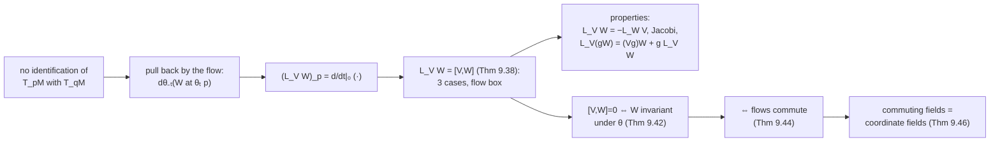

# DM13 · Lie Derivatives and Commuting Vector Fields

◀ [[DM12 Integral Curves, Flows and Flowouts]] · [[Differential Geometry - Course Map]] · [[DM14 One-Parameter Subgroups and the Exponential Map]] ▶

taught · in syllabus extra · book extra · beyond

> [!warning] What the lecture source says
> The Lie derivative is the last topic of **week 11** (slide DG24: motivation by directional derivatives on $\mathbb R^n$, the definition by the flow, **Lemma 9.36**, **Thm 9.38** $\mathcal L_VW=[V,W]$) and of **week 12** (first page of DG25: the proof of Thm 9.38 by cases using the straightening chart, and a list of properties (a)–(d)). Homework: **HW8 Q5–Q6** (the Lie derivative on $\mathbb R^n$ is the directional derivative; the Lie derivative depends on $V$ off its integral curves) and **HW9 Q4** (commuting flows; done in [[DM14 One-Parameter Subgroups and the Exponential Map]]). Sources: [[mt3184-differential-geometry-and-lie-groups/2026-10-16-october-12-16|Oct 12–16]], [[mt3184-differential-geometry-and-lie-groups/2026-10-24-october-19-24|Oct 19–24]] notes. Book: Lee Ch. 9 §§ Lie Derivatives, Commuting Vector Fields ([[John M. Lee - Introduction to Smooth Manifolds.pdf#page=246|Lee pp. 227–236]]; printed page = PDF page − 18). The OCR of DG24 stops after the statement of Thm 9.38 and the properties on DG25 are illegible (`[!verify]`): the statements below follow Lee Cor. 9.39. The **commuting-fields** material (§3–§4) is **not** on the slides' legible pages and is marked extra · book.

> [!syllabus] Syllabus map: what is in the syllabus and what is extra in this chapter
> 🟢 **In syllabus (taught: DG24–DG25, HW8 Q5–Q6)**
> - §1 the Lie derivative defined by the flow, existence and smoothness (Lemma 9.36), the agreement with the directional derivative on $\mathbb R^n$ (HW8 Q5); §2 **Thm 9.38** $\mathcal L_VW=[V,W]$ with the three-case proof, its properties, HW8 Q6
>
> 🟡 **Extra · book** (Lee Ch. 9; Tu §20; Kumaresan Ch. 3; Warner §1.5)
> - Prop 9.41, **Thm 9.42** (invariance $\iff$ commuting), Cor 9.43, **Thm 9.44** (commuting fields $\iff$ commuting flows), **Thm 9.46** (canonical form for commuting fields), commuting frames $\iff$ coordinate frames
>
> 🔵 **Extra · beyond** (my additions, labelled)
> - finite-difference check of $\mathcal L_VW=[V,W]$ for the shear field at $100$ random points ($3.4\times10^{-10}$); exact computation of the failure of commutation $\theta_t\psi_s-\psi_s\theta_t=-st\,\partial_y$; log-polar coordinates as the canonical form of the commuting pair $(E,R)$

> [!key] After this chapter you can
> - define $\mathcal L_VW$ by **pulling $W$ back along the flow of $V$** and differentiating, and explain why this (not a naive derivative) is needed on a manifold,
> - prove **$\mathcal L_VW=[V,W]$** and derive the properties of the Lie derivative from those of the bracket,
> - show that $[V,W]=0$ iff **$W$ is invariant under the flow of $V$** iff **the flows commute**,
> - recognise when a frame is a **coordinate frame** (commuting) and straighten commuting fields simultaneously.

> [!intuition] The one-sentence story
> To differentiate $W$ along $V$ you must compare $W$ at two *nearby* points, but their tangent spaces are different vector spaces. The flow of $V$ supplies the missing identification: it carries one tangent space to the other, so $d\theta_{-t}$ can **pull $W_{\theta_t(p)}$ back to $T_pM$**. The resulting derivative turns out to be the **bracket**, which therefore has a geometric meaning: it is the first-order obstruction to the flows of $V$ and $W$ commuting, and the infinitesimal change of $W$ as seen by an observer riding on the flow of $V$.

*Concept map: pullback along the flow ⇒ Lie derivative = bracket ⇒ invariance ⇔ commuting flows ⇔ commuting frames are coordinate frames.*

![[fig_dm13_lie.png]]
*A: the curve $t\mapsto d\theta_{-t}(W_{\theta_t p})\in T_p\mathbb R^2$ for $V=y\partial_x+\partial_y$, $W=x\partial_y$ at $p=(1,\tfrac12)$: its velocity at $t=0$ is $[V,W]_p=(-1,\tfrac12)$ (§1–§2). B: the flows of $\partial_x$ and $x\partial_y$ fail to commute by $st\,\partial_y=st[V,W]$ (§3). C: the commuting pair $E=r\partial_r$, $R=\partial_\theta$ is the coordinate frame of log-polar coordinates (§4).*

## 1. The Lie derivative of a vector field
taught *Source: DG24, HW8 Q5* · extra · book *[[John M. Lee - Introduction to Smooth Manifolds.pdf#page=246|Lee Lemma 9.36, p. 228]]*

> [!key] Definition (DG24; Lee (9.16))
> Let $V,W\in\mathfrak X(M)$ and $\theta$ the flow of $V$. For $p\in M$ and small $t$ the vector $W_{\theta_t(p)}\in T_{\theta_t(p)}M$ is carried back to $T_pM$ by $d(\theta_{-t})_{\theta_t(p)}$ (note $\theta_{-t}=\theta_t^{-1}$). The **Lie derivative** is
> $$(\mathcal L_VW)_p=\frac d{dt}\Big|_{t=0}d(\theta_{-t})_{\theta_t(p)}\big(W_{\theta_t(p)}\big)=\lim_{t\to0}\frac{d(\theta_{-t})_{\theta_t(p)}\big(W_{\theta_t(p)}\big)-W_p}{t}.$$
> (For a function $f$ the same recipe gives $\mathcal L_Vf=\frac d{dt}|_0f\circ\theta_t=Vf$.)

> [!intuition] Why not just differentiate $W$?
> On $\mathbb R^n$ one writes $D_vW(p)=\frac d{dt}|_0W(p+tv)$ because every $T_q\mathbb R^n$ is canonically $\mathbb R^n$. On a manifold $W_{\gamma(t)}$ and $W_{\gamma(0)}$ lie in *different* vector spaces and there is no canonical isomorphism; the flow of a *field* $V$ (not just a vector $v$) provides one. This is also why $\mathcal L_VW$ depends on $V$ in a *neighbourhood* of $p$, not only on $V_p$ (HW8 Q6 below).

> [!key] Existence and smoothness (Lee Lemma 9.36)
> $(\mathcal L_VW)_p$ exists for every $p$ and $\mathcal L_VW$ is a smooth vector field.
> *Proof.* In a chart $(U,x^i)$ about $p$ choose $J_0\ni0$ and $U_0\ni p$ with $\theta(J_0\times U_0)\subseteq U$. The matrix of $d(\theta_{-t})_{\theta_t(x)}$ is $\big(\partial\theta^i/\partial x^j\big)(-t,\theta(t,x))$, so
> $$d(\theta_{-t})_{\theta_t(x)}\big(W_{\theta_t(x)}\big)=\frac{\partial\theta^i}{\partial x^j}\big(-t,\theta(t,x)\big)\,W^j\big(\theta(t,x)\big)\frac\partial{\partial x^i}\Big|_x,$$
> whose coefficients are smooth in $(t,x)$ (smoothness of the flow, [[DM12 Integral Curves, Flows and Flowouts]] §2). Differentiating in $t$ at $t=0$ gives a vector depending smoothly on $x$. $\square$

> [!example] HW8 Q5: constant fields give the directional derivative
> If $V=\sum v^i\partial_i$ has constant coefficients its flow is $\theta_t(p)=p+tv$ with $d\theta_t=\mathrm{id}$, so $d(\theta_{-t})(W_{p+tv})=W(p+tv)$ and $(\mathcal L_VW)_p=\frac d{dt}|_0W(p+tv)=D_vW(p)$. (Numerically for $W=(\sin xy,\,x^2+y)$, $v=(0.6,-1.1)$ at $p=(0.4,0.9)$: $D_vW=(0.09359,-0.62)$ and $[V,W]_p$ agree.)

## 2. Theorem 9.38: $\mathcal L_VW=[V,W]$
taught *Source: DG24–DG25, HW8 Q6* · extra · book *[[John M. Lee - Introduction to Smooth Manifolds.pdf#page=247|Lee Thm 9.38, p. 229]], [[John M. Lee - Introduction to Smooth Manifolds.pdf#page=248|Lee Cor. 9.39, p. 230]]*

> [!key] Theorem 9.38 (DG24–DG25)
> For $V,W\in\mathfrak X(M)$: $\ \mathcal L_VW=[V,W]$.
>
> *Proof.* Let $R(V)=\{V\ne0\}$ (open). *Case 1: $p\in R(V)$.* By the canonical form near a regular point ([[DM12 Integral Curves, Flows and Flowouts]] §4, Thm 9.22) choose coordinates $u^i$ near $p$ with $V=\partial/\partial u^1$; the flow is $\theta_t(u)=(u^1+t,u^2,\dots,u^n)$, whose Jacobian is the identity, so
> $$(\mathcal L_VW)_u=\frac d{dt}\Big|_0W^j\big(u^1+t,u^2,\dots,u^n\big)\frac\partial{\partial u^j}=\frac{\partial W^j}{\partial u^1}\frac\partial{\partial u^j},$$
> which equals $[V,W]_u=\big(V(W^j)-W(V^j)\big)\partial_j$ (coordinate formula, [[DM10 Vector Fields and Lie Brackets]] §3; $V^j$ are constants). *Case 2: $p\in\operatorname{supp}V=\overline{R(V)}$:* both sides are continuous, so equality passes to the closure. *Case 3: $p\notin\operatorname{supp}V$:* $V\equiv0$ near $p$, so $\theta_t=\mathrm{id}$ near $p$ and $(\mathcal L_VW)_p=0=[V,W]_p$. $\square$

> [!example] Checking the theorem from the definition
> * **Shear and a linear field.** $V=y\partial_x+\partial_y$ (flow $\theta_t(x,y)=(x+yt+t^2/2,\,y+t)$, $d\theta_t=\begin{pmatrix}1&t\\0&1\end{pmatrix}$) and $W=x\partial_y$. Then $d(\theta_{-t})W_{\theta_t(p)}=\begin{pmatrix}1&-t\\0&1\end{pmatrix}\begin{pmatrix}0\\w(t)\end{pmatrix}=(-t\,w(t),\,w(t))$ with $w(t)=x+yt+t^2/2$, whose $t$-derivative at $0$ is $(-x,\,y)$; and $[V,W]=\big(V(0)-W(y),\,V(x)-W(1)\big)=(-x,\,y)$ ✓ (figure A). Finite differences of the *definition* agree with this at $100$ random points to $3.4\times10^{-10}$.
> * **Rotation and $\partial_x$.** $V=-y\partial_x+x\partial_y$, $\theta_t=R(t)$, $W=\partial_x$: $d(\theta_{-t})e_1=R(-t)e_1=(\cos t,-\sin t)$, derivative at $0$ is $(0,-1)$; and $[V,\partial_x]=-\partial_y$ ✓.

> [!key] Properties (Lee Cor. 9.39; DG25 (a)–(d) illegible)
> For $V,W,X\in\mathfrak X(M)$, $g\in C^\infty(M)$ and a diffeomorphism $F:M\to N$:
> (a) $\mathcal L_VW=-\mathcal L_WV$; (b) $\mathcal L_V[W,X]=[\mathcal L_VW,X]+[W,\mathcal L_VX]$; (c) $\mathcal L_{[V,W]}X=\mathcal L_V\mathcal L_WX-\mathcal L_W\mathcal L_VX$; (d) $\mathcal L_V(gW)=(Vg)W+g\,\mathcal L_VW$; (e) $F_*(\mathcal L_VX)=\mathcal L_{F_*V}F_*X$.
> *Proof.* (a) antisymmetry; (b) and (c) are the **Jacobi identity** in two guises; (d) is the product rule for the bracket ([[DM10 Vector Fields and Lie Brackets]] §3, property 4 with $f=1$); (e) is naturality ([[DM10 Vector Fields and Lie Brackets]] §4, Cor. 8.31). $\square$ (Verified symbolically for three fields and a function on $\mathbb R^3$: all four differences vanish identically.) Part (d) explains the product rules in $[fX,gY]$: view $[fX,gY]$ as $\mathcal L_{fX}(gY)$ and as $-\mathcal L_{gY}(fX)$.

> [!example] HW8 Q6: the Lie derivative is not determined by $V$ along a curve
> On $\mathbb R^2$ let $V=\partial_x$, $\tilde V=\partial_x+y\,\partial_y$ and $W=\partial_y$. Then $V=\tilde V$ **along the $x$-axis** (where $y=0$), but
> $$\mathcal L_VW=[\partial_x,\partial_y]=0,\qquad\mathcal L_{\tilde V}W=[\partial_x+y\partial_y,\ \partial_y]=-\partial_y\ \ne0,$$
> also at the origin. So $(\mathcal L_VW)_p$ depends on the **derivative of $V$ transverse** to its integral curves, not only on $V$ along them: contrast the directional derivative $D_vW(p)$ of §1, which needs only a vector $v$. (This is the difference between a Lie derivative and a covariant derivative.)

## 3. Invariance and commuting vector fields
extra · book *[[John M. Lee - Introduction to Smooth Manifolds.pdf#page=249|Lee Prop. 9.41, Thm 9.42, p. 231]], [[John M. Lee - Introduction to Smooth Manifolds.pdf#page=251|Lee Thm 9.44, p. 233]]* · taught in the form used by *HW9 Q4* (DM14)

> [!key] Invariance and commuting (Lee Prop. 9.41, Thm 9.42, Cor. 9.43)
> $W$ is **invariant under the flow $\theta$ of $V$** if $d(\theta_t)_p(W_p)=W_{\theta_t(p)}$ for all $(t,p)\in\mathcal D$ (i.e. $W$ is $\theta_t$-related to itself). $V,W$ **commute** if $[V,W]=0$, i.e. $VWf=WVf$ for all $f$.
>
> **Theorem 9.42.** The following are equivalent: (a) $[V,W]=0$; (b) $W$ is invariant under the flow of $V$; (c) $V$ is invariant under the flow of $W$. **Cor. 9.43:** every vector field is invariant under its own flow ($[V,V]=0$).
>
> *Proof.* Put $X(t)=d(\theta_{-t})_{\theta_t(p)}W_{\theta_t(p)}\in T_pM$. **Prop 9.41:** $X'(t_0)=d(\theta_{-t_0})\big((\mathcal L_VW)_{\theta_{t_0}(p)}\big)$ (substitute $t=t_0+s$ and use the group law). (b)$\Rightarrow$(a): invariance says $X(t)\equiv W_p$, so $\mathcal L_VW=X'(0)=0$. (a)$\Rightarrow$(b): if $\mathcal L_VW=0$ everywhere then $X'\equiv0$ by Prop 9.41, so $X(t)=X(0)=W_p$, which is invariance. (a)$\Leftrightarrow$(c): swap the roles, $[V,W]=-[W,V]$. $\square$

> [!key] Theorem 9.44: commuting fields $\iff$ commuting flows
> Smooth vector fields $V,W$ commute iff their flows $\theta,\psi$ commute: $\theta_t\circ\psi_s=\psi_s\circ\theta_t$ wherever both sides are defined (for complete fields: for all $s,t$).
>
> *Proof ($\Rightarrow$).* By Thm 9.42, $V$ is invariant under $\psi$. Fix $s$; the curve $\gamma(t)=\psi_s(\theta_t(p))$ has $\gamma(0)=\psi_s(p)$ and $\gamma'(t)=d(\psi_s)(V_{\theta_t(p)})=V_{\gamma(t)}$, so it is the integral curve of $V$ from $\psi_s(p)$, i.e. $\gamma(t)=\theta_t(\psi_s(p))$. *($\Leftarrow$).* Differentiate $\theta_t(\psi_s(p))=\psi_s(\theta_t(p))$ in $s$ at $s=0$: $d(\theta_t)_p(W_p)=W_{\theta_t(p)}$, i.e. $W$ is invariant under $\theta$, so $[V,W]=0$ by Thm 9.42. $\square$ (For non-complete fields the domain bookkeeping needs care; Lee's definition of "flows commute" handles it.)

> [!example] Commuting and non-commuting flows, with numbers
> * **Non-commuting.** $V=\partial_x$ (flow $\theta_t(x,y)=(x+t,y)$) and $W=x\partial_y$ (flow $\psi_s(x,y)=(x,y+sx)$) have $[V,W]=\partial_y$. Exactly, $\theta_t\psi_s(p)=(x+t,\,y+sx)$ but $\psi_s\theta_t(p)=(x+t,\,y+s(x+t))$, so
>   $$\theta_t\circ\psi_s-\psi_s\circ\theta_t=-st\,\partial_y=-st\,[V,W]$$
>   (checked at $100$ random $(p,s,t)$: $4.4\times10^{-16}$; figure B). This is the exact version of the commutator quadrilateral of [[DM10 Vector Fields and Lie Brackets]] §3: going $\theta_\varepsilon,\psi_\varepsilon,\theta_{-\varepsilon},\psi_{-\varepsilon}$ lands at $p+\varepsilon^2\partial_y=p+\varepsilon^2[V,W]$.
> * **Commuting.** The Euler field $E=x\partial_x+y\partial_y$ (dilations $e^t$) and the rotation field $R=-y\partial_x+x\partial_y$ have $[E,R]=0$ and their flows commute: $e^t\!\cdot R(s)p=R(s)\,(e^tp)$ to $1.8\times10^{-15}$.

## 4. Commuting frames and the canonical form
extra · book *[[John M. Lee - Introduction to Smooth Manifolds.pdf#page=252|Lee Ex. 9.45, Thm 9.46, p. 234]]*

> [!key] Theorem 9.46 (Lee)
> A local frame is **commuting** if $[E_i,E_j]=0$. If $(V_1,\dots,V_k)$ are **linearly independent commuting** fields on an open set $W$, then every $p\in W$ has a chart $(U,s^i)$ centred at $p$ with $V_i=\partial/\partial s^i$ for $i=1,\dots,k$ (and, if $S$ is a codimension-$k$ submanifold through $p$ transverse to the span, with $S=\{s^1=\dots=s^k=0\}$).
> *Idea.* Flow out of $S$ along all $V_i$ at once: $\Phi(s^1,\dots,s^n)=(\theta^1)_{s^1}\circ\cdots\circ(\theta^k)_{s^k}(0,\dots,0,s^{k+1},\dots,s^n)$. Commutation of the flows (Thm 9.44) makes $\partial/\partial s^i$ $\Phi$-related to $V_i$ for **every** $i$ (not only the last flow), and $\Phi$ is a local diffeomorphism by the Flowout argument. $\square$
>
> Consequence: **a frame is a coordinate frame iff it is commuting** (necessity: $[\partial_i,\partial_j]=0$; sufficiency: Thm 9.46 with $k=n$). **Example:** $E=r\partial_r$ and $R=\partial_\theta$ commute and are independent on $\mathbb R^2\setminus\{0\}$; $\Phi(s^1,s^2)=(e^{s^1}\cos s^2,\,e^{s^1}\sin s^2)$ (log-polar) has $d\Phi(\partial_{s^1})=E$ and $d\Phi(\partial_{s^2})=R$ exactly (figure C). By contrast the orthonormal polar frame $\big(\partial_r,\tfrac1r\partial_\theta\big)$ does **not** commute ($[E_1,E_2]=-\tfrac1{r^2}\,\partial_\theta\ne0$ in Lee's Example 9.45(b)) and so is not a coordinate frame for any chart.

> [!pitfall] Commuting is much stronger than being independent
> Any single non-vanishing field can be straightened (Thm 9.22), but two independent fields can be straightened **simultaneously** only if they commute: $[\partial_x,x\partial_y]=\partial_y\neq0$ shows $(\partial_x,x\partial_y)$ is not a coordinate frame (it is not even a frame at $x=0$, where $x\partial_y$ vanishes). The obstruction to simultaneous straightening of a $k$-tuple that span a *distribution* is exactly the Frobenius condition ([[DM15 Closed Subgroups and the Lie Correspondence]]).

## Map of this chapter
> [!connection] How DM13 connects
> **Builds on:** [[DM12 Integral Curves, Flows and Flowouts]] (flows, canonical form), [[DM10 Vector Fields and Lie Brackets]] (bracket, naturality, coordinate formula), [[DM03 Tangent Vectors and the Differential]] (pushforward $d\theta$).
> **Leads to:** [[DM14 One-Parameter Subgroups and the Exponential Map]] (HW9 Q4: $[X,Y]=0\iff\exp tX\exp sY=\exp sY\exp tX$), [[DM15 Closed Subgroups and the Lie Correspondence]] (Frobenius, involutive distributions).
> **Concepts:** [[Lie Derivative of a Vector Field]] · [[Invariant Vector Field]] · [[Commuting Vector Fields]] · [[Commuting Frame]]
> **Other subjects:** [[Thermodynamics and Statistical Mechanics - Course Map]] (Poisson brackets of conserved quantities), [[Quantum Mechanics - Course Map]] (Heisenberg picture: $\dot A=\tfrac i\hbar[H,A]$ is a Lie derivative; commuting observables $\leftrightarrow$ simultaneous eigenbases), [[Group Theory - Course Map]] (infinitesimal generators of actions)

## Summary
> [!summary] Cheat-sheet
> - $(\mathcal L_VW)_p=\dfrac d{dt}\Big|_0d(\theta_{-t})_{\theta_t(p)}W_{\theta_t(p)}$, with $\theta$ the flow of $V$; exists and is smooth (Lemma 9.36). On $\mathbb R^n$, $V$ constant: $\mathcal L_VW=D_vW$.
> - **Thm 9.38:** $\mathcal L_VW=[V,W]$ (flow-box proof, 3 cases). Properties: $\mathcal L_VW=-\mathcal L_WV$, $\mathcal L_V[W,X]=[\mathcal L_VW,X]+[W,\mathcal L_VX]$, $\mathcal L_{[V,W]}=[\mathcal L_V,\mathcal L_W]$, $\mathcal L_V(gW)=(Vg)W+g\mathcal L_VW$, $F_*\mathcal L_VX=\mathcal L_{F_*V}F_*X$. $\mathcal L_VW$ depends on $V$ near $p$ (HW8 Q6).
> - **Thm 9.42:** $[V,W]=0\iff W$ invariant under $\theta^V\iff V$ invariant under $\theta^W$; **Thm 9.44:** $[V,W]=0\iff$ flows commute. Failure: $\theta_t\psi_s-\psi_s\theta_t=-st[V,W]$ (example), gap $\varepsilon^2[V,W]$.
> - **Thm 9.46:** commuting independent fields are simultaneously coordinate fields $\partial/\partial s^i$; commuting frame $\iff$ coordinate frame.

## Practice
1. **Directional derivative (HW8 Q5).** Show $\mathcal L_VW=D_vW$ for constant $V=v$.
2. **From the definition.** Compute $\mathcal L_VW$ for $V=y\partial_x+\partial_y$, $W=x\partial_y$ from the flow and compare with $[V,W]$.
3. **Rotation and dilation.** Compute $\mathcal L_RE$, $\mathcal L_R\partial_x$ and $\mathcal L_E\partial_x$ ($R$ rotation field, $E$ Euler field).
4. **Properties.** Prove (a)–(d) of Cor 9.39 from the properties of the bracket.
5. **Dependence on $V$ (HW8 Q6).** Give $V,\tilde V,W$ equal-on-a-curve with different Lie derivatives.
6. **Invariance.** Show $W$ is invariant under the flow of $V$ iff $[V,W]=0$ (Thm 9.42).
7. **Commuting flows.** Show the flows of $\partial_x$ and $x\partial_y$ fail to commute by $-st\,\partial_y$; do the flows of $E$ and $R$ commute?
8. **Self-invariance.** Prove every vector field is invariant under its own flow.
9. **Coordinate frame?** Decide whether $(\partial_x,\,x\partial_x+\partial_y)$ on $\mathbb R^2$ is a coordinate frame; find coordinates if so.
10. **Log-polar.** Show $(E,R)$ is a coordinate frame on $\mathbb R^2\setminus\{0\}$ and identify the coordinates; explain why $(\partial_r,\tfrac1r\partial_\theta)$ is not.

> [!example]- Solutions
> 1. §1: the flow is $p\mapsto p+tv$ with identity differential.
> 2. §2: $d\theta_{-t}W_{\theta_tp}=(-tw,w)$, $w=x+yt+t^2/2$; derivative at $0$ is $(-x,y)=[V,W]$.
> 3. $[R,E]=0$ so $\mathcal L_RE=0$. $\mathcal L_R\partial_x=[R,\partial_x]=-\partial_y$ (§2). $\mathcal L_E\partial_x=[E,\partial_x]=-\partial_x$ (dilation shrinks the pulled-back $\partial_x$).
> 4. §2.
> 5. §2: $V=\partial_x$, $\tilde V=\partial_x+y\partial_y$, $W=\partial_y$: $0$ versus $-\partial_y$.
> 6. §3.
> 7. §3: exact formula; $[E,R]=0$ and the flows commute to $1.8\times10^{-15}$.
> 8. Theorem 9.42(a)$\Rightarrow$(b) with $W=V$ since $[V,V]=0$.
> 9. $[\partial_x,\,x\partial_x+\partial_y]=\partial_x\neq0$: not commuting, so not a coordinate frame.
> 10. $[E,R]=0$ and they are independent for $r>0$; $\Phi(s^1,s^2)=(e^{s^1}\cos s^2,e^{s^1}\sin s^2)$ gives $E=\partial_{s^1}$, $R=\partial_{s^2}$, i.e. $s^1=\log r$, $s^2=\theta$. $[\partial_r,\tfrac1r\partial_\theta]=-\tfrac1{r^2}\partial_\theta\neq0$.

## Provenance
> [!provenance]- Source map for this chapter
> | Topic | Source | Scope |
> |---|---|---|
> | motivation, definition by the flow, Lemma 9.36, Thm 9.38 (statement), case 1 | slide DG24 via [[mt3184-differential-geometry-and-lie-groups/2026-10-16-october-12-16\|Oct 12–16 note]] | taught (OCR cut off) |
> | proof of Thm 9.38 by cases, properties (a)–(d) | slide DG25 (first page) via [[mt3184-differential-geometry-and-lie-groups/2026-10-24-october-19-24\|Oct 19–24 note]] | taught (properties illegible) |
> | HW8 Q5 (directional derivative), Q6 (dependence on $V$) | [[mt3184-differential-geometry-and-lie-groups/2026-10-16-hw8\|HW8]] | taught (via homework) |
> | HW9 Q4 (bracket and commuting flows) | [[mt3184-differential-geometry-and-lie-groups/2026-10-26-hw9\|HW9]] | taught (via homework; see DM14) |
> | proofs of Lemma 9.36, Thm 9.38, Cor 9.39, Prop 9.41, Thms 9.42, 9.44, 9.46; Ex. 9.45 | Lee Lemma 9.36, Thm 9.38, Cor. 9.39, Prop. 9.41, Thm 9.42, Cor. 9.43, Thm 9.44, Example 9.45, Thm 9.46; Tu §20 | extra/book |
> | finite-difference and symbolic checks, exact non-commutation formula, log-polar frame | `scripts/dm_numbers.py` (DM13), `fig_dm13_lie.py` | extra/beyond |
>
> **Notes.** [!verify] The OCR of DG24 stops after the statement of Thm 9.38 and the properties on DG25 are illegible; the proof of Thm 9.38 is Lee's (three cases), and the properties are Lee's Cor. 9.39. The slide notes call the Lie derivative's object "covariant tensor/vector field $\omega$"; only the vector-field version is treated here (Lie derivatives of forms and tensors are beyond MT3184 as far as the readable pages show).
