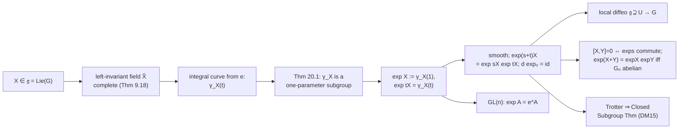

# DM14 · One-Parameter Subgroups and the Exponential Map

◀ [[DM13 Lie Derivatives and Commuting Vector Fields]] · [[Differential Geometry - Course Map]] · [[DM15 Closed Subgroups and the Lie Correspondence]] ▶

taught · in syllabus extra · book extra · beyond

> [!warning] What the lecture source says
> One-parameter subgroups and the exponential map are **week 12** (slides DG25 second page: **Thm 20.1**; DG26: the matrix exponential **Prop 20.2**, **Prop 20.3** for subgroups, the exponential map, **Prop 20.5**, properties (a)–(d), $d\exp_0=\mathrm{id}$, local diffeomorphism). Homework: **HW9 Q1–Q5** (images of one-parameter subgroups, $\exp$ of $\mathbb R^n$ and $T^n$, $\exp X\exp Y$ as coordinates, commuting, $\exp(X+Y)=\exp X\exp Y$). Sources: [[mt3184-differential-geometry-and-lie-groups/2026-10-24-october-19-24|Oct 19–24 note]], [[mt3184-differential-geometry-and-lie-groups/2026-10-26-hw9|HW9]]. Book: Lee Ch. 20 §§ One-Parameter Subgroups and the Exponential Map ([[John M. Lee - Introduction to Smooth Manifolds.pdf#page=534|Lee pp. 516–523]]; printed page = PDF page − 18). The **last slide of DG26** (the relation of $\exp$ to a homomorphism, and a formula for $d\exp_X$) is cut off and illegible; the statements below follow Lee Prop. 20.8(g) (`[!verify]`).

> [!syllabus] Syllabus map: what is in the syllabus and what is extra in this chapter
> 🟢 **In syllabus (taught: DG25–DG26, HW9 Q1–Q5)**
> - §1 one-parameter subgroups, **Thm 20.1** (integral curves of left-invariant fields), Prop 20.3 (subgroups), HW9 Q1–Q2; §2 the matrix exponential, Prop 20.2; §3 $\exp:\mathfrak g\to G$, Prop 20.5, smoothness, $\exp(s+t)X$, $(\exp X)^{-1}$, $(\exp X)^n$, $d\exp_0=\mathrm{id}$, local diffeomorphism, naturality; §4 HW9 Q3–Q5
>
> 🟡 **Extra · book** (Lee Ch. 20; Tu §15; Kumaresan Ch. 3; Warner §3.6)
> - Prop 20.8(g)–(h) (naturality, flow $=R_{\exp tX}$), Prop 20.9 ($\mathrm{Lie}(H)=\{X:\exp tX\in H\ \forall t\}$), **Prop 20.10 and Cor 20.11** (the Trotter product formula), the key tools for the Closed Subgroup Theorem in DM15
>
> 🔵 **Extra · beyond** (my additions, labelled)
> - numerical checks: Rodrigues' formula, surjectivity of $\exp:\mathfrak{so}(3)\to SO(3)$ ($500/500$ rotations), the $\mathfrak{su}(2)$ formula, **$\exp:\mathfrak{sl}(2,\mathbb R)\to SL(2,\mathbb R)$ is not onto** (traces of $e^A$ stay $\ge-2$ over $2\times10^5$ samples), the $1/n$ Trotter rate, one-parameter subgroups of $T^2$

> [!key] After this chapter you can
> - identify one-parameter subgroups with **integral curves through $e$ of left-invariant fields** and so with elements of $\mathfrak g$ (**Thm 20.1**), and describe their images (circle, line or point),
> - compute **$e^A$** and recognise it as $\exp$ for $GL(n,\mathbb R)$ and its subgroups,
> - prove the **properties of $\exp$** (smooth, $\exp(s+t)X=\exp sX\exp tX$, $d\exp_0=\mathrm{id}$, local diffeo, naturality),
> - use **$\exp X\exp Y$** as coordinates, relate $[X,Y]=0$ to commuting exponentials, and say when $\exp(X+Y)=\exp X\exp Y$,
> - state the **Trotter product formula**; know that $\exp$ need not be onto.

> [!intuition] The one-sentence story
> A Lie algebra element $X$ is an *infinitesimal symmetry*; following it for one unit of time gives a group element $\exp X$. The curve $t\mapsto\exp tX$ is exactly a **one-parameter subgroup**: a copy of $\mathbb R$ (or of a circle) sitting inside $G$ with initial velocity $X$. The exponential map is therefore the dictionary from the linear object $\mathfrak g$ to the group, a local diffeomorphism near $0$, but in general neither injective nor onto, and it only converts *sums* into *products* when the elements commute.

*Concept map: complete left-invariant fields ⇒ one-parameter subgroups ⇒ $\exp$ with its properties ⇒ matrix exponential, commuting, Trotter.*

![[fig_dm14_exp.png]]
*A: $\operatorname{tr}e^A\ge-2$ for every $A\in\mathfrak{sl}(2,\mathbb R)$, so $\operatorname{diag}(-2,-\tfrac12)$ is not an exponential (§3). B: the Trotter product formula (Lee Cor. 20.11), error $\propto1/n$ (§4; the figure uses its own random pair $X,Y$). C: the three kinds of one-parameter subgroup of $T^2$: circle, dense line, point (§1).*

## 1. One-parameter subgroups
taught *Source: DG25, HW9 Q1–Q2* · extra · book *[[John M. Lee - Introduction to Smooth Manifolds.pdf#page=534|Lee Thm 20.1, p. 516]], [[John M. Lee - Introduction to Smooth Manifolds.pdf#page=536|Lee Prop. 20.3, p. 518]]*

> [!key] Definition and Theorem 20.1 (DG25)
> A **one-parameter subgroup** of a Lie group $G$ is a Lie group homomorphism $\gamma:\mathbb R\to G$. **Theorem 20.1:** the one-parameter subgroups of $G$ are precisely the **maximal integral curves, starting at $e$, of left-invariant vector fields** $X\in\mathrm{Lie}(G)$. Write $\gamma_X$ for the one generated by $X$; $\gamma_X'(0)=X_e$.
>
> *Proof.* ($\Leftarrow$) Let $\gamma$ be the maximal integral curve of $X\in\mathrm{Lie}(G)$ with $\gamma(0)=e$; it is defined on $\mathbb R$ since left-invariant fields are complete ([[DM12 Integral Curves, Flows and Flowouts]] §3, Thm 9.18). Fix $s$. $X$ is $L_{\gamma(s)}$-related to itself, so $t\mapsto\gamma(s)\gamma(t)$ is an integral curve of $X$ starting at $\gamma(s)$ (Prop 9.6); so is $t\mapsto\gamma(s+t)$ (translation lemma). By uniqueness $\gamma(s+t)=\gamma(s)\gamma(t)$: $\gamma$ is a homomorphism. ($\Rightarrow$) Let $\gamma:\mathbb R\to G$ be a homomorphism and $X\in\mathrm{Lie}(G)$ the left-invariant field with $X_e=\gamma'(0)$. The field $d/dt$ on $\mathbb R$ is left-invariant, and $\gamma\circ L_s=L_{\gamma(s)}\circ\gamma$ gives $\gamma'(s)=d(L_{\gamma(s)})_e\gamma'(0)=X_{\gamma(s)}$. So $\gamma$ is an integral curve of $X$ through $e$, and a maximal one since it is defined on $\mathbb R$. $\square$
>
> **Prop 20.3 (subgroups).** If $H\le G$ is a Lie subgroup, the one-parameter subgroups of $H$ are exactly those of $G$ whose initial velocity lies in $T_eH$. *Proof.* A homomorphism into $H$ composed with the inclusion is one into $G$ with $\gamma'(0)\in T_eH$; conversely use $\mathrm{Lie}(H)\subseteq\mathrm{Lie}(G)$ ([[DM11 The Lie Algebra of a Lie Group]] §3) and Thm 20.1 for $H$. $\square$

> [!example] Examples
> * $G=\mathbb R^\times$ (or $\mathbb R_{>0}$): $\gamma_a(t)=e^{at}$. $G=S^1$: $t\mapsto e^{iat}$. $G=GL(n,\mathbb R)$: $t\mapsto e^{tA}$ (§2). $G=SO(2)$: $t\mapsto R(at)$.
> * **HW9 Q2.** In $(\mathbb R^n,+)$ the one-parameter subgroups are $t\mapsto tv$, so $\exp v=v$: **$\exp=\mathrm{id}$**. In the torus $T^n=(S^1)^n$ (with $\mathrm{Lie}(S^1)=\mathbb R\,\partial_\theta$) the one-parameter subgroups are $t\mapsto(e^{iv_1t},\dots,e^{iv_nt})$, so $\exp(v)=(e^{iv_1},\dots,e^{iv_n})$: a surjective homomorphism $\mathbb R^n\to T^n$ with **kernel $2\pi\mathbb Z^n$**: $\exp$ need not be injective.

> [!key] HW9 Q1: the image of a one-parameter subgroup
> If $\gamma:\mathbb R\to G$ is a one-parameter subgroup and $H=\gamma(\mathbb R)$, then $H$ is isomorphic as a Lie group to **$\mathbb R$, $S^1$ or $\{e\}$**.
> *Proof.* $\gamma$ is a maximal integral curve (Thm 20.1), so by the trichotomy ([[DM12 Integral Curves, Flows and Flowouts]] §4) it is constant, injective or periodic. *Constant:* $H=\{e\}$. *Injective:* $\gamma$ is an injective homomorphism of constant rank $1$ ($\gamma'\ne0$), so $H$ is a Lie subgroup and $\gamma:\mathbb R\to H$ is an isomorphism ([[DM08 Lie Groups]] §2, Prop 7.17). *Periodic:* $\ker\gamma=T_0\mathbb Z$ ($T_0>0$ the minimal period), and $\gamma$ induces a bijective homomorphism $\mathbb R/T_0\mathbb Z\to H$ of constant rank $1$, hence an isomorphism $S^1\cong H$. $\square$
> *Numerics (figure C), $T^2=\mathbb R^2/\mathbb Z^2$, $\gamma(t)=(at,bt)$:* for $(a,b)=(2,3)$ the curve closes at $t=1$ (a circle); for $(1,\sqrt2)$ the distance to $e$ never vanishes for $0.001\le t\le2000$ but gets as small as $3.1\times10^{-4}$ (injective, **dense**: not an embedded subgroup, [[DM09 Group Actions and Semidirect Products]] §1); for $(0,0)$ the curve is constant.

## 2. The matrix exponential
taught *Source: DG26* · extra · book *[[John M. Lee - Introduction to Smooth Manifolds.pdf#page=535|Lee Prop. 20.2, p. 517]]*

> [!key] Proposition 20.2 (DG26)
> For $A\in\mathfrak{gl}(n,\mathbb R)$ the series $e^A=\sum_{k\ge0}A^k/k!$ converges to an **invertible** matrix, and the one-parameter subgroup of $GL(n,\mathbb R)$ generated by $A$ is $\gamma(t)=e^{tA}$.
>
> *Proof.* With $\|A\|$ an operator norm, $\|A^k/k!\|\le\|A\|^k/k!$, so by the Weierstrass M-test the series (and its termwise derivative) converges uniformly on bounded sets. Hence $\gamma(t)=e^{tA}$ is smooth with $\gamma(0)=I$ and $\gamma'(t)=\gamma(t)A$, which says $\gamma$ is the integral curve through $I$ of the left-invariant field $\tilde A_X=XA$ ([[DM11 The Lie Algebra of a Lie Group]] §3). By Thm 20.1 it is the one-parameter subgroup with initial velocity $A$; in particular $e^{(s+t)A}=e^{sA}e^{tA}$ and $e^{A}e^{-A}=I$. $\square$ (Series with $60$ terms versus a library $\exp$: $2.9\times10^{-13}$; group law $1.4\times10^{-12}$.) Hence **$\exp A=e^A$ for $GL(n,\mathbb R)$ and for every Lie subgroup of it** (Prop 20.3).

> [!example] The classical groups, with numbers
> * **$SO(2)$.** $A=\begin{pmatrix}0&-1\\1&0\end{pmatrix}$: $e^{tA}=R(t)$ exactly; $e^{2\pi A}=I$ and $e^{\pi A}=-I$ (to $4.4\times10^{-16}$): kernel $2\pi\mathbb Z$.
> * **$SO(3)$ (Rodrigues).** For $\omega\in\mathbb R^3$ with $\hat\omega v=\omega\times v$: $e^{\hat\omega}=I+\dfrac{\sin|\omega|}{|\omega|}\hat\omega+\dfrac{1-\cos|\omega|}{|\omega|^2}\hat\omega^2$, the rotation about $\omega$ by the angle $|\omega|$ (matches $\exp$ to $6\times10^{-14}$ at $500$ random $\omega$). **$\exp:\mathfrak{so}(3)\to SO(3)$ is onto** (Euler's theorem; numerically all $500/500$ random rotations have a real skew logarithm with $e^{\log R}=R$ to $4.7\times10^{-15}$).
> * **$SU(2)$.** With $\tau_k=-\tfrac i2\sigma_k$: $\exp\big(\sum\omega_k\tau_k\big)=\cos\tfrac{|\omega|}2\,I-i\sin\tfrac{|\omega|}2\,\tfrac{\omega}{|\omega|}\!\cdot\!\sigma$, unitary of determinant $1$ ($10^{-16}$ at $200$ random $\omega$); the loop $|\omega|=2\pi$ gives $-I$ and $4\pi$ closes: the double cover over $SO(3)$ ([[DM11 The Lie Algebra of a Lie Group]] §5).
> * **Determinant.** $\det e^A=e^{\operatorname{tr}A}$ ($111.01966564$ both ways for a random $4\times4$): by naturality (below) applied to $\det$ with $\det_*=\operatorname{tr}$ (HW6 Q7).

## 3. The exponential map
taught *Source: DG26* · extra · book *[[John M. Lee - Introduction to Smooth Manifolds.pdf#page=536|Lee Prop. 20.5, p. 518]], [[John M. Lee - Introduction to Smooth Manifolds.pdf#page=537|Lee Prop. 20.8, pp. 519–520]], [[John M. Lee - Introduction to Smooth Manifolds.pdf#page=539|Lee Prop. 20.9, p. 521]]*

> [!key] Definition and Prop. 20.5 (DG26)
> $\exp:\mathfrak g\to G$, $\exp X=\gamma_X(1)$. **Prop 20.5:** $s\mapsto\exp sX$ **is** $\gamma_X$. *Proof.* By rescaling ([[DM12 Integral Curves, Flows and Flowouts]] §1), $t\mapsto\gamma_X(st)$ is the integral curve of $sX$ from $e$, so $\gamma_{sX}(t)=\gamma_X(st)$; take $t=1$. $\square$

> [!key] Properties of $\exp$ (DG26; Lee Prop. 20.8)
> For $G$ with Lie algebra $\mathfrak g$, $X\in\mathfrak g$:
> (a) $\exp$ is **smooth**. (b) $\exp(s+t)X=\exp sX\,\exp tX$. (c) $(\exp X)^{-1}=\exp(-X)$. (d) $(\exp X)^n=\exp(nX)$, $n\in\mathbb Z$. (e) $d(\exp)_0=\mathrm{id}$ (under $T_0\mathfrak g=\mathfrak g$, $T_eG=\mathfrak g$). (f) $\exp$ restricts to a **diffeomorphism from a neighbourhood of $0$ onto a neighbourhood of $e$**. (g) For a Lie group homomorphism $\Phi:G\to H$: **$\Phi\circ\exp_G=\exp_H\circ\Phi_*$**. (h) The flow of the left-invariant field $\tilde X$ is $\theta_t=R_{\exp tX}$.
>
> *Proof.* (a) On $G\times\mathfrak g$ define $\Xi_{(g,X)}=(X_g,0)$, smooth in $(g,X)$; its flow is $(g,X)\mapsto(\theta^X_t(g),X)$, smooth by the Fundamental Theorem on Flows ([[DM12 Integral Curves, Flows and Flowouts]] §2); $\exp X=\pi_G\big(\Xi\text{-flow}_1(e,X)\big)$. (b)–(d): $t\mapsto\exp tX$ is a homomorphism (Prop 20.5, Thm 20.1). (e): for $\sigma(t)=tX$, $d(\exp)_0(X)=\frac d{dt}|_0\exp tX=X_e$. (f): inverse function theorem. (g): $t\mapsto\Phi(\exp tX)$ is a one-parameter subgroup of $H$ with initial velocity $d\Phi_e(X_e)=(\Phi_*X)_e$ (Thm 8.44), so it equals $\exp t\Phi_*X$ (Thm 20.1). (h): $L_g$ takes integral curves of $\tilde X$ to integral curves, so $\theta^{(g)}(t)=L_g(\exp tX)=g\exp tX=R_{\exp tX}(g)$. $\square$

> [!intuition] Reading the properties
> (b)–(d) say $\exp$ is a homomorphism on every **line** through $0$. (e)–(f) say that near the identity $G$ *is* $\mathfrak g$ (canonical "normal" coordinates), so the local group structure is encoded in the bracket (DM15). (g) is naturality: exponentiating commutes with homomorphisms, e.g. $\det e^A=e^{\operatorname{tr}A}$, $\mathrm{Ad}(e^{\omega\cdot\tau})=e^{\hat\omega}$.

> [!pitfall] $\exp(X+Y)\ne\exp X\exp Y$, and $\exp$ need not be onto or injective
> (b) does **not** give $\exp(X+Y)=\exp X\exp Y$. For random non-commuting $3\times3$ matrices $e^Xe^Y-e^{X+Y}$ has entries of size $3.4$; for commuting (diagonal) $X,Y$ it is $9\times10^{-16}$. *Not injective:* $\exp:\mathbb R\to S^1$, kernel $2\pi\mathbb Z$. *Not onto:* **$\exp:\mathfrak{sl}(2,\mathbb R)\to SL(2,\mathbb R)$**: for $A=\begin{pmatrix}a&b\\c&-a\end{pmatrix}$ put $\mu^2=a^2+bc$; then $\operatorname{tr}e^A=2\cosh\mu$ if $\mu^2>0$ and $2\cos\omega$ if $\mu^2=-\omega^2<0$ ($A$ nilpotent gives $2$), so **$\operatorname{tr}e^A\ge-2$**: the smallest trace over $2\times10^5$ random $A$ is $-2.00000$, while $\operatorname{diag}(-2,-\tfrac12)\in SL(2,\mathbb R)$ has trace $-2.5$ (figure A). (For *compact connected* groups $\exp$ is onto: true, not proved here; $\mathfrak{so}(3)\to SO(3)$ above.)

> [!key] Lie subalgebras via $\exp$ (Lee Prop. 20.9)
> If $H\le G$ is a Lie subgroup, $\exp_H=\exp_G|_{\mathrm{Lie}(H)}$ and
> $$\mathrm{Lie}(H)=\{X\in\mathrm{Lie}(G):\exp tX\in H\ \text{for all }t\in\mathbb R\}.$$
> (Used in DM15 to *define* the candidate Lie algebra $\mathfrak h$ of a closed subgroup.)

## 4. Consequences and HW9
taught *Source: HW9 Q3–Q5* · extra · book *[[John M. Lee - Introduction to Smooth Manifolds.pdf#page=540|Lee Prop. 20.10, p. 522]], [[John M. Lee - Introduction to Smooth Manifolds.pdf#page=541|Lee Cor. 20.11, p. 523]]*

> [!key] HW9 Q3: $\exp X\exp Y$ as coordinates
> If $\mathfrak g=A\oplus B$ (vector-space direct sum), then $\Phi(X,Y)=\exp X\exp Y$, $A\oplus B\to G$, is a diffeomorphism from a neighbourhood of $(0,0)$ onto a neighbourhood of $e$. *Proof.* $d\Phi_{(0,0)}(X,Y)=dm_{(e,e)}\big(d\exp_0X,d\exp_0Y\big)=X+Y$ ([[DM08 Lie Groups]] §1, $dm_{(e,e)}(X,Y)=X+Y$; Prop 20.8(e)), which is an isomorphism $A\oplus B\to\mathfrak g$; apply the inverse function theorem. $\square$ (Numerically in $\mathfrak{gl}(2)=\mathfrak{so}(2)\oplus\mathrm{Sym}(2)$: the Jacobian of $(X,Y)\mapsto e^Xe^Y$ at $0$ has rank $4$, $|\det|=2$, the determinant of the basis change.)

> [!key] HW9 Q4: commuting
> Let $G$ be connected. (a) For $X,Y\in\mathfrak g$: $[X,Y]=0\iff\exp tX\exp sY=\exp sY\exp tX$ for all $s,t$. (b) $G$ is abelian $\iff\mathfrak g$ is abelian.
> *Proof.* (a) By Prop 20.8(h) the flows of the complete fields $\tilde X,\tilde Y$ are $R_{\exp tX}$ and $R_{\exp sY}$; $\theta^X_t\theta^Y_s(g)=g\exp sY\exp tX$ and $\theta^Y_s\theta^X_t(g)=g\exp tX\exp sY$. By Thm 9.44 ([[DM13 Lie Derivatives and Commuting Vector Fields]] §3), $[\tilde X,\tilde Y]=0$ iff these flows commute for all $s,t$, iff the displayed identity holds (take $g=e$; conversely it holds for all $g$ if it holds at $e$). (b) ($\Rightarrow$) HW6 Q6 ([[DM11 The Lie Algebra of a Lie Group]] §4). ($\Leftarrow$) if $\mathfrak g$ is abelian then by (a) all $\exp X$ commute; $\exp(\mathfrak g)$ contains a neighbourhood $W$ of $e$ (Prop 20.8(f)), which generates the connected group $G$ ([[DM08 Lie Groups]] §3, Prop 7.14(c)); a group generated by pairwise commuting elements is abelian. $\square$

> [!key] HW9 Q5: when is $\exp(X+Y)=\exp X\exp Y$?
> $\exp(X+Y)=\exp X\exp Y$ for **all** $X,Y\in\mathfrak g$ iff the **identity component $G_0$ is abelian**.
> *Proof.* ($\Leftarrow$) $\gamma(t)=\exp tX\exp tY$ is a homomorphism $\mathbb R\to G$ because $\exp sX$ and $\exp tY$ lie in the abelian $G_0$ and commute; $\gamma'(0)=dm_{(e,e)}(X,Y)=X+Y$ (DM08), so $\gamma=\gamma_{X+Y}$ by Thm 20.1 and $\gamma(1)=\exp(X+Y)$. ($\Rightarrow$) $\exp X\exp Y=\exp(X+Y)=\exp(Y+X)=\exp Y\exp X$: elements of $\exp\mathfrak g$ commute, and $\exp\mathfrak g$ contains a neighbourhood of $e$, which generates $G_0$ ([[DM08 Lie Groups]] §3, Prop 7.15). $\square$

> [!key] Proposition 20.10 and the Trotter product formula (Lee Cor. 20.11)
> For $X,Y\in\mathfrak g$ there is a smooth $Z:(-\varepsilon,\varepsilon)\to\mathfrak g$ with $\exp tX\,\exp tY=\exp\big(t(X+Y)+t^2Z(t)\big)$, and consequently
> $$\lim_{n\to\infty}\Big(\exp\tfrac tnX\,\exp\tfrac tnY\Big)^n=\exp t(X+Y).$$
> *Proof.* $\varphi(t)=\exp^{-1}(\exp tX\exp tY)$ is smooth near $0$ with $\varphi(0)=0$ and $\varphi'(0)=(d\exp_0)^{-1}\big(dm_{(e,e)}(X,Y)\big)=X+Y$; Taylor's theorem gives $t(X+Y)+t^2Z(t)$. Then $(\exp\frac tnX\exp\frac tnY)^n=\exp\big(t(X+Y)+\tfrac{t^2}nZ(\tfrac tn)\big)\to\exp t(X+Y)$ by (d) and continuity. $\square$ Numerically, for random $3\times3$ $X,Y$ and $t=1$: the error is $2.46\times10^{-1},\,2.46\times10^{-2},\,2.46\times10^{-3},\,2.46\times10^{-4}$ for $n=10,10^2,10^3,10^4$ (rate $1/n$, figure B). This **sum from products** is what makes the set $\{X:\exp tX\in H\ \forall t\}$ a vector subspace for a *closed* subgroup $H$: the heart of the Closed Subgroup Theorem ([[DM15 Closed Subgroups and the Lie Correspondence]]).

## Map of this chapter
> [!connection] How DM14 connects
> **Builds on:** [[DM12 Integral Curves, Flows and Flowouts]] (complete fields, rescaling, uniqueness, trichotomy), [[DM11 The Lie Algebra of a Lie Group]] ($\mathrm{Lie}(G)$, $F_*$, $\mathfrak{gl}(n)$, $\mathfrak{su}(2)$), [[DM13 Lie Derivatives and Commuting Vector Fields]] (commuting flows), [[DM08 Lie Groups]] ($dm_{(e,e)}$, generation by a neighbourhood), [[PA14 ODE Existence Uniqueness and Smooth Dependence]] (the ODE behind $e^{tA}$).
> **Leads to:** [[DM15 Closed Subgroups and the Lie Correspondence]] (Closed Subgroup Theorem via Trotter, the Lie correspondence, Lie's third theorem).
> **Concepts:** [[One-Parameter Subgroup]] · [[Exponential Map]] · [[Matrix Exponential]] · [[Trotter Product Formula]]
> **Other subjects:** [[Quantum Mechanics - Course Map]] (time evolution $U(t)=e^{-iHt/\hbar}$ is a one-parameter subgroup of $U(n)$; rotations $e^{-i\theta\hat n\cdot L/\hbar}$; Trotter splitting in simulations), [[Group Theory - Course Map]] ([[GT10 Symmetry Representations and Characters]]: generators of continuous symmetries), [[Waves - Course Map]] (linear ODE solutions $e^{tA}$)

## Summary
> [!summary] Cheat-sheet
> - **One-parameter subgroup** = homomorphism $\gamma:\mathbb R\to G$ = maximal integral curve from $e$ of a left-invariant field (**Thm 20.1**); image $\cong\mathbb R$, $S^1$ or $\{e\}$ (HW9 Q1). Subgroup $H$: those with $\gamma'(0)\in T_eH$.
> - **$GL(n)$:** $\exp A=e^A=\sum A^k/k!$, $e^{tA}$ solves $\dot X=XA$; $\det e^A=e^{\operatorname{tr}A}$. $\exp(\mathbb R^n)=\mathrm{id}$; $\exp:\mathbb R^n\to T^n$ has kernel $2\pi\mathbb Z^n$. $\mathfrak{so}(3)$: Rodrigues.
> - **$\exp X=\gamma_X(1)$**; $\exp sX=\gamma_X(s)$; smooth; $\exp(s+t)X=\exp sX\exp tX$; $(\exp X)^n=\exp nX$; $d\exp_0=\mathrm{id}$, local diffeo; $\Phi\circ\exp=\exp\circ\Phi_*$; flow of $\tilde X$ is $R_{\exp tX}$. **Not** additive, injective or onto in general (**$\mathfrak{sl}(2,\mathbb R)$: $\operatorname{tr}e^A\ge-2$**).
> - **HW9:** $\exp X\exp Y$ are coordinates near $e$ for $A\oplus B=\mathfrak g$; $[X,Y]=0\iff$ exps commute; $G$ connected: abelian $\iff\mathfrak g$ abelian; $\exp(X+Y)=\exp X\exp Y\ \forall X,Y\iff G_0$ abelian. **Trotter:** $(e^{tX/n}e^{tY/n})^n\to e^{t(X+Y)}$.

## Practice
1. **Thm 20.1.** Prove that $\gamma_X(t)=\exp tX$ is a one-parameter subgroup and that every one-parameter subgroup arises this way.
2. **Images (HW9 Q1).** Show the image of a one-parameter subgroup is $\mathbb R$, $S^1$ or trivial; classify those of $T^2$.
3. **Abelian groups (HW9 Q2).** Compute $\exp$ for $(\mathbb R^n,+)$ and $T^n$ and find the kernels.
4. **Matrix exponential.** Show $e^{tA}$ is the one-parameter subgroup of $GL(n)$ with velocity $A$; compute $e^{tA}$ for $A=\begin{pmatrix}0&-1\\1&0\end{pmatrix}$ and $A=\begin{pmatrix}0&1\\0&0\end{pmatrix}$.
5. **Naturality.** Prove $\Phi\circ\exp=\exp\circ\Phi_*$ and deduce $\det e^A=e^{\operatorname{tr}A}$.
6. **Coordinates (HW9 Q3).** Show $(X,Y)\mapsto\exp X\exp Y$ is a local diffeomorphism for $\mathfrak g=A\oplus B$.
7. **Commuting (HW9 Q4).** Prove $[X,Y]=0\iff\exp tX\exp sY=\exp sY\exp tX$, and $G$ abelian $\iff\mathfrak g$ abelian ($G$ connected).
8. **Additivity (HW9 Q5).** Prove $\exp(X+Y)=\exp X\exp Y$ for all $X,Y$ iff $G_0$ is abelian.
9. **Not onto.** Show $\operatorname{diag}(-2,-\tfrac12)\notin\exp\mathfrak{sl}(2,\mathbb R)$.
10. **Trotter.** Prove $(\exp\tfrac tnX\exp\tfrac tnY)^n\to\exp t(X+Y)$ and check the rate on a commuting and a non-commuting pair.

> [!example]- Solutions
> 1. §1.
> 2. §1. On $T^2$: $(a,b)=(0,0)$ constant; $a/b\in\mathbb Q$ (or one of them $0$): circle (periodic); $a/b\notin\mathbb Q$: dense line (injective).
> 3. $\exp v=v$ on $\mathbb R^n$ (kernel $\{0\}$); $\exp v=(e^{iv_1},\dots,e^{iv_n})$ on $T^n$, kernel $2\pi\mathbb Z^n$.
> 4. §2. $e^{tA}=\begin{pmatrix}\cos t&-\sin t\\\sin t&\cos t\end{pmatrix}$; for the nilpotent $A$, $A^2=0$ and $e^{tA}=I+tA=\begin{pmatrix}1&t\\0&1\end{pmatrix}$.
> 5. §3 (g); $\det_*=\operatorname{tr}$ and $\exp_{\mathbb R^\times}(a)=e^a$ give $\det e^A=e^{\operatorname{tr}A}$.
> 6. §4.
> 7. §4.
> 8. §4.
> 9. §3: all $e^A$ with $A\in\mathfrak{sl}(2,\mathbb R)$ have trace $\ge-2$.
> 10. §4. For commuting $X,Y$ the error is $0$ up to rounding; for non-commuting it is $O(1/n)$ ($2.46\times10^{-1}\to2.46\times10^{-4}$ for $n=10\to10^4$).

## Provenance
> [!provenance]- Source map for this chapter
> | Topic | Source | Scope |
> |---|---|---|
> | one-parameter subgroups, Thm 20.1 and its proof | slide DG25 (second page) via [[mt3184-differential-geometry-and-lie-groups/2026-10-24-october-19-24\|Oct 19–24 note]] | taught |
> | matrix exponential Prop 20.2, Prop 20.3, exponential map, Prop 20.5, properties (a)–(d), $d\exp_0$, local diffeo | slide DG26 via [[mt3184-differential-geometry-and-lie-groups/2026-10-24-october-19-24\|Oct 19–24 note]] | taught (last slide illegible) |
> | HW9 Q1–Q5 | [[mt3184-differential-geometry-and-lie-groups/2026-10-26-hw9\|HW9]] | taught (via homework; "not graded, self-study") |
> | Prop 20.8(g)–(h), Prop 20.9, Prop 20.10, Cor 20.11 (Trotter) | Lee Prop. 20.8, Prop. 20.9, Prop. 20.10, Cor. 20.11; Tu §15 | extra/book |
> | Rodrigues check, $\mathfrak{sl}(2,\mathbb R)$ non-surjectivity, Trotter rate, $T^2$ subgroups | `scripts/dm_numbers.py` (DM14), `fig_dm14_exp.py` | extra/beyond |
>
> **Notes.** [!verify] The final DG26 slide (relation of $\exp$ to homomorphisms, $d\exp_X$) is cut off and illegible: the statement used here is Lee Prop. 20.8(g). Slide DG26 uses $\exp X=\gamma_X(1)$ and Lee Prop. 20.5 as the first property; the numbering (a)–(d) of the slide corresponds to Lee Prop. 20.8(a)–(d). The claim that $\exp$ is onto for compact connected groups is quoted, not proved.
