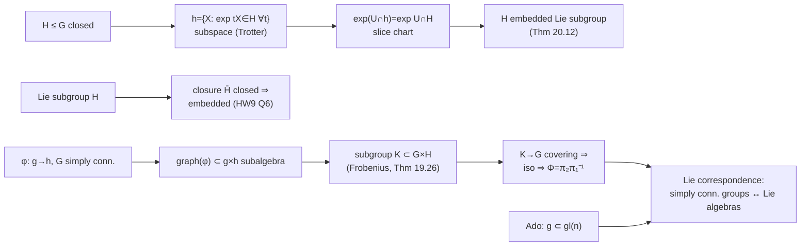

# DM15 · Closed Subgroups and the Lie Correspondence

◀ [[DM14 One-Parameter Subgroups and the Exponential Map]] · [[Differential Geometry - Course Map]] ▶ *(end of the vault; back to the [[Differential Geometry - Course Map|map]])*

taught · in syllabus extra · book extra · beyond

> [!warning] What the lecture source says

> [!note] Update 2026-11-07: the Frobenius theorem *is* now on the slides
> After this chapter was written, the lectures of **26 Oct–6 Nov (DG27–DG30)** proved the Closed Subgroup Theorem (the proof of §1 agrees with the lecture's: $\mathfrak h$ a subspace by Trotter, the Claim $\exp(U\cap\mathfrak h)=\exp U\cap H$, slice charts) and **taught distributions, foliations, the Frobenius theorem and Thm 19.26** in full. So §3 below ("statement", labelled extra · book) is superseded as a *scope* label: the material is **taught** and is written out in [[DM16 Distributions, Involutivity and the Frobenius Theorem]] and [[DM17 Foliations, Weakly Embedded Submanifolds and Lie Subgroups]] (weakly embedded submanifolds, Lemma 19.24, Thms 19.25–19.26 with proof, HW10). Nothing in this chapter was removed.
> The **Closed Subgroup Theorem** is stated in **week 6** (slide DG14, **Thm 20.12**), with a proof outline that, as far as it can be read, proves only the *easy* direction (an embedded subgroup is closed); the hard direction needs $\exp$ and is Lee's proof (§1, extra · book). The **Lie correspondence** is **week 7** (slide DG18: $G\mapsto\mathrm{Lie}(G)$, **Homomorphism Theorem** (the OCR numbers it "Thm 20.19; check"), well defined, injective, surjective by **Lie's third theorem**) and **weeks 6 and 10** (DG17, DG19–DG20: Ado's theorem). Homework: **HW9 Q6** (the closure of a Lie subgroup; every Lie subgroup is embedded or dense in an embedded one). The **Frobenius theorem** is *not* on the legible slides: §3 states it (extra · book) because the existence of a subgroup for each subalgebra needs it. Sources: [[mt3184-differential-geometry-and-lie-groups/2026-09-10-september-7-12|Sep 7–12]], [[mt3184-differential-geometry-and-lie-groups/2026-09-15-september-14-18|Sep 14–18]], [[mt3184-differential-geometry-and-lie-groups/2026-10-10-october-5-9|Oct 5–9]] notes, [[mt3184-differential-geometry-and-lie-groups/2026-10-26-hw9|HW9]]. Book: Lee Ch. 19 §§ The Frobenius Theorem, Lie subalgebras and Lie subgroups; Ch. 20 §§ The Closed Subgroup Theorem, The Lie Correspondence ([[John M. Lee - Introduction to Smooth Manifolds.pdf#page=523|Lee pp. 505–507, 523–533]]; printed page = PDF page − 18). DG14, DG18 are noisy OCR (`[!verify]`).

> [!syllabus] Syllabus map: what is in the syllabus and what is extra in this chapter
> 🟢 **In syllabus (taught: DG14, DG17–DG20, HW9 Q6)**
> - §1 statement of the Closed Subgroup Theorem and the easy direction, closure of a Lie subgroup (HW9 Q6); §2 the Homomorphism Theorem, injectivity of $G\mapsto\mathrm{Lie}(G)$ on simply connected groups, surjectivity by Ado + Lie's third theorem (statements and the sketch given on the slides), Ado's theorem (statement)
>
> 🟡 **Extra · book** (Lee Ch. 19–21; Tu §§15–16, 19; Kumaresan Ch. 3; Warner Ch. 3)
> - the proof of the **hard direction** of Thm 20.12 (via $\exp$ and the Trotter formula, DM14), the Frobenius theorem (statement) and Lie subgroup $\leftrightarrow$ subalgebra (Thm 19.26), Lee's Fundamental Theorems of Lie (Thm 20.22, statement), connected groups as $\tilde G/\Gamma$ (Thm 21.32)
>
> 🔵 **Extra · beyond** (my additions, labelled)
> - proof of the Homomorphism Theorem by the **graph subalgebra** and a covering argument (an alternative to Lee's proof, which uses actions of Lie algebras); numerical density of the line $\{(t,\sqrt2t)\}\subset T^2$ (worst distance $7.3\times10^{-7}$ by $T=10^6$); the non-involutive contact distribution $\mathrm{span}\{\partial_x,\partial_y+x\partial_z\}$ and its commutator picture

> [!key] After this chapter you can
> - state and prove (outline) the **Closed Subgroup Theorem**: a subgroup is closed $\iff$ it is an embedded Lie subgroup,
> - show that **every Lie subgroup is embedded or dense in an embedded one** (HW9 Q6),
> - state the **Homomorphism Theorem** and the **Lie correspondence**, prove injectivity, and explain **Lie's third theorem** via Ado,
> - say precisely **how far the correspondence goes** (simply connected groups; quotients $\tilde G/\Gamma$ otherwise),
> - state **Frobenius** and use it for **Lie subgroups $\leftrightarrow$ Lie subalgebras**.

> [!intuition] The one-sentence story
> The Lie algebra captures the group *near the identity*; $\exp$ is a local diffeomorphism, and the Trotter formula turns sums into products, so a **closed** subgroup is cut out near $e$ by a linear subspace of $\mathfrak g$: that is a slice chart. Globally, information is lost exactly through **topology**: $\mathbb R^n$ and $T^n$, $SU(2)$ and $SO(3)$ share a Lie algebra. On **simply connected** groups nothing is lost: Lie algebra homomorphisms integrate (the graph of $\varphi$ is a subalgebra, hence a subgroup that covers $G$, hence is $G$), and every finite-dimensional algebra occurs (Ado).

*Concept map: $\exp$ + Trotter ⇒ closed subgroups are embedded; Frobenius ⇒ subalgebras give subgroups ⇒ homomorphisms integrate ⇒ correspondence.*

![[fig_dm15_correspondence.png]]
*A: for the closed circle $H=\{(2t,3t)\}\subset T^2$ the preimage in $\mathfrak g=\mathbb R^2$ is a family of parallel strands $3x-2y=k$ of spacing $1/\sqrt{13}$: $\exp U\cap H=\exp(U\cap\mathfrak h)$ only for small $U$ (§1). B: the Lie correspondence and its examples (§2). C: the commutator quadrilateral of $X_1=\partial_x$, $X_2=\partial_y+x\partial_z$ ends at $(0,0,\varepsilon^2)$: the distribution is not involutive (§3).*

## 1. The Closed Subgroup Theorem
taught *Source: DG14, HW9 Q6* · extra · book *[[John M. Lee - Introduction to Smooth Manifolds.pdf#page=541|Lee Thm 20.12, p. 523]], [[John M. Lee - Introduction to Smooth Manifolds.pdf#page=543|Lee Cor. 20.13, p. 525]], [[John M. Lee - Introduction to Smooth Manifolds.pdf#page=177|Lee Thm 7.21, p. 159]]*

> [!key] Theorem 20.12 and Cor. 20.13 (DG14)
> Let $G$ be a Lie group and $H\le G$ a subgroup. The following are equivalent: **(a)** $H$ is a closed subset of $G$; **(b)** $H$ is an embedded submanifold; **(c)** $H$ is an embedded Lie subgroup.

> [!key] (c)$\Rightarrow$(a): an embedded subgroup is closed (DG14 outline; Lee Thm 7.21)
> *Proof.* Let $g\in\overline H$, $g=\lim h_i$ with $h_i\in H$. Take a slice chart $(U,\varphi)$ for $H$ at $e$ (so $H\cap U$ is closed in $U$), an open $V\ni e$ with $\overline V$ compact $\subset U$, and an open $W\ni e$ with $W^{-1}W\subseteq V$ (continuity of $(a,b)\mapsto a^{-1}b$ at $(e,e)$; HW5 Q4, [[DM08 Lie Groups]] §1). Since $gW$ is a neighbourhood of $g$, $h_i\in gW$ for large $i$, so $h_i^{-1}h_j\in W^{-1}g^{-1}gW=W^{-1}W\subseteq V$ for large $i,j$. Fix such an $i$ and let $j\to\infty$: the elements $h_i^{-1}h_j\in H\cap\overline V\subseteq H\cap U$ converge to $h_i^{-1}g\in\overline V\subseteq U$; since $H\cap U$ is closed in $U$, $h_i^{-1}g\in H$, hence $g\in H$. $\square$

> [!key] (a)$\Rightarrow$(b),(c): a closed subgroup is embedded (Lee's proof; uses [[DM14 One-Parameter Subgroups and the Exponential Map]])
> Let $H$ be closed and $\mathfrak h=\{X\in\mathfrak g:\exp tX\in H\ \forall t\in\mathbb R\}$.
> **Step 1: $\mathfrak h$ is a linear subspace.** Closed under scalars by definition. If $X,Y\in\mathfrak h$ then $\exp\tfrac tnX\,\exp\tfrac tnY\in H$ for all $n$, so $\big(\exp\tfrac tnX\exp\tfrac tnY\big)^n\in H$ and by the **Trotter formula** (DM14, Cor. 20.11) its limit $\exp t(X+Y)\in H$ because $H$ is closed: $X+Y\in\mathfrak h$.
> **Step 2: a neighbourhood $U$ of $0$ with $\exp(U\cap\mathfrak h)=\exp U\cap H$.** Choose a complement $\mathfrak b$, $\mathfrak g=\mathfrak h\oplus\mathfrak b$. By HW9 Q3 (DM14) $\Phi(X,Y)=\exp X\exp Y$ is a diffeomorphism near $(0,0)$. Suppose no such $U$ exists: then there are $h_i\in H$, $h_i\to e$, not in $\exp\mathfrak h$; write $h_i=\exp X_i\exp Y_i$ with $(X_i,Y_i)\to(0,0)$, $X_i\in\mathfrak h$, $Y_i\in\mathfrak b$. Since $\exp X_i\in H$, $\exp Y_i=(\exp X_i)^{-1}h_i\in H$, and $Y_i\ne0$ (else $h_i\in\exp\mathfrak h$). Put $c_i=|Y_i|\to0$ and pass to a subsequence with $Y_i/c_i\to Y\in\mathfrak b$, $|Y|=1$. For $t\in\mathbb R$ let $n_i=\lfloor t/c_i\rfloor$; then $n_ic_i\to t$, $n_iY_i=(n_ic_i)(Y_i/c_i)\to tY$, and $\exp n_iY_i=(\exp Y_i)^{n_i}\in H$, so $\exp tY\in H$ since $H$ is closed. Thus $Y\in\mathfrak h\cap\mathfrak b=\{0\}$, contradicting $|Y|=1$.
> **Step 3: slice charts.** With a linear isomorphism $E:\mathfrak g\to\mathbb R^m$, $E(\mathfrak h)=\mathbb R^k$, the map $E\circ\exp^{-1}:\exp U\to\mathbb R^m$ is a chart carrying $\exp U\cap H=\exp(U\cap\mathfrak h)$ onto a slice. For $h\in H$, $L_h(H)=H$, so $(E\circ\exp^{-1})\circ L_h^{-1}$ is a slice chart at $h$. Hence $H$ is an embedded submanifold, thus an embedded Lie subgroup (Prop. 7.11). $\square$ Moreover **$\mathrm{Lie}(H)=\mathfrak h$** (Prop. 20.9).

> [!example] Closed subgroups, non-closed ones, and the picture
> * **Closed (hence embedded Lie subgroups):** $SL(n,\mathbb R)=\det^{-1}(1)$, $O(n)$, $SO(n)$, $U(n)$, $SU(n)$ (preimages of points, closed), the centre of $G$, discrete closed subgroups such as $\mathbb Z\subset\mathbb R$ ($\mathfrak h=\{0\}$), the circle $H=\{(2t,3t)\}\subset T^2$ ($\mathfrak h=\mathrm{span}(2,3)$).
> * **Not closed (hence *not* embedded):** $\mathbb Q\subset\mathbb R$ (a $0$-dimensional Lie subgroup, dense), $GL(n,\mathbb Q)\subset GL(n,\mathbb R)$, the **dense line** $\{(t,\sqrt2t)\}\subset T^2$.
> * **Why $U$ must be small (figure A).** For the circle $H=\{(2t,3t)\}\subset T^2=\mathbb R^2/\mathbb Z^2$ the preimage of $H$ in $\mathfrak g=\mathbb R^2$ is the family of strands $3x-2y=k$ ($k\in\mathbb Z$), parallel to $\mathfrak h=\mathrm{span}(2,3)$ at distance $1/\sqrt{13}\approx0.277$. A ball $U$ of radius $0.12$ meets only the strand $k=0$, so $\exp U\cap H=\exp(U\cap\mathfrak h)$; a ball of radius $0.4$ meets three strands and the identity fails.

> [!key] HW9 Q6: the closure of a Lie subgroup
> If $H\le G$ is a Lie subgroup (immersed), then $\overline H$ is also a Lie subgroup; and **every Lie subgroup of $G$ is either an embedded submanifold or a dense subset of an embedded submanifold.**
> *Proof.* The closure of a subgroup of a topological group is a subgroup (continuity of multiplication and inversion), and it is closed, hence an **embedded Lie subgroup** by Thm 20.12. If $H=\overline H$ then $H$ is closed, hence embedded (Thm 20.12 or Thm 7.21). Otherwise $H$ is dense in the embedded submanifold $\overline H$. $\square$ *Example:* $H=\{(t,\sqrt2t)\}\subset T^2$: for six random targets $(a,b)\in T^2$ the point of $H$ with first coordinate $a$ (take $t=a+m$) comes within $7.2\times10^{-2},\,4.5\times10^{-3},\,5.6\times10^{-4},\,6.2\times10^{-5},\,7.3\times10^{-7}$ of the target for $m\le T=10,10^2,10^3,10^4,10^6$ (worst target; rate $1/T$): $\overline H=T^2$, an embedded subgroup in which $H$ is dense.

## 2. The Lie correspondence
taught *Source: DG17–DG20* · extra · book *[[John M. Lee - Introduction to Smooth Manifolds.pdf#page=548|Lee Thm 20.19, p. 530]], [[John M. Lee - Introduction to Smooth Manifolds.pdf#page=549|Lee Cor. 20.20, Thm 20.21, p. 531]], [[John M. Lee - Introduction to Smooth Manifolds.pdf#page=550|Lee Thm 20.22, p. 532]], [[John M. Lee - Introduction to Smooth Manifolds.pdf#page=575|Lee Thm 21.32, p. 557]]*

> [!key] Lie subgroups $\leftrightarrow$ Lie subalgebras (Lee Thm 19.26; uses Frobenius, §3)
> If $\mathfrak h$ is a Lie subalgebra of $\mathfrak g=\mathrm{Lie}(G)$ there is a **unique connected Lie subgroup** $H\le G$ with $\mathrm{Lie}(H)=\mathfrak h$ (an immersed subgroup in general): the left-invariant distribution $D_g=\{X_g:X\in\mathfrak h\}$ is involutive (Lee Lemma 19.24) and $H$ is the leaf through $e$.

> [!key] The Homomorphism Theorem (DG18; Lee Thm 20.19)
> Let $G$, $H$ be Lie groups with **$G$ simply connected** and $\varphi:\mathfrak g\to\mathfrak h$ a Lie algebra homomorphism. Then there is a **unique** Lie group homomorphism $\Phi:G\to H$ with $\Phi_*=\varphi$.
>
> *Proof (by the graph; an alternative to Lee's).* **Existence.** The graph $\mathfrak k=\{(X,\varphi X)\}\subset\mathfrak g\oplus\mathfrak h=\mathrm{Lie}(G\times H)$ is a **subalgebra**: $[(X,\varphi X),(Y,\varphi Y)]=([X,Y],[\varphi X,\varphi Y])=([X,Y],\varphi[X,Y])$ (numerically for $\varphi:\mathfrak{su}(2)\to\mathfrak{so}(3)$, $\tau_k\mapsto E_k$: $2.2\times10^{-16}$ at $500$ random pairs). By the previous box there is a connected Lie subgroup $K\le G\times H$ with $\mathrm{Lie}(K)=\mathfrak k$. The projection $\pi_1:K\to G$ is a homomorphism with $(\pi_1)_*:(X,\varphi X)\mapsto X$ an **isomorphism**, so $d(\pi_1)_e$, hence (constant rank, Thm 7.5) every $d\pi_1$, is invertible: $\pi_1$ is a local diffeomorphism. Its image is an open subgroup of the connected $G$, so $\pi_1$ is **onto**, and a surjective local-diffeomorphism homomorphism is a **covering map** (its kernel is discrete; translate an evenly covered neighbourhood of $e$). Since $K$ is connected and $G$ is **simply connected**, the covering is one-sheeted ([[PA15 Covering Spaces and the Fundamental Group]]): $\pi_1$ is a diffeomorphism. Put $\Phi=\pi_2\circ\pi_1^{-1}$; then $\Phi_*X=(\pi_2)_*(\pi_1)_*^{-1}X=\varphi X$. **Uniqueness.** $\Phi(\exp X)=\exp(\Phi_*X)$ (DM14, Prop. 20.8(g)) and a connected group is generated by $\exp\mathfrak g$ (a neighbourhood of $e$, DM08 Prop 7.14(c)), so $\Phi$ is determined by $\Phi_*$. $\square$ *(Lee's proof integrates the Lie algebra action $\mathfrak g\to\mathfrak X(H)$ with the Fundamental Theorem on Lie algebra actions, Thm 20.16.)*

> [!key] Corollary 20.20, the Lie correspondence (Thm 20.21), Lie's third theorem (DG18–DG20)
> (a) **Injective:** if $G,H$ are simply connected with isomorphic Lie algebras then $G\cong H$. *Proof.* A Lie algebra isomorphism $\varphi$ and its inverse integrate to $\Phi:G\to H$, $\Psi:H\to G$; $\Psi\circ\Phi$ and $\mathrm{Id}_G$ both have induced map $\mathrm{Id}$, so are equal by uniqueness; likewise $\Phi\circ\Psi=\mathrm{Id}_H$. $\square$
> (b) **Lie's third theorem (surjective):** every finite-dimensional real Lie algebra is the Lie algebra of a simply connected Lie group. *Proof.* By Ado's theorem ([[DM11 The Lie Algebra of a Lie Group]] §6, Cor. 8.50) $\mathfrak g\cong\mathfrak g'\le\mathfrak{gl}(n,\mathbb R)$; by Thm 19.26 there is a connected Lie subgroup $G'\le GL(n,\mathbb R)$ with Lie algebra $\mathfrak g'$; its universal covering group $\tilde G'$ is simply connected with the same Lie algebra (a covering homomorphism is a local diffeomorphism). $\square$
> (c) **The Lie correspondence (Thm 20.21):** $G\mapsto\mathrm{Lie}(G)$ is a **bijection** between isomorphism classes of **simply connected Lie groups** and of **finite-dimensional real Lie algebras**.

> [!key] What happens without simple connectivity (Lee Thm 21.32; statement)
> The connected Lie groups with Lie algebra $\mathfrak g$ are, up to isomorphism, exactly the quotients $\tilde G/\Gamma$ of the simply connected $\tilde G$ by **discrete normal (hence central) subgroups** $\Gamma$.

> [!example] Examples of the correspondence, with numbers
> | simply connected $G$ | $\mathfrak g$ | other connected groups with the same $\mathfrak g$ |
> |---|---|---|
> | $\mathbb R^n$ | abelian $\mathbb R^n$ | $T^n=\mathbb R^n/\mathbb Z^n$, $\mathbb R^k\times T^{n-k}$ |
> | $SU(2)\cong S^3$ | $\mathfrak{su}(2)\cong\mathfrak{so}(3)\cong(\mathbb R^3,\times)$ | $SO(3)=SU(2)/\{\pm I\}$ |
> | $\widetilde{\mathrm{Aff}(1)^+}=\mathrm{Aff}(1)^+\cong\mathbb R^2$ | $\mathfrak{aff}(1)$: $[f_1,f_2]=f_2$ | none (centre trivial) |
> | Heisenberg $H_3\cong\mathbb R^3$ | $[X,Y]=Z$, $Z$ central | $H_3/\mathbb Z$ (quotient by the centre's integer points) |
>
> **$SU(2)\to SO(3)$ in detail.** $\mathrm{Ad}(U)_{jk}=\tfrac12\operatorname{tr}(\sigma_jU\sigma_kU^*)$ satisfies $\mathrm{Ad}(UV)=\mathrm{Ad}(U)\mathrm{Ad}(V)$ (to $3.9\times10^{-16}$) and $\mathrm{Ad}(-U)=\mathrm{Ad}(U)$ exactly; the kernel $\{\pm I\}$ is the (discrete) centre ($-I$ commutes with every $U$ exactly). By the Homomorphism Theorem $\mathrm{Ad}$ is **the** homomorphism $SU(2)\to SO(3)$ integrating $\tau_k\mapsto E_k$; $SO(3)\not\cong SU(2)$ because $\pi_1(SO(3))=\mathbb Z/2$ ([[PA15 Covering Spaces and the Fundamental Group]] §5). (Heisenberg: $H_3=\left\{\begin{pmatrix}1&a&c\\0&1&b\\0&0&1\end{pmatrix}\right\}$ is diffeomorphic to $\mathbb R^3$ and $[E_{12},E_{23}]=E_{13}$.)

> [!key] Lie's three fundamental theorems (Lee Thm 20.22; statement only)
> The nineteenth-century *local* versions: (i) the left-invariant fields of a **local Lie group** form a finite-dimensional Lie algebra, and local groups with isomorphic algebras are locally isomorphic; (ii) smooth local actions of local Lie groups on $W\subseteq\mathbb R^n$ correspond to finite-dimensional Lie subalgebras of $\mathfrak X(W)$; (iii) every abstract finite-dimensional Lie algebra is the algebra of a local Lie group. The global statements above are the modern forms of (i) and (iii).

## 3. The Frobenius theorem (statement)
extra · book *[[John M. Lee - Introduction to Smooth Manifolds.pdf#page=515|Lee Thm 19.12, p. 497]], [[John M. Lee - Introduction to Smooth Manifolds.pdf#page=524|Lee Lemma 19.24, Thms 19.25–19.26, p. 506]]*

> [!key] Distributions and Frobenius (Lee Ch. 19; not on the legible slides)
> A **(smooth, rank-$k$) distribution** on $M$ is a smooth rank-$k$ subbundle $D\subseteq TM$, locally spanned by $k$ independent vector fields. It is **involutive** if $[X,Y]\in\Gamma(D)$ whenever $X,Y\in\Gamma(D)$, and **integrable** if through every point there is an **integral manifold** (an immersed submanifold $N$ with $T_qN=D_q$ for $q\in N$). **Theorem 19.12 (Frobenius):** a distribution is integrable iff it is involutive; equivalently, near each point there is a *flat chart* in which $D=\mathrm{span}\{\partial_1,\dots,\partial_k\}$.
> *Necessity* is Cor. 8.32 ([[DM10 Vector Fields and Lie Brackets]] §4): fields tangent to a submanifold have tangent brackets. *Sufficiency:* an involutive $D$ is locally spanned by independent **commuting** fields, which are coordinate fields by Thm 9.46 ([[DM13 Lie Derivatives and Commuting Vector Fields]] §4).

> [!example] Involutive and non-involutive distributions
> * $D'=\mathrm{span}\{\partial_x,\partial_y\}\subset T\mathbb R^3$: $[\partial_x,\partial_y]=0\in D'$, involutive; integral manifolds are the planes $z=\mathrm{const}$.
> * $D=\mathrm{span}\{X_1=\partial_x,\;X_2=\partial_y+x\partial_z\}$: $[X_1,X_2]=\partial_z$ and $\det[X_1,X_2,[X_1,X_2]]=1\ne0$ everywhere, so $[X_1,X_2]\notin D$: **not involutive**, hence no surface is tangent to $D$ at any point (a *contact distribution*). Tracing the flows of $X_1,X_2,-X_1,-X_2$ for time $\varepsilon$ from the origin returns to $(0,0,\varepsilon^2)$ (figure C), the commutator quadrilateral of [[DM10 Vector Fields and Lie Brackets]] §3, now leaving $D$.
> * **Left-invariant distributions of a subalgebra** (Lee Lemma 19.24): $D_g=\{X_g:X\in\mathfrak h\}$ is a left-invariant involutive distribution; on $\mathrm{Aff}(1)$, $\mathfrak h=\mathrm{span}\{X_1\}=\mathrm{span}\{a\partial_b\}$ has integral curves $a=\mathrm{const}$, the cosets $g\{(b,1)\}$; the leaf through $e$ is the subgroup $\{(b,1)\}$. This is how Frobenius produces **a subgroup for each subalgebra** (Thm 19.26).

<!-- interactive:start (generated by scripts/embed_interactive.py; edit the tool in scripts/interactive/tools/, not this block) -->
> [!interactive]+ Interactive: Holonomy of a plane field: why some plane fields have no integral surface
> A plane field D = ker(dz − A) on R³ with A = A₁dx + A₂dy.
>
> ![[dm_contact_holonomy.png|720]]
>
> **Try:** Option 1 with c = 1: Δz = area exactly (for any position of the loop). Set c = 0 and Δz = 0: D = span{∂ₓ, ∂ᵧ} has the integral planes z = const. Option 3 (the Lee 19.14 distribution with leaves z − xy = const) gives Δz = 0 for every loop even though the planes are tilted. The figure-eight loop has signed area 0, so even the non-integrable fields close up for it: the obstruction is the signed area.
>
> [▶ Open the tool in your browser](../Assets/interactive/dm_contact_holonomy.html) · [absolute link](file:///home/swastik/Documents/notes/Assets/interactive/dm_contact_holonomy.html) · all tools and coverage: [[Interactive Tools]]

> [!interactive]+ Interactive: Leaves of a linear foliation of the torus: closed or dense?
> The torus T² = ℝ²/ℤ² is foliated by the lines of slope θ: the leaf through a point is t ↦ (t, θt) mod 1.
>
> ![[dm_torus_foliation.png|720]]
>
> **Try:** Slope 3/5: after 5 turns the leaf closes (exactly 5 distinct crossing points, spacing 0.2). Slope √2: after N turns there are N distinct crossings and the largest gap is about 1.2–1.5 / N (the gaps take only three sizes). Compare with slope 0.6 + 10⁻⁶: it looks closed for ~10⁵ turns and then changes: density is a limit statement.
>
> [▶ Open the tool in your browser](../Assets/interactive/dm_torus_foliation.html) · [absolute link](file:///home/swastik/Documents/notes/Assets/interactive/dm_torus_foliation.html) · all tools and coverage: [[Interactive Tools]]

<!-- interactive:end -->

## Map of this chapter
> [!connection] How DM15 connects
> **Builds on:** [[DM14 One-Parameter Subgroups and the Exponential Map]] (exp, Trotter, $\exp X\exp Y$ coordinates), [[DM11 The Lie Algebra of a Lie Group]] (Lie algebras, $F_*$, Ado), [[DM08 Lie Groups]] (Lie subgroups, closed $\Leftrightarrow$ embedded, generation by neighbourhoods), [[DM09 Group Actions and Semidirect Products]] (homogeneous spaces $G/H$ need $H$ closed), [[DM13 Lie Derivatives and Commuting Vector Fields]] and [[DM10 Vector Fields and Lie Brackets]] (involutivity, commuting frames), [[PA15 Covering Spaces and the Fundamental Group]] (coverings, simple connectivity), [[PA12 Separation, Countability and Local Compactness]] (closed sets, local compactness).
> **Leads to:** beyond the course: quotient manifolds and homogeneous spaces $G/H$ (Lee Ch. 21), the adjoint representation and normal subgroups (Lee §20), Riemannian geometry (Lee's *Riemannian Manifolds*), the classification of compact and semisimple Lie algebras.
> **Concepts:** [[Closed Subgroup Theorem]] · [[Lie Correspondence]] · [[Homomorphism Theorem for Lie Groups]] · [[Frobenius Theorem]] · [[Universal Covering Group]]
> **Other subjects:** [[Group Theory - Course Map]] (centres, normal subgroups, quotients $\tilde G/\Gamma$; [[GT02 Homomorphisms Normal Subgroups and Quotients]]), [[Quantum Mechanics - Course Map]] (why spin-½ lives in $SU(2)$, not $SO(3)$: projective representations), [[Proofs, Analysis and Topology - Course Map]] ([[PA15 Covering Spaces and the Fundamental Group]])

## Summary
> [!summary] Cheat-sheet
> - **Closed Subgroup Theorem:** $H\le G$ closed $\iff$ embedded Lie subgroup. Easy direction: slice chart + $W^{-1}W\subseteq V$. Hard direction: $\mathfrak h=\{X:\exp tX\in H\ \forall t\}$ is a subspace (**Trotter**), $\exp(U\cap\mathfrak h)=\exp U\cap H$ for small $U$ (sequence argument with $\Phi=\exp X\exp Y$), slice charts by left translation; $\mathrm{Lie}(H)=\mathfrak h$.
> - **HW9 Q6:** $\overline H$ of a Lie subgroup is an embedded Lie subgroup; $H$ is embedded or dense in an embedded subgroup (dense line in $T^2$).
> - **Subalgebra $\Rightarrow$ subgroup** (Frobenius): unique connected Lie subgroup per Lie subalgebra. **Homomorphism Theorem:** $G$ simply connected, $\varphi:\mathfrak g\to\mathfrak h$ $\Rightarrow$ unique $\Phi:G\to H$, $\Phi_*=\varphi$ (graph subgroup $K\to G$ is a covering, hence iso).
> - **Lie correspondence:** simply connected Lie groups $\leftrightarrow$ finite-dim. real Lie algebras (injective by uniqueness; surjective by **Ado** + Thm 19.26 + universal cover = **Lie's third theorem**). Other connected groups: $\tilde G/\Gamma$ ($T^n$, $SO(3)$).
> - **Frobenius:** involutive $\iff$ integrable $\iff$ flat charts; $\mathrm{span}\{\partial_x,\partial_y+x\partial_z\}$ is not involutive.

## Practice
1. **Lie algebras of closed subgroups.** Find $\mathfrak h=\{X:\exp tX\in H\}$ for $H=SL(n)$, $O(n)$, $\mathbb Z\subset\mathbb R$ and $H=\{(2t,3t)\}\subset T^2$.
2. **Easy direction.** Prove an embedded subgroup is closed.
3. **Which are Lie subgroups?** Decide, for $\mathbb Q\subset\mathbb R$, $\mathbb Z\subset\mathbb R$, the dense line in $T^2$, $GL(n,\mathbb Q)\subset GL(n,\mathbb R)$: Lie subgroup? closed? embedded?
4. **Closure (HW9 Q6).** Prove the closure of a Lie subgroup is a Lie subgroup and the embedded/dense dichotomy.
5. **The sequence argument.** In Step 2 of the Closed Subgroup Theorem, why does $\exp tY\in H$ for every $t$ contradict $Y\in\mathfrak b$, $|Y|=1$?
6. **Homomorphism Theorem.** Prove it via the graph subalgebra and apply it to $\tau_k\mapsto E_k$.
7. **Uniqueness.** Show two homomorphisms $G\to H$ ($G$ connected) with the same differential at $e$ are equal.
8. **$SU(2)$ versus $SO(3)$.** Explain why they share a Lie algebra but are not isomorphic, and identify $\Gamma$ with $SO(3)=SU(2)/\Gamma$.
9. **Lie III.** Give a simply connected Lie group for $\mathfrak{aff}(1)$ and for the Heisenberg algebra.
10. **Frobenius.** Decide whether $D'=\mathrm{span}\{\partial_x+y\partial_z,\ \partial_y-x\partial_z\}\subset T\mathbb R^3$ is involutive; same for $\mathrm{span}\{\partial_x+z\partial_y,\ \partial_z\}$.

> [!example]- Solutions
> 1. $SL(n)$: $\{\operatorname{tr}=0\}$; $O(n)$: skew matrices; $\mathbb Z\subset\mathbb R$: $\{0\}$ ($\exp tx=tx\in\mathbb Z$ for all $t$ forces $x=0$); $\{(2t,3t)\}$: $\mathrm{span}(2,3)$.
> 2. §1 (the sequence/slice argument).
> 3. $\mathbb Q$: Lie subgroup (discrete $0$-dim, immersed), dense, not closed, not embedded; $\mathbb Z$: closed, embedded (discrete); dense line: Lie subgroup, dense, not closed, not embedded; $GL(n,\mathbb Q)$: a countable Lie subgroup of dimension $0$, dense, not closed.
> 4. §1.
> 5. $\exp tY\in H$ for all $t$ means $Y\in\mathfrak h$ by the definition of $\mathfrak h$; but $Y\in\mathfrak b$ and $\mathfrak h\cap\mathfrak b=\{0\}$, so $Y=0$, contradicting $|Y|=1$.
> 6. §2: graph $\mathfrak k$; $K\to G$ covering, iso; $\Phi=\pi_2\pi_1^{-1}$; for $\tau_k\mapsto E_k$ the result is $\mathrm{Ad}$.
> 7. $\Phi(\exp X)=\exp(\Phi_*X)$ and $\exp\mathfrak g$ generates the connected $G$.
> 8. §2: $\pi_1(SO(3))=\mathbb Z/2$, $SU(2)=S^3$ simply connected; $\Gamma=\{\pm I\}=\ker\mathrm{Ad}$ (the centre).
> 9. $\mathfrak{aff}(1)$: $\mathrm{Aff}(1)^+\cong\mathbb R^2$; Heisenberg: $H_3=\{\text{upper unitriangular }3\times3\}\cong\mathbb R^3$.
> 10. $X_1=\partial_x+y\partial_z$, $X_2=\partial_y-x\partial_z$: $[X_1,X_2]=\big(X_1(-x)-X_2(y)\big)\partial_z=-2\partial_z\notin D'$ (all vectors in $D'$ have non-zero $x$- or $y$-component): **not involutive**. $X_1=\partial_x+z\partial_y$, $X_2=\partial_z$: $[X_1,X_2]=-\partial_y\notin\mathrm{span}\{X_1,X_2\}$: **not involutive**.

<!-- zettel:start (generated by scripts/sort_zettel.py; do not edit between the markers) -->
## Zettel notes

> [!abstract]- Zettel notes filed under this chapter (3): the other tool's concept notes from the lectures, unreviewed
> [[zettel/lie-algebra-homomorphism-of-infinitesimal-generators|Lie Algebra Homomorphism of Infinitesimal Generators]] · [[zettel/lie-correspondence|Lie Correspondence]] · [[zettel/lie-subgroup-subalgebra-correspondence|Lie Subgroup-Subalgebra Correspondence]]
<!-- zettel:end -->

## Provenance
> [!provenance]- Source map for this chapter
> | Topic | Source | Scope |
> |---|---|---|
> | Closed Subgroup Theorem (statement, easy-direction outline), $\mathbb R^n_{>0}$ exercise | slide DG14 via [[mt3184-differential-geometry-and-lie-groups/2026-09-10-september-7-12\|Sep 7–12 note]] | taught (OCR; hard direction not read) |
> | Homomorphism Theorem, injectivity, Lie's third theorem (summary table) | slide DG18 via [[mt3184-differential-geometry-and-lie-groups/2026-09-15-september-14-18\|Sep 14–18 note]] | taught |
> | $\mathrm{Lie}(G)$, Ado, the correspondence (revision) | slides DG17, DG19–DG20 via [[mt3184-differential-geometry-and-lie-groups/2026-09-10-september-7-12\|Sep 7–12]], [[mt3184-differential-geometry-and-lie-groups/2026-10-10-october-5-9\|Oct 5–9]] notes | taught |
> | HW9 Q6 (closure of a Lie subgroup; embedded or dense) | [[mt3184-differential-geometry-and-lie-groups/2026-10-26-hw9\|HW9]] | taught (via homework) |
> | hard direction of Thm 20.12, Cor 20.13, Thm 7.21, Frobenius Thm 19.12, Lemma 19.24, Thms 19.25–19.26, Thms 20.19–20.22, Thm 21.32 | Lee Thm 7.21, Thm 19.12, Lemma 19.24, Thm 19.26, Thm 20.12, Cor. 20.13, Thm 20.19, Cor. 20.20, Thm 20.21, Thm 20.22, Thm 21.32; Tu §§15–16, 19 | extra/book |
> | graph proof of the Homomorphism Theorem, density numerics, non-involutive distribution | `scripts/dm_numbers.py` (DM15), `fig_dm15_correspondence.py` | extra/beyond |
>
> **Notes.** [!verify] DG14's proof outline reads as the proof that an *embedded* subgroup is closed (Lee Thm 7.21); the converse, the actual content of the Closed Subgroup Theorem, is not on the legible slides and is Lee's proof. DG18 numbers the Homomorphism Theorem "Thm 20.19" by OCR (matches Lee). The graph-subalgebra proof is standard and replaces Lee's argument via Lie algebra actions (Thm 20.16), which the slides do not reach. The Frobenius theorem does not appear on any legible slide.
