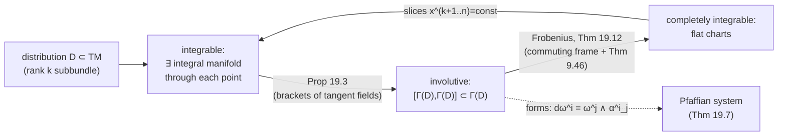

# DM16 · Distributions, Involutivity and the Frobenius Theorem

◀ [[DM15 Closed Subgroups and the Lie Correspondence]] · [[Differential Geometry - Course Map|Course Map]] · ▶ [[DM17 Foliations, Weakly Embedded Submanifolds and Lie Subgroups]]

taught · in syllabus extra · book extra · beyond

> [!warning] What the lecture source says (added 2026-11-07)
> **Week 13 (slide DG29)** introduces distributions, integral manifolds, integrability, involutivity, flat charts and complete integrability, and **states** the Local Frobenius Theorem (the OCR shows no proof). The lecture shows Prop 19.3 (integrable ⇒ involutive) with proof and three examples, of which the third (a rank-2 distribution on $\mathbb R^3$ with no integral manifold) is **partly illegible** (`[!verify]`: the formula and the final step). Everything in §4 beyond the statement (the proof via commuting frames, Cor 19.13, Example 19.14) and all of §5 (the differential-form criteria) is Lee, Ch. 19 (**extra · book**). **HW10 Q2–Q3** belong to [[DM17 Foliations, Weakly Embedded Submanifolds and Lie Subgroups]]. DM15 §3 stated Frobenius before this lecture was available; it is kept, and DM15 now points here. Source: [[mt3184-differential-geometry-and-lie-groups/2026-11-06-november-2-6|Nov 2–6 note (DG29, DG30)]]. Book: [[John M. Lee - Introduction to Smooth Manifolds.pdf#page=509|Lee Ch. 19, pp. 490–498]] (printed page = PDF page − 18).

> [!syllabus] Syllabus map: what is in the syllabus and what is extra in this chapter
> 🟢 **In syllabus (taught: DG29)**
> - §1 distributions of rank $k$, smoothness via local frames, examples (nowhere-zero field, $\mathrm{span}\{\partial_1,\dots,\partial_k\}$, a non-integrable rank-2 distribution on $\mathbb R^3$); §2 integral manifolds, **integrable ⇒ involutive** (Prop 19.3), involutive, §3 flat charts, completely integrable, the chain *completely integrable ⇒ integrable ⇒ involutive*, the statement of the **Local Frobenius Theorem**
>
> 🟡 **Extra · book** (Lee Ch. 19: Props 19.2, 19.4, 19.16, Lemma 19.5, Thm 19.7, Props 19.8, 19.11, Thm 19.12 with proof, Cor 19.13, Ex 19.14)
> - §2 $\Gamma(D)$ is a Lie subalgebra, the local frame criterion; §4 the proof of Frobenius, a flat chart by explicit flows, the local structure of integral manifolds (Prop 19.16); §5 defining forms and $d\omega^i=\omega^j\wedge\alpha^i_j$, Pfaffian systems, integrating factors
>
> 🔵 **Extra · beyond** (my additions, labelled)
> - §3 **holonomy**: the height gap of a horizontally lifted loop equals (curl) × (signed area), computed by ODE; §5 the thermodynamic integrating factor $1/T$; the statement that a *random* rank-2 distribution on $\mathbb R^3$ is never involutive; the octant example (Lee Problem 19-4) solved in full

> [!key] After this chapter you can
> - define a **distribution**, an **integral manifold**, **integrable**, **involutive**, a **flat chart** and **completely integrable**, and write the chain between them,
> - prove **integrable ⇒ involutive** and test involutivity of a given frame (bracket in the span?), or by the form criterion $\omega\wedge d\omega=0$,
> - state the **Local Frobenius Theorem** and prove it (reduction to a commuting frame by a coordinate projection, then Thm 9.46),
> - find a **flat chart explicitly** (Lee Ex. 19.14: leaves $z-xy=\text{const}$),
> - explain why integrability is **non-generic** and how the obstruction shows up as a **height gap** of a lifted loop.

> [!intuition] The one-sentence story
> A vector field has integral curves (ODE existence). A *plane* field has integral surfaces only if the planes **fit together**: moving along $X$ then $Y$ must land where moving along $Y$ then $X$ lands, to first order, and that is exactly "$[X,Y]$ stays in the plane field". Frobenius says this first-order test is also **sufficient**, locally: involutive plane fields are the tangent spaces of a stack of parallel slices in suitable coordinates.

*Concept map: the three notions are equivalent; the arrow $B\Rightarrow C$ is the easy one (needs only Cor 8.32), $C\Rightarrow D$ is Frobenius.*

![[fig_dm16_frobenius.png]]
*A: the leaves $z-xy=-1,0,1$ of the distribution of Lee Ex. 19.14 and the coordinate curves of the flat chart (§4). B: for $X=\partial_x+y\partial_z$, $Y=\partial_y$ the two routes (X then Y; Y then X) from the origin end at different heights: $[X,Y]=-\partial_z\notin D$ (§2). C: the height gap of the lift of a loop is $c\cdot\text{area}$ (§3). Numbers: `scripts/dm_numbers2.py` (DM16); `scripts/fig_dm16.py`.*

> [!tip] 🔬 Interactive: holonomy of a plane field
> Open [[Assets/interactive/dm_contact_holonomy.html|▶ dm_contact_holonomy.html]] (self-contained, works offline). Choose one of the three plane fields of this chapter, a loop (square, circle, rectangle, figure eight) and its size; the tool lifts the loop to a curve tangent to $D$ and shows the height gap $\Delta z=\oint A=\iint dA$. For the integrable field 3 the gap is $0$ for **every** loop; for the others it is the signed area times the curl; the figure eight (signed area $0$) closes even for the contact field.

## 1. Distributions
taught *Source: DG29* · extra · book *[[John M. Lee - Introduction to Smooth Manifolds.pdf#page=509|Lee p. 491]], Example 19.1*

> [!key] Definition (DG29; Lee p. 491)
> A **distribution of rank $k$** on a smooth $n$-manifold $M$ is a subset $D\subseteq TM$, $D=\coprod_{p}D_p$, where every $D_p\subseteq T_pM$ is a $k$-dimensional linear subspace, that is **smooth**: each point has a neighbourhood $U$ and smooth vector fields $V_1,\dots,V_k$ on $U$ such that $V_1|_q,\dots,V_k|_q$ is a basis of $D_q$ for every $q\in U$ ("$D$ is locally spanned by $V_1,\dots,V_k$"; a rank-$k$ subbundle of $TM$, [[DM04 The Tangent Bundle and the Rank Theorem]]). Other names: tangent distribution, $k$-plane field, tangent subbundle.

The word has nothing to do with generalised functions; it is a **choice of $k$-plane at every point, varying smoothly**. A rank-1 distribution is a line field: a nowhere-vanishing vector field gives one, and conversely (locally) a line field is spanned by a field, so ODE theory ([[DM12 Integral Curves, Flows and Flowouts]]) says every point lies on an **integral curve**. The new phenomenon starts at rank 2.

> [!key] Integral manifold, integrable (DG29; Lee p. 491)
> A nonempty **immersed** submanifold $N\subseteq M$ is an **integral manifold** of $D$ if $T_pN=D_p$ for **every** $p\in N$. $D$ is **integrable** if every point of $M$ lies in an integral manifold of $D$.

**Examples** (DG29 (i)–(iii); Lee Ex. 19.1):
1. **A nowhere-vanishing field $V$** spans a rank-1 distribution; the integral curves are its integral manifolds, so it is integrable.
2. **$\mathrm{span}\{\partial_1,\dots,\partial_k\}$ on $\mathbb R^n$**: the slices $\{x^{k+1}=c^{k+1},\dots,x^n=c^n\}$ are integral manifolds.
3. **The orthogonal complement of the radial field** on $\mathbb R^n\setminus 0$ (Lee Ex. 19.1(c)): through $x$ the sphere $|y|=|x|$ is an integral manifold.
4. **A distribution with no integral manifold** (Lee Ex. 19.1(d); the lecture's example (iii), whose formula is illegible in the OCR, is of this type, `[!verify]`): on $\mathbb R^3$ take $D=\mathrm{span}\{X=\partial_x+y\partial_z,\ Y=\partial_y\}$. *If* $N$ were an integral manifold through $0$, the integral curves of $X$ and $Y$ starting in $N$ would stay in $N$ (for a short time). The $x$-axis is an integral curve of $X$; from each point $(x,0,0)$ the $Y$-curve is the parallel to the $y$-axis. So $N$ would contain an open piece of the $(x,y)$-plane, whose tangent plane at points off the $x$-axis is not $D$ (it contains $\partial_y$ and $\partial_x$, but $D$ contains $\partial_x+y\partial_z$). Contradiction ([[John M. Lee - Introduction to Smooth Manifolds.pdf#page=510|Lee p. 492]]).

> [!example] Why the rank-2 case is different 🔵
> Figure B counts the same thing as height: from the origin follow $X$ for time $s$ then $Y$ for time $t$: $(s,t,0)$. Follow $Y$ then $X$: $Y$ takes you to $(0,t,0)$, then $X$ raises $z$ at rate $y=t$: $(s,t,st)$. **Two routes inside $D$ end at different points** of the same vertical line: a surface tangent to $D$ would contain both, and $D$ would force them to agree. The gap $st\,\partial_z=-[X,Y]\,st$ is exactly the Lie bracket (the flow-rectangle picture of [[DM10 Vector Fields and Lie Brackets]] §3, now leaving $D$).

## 2. Integral manifolds and involutivity
taught *Source: DG29 (Prop 19.3)* · extra · book *[[John M. Lee - Introduction to Smooth Manifolds.pdf#page=510|Lee Props 19.2–19.3, p. 492]], [[John M. Lee - Introduction to Smooth Manifolds.pdf#page=511|Lemma 19.4, p. 493]]*

> [!key] Involutive (DG29; Lee p. 492)
> $D$ is **involutive** if for every open $U\subseteq M$ and all smooth vector fields $X,Y$ on $U$ with $X_p,Y_p\in D_p$ for all $p\in U$ (**local sections of $D$**), also $[X,Y]_p\in D_p$ for all $p\in U$.

> [!key] Proposition 19.3: integrable ⇒ involutive (DG29)
> *Proof.* Let $X,Y$ be local sections of an integrable $D$ on $U$ and $p\in U$; let $S$ be an integral manifold through $p$, $\iota:S\hookrightarrow M$. Since $X_q,Y_q\in D_q=T_qS$ for $q\in S$, the restrictions $X|_S,Y|_S$ are tangent to $S$, so they are vector fields on $S$ that are $\iota$-related to $X,Y$; by naturality of the bracket ([[DM10 Vector Fields and Lie Brackets]] §4, Cor 8.32) $[X|_S,Y|_S]$ is $\iota$-related to $[X,Y]$, so $[X,Y]_p\in T_pS=D_p$. $\square$

**Two reformulations** (Lee):
- **Prop 19.2.** $D$ is involutive $\iff$ $\Gamma(D)$, the space of smooth global sections, is a **Lie subalgebra of $\mathfrak X(M)$**. (*Proof, ⇐:* extend local sections by a bump function equal to $1$ near $p$; $[\psi X,\psi Y]=\psi^2[X,Y]+\psi X(\psi)Y-\psi Y(\psi)X$ and the last two terms are in $\Gamma(D)$, equal to $[X,Y]$ near $p$.)
- **Lemma 19.4 (local frame criterion).** If every point has a local frame $(V_1,\dots,V_k)$ of $D$ with $[V_i,V_j]\in\Gamma(D)$ for all $i,j$, then $D$ is involutive. (*Proof:* for $X=X^iV_i$, $Y=Y^jV_j$, $[X,Y]=X^iY^j[V_i,V_j]+X^iV_i(Y^j)V_j-Y^jV_j(X^i)V_i$.)

So **to test involutivity, take a frame and look at the brackets of the frame fields**.

> [!example] Checking involutivity: three distributions on $\mathbb R^3$ (all brackets by `dm_numbers2.py`)
> * **Lee 19.1(d):** $X=\partial_x+y\partial_z$, $Y=\partial_y$: $[X,Y]=-\partial_z$ and $\det[X,Y,[X,Y]]=-1\ne0$ at every point, so $[X,Y]\notin D$: **not involutive**, hence (Prop 19.3) **not integrable**, consistent with the argument of §1.
> * **Lee 19.14:** $X=x\partial_x+\partial_y+x(y+1)\partial_z$, $Y=\partial_x+y\partial_z$: $[X,Y]=-\partial_x-y\partial_z=-Y\in D$: **involutive**.
> * **Lee Problem 19-4 (octant):** $X=y\partial_z-z\partial_y$, $Y=z\partial_x-x\partial_z$ on $x,y,z>0$ (the rotation fields about the $x$- and $y$-axes): $[X,Y]=y\partial_x-x\partial_y=\frac xzX+\frac yzY\in D$: **involutive**. Both fields preserve $r^2=x^2+y^2+z^2$ ($X(r^2)=Y(r^2)=0$), so the integral manifolds are the **spheres $r=\text{const}$** and a global flat chart is spherical coordinates $(r,\theta,\varphi)$ with $D=\mathrm{span}\{\partial_\theta,\partial_\varphi\}$ (the other two coordinates are the leaves' labels).
> * **A random rank-2 distribution is not involutive** 🔵: for $400$ random frames $X,Y$ with affine coefficients, $[X,Y]\notin\mathrm{span}\{X,Y\}$ at the sample point in **all $400$** cases (`det≠0`). Integrability is a *closed condition of infinite codimension*; the contact structure of §3 is the typical case.

## 3. Flat charts, complete integrability and the holonomy picture
taught *Source: DG29* · extra · beyond *holonomy computation*

> [!key] Flat chart; completely integrable (DG29; Lee p. 496)
> A chart $(U,\varphi)$, $\varphi=(x^1,\dots,x^n)$, is **flat for $D$** if $D_q=\mathrm{span}(\partial_1|_q,\dots,\partial_k|_q)$ for all $q\in U$ (Lee also asks that $\varphi(U)$ be a cube). In a flat chart every slice $\{x^{k+1}=c^{k+1},\dots,x^n=c^n\}$ is an integral manifold. $D$ is **completely integrable** if every $p\in M$ lies in a chart flat for $D$.
>
> **The chain (DG29):** completely integrable $\Rightarrow$ integrable (slices) $\Rightarrow$ involutive (Prop 19.3).
>
> **Local Frobenius Theorem (DG29; Lee Thm 19.12).** *Every involutive distribution is completely integrable.* So all three notions are equivalent.

**The holonomy picture** 🔵. Write a rank-2 distribution on $\mathbb R^3$ transverse to $\partial_z$ as $D=\ker\omega$, $\omega=dz-A$ with $A=A_1dx+A_2dy$ (a 1-form on the plane). **Horizontal lifts:** given a curve $\gamma$ in the $(x,y)$-plane there is, for each starting height, a unique curve in $\mathbb R^3$ tangent to $D$ over it, with $dz=A$ along $\gamma$. For a *closed* loop the lift ends at height
$$\Delta z=\oint_\gamma A=\iint_{\text{inside}}dA\qquad(\text{Stokes}).$$
If $D$ had an integral surface $z=f(x,y)$ through the starting point, the lift would stay on it, so $\Delta z=0$ for every small loop, i.e. $dA=0$. Conversely $dA=0$ means $A=df$ locally and $z=f+c$ are integral surfaces. So **integrability $\iff dA=0\iff d\omega=-dA=0\ \Leftrightarrow\ \omega\wedge d\omega=0$** (the last because, for $dA=k\,dx\wedge dy$, $\omega\wedge d\omega=-k\,dx\wedge dy\wedge dz$; §5 proves the general criterion). Numbers (ODE, `dm_numbers2.py`):

| loop | field $A$ | height gap $\Delta z$ | $k\times$ area ($dA=k\,dx\wedge dy$) |
|---|---|---|---|
| square, side $0.50$ | $A=x\,dy$ ($c=1$) | $0.250000$ | $1\times0.25$ |
| square, side $0.25$ | $x\,dy$ | $0.062500$ | $0.0625$ |
| square, side $0.10$ | $x\,dy$ | $0.010000$ | $0.01$ |
| circle, radius $0.50$ | $x\,dy$ | $0.785398$ | $\pi/4$ |
| circle, radius $0.25$ | $x\,dy$ | $0.196350$ | $\pi/16$ |
| any loop | $A=y\,dx+x\,dy=d(xy)$ (**Lee 19.14**) | $0$ | $0$ |
| any loop | $A=y\,dx$ (**Lee 19.1(d)**) | $-\text{area}$ | $-1\times$ area |

The gap scales as the **area, i.e. quadratically in the loop size**: this is the second-order effect of the bracket, $t^2[X,Y]$, which the interactive tool makes visible (it halves the loop size and the gap quarters).

> [!example] The contact distribution of §3 of DM15 🔵
> $D=\mathrm{span}\{\partial_x,\partial_y+x\partial_z\}$ has $A=x\,dy$ ($c=1$). The commutator quadrilateral $X_1,X_2,-X_1,-X_2$ of side $\varepsilon$ ends at $(0,0,\varepsilon^2)$: $\varepsilon=0.5$ gives $0.25$. Any two points of $\mathbb R^3$ can be joined by a curve tangent to $D$ (a fact called Chow's theorem, quoted here without proof, **not read**): the planes twist so much that no surface follows them, yet one can reach everywhere.

## 4. The Frobenius theorem: proof and a worked flat chart
taught *Source: DG29 (statement only)* · extra · book *[[John M. Lee - Introduction to Smooth Manifolds.pdf#page=515|Lee Thm 19.12, p. 497]], [[John M. Lee - Introduction to Smooth Manifolds.pdf#page=516|Cor. 19.13 and Ex. 19.14, p. 498]], [[John M. Lee - Introduction to Smooth Manifolds.pdf#page=518|Prop 19.16, p. 500]]*

> [!key] Proof of the Local Frobenius Theorem (Lee p. 497)
> **Reduction.** By [[DM13 Lie Derivatives and Commuting Vector Fields]] (Thm 9.46) a distribution locally spanned by $k$ independent **commuting** fields is completely integrable: the chart $(s^1,\dots,s^n)$ with $V_i=\partial_{s^i}$ is flat. So it suffices to show that an involutive $D$ is locally spanned by independent commuting fields.
>
> **Construction.** Work in a chart, $U\subseteq\mathbb R^n$, with a local frame $X_1,\dots,X_k$ for $D$; reorder coordinates so that $D_p$ is **complementary** to $\mathrm{span}(\partial_{k+1}|_p,\dots,\partial_n|_p)$. Let $\pi:\mathbb R^n\to\mathbb R^k$ be the projection onto the first $k$ coordinates. The differential $d\pi|_{D_p}:D_p\to T_{\pi(p)}\mathbb R^k$ is bijective, hence (continuity) bijective on $D_q$ for $q$ near $p$, with smooth inverse. Define
> $$V_i|_q=\big(d\pi|_{D_q}\big)^{-1}\Big(\frac{\partial}{\partial x^i}\Big|_{\pi(q)}\Big),\qquad i=1,\dots,k.$$
> These fields are a smooth frame for $D$ and $V_i$ is **$\pi$-related** to $\partial/\partial x^i$.
>
> **Commutation.** Naturality of the bracket gives $d\pi_q[V_i,V_j]_q=[\partial_i,\partial_j]=0$. By involutivity $[V_i,V_j]$ takes values in $D$, and $d\pi$ is injective on $D$, so $[V_i,V_j]=0$. $\square$

> [!key] Corollary 19.13 (Lee p. 498)
> If $D$ is involutive of rank $k$ and $S$ is an embedded submanifold of codimension $k$ with $T_pS$ **complementary** to $D_p$, then there is a flat chart $(s^i)$ for $D$ centred at $p$ with $S\cap U=\{s^1=\dots=s^k=0\}$.

**How to find a flat chart in practice (Lee Ex. 19.14).** The proof is a recipe: *project, lift to commuting fields, flow out of a transversal.* $D=\mathrm{span}\{X,Y\}$ with $X=x\partial_x+\partial_y+x(y+1)\partial_z$, $Y=\partial_x+y\partial_z$ is involutive ($[X,Y]=-Y$, §2). It is complementary to $\partial_z$, so use $\pi(x,y,z)=(x,y)$. Fields in $D$ that are $\pi$-related to $\partial_x,\partial_y$ must be of the form $V=\partial_x+u\partial_z$, $W=\partial_y+v\partial_z$; solving gives
$$V=Y=\partial_x+y\partial_z,\qquad W=X-xY=\partial_y+x\partial_z,\qquad [V,W]=0\ \ (\text{checked}).$$
Their flows are explicit, $\alpha_t(x,y,z)=(x+t,\,y,\,z+ty)$ and $\beta_t(x,y,z)=(x,\,y+t,\,z+tx)$ (both verified against $\dot{}=V$, $W$). Flow out of the $z$-axis ($S=\{x=y=0\}$):
$$\Phi(u,v,w)=\alpha_u\circ\beta_v(0,0,w)=(u,\ v,\ w+uv),\qquad \Phi^{-1}(x,y,z)=(x,\ y,\ z-xy).$$
So the **flat coordinates are $(u,v,w)=(x,y,z-xy)$ and the integral manifolds are the level sets of $w=z-xy$** (a *global* chart, so these are all of them). Check: $X(w)=x(y+1)-(xy+x)=0$ and $Y(w)=y-y=0$; at 200 random points $|dw(X)|,|dw(Y)|=0$ to machine precision. This is figure A. Compare with the **non-integrable** $\partial_x+y\partial_z$, $\partial_y$: the surfaces $z=xy+c$ are tangent to $\partial_x+y\partial_z$, but their tangent plane contains $\partial_y+x\partial_z$, not $\partial_y$.

> [!key] Proposition 19.16: the local structure of integral manifolds (Lee p. 500; used in DM17)
> Let $(U,x^i)$ be a flat chart for an involutive $D$ and $H$ **any** integral manifold. Then $H\cap U$ is a **countable disjoint union of open subsets of parallel $k$-slices**, each open in $H$ and embedded in $M$.
> *Proof sketch.* $H\cap U=\iota^{-1}(U)$ is open in $H$, so it is a countable union of connected components $V$. On $V$ the pullbacks of the defining forms $dx^{k+1},\dots,dx^n$ vanish, so $x^{k+1},\dots,x^n$ are constant: $V$ lies in one slice $S$. The inclusion $V\to S$ is an injective immersion between manifolds of the same dimension, a local diffeomorphism and open; so $V$ is open in $S$. $\square$
> **Consequence:** an integral manifold can wind through the same chart **infinitely often** (countably many slices), e.g. the dense line on the torus ([[DM17 Foliations, Weakly Embedded Submanifolds and Lie Subgroups]] §2).

## 5. Differential forms: defining forms and the Pfaffian criterion
extra · book *[[John M. Lee - Introduction to Smooth Manifolds.pdf#page=511|Lemma 19.5, p. 493]], [[John M. Lee - Introduction to Smooth Manifolds.pdf#page=512|Thm 19.7, p. 494]], [[John M. Lee - Introduction to Smooth Manifolds.pdf#page=513|Prop 19.8, p. 495]]* · extra · beyond *thermodynamic example*

A distribution of rank $k$ on an $n$-manifold can be given **dually**: locally $D=\ker\omega^1\cap\dots\cap\ker\omega^{n-k}$ for independent 1-forms $\omega^i$, the **local defining forms** (Lee Lemma 19.5: $D$ is smooth iff such forms exist locally). A form $\eta$ **annihilates** $D$ if $\eta(X_1,\dots,X_p)=0$ for sections $X_j$ of $D$.

> [!key] Theorem 19.7 (1-form criterion) and Prop 19.8 (Lee pp. 494–495)
> **$D$ is involutive $\iff$ whenever a 1-form $\eta$ annihilates $D$ on $U$, so does $d\eta$.** *Proof.* From $d\eta(X,Y)=X\eta(Y)-Y\eta(X)-\eta([X,Y])$: if $\eta$ annihilates $D$ then the first two terms vanish, so $d\eta(X,Y)=-\eta([X,Y])$, which is $0$ for all $\eta$ annihilating $D$ iff $[X,Y]\in D$.
> **Local coframe criterion (Prop 19.8).** For defining forms $\omega^1,\dots,\omega^{n-k}$, the following are equivalent: **(a)** $D$ involutive; **(b)** each $d\omega^i$ annihilates $D$; **(c)** there are 1-forms $\alpha^i_j$ with $d\omega^i=\sum_j\omega^j\wedge\alpha^i_j$ (so $d\omega^i\wedge\omega^1\wedge\dots\wedge\omega^{n-k}=0$, which is Lee Problem 19-2).

For a **single** form ($n-k=1$) this reads: $D=\ker\omega$ is involutive $\iff\ \omega\wedge d\omega=0$. The set of forms annihilating $D$ is an **ideal** in the algebra of forms (a *Pfaffian system*), and (Lee Prop 19.11) involutivity says it is a **differential ideal** ($d$ maps it into itself); this is the form in which Frobenius is used for PDE systems (Lee §"Overdetermined systems", Thm 19.27, not read in detail).

**Examples (checked symbolically).**
- Lee 19.1(d): $\omega=dz-y\,dx$; $d\omega=dx\wedge dy$; $\omega\wedge d\omega=dz\wedge dx\wedge dy=+1\,dx\wedge dy\wedge dz\ne0$: not integrable.
- Lee 19.14: $\omega=dw=d(z-xy)$, $d\omega=0$: integrable.
- The contact form $dz-x\,dy$: $\omega\wedge d\omega=-dz\wedge dx\wedge dy\ne0$.

> [!example] Integrating factors and the entropy 🔵 (cross-subject)
> A nowhere-vanishing 1-form $\omega$ has an **integrating factor** $\mu$ ($\mu\omega$ exact) near each point iff $d\omega\wedge\omega=0$; and **if $\dim M=2$ every nonvanishing 1-form has one** (Lee Problem 19-3, [[John M. Lee - Introduction to Smooth Manifolds.pdf#page=530|p. 512]]; here $\omega\wedge d\omega$ is a 3-form, hence $0$). Thermodynamics: on the $(U,V)$ state plane the **heat 1-form** $\delta Q=dU+P\,dV$ is not closed, but it has an integrating factor. For one mole of a monatomic ideal gas, $P=\tfrac{2U}{3V}$: $d(\delta Q)=\tfrac{2}{3V}dU\wedge dV\ne0$, while $\delta Q/U$ is **exact**: $\delta Q/U=d\big(\tfrac32\ln U+\ln V\big)$, so $S/R=\tfrac32\ln U+\ln V$ and $T\propto U$ ($1/T$ is the integrating factor). Numbers: doubling $V$ at fixed $T$ gives $\Delta S=R\ln2=5.763$ J/K; tripling $U$ at fixed $V$, $\Delta S=\tfrac32R\ln3=13.702$ J/K. (Carathéodory's formulation of the second law makes the *existence of such an integrating factor for $n>2$ variables* the content of the law; that statement is recalled, **not read**, and is flagged as such.) Link: [[Thermodynamics and Statistical Mechanics - Course Map]], [[TH04 The Second Law Carnot Engines and Entropy]].

## Map of this chapter
> [!connection] How DM16 connects
> **Builds on:** [[DM10 Vector Fields and Lie Brackets]] (brackets, naturality, Cor 8.32), [[DM13 Lie Derivatives and Commuting Vector Fields]] (Thm 9.46 canonical form for commuting fields: the engine of the Frobenius proof), [[DM04 The Tangent Bundle and the Rank Theorem]] (subbundles, charts), [[DM12 Integral Curves, Flows and Flowouts]] (flows, flowout from a transversal).
> **Leads to:** [[DM17 Foliations, Weakly Embedded Submanifolds and Lie Subgroups]] (global Frobenius, foliations, Lie subgroup of a subalgebra), [[DM15 Closed Subgroups and the Lie Correspondence]] (which uses it), differential forms and de Rham theory (Lee Ch. 14–19; not in the course).
> **Concepts:** [[Distribution]] · [[Integral Manifold]] · [[Involutive Distribution]] · [[Flat Chart for a Distribution]] · [[Frobenius Theorem]] · [[Defining Forms and Pfaffian Systems]] · [[Integrating Factor]] · [[Holonomy of a Plane Field]]
> **Other subjects:** [[Thermodynamics and Statistical Mechanics - Course Map]] (integrating factor $=1/T$), [[Classical Mechanics - Course Map]] (non-holonomic constraints are exactly non-integrable distributions on configuration space: rolling without slipping, the "falling cat"; recalled, not read), [[Proofs, Analysis and Topology - Course Map]] ([[PA14 ODE Existence Uniqueness and Smooth Dependence]]: flows).

## Summary
> [!summary] Cheat-sheet
> - **Distribution** of rank $k$ = smooth choice of $k$-planes $D_p\subseteq T_pM$ (locally spanned by $k$ independent fields). **Integral manifold** = immersed $N$ with $T_pN=D_p$. **Integrable** = through every point. **Involutive** = brackets of local sections are sections.
> - **Integrable ⇒ involutive** (brackets of fields tangent to $S$ are tangent to $S$, Cor 8.32). **Test:** brackets of a local frame lie in the span (Lemma 19.4).
> - **Flat chart:** $D=\mathrm{span}\{\partial_1,\dots,\partial_k\}$; **completely integrable** = flat charts around every point. **Frobenius:** involutive ⇒ completely integrable (project to $\mathbb R^k$, lift $\partial_i$ to commuting fields $V_i=(d\pi|_D)^{-1}\partial_i$, Thm 9.46).
> - **Flat chart in practice:** project, find commuting lifts, flow out of a transversal (Lee 19.14: $w=z-xy$).
> - **Forms:** $D=\ker\omega^1\cap\dots$; involutive $\iff d\omega^i=\sum\omega^j\wedge\alpha^i_j$; for one form, $\omega\wedge d\omega=0$.
> - **Obstruction = holonomy:** the lift of a loop has height gap $\oint A=\iint dA$ (area × curl). Random rank-2 distributions on $\mathbb R^3$ are not involutive.
> - **Prop 19.16:** an integral manifold meets a flat chart in countably many open slices.

## Practice
1. **Involutive or not?** Decide for $D_1=\mathrm{span}\{\partial_x+z\partial_y,\ \partial_z\}$, $D_2=\mathrm{span}\{x\partial_y-y\partial_x,\ \partial_z\}$ on $\mathbb R^3\setminus\{x=y=0\}$, and $D_3=\mathrm{span}\{\partial_x,\ \partial_y+x\partial_z\}$. For the involutive ones name the integral manifolds.
2. **Integrable ⇒ involutive.** Prove Prop 19.3 in your own words, and show by an example that an *involutive* distribution of rank 2 on $\mathbb R^3$ can have its leaves **not planes**.
3. **The form test.** For $\omega=dz-y\,dx$ and $\omega'=dz-y\,dx-x\,dy$ compute $d\omega$ and $\omega\wedge d\omega$ and compare with §2.
4. **Lee 19.14.** Verify $[X,Y]=-Y$, $[V,W]=0$, the flows $\alpha_t,\beta_t$, and that $z-xy$ is constant on the leaves.
5. **A flat chart.** Is there a flat chart for $D=\mathrm{span}\{\partial_x+y\partial_z,\ \partial_y\}$? (Test involutivity first.) Find one for $D=\mathrm{span}\{\partial_x+2x\partial_z,\ \partial_y+2y\partial_z\}$, and decide $D=\mathrm{span}\{\partial_x+\partial_z,\ \partial_y+z\partial_z\}$ near $(0,0,1)$.
6. **Octant (Lee 19-4).** Show $D=\mathrm{span}\{y\partial_z-z\partial_y,\ z\partial_x-x\partial_z\}$ is involutive on $x,y,z>0$, identify the leaves, and give a global flat chart.
7. **Holonomy.** For $A=c\,x\,dy$ compute the height gap of the square of side $e$ and the circle of radius $r$; what is it for the figure-eight loop?
8. **Frobenius, step by step.** In the proof, why can one assume $D_p$ is complementary to $\mathrm{span}(\partial_{k+1},\dots,\partial_n)$? Why is $[V_i,V_j]=0$ and not merely "in $D$"?
9. **Local structure.** Use Prop 19.16 to explain why the leaf $\{(t,\sqrt2t)\}$ of the torus meets a small square in infinitely many slices.
10. **Entropy.** Show that $\delta Q=dU+P\,dV$ with $P=nRT/V$, $U=\tfrac32nRT$ has the integrating factor $1/T$ and find $S$.

> [!example]- Solutions
> 1. $D_1$: $X=\partial_x+z\partial_y$, $Z=\partial_z$: $[X,Z]=-\partial_y$ and $\det[X,Z,[X,Z]]=\det[(1,z,0),(0,0,1),(0,-1,0)]=1\ne0$, so $[X,Z]\notin D_1$: **not involutive**. $D_2$: $X=-y\partial_x+x\partial_y$ (rotation), $Z=\partial_z$: $[X,Z]=0$: **involutive**; leaves $=$ cylinders $x^2+y^2=r^2$. $D_3$: contact (§3): not involutive.
> 2. §2. Example: $D_2$ above (cylinders), or Lee 19.14 (graphs $z=xy+c$).
> 3. $\omega=dz-y\,dx$: $d\omega=dx\wedge dy$, $\omega\wedge d\omega=dz\wedge dx\wedge dy\ne0$. $\omega'=dz-d(xy)$: $d\omega'=0$, $\omega'\wedge d\omega'=0$.
> 4. §4 and `dm_numbers2.py`.
> 5. $[X,Y]=-\partial_z\notin D$ for $X=\partial_x+y\partial_z$, $Y=\partial_y$: not involutive, **no flat chart**. For $X=\partial_x+2x\partial_z$, $Y=\partial_y+2y\partial_z$: $[X,Y]=0$, the flows are $(x+t,y,z+2xt+t^2)$ and $(x,y+t,z+2yt+t^2)$, the leaves are $z=x^2+y^2+c$ and a flat chart is $(x,y,z-x^2-y^2)$. For $X=\partial_x+\partial_z$, $Y=\partial_y+z\partial_z$: $[X,Y]=X(z)\partial_z-Y(1)\partial_z=\partial_z$, and at $(0,0,1)$, $D=\mathrm{span}\{(1,0,1),(0,1,1)\}\not\ni\partial_z$: **not involutive**, no flat chart (the pitfall is to assert integrability without computing).
> 6. §2: $[X,Y]=\frac xzX+\frac yzY$; $r^2$ is constant on the leaves; spherical coordinates.
> 7. §3: $c\,e^2$ for the square, $c\pi r^2$ for the circle, $0$ for the figure eight (signed area $0$).
> 8. Reordering coordinates is just a relabelling; then $d\pi|_{D_p}$ is injective (kernel of $d\pi$ is $\mathrm{span}(\partial_{k+1},\dots)$ meets $D_p$ trivially), hence bijective for dimension reasons. $[V_i,V_j]\in\Gamma(D)$ by involutivity and $d\pi[V_i,V_j]=0$ with $d\pi|_D$ injective gives $[V_i,V_j]=0$.
> 9. $H\cap U$ is a countable union of open parts of slices; the leaf winds densely, so it returns infinitely often to $U$ with different slices ($N\times$ max gap $\to1.2\text{–}1.5$: DM17 §2).
> 10. $\delta Q/T=\tfrac32nR\,dU/U+nR\,dV/V=d\big[nR(\tfrac32\ln U+\ln V)\big]$ ($T=2U/3nR$): $S=nR\ln(U^{3/2}V)+\text{const}$.

## Provenance
> [!provenance]- Source map for this chapter
> | Topic | Source | Scope |
> |---|---|---|
> | distribution, examples (i)–(iii), integral manifold, integrable, Prop 19.3 with proof, involutive, flat chart, completely integrable, the chain, **statement** of Local Frobenius | slide DG29 via [[mt3184-differential-geometry-and-lie-groups/2026-11-06-november-2-6\|Nov 2–6 note]] | taught (OCR; example (iii) illegible) |
> | HW10 (foliations, Φ-invariance, Lie subgroup of a subalgebra, submersions) | [[mt3184-differential-geometry-and-lie-groups/2026-11-06-hw10\|HW10]] | taught (via homework; solved in DM17) |
> | Props 19.2, 19.3, Lemma 19.4, Lemma 19.5, Thm 19.7, Prop 19.8, Thm 19.12 and its proof, Cor 19.13, Ex 19.14, Prop 19.16, Problems 19-2, 19-3, 19-4 | Lee, Ch. 19 (read: pp. 490–500, 512); [[John M. Lee - Introduction to Smooth Manifolds.pdf#page=515\|Thm 19.12, p. 497]], [[John M. Lee - Introduction to Smooth Manifolds.pdf#page=516\|Ex. 19.14, p. 498]], [[John M. Lee - Introduction to Smooth Manifolds.pdf#page=207\|Cor 8.32, p. 189]], [[John M. Lee - Introduction to Smooth Manifolds.pdf#page=252\|Thm 9.46, p. 234]] | extra/book |
> | holonomy table, random-frame test, octant bracket, flat-chart checks, entropy example | `scripts/dm_numbers2.py` (DM16), `scripts/fig_dm16.py`, tool `dm_contact_holonomy` | extra/beyond |
>
> **Notes.** [!verify] DG29's example (iii) (the non-integrable rank-2 field on $\mathbb R^3$) is illegible in the OCR; Lee Ex. 19.1(d) is the example of that type and is used here. Lee's proof of Frobenius is **not** on the legible slides. Chow's theorem and Carathéodory's principle are named from memory and **not read**; the relation of non-holonomic constraints to non-integrable distributions is likewise recalled. Lee's Prop 19.11 (differential ideal) and Thm 19.27 (overdetermined PDE) are mentioned from the pages read (p. 496, p. 508) but not worked.
