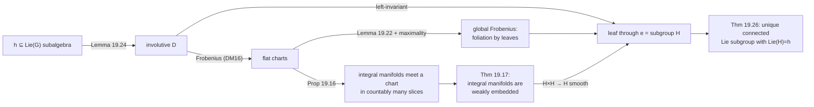

# DM17 · Foliations, Weakly Embedded Submanifolds and Lie Subgroups

◀ [[DM16 Distributions, Involutivity and the Frobenius Theorem]] · [[Differential Geometry - Course Map|Course Map]] · (last chapter of the course map; DM15 §2–3 is the application)

taught · in syllabus extra · book extra · beyond

> [!warning] What the lecture source says (added 2026-11-07)
> Slides **DG27–DG28** (weeks of 26–30 Oct) prove the properties of $\exp$ (Prop 20.10, Cor 20.11, naturality), the characterisation $\mathrm{Lie}(H)=\{X:\exp tX\in H\ \forall t\}$, the lemma on smooth maps into embedded submanifolds, the **figure-eight counterexample** and the definition of **weakly embedded**, and give the **proof of the Closed Subgroup Theorem** (Thm 20.12). **DG29–DG30** (2–6 Nov) give foliations, the global Frobenius theorem, $\Phi$-invariance (Prop 19.23, left as HW10 Q3), **Thm 19.17**, **Lemma 19.24**, **Thms 19.25–19.26** (every Lie subgroup is weakly embedded; Lie subgroups $\leftrightarrow$ Lie subalgebras). **HW10** (all five problems) is solved in §8. All slides are handwritten and were read by OCR: the proof of Thm 19.26 and the last lines of the Closed Subgroup proof are **partly garbled** (`[!verify]`; the arguments here are Lee's, p. 506–507, and agree with what is legible). Sources: [[mt3184-differential-geometry-and-lie-groups/2026-11-06-october-26-30|Oct 26–30 note (DG27–28)]], [[mt3184-differential-geometry-and-lie-groups/2026-11-06-november-2-6|Nov 2–6 note (DG29–30)]], [[mt3184-differential-geometry-and-lie-groups/2026-11-06-hw10|HW10]]. Book: [[John M. Lee - Introduction to Smooth Manifolds.pdf#page=518|Lee pp. 500–507]] and Ch. 5 ([[John M. Lee - Introduction to Smooth Manifolds.pdf#page=131|pp. 112–115]]); printed page = PDF page − 18.

> [!syllabus] Syllabus map: what is in the syllabus and what is extra in this chapter
> 🟢 **In syllabus (taught: DG27–DG30, HW10)**
> - §1 smooth maps into embedded submanifolds, the figure eight, **weakly embedded**, Lie subgroups are weakly embedded; §2 foliations and flat charts, the torus example; §3 the **global Frobenius theorem** (statement); §4 **$\Phi$-invariance**; §6 **Lie subalgebra $\Rightarrow$ unique connected Lie subgroup** (Lemma 19.24, Thm 19.25–19.26); §7 $\mathrm{Lie}(H)=\{X:\exp tX\in H\}$ and naturality; **HW10 Q1–Q5** (§8)
>
> 🟡 **Extra · book** (Lee Ch. 5, Ch. 19)
> - §3 the proof of the global Frobenius theorem (Lemma 19.22: a union of integral manifolds through a point is an integral manifold; the countability argument); more examples of foliations (Lee Ex. 19.18(b)–(g)); Thm 5.33 (uniqueness of the structure of a weakly embedded submanifold)
>
> 🔵 **Extra · beyond** (my additions, labelled)
> - numerics for the irrational foliation (three gap sizes, density rate), the non-Hausdorff (indiscrete) leaf space, the $\mathfrak{so}(2,1)$ example for the submersion foliation, the $\mathrm{Aff}(1)$ subgroup computations, the proof of $\Phi$-invariance, the full solutions of HW10

> [!key] After this chapter you can
> - say when a submanifold is **weakly embedded** and show that **embedded** ⇒ weakly embedded, **integral manifolds of involutive distributions are weakly embedded**, and the figure eight is not,
> - define a **foliation** (leaves + flat charts) and give examples with closed and dense leaves,
> - state the **global Frobenius theorem** (involutive $D$ ⇒ foliation by maximal connected integral manifolds) and explain why leaves may fail to be embedded,
> - decide **$\Phi$-invariance** of $D$ and of $\mathcal F$ and prove they are equivalent,
> - construct, for a Lie subalgebra $\mathfrak h\subseteq\mathfrak g$, the **unique connected Lie subgroup** with Lie algebra $\mathfrak h$, and see why it need not be closed,
> - solve **HW10**.

> [!intuition] The one-sentence story
> A distribution is the infinitesimal data; a **foliation** is its global shadow: the whole manifold cut into **leaves** that look, in a flat chart, like parallel slices. Leaves are **immersed**, not necessarily embedded (a leaf can accumulate on itself like the irrational line on the torus), but they are still *honest* submanifolds in the **weak** sense: any smooth map into $M$ that lands in a leaf is smooth into the leaf. That single property is what makes the leaf through $e$ of a left-invariant foliation a **Lie group** (the multiplication, smooth into $G$, is smooth into $H$), and gives the **subgroup for every subalgebra**.

*Concept map: involutivity gives flat charts, flat charts give weak embeddedness and a foliation, and for a left-invariant $D$ on a Lie group these two facts produce a subgroup.*

![[fig_dm17_foliations.png]]
*A: the leaves of slope $3/5$ (closed after 5 turns) and $\sqrt2$ (dense) on the torus (§2). B: the figure eight $S$ and $G(t)=(\sin2t,\sin t)$, which leaves the end of the parameter interval and re-enters at the other end: $G:\mathbb R\to S$ is not continuous (§1). C: the foliation of $\mathbb R^3\setminus 0$ by the components of the level sets of $F=x^2+y^2-z^2$ (§5, HW10 Q5). Numbers: `scripts/dm_numbers2.py` (DM17); `scripts/fig_dm17.py`.*

> [!tip] 🔬 Interactive: closed or dense leaves
> Open [[Assets/interactive/dm_torus_foliation.html|▶ dm_torus_foliation.html]] (self-contained, works offline). Choose a slope (1/2, 3/5, √2, the golden ratio, π−3, or 0.6 + 10⁻⁶) and the number of turns $N$; the left panel draws the leaf in the unrolled torus, the right panel shows how fast the crossings of the transversal $x=\tfrac12$ fill the circle. For rational slope the crossing count stops at $q$; for irrational slope it keeps growing and the largest gap decays like $1/N$.

## 1. Weakly embedded submanifolds
taught *Source: DG28, DG30 (Thm 19.17)* · extra · book *[[John M. Lee - Introduction to Smooth Manifolds.pdf#page=131|Cor 5.30, p. 113]], [[John M. Lee - Introduction to Smooth Manifolds.pdf#page=132|p. 114]], [[John M. Lee - Introduction to Smooth Manifolds.pdf#page=133|Thm 5.33, p. 115]], [[John M. Lee - Introduction to Smooth Manifolds.pdf#page=518|Thm 19.17, p. 500]]*

**The question.** Let $S\subseteq M$ be a submanifold and $F:N\to M$ smooth with $F(N)\subseteq S$. Is $F:N\to S$ smooth? (Then restricting the codomain is harmless.)

> [!key] Embedded case (DG28 Lemma; Lee Cor 5.30)
> If $S$ is **embedded** the answer is yes. *Proof.* Let $p\in N$. Take a slice chart $(V,\psi)$ of $S$ around $F(p)$, $S\cap V=\{\psi^{k+1}=\dots=\psi^n=0\}$, and a chart $(U,\varphi)$ of $N$ at $p$ with $F(U)\subseteq V$ (possible since $F$ is continuous into $M$ and $S$ has the **subspace topology**). In these charts the last $n-k$ components of $\psi\circ F\circ\varphi^{-1}$ vanish and the first $k$ are smooth. $\square$

> [!key] Weakly embedded (DG28; Lee p. 113–114)
> An **immersed** submanifold $S\subseteq M$ is **weakly embedded** (also called an *initial submanifold*) if **every** smooth map $F:N\to M$ with $F(N)\subseteq S$ is smooth as a map $N\to S$. By the lemma, **embedded ⇒ weakly embedded**.

> [!example] The figure eight is *not* weakly embedded (DG28; Lee Ex. 5.28)
> Let $S$ be the image of $\beta(t)=(\sin2t,\sin t)$ on a bounded interval of length $2\pi$, with the topology and smooth structure making $\beta$ a diffeomorphism onto $S$ (an injective immersion that is not an embedding). The map $G:\mathbb R\to\mathbb R^2$, $G(t)=(\sin2t,\sin t)$, is smooth with image in $S$, but $\beta^{-1}\circ G$ is **not continuous**: with the interval $(-\pi/2,3\pi/2)$ (my choice; the endpoints are illegible in the text layer of Lee Ex. 4.19) one finds $G(3\pi/2\mp\varepsilon)=(\pm0.002,-1)$ for $\varepsilon=10^{-3}$, essentially the same point of the plane, but $\beta^{-1}G$ equals $4.7114$ then $-1.5698$: a **jump of $2\pi$** (figure B). The figure eight is a closed *curve* that the immersion cuts open at the point $(0,-1)$.
>
> **Dense curve on the torus.** The dense line $t\mapsto(e^{2\pi it},e^{2\pi i\alpha t})$, $\alpha$ irrational (Lee Ex. 4.20), is *weakly embedded* (Lee, p. 114, citing Problem 5-13; also a consequence of Thm 19.17 below, since it is a leaf of an involutive distribution): any smooth map into $T^2$ that lands on the line is smooth into the line (parameter $t$).

**Why it matters.** (i) **Uniqueness** (Lee Thm 5.33): a weakly embedded submanifold has only **one** topology and smooth structure making it an immersed submanifold; so "the leaf" or "the Lie subgroup" is a well-defined object, not a choice. (ii) **Lie groups**: if $H\subseteq G$ is a subgroup and weakly embedded, then multiplication $H\times H\to G$ (smooth into $G$, landing in $H$) is automatically smooth into $H$.

> [!key] Theorem 19.17: integral manifolds of involutive distributions are weakly embedded (DG30; Lee p. 500)
> *Proof.* Let $H$ be an integral manifold of an involutive $D$ and $F:N\to M$ smooth with $F(N)\subseteq H$. Let $p\in N$, $q=F(p)$, take flat coordinates $(y^i)$ for $D$ on a neighbourhood $U$ of $q$ and a connected coordinate neighbourhood $B$ of $p$ with $F(B)\subseteq U$. The last $n-k$ components $F^{k+1},\dots,F^n$ take only **countably many** values on $B$, because $F(B)\subseteq H\cap U$ is contained in countably many slices (Prop 19.16, DM16 §4). A continuous function on a connected set with countably many values is constant (intermediate value theorem), so $F(B)$ lies in a **single slice** $S$. Now $S\cap H$ is open in $H$ and **embedded** in $M$, so by the embedded case $F|_B:B\to S\cap H$ is smooth, hence smooth into $H$. $\square$

## 2. Foliations
taught *Source: DG29* · extra · book *[[John M. Lee - Introduction to Smooth Manifolds.pdf#page=519|Foliations, Ex. 19.18, pp. 501–502]], [[John M. Lee - Introduction to Smooth Manifolds.pdf#page=520|Prop 19.19, p. 502]]*

> [!key] Foliation (DG29; Lee p. 501)
> Let $\mathcal F$ be a collection of **disjoint, connected, nonempty, immersed $k$-dimensional submanifolds** (the **leaves**) whose union is $M$. A chart $(U,\varphi)$ is **flat for $\mathcal F$** if $\varphi(U)$ is a cube and every leaf meets $U$ in the empty set or a **countable union of $k$-slices** $\{x^{k+1}=c^{k+1},\dots,x^n=c^n\}$. $\mathcal F$ is a **$k$-dimensional foliation** if $M$ is covered by charts flat for $\mathcal F$. A distribution $D$ **induces** $\mathcal F$ if $D_p=T_pL$ for the leaf $L$ through each $p$.

**Examples** (Lee Ex. 19.18 and DG29): the affine subspaces parallel to $\mathbb R^k$ in $\mathbb R^n$; the open rays $\{\lambda x:\lambda>0\}$ in $\mathbb R^n\setminus0$; the spheres centred at $0$; the circles $S^1\times\{q\}$ and $\{p\}\times S^1$ of the torus (product foliations $M\times\{q\}$); and:

> [!example] The linear foliation of the torus (Lee Ex. 19.18(e), Ex. 4.20; DG29)
> $T^2=\mathbb R^2/\mathbb Z^2$, leaves $\gamma_c(t)=(t,\theta t+c)\bmod1$ (slope $\theta$). **Rational** $\theta=p/q$: every leaf is an embedded circle, closed after $q$ turns (for $\theta=3/5$ the leaf crosses the transversal circle $x=\tfrac12$ in exactly $5$ points, spacing $0.200$). **Irrational** $\theta$: no leaf closes and **each leaf is dense**. The picture in a flat chart (a small square): each leaf is a *countable union of parallel slices* (Prop 19.16), accumulating everywhere.
>
> **Numbers** 🔵 (`dm_numbers2.py`): $\theta=\sqrt2$, the $N$ crossings $\{\sqrt2(\tfrac12+k)\}$ of the transversal $x=\tfrac12$ with the circle:
>
> | $N$ | largest gap | $N\times$ largest gap | distinct gap sizes |
> |---|---|---|---|
> | 10 | $0.1716$ | $1.716$ | 3 |
> | 100 | $1.219\times10^{-2}$ | $1.219$ | 3 |
> | 1000 | $1.225\times10^{-3}$ | $1.225$ | 3 |
> | $10^4$ | $1.487\times10^{-4}$ | $1.487$ | 3 |
> | $10^5$ | $1.494\times10^{-5}$ | $1.494$ | 3 |
>
> The crossings never repeat, the gaps shrink like $1/N$ (density) and take **only three values** at each $N$ (an instance of the three-gap theorem, named from memory, observed here). For six random targets on the leaf's circle the worst distance to the leaf (first coordinate fixed) falls from $1.8\times10^{-2}$ ($T=10$) to $4.8\times10^{-6}$ ($T=10^5$).

> [!key] Proposition 19.19 (the easy direction; HW10 Q2)
> *The tangent spaces to the leaves of a foliation $\mathcal F$ form an involutive distribution.* **Proof.** Around any point take a chart flat for $\mathcal F$. In it, each leaf meets $U$ in open subsets of slices, so $T_pL=\mathrm{span}(\partial_1,\dots,\partial_k)|_p$ for the leaf $L$ through $p$. Hence the field of tangent spaces $D_p=T_pL_p$ is locally $\mathrm{span}\{\partial_1,\dots,\partial_k\}$, a smooth distribution with a flat chart around every point. Its local frame $\partial_1,\dots,\partial_k$ commutes, so $D$ is involutive by Lemma 19.4 (DM16 §2); equivalently it is completely integrable. $\square$

So **foliations $\to$ involutive distributions** is easy. The converse needs Frobenius.

## 3. The global Frobenius theorem
taught *Source: DG29, DG30 (statement)* · extra · book *[[John M. Lee - Introduction to Smooth Manifolds.pdf#page=520|Thm 19.21 and Lemma 19.22, p. 502]], [[John M. Lee - Introduction to Smooth Manifolds.pdf#page=521|pp. 503–504]], [[John M. Lee - Introduction to Smooth Manifolds.pdf#page=523|p. 505]]*

> [!key] Global Frobenius theorem (DG29; Lee Thm 19.21)
> *Let $D$ be an involutive distribution on $M$. The collection of all **maximal connected integral manifolds** of $D$ forms a foliation of $M$.*

> [!key] Lemma 19.22 and the proof (Lee pp. 502–505; extra · book)
> **Lemma.** If $\{N_\alpha\}$ is any family of **connected** integral manifolds of $D$ with a common point $p_0$, then $N=\bigcup N_\alpha$ has a unique smooth structure making it a connected integral manifold of $D$.
> *Proof, in outline.* (i) *Topology:* $N_\alpha\cap N_\beta$ is open in each (in a flat chart around a common point both pieces lie in the same slice and are open in it, Prop 19.16); declare $U\subseteq N$ open iff every $U\cap N_\alpha$ is open in $N_\alpha$. This is locally Euclidean, the inclusion $N\hookrightarrow M$ is continuous (so $N$ is Hausdorff). (ii) *Second countable:* cover $M$ by countably many flat charts $W_i$; every slice that meets $N$ is **accessible** from $p_0$ by a finite chain of overlapping slices (follow a path in some $N_\alpha$ from $p_0$ to the point; compactness gives a finite chain), and only countably many slices are accessible because each slice, being an integral manifold, meets only countably many slices of the next chart. (iii) *Smooth structure:* charts $(S\cap N,\ \text{projection to }x^1..x^k)$ for slices $S$; they are compatible because slices are embedded; $T_qN=D_q$ and the inclusion is an immersion. Uniqueness: integral manifolds are weakly embedded (Thm 19.17, Thm 5.33). $\square$
> **Proof of the theorem.** For $p\in M$ let $L_p$ be the union of all connected integral manifolds through $p$: by the lemma an integral manifold, clearly maximal. Two maximal ones that meet have a union that is an integral manifold, so they coincide: the $L_p$ partition $M$. If $(U,\varphi)$ is flat, $L_p\cap U$ is a countable union of open subsets of slices (Prop 19.16); if it contained part but not all of a slice $S$, then $L_p\cup S$ would be a connected integral manifold properly containing $L_p$, contradicting maximality; so $L_p\cap U$ is a countable union of **whole slices**. $\square$

> [!example] What can go wrong with leaves 🔵
> * **Leaves need not be embedded or closed**: the leaves of the irrational foliation are dense, injectively immersed lines.
> * **The leaf space can be pathological.** For the irrational foliation of $T^2$ call a set *saturated* if it is a union of leaves. If $U$ is a saturated open set and $U\neq T^2$, its complement is a non-empty closed saturated set, so it contains a whole leaf, which is dense, so the complement is all of $T^2$ and $U=\emptyset$. Hence the only saturated open sets are $\emptyset$ and $T^2$: **the quotient $T^2/\mathcal F$ has the indiscrete topology** (not Hausdorff). This is why foliations are not studied as quotient manifolds; for foliations coming from **submersions** (§5) the leaf space *is* locally a manifold.
> * **Leaves vs level sets.** Lee's Problem 19-7: a *closed* connected integral manifold is automatically a leaf.

## 4. Invariance under a diffeomorphism
taught *Source: DG30 (Prop 19.23; left as HW10 Q3)* · extra · book *[[John M. Lee - Introduction to Smooth Manifolds.pdf#page=521|Prop 19.23, p. 503]]*

> [!key] Definition and Proposition 19.23 (DG30)
> For a diffeomorphism $\Phi:M\to M$, a distribution $D$ is **$\Phi$-invariant** if $d\Phi_p(D_p)=D_{\Phi(p)}$ for all $p$; a foliation $\mathcal F$ is **$\Phi$-invariant** if $\Phi(L)$ is a leaf for every leaf $L$. **For an involutive $D$ with induced foliation $\mathcal F$: $D$ is $\Phi$-invariant $\iff$ $\mathcal F$ is $\Phi$-invariant.**
> *Proof (my solution of HW10 Q3).* ($\Rightarrow$) Let $L$ be a leaf. $\Phi(L)$ is a connected immersed submanifold and $T_{\Phi(p)}\Phi(L)=d\Phi_p(T_pL)=d\Phi_p(D_p)=D_{\Phi(p)}$: an **integral manifold**. If $\Phi(L)\subseteq N$ with $N$ a connected integral manifold, then $\Phi^{-1}(N)$ is a connected integral manifold too (because $d\Phi^{-1}(D)=D$, from $d\Phi(D)=D$) and contains $L$, so equals $L$ by maximality: $N=\Phi(L)$. So $\Phi(L)$ is a **maximal** connected integral manifold, i.e. a leaf. ($\Leftarrow$) Let $p\in M$, $L$ its leaf. $\Phi(L)$ is a leaf through $\Phi(p)$, so $D_{\Phi(p)}=T_{\Phi(p)}\Phi(L)=d\Phi_p(T_pL)=d\Phi_p(D_p)$. $\square$

*Example.* $D=\mathrm{span}\{\partial_x\}$ on $\mathbb R^2$ (horizontal lines): $\Phi(x,y)=(2x,y+1)$ is invariant ($d\Phi(\partial_x)=2\partial_x$; horizontal lines go to horizontal lines), the swap $\Psi(x,y)=(y,x)$ is not ($d\Psi(\partial_x)=\partial_y$; lines go to vertical lines).

## 5. Foliations from submersions
taught *Source: HW10 Q5* · extra · book *Lee Problem 19-8 ([[John M. Lee - Introduction to Smooth Manifolds.pdf#page=531|p. 513]])* · extra · beyond *the $\mathfrak{so}(2,1)$ example*

> [!key] Level sets of a submersion (HW10 Q5)
> *Let $F:M\to N$ be a smooth submersion. The connected components of the nonempty fibres $F^{-1}(q)$ form a foliation of $M$ (of dimension $\dim M-\dim N$).*
> *Proof.* Each fibre is an embedded submanifold (regular level set theorem), its components are connected embedded submanifolds, they are disjoint and cover $M$. **Flat charts:** by the **rank theorem** ([[DM04 The Tangent Bundle and the Rank Theorem]]) around $p$ there are charts $(U,\varphi)$, $(V,\psi)$ with $\psi\circ F\circ\varphi^{-1}(x^1,\dots,x^n)=(x^1,\dots,x^m)$ ($m=\dim N$); shrink $U$ so $\varphi(U)$ is a cube. Then $F^{-1}(q)\cap U$ is the single slice $\{x^1,\dots,x^m=\psi(q)\}$ (or empty), which is connected and so lies in one component of the fibre: that component meets $U$ in this whole slice and no other component meets $U$. So $\varphi$ is flat for the family of components. $\square$

> [!example] $F=x^2+y^2-z^2$ on $\mathbb R^3\setminus\{0\}$ 🔵 (figure C)
> $dF=2(x,y,-z)$ vanishes only at $0$, so $F$ is a submersion on $\mathbb R^3\setminus0$. Fibres: $c>0$ one-sheeted hyperboloid (**connected**); $c=0$ the cone minus the origin: **two components** (the nappes $z>0$, $z<0$); $c<0$ the two-sheeted hyperboloid: **two components**, because $z^2=x^2+y^2-c\ge-c>0$ forces $z\ne0$ so $\mathrm{sign}\,z$ separates. These components are the leaves, a 2-dimensional foliation. The distribution $D=\ker dF$ is spanned by $R=y\partial_x-x\partial_y$ (rotation) and the boosts $B_1=z\partial_x+x\partial_z$, $B_2=z\partial_y+y\partial_z$, all with $R(F)=B_1(F)=B_2(F)=0$ and $\det[R,B_1,B_2]=0$ (three fields, rank 2). Their brackets
> $$[R,B_1]=B_2,\qquad[R,B_2]=-B_1,\qquad[B_1,B_2]=-R$$
> (computed symbolically) show the span is closed under bracket: it is the Lie algebra $\mathfrak{so}(2,1)$ of the group preserving $F$, and **the leaves are the orbits of $SO(2,1)^0$** (the foliation by the group action, [[DM09 Group Actions and Semidirect Products]]).

## 6. Lie subalgebras and Lie subgroups
taught *Source: DG30, HW10 Q4* · extra · book *[[John M. Lee - Introduction to Smooth Manifolds.pdf#page=524|Lemma 19.24, Thms 19.25–19.26, p. 506]], [[John M. Lee - Introduction to Smooth Manifolds.pdf#page=525|p. 507]]*

> [!key] Lemma 19.24 (DG30): the left-invariant distribution of a subalgebra
> Let $\mathfrak h$ be a Lie subalgebra of $\mathfrak g=\mathrm{Lie}(G)$ and $D_g=\{X_g:X\in\mathfrak h\}\subseteq T_gG$. Then $D$ is a **left-invariant involutive distribution**.
> *Proof.* $D_g=d(L_g)_e(\mathfrak h_e)$, so all $D_g$ have the same dimension $k=\dim\mathfrak h$ and $dL_h(D_g)=D_{hg}$ (left-invariance). A basis $X_1,\dots,X_k$ of $\mathfrak h$ is a **global smooth frame** for $D$, so $D$ is smooth. $[X_i,X_j]\in\mathfrak h$ ($\mathfrak h$ a subalgebra), so by the frame criterion (Lemma 19.4, DM16 §2) $D$ is involutive. $\square$

> [!key] Theorem 19.25 (DG30): Lie subgroups are weakly embedded
> Every Lie subgroup $H\le G$ is an integral manifold of an involutive distribution, hence (Thm 19.17) **weakly embedded**.
> *Proof.* $\mathrm{Lie}(H)\cong\mathfrak h:=d\iota_e(\mathrm{Lie}(H))\subseteq\mathfrak g$ is a subalgebra; let $D$ be its left-invariant distribution (Lemma 19.24). For $h\in H$, $T_hH=dL_h(T_eH)=D_h$, so $H$ is an integral manifold of $D$. $\square$

> [!key] Theorem 19.26 (DG30; HW10 Q4): the Lie subgroup of a Lie subalgebra
> *If $\mathfrak h$ is a Lie subalgebra of $\mathfrak g=\mathrm{Lie}(G)$, there is a **unique connected Lie subgroup** $H\le G$ with $\mathrm{Lie}(H)=\mathfrak h$.*
> **Existence.** Let $D$ be as in Lemma 19.24, $\mathcal F$ the foliation it induces (global Frobenius), $\mathcal F_g$ the leaf through $g$, $H=\mathcal F_e$. Since $D$ is left-invariant, each $L_g$ is $d$-invariant, so by Prop 19.23 **left translations carry leaves to leaves**: $L_g(\mathcal F_{g'})=\mathcal F_{gg'}$.
> *$H$ is a subgroup.* For $h,h'\in H$: $hh'=L_h(h')\in L_h(\mathcal F_e)=\mathcal F_h=H$. And $h^{-1}=h^{-1}e\in L_{h^{-1}}(\mathcal F_h)=\mathcal F_{h^{-1}h}=\mathcal F_e=H$. *$H$ is a Lie group.* $(h,h')\mapsto hh'^{-1}$ is smooth $H\times H\to G$ (restriction of a smooth map to a submanifold); $H\times H$ lands in $H$, and since $H$ is an integral manifold of an involutive distribution, it is **weakly embedded** (Thm 19.17), so the map is smooth into $H$. *The Lie algebra:* $T_eH=D_e=\{X_e:X\in\mathfrak h\}$, i.e. $\mathrm{Lie}(H)=\mathfrak h$.
> **Uniqueness.** Let $\tilde H$ be a connected Lie subgroup with $\mathrm{Lie}(\tilde H)=\mathfrak h$. Then $T_h\tilde H=dL_h(\mathfrak h_e)=D_h$, so $\tilde H$ is a connected integral manifold of $D$ through $e$, hence $\tilde H\subseteq H$ by **maximality**. Conversely, in a flat chart $U$ at $e$, $\tilde H\cap U$ is a union of open subsets of slices (Prop 19.16), and the slice through $e$ is open in $H$; so $\tilde H$ contains a **neighbourhood of $e$ in $H$**. A neighbourhood of $e$ generates the connected group $H$ (Lee Prop 7.14, [[John M. Lee - Introduction to Smooth Manifolds.pdf#page=174|p. 156]]), so $H\subseteq\tilde H$. Thus $H=\tilde H$. $\square$

**Examples.**
- **$\mathrm{Aff}(1)^+$** (🔵; DM11 convention, $(a,b)(a',b')=(aa',ab'+b)$): left-invariant fields $X_1=a\partial_a$, $X_2=a\partial_b$. $\mathfrak h=\mathrm{span}\{X_1\}$: $D=\mathrm{span}\{a\partial_a\}$, the leaves are the lines $b=\text{const}$; the leaf through $e=(1,0)$ is $\{(a,0)\}$, closed under the product $(a,0)(a',0)=(aa',0)$: a subgroup. $\mathfrak h=\mathrm{span}\{X_2\}$: the leaves are $a=\text{const}$ and $H=\{(1,b)\}$, the translations (normal). $\mathfrak h=\mathrm{span}\{X_1+X_2\}$: the matrix generator $\begin{pmatrix}1&1\\0&0\end{pmatrix}$ has $\exp t(\cdot)=\begin{pmatrix}e^t&e^t-1\\0&1\end{pmatrix}$, so the subgroup is $\{b=a-1\}$ (checked at $t=0.7,-1.3$ to $10^{-16}$).
- **The dense line** (🔵): $G=T^2$, $\mathfrak h=\mathrm{span}(1,\sqrt2)\subseteq\mathbb R^2=\mathrm{Lie}(T^2)$. $D$ is the constant slope-$\sqrt2$ field, the leaf through $e$ is the **dense line** $\{(s,\sqrt2s)\}$: the *unique connected Lie subgroup* with this Lie algebra. It is **not closed**, hence (Closed Subgroup Theorem, DM15) **not embedded**: Thm 19.26 produces **immersed** subgroups, closed ones only when the Closed Subgroup Theorem applies.

## 7. Properties of $\exp$ used here, and the Closed Subgroup Theorem again
taught *Source: DG27, DG28*

The lectures of 26–30 Oct are **consistent with, and add no new content to**, DM14–DM15: Prop 20.10 and Cor 20.11 (**Trotter**, DM14 §3), naturality $\Phi\circ\exp_G=\exp_H\circ\Phi_*$ (DM14, Prop 20.8(g)), and the proof of the **Closed Subgroup Theorem** (DM15 §1: $\mathfrak h=\{X:\exp tX\in H\ \forall t\}$ is a subspace by Trotter; the *Claim* $\exp(U\cap\mathfrak h)=\exp U\cap H$ by the sequence argument with $\Phi(x,y)=\exp x\exp y$ on $\mathfrak h\oplus\mathfrak b$; slice charts by left translation; and the converse via $V^{-1}V\subseteq W$). What DG28 adds is the following use of weak embeddedness.

> [!key] Proposition (DG28): $\mathrm{Lie}(H)=\{X\in\mathfrak g:\exp tX\in H\ \forall t\}$ for a Lie subgroup $H$
> *Proof.* ($\subseteq$) For $X\in\mathfrak h=\mathrm{Lie}(H)$, $t\mapsto\exp_H(tX)$ is the one-parameter subgroup of $H$ generated by $X$, and its image under the inclusion is $\exp_G(tX)$ (naturality). ($\supseteq$) If $\exp(tX)\in H$ for all $t$, then $\gamma(t)=\exp(tX)$ is a smooth map $\mathbb R\to G$ with image in $H$. **Because $H$ is weakly embedded** (Thm 19.25), $\gamma:\mathbb R\to H$ is smooth; it is a homomorphism, so a one-parameter subgroup of $H$ with $\gamma'(0)=X\in T_eH$. $\square$ (DM15 quoted the same statement as Prop 20.9.)
> *Example, the dense line:* $H=\{(s,\sqrt2s)\}\subseteq T^2$, $X=(a,b)$. $H+\mathbb Z^2=\{(u,v):v-\sqrt2u\in\mathbb Z+\sqrt2\mathbb Z\}$; $\exp tX\in H$ for all $t$ means $(b-\sqrt2a)t\in\mathbb Z+\sqrt2\mathbb Z$ for all $t$; the set is **countable**, a continuous function of $t$ into it is constant, so $b=\sqrt2a$: $\{X:\exp tX\in H\}=\mathrm{span}(1,\sqrt2)=\mathfrak h$. (Without weak embeddedness this last step of the proof would fail.)

## 8. HW10, solved
taught *Source: [[mt3184-differential-geometry-and-lie-groups/2026-11-06-hw10|HW10]]; the solutions are mine (the note records only the problem statements)*

> [!example] HW10 Q1: homomorphisms with equal differentials
> *$G$ a connected Lie group, $\Phi,\Psi:G\to H$ Lie group homomorphisms with $\Phi_*=\Psi_*$. Prove $\Phi=\Psi$.* **Solution.** By naturality (DM14) $\Phi\circ\exp_G=\exp_H\circ\Phi_*=\exp_H\circ\Psi_*=\Psi\circ\exp_G$: so $\Phi=\Psi$ on $\exp(\mathfrak g)$. This set contains a **neighbourhood of $e$** ($\exp$ is a local diffeomorphism at $0$, DM14), which **generates** the connected group $G$ (Lee Prop 7.14(c)). Two homomorphisms that agree on a generating set agree everywhere. $\square$ *Connectedness is necessary:* $G=H=\mathbb Z/2$, $\Phi$ trivial, $\Psi=\mathrm{id}$ both have $\Phi_*=\Psi_*=0$ (the Lie algebra is $0$) but $\Phi\ne\Psi$. (This is the uniqueness half of the Homomorphism Theorem, DM15 §2.)

> [!example] HW10 Q2: the tangent spaces of a foliation form an involutive distribution
> **Solution.** Proposition 19.19, §2 (flat charts give the local frame $\partial_1,\dots,\partial_k$, which commutes).

> [!example] HW10 Q3: $D$ is $\Phi$-invariant iff $\mathcal F$ is
> **Solution.** Proposition 19.23, §4 (both directions; the key step is maximality, using $\Phi^{-1}$).

> [!example] HW10 Q4: existence and uniqueness of the connected Lie subgroup of a subalgebra
> **Solution.** Theorem 19.26, §6 (Lemma 19.24, Frobenius, left-invariance of the foliation, weak embeddedness for smoothness of the group operations, maximality and Prop 7.14 for uniqueness).

> [!example] HW10 Q5: components of the fibres of a submersion form a foliation
> **Solution.** §5 (rank theorem gives flat charts; example $F=x^2+y^2-z^2$ on $\mathbb R^3\setminus0$).

## Map of this chapter
> [!connection] How DM17 connects
> **Builds on:** [[DM16 Distributions, Involutivity and the Frobenius Theorem]] (flat charts, Prop 19.16, involutivity), [[DM06 Submanifolds]] (embedded vs immersed), [[DM08 Lie Groups]] (Lie subgroups, generation by neighbourhoods), [[DM11 The Lie Algebra of a Lie Group]] (left-invariant fields, subalgebras), [[DM14 One-Parameter Subgroups and the Exponential Map]] (exp, naturality, Trotter), [[DM04 The Tangent Bundle and the Rank Theorem]] (rank theorem for HW10 Q5).
> **Leads to:** [[DM15 Closed Subgroups and the Lie Correspondence]] (Lie correspondence, Homomorphism Theorem use Thm 19.26), the theory of foliations (Reeb foliation, holonomy, leaf spaces; beyond the course), quotient manifolds (Lee Ch. 21).
> **Concepts:** [[Weakly Embedded Submanifold]] · [[Foliation]] · [[Global Frobenius Theorem]] · [[Invariant Distribution]] · [[Foliation by Fibres of a Submersion]] · [[Left-Invariant Distribution of a Subalgebra]] · [[Lie Subgroup of a Subalgebra]] · [[Dense Line on the Torus]]
> **Other subjects:** [[Group Theory - Course Map]] (subgroups vs subalgebras), [[Quantum Mechanics - Course Map]] (symmetry orbits as leaves: $SO(2,1)$-orbits are the level sets of a quadratic form, as the mass-shell in special relativity; recalled), [[Proofs, Analysis and Topology - Course Map]] ([[PA11 Subspaces Products and Quotients]]: topologies of leaves; [[PA12 Separation Countability and Local Compactness]]: the non-Hausdorff leaf space).

## Summary
> [!summary] Cheat-sheet
> - **Weakly embedded:** every smooth map into $M$ landing in $S$ is smooth into $S$. Embedded ⇒ weakly embedded (slice charts); figure eight is not; **integral manifolds of involutive distributions are weakly embedded** (Thm 19.17: countably many values ⇒ constant ⇒ one slice); the structure is then unique (Thm 5.33).
> - **Foliation** = disjoint connected immersed $k$-submanifolds (leaves) + flat charts (leaves meet a chart in countably many slices). Foliation ⇒ involutive distribution (Prop 19.19, easy); involutive ⇒ foliation (**global Frobenius**: leaves = maximal connected integral manifolds, Lemma 19.22).
> - **Torus:** slope $p/q$ ⇒ closed leaves; irrational ⇒ dense leaves (leaf space indiscrete). **Submersion:** components of fibres form a foliation (rank theorem).
> - **$\Phi$-invariance:** $d\Phi(D)=D$ iff $\Phi$ permutes the leaves (Prop 19.23).
> - **Subalgebra ⇒ subgroup (Thm 19.26):** $D_g=\{X_g:X\in\mathfrak h\}$ is left-invariant and involutive; the **leaf through $e$** is a subgroup (left translations permute leaves), a Lie group (weak embeddedness), with $\mathrm{Lie}=\mathfrak h$, unique among connected Lie subgroups (maximality + Prop 7.14). Generally **immersed**, not closed (dense line).
> - $\mathrm{Lie}(H)=\{X:\exp tX\in H\ \forall t\}$ for a Lie subgroup (uses weak embeddedness). **HW10 Q1:** homomorphisms of a **connected** group are determined by their differential.

## Practice
1. **Weak embeddedness.** Prove embedded ⇒ weakly embedded; show the figure eight is not (compute the jump of $\beta^{-1}\circ G$).
2. **Thm 19.17.** Explain where "countably many values" and the intermediate value theorem enter, and why $F$ is smooth into $H\cap S$.
3. **Foliations.** Which of these are foliations of $\mathbb R^2\setminus0$: (a) concentric circles; (b) rays from the origin; (c) lines $y=c$?
4. **Torus.** For slope $\sqrt2$, find how many times a leaf crosses the circle $x=\tfrac12$ in $N$ turns and the largest gap for $N=100$; what changes for slope $3/5$?
5. **Flat charts.** Why does the leaf $\{(t,\sqrt2t)\}$ meet a small flat square in *infinitely many* slices, yet is still a (weakly embedded) submanifold?
6. **$\Phi$-invariance.** Is the foliation of $\mathbb R^2$ by horizontal lines invariant under $(x,y)\mapsto(x+y,y)$? Under $(x,y)\mapsto(y,x)$?
7. **Submersion foliation.** For $F(x,y,z)=x^2+y^2-z^2$ on $\mathbb R^3\setminus0$ count the components of $F^{-1}(c)$ for $c>0$, $c=0$, $c<0$, and verify that $R,B_1,B_2$ span $\ker dF$ and satisfy $[R,B_1]=B_2$.
8. **Lie subgroups.** On $\mathrm{Aff}(1)^+$ find the connected Lie subgroup for $\mathfrak h=\mathrm{span}\{X_1+X_2\}$; on $T^2$ for $\mathfrak h=\mathrm{span}(1,\sqrt2)$; which is closed?
9. **Unique connected subgroup.** Prove Thm 19.26 uniqueness; where is "connected" used?
10. **HW10 Q1.** Why is "connected" needed? Give the counterexample.

> [!example]- Solutions
> 1. §1; $\beta^{-1}G$ jumps from $4.7114$ to $-1.5698$ (jump $2\pi$) around $t=3\pi/2$ for the interval $(-\pi/2,3\pi/2)$.
> 2. $F^{k+1},\dots,F^n$ take values in the countable set of slice labels met by $H$ (Prop 19.16); $B$ connected ⇒ constant; then $F(B)\subseteq$ one slice $S$, $S\cap H$ open in $H$ and embedded in $M$, so $F:B\to S\cap H$ is smooth (embedded case), hence into $H$.
> 3. (a) yes (circles, Lee 19.18(c) in dimension 2); (b) yes (rays, Lee 19.18(b)); (c) yes: the lines $y=c$ with $c\ne0$ and the two open half-lines of $y=0$ (the line $y=0$ minus the origin has two components), with flat charts given by small squares not containing the origin.
> 4. $N$ crossings, all distinct, largest gap $1.219\times10^{-2}$ at $N=100$ (three gap sizes); slope $3/5$: exactly $5$ distinct points (spacing $0.2$), the leaf is a closed embedded circle.
> 5. Each time the leaf passes through the square it traces a new parallel segment; there are countably many by density; weak embeddedness only requires maps *into* the leaf to be smooth (Thm 19.17 applies because the leaf is an integral manifold).
> 6. Yes for the shear $(x+y,y)$ (horizontal lines go to horizontal lines, $d\Phi\partial_x=\partial_x$); no for the swap (lines go to vertical lines).
> 7. $c>0$: 1; $c=0$ (minus the origin): 2; $c<0$: 2. $R(F)=y\cdot2x-x\cdot2y=0$; $B_1(F)=z\cdot2x+x\cdot(-2z)=0$; $[R,B_1]=(0,z,y)=B_2$ (computed).
> 8. $\{b=a-1\}$ (closed, embedded, a line in the half-plane); the dense line (not closed).
> 9. §6: a connected integral manifold through $e$ lies in the maximal one; a neighbourhood of $e$ in $H$ lies in $\tilde H$; neighbourhoods of $e$ generate **connected** groups (Prop 7.14(c) applied to $H$); "connected" is used for $\tilde H\subseteq H$ (maximal *connected* integral manifold) and for generation.
> 10. §8 Q1: $\mathbb Z/2\to\mathbb Z/2$, trivial vs identity.

## Provenance
> [!provenance]- Source map for this chapter
> | Topic | Source | Scope |
> |---|---|---|
> | smooth maps into embedded submanifolds, figure-eight counterexample, weakly embedded, Lie subgroups weakly embedded, $\mathrm{Lie}(H)=\{X:\exp tX\in H\}$, Closed Subgroup Theorem (proof), Prop 20.10, Cor 20.11, naturality | slides DG27–DG28 via [[mt3184-differential-geometry-and-lie-groups/2026-11-06-october-26-30\|Oct 26–30 note]] | taught (OCR; ends of the proofs partly garbled) |
> | foliations, flat charts for $\mathcal F$, global Frobenius (statement), torus example, Thm 19.17, $\Phi$-invariance, Lemma 19.24, Thms 19.25–19.26 | slides DG29–DG30 via [[mt3184-differential-geometry-and-lie-groups/2026-11-06-november-2-6\|Nov 2–6 note]] | taught (OCR; proof of Thm 19.26 and an example illegible) |
> | HW10 Q1–Q5 (statements) | [[mt3184-differential-geometry-and-lie-groups/2026-11-06-hw10\|HW10]] | taught (via homework; solutions mine) |
> | Cor 5.30, weakly embedded, Thm 5.33, Ex 5.28, Ex 4.19–4.20, Prop 19.16, Thm 19.17, Foliations and Ex 19.18, Prop 19.19, Thm 19.21, Lemma 19.22, Prop 19.23, Lemma 19.24, Thms 19.25–19.26, Prop 7.14, Problems 19-7, 19-8, 19-9 | Lee Ch. 5, 7, 19 (read: pp. 112–115, 156, 490–507, 513): [[John M. Lee - Introduction to Smooth Manifolds.pdf#page=131\|Cor 5.30, p. 113]], [[John M. Lee - Introduction to Smooth Manifolds.pdf#page=133\|Thm 5.33, p. 115]], [[John M. Lee - Introduction to Smooth Manifolds.pdf#page=518\|Thm 19.17, p. 500]], [[John M. Lee - Introduction to Smooth Manifolds.pdf#page=520\|Thm 19.21, p. 502]], [[John M. Lee - Introduction to Smooth Manifolds.pdf#page=521\|Prop 19.23, p. 503]], [[John M. Lee - Introduction to Smooth Manifolds.pdf#page=524\|Thm 19.26, p. 506]] | extra/book |
> | gap statistics, indiscrete leaf space, $\mathfrak{so}(2,1)$ example, $\mathrm{Aff}(1)$ subgroups, HW10 solutions | `scripts/dm_numbers2.py` (DM17), `scripts/fig_dm17.py`, tool `dm_torus_foliation` | extra/beyond |
>
> **Notes.** [!verify] The proof of Thm 19.26 on DG30 and the end of the Closed Subgroup proof on DG28 are partly illegible; the arguments used here are Lee's (pp. 506–507). The interval for $\beta$ in Lee Ex. 4.19 is illegible in the text layer; $(-\pi/2,3\pi/2)$ is my choice and only the *jump*, not its location, is claimed from Lee. The "three-gap theorem" and the Reeb foliation are named from memory (not read). Lee's Problems 5-13 and 19-7 are quoted from the statements on pp. 114 and 513 only. The DG27–DG28 proof of the Closed Subgroup Theorem agrees with DM15 §1, which was written from Lee's proof when DG14's outline was illegible; DM15's warning box is updated.
