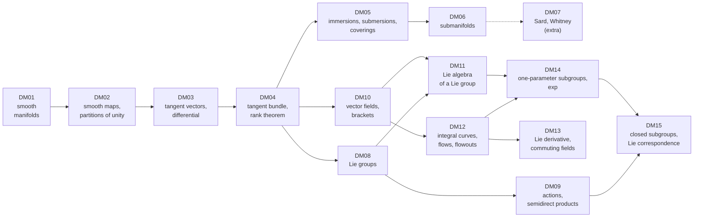

# Differential Geometry: Course Map

<span class="scope-taught">taught · in syllabus</span> <span class="scope-extra-book">extra · book</span> <span class="scope-extra-beyond">extra · beyond</span>

Fifteen chapters on **smooth manifolds, Lie groups and flows**, written 2026-10-30 to 2026-11-02 on **John M. Lee, *Introduction to Smooth Manifolds* (2nd ed.)** as the primary book, with Tu, Kumaresan, Guillemin–Pollack, Milnor and Warner as companions, and aligned with the lectures of **MT3184 Differential Geometry and Lie Groups** (the lectures follow Lee's numbering: Lemma 1.35, Thm 4.12, Thm 7.5, Thm 9.12, Thm 20.1, …). The topology and analysis it needs is written in the analysis vault as **PA11–PA15** ([[Proofs, Analysis and Topology - Course Map]]), and the Lie groups are the continuous side of [[Group Theory - Course Map]] ([[GT10 Symmetry Representations and Characters]] §6).

> [!note] Update 2026-11-07: two chapters added
> The lectures of **26 Oct–6 Nov (slides DG27–DG30) and Homework 10** reached **distributions, foliations, the Frobenius theorem and Lie subgroups from Lie subalgebras**, which DM15 had only stated. They are now written up as **[[DM16 Distributions, Involutivity and the Frobenius Theorem]]** and **[[DM17 Foliations, Weakly Embedded Submanifolds and Lie Subgroups]]** (17 chapters in all); DM15 is unchanged and points to them. Reading order for the end of the course: DM14 → DM16 → DM17 → DM15 (DM15 §2–3 uses the Frobenius theorem).

> [!warning] What is and is not in the sources
> - **Taught (🟢)** means *covered by MT3184*, as far as the notes in the folder show. The only course material is the other tool's notes `mt3184-differential-geometry-and-lie-groups/` (OCR of the instructor's **handwritten slides DG1–DG26**, plus homework HW1–HW9, Test 1, and an exam-prep page). **DG1–DG7 are scans with no readable text** (weeks 1–3: manifolds, smooth maps, partitions of unity, tangent spaces, differentials, submanifolds), so for those chapters "taught" is inferred from the weekly post, the homework and the syllabus outline, not from the slides. The last slides of DG25 and DG26 are partly illegible. Every such gap is marked `[!verify]` in the chapter.
> - **Extra · book (🟡)** is Lee/Tu/Kumaresan/… material that the lectures did not reach (e.g. Sard's theorem, Whitney embedding, transversality, Lie subalgebras and subgroups beyond the statement, the Lie correspondence proof). **Extra · beyond (🔵)** is my additions (numerical checks, worked examples, comparisons between books), always labelled.
> - **Not covered at all** (by design of the user's scope: *course-aligned*): vector bundles, tensors, Riemannian metrics, differential forms, integration, de Rham cohomology, foliations, symplectic geometry (Lee Ch. 10–19, 21–22). The Frobenius theorem and Lie subalgebra–subgroup correspondence are only **stated** (DM15).
> - **Update 2026-11-07:** the sentence above is no longer true for **foliations** and the **Frobenius theorem**: they were taught in weeks 13–14 (DG29–DG30) and are the subject of [[DM16 Distributions, Involutivity and the Frobenius Theorem]] and [[DM17 Foliations, Weakly Embedded Submanifolds and Lie Subgroups]]; differential forms, tensors, Riemannian metrics and integration remain uncovered (forms appear in DM16 §5 only as a tool for the Frobenius criterion).
> - **Assessments:** Test 1 (2026-09-03, HW1–HW3), mid-term (2026-09-24), **Test 2 on 2026-11-02 (HW6–HW9)**, end-sem 2026-11-23 to 12-02 (cumulative). Grading 20/40/40.
> - The source notes are **read-only** and are the other tool's: they are listed in Sources below, never cited as primary.


> [!info] Shared drive: related books, past papers and old decks on the shared drive are listed in [[math/differential-geometry/shared-drive-sources|shared-drive sources (3 files)]].


> [!info] Added 2026-11-21 (Classroom sync; kept lean: audited course)
> [[DM18 Lie Algebra Actions, the Lie Correspondence and the Adjoint Representation]] from [[DG31.pdf]]–[[DG34.pdf]] (infinitesimal generators, Thm 20.15–20.16, Lie correspondence 20.19–20.20 + Ado, Ad/ad, normal ⟺ ideal), [[HW11.pdf]] and the [[Midsem.pdf|mid-sem]] outlined. The class-note PDFs DG27–DG34, HW10, HW11, Midsem and its solutions are now in `math/differential-geometry/lecture-notes-slides/` (DM17 was written from the other tool's OCR of DG27–DG30). **Final exam: Thu 26 Nov, 10 am–12 pm, HW5–HW11 material; Thm 20.16's proof excluded.**

## The storyline

Central thread: **a manifold is a space that looks like $\mathbb R^n$ near every point (DM01–DM02); calculus on it needs tangent vectors and differentials (DM03–DM04), whose constant-rank behaviour is governed by one theorem (the rank theorem, DM04) with consequences for immersions, submersions and submanifolds (DM05–DM06). A Lie group is a manifold with a smooth group structure (DM08–DM09); vector fields and their brackets (DM10) give each Lie group a Lie algebra (DM11); flows of vector fields (DM12–DM13) turn one-parameter families of symmetries into integral curves, giving the exponential map (DM14) and, with the Closed Subgroup Theorem, the Lie correspondence (DM15).**

## Chapters
| # | Chapter | Lee | Taught by | Status |
|---|---|---|---|---|
| 01 | [[DM01 Smooth Manifolds]] | Ch. 1 | DG1–DG3 (unreadable); HW1 | draft |
| 02 | [[DM02 Smooth Maps and Partitions of Unity]] | Ch. 2 | DG1–DG3; HW1 Q3 | draft |
| 03 | [[DM03 Tangent Vectors and the Differential]] | Ch. 3 | DG4–DG6 (unreadable); HW2–HW3 | draft |
| 04 | [[DM04 The Tangent Bundle and the Rank Theorem]] | Ch. 3, 4 | DG8, DG11; HW3 Q2 | draft |
| 05 | [[DM05 Immersions, Embeddings, Submersions and Coverings]] | Ch. 4 | DG11–DG12; HW5 Q1 | draft |
| 06 | [[DM06 Submanifolds]] | Ch. 5 | DG7–DG8, DG12; HW4 Q1 | draft |
| 07 | [[DM07 Sard Whitney and Transversality]] | Ch. 6 | none (Baire only) | draft (🟡) |
| 08 | [[DM08 Lie Groups]] | Ch. 7 | DG10–DG13, DG19; HW4–HW5 | draft |
| 09 | [[DM09 Group Actions and Semidirect Products]] | Ch. 7, 21 | DG14–DG16; HW6 Q1–Q3 | draft |
| 10 | [[DM10 Vector Fields and Lie Brackets]] | Ch. 8 | DG8–DG10, DG16–DG17; HW4 Q2–Q4, HW6 Q4–Q5 | draft |
| 11 | [[DM11 The Lie Algebra of a Lie Group]] | Ch. 8 | DG17–DG20; HW5 Q3, HW6 Q6–Q7, HW7 Q1–Q3 | draft |
| 12 | [[DM12 Integral Curves, Flows and Flowouts]] | Ch. 9 | DG21–DG24; HW7 Q4–Q6, HW8 Q1–Q4 | draft |
| 13 | [[DM13 Lie Derivatives and Commuting Vector Fields]] | Ch. 9 | DG24–DG25; HW8 Q5–Q6 (HW9 Q4 in DM14) | draft |
| 14 | [[DM14 One-Parameter Subgroups and the Exponential Map]] | Ch. 20 | DG25–DG26; HW9 Q1–Q5 | draft |
| 15 | [[DM15 Closed Subgroups and the Lie Correspondence]] | Ch. 19–21 | DG14, DG18–DG20; HW9 Q6 | draft |
| 16 | [[DM16 Distributions, Involutivity and the Frobenius Theorem]] | Ch. 19 | DG29; HW10 (Q2 partly) | draft |
| 17 | [[DM17 Foliations, Weakly Embedded Submanifolds and Lie Subgroups]] | Ch. 5, 19, 20 | DG27–DG30; HW10 Q1–Q5 | draft |

```dataview
TABLE chapter AS "#", scope AS "Scope", status AS "Status"
FROM #subject/diff-geometry AND #type/chapter
SORT chapter ASC
```

## Prerequisites (analysis vault)
| Need | Chapter |
|---|---|
| open sets, continuity, compactness, connectedness | [[PA07 Metric and Topological Spaces]] |
| subspace, product, quotient topologies; $S^1$, torus, $\mathbb{RP}^n$ as quotients | [[PA11 Subspaces, Products and Quotients]] |
| Hausdorff, second-countable, local compactness, exhaustions, paracompactness | [[PA12 Separation, Countability and Local Compactness]] |
| derivative, inverse and implicit function theorems, Euclidean rank theorem | [[PA13 The Derivative and the Inverse Function Theorem]] |
| ODE existence, uniqueness, smooth dependence, the flow | [[PA14 ODE Existence Uniqueness and Smooth Dependence]] |
| homotopy, $\pi_1$, covering spaces, universal cover, $SU(2)\to SO(3)$ | [[PA15 Covering Spaces and the Fundamental Group]] |
| groups, subgroups, normal subgroups, quotients, homomorphisms, actions | [[Group Theory - Course Map]] ([[GT01 Groups Subgroups and Cosets]], [[GT02 Homomorphisms Normal Subgroups and Quotients]], [[GT05 Actions Conjugation and Sylow Theorems]]) |
| vector spaces, bases, linear maps, determinants | [[Basis of a Vector Space]] |

## Lecture-to-chapter map (MT3184 slides DG1–DG26)
| Week (post) | Slides | Content (as far as readable) | Chapters |
|---|---|---|---|
| Aug 3–7 | DG1–DG3 | smooth manifolds, smooth maps, partitions of unity | DM01, DM02 |
| Aug 10–14 | DG4–DG6 | tangent spaces, differentials, change of coordinates | DM03 |
| Aug 17–21 | DG7–DG8 | submanifolds, $T_pS\subset T_pM$, tangent bundle, Chart Lemma 1.35, Prop 3.18, vector fields | DM04, DM06 |
| Aug 24–28 | DG9–DG11 | vector fields as derivations, $F$-related fields, Lie groups and homomorphisms, rank theorems (4.12, 4.14), Baire | DM10, DM08, DM04 |
| Aug 31 – Sep 4 | DG12–DG13 | immersed submanifolds, Lie subgroups, identity component | DM05, DM06, DM08 |
| Sep 7–12 | DG14–DG17 | Closed Subgroup Thm 20.12, actions, orbits, stabilisers, equivariant rank theorem, semidirect products, Lie algebras, Lie bracket | DM09, DM15, DM10, DM11 |
| Sep 14–18 | DG18 | Lie correspondence, homomorphism theorem | DM15 |
| Oct 5–9 | DG19–DG21 | $\mathrm{Lie}(G)$, $\mathfrak{gl}(n)$, $\mathfrak{so}(n)$, representations, Ado; integral curves and flows | DM11, DM12 |
| Oct 12–16 | DG22–DG24 | naturality, complete fields, flowout theorem, straightening, Lie derivative | DM12, DM13 |
| Oct 19–24 | DG25–DG26 | end of the Lie derivative, one-parameter subgroups, matrix exponential, exp map | DM13, DM14 |
| Oct 26–30 | DG27–DG28 | properties of exp (Prop 20.10, Cor 20.11, naturality), $\mathrm{Lie}(H)=\{X:\exp tX\in H\}$, smooth maps into embedded submanifolds, figure eight, weakly embedded, **Closed Subgroup Theorem proved** | DM14, DM15, DM17 |
| Nov 2–6 | DG29–DG30 | distributions, integral manifolds, involutive, flat charts, Local Frobenius (statement), foliations, global Frobenius, $\Phi$-invariance, Thm 19.17, Lemma 19.24, Thms 19.25–19.26 | DM16, DM17 |

## Sources and what they are
| ID | File | What it is | Role |
|---|---|---|---|
| L | [[John M. Lee - Introduction to Smooth Manifolds.pdf]] | *Introduction to Smooth Manifolds*, 2nd ed., 726 pp. (printed page = PDF page − 18) | **primary**: every chapter |
| T | [[Loring W. Tu - An Introduction to Manifolds (2011).pdf]] | Tu, *An Introduction to Manifolds*, 426 pp. | companion: intuition, tangent spaces, forms |
| K | [[S. Kumaresan - A Course in Differential Geometry and Lie Groups (2002).pdf]] | Kumaresan, 306 pp. | companion: Lie groups, exp, Lie correspondence |
| GP | [[Victor W. Guillemin, Alan Pollack - Differential Topology (2011).pdf]] | Guillemin–Pollack | companion: Sard, transversality (DM07) |
| M | `Milnor - Topology from the Differentiable Viewpoint` (djvu) | Milnor | companion: Sard, degree |
| W | `Frank W. Warner - Foundations of Differentiable Manifolds and Lie Groups` (djvu) | Warner | companion: partitions of unity, Lie groups |
| Y | [[Ernest Yeung - J. M. Lee_s Intro to Smooth Manifolds solutions.pdf]] | solutions to Lee's exercises | practice problems and checks |
| S | `Michael Spivak - Calculus on Manifolds` | Spivak | PA13 (analysis background) |
| MT | `mt3184-differential-geometry-and-lie-groups/` (other tool, **read-only**) | OCR notes of DG1–DG26, HW1–HW9, Test 1, exam prep | **the taught scope** |
| MT2 | `mt3184-…/2026-11-06-october-26-30.md`, `…-november-2-6.md`, `…-hw10.md` (added 2026-11-07) | OCR notes of DG27–DG30 and HW10 | **taught scope of weeks 13–14** (DM16–DM17) |

## Concept notes and zettel notes
- **Concept notes** (`Concepts/`, 98): one per idea, with scope chips, a syllabus line, intuition, key facts and a Dataview "Linked from" block; every chapter lists its own in its *Map of this chapter*.
- **Zettel notes** (`Concepts/zettel/`, 43): the other tool's agent-written concept notes from the MT3184 lectures and homework (38 moved here from `10-Group-Theory/Concepts/zettel/` on 2026-11-02, 5 new from HW1). Each carries a generated block linking it to its DM chapter and to the vault's concept note on the same idea; each chapter lists its notes in a generated *Zettel notes* block. They are unreviewed and are **never cited in a Provenance table**. Re-run `scripts/sort_zettel.py --apply --vault 14-Diff` after each Kurooto ingest.

## Gaps (to ask the instructor / supply later)
- **Slides DG1–DG7** (weeks 1–3) are unreadable scans: confirm exactly what was proved about partitions of unity and the equivalent definitions of tangent vectors.
- **DG25 properties (a)–(d) of the Lie derivative** and the last slide of **DG26** (presumably $F\circ\exp_G=\exp_H\circ F_*$) are cut off in the OCR; DM13–DM14 state the standard results and flag them.
- Is the **Frobenius theorem** / Lie subalgebra–subgroup correspondence examinable (only the statements are used in the slides)? Is **Sard's theorem** (the Global Rank Theorem proof uses Baire instead)?
- HW9 has no posted solutions; the practice solutions in DM14–DM15 are mine and are marked as such.
- **DG29–DG30 and HW10 (added 2026-11-07):** the slides are OCR; the example (iii) of DG29 and the proof of Thm 19.26 (DG30) are partly illegible; **HW10 has no posted solutions**, so the solutions in DM17 §8 are mine. Is the **proof** of the Local Frobenius Theorem examinable (DG29 states it only)? The end-semester covers all of DM01–DM17.

## Cross-subject links
- **Group theory:** Lie groups are the continuous analogue of [[GT01 Groups Subgroups and Cosets]]–[[GT05 Actions Conjugation and Sylow Theorems]]; representations in [[GT10 Symmetry Representations and Characters]] §6 (the stub bridge written before this vault).
- **Quantum mechanics:** $\mathfrak{so}(3)\cong\mathfrak{su}(2)$ and the angular momentum algebra; $SU(2)\to SO(3)$ and spin-½ ([[QM09 The Stern-Gerlach Experiment and Spin]], [[PA15 Covering Spaces and the Fundamental Group]]); the one-parameter subgroup $e^{-i\theta L_z/\hbar}$ ([[DM14 One-Parameter Subgroups and the Exponential Map]]).
- **Dynamics (foundations, climate, eco-evo):** flows of vector fields are the mathematics of [[Phase Plane and Isoclines]] and [[Fixed Points and Linear Stability]]; the pendulum and Lorenz notes in [[CL01 Earth as a System]] ([[DM12 Integral Curves, Flows and Flowouts]]).
- **Thermodynamics:** implicit functions and exact differentials ([[PA13 The Derivative and the Inverse Function Theorem]]).

<!-- graph-spine:start (generated by scripts/graph_spine.py; do not edit between the markers) -->
## Atlas: every note in this subject
The graph view draws only real links, so this block links **every** note of the subject (the map is the hub of its cluster; [[Home]] is the hub of all maps).

> [!abstract]- Atlas (generated): 18 chapters · 112 concept notes · 62 zettel notes (the other tool's, filed in the vault) · 32 notes from the other tool (source layer)
> **Chapters (18):** [[DM01 Smooth Manifolds]] · [[DM02 Smooth Maps and Partitions of Unity]] · [[DM03 Tangent Vectors and the Differential]] · [[DM04 The Tangent Bundle and the Rank Theorem]] · [[DM05 Immersions, Embeddings, Submersions and Coverings]] · [[DM06 Submanifolds]] · [[DM07 Sard Whitney and Transversality]] · [[DM08 Lie Groups]] · [[DM09 Group Actions and Semidirect Products]] · [[DM10 Vector Fields and Lie Brackets]] · [[DM11 The Lie Algebra of a Lie Group]] · [[DM12 Integral Curves, Flows and Flowouts]] · [[DM13 Lie Derivatives and Commuting Vector Fields]] · [[DM14 One-Parameter Subgroups and the Exponential Map]] · [[DM15 Closed Subgroups and the Lie Correspondence]] · [[DM16 Distributions, Involutivity and the Frobenius Theorem]] · [[DM17 Foliations, Weakly Embedded Submanifolds and Lie Subgroups]] · [[DM18 Lie Algebra Actions, the Lie Correspondence and the Adjoint Representation]]
>
> **Concept notes (112):** [[Baire Category Theorem]] · [[Bump Function]] · [[Characteristic Property of Surjective Submersions]] · [[Closed Subgroup Theorem]] · [[Commuting Frame]] · [[Commuting Vector Fields]] · [[Complete Vector Field]] · [[Coordinate Basis]] · [[Coordinate Chart]] · [[Coordinate Representation of a Map]] · [[Defining Forms and Pfaffian Systems]] · [[Dense Line on the Torus]] · [[Diffeomorphism]] · [[Differential of a Smooth Map]] · [[14-Differential-Geometry/Concepts/Distribution|Distribution]] · [[Embedded Submanifold]] · [[Equivariant Map]] · [[Equivariant Rank Theorem]] · [[Escape Lemma]] · [[Euclidean Group]] · [[Exotic Smooth Structure]] · [[Exponential Map]] · [[F-Related Vector Fields]] · [[Flat Chart for a Distribution]] · [[Flow of a Vector Field]] · [[Flowout Theorem]] · [[Foliation by Fibres of a Submersion]] · [[14-Differential-Geometry/Concepts/Foliation|Foliation]] · [[Frobenius Theorem]] · [[General Linear Group]] · [[Global Differential]] · [[Global Frobenius Theorem]] · [[Global Rank Theorem]] · [[Hairy Ball Theorem]] · [[Holonomy of a Plane Field]] · [[Homogeneous Space]] · [[Homomorphism Theorem for Lie Groups]] · [[Identity Component]] · [[Immersed Submanifold]] · [[Immersion and Submersion]] · [[Induced Lie Algebra Homomorphism]] · [[Integral Curve]] · [[Integral Manifold]] · [[Integrating Factor]] · [[Invariant Distribution]] · [[Invariant Vector Field]] · [[Involutive Distribution]] · [[Jacobi Identity]] · [[Left Translation]] · [[Left-Invariant Distribution of a Subalgebra]] · [[Left-Invariant Vector Field]] · [[Lie Algebra of a Lie Group]] · [[Lie Algebra Representation]] · [[Lie Algebra]] · [[Lie Bracket of Vector Fields]] · [[Lie Correspondence]] · [[Lie Derivative of a Vector Field]] · [[Lie Group Homomorphism]] · [[Lie Group]] · [[Lie Subgroup of a Subalgebra]] · [[Lie Subgroup]] · [[Local Frame]] · [[Local Section Theorem]] · [[Manifold with Boundary]] · [[Matrix Exponential]] · [[Matrix Lie Algebras]] · [[Naturality of the Lie Bracket]] · [[One-Parameter Subgroup]] · [[Orbit Map and Stabiliser]] · [[Orthogonal Group]] · [[Partition of Unity]] · [[Product Manifold]] · [[Proper Map]] · [[Rank of a Smooth Map]] · [[Rank Theorem]] · [[Real Projective Space]] · [[Regular and Singular Points]] · [[Regular Level Set Theorem]] · [[Regular Value]] · [[Sard's Theorem]] · [[Semidirect Product of Lie Groups]] · [[Set of Measure Zero]] · [[Slice Chart]] · [[Smooth Action]] · [[Smooth Atlas]] · [[Smooth Covering Map]] · [[Smooth Embedding]] · [[Smooth Extension Lemma]] · [[Smooth Function]] · [[Smooth Manifold Chart Lemma]] · [[Smooth Manifold]] · [[Smooth Map]] · [[Smooth Structure]] · [[Smooth Urysohn Lemma]] · [[Special Linear Group]] · [[Stereographic Projection]] · [[Tangent Bundle]] · [[Tangent Space of a Product]] · [[Tangent Space of a Submanifold]] · [[Tangent Space]] · [[Tangent Vector]] · [[Topological Manifold]] · [[Transformation Law for Tangent Vectors]] · [[Transition Map]] · [[Transversality]] · [[Trotter Product Formula]] · [[Unitary Group]] · [[Universal Covering Group]] · [[Vector Field]] · [[Velocity of a Curve]] · [[Weakly Embedded Submanifold]] · [[Whitney Embedding Theorem]]
>
> **Zettel notes (the other tool's, filed in the vault) (62):** [[abelian-lie-algebra]] · [[ado-s-theorem]] · [[antipodal-map-on-s2]] · [[baire-category-theorem]] · [[classification-of-two-dimensional-non-abelian-lie-algebras]] · [[compact-immersed-submanifold-embedding-theorem]] · [[complete-vector-field]] · [[completely-integrable-distribution]] · [[completeness-of-compactly-supported-vector-fields]] · [[constant-rank-of-lie-group-homomorphisms]] · [[14-Differential-Geometry/Concepts/zettel/distribution|distribution]] · [[equivariant-map-constant-rank-theorem]] · [[euclidean-group]] · [[existence-of-infinitely-many-smooth-structures]] · [[exponential-map]] · [[faithful-representation]] · [[flowout-theorem]] · [[14-Differential-Geometry/Concepts/zettel/foliation|foliation]] · [[fundamental-theorem-on-flows]] · [[global-rank-theorem]] · [[graph-coordinate-atlas-of-the-2-sphere]] · [[identity-of-connected-lie-group-homomorphisms]] · [[image-of-injective-immersion]] · [[immersed-submanifold]] · [[integrable-distribution]] · [[integral-curve]] · [[integral-manifold]] · [[left-invariant-vector-field]] · [[left-translation-map]] · [[lie-algebra-homomorphism-of-infinitesimal-generators]] · [[lie-algebra-of-a-lie-group]] · [[lie-algebra-representation]] · [[lie-algebra]] · [[lie-bracket-of-vector-fields]] · [[lie-correspondence]] · [[lie-group-homomorphism]] · [[lie-group]] · [[lie-subgroup-subalgebra-correspondence]] · [[lie-subgroup]] · [[local-frobenius-theorem]] · [[locality-of-derivations]] · [[maximal-smooth-atlas]] · [[naturality-of-flows]] · [[naturality-of-integral-curves]] · [[one-parameter-subgroup]] · [[orbit-map]] · [[partition-of-unity-subordinate-to-a-cover]] · [[product-manifold-tangent-space-isomorphism]] · [[rank-theorem]] · [[semidirect-product-of-lie-groups]] · [[singular-and-regular-points-of-a-vector-field]] · [[slice-chart]] · [[smooth-group-action]] · [[smooth-map-between-smooth-manifolds]] · [[smooth-structure-compatibility]] · [[submanifold-tangent-space-via-slice-chart]] · [[tangent-bundle-as-a-smooth-manifold]] · [[tangent-vector-of-a-manifold]] · [[uniform-time-lemma]] · [[vector-field-on-s2-with-a-single-zero]] · [[vector-field]] · [[weakly-embedded-submanifold]]
>
> **Notes from the other tool (source layer) (32):** [[2026-08-07-august-3-7]] · [[2026-08-07-hw1]] · [[2026-08-14-august-10-14]] · [[2026-08-14-hw2]] · [[2026-08-20-august-17-21]] · [[2026-08-20-hw3]] · [[2026-08-27-august-24-28]] · [[2026-08-27-hw4]] · [[2026-09-03-august-31-september-4]] · [[2026-09-03-test-i]] · [[2026-09-04-hw5]] · [[2026-09-10-september-7-12]] · [[2026-09-11-hw6]] · [[2026-09-15-september-14-18]] · [[2026-10-10-hw7]] · [[2026-10-10-october-5-9]] · [[2026-10-16-hw8]] · [[2026-10-16-october-12-16]] · [[2026-10-24-october-19-24]] · [[2026-10-26-hw9]] · [[2026-11-06-hw10]] · [[2026-11-06-november-2-6]] · [[2026-11-06-october-26-30]] · [[2026-11-16-hw11]] · [[2026-11-16-midsem-exam]] · [[2026-11-16-november-9-13]] · [[2026-11-18-november-16-20]] · [[commutativity-criteria-for-connected-lie-groups]] · [[mt3184-differential-geometry-and-lie-groups/exam-prep|exam-prep]] · [[ideal-in-a-lie-algebra]] · [[lie-algebra-ideal-and-normal-subgroup-correspondence]] · [[mt3184-differential-geometry-and-lie-groups]]
<!-- graph-spine:end -->
