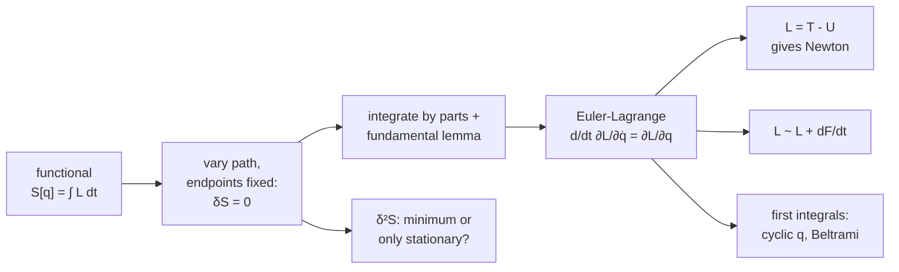
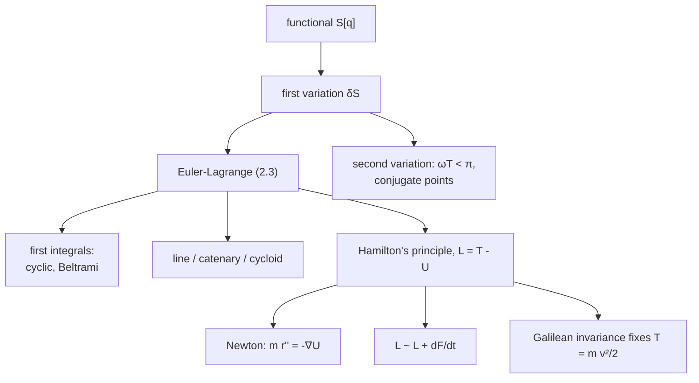

# CM01 · Variational Calculus and Hamilton's Principle

◀ [[Classical Mechanics - Course Map]] · [[CM02 Lagrange's Equations, Constraints and Generalised Coordinates]] ▶

in course overview extra · book extra · beyond

> [!warning] Source status (every citation below was read in this session)
> Overview block 1: *"We would start by understanding Hamilton's least action principle and derive Lagrange's equations from that."* No IISERP lecture notes exist in the folder, so the order is mine.
>
> **Read directly (text layer or djvu text):** Landau-Lifshitz Vol. 1 §§2-5 (printed pp. 3-9; pdf = printed + 28); Goldstein-Poole-Safko 3rd ed. §§2.1-2.3 (printed pp. 34-45, headings and §2.2 examples); Thornton-Marion Ch. 6 (6.1-6.3 and Examples 6.1-6.3); Gregory Ch. 13 (13.2 and Example 13.3, printed pp. 378-379); Arnold §12 (printed pp. 55-56) and the conjugate-point passage in **Appendix 11** (printed pp. 441-442); Alam (IISER Kolkata student notes) §1.1, pp. 1-3. **Not cited because not read:** Arnold's treatment of the second variation inside §12, Gregory §13.3-13.4, Thornton §6.4-6.7.

> [!syllabus] Syllabus map
> 🟢 **In course overview**: §2 first variation and the Euler-Lagrange equation, §4 Hamilton's principle and Lagrange's equations, §5 non-uniqueness of $L$, §7 why $L=\tfrac12mv^2-U$ (inertial frames, Galilean relativity).
>
> 🟡 **Extra · book**: §3 the classic problems (shortest path, surface of revolution, brachistochrone: Goldstein 2.2, Thornton Ex. 6.1-6.3, Gregory Ex. 13.3), §2.4 first integrals, §6 conjugate points (Arnold App. 11).
>
> 🔵 **Extra · beyond (mine)**: free endpoints and natural boundary conditions (§2.5), the soap-film existence analysis with numbers (§3.2), the exact pendulum period from the Lagrangian (§4), the exact second variation of the oscillator (§6), Euler-Lagrange for higher derivatives, `scripts/cm01_numbers.py`, `scripts/fig_cm01.py`.

> [!key] After this chapter you can
> - define a **functional**, its **variation**, and derive the **Euler-Lagrange equation** from the fundamental lemma,
> - handle several unknown functions, higher derivatives, free endpoints, and extract **first integrals** (cyclic variable, Beltrami),
> - solve the classic problems, including the existence analysis for the **soap film** and the **brachistochrone**,
> - state **Hamilton's principle** and prove that $L=T-U$ gives Newton's second law, in any coordinates,
> - explain why $L$ is ambiguous by $\mathrm dF(q,t)/\mathrm dt$ and by a constant factor,
> - decide when a stationary path is really a **minimum** (second variation, conjugate points).

> [!intuition] The one-sentence story
> Newton asks *what force acts now*, a local rule applied instant by instant. Hamilton asks *which whole path between two events is special*: nature chooses the path along which one number, the action $S=\int L\,\mathrm dt$, is unchanged to first order by small wiggles of the path, and that single global statement packs in $m\ddot{\mathbf r}=\mathbf F$.

## 1. Why a variational principle
1. **Coordinate freedom.** "$S$ is stationary" mentions no coordinates, so the equations it generates keep one form in *any* generalised coordinates (§4, CM02). Newton's $\mathbf F=m\mathbf a$ does not.
2. **Constraints and symmetry.** Forces of constraint never appear; symmetries of $L$ yield conservation laws (CM03).
3. **Reach.** The same principle governs light rays (Fermat, P1), fields (CMX2, ED08) and quantum amplitudes (the path integral).

Historically the subject began with a race. Gregory records that Johann Bernoulli posed the brachistochrone problem in 1696 as a challenge, having already found the solution; solutions came from Jakob Bernoulli, l'Hôpital, Leibniz and Newton (anonymously). Goldstein adds that Bernoulli's analysis led to the formal foundation of the calculus of variations (§3.3).

## 2. Functionals and the first variation
### 2.1 Definitions
A **functional** assigns a number to a *function*, i.e. to a curve (Arnold §12). The model case is
$$S[q]=\int_{t_1}^{t_2}L\bigl(q(t),\dot q(t),t\bigr)\,\mathrm dt,\qquad q(t_1)=q_1,\quad q(t_2)=q_2\ \text{fixed.}$$

Arnold's definition: $S$ is *differentiable* if $S[q+h]-S[q]=F(h)+R$ with $F$ linear in $h$ and $R=O(h^2)$; $F$ is the *differential*, also called the **variation**, and $h$ a variation of the curve. Goldstein (and Thornton) use an equivalent parametric family
$$q(t,\alpha)=q(t,0)+\alpha\,\eta(t),\qquad \eta(t_1)=\eta(t_2)=0,\tag{2.1}$$
and write $\delta q=\bigl(\partial q/\partial\alpha\bigr)_0\,\mathrm d\alpha=\eta\,\mathrm d\alpha$, $\delta S=\bigl(\partial S/\partial\alpha\bigr)_0\,\mathrm d\alpha$ (Goldstein (2.12)-(2.13)). The curve $q(t,0)$ is stationary when $(\partial S/\partial\alpha)_0=0$ for **every** admissible $\eta$ (Thornton (6.4): "a necessary condition; it is not sufficient").

> [!example] Worked example 1 (Thornton Ex. 6.1): what "stationary" looks like
> Take $f=(\mathrm dy/\mathrm dx)^2$ and the trial family $y(\alpha,x)=x+\alpha\sin x$ on $[0,2\pi]$ (endpoints fixed since $\sin0=\sin2\pi=0$). Then
>
> $$J(\alpha)=\int_0^{2\pi}(1+\alpha\cos x)^2\,\mathrm dx=2\pi+\pi\alpha^2 ,$$
>
> so $\mathrm dJ/\mathrm d\alpha=2\pi\alpha=0$ at $\alpha=0$, and $J(\alpha)>J(0)$ for every $\alpha\ne0$: the path $y=x$ is a (minimum) stationary path. Numerically $J(-0.5)=7.0686$, $J(0)=6.2832$, $J(0.3)=6.5659$, $J(1)=9.4248$, all equal to $2\pi+\pi\alpha^2$ (`scripts/cm01_numbers.py`). Notice there is no linear term in $\alpha$: that absence *is* the stationarity condition.

### 2.2 Derivation of the Euler-Lagrange equation
Expand $S[q+\epsilon\eta]$ to first order (LL (2.4)-(2.5); Alam §1.1):

$$\delta S=\int_{t_1}^{t_2}\Bigl(\frac{\partial L}{\partial q}\,\delta q+\frac{\partial L}{\partial\dot q}\,\delta\dot q\Bigr)\mathrm dt .$$

Since variation and time derivative commute, $\delta\dot q=\tfrac{\mathrm d}{\mathrm dt}\delta q$, and integrating the second term by parts gives

$$\delta S=\Bigl[\frac{\partial L}{\partial\dot q}\,\delta q\Bigr]_{t_1}^{t_2}+\int_{t_1}^{t_2}\Bigl(\frac{\partial L}{\partial q}-\frac{\mathrm d}{\mathrm dt}\frac{\partial L}{\partial\dot q}\Bigr)\delta q\,\mathrm dt .\tag{2.2}$$

The boundary term vanishes because $\delta q(t_1)=\delta q(t_2)=0$. What remains must vanish for all $\delta q$, and the lemma below finishes the argument. Goldstein states the same lemma and justifies it by constructing an $\eta$ that is positive near a chosen point and zero elsewhere (his (2.10)-(2.11)).

> [!theorem] Fundamental lemma of the calculus of variations
> If $f$ is continuous on $[t_1,t_2]$ and $\int_{t_1}^{t_2}f\,\eta\,\mathrm dt=0$ for every smooth $\eta$ with $\eta(t_1)=\eta(t_2)=0$, then $f\equiv0$.
>
> *Proof.* If $f(t_0)>0$ at an interior point, then $f>0$ on a small interval $I\ni t_0$. Choose a smooth bump $\eta\ge0$ supported in $I$ with $\eta(t_0)>0$. Then $\int f\eta>0$, a contradiction; the case $f(t_0)<0$ is identical, and continuity extends the result to the endpoints. ∎

The **Euler-Lagrange equation** (LL (2.6), "Lagrange's equations" in mechanics):

$$\boxed{\;\frac{\mathrm d}{\mathrm dt}\frac{\partial L}{\partial\dot q}-\frac{\partial L}{\partial q}=0\;}\qquad(2.3)$$

> [!pitfall] What the partial derivatives mean
> In (2.3), $q$ and $\dot q$ are *independent variables* while taking $\partial L/\partial q$ and $\partial L/\partial\dot q$; only afterwards is $q(t)$ substituted, and then $\mathrm d/\mathrm dt$ acts on everything including explicit $t$:
>
> $$\frac{\mathrm d}{\mathrm dt}\frac{\partial L}{\partial\dot q}=\frac{\partial^2L}{\partial t\,\partial\dot q}+\frac{\partial^2L}{\partial q\,\partial\dot q}\,\dot q+\frac{\partial^2L}{\partial\dot q^{2}}\,\ddot q .$$
>
> The equation is second order in $q$ precisely when $\partial^2L/\partial\dot q^2\neq0$.

### 2.3 Several unknown functions
For $s$ unknown functions $q_1,\dots,q_s$ vary each independently (Goldstein 2.3 generalises the one-function case in exactly this way, with $y_1(x,\alpha)=y_1(x,0)+\alpha\eta_1(x)$, and LL says the same, p. 3). Because the $\delta q_i$ are independent, each coefficient vanishes separately:

$$\frac{\mathrm d}{\mathrm dt}\frac{\partial L}{\partial\dot q_i}-\frac{\partial L}{\partial q_i}=0,\qquad i=1,\dots,s .\tag{2.4}$$

These are $s$ second-order ODEs; the general solution has $2s$ constants, fixed by initial positions and velocities (LL p. 4).

### 2.4 First integrals
* **Cyclic coordinate.** If $\partial L/\partial q=0$ then $p=\partial L/\partial\dot q$ is constant.
* **Beltrami (no explicit $t$).** Define $h=\dot q\,\partial L/\partial\dot q-L$. Then
$$\frac{\mathrm dh}{\mathrm dt}=\ddot q\,L_{\dot q}+\dot q\frac{\mathrm d}{\mathrm dt}L_{\dot q}-L_q\dot q-L_{\dot q}\ddot q-\frac{\partial L}{\partial t}=\dot q\Bigl(\frac{\mathrm d}{\mathrm dt}L_{\dot q}-L_q\Bigr)-\frac{\partial L}{\partial t},$$
so on solutions $\mathrm dh/\mathrm dt=-\partial L/\partial t$: $h$ is conserved when $L$ has no explicit time dependence. Gregory's Example 13.3 uses precisely this "integrated form" of the E-L equation for the brachistochrone.

These two are the seeds of CM03.

### 2.5 Free endpoints and higher derivatives (🔵)
* **Free end.** If $q(t_2)$ is *not* fixed, the boundary term in (2.2) survives and demands the **natural boundary condition** $\partial L/\partial\dot q\big|_{t_2}=0$ (in addition to (2.3)). Example: the shortest path from the origin to the vertical line $x=1$ has $L=\sqrt{1+y'^2}$, $\partial L/\partial y'=y'/\sqrt{1+y'^2}=0$ at $x=1$, so $y'=0$ there; with $y''=0$ the path is the horizontal line, meeting the line perpendicularly (P9).
* **Second derivatives.** For $L(q,\dot q,\ddot q)$ integrate by parts twice (requiring $\delta q=\delta\dot q=0$ at the ends):
$$\frac{\partial L}{\partial q}-\frac{\mathrm d}{\mathrm dt}\frac{\partial L}{\partial\dot q}+\frac{\mathrm d^2}{\mathrm dt^2}\frac{\partial L}{\partial\ddot q}=0 .$$
The equations of motion are then fourth order, so Newtonian mechanics (second order) corresponds to $L$ depending on $q,\dot q$ only.

## 3. Three classic problems (🟡)
### 3.1 Shortest path in the plane
$S=\int\sqrt{1+y'^2}\,\mathrm dx$. The variable $y$ is cyclic: $y'/\sqrt{1+y'^2}=\text{const}\Rightarrow y'=\text{const}$, a straight line (Goldstein §2.2, example 1).

### 3.2 Minimal surface of revolution (the soap film)
Area $=2\pi\int y\sqrt{1+y'^2}\,\mathrm dx$ (Goldstein example 2, Thornton Ex. 6.3). With no explicit $x$, Beltrami gives

$$h=y'\frac{yy'}{\sqrt{1+y'^2}}-y\sqrt{1+y'^2}=-\frac{y}{\sqrt{1+y'^2}}=-c\;\Longrightarrow\; y=c\cosh\frac{x-x_0}{c},$$

the **catenary**; Thornton notes it is the shape of a soap film suspended between two circular rings. Goldstein stresses the sting in the tail: for some pairs of end points unique constants can be found, "But for other end points, it is possible to draw two different catenary curves through the end points, while for additional cases no possible values can be found for a and b", and a stationary catenary may be an "inflection point", not a minimum. He also notes that for some end points the absolute minimum is a discontinuous curve (two flat discs) that is not a solution of the E-L equation at all. Here are the numbers.

> [!example] Worked example 2: two coaxial rings of radius 1 at $z=\pm h$
> The film is $r(z)=c\cosh(z/c)$ with $r(\pm h)=1$, i.e.
>
> $$c\cosh(h/c)=1 .$$
>
> The left side, as a function of $c$, solved for $h(c)=c\,\mathrm{arccosh}(1/c)$, has a **maximum** $h_{\max}=0.6627$ (at $c\approx0.552$). Hence: $h>0.6627$: **no** catenary exists (the film is the two discs); $h<0.6627$: **two** catenaries.
>
> For $h=0.5$ the roots are $c=0.2351$ and $c=0.8483$ with areas
>
> | catenary | $c$ | area (units of ring radius²) |
> |---|---|---|
> | narrow waist | 0.2351 | 6.846 |
> | wide waist | 0.8483 | 5.992 |
> | two flat discs | none | $2\pi=6.283$ |
>
> The narrow-waisted catenary is stationary but has *larger* area than the discs: a saddle, not a minimum. The wide catenary beats the discs ($5.992<6.283$) and is the observed soap film. As $h$ increases the wide catenoid's area rises, crossing $2\pi$ at **$h=0.5277$**; beyond that the discs are cheaper (Goldschmidt) even though a catenary still exists up to $0.6627$. Stationarity of $\delta S=0$ does not select the physical answer, which is why §6 matters. (`scripts/cm01_numbers.py`.)

![[fig_cm01_soapfilm.png]]

Panels A-B: the soap-film analysis; panel C: the pendulum period of Worked example 4.

### 3.3 The brachistochrone
A bead released from rest slides without friction from the origin to $(X,Y)$ ($y$ measured *downward*). Energy conservation gives $v=\sqrt{2gy}$ (Goldstein, Gregory), so

$$T=\int_0^X\sqrt{\frac{1+y'^2}{2gy}}\,\mathrm dx .$$

Beltrami (no explicit $x$) gives $y(1+y'^2)=2a$ (Gregory writes $z(1+\dot z^2)=2C$). Put $y=a(1-\cos\theta)$: then $1+y'^2=2a/y=1/\sin^2(\theta/2)$, so $y'=\cot(\theta/2)$, and $\mathrm dx=\mathrm dy/y'=a\sin\theta\tan(\theta/2)\,\mathrm d\theta=a(1-\cos\theta)\,\mathrm d\theta$, giving

$$x=a(\theta-\sin\theta),\qquad y=a(1-\cos\theta),$$

a **cycloid** (Goldstein's parametric solution). Along it $\mathrm ds=a\sqrt{2(1-\cos\theta)}\,\mathrm d\theta$ and $v=\sqrt{2ga(1-\cos\theta)}$, so $\mathrm dt=\sqrt{a/g}\,\mathrm d\theta$ and $T=\theta_1\sqrt{a/g}$.

> [!example] Worked example 3: bead to $(1.00,\ 0.50)$ m
> The end condition $\dfrac{1-\cos\theta_1}{\theta_1-\sin\theta_1}=0.5$ gives $\theta_1=3.5084$ and $a=X/(\theta_1-\sin\theta_1)=0.2586$ m, hence $T=\theta_1\sqrt{a/g}=0.5696$ s.
>
> | path | time (s) |
> |---|---|
> | **cycloid** | **0.5696** |
> | parabola $y\propto\sqrt x$ | 0.5832 |
> | $y\propto x^{0.7}$ | 0.6075 |
> | straight line | 0.7139 |
>
> Straight-line check: acceleration $g\sin\phi$ with $\sin\phi=Y/\sqrt{X^2+Y^2}$ gives $T=\sqrt{X^2+Y^2}\sqrt{2/(gY)}=1.1180\times0.6385=0.7139$ s ✓. Because $\theta_1>\pi$ the optimal bead **dips below the target** (lowest point $2a=0.517$ m $>0.50$ m), panel A.

![[fig_cm01_variational.png]]

Thornton adds the caution that the calculus of variations produces only an *extremum*; that it is a minimum here is a separate fact "almost always" true in dynamics.

## 4. Hamilton's principle
> [!theorem] Hamilton's principle (stationary action)
> A mechanical system with $s$ degrees of freedom is described by a **Lagrangian** $L(q_1,\dots,q_s,\dot q_1,\dots,\dot q_s,t)$. Between fixed configurations at $t_1$ and $t_2$ the actual motion makes the **action** $S=\int_{t_1}^{t_2}L\,\mathrm dt$ stationary: $\delta S=0$. By §2.3 this is equivalent to Lagrange's equations (2.4).

LL calls it the principle of *least* action; §6 explains why "stationary" is the safe word. For a closed system of particles the Lagrangian is (LL (5.1))

$$L=\sum_a\tfrac12m_a\mathbf v_a^2-U(\mathbf r_1,\mathbf r_2,\dots),$$

with $T=\sum\tfrac12m_av_a^2$ the kinetic and $U$ the potential energy.

**Newton recovered.** For one particle, (2.4) in Cartesian components gives $\tfrac{\mathrm d}{\mathrm dt}(m\dot x_i)=-\partial U/\partial x_i$, i.e. $m\ddot{\mathbf r}=-\nabla U$. The free particle $L=\tfrac12m\dot x^2$ gives $\ddot x=0$ (Alam §1.1).

**Coordinate invariance.** Because $S$ is a number attached to a path, not to a coordinate system, the same stationarity condition in new coordinates $x=f(Q)$ gives equations of the *same form*. Check for $L=\tfrac12m\dot x^2-U(x)$ with $x=f(Q)$: $L'=\tfrac12mf'^2\dot Q^2-U(f(Q))$ and (2.3) gives

$$\frac{\mathrm d}{\mathrm dt}\bigl(mf'^2\dot Q\bigr)=mf'f''\dot Q^2-U'f'\ \Longrightarrow\ mf'\bigl(f'\ddot Q+f''\dot Q^2\bigr)=-U'f' ,$$

and $f'\ddot Q+f''\dot Q^2=\ddot x$, so $m\ddot x=-U'(x)$: identical physics in the new coordinate (P11).

> [!example] Worked example 4: the pendulum (Alam §1.1) and its exact period
> One coordinate $\theta$: $T=\tfrac12ml^2\dot\theta^2$, $V=-mgl\cos\theta$, $L=\tfrac12ml^2\dot\theta^2+mgl\cos\theta$. (2.3) gives $ml^2\ddot\theta+mgl\sin\theta=0$, i.e. $\ddot\theta+(g/l)\sin\theta=0$, no tension force ever appears. For small angles $\sin\theta\approx\theta$ and $T_0=2\pi\sqrt{l/g}$. The exact period from energy conservation $\dot\theta^2=(2g/l)(\cos\theta-\cos\theta_0)$ is $T=4\sqrt{l/g}\,K(k)$, $k=\sin(\theta_0/2)$, with $K$ the complete elliptic integral of the first kind. Evaluated numerically:
>
> | $\theta_0$ (rad) | $T/T_0$ exact | series $1+\theta_0^2/16$ |
> |---|---|---|
> | 0.1 | 1.00063 | 1.00063 |
> | 1.0 | 1.06633 | 1.06250 |
> | 2.0 | 1.32890 | 1.25000 |
> | 3.0 | 2.57123 | 1.56250 |
>
> The period diverges as $\theta_0\to\pi$ (the separatrix, CM04 and CM11).

The curves are panel C of the figure in §3.2.

> [!intuition] Why $T-U$ and not $T+U$?
> $T+U$ is the energy, conserved along the motion and so carrying no information about *which* path is taken. $T-U$ is the combination whose stationarity yields the equation of motion. §7 shows $T$ is forced by Galilean invariance; the sign of $U$ then follows from reproducing Newton's law.

## 5. What the Lagrangian is not unique about
Two facts (LL §2, pp. 4-5).

1. **Constant factor.** $L\to cL$ ($c\ne0$) leaves (2.3) unchanged. For *non-interacting* parts $A,B$ the Lagrangian is additive, $L=L_A+L_B$ (LL (2.7)); this ties all systems to the *same* $c$, which is just the choice of unit.
2. **Total derivative.** If $L'=L+\dfrac{\mathrm d}{\mathrm dt}F(q,t)$, then

$$S'=S+F\bigl(q(t_2),t_2\bigr)-F\bigl(q(t_1),t_1\bigr),$$

and since the endpoints are fixed the extra term does not vary: $\delta S'=\delta S$ (LL (2.8)).

> [!pitfall] $F$ must not depend on velocities
> If $F=F(q,\dot q,t)$, then $\mathrm dF/\mathrm dt$ contains $\ddot q$ and the boundary term involves $\dot q(t_{1,2})$, which (2.1) does *not* fix; the result is a different, higher-order equation. The invariance holds only for $F(q,t)$.

> [!example] Worked example 5: shifting the oscillator Lagrangian
> Take $L=\tfrac12m\dot x^2-\tfrac12kx^2$ and $F=\tfrac12\alpha x^2$, so $L'=L+\alpha x\dot x$. Then $\partial L'/\partial\dot x=m\dot x+\alpha x$, whose time derivative is $m\ddot x+\alpha\dot x$, and $\partial L'/\partial x=-kx+\alpha\dot x$. The $\alpha\dot x$ terms cancel: $m\ddot x=-kx$ as before ✓. But the **momentum changes**, $p'=p+\alpha x$: canonical momenta are not invariant under this freedom (it reappears as a canonical transformation in CM10). Numerical check with $k/m=4$, $x(0)=1$, $\dot x(0)=0$: $x(3)=0.96017=\cos6$.

## 6. Stationary is not always minimal (🟡)
Expand $S[q+\epsilon\eta]=S[q]+\epsilon\,\delta S+\tfrac12\epsilon^2\delta^2S+\cdots$ with

$$\delta^2S=\int\bigl(L_{qq}\eta^2+2L_{q\dot q}\,\eta\dot\eta+L_{\dot q\dot q}\,\dot\eta^2\bigr)\,\mathrm dt .$$

On a solution the first-order term is zero; the **sign of $\delta^2S$** decides minimum, maximum or saddle.

* **Free particle.** $L=\tfrac12m\dot q^2$: $\delta^2S=m\int\dot\eta^2\,\mathrm dt>0$ for every non-zero $\eta$ (vanishing at both ends cannot be constant): always a strict minimum.
* **Harmonic oscillator** $L=\tfrac12m\dot q^2-\tfrac12m\omega^2q^2$ on $[0,T]$. Vary by $\eta_n=\sin(n\pi t/T)$. Then $\delta^2S=m\int(\dot\eta^2-\omega^2\eta^2)\mathrm dt=\tfrac{mT}{2}\bigl[(n\pi/T)^2-\omega^2\bigr]$ and

$$\boxed{\;S[q+\epsilon\eta_n]-S[q]=\tfrac12\epsilon^2\delta^2S=\frac{mT}{4}\,\epsilon^2\Bigl[\Bigl(\frac{n\pi}{T}\Bigr)^2-\omega^2\Bigr]\;}\qquad(6.1)$$

(the true path contributes nothing at first order, and $\int_0^T\sin^2=\int_0^T\cos^2=T/2$). So the action is a **minimum if $\omega T<\pi$**; for $\omega T>\pi$ the $n=1$ mode lowers $S$ and the true path is a **saddle**. At $\omega T=\pi$ (half a period) the endpoint is *conjugate*: a one-parameter family of paths from the start all reach it.

> [!example] Worked example 6: numerical check of (6.1), $m=1$, $\omega=2$
> | $T$ | $\omega T$ | $(S-S_0)/\epsilon^2$ by quadrature | formula (6.1) |
> |---|---|---|---|
> | 1.00 | 2.000 | 1.4674 | 1.4674 |
> | 1.40 | 2.800 | 0.3624 | 0.3624 |
> | 2.00 | 4.000 | −0.7663 | −0.7663 |
>
> The sign flips between $\omega T=2.8$ and $4.0$, bracketing $\pi$ (panel B).

**Conjugate points, in general.** Arnold (Appendix 11) puts it this way: the *second differential* of the action is a quadratic form on the space of variations with fixed ends, whose index of inertia equals the **Morse index**, the number of points conjugate to the initial point; "Thus the geodesic, up to the first conjugate point, is a minimum of the action, which justifies the name 'principle of least action' for various variational principles of mechanics". His example: the south pole of a sphere is conjugate to the north pole along any meridian.

> [!example] Worked example 7: two routes on the sphere
> Two points on a great circle separated by $170^\circ$. Both arcs of that circle are geodesics (stationary length): the short arc ($170^\circ$) and the long arc ($190^\circ$). The long arc passes through the antipode of the starting point (the conjugate point, at $180^\circ$), so it is a saddle: slightly deformed paths exist that are shorter. Only the short arc is a minimum.

> [!note] Looking ahead (🔵, not from a cited source)
> The fact that stationarity, not minimality, is what matters is why the same principle survives into quantum mechanics: in a path integral all paths contribute with phase $e^{iS/\hbar}$, and as $\hbar\to0$ only paths with $\delta S=0$ survive constructively.

## 7. Why this Lagrangian? Inertial frames (LL §§3-4)
Choose an **inertial frame**, one in which space is homogeneous and isotropic and time homogeneous (LL p. 5). For a free particle $L$ then cannot depend on $\mathbf r$ or $t$ (homogeneity) nor on the direction of $\mathbf v$ (isotropy): $L=L(v^2)$ (LL (3.1)). Since $\partial L/\partial\mathbf r=0$, (2.3) reads $\tfrac{\mathrm d}{\mathrm dt}\,\partial L/\partial\mathbf v=0$, so $\partial L/\partial\mathbf v$ is constant; being a function of $\mathbf v$ only, this means $\mathbf v$ is constant: the **law of inertia**.

Now impose **Galileo's relativity principle**: the laws of mechanics are the same in all inertial frames related by $\mathbf r=\mathbf r'+\mathbf Vt$, $t=t'$ (LL (3.3)-(3.4)). For an infinitesimal boost $\mathbf v'=\mathbf v+\boldsymbol\epsilon$ the Lagrangian may change only by a total time derivative of a function of coordinates and time (LL §4):

$$L(v'^2)=L(v^2+2\mathbf v\cdot\boldsymbol\epsilon+\epsilon^2)\simeq L(v^2)+\frac{\partial L}{\partial v^2}\,2\mathbf v\cdot\boldsymbol\epsilon .$$

The last term is linear in $\mathbf v$; it is a total derivative ($\mathbf v\cdot\boldsymbol\epsilon=\mathrm d(\mathbf r\cdot\boldsymbol\epsilon)/\mathrm dt$) only if its coefficient $\partial L/\partial v^2$ is independent of $\mathbf v$. Hence $L=\tfrac12mv^2$ with a constant $m$. A finite boost checks this: $\tfrac12m(\mathbf v+\mathbf V)^2=\tfrac12mv^2+\tfrac{\mathrm d}{\mathrm dt}\bigl(m\mathbf V\cdot\mathbf r+\tfrac12mV^2t\bigr)$ ✓. For a closed system of interacting particles, LL §5 adds $-U$ to the sum of free Lagrangians, giving (5.1) above.

<!-- interactive:start (generated by scripts/embed_interactive.py; edit the tool in scripts/interactive/tools/, not this block) -->
> [!interactive]+ Interactive: Brachistochrone: which path is fastest?
> A bead slides from rest from the origin to the end point under gravity along four paths.
>
> ![[cm01_brachistochrone.png|720]]
>
> **Try:** Drag the exponent p of the power-law path (p = 1 is the straight line) and watch its time exceed the cycloid's; then increase the depth Y beyond X to make the cycloid dip below the end point.
>
> [▶ Open the tool in your browser](../Assets/interactive/cm01_brachistochrone.html) · [absolute link](file:///home/swastik/Documents/notes/Assets/interactive/cm01_brachistochrone.html) · all tools and coverage: [[Interactive Tools]]

> [!interactive]+ Interactive: Is the action a minimum? The second variation
> Oscillator with ω = 2 between fixed endpoints x(0)=0, x(T)=1.
>
> ![[cm01_second_variation.png|720]]
>
> **Try:** Move T through π/ω = 1.571: for n = 1 the curvature of S(ε) changes sign exactly there. Raise n and see that higher modes stay stabilising until ωT > nπ.
>
> [▶ Open the tool in your browser](../Assets/interactive/cm01_second_variation.html) · [absolute link](file:///home/swastik/Documents/notes/Assets/interactive/cm01_second_variation.html) · all tools and coverage: [[Interactive Tools]]

<!-- interactive:end -->

## Map of this chapter

## Common mistakes
1. Forgetting the boundary term in (2.2) or that $\delta q$ vanishes only if the *endpoints are fixed*.
2. Treating $\partial L/\partial q$ as a total derivative, or dropping explicit $t$-dependence in $\mathrm d/\mathrm dt$.
3. Adding $\mathrm dF/\mathrm dt$ with $F$ depending on $\dot q$.
4. Believing "stationary ⇒ minimum" (soap-film narrow catenoid; long arc on the sphere; oscillator with $\omega T>\pi$).
5. Using Beltrami's $h$ when $L$ depends explicitly on $t$ ($\mathrm dh/\mathrm dt=-\partial_tL\ne0$).

## Summary
- $S[q]=\int L\,\mathrm dt$; $\delta S=0$ with fixed endpoints ⟺ $\tfrac{\mathrm d}{\mathrm dt}\partial_{\dot q}L=\partial_qL$ (fundamental lemma).
- Free end ⟹ $\partial_{\dot q}L=0$ there; higher-derivative $L$ gives higher-order equations.
- Cyclic $q$ ⟹ $p$ conserved; $\partial_tL=0$ ⟹ $h=\dot q\,\partial_{\dot q}L-L$ conserved.
- $L=T-U$ reproduces Newton in any coordinates; $L\to cL$ and $L\to L+\mathrm dF(q,t)/\mathrm dt$ leave the motion unchanged but change $p$.
- Extremum is a minimum only up to the first conjugate point ($\omega T<\pi$; long arc on the sphere; narrow catenoid is a saddle).
- Numbers: cycloid 0.570 s vs line 0.714 s; catenoid roots $c=0.235,0.848$ at $h=0.5$; $h_{\max}=0.6627$; pendulum $T/T_0=1.066$ at 1 rad.

## Practice
> [!question]- P1. Fermat → Snell
> Light travels at $c/n_1$ above $y=0$ and $c/n_2$ below. Minimise the travel time from $A=(0,h_1)$ to $B=(d,-h_2)$ over the crossing point $x$.
> **Solution.** $cT=n_1\sqrt{x^2+h_1^2}+n_2\sqrt{(d-x)^2+h_2^2}$. $\mathrm dT/\mathrm dx=0$ gives $n_1\dfrac{x}{\sqrt{x^2+h_1^2}}=n_2\dfrac{d-x}{\sqrt{(d-x)^2+h_2^2}}$, and each fraction is the sine of the angle to the normal: $n_1\sin\theta_1=n_2\sin\theta_2$. ∎

> [!question]- P2. Minimise $\int_0^1(y'^2+y^2)\,\mathrm dx$ with $y(0)=0$, $y(1)=1$
> **Solution.** (2.3): $2y''-2y=0$, so $y=\sinh x/\sinh1$. Then $S=[yy']_0^1=y(1)y'(1)=\coth1=1.3130$ (use $y''=y$ to integrate by parts).

> [!question]- P3. Total derivatives
> Show $L'=L+\mathrm dF/\mathrm dt$, $F=F(q,t)$, gives the same E-L equation by direct differentiation.
> **Solution.** $\mathrm dF/\mathrm dt=F_t+F_q\dot q$. Its $\partial_{\dot q}$ is $F_q$, whose $\mathrm d/\mathrm dt$ is $F_{qt}+F_{qq}\dot q$. Its $\partial_q$ is $F_{tq}+F_{qq}\dot q$. The two are equal and cancel in (2.3). ∎

> [!question]- P4. Free particle is always a minimum
> **Solution.** $\delta^2S=m\int\dot\eta^2\,\mathrm dt>0$ for non-zero $\eta$ vanishing at both ends.

> [!question]- P5. Oscillator second variation
> Derive (6.1).
> **Solution.** $\delta^2S=m\int_0^T(\dot\eta^2-\omega^2\eta^2)\,\mathrm dt$ with $\eta=\sin(n\pi t/T)$ gives $m\bigl[(n\pi/T)^2-\omega^2\bigr]T/2$; and $S-S_0=\tfrac12\epsilon^2\delta^2S$.

> [!question]- P6. Second-order Lagrangian
> Derive the E-L equation for $L(q,\dot q,\ddot q)$ and apply it to $L=\tfrac12\ddot q^2$.
> **Solution.** Two integrations by parts (§2.5). For $L=\tfrac12\ddot q^2$: $q''''=0$, so $q$ is a cubic polynomial in $t$ (a cubic spline).

> [!question]- P7. Equator is a geodesic
> Show the equator is stationary for the length $\int\sqrt{\mathrm d\theta^2+\sin^2\theta\,\mathrm d\phi^2}$.
> **Solution.** Parametrise by $\phi$: $L=\sqrt{\theta'^2+\sin^2\theta}$. At $\theta=\pi/2$, $\theta'=0$: $\partial_{\theta'}L=\theta'/L=0$ identically and $\partial_\theta L=\sin\theta\cos\theta/L=0$ ✓.

> [!question]- P8. Verify the cycloid
> Show $x=a(\theta-\sin\theta)$, $y=a(1-\cos\theta)$ satisfies $y(1+y'^2)=2a$.
> **Solution.** $y'=\sin\theta/(1-\cos\theta)=\cot(\theta/2)$, so $1+y'^2=1/\sin^2(\theta/2)=2/(1-\cos\theta)$ and $y(1+y'^2)=2a$ ✓.

> [!question]- P9. Natural boundary condition
> Find the shortest path from the origin to the line $x=1$ (the endpoint free in $y$).
> **Solution.** $\partial_{y'}L=y'/\sqrt{1+y'^2}=0$ at $x=1$ so $y'(1)=0$; with $y''=0$ everywhere, $y\equiv0$: the horizontal segment of length 1, crossing the line perpendicularly.

> [!question]- P10. Energy from Beltrami
> Show $h=\dot x\,\partial_{\dot x}L-L$ equals $E=T+U$ for $L=\tfrac12m\dot x^2-U(x)$.
> **Solution.** $h=m\dot x^2-\tfrac12m\dot x^2+U=\tfrac12m\dot x^2+U$; conserved since $\partial_tL=0$.

> [!question]- P11. Point transformation
> Repeat the coordinate-invariance check of §4 for $x=Q^3$.
> **Solution.** $f'=3Q^2$, $f''=6Q$. $L'=\tfrac92mQ^4\dot Q^2-U(Q^3)$; (2.3): $\tfrac{\mathrm d}{\mathrm dt}(9mQ^4\dot Q)=18mQ^3\dot Q^2-3Q^2U'$, i.e. $9mQ^4\ddot Q+36mQ^3\dot Q^2-18mQ^3\dot Q^2=-3Q^2U'$, so $m(3Q^2\ddot Q+6Q\dot Q^2)=-U'$, which is $m\ddot x=-U'$ since $\ddot x=3Q^2\ddot Q+6Q\dot Q^2$. ✓

> [!question]- P12. Pendulum amplitude
> At $\theta_0=1$ rad by what percentage does the true period exceed $2\pi\sqrt{l/g}$?
> **Solution.** $T/T_0=1.0663$: 6.6 % (the series $1+\theta_0^2/16$ gives 6.25 %).

> [!question]- P13. Soap film existence
> For two rings of radius $R$ at separation $2h$ show no catenary film exists if $h/R>0.6627$.
> **Solution.** $c\cosh(h/c)=R$ with $u=c/R$: $h/R=u\,\mathrm{arccosh}(1/u)$ for $u\le1$. Its maximum (at $u\approx0.5517$) is $0.6627$; beyond it there is no real solution.

> [!question]- P14. Time to the bottom of the cycloid
> **Solution.** $\mathrm dt=\sqrt{a/g}\,\mathrm d\theta$, so from the cusp ($\theta=0$) to the lowest point ($\theta=\pi$): $T=\pi\sqrt{a/g}$; for $a=0.2586$ m this is $0.510$ s.

> [!question]- P15. Units of action
> What are the dimensions of $S$, and why does the classical limit require $S\gg\hbar$?
> **Solution.** $[S]=$ energy × time $=$ J s, the dimension of $\hbar=1.055\times10^{-34}$ J s. When typical actions are $\gg\hbar$, phases $S/\hbar$ vary rapidly and only stationary paths contribute (see the note in §6).

## Zettel notes
<!-- zettel:start -->
<!-- zettel:end -->

## Provenance
> [!provenance]- Source map for this chapter (all rows read in this session)
> | Topic | Source | Scope |
> |---|---|---|
> | first variation, E-L derivation, additivity, total derivative | LL Vol. 1 §2, pp. 3-5 (pdf 31-33) | in overview |
> | inertial frames, Galilean transformation, free-particle $L$, $L$ for a system | LL §§3-5, pp. 4-9 | in overview |
> | fundamental lemma (bump function), $\delta$ notation, many variables | Goldstein 3rd ed. §§2.1-2.3 (pp. 34-45) | in overview |
> | examples: shortest line, catenary and its caveats, brachistochrone, Bernoulli's role | Goldstein §2.2 (pp. 39-43) | extra/book |
> | stationary-value condition, Ex. 6.1, brachistochrone and surface-of-revolution examples, "extremum only" | Thornton-Marion Ch. 6 (§§6.2-6.3, Ex. 6.1-6.3; pp. 207-214) | extra/book |
> | Ex. 13.3, integrated E-L form, Bernoulli 1696 | Gregory §13.2, Ex. 13.3 (pp. 378-379) | extra/book |
> | functional, differentiable, variation | Arnold §12 (pp. 55-56) | extra/book |
> | second differential, Morse index, conjugate points, sphere example | Arnold Appendix 11 (pp. 441-442) | extra/book |
> | action principle supplement, pendulum | Alam, IISER Kolkata notes §1.1 (pp. 1-3) | supplement |
> | free endpoints, Beltrami derivation with $\partial_tL$, soap-film numbers, pendulum period, oscillator $\delta^2S$, sphere example, coordinate-invariance checks | `scripts/cm01_numbers.py`, `scripts/fig_cm01.py` | extra/beyond |
