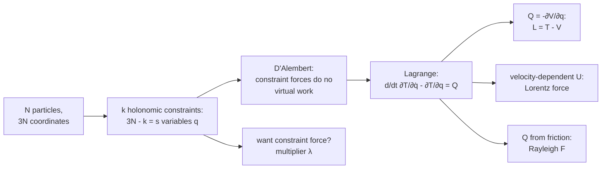
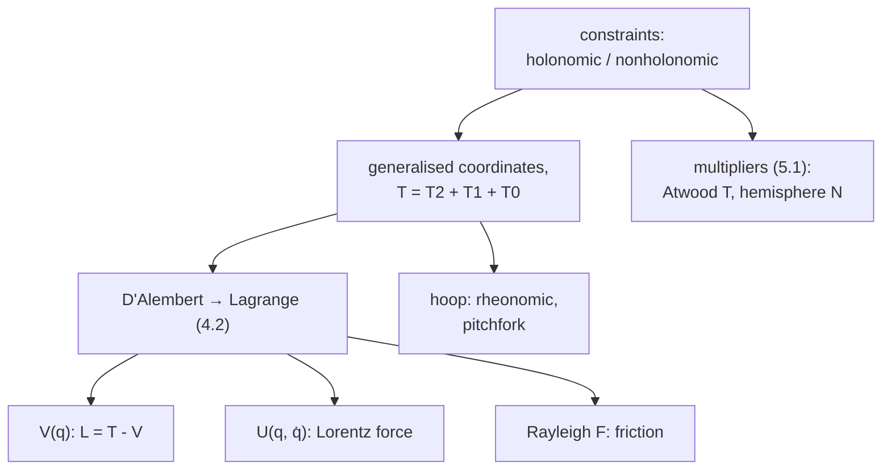

# CM02 · Lagrange's Equations, Constraints and Generalised Coordinates

◀ [[CM01 Variational Calculus and Hamilton's Principle]] · [[Classical Mechanics - Course Map]] · [[CM03 Symmetries, Noether's Theorem and Conservation Laws]] ▶

in course overview extra · book extra · beyond

> [!warning] Source status (every citation below was read in this session)
> Overview block 1: Lagrange's equations "for a class of systems observed on inertial frames obtained using generalized coordinates". No IISERP lecture notes exist in the folder.
>
> **Read directly:** Landau-Lifshitz Vol. 1 §1 (printed pp. 1-2) and §5 (pp. 8-10, incl. (5.5)); Goldstein-Poole-Safko 3rd ed. §1.3 (pp. 12-15), §1.4 (pp. 16-21), §1.5 (pp. 22-24, incl. the Lorentz-force Lagrangian and the dissipation function) and §2.4 (pp. 45-49, Lagrange multipliers, hemisphere example, semi-holonomic constraints); Alam (IISER Kolkata notes) §1.2 opening (definition of holonomic constraint). **Not cited because not read:** Goldstein §1.6, Thornton Ch. 7, Gregory Ch. 12, Alam §1.2-1.3 beyond the opening.

> [!syllabus] Syllabus map
> 🟢 **In course overview**: §1 generalised coordinates, §2 constraints, §4 Lagrange's equations from D'Alembert's principle, §6 generalised forces (including the electromagnetic Lagrangian).
>
> 🟡 **Extra · book**: §3 Lagrange multipliers (Goldstein §2.4), §5 velocity-dependent potentials and Rayleigh's dissipation function (Goldstein §1.5).
>
> 🔵 **Extra · beyond (mine)**: the structure $T=T_2+T_1+T_0$, the hoop and hemisphere analyses with numbers, the Frobenius-type nonholonomy proof for the rolling disk, `scripts/cm02_numbers.py`, `scripts/fig_cm02.py`.

> [!key] After this chapter you can
> - count **degrees of freedom** and choose **generalised coordinates**, writing $T$ as a quadratic form in the generalised velocities,
> - classify constraints (**holonomic / nonholonomic**, **rheonomic / scleronomic**) and say which can be eliminated,
> - derive Lagrange's equations from **D'Alembert's principle** and recover the forces of constraint with **Lagrange multipliers**,
> - write the equations when forces are not conservative: **generalised forces**, **velocity-dependent potentials** (the Lorentz force), **Rayleigh dissipation**,
> - use the method on hoops, pulleys, spheres and charged particles, with numbers.

> [!intuition] The one-sentence story
> CM01 showed that stationary action gives $\tfrac{\mathrm d}{\mathrm dt}\partial_{\dot q}L=\partial_qL$ for *independent* coordinates $q$. Real systems are tied together by constraints (strings, wires, surfaces). The trick of Lagrange is to choose coordinates that **already respect the constraints**, so the forces of constraint, unknown a priori, never enter the equations; and when you *want* them, a multiplier brings them back.

## 1. Generalised coordinates and degrees of freedom
LL §1 (p. 1): to fix the position of $N$ particles one needs $3N$ coordinates, and the number of independent quantities needed to define the position of a system uniquely is its number of **degrees of freedom**. Any $s$ quantities $q_1,\dots,q_s$ that completely define the position are **generalised coordinates**, and the $\dot q_i$ are **generalised velocities**. Specifying the $q_i$ alone does *not* fix the later motion; specifying $q$ **and** $\dot q$ does, which means the accelerations are then determined: this is why the Lagrangian contains $q$ and $\dot q$ and no higher derivatives (LL §1-§2, p. 2).

Goldstein (§1.3) gives the transformation equations from Cartesian positions to generalised coordinates,

$$\mathbf r_i=\mathbf r_i(q_1,\dots,q_s,t),\qquad i=1,\dots,N,\tag{1.1}$$

which contain the constraints implicitly, and assumes they can be inverted (the $q$'s are functions of the $\mathbf r_i$ and $t$). He stresses that generalised coordinates "will not divide into convenient groups of three" and need not be lengths: examples are the latitude and longitude of a particle constrained to a sphere, the two angles $\theta_1,\theta_2$ of a planar double pendulum, or even the amplitudes of a Fourier expansion of $\mathbf r_i$.

> [!example] Worked example 1: counting
> A system of $N$ particles with $k$ holonomic constraints has $s=3N-k$ degrees of freedom (Goldstein). Three particles in space: $9$ coordinates; joined by two inextensible rods in a chain, $k=2$ so $s=7$; joined into a rigid triangle, $k=3$ so $s=6$. A particle on a sphere: $s=2$. A planar double pendulum: the two bobs have $4$ planar coordinates and $2$ rod constraints, so $s=2$ (Goldstein's choice $\theta_1,\theta_2$).

## 2. Constraints
Goldstein §1.3 classifies constraints.

* **Holonomic**: expressible as equations $f(\mathbf r_1,\mathbf r_2,\dots,t)=0$ (1.37 of Goldstein). Rigid bodies ($(\mathbf r_i-\mathbf r_j)^2-c_{ij}^2=0$) and motion on a given curve or surface are holonomic. Alam's notes state the same condition as $f(q_i,t)=0$.
* **Nonholonomic**: not expressible that way. Goldstein's examples: the walls of a gas container, and a particle on the surface of a sphere, which obeys the *inequality* $r^2-a^2\ge0$ (so it can leave the surface: it slides down the sphere and "will eventually fall off"). Another, subtler, class is *differential* constraints that cannot be integrated: an object rolling without slipping.
* **Rheonomic** if the constraint equations contain $t$ explicitly (a bead on a moving wire), **scleronomic** if not. Goldstein notes that if the wire moves as a reaction to the bead's motion, the wire's coordinates become part of the system and the overall constraint is scleronomic.

Constraints cause two difficulties (Goldstein): the coordinates are no longer independent, so the equations of motion (1.19) are not all independent; and the **forces of constraint** are unknowns, "not furnished a priori". For holonomic constraints the first is solved by generalised coordinates; the second by D'Alembert's principle (§4).

> [!example] Worked example 2: a vertical disk rolling on a plane is nonholonomic
> Goldstein's disk of radius $a$ with coordinates $(x,y)$ of its centre, rotation angle $\phi$ about its axis and heading angle $\theta$ obeys $v=a\dot\phi$ along the heading, i.e.
>
> $$\mathrm dx-a\sin\theta\,\mathrm d\phi=0,\qquad\mathrm dy+a\cos\theta\,\mathrm d\phi=0\quad(\text{Goldstein (1.39)}).$$
>
> Goldstein says no integrating factor exists. Here is a short proof (mine). The allowed velocity directions are spanned by $X_1=\partial_\theta$ and $X_2=a\sin\theta\,\partial_x-a\cos\theta\,\partial_y+\partial_\phi$. Their commutator is
>
> $$[X_1,X_2]=a\cos\theta\,\partial_x+a\sin\theta\,\partial_y ,$$
>
> which is *not* a combination of $X_1,X_2$ (no $\partial_\theta$ or $\partial_\phi$ part, and the $\partial_x,\partial_y$ parts do not match the $\sin\theta,-\cos\theta$ pattern). If the constraints could be integrated, the allowed directions would be tangent to submanifolds and closed under the bracket. They are not, so the constraints are nonholonomic. Physically: by rolling and turning you can reach *any* position and heading (parallel parking), even though only 2 of the 4 velocity directions are allowed at each instant. The number of coordinates ($4$) cannot be reduced.

## 3. The kinetic energy in generalised coordinates
From (1.1), $\dot{\mathbf r}_i=\sum_k\dfrac{\partial\mathbf r_i}{\partial q_k}\dot q_k+\dfrac{\partial\mathbf r_i}{\partial t}$ (Goldstein (1.46)). Hence

$$T=\sum_i\tfrac12m_i\dot{\mathbf r}_i^2=T_2+T_1+T_0,$$

$$T_2=\tfrac12\sum_{jk}a_{jk}\dot q_j\dot q_k,\quad a_{jk}=\sum_im_i\frac{\partial\mathbf r_i}{\partial q_j}\!\cdot\!\frac{\partial\mathbf r_i}{\partial q_k};\qquad T_1=\sum_jb_j\dot q_j,\ \ b_j=\sum_im_i\frac{\partial\mathbf r_i}{\partial q_j}\!\cdot\!\frac{\partial\mathbf r_i}{\partial t};\qquad T_0=\tfrac12\sum_im_i\Bigl|\frac{\partial\mathbf r_i}{\partial t}\Bigr|^2 .$$

If the transformation does not depend on $t$ (scleronomic), $T=T_2$ is a quadratic form in the velocities with coefficients depending on $q$ only: LL (5.5), $L=\tfrac12\sum a_{ik}(q)\dot q_i\dot q_k-U(q)$. LL add: the kinetic energy is "still a quadratic function of the velocities, but it may depend on the co-ordinates also". For a time-dependent transformation the linear and constant parts $T_1,T_0$ appear (see the rotating hoop, §7).

**Systems in a given external field** (LL §5, pp. 9-10): if system $A$ moves in the field of a system $B$ whose motion is prescribed, take the Lagrangian of $A+B$ and substitute the *given* functions of time for $q_B$; the term $T_B[q_B(t),\dot q_B(t)]$ depends on time only, is a total derivative, and drops out. So $L_A=T_A(q_A,\dot q_A)-U[q_A,q_B(t)]$: "a Lagrangian of the usual type, the only difference being that the potential energy may depend explicitly on time".

## 4. D'Alembert's principle and Lagrange's equations
### 4.1 Virtual work
A **virtual displacement** $\delta\mathbf r_i$ is an infinitesimal change of the configuration consistent with the constraints *at the given instant*, with **no change of time** ($\delta t=0$): it is distinguished from an actual displacement during $\mathrm dt$, when forces and constraints may change (Goldstein §1.4). Decompose the force on each particle as $\mathbf F_i=\mathbf F_i^{(a)}+\mathbf f_i$ (applied plus constraint). In *equilibrium* $\sum_i\mathbf F_i\!\cdot\!\delta\mathbf r_i=0$; for systems in which the constraint forces do no net virtual work (a particle on a smooth surface: the constraint force is normal and $\delta\mathbf r$ is tangent; also rigid bodies and rolling without slipping, but **not** sliding friction) this reduces to the **principle of virtual work**

$$\sum_i\mathbf F_i^{(a)}\!\cdot\!\delta\mathbf r_i=0 .$$

Goldstein adds the subtle point that this holds even for a constraint surface that moves in time: the constraint force is instantaneously perpendicular to the surface, so the virtual work vanishes "even though the work during an actual displacement in the time $\mathrm dt$ does not necessarily vanish".

### 4.2 D'Alembert's principle
Writing Newton's law as $\mathbf F_i-\dot{\mathbf p}_i=0$ (a body in equilibrium under the actual force and the *reversed effective force* $-\dot{\mathbf p}_i$; Goldstein credits the device to James Bernoulli and D'Alembert), the same argument gives

$$\sum_i\bigl(\mathbf F_i^{(a)}-\dot{\mathbf p}_i\bigr)\!\cdot\!\delta\mathbf r_i=0,\tag{4.1}$$

in which the forces of constraint no longer appear.

### 4.3 Translation to generalised coordinates
Using $\delta\mathbf r_i=\sum_j\dfrac{\partial\mathbf r_i}{\partial q_j}\delta q_j$ (no $\delta t$), the applied-force term is $\sum_jQ_j\delta q_j$ with the **generalised force** $Q_j=\sum_i\mathbf F_i^{(a)}\!\cdot\!\dfrac{\partial\mathbf r_i}{\partial q_j}$; $Q_j\delta q_j$ has the dimension of work, so $Q_j$ may be a torque if $q_j$ is an angle (Goldstein). For the inertial term, two lemmas (Goldstein (1.50)-(1.51)):

$$\frac{\partial\dot{\mathbf r}_i}{\partial\dot q_j}=\frac{\partial\mathbf r_i}{\partial q_j},\qquad\frac{\mathrm d}{\mathrm dt}\Bigl(\frac{\partial\mathbf r_i}{\partial q_j}\Bigr)=\frac{\partial\dot{\mathbf r}_i}{\partial q_j}.$$

(The first follows by differentiating $\dot{\mathbf r}_i=\sum_k\partial_{q_k}\mathbf r_i\,\dot q_k+\partial_t\mathbf r_i$ with respect to $\dot q_j$; the second because $\mathrm d/\mathrm dt$ and $\partial/\partial q_j$ commute when acting on a function of $q$ and $t$.) Then

$$\sum_im_i\ddot{\mathbf r}_i\!\cdot\!\frac{\partial\mathbf r_i}{\partial q_j}=\frac{\mathrm d}{\mathrm dt}\Bigl(\sum_im_i\dot{\mathbf r}_i\!\cdot\!\frac{\partial\dot{\mathbf r}_i}{\partial\dot q_j}\Bigr)-\sum_im_i\dot{\mathbf r}_i\!\cdot\!\frac{\partial\dot{\mathbf r}_i}{\partial q_j}=\frac{\mathrm d}{\mathrm dt}\frac{\partial T}{\partial\dot q_j}-\frac{\partial T}{\partial q_j},$$

and (4.1) becomes (Goldstein (1.52))

$$\sum_j\Bigl[\frac{\mathrm d}{\mathrm dt}\frac{\partial T}{\partial\dot q_j}-\frac{\partial T}{\partial q_j}-Q_j\Bigr]\delta q_j=0 .$$

For **holonomic** constraints the $q_j$ can be chosen independent, so each bracket vanishes separately (1.53):

$$\boxed{\;\frac{\mathrm d}{\mathrm dt}\frac{\partial T}{\partial\dot q_j}-\frac{\partial T}{\partial q_j}=Q_j\;}\tag{4.2}$$

If the forces come from a potential $V(q,t)$ not depending on velocities, $Q_j=-\partial V/\partial q_j$, and with $L=T-V$ (Goldstein (1.56)-(1.57)):

$$\frac{\mathrm d}{\mathrm dt}\frac{\partial L}{\partial\dot q_j}-\frac{\partial L}{\partial q_j}=0,$$

exactly the equations obtained from Hamilton's principle in CM01 §2.3. (Goldstein remarks that the Lagrangian is not unique: $L'=L+\mathrm dF(q,t)/\mathrm dt$ gives the same equations; CM01 §5 proves it.) The route here is *Newtonian*; CM01's was *variational*; the two agree, and that is the content of the statement "Lagrange's equations are Newton's equations in generalised coordinates".

> [!pitfall] The term $\partial T/\partial q_j$ is the curvature of the coordinates
> In Cartesian coordinates $\partial T/\partial q_j=0$. In curvilinear coordinates it supplies the inertial ("centripetal") terms. For polar coordinates $T=\tfrac12m(\dot r^2+r^2\dot\theta^2)$ gives $\partial T/\partial r=mr\dot\theta^2$: the radial equation is $m\ddot r-mr\dot\theta^2=-U'(r)$ and $p_\theta=mr^2\dot\theta$ is conserved.

## 5. Constraint forces by Lagrange multipliers (🟡)
Goldstein §2.4: if there are $n$ variables $q_i$ and $m$ holonomic constraint equations $f_\alpha(q,t)=0$, modify the action to $I=\int(L+\sum_\alpha\lambda_\alpha f_\alpha)\,\mathrm dt$ and vary the $q_i$ and $\lambda_\alpha$ *independently*, giving $n+m$ equations:

$$\frac{\mathrm d}{\mathrm dt}\frac{\partial L}{\partial\dot q_k}-\frac{\partial L}{\partial q_k}+\sum_\alpha\lambda_\alpha\frac{\partial f_\alpha}{\partial q_k}=0\ \ (k=1,\dots,n),\qquad f_\alpha(q,t)=0.\tag{5.1}$$

The $\lambda_\alpha$ are fixed by the requirement that the $m$ equations in which the dependent variations sit are satisfied; the remaining $n-m$ then follow from the independent variations. The terms $\sum\lambda_\alpha\partial f_\alpha/\partial q_k$ are the **generalised forces of constraint**. Goldstein warns that the sign of the multiplier term is arbitrary, so mathematics gives only the *magnitude*: "you need to understand the physics to determine their directions".

**Nonholonomic constraints** generally cannot be handled by a variational principle (Goldstein). The exception is the *semi-holonomic* class $f_\alpha=\sum_ka_{\alpha k}\dot q_k+a_{\alpha0}=0$ with non-integrable coefficients: here too multipliers $\mu_\alpha(t)$ produce equations $\frac{\mathrm d}{\mathrm dt}\partial_{\dot q_k}L-\partial_{q_k}L=-\sum\mu_\alpha a_{\alpha k}$, and the constraints are the other $m$ equations (his (2.26)-(2.27)).

> [!example] Worked example 3: Atwood's machine, with the tension (🔵)
> Two masses on a string over a frictionless pulley, $x_1,x_2$ measured downward, constraint $f=x_1+x_2-\ell=0$. $L=\tfrac12m_1\dot x_1^2+\tfrac12m_2\dot x_2^2+m_1gx_1+m_2gx_2$. By (5.1): $m_1\ddot x_1-m_1g+\lambda=0$ and $m_2\ddot x_2-m_2g+\lambda=0$. With $\ddot x_1=-\ddot x_2=a$: $a=\dfrac{m_1-m_2}{m_1+m_2}g$ and $\lambda=\dfrac{2m_1m_2}{m_1+m_2}g=T$, the string tension. For $m_1=3$ kg, $m_2=1$ kg: $a=4.905$ m/s² and $T=14.715$ N. (Eliminating the constraint instead: $x_2=\ell-x_1$, $L=\tfrac12(m_1+m_2)\dot x^2+(m_1-m_2)gx$, same $a$, no tension: that is the benefit and the cost of choosing coordinates that respect the constraint.)

> [!example] Worked example 4: the mass on a hemisphere (Goldstein's example, derived)
> A mass $M$ starts at the top of a smooth hemisphere of radius $a$ and slides off. Coordinates $(r,\theta)$, $\theta$ from the vertical, constraint $f=r-a=0$. $L=\tfrac12M(\dot r^2+r^2\dot\theta^2)-Mgr\cos\theta$. By (5.1): the $\theta$ equation (with $r=a$) is $a^2\ddot\theta=ga\sin\theta$, so $\dot\theta^2=\tfrac{2g}{a}(1-\cos\theta)$ by integrating from rest at the top; the $r$ equation (with $\ddot r=0$) gives
>
> $$\lambda=Ma\dot\theta^2-Mg\cos\theta=Mg(2-3\cos\theta).$$
>
> The physical normal force pushing outward is $N=-\lambda=Mg(3\cos\theta-2)$, which agrees with Goldstein's $\lambda=Mg(3\cos\theta-2)$ (his sign convention). $N$ vanishes at $\cos\theta=\tfrac23$, **$\theta=48.19^\circ$**, where the mass **leaves** the sphere (for $N<0$ the constraint would have to pull); there $v^2=a^2\dot\theta^2=\tfrac23ga$. (Panel B of the figure.) This is Goldstein's point that "particle on a sphere" is an *inequality* (nonholonomic), solved here by treating it as an equality until the multiplier changes sign.

## 6. Generalised forces beyond a potential (🟡)
### 6.1 Velocity-dependent potentials and the Lorentz force
Goldstein §1.5: Lagrange's equations keep the form (1.57) if the generalised forces come from a function $U(q,\dot q)$ by $Q_j=-\dfrac{\partial U}{\partial q_j}+\dfrac{\mathrm d}{\mathrm dt}\dfrac{\partial U}{\partial\dot q_j}$ with $L=T-U$. The key case is a charge $q$ in electric and magnetic fields $\mathbf E=-\nabla\phi-\partial_t\mathbf A$, $\mathbf B=\nabla\times\mathbf A$ with the Lorentz force $\mathbf F=q(\mathbf E+\mathbf v\times\mathbf B)$:

$$U=q\phi-q\,\mathbf A\!\cdot\!\mathbf v,\qquad L=\tfrac12mv^2-q\phi+q\,\mathbf A\!\cdot\!\mathbf v.\tag{6.1}$$

**Check** (Goldstein (1.64)-(1.66), reproduced): the $x$ Lagrange equation is $\dfrac{\mathrm d}{\mathrm dt}(m\dot x+qA_x)=-q\,\partial_x\phi+q\,\mathbf v\!\cdot\!\partial_x\mathbf A$. With $\dfrac{\mathrm dA_x}{\mathrm dt}=\partial_tA_x+\mathbf v\!\cdot\!\nabla A_x$ this becomes $m\ddot x=q\bigl(-\partial_x\phi-\partial_tA_x\bigr)+q\bigl[\mathbf v\!\cdot\!\partial_x\mathbf A-\mathbf v\!\cdot\!\nabla A_x\bigr]=qE_x+q(\mathbf v\times\mathbf B)_x$, since $[\mathbf v\times(\nabla\times\mathbf A)]_x=\mathbf v\!\cdot\!\partial_x\mathbf A-\mathbf v\!\cdot\!\nabla A_x$. ∎ The Lagrangian involves the **potentials**, not the fields: this is why gauge invariance (CMX2, ED08) is a symmetry of $L$ up to a total derivative (P9). The canonical momentum is $\mathbf p=\partial L/\partial\mathbf v=m\mathbf v+q\mathbf A$, not $m\mathbf v$ (P15).

> [!example] Worked example 5: the cyclotron orbit from (6.1)
> Uniform $\mathbf B=B\hat{\mathbf z}$, $\phi=0$, $\mathbf A=\tfrac12\mathbf B\times\mathbf r$: $L=\tfrac12m(\dot x^2+\dot y^2)+\tfrac12qB(x\dot y-y\dot x)$. The Lagrange equations are $m\ddot x=qB\dot y$, $m\ddot y=-qB\dot x$, so $\mathbf v$ rotates at $\omega=qB/m$ with radius $v_\perp/\omega$ and period $2\pi m/qB$. Numerically ($q=m=1$, $B=2$, $v_\perp=1$): period $=3.1416$, radius $=0.5$, confirmed by integrating the equations.

### 6.2 Rayleigh's dissipation function
For frictional forces proportional to velocity, $\mathbf F_{f,i}=-k\mathbf v_i$ (in Goldstein, componentwise $F_{fx}=-k_xv_x$) define

$$\mathcal F=\tfrac12\sum_i\bigl(k_xv_{ix}^2+k_yv_{iy}^2+k_zv_{iz}^2\bigr),\qquad\mathbf F_{f,i}=-\nabla_{\mathbf v_i}\mathcal F,\qquad Q_j=-\frac{\partial\mathcal F}{\partial\dot q_j}\ \ (\text{Goldstein (1.67)-(1.69)}).$$

The work done against friction in $\mathrm dt$ is $\mathrm dW_f=\sum(k_xv_x^2+k_yv_y^2+k_zv_z^2)\,\mathrm dt=2\mathcal F\,\mathrm dt$, so $2\mathcal F$ is the rate of energy dissipation. Two functions, $L$ and $\mathcal F$, now specify the motion:

$$\frac{\mathrm d}{\mathrm dt}\frac{\partial L}{\partial\dot q_j}-\frac{\partial L}{\partial q_j}+\frac{\partial\mathcal F}{\partial\dot q_j}=0 .\tag{6.2}$$

Goldstein's example is Stokes' drag $\mathbf F_f=-6\pi\eta a\mathbf v$ on a sphere.

> [!example] Worked example 6: the damped oscillator
> $L=\tfrac12m\dot x^2-\tfrac12kx^2$, $\mathcal F=\tfrac12b\dot x^2$: (6.2) gives $m\ddot x+b\dot x+kx=0$. The energy $E=\tfrac12m\dot x^2+\tfrac12kx^2$ obeys $\dot E=\dot x(m\ddot x+kx)=-b\dot x^2=-2\mathcal F$. Numerically ($m=1$, $k=4$, $b=0.4$, $x(0)=1$): damped frequency $\sqrt{4-0.01}=1.9975$, amplitude decay rate $b/2m=0.2$; $E(0)-E(10)=1.9596$ equals $\int_0^{10}b\dot x^2\,\mathrm dt=1.9596$ ✓ (panel C).

## 7. A rheonomic example: the bead on a rotating hoop
A bead of mass $m$ slides on a smooth circular hoop of radius $R$ that rotates about its vertical diameter at constant $\Omega$. The constraint is rheonomic (the hoop moves) but there is only one coordinate, $\theta$ measured from the downward vertical:

$$\mathbf r=\bigl(R\sin\theta\cos\Omega t,\ R\sin\theta\sin\Omega t,\ -R\cos\theta\bigr).$$

$T=\tfrac12mR^2(\dot\theta^2+\Omega^2\sin^2\theta)$ (both $T_2$ and $T_0$ present), $U=-mgR\cos\theta$, so

$$L=\tfrac12mR^2\dot\theta^2+\tfrac12mR^2\Omega^2\sin^2\theta+mgR\cos\theta,\qquad\ddot\theta=\sin\theta\Bigl(\Omega^2\cos\theta-\frac gR\Bigr).\tag{7.1}$$

* Equilibria: $\theta=0$ and $\cos\theta_0=g/(\Omega^2R)$ (exists only if $\Omega>\Omega_c=\sqrt{g/R}$).
* Stability: linearising at $\theta=0$ gives $\ddot\theta=(\Omega^2-g/R)\theta$, stable for $\Omega<\Omega_c$ and unstable above, where the bead moves to the new stable equilibrium: a **pitchfork** (panel A). Linearising at $\theta_0$: $\delta\ddot\theta=-\Omega^2\sin^2\theta_0\,\delta\theta$, so small oscillations have $\omega=\Omega\sin\theta_0$.
* Energy: $L$ has no explicit $t$, so by CM01 §2.4 the quantity $h=\dot\theta\,\partial_{\dot\theta}L-L=\tfrac12mR^2\dot\theta^2-\tfrac12mR^2\Omega^2\sin^2\theta-mgR\cos\theta$ is conserved, but it is **not** $T+U=h+mR^2\Omega^2\sin^2\theta$: the hoop's motor does work on the bead, so the true energy changes, while $h$ (which involves $T_2-T_0$) does not.

> [!example] Worked example 7: numbers
> $R=0.5$ m, $\Omega=6$ rad/s: $\Omega_c=\sqrt{g/R}=4.429$ rad/s, so the bead leaves the bottom; $\cos\theta_0=9.81/(36\times0.5)=0.545$, $\theta_0=56.98^\circ$, and $\omega=6\sin\theta_0=5.031$ rad/s. Integrating (7.1) from a $0.01$ rad displacement gives a period $1.2491$ s against $2\pi/\omega=1.2490$ s.

![[fig_cm02_constraints.png]]

## 8. When the Lagrangian method does and does not help
* **Does:** holonomic constraints, any coordinates, forces of constraint eliminated, a scalar function $L$ to write down.
* **Needs care:** nonholonomic constraints (cannot be eliminated; semi-holonomic ones via multipliers; inequalities like the sphere via the sign of $\lambda$); sliding friction (does virtual work, so outside D'Alembert's principle; Goldstein excludes it, noting that friction is essentially macroscopic).
* **Cannot:** replace physics. You still decide what the system is and which forces are in $L$ or in $Q_j$.

<!-- interactive:start (generated by scripts/embed_interactive.py; edit the tool in scripts/interactive/tools/, not this block) -->
> [!interactive]+ Interactive: Leaving the hemisphere: the Lagrange multiplier is the normal force
> A mass slides without friction from near the top of a hemisphere.
>
> ![[cm02_hemisphere.png|720]]
>
> **Try:** Change the tiny initial push: the leaving angle does not depend on it (for a start from rest at the top). Watch N/Mg fall to zero as the bead reaches 48.19° and see the parabola take over.
>
> [▶ Open the tool in your browser](../Assets/interactive/cm02_hemisphere.html) · [absolute link](file:///home/swastik/Documents/notes/Assets/interactive/cm02_hemisphere.html) · all tools and coverage: [[Interactive Tools]]

> [!interactive]+ Interactive: Bead on a rotating hoop: a pitchfork bifurcation
> A smooth bead on a hoop of radius R that spins about its vertical diameter at Ω.
>
> ![[cm02_hoop.png|720]]
>
> **Try:** Sweep Ω through √(g/R) = 4.43 rad/s and watch the bottom of the hoop become a maximum while two new minima appear at cos θ₀ = g/(Ω²R).
>
> [▶ Open the tool in your browser](../Assets/interactive/cm02_hoop.html) · [absolute link](file:///home/swastik/Documents/notes/Assets/interactive/cm02_hoop.html) · all tools and coverage: [[Interactive Tools]]

<!-- interactive:end -->

## Map of this chapter

## Common mistakes
1. Counting coordinates instead of degrees of freedom (nonholonomic constraints do not reduce $s$).
2. Including the force of constraint in $Q_j$ (it never appears when the coordinates respect the constraint).
3. Varying time: $\delta t=0$ for virtual displacements.
4. Writing $E=T+U$ as conserved for a time-dependent constraint (hoop: only $h$ is).
5. Taking the sign of $\lambda$ as the physical direction of the force (§5).
6. Forgetting that the canonical momentum of a charge is $m\mathbf v+q\mathbf A$.

## Summary
- $s=3N-k$; $\mathbf r_i=\mathbf r_i(q,t)$; $T=T_2+T_1+T_0$ ($=T_2$ when scleronomic).
- D'Alembert: $\sum(\mathbf F^{(a)}_i-\dot{\mathbf p}_i)\!\cdot\!\delta\mathbf r_i=0$ with $\delta t=0$ ⟹ $\tfrac{\mathrm d}{\mathrm dt}\partial_{\dot q}T-\partial_qT=Q$; $Q=-\partial_qV$ ⟹ $L=T-V$.
- Multipliers: $\tfrac{\mathrm d}{\mathrm dt}\partial_{\dot q_k}L-\partial_{q_k}L+\sum\lambda_\alpha\partial_{q_k}f_\alpha=0$; $\lambda$ gives the constraint force.
- Charged particle: $L=\tfrac12mv^2-q\phi+q\mathbf A\!\cdot\!\mathbf v$; friction: $+\partial_{\dot q}\mathcal F$ with $\dot E=-2\mathcal F$.
- Numbers: Atwood $a=4.905$, $T=14.715$; hemisphere leaves at $48.19^\circ$; hoop $\theta_0=56.98^\circ$, $\omega=5.031$.

## Practice
> [!question]- P1. Degrees of freedom
> How many degrees of freedom do three particles have if (a) joined by two rods in a chain, (b) forming a rigid triangle?
> **Solution.** $9-2=7$; $9-3=6$.

> [!question]- P2. The two lemmas
> Prove $\partial\dot{\mathbf r}_i/\partial\dot q_j=\partial\mathbf r_i/\partial q_j$ and $\tfrac{\mathrm d}{\mathrm dt}(\partial\mathbf r_i/\partial q_j)=\partial\dot{\mathbf r}_i/\partial q_j$.
> **Solution.** From $\dot{\mathbf r}_i=\sum_k\partial_{q_k}\mathbf r_i\,\dot q_k+\partial_t\mathbf r_i$ differentiate with respect to $\dot q_j$: only the $k=j$ term survives. For the second, $\tfrac{\mathrm d}{\mathrm dt}\partial_{q_j}\mathbf r_i=\sum_k\partial_{q_k}\partial_{q_j}\mathbf r_i\,\dot q_k+\partial_t\partial_{q_j}\mathbf r_i=\partial_{q_j}\dot{\mathbf r}_i$ by symmetry of mixed partials. ∎

> [!question]- P3. Spherical coordinates
> Find the metric $a_{ik}$ in $T=\tfrac12\sum a_{ik}\dot q_i\dot q_k$ for $(r,\theta,\phi)$.
> **Solution.** $\mathbf r=r(\sin\theta\cos\phi,\sin\theta\sin\phi,\cos\theta)$ gives $a=m\,\mathrm{diag}(1,\,r^2,\,r^2\sin^2\theta)$.

> [!question]- P4. Spherical pendulum
> Write $L$ for a pendulum of length $l$ ($\theta$ from the downward vertical), find the conserved quantity, and the angular speed for a steady cone with $l=1$ m, $\theta_0=30^\circ$.
> **Solution.** $L=\tfrac12ml^2(\dot\theta^2+\sin^2\theta\,\dot\phi^2)+mgl\cos\theta$; $\phi$ cyclic so $p_\phi=ml^2\sin^2\theta\,\dot\phi$ is conserved. $\theta$-equation: $l\ddot\theta=l\sin\theta\cos\theta\,\dot\phi^2-g\sin\theta$; steady cone $\ddot\theta=0$: $\dot\phi^2=g/(l\cos\theta_0)=11.33$, $\dot\phi=3.366$ rad/s.

> [!question]- P5. Bead on a rotating parabola
> A bead slides on the smooth parabolic wire $z=\alpha r^2$ rotating about $z$ with $\Omega$. For what $\Omega$ is $r=0$ stable?
> **Solution.** $L=\tfrac12m[(1+4\alpha^2r^2)\dot r^2+r^2\Omega^2]-mg\alpha r^2$. Linearising: $m\ddot r=m(\Omega^2-2g\alpha)r$: stable iff $\Omega^2<2g\alpha$.

> [!question]- P6. Atwood tension
> Verify $T=2m_1m_2g/(m_1+m_2)$ by Newton's laws.
> **Solution.** $m_1a=m_1g-T$, $m_2(-a)=m_2g-T$ ⟹ $a=g(m_1-m_2)/(m_1+m_2)$, $T=m_1(g-a)=2m_1m_2g/(m_1+m_2)$ ✓ equals $\lambda$.

> [!question]- P7. Leaving the hemisphere
> Show the mass leaves at $\cos\theta=2/3$ with $v^2=\tfrac23ga$, and find the speed for $a=1$ m.
> **Solution.** $N=Mg(3\cos\theta-2)=0$ at $\cos\theta=2/3$; $v^2=a^2\dot\theta^2=2ga(1-2/3)=\tfrac23ga=6.54$ m²/s², $v=2.56$ m/s.

> [!question]- P8. Energy for scleronomic constraints
> Show $\dot q_j\partial T/\partial\dot q_j=2T$ and that $h=T+U$ is conserved when $\partial_tL=0$ and $T=T_2$.
> **Solution.** $T_2$ is homogeneous of degree 2 in $\dot q$ (Euler). Then $h=\dot q\,\partial_{\dot q}L-L=2T-(T-U)=T+U$; $\dot h=-\partial_tL=0$ (CM01 §2.4).

> [!question]- P9. Gauge transformation
> Show $\phi\to\phi-\partial_t\chi$, $\mathbf A\to\mathbf A+\nabla\chi$ changes $L$ in (6.1) by $q\,\mathrm d\chi/\mathrm dt$.
> **Solution.** $\Delta L=q\partial_t\chi+q\mathbf v\!\cdot\!\nabla\chi=q\,\mathrm d\chi/\mathrm dt$, a total derivative of $q\chi(\mathbf r,t)$, which CM01 §5 shows leaves the equations unchanged (but $\mathbf p\to\mathbf p+q\nabla\chi$).

> [!question]- P10. Cyclotron
> With $q/m=0.5$, $B=2$ T, $v_\perp=1$ m/s find $\omega$ and radius.
> **Solution.** $\omega=qB/m=1$ rad/s, radius $v_\perp/\omega=1$ m.

> [!question]- P11. Mean decay of the damped oscillator
> Show the energy of the damped oscillator decays on average as $e^{-bt/m}$.
> **Solution.** $x\approx Ae^{-bt/2m}\cos\omega_dt$, so $E\propto A^2e^{-bt/m}$. With $b/m=0.4$, $e^{-4}=0.0183$ at $t=10$ (the exact $E(10)/E(0)=0.0202$ includes the oscillating factor).

> [!question]- P12. Nonholonomic check
> Show the constraints $\mathrm dx=a\sin\theta\,\mathrm d\phi$, $\mathrm dy=-a\cos\theta\,\mathrm d\phi$ are non-integrable using the commutator.
> **Solution.** §2: $[X_1,X_2]=a\cos\theta\,\partial_x+a\sin\theta\,\partial_y\notin\mathrm{span}(X_1,X_2)$.

> [!question]- P13. Generalised force
> A force $\mathbf F$ acts on a point at $(R\cos\theta,R\sin\theta)$. Find $Q_\theta$.
> **Solution.** $Q_\theta=\mathbf F\!\cdot\!\partial\mathbf r/\partial\theta=R(F_y\cos\theta-F_x\sin\theta)$, the torque about the origin.

> [!question]- P14. Energy and $h$ on the hoop
> Show $E-h=mR^2\Omega^2\sin^2\theta$ and that $E$ is not conserved.
> **Solution.** $E=T+U=\tfrac12mR^2\dot\theta^2+\tfrac12mR^2\Omega^2\sin^2\theta-mgR\cos\theta$, $h=E-mR^2\Omega^2\sin^2\theta$; $h$ is constant so $\dot E=mR^2\Omega^2\,\mathrm d(\sin^2\theta)/\mathrm dt\ne0$ whenever $\theta$ is changing.

> [!question]- P15. Canonical momentum
> Compute $p_j=\partial L/\partial\dot q_j$ for $L=\tfrac12\sum a_{jk}\dot q_j\dot q_k-U$ and for the charged particle (6.1).
> **Solution.** $p_j=\sum_ka_{jk}\dot q_k$; for (6.1), $\mathbf p=m\mathbf v+q\mathbf A$.

## Zettel notes
<!-- zettel:start -->
<!-- zettel:end -->

## Provenance
> [!provenance]- Source map for this chapter (all rows read in this session)
> | Topic | Source | Scope |
> |---|---|---|
> | degrees of freedom, generalised coordinates and velocities, state determined by $q,\dot q$ | LL Vol. 1 §1, pp. 1-2 | in overview |
> | $L=\tfrac12\sum a_{ik}\dot q_i\dot q_k-U$ (5.5); system in an external field | LL §5, pp. 8-10 | in overview |
> | holonomic/nonholonomic, rheonomic/scleronomic, $3N-k$, transformation equations, double pendulum, rolling disk (1.39) | Goldstein 3rd ed. §1.3, pp. 12-15 | in overview |
> | virtual work, D'Alembert, generalised force, derivation of (1.52)-(1.57), non-uniqueness | Goldstein §1.4, pp. 16-21 | in overview |
> | velocity-dependent potential, Lorentz Lagrangian (1.60)-(1.66), Rayleigh function (1.67)-(1.70) | Goldstein §1.5, pp. 22-24 | extra/book |
> | multipliers (2.20)-(2.23), hemisphere example, semi-holonomic constraints (2.24)-(2.27) | Goldstein §2.4, pp. 45-49 | extra/book |
> | holonomic constraint definition | Alam, IISER Kolkata notes §1.2 (opening) | supplement |
> | $T_2+T_1+T_0$, Frobenius/commutator proof, Atwood tension, hoop, damped oscillator, cyclotron numbers | `scripts/cm02_numbers.py`, `scripts/fig_cm02.py` | extra/beyond |
