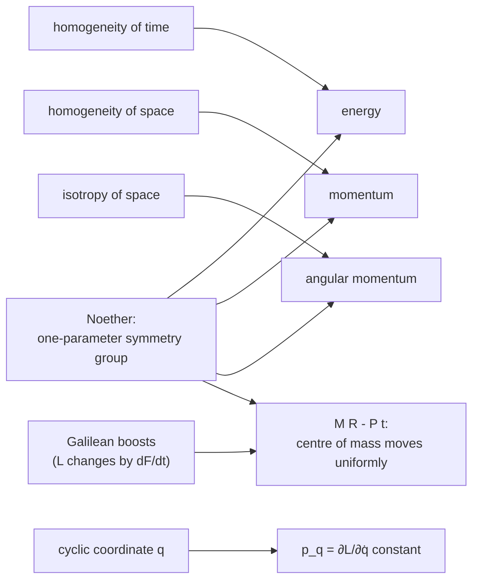
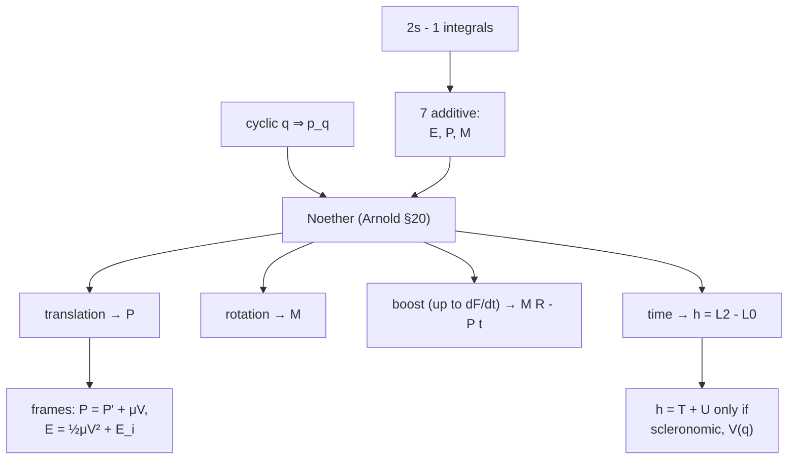

# CM03 · Symmetries, Noether's Theorem and Conservation Laws

◀ [[CM02 Lagrange's Equations, Constraints and Generalised Coordinates]] · [[Classical Mechanics - Course Map]] · [[CM04 Central Forces and Effective One-Dimensional Motion]] ▶

in course overview extra · book extra · beyond

> [!warning] Source status (every citation below was read in this session)
> Overview block 2: "the symmetries and additive conserved quantities for closed systems". No IISERP lecture notes exist in the folder.
>
> **Read directly:** Landau-Lifshitz Vol. 1 §6 (energy, printed pp. 13-15), §7 (momentum, pp. 15-16, with the potential-step problem), §8 (centre of mass, pp. 16-18, with the action-transformation problem), §9 (angular momentum, pp. 18-20); Goldstein-Poole-Safko 3rd ed. §2.6 (pp. 54-59) and §2.7 (pp. 60-63); Arnold §20 *Noether's theorem* (printed pp. 88-90, statement, proof, examples 1-2 and footnote 38). **Not cited because not read:** LL §10 (mechanical similarity), Goldstein §13.7 (Noether's theorem for fields), Gregory Ch. 12, Thornton §7.9, the remainder of Arnold §20.

> [!syllabus] Syllabus map
> 🟢 **In course overview**: §1 integrals of motion, §2 cyclic coordinates and generalised momenta, §3 energy, §4 momentum, §5 angular momentum, §7 centre of mass and frame dependence.
>
> 🟡 **Extra · book**: §6 Noether's theorem as a theorem about one-parameter groups (Arnold §20).
>
> 🔵 **Extra · beyond (mine)**: the quasi-symmetry version (symmetry up to a total derivative) and the Galilean-boost integral, the time-translation case via the Beltrami identity, the numerical checks, `scripts/cm03_numbers.py`, `scripts/fig_cm03.py`.

> [!key] After this chapter you can
> - count the **integrals of motion** of a system and say which are *additive*,
> - read a conserved quantity off a **cyclic coordinate**, and distinguish the **energy function** $h$ from the total energy $T+U$,
> - derive **momentum, angular momentum and energy** conservation from the homogeneity and isotropy of space and time,
> - state and prove **Noether's theorem** for a one-parameter symmetry group, including symmetries up to a total derivative (Galilean boosts),
> - transform energy, momentum and angular momentum between inertial frames and use the **centre-of-mass** frame.

> [!intuition] The one-sentence story
> A symmetry of the Lagrangian is a way of changing the motion that does not change the physics; the conserved quantity is the *rate at which $L$ would change* if the symmetry were broken, and it is conserved because the symmetry is exact. Space being the same everywhere gives momentum, space having no preferred direction gives angular momentum, and time being uniform gives energy.

## 1. Integrals of motion
LL §6 (p. 13): during the motion the $2s$ quantities $q_i,\dot q_i$ vary, but some functions of them stay constant, depending only on the initial conditions: **integrals of the motion**. For a closed system with $s$ degrees of freedom there are $2s-1$ independent ones. The argument: the general solution contains $2s$ constants; the equations of a closed system do not contain $t$ explicitly, so one constant can always be taken as an additive shift $t_0$ in the time; eliminating $t+t_0$ from the $2s$ functions $q_i(t+t_0,C_1,\dots,C_{2s-1})$, $\dot q_i(\dots)$ expresses the remaining $2s-1$ constants as functions of $(q,\dot q)$.

Not all integrals are equally important. Some owe their constancy to the homogeneity and isotropy of space and time; these are the **conserved quantities**, and they share the property of being **additive**: their value for a system of weakly interacting parts is the sum of the values for the parts. Additivity is what makes them useful: if two bodies interact, the conservation laws constrain the final state from the initial one without solving the interaction.

## 2. Cyclic coordinates and generalised momenta
Goldstein §2.6: the **generalised (canonical, conjugate) momentum** is $p_j=\partial L/\partial\dot q_j$ (2.44). If $q_j$ is not Cartesian, $p_j$ need not have the dimensions of linear momentum (for an angle it is an angular momentum); and with a velocity-dependent potential even a Cartesian $p_j$ differs from $m\dot x_j$. For a charge in electromagnetic fields (his (2.45))

$$p_x=m\dot x+qA_x,$$

the mechanical momentum plus an extra term. A coordinate that does not appear in $L$ (though $\dot q_j$ may) is **cyclic** (ignorable); Lagrange's equation $\tfrac{\mathrm d}{\mathrm dt}p_j=\partial L/\partial q_j=0$ then gives

$$\boxed{\;\frac{\partial L}{\partial q_j}=0\ \Longrightarrow\ p_j=\text{const}\;}\tag{2.1}$$

(Goldstein (2.46)). Two refinements from Goldstein.

* **Electromagnetism.** The cyclic-coordinate theorem is *more general than Newton-III momentum conservation*: for a particle in fields $\phi,\mathbf A$ independent of $x$, $x$ is cyclic and $p_x=m\dot x+qA_x$ is conserved, although the law of action and reaction is violated when electromagnetic forces act. (He notes in a footnote that $qA_x$ is the $x$-component of the electromagnetic momentum of the field associated with the charge; compare ED04.)
* **A caveat with constraints.** (2.46) assumes $q_j$ is a genuinely independent coordinate. For a hoop rolling without slipping on a horizontal plane, the angle $\theta$ does not appear in $L$, yet $p_\theta=mr^2\dot\theta$ is *not* conserved, because $\theta$ is tied to $x$ by the constraint $r\,\mathrm d\theta=\mathrm dx$.

Goldstein also shows the connection to ordinary momentum: if a change $\delta q_j$ translates the whole system along a unit vector $\mathbf n$ then $Q_j=\mathbf n\!\cdot\!\mathbf F$ (the component of total force) and $p_j=\mathbf n\!\cdot\!\sum m_i\mathbf v_i$ (component of total linear momentum); if that coordinate is cyclic, the force component vanishes and the momentum component is conserved.

> [!example] Worked example 1: Landau gauge cyclotron orbit (🔵, using Goldstein (2.45)-(2.47))
> Uniform $\mathbf B=B\hat{\mathbf z}$, gauge $\mathbf A=(0,Bx,0)$: $L=\tfrac12m(\dot x^2+\dot y^2)+qBx\dot y$. $y$ is cyclic, so $p_y=m\dot y+qBx$ is conserved, while the *mechanical* $m\dot y$ is not. Rewriting, $\dot y=-\tfrac{qB}{m}\bigl(x-p_y/qB\bigr)$: the orbit circles about $x_c=p_y/(qB)$. The conserved canonical momentum labels *where* the orbit is; the cyclotron orbit of CM02 Worked example 5 is the same motion in another gauge.

## 3. Energy
### 3.1 Homogeneity of time (LL §6)
If $L$ has no explicit time dependence, $\mathrm dL/\mathrm dt=\sum_i\bigl(\tfrac{\partial L}{\partial q_i}\dot q_i+\tfrac{\partial L}{\partial\dot q_i}\ddot q_i\bigr)$; replacing $\partial L/\partial q_i$ by $\tfrac{\mathrm d}{\mathrm dt}\partial L/\partial\dot q_i$ gives $\tfrac{\mathrm d}{\mathrm dt}\bigl(\sum_i\dot q_i\tfrac{\partial L}{\partial\dot q_i}-L\bigr)=0$. Hence

$$E=\sum_i\dot q_i\frac{\partial L}{\partial\dot q_i}-L\tag{3.1}$$

is conserved (LL (6.1)); it is additive because $L$ is. The law holds for closed systems and also for systems in a **constant external field**, since only the absence of explicit $t$ was used (such systems are called *conservative*). For $L=T(q,\dot q)-U(q)$ with $T$ quadratic in the velocities, Euler's theorem on homogeneous functions gives $\sum\dot q_i\partial T/\partial\dot q_i=2T$ and so $E=T+U$ (LL (6.2)).

### 3.2 The energy function (Goldstein §2.7)
Goldstein allows explicit time dependence: differentiating $L(q,\dot q,t)$ along a solution and using Lagrange's equations which leads to

$$h=\sum_j\dot q_j\frac{\partial L}{\partial\dot q_j}-L,\qquad\frac{\mathrm dh}{\mathrm dt}=-\frac{\partial L}{\partial t}\quad(\text{Goldstein (2.52)-(2.54)}),$$

(this is the Beltrami quantity of CM01 §2.4). $h$ is conserved when $L$ has no explicit time dependence, and is then called **Jacobi's integral**. When is $h$ the energy? Decompose $L=L_0+L_1+L_2$ by degree in the velocities (his (2.55)). Euler's theorem gives

$$h=L_2-L_0\qquad(2.57).$$

If the transformation to generalised coordinates is time-independent, $T=T_2$; if also the potential is velocity-independent, $L_2=T$, $L_0=-V$, so $h=T+V=E$ (2.58). Goldstein's warning: the conditions for $h$ to be *conserved* and for $h$ to *be the energy* are in principle quite distinct; there are systems where $h$ is conserved but is not the energy, and systems where $h=T+V$ but is not conserved. Moreover, while $L$ is fixed uniquely by $L=T-U$, **$h$ depends on the choice of generalised coordinates** (it changes in magnitude and form).

> [!example] Worked example 2: the rotating hoop again (CM02 §7)
> $L=\tfrac12mR^2\dot\theta^2+\tfrac12mR^2\Omega^2\sin^2\theta+mgR\cos\theta$ has no explicit time dependence, so $h=\tfrac12mR^2\dot\theta^2-\tfrac12mR^2\Omega^2\sin^2\theta-mgR\cos\theta$ is conserved, $h=L_2-L_0$ with $L_0=\tfrac12mR^2\Omega^2\sin^2\theta+mgR\cos\theta$. But $T+U=h+mR^2\Omega^2\sin^2\theta$ is not conserved: the motor does work. Numerically ($R=0.5$ m, $\Omega=6$ rad/s, $\theta(0)=1.0$, $\dot\theta(0)=0$, per unit mass): over 3 s, $h$ varies by $3\times10^{-14}$ while $T+U$ varies by $0.092$ m²/s² (panel C).

## 4. Homogeneity of space: momentum (LL §7)
A parallel displacement $\mathbf r_a\to\mathbf r_a+\boldsymbol\epsilon$ of the *whole system* (velocities unchanged) changes $L$ by $\delta L=\boldsymbol\epsilon\!\cdot\!\sum_a\partial L/\partial\mathbf r_a$. Homogeneity of space means $\delta L=0$ for arbitrary $\boldsymbol\epsilon$:

$$\sum_a\frac{\partial L}{\partial\mathbf r_a}=0\tag{4.1}$$

(LL (7.1)). By Lagrange's equations $\tfrac{\mathrm d}{\mathrm dt}\sum_a\partial L/\partial\mathbf v_a=\sum_a\partial L/\partial\mathbf r_a=0$, so

$$\mathbf P=\sum_a\frac{\partial L}{\partial\mathbf v_a}=\sum_am_a\mathbf v_a=\text{const}\qquad(7.2)\text{-}(7.3).$$

Since $\partial L/\partial\mathbf r_a=-\partial U/\partial\mathbf r_a=\mathbf F_a$, (4.1) says $\sum_a\mathbf F_a=0$ (LL (7.4)); for two particles $\mathbf F_1+\mathbf F_2=0$: **Newton's third law is a consequence of homogeneity of space**. Unlike energy, momentum is the sum of the particles' momenta whether or not they interact. Only the components along displacements that are symmetries are conserved: in a uniform field along $z$, $p_x$ and $p_y$ are conserved but not $p_z$ (LL p. 15-16). LL also names the generalised momenta $p_i=\partial L/\partial\dot q_i$ (7.5) and generalised forces $F_i=\partial L/\partial q_i$ (7.6), so that Lagrange's equations read $\dot p_i=F_i$ (7.7).

> [!example] Worked example 3: a particle crossing a potential step (LL §7 Problem)
> A particle of mass $m$ passes from a region where $U=U_1$ to one where $U=U_2$ across a plane. $U$ depends only on the coordinate normal to the plane, so the momentum component **parallel** to the plane is conserved: $mv_1\sin\theta_1=mv_2\sin\theta_2$, where $\theta_i$ are the angles to the normal, and energy gives $v_2=\sqrt{v_1^2-2(U_2-U_1)/m}$. This is "Snell's law for particles": $\sin\theta_1/\sin\theta_2=v_2/v_1$. For $m=1$, $v_1=10$, $U_2-U_1=20$: $v_2=7.746$; $\theta_1=30^\circ$ gives $\sin\theta_2=0.6455$, $\theta_2=40.20^\circ$; beyond the critical angle $\sin\theta_c=v_2/v_1=0.7746$, $\theta_c=50.77^\circ$, the particle is totally reflected (panel A).

## 5. Isotropy of space: angular momentum (LL §9)
A rotation of the whole system by an infinitesimal angle $\delta\boldsymbol\phi$ (magnitude = angle, direction = axis, right-hand screw) changes position vectors by $\delta\mathbf r=\delta\boldsymbol\phi\times\mathbf r$ (9.1) and velocities by $\delta\mathbf v=\delta\boldsymbol\phi\times\mathbf v$ (9.2). Requiring $\delta L=\sum_a\bigl(\tfrac{\partial L}{\partial\mathbf r_a}\!\cdot\!\delta\mathbf r_a+\tfrac{\partial L}{\partial\mathbf v_a}\!\cdot\!\delta\mathbf v_a\bigr)=0$, with $\partial L/\partial\mathbf v_a=\mathbf p_a$ and $\partial L/\partial\mathbf r_a=\dot{\mathbf p}_a$, gives $\delta\boldsymbol\phi\!\cdot\!\sum_a(\mathbf r_a\times\dot{\mathbf p}_a+\mathbf v_a\times\mathbf p_a)=\delta\boldsymbol\phi\!\cdot\!\tfrac{\mathrm d}{\mathrm dt}\sum_a\mathbf r_a\times\mathbf p_a=0$, so

$$\mathbf M=\sum_a\mathbf r_a\times\mathbf p_a=\text{const}\qquad(9.3).$$

It is additive whether or not the particles interact. LL's conclusion: **a closed system has exactly seven additive integrals of motion** (energy, three components of momentum, three of angular momentum); "there are no other additive integrals of the motion". Angular momentum depends on the choice of origin: $\mathbf M=\mathbf M'+\mathbf a\times\mathbf P$ (9.4) for origins a distance $\mathbf a$ apart; this is harmless since $\mathbf P$ is conserved too, and $\mathbf M$ is origin-independent for a system at rest as a whole. For a system in an external field, the component of $\mathbf M$ along an axis about which the field is symmetric is conserved (LL p. 20).

## 6. Noether's theorem (🟡)
Arnold (§20) states all of these as one theorem. Let $(M,L)$ be a Lagrangian system, $L:TM\to\mathbb R$. A smooth map $h:M\to M$ is **admitted** if $L(h_*\mathbf v)=L(\mathbf v)$ for every tangent vector $\mathbf v$ (Arnold's example: $L=\tfrac m2(\dot x_1^2+\dot x_2^2+\dot x_3^2)-U$ admits translation $x_1\to x_1+s$ only if $U$ is independent of $x_1$).

> [!theorem] Noether's theorem (Arnold §20)
> If the system $(M,L)$ admits a one-parameter group of diffeomorphisms $h^s:M\to M$, $s\in\mathbb R$, then the Lagrange equations have a first integral $I:TM\to\mathbb R$. In local coordinates
> $$I(q,\dot q)=\frac{\partial L}{\partial\dot q}\cdot\frac{\mathrm dh^s(q)}{\mathrm ds}\Big|_{s=0}.$$
>
> *Proof (Arnold's argument, written out).* Let $q=\varphi(t)$ be a solution. Since $h^s$ preserves $L$, $h^s\circ\varphi$ is also a solution for every $s$. Define $\Phi(s,t)=h^s(\varphi(t))$ and write $'=\partial_s$, $\dot{}=\partial_t$. Preserving $L$ means $0=\dfrac{\partial L(\Phi,\dot\Phi)}{\partial s}=\dfrac{\partial L}{\partial q}\Phi'+\dfrac{\partial L}{\partial\dot q}\dot\Phi'$. For each fixed $s$, $\Phi(s,\cdot)$ satisfies Lagrange's equations, $\dfrac{\partial L}{\partial q}=\dfrac{\partial}{\partial t}\dfrac{\partial L}{\partial\dot q}$; substituting, $0=\dfrac{\partial}{\partial t}\Bigl(\dfrac{\partial L}{\partial\dot q}\Bigr)\Phi'+\dfrac{\partial L}{\partial\dot q}\dfrac{\partial\Phi'}{\partial t}=\dfrac{\partial}{\partial t}\Bigl(\dfrac{\partial L}{\partial\dot q}\Phi'\Bigr)$. Evaluating at $s=0$ gives $\tfrac{\mathrm d}{\mathrm dt}I=0$. ∎

Arnold remarks that $I$ does not depend on the choice of coordinates (it is the rate of change of $L(\mathbf v)$ as $\mathbf v$ varies in $T_xM$ with velocity $\tfrac{\mathrm d}{\mathrm ds}h^sx$), so Noether's theorem holds on manifolds. He adds a warning in footnote 38: some textbooks wrongly assert the converse, that *if $h^s$ merely takes solutions to solutions then it preserves $L$* (false: the dilation $x\to e^sx$ takes free-particle solutions to solutions but multiplies $L=\tfrac12m\dot x^2$ by $e^{2s}$).

**Examples (Arnold).** *Translations* along $e_1$ for a system whose potential and constraints admit it: $I=P_1$, the first component of the momentum, so the projection of the centre of mass on that axis moves uniformly. *Rotations* about $e_1$: $I=M_1$, the angular momentum about that axis.

### 6.1 Symmetry up to a total derivative; boosts (🔵)
A transformation need only preserve the *equations*: if under $q\to q+\epsilon\eta(q,t)$ one has $\delta L=\epsilon\,\mathrm dF(q,t)/\mathrm dt$, then CM01 §5 says the action changes by boundary terms only, and the same argument gives the conserved quantity

$$I=\frac{\partial L}{\partial\dot q}\,\eta(q,t)-F.\tag{6.1}$$

(Proof: $\tfrac{\mathrm d}{\mathrm dt}(p\eta)=\dot p\,\eta+p\dot\eta=\tfrac{\partial L}{\partial q}\eta+\tfrac{\partial L}{\partial\dot q}\dot\eta=\delta L/\epsilon=\mathrm dF/\mathrm dt$.) The **Galilean boost** $\mathbf r_a\to\mathbf r_a+\boldsymbol\epsilon t$ (so $\eta_a=t$, $\mathbf v_a\to\mathbf v_a+\boldsymbol\epsilon$) changes $L$ by $\sum m_a\mathbf v_a\!\cdot\!\boldsymbol\epsilon=\boldsymbol\epsilon\!\cdot\!\mathrm d(\sum m_a\mathbf r_a)/\mathrm dt$ when $U$ depends on differences only (LL §4 used exactly this kind of total derivative). Then (6.1) gives

$$\sum_am_a\mathbf r_a-\mathbf Pt=M\mathbf R-\mathbf Pt=\text{const},\tag{6.2}$$

i.e. the centre of mass moves uniformly: $\mathbf R=\mathbf R_0+\mathbf Vt$ (LL §8: "the centre of mass of the system moves uniformly in a straight line"). So the boost symmetry yields the *position* of the centre of mass as an integral, which is not additive in LL's sense but is a genuine integral.

**Time translation** $t\to t+s$ (🔵) is not a map of $M$, so it lies outside Arnold's statement; its integral is $h$ of §3.2, with the Beltrami identity of CM01 §2.4 playing the role of the proof.

> [!example] Worked example 4: numerical check of (6.2)
> Two particles ($m_1=1$, $m_2=3$) joined by a spring, $U=\tfrac12k|\mathbf r_1-\mathbf r_2|^2$ ($k=5$), initial positions $(0,0),(1,0.5)$, velocities $(0.3,-0.2),(-0.1,0.4)$. Integrating to $t=20$: $M\mathbf R-\mathbf Pt=(3.0,\,1.5)$ at every sampled time, with maximum deviation $2\times10^{-14}$.

## 7. Centre of mass and frame dependence (LL §8-9)
Momentum is frame-dependent: with $\mathbf v_a=\mathbf v_a'+\mathbf V$,

$$\mathbf P=\mathbf P'+\mu\mathbf V\ (8.1),\qquad\mu=\sum_am_a.$$

Choosing $\mathbf P'=0$ gives the velocity of the frame in which the system is at rest as a whole, $\mathbf V=\mathbf P/\mu$ (8.2), the velocity of the **centre of mass** $\mathbf R=\sum m_a\mathbf r_a/\sum m_a$ (8.3). The energy in two frames is related by $E=E'+\mathbf V\!\cdot\!\mathbf P'+\tfrac12\mu V^2$ (8.5); in the centre-of-mass frame $E'=E_i$ (the **internal energy**) and

$$E=\tfrac12\mu V^2+E_i\qquad(8.4).$$

Angular momentum transforms as $\mathbf M=\mathbf M'+\mathbf R\times\mathbf P$ (9.5)-(9.6): the sum of the "intrinsic" angular momentum and the angular momentum of the motion as a whole. LL's problem on the action: since $L$ transforms like (8.5), $S=S'+\mu\mathbf V\!\cdot\!\mathbf R'+\tfrac12\mu V^2t$.

> [!example] Worked example 5: energy split into centre-of-mass and internal parts (LL (8.4))
> $m_1=1$, $m_2=3$, $\mathbf v_1=(2,0)$, $\mathbf v_2=(-1,1)$: $\mathbf P=(-1,3)$, $\mathbf V=(-0.25,0.75)$. Total kinetic energy $K=\tfrac12(1)(4)+\tfrac12(3)(2)=5$; $\tfrac12\mu V^2=1.25$; so $E_i=3.75$. Cross-check with the reduced mass $m_{\mathrm{red}}=m_1m_2/(m_1+m_2)=0.75$ and relative velocity $(3,-1)$: $\tfrac12m_{\mathrm{red}}v_{\mathrm{rel}}^2=0.5\times0.75\times10=3.75$ ✓.

> [!example] Worked example 6: do the integrals really stay constant? (🔵)
> Integrating with $10^{-12}$ tolerances: (a) spherical pendulum ($l=1$): $p_\phi=ml^2\sin^2\theta\,\dot\phi$ and $E$ drift by $1.6\times10^{-11}$ and $1.9\times10^{-11}$ over 30 s while $\theta(t)$ oscillates between $0.41$ and $0.83$ (panel B); (b) Kepler orbit $U=-1/r$: $L_z=0.800000$ (drift $1.0\times10^{-11}$), $E=-0.680000$ (drift $1.8\times10^{-11}$). Both are exact symmetries, so the drift is integration error only.

![[fig_cm03_symmetry.png]]

<!-- interactive:start (generated by scripts/embed_interactive.py; edit the tool in scripts/interactive/tools/, not this block) -->
> [!interactive]+ Interactive: Bead on a rotating hoop: a pitchfork bifurcation
> A smooth bead on a hoop of radius R that spins about its vertical diameter at Ω.
>
> ![[cm02_hoop.png|720]]
>
> **Try:** Sweep Ω through √(g/R) = 4.43 rad/s and watch the bottom of the hoop become a maximum while two new minima appear at cos θ₀ = g/(Ω²R).
>
> [▶ Open the tool in your browser](../Assets/interactive/cm02_hoop.html) · [absolute link](file:///home/swastik/Documents/notes/Assets/interactive/cm02_hoop.html) · all tools and coverage: [[Interactive Tools]]

> [!interactive]+ Interactive: Noether in action: which symmetry conserves what?
> A particle moves in the plane in one of three potentials.
>
> ![[cm03_noether_rotor.png|720]]
>
> **Try:** Cycle through the three potentials with the same initial condition and see which curves become flat lines.
>
> [▶ Open the tool in your browser](../Assets/interactive/cm03_noether_rotor.html) · [absolute link](file:///home/swastik/Documents/notes/Assets/interactive/cm03_noether_rotor.html) · all tools and coverage: [[Interactive Tools]]

<!-- interactive:end -->

## Map of this chapter

## Common mistakes
1. Declaring a momentum conserved because "$\theta$ is missing from $L$" for a constrained coordinate (Goldstein's rolling hoop).
2. Equating $h$ with $T+U$ when the coordinates or the constraints depend on time (rotating hoop).
3. Forgetting that the canonical momentum of a charge is $m\mathbf v+q\mathbf A$ and is gauge-dependent.
4. Concluding the converse of Noether (footnote 38): a map that takes solutions to solutions need not preserve $L$.
5. Using $\mathbf M$ without stating the origin, unless $\mathbf P=0$.
6. Counting the centre-of-mass position (6.2) as one of the seven additive integrals (it is not additive in LL's sense).

## Summary
- $2s-1$ integrals for a closed system; seven additive ones: $E$, $\mathbf P$, $\mathbf M$ (LL).
- Cyclic $q_j$ ⟹ $p_j=\partial L/\partial\dot q_j$ conserved (caveat: constraints).
- $h=\sum\dot q\partial_{\dot q}L-L$, $\dot h=-\partial_tL$; $h=L_2-L_0$; $h=T+U$ only for scleronomic, velocity-independent $V$.
- Space homogeneity ⟹ $\mathbf P$ and Newton III; isotropy ⟹ $\mathbf M$; time homogeneity ⟹ $E$.
- Noether: $I=\partial_{\dot q}L\cdot\mathrm d h^s/\mathrm ds|_0$; with $\delta L=\mathrm dF/\mathrm dt$: $I=p\eta-F$; boosts ⟹ $M\mathbf R-\mathbf Pt$.
- $\mathbf P=\mathbf P'+\mu\mathbf V$, $E=\tfrac12\mu V^2+E_i$, $\mathbf M=\mathbf M'+\mathbf R\times\mathbf P$.
- Numbers: step refraction $\theta_2=40.20^\circ$ (critical $50.77^\circ$); $E_i=3.75$; boost integral constant to $2\times10^{-14}$.

## Practice
> [!question]- P1. Counting integrals
> How many integrals of motion has a closed system of two particles in 3D, and how many are additive?
> **Solution.** $s=6$, so $2s-1=11$; the additive ones are the seven: $E$, $\mathbf P$, $\mathbf M$.

> [!question]- P2. Cyclic angle
> For $L=\tfrac12m(\dot r^2+r^2\dot\theta^2)-U(r)$ identify the conserved quantities.
> **Solution.** $\theta$ is cyclic: $p_\theta=mr^2\dot\theta$ (the angular momentum); $t$ is absent: $E=\tfrac12m(\dot r^2+r^2\dot\theta^2)+U$.

> [!question]- P3. Newton III from homogeneity
> Derive $\sum\mathbf F_a=0$ from (4.1).
> **Solution.** $\partial L/\partial\mathbf r_a=-\partial U/\partial\mathbf r_a=\mathbf F_a$, so $\sum\partial L/\partial\mathbf r_a=\sum\mathbf F_a=0$.

> [!question]- P4. Rotation gives $\mathbf M$
> Show from $\delta\mathbf r=\delta\boldsymbol\phi\times\mathbf r$, $\delta\mathbf v=\delta\boldsymbol\phi\times\mathbf v$ that $\delta L=0$ implies $\mathrm d\mathbf M/\mathrm dt=0$.
> **Solution.** §5: $\delta\boldsymbol\phi\!\cdot\!\sum(\mathbf r_a\times\dot{\mathbf p}_a+\mathbf v_a\times\mathbf p_a)=\delta\boldsymbol\phi\!\cdot\!\tfrac{\mathrm d}{\mathrm dt}\sum\mathbf r_a\times\mathbf p_a=0$ for arbitrary $\delta\boldsymbol\phi$ (note $\mathbf v_a\times\mathbf p_a=0$ for $\mathbf p=m\mathbf v$).

> [!question]- P5. Noether for translation
> Apply Arnold's formula to $h^s:\mathbf x_a\to\mathbf x_a+s\mathbf e_1$.
> **Solution.** $\mathrm dh^s/\mathrm ds=\mathbf e_1$ for every particle, so $I=\sum_a\partial L/\partial\dot{\mathbf x}_a\!\cdot\!\mathbf e_1=P_1$.

> [!question]- P6. Origin dependence
> A particle with $\mathbf r=(1,0,0)$ and $\mathbf p=(0,2,1)$. Compute $\mathbf M$ about the origin and about $\mathbf a=(0,1,0)$ and verify $\mathbf M=\mathbf M'+\mathbf a\times\mathbf P$.
> **Solution.** $\mathbf M=\mathbf r\times\mathbf p=(0,-1,2)$; with $\mathbf r'=\mathbf r-\mathbf a=(1,-1,0)$: $\mathbf M'=(-1,-1,2)$; $\mathbf a\times\mathbf P=(1,0,0)$; sum $=(0,-1,2)$ ✓.

> [!question]- P7. Frames
> In the CM frame of Worked example 5 ($\mathbf P'=0$, $E'=3.75$), find the energy in the original frame.
> **Solution.** $E=E'+\mathbf V\!\cdot\!\mathbf P'+\tfrac12\mu V^2=3.75+0+1.25=5$ ✓ (the original frame's kinetic energy).

> [!question]- P8. $h$ with an explicit time dependence
> For $L=\tfrac12m\dot x^2-\tfrac12kx^2+F_0x\cos\omega t$, is $h$ conserved?
> **Solution.** $\partial_tL=-F_0\omega x\sin\omega t\ne0$, so $\mathrm dh/\mathrm dt=F_0\omega x\sin\omega t\ne0$: $h=T+U-F_0x\cos\omega t$ is not conserved (the driver does work).

> [!question]- P9. The boost integral
> Derive (6.2) from (6.1) for a single free particle.
> **Solution.** $\eta=t$, $\delta L=m\dot x\epsilon=\epsilon\,\mathrm d(mx)/\mathrm dt$ so $F=mx$ and $I=p\,t-mx=m(\dot xt-x)$, conserved ⟹ $x-\dot xt=\text{const}$ ✓ (uniform motion).

> [!question]- P10. Time translation
> Show $h$ is conserved when $\partial_tL=0$ without invoking Noether.
> **Solution.** CM01 §2.4: $\mathrm dh/\mathrm dt=\dot q(\tfrac{\mathrm d}{\mathrm dt}L_{\dot q}-L_q)-\partial_tL=-\partial_tL$.

> [!question]- P11. Step refraction
> $m=1$, $v_1=10$, $U_2-U_1=20$, $\theta_1=30^\circ$: find $\theta_2$ and the critical angle.
> **Solution.** $v_2=7.746$; $\sin\theta_2=v_1\sin\theta_1/v_2=0.6455$, $\theta_2=40.20^\circ$; $\theta_c=\arcsin(v_2/v_1)=50.77^\circ$.

> [!question]- P12. Landau gauge
> For $\mathbf A=(0,Bx,0)$ and $q=m=1$, $B=2$, $p_y=3$: find the centre of the cyclotron orbit.
> **Solution.** $x_c=p_y/(qB)=1.5$.

> [!question]- P13. Cylindrical angular momentum
> Show $p_\phi$ in cylindrical coordinates equals $L_z$.
> **Solution.** $L=\tfrac12m(\dot\rho^2+\rho^2\dot\phi^2+\dot z^2)-U$, $p_\phi=m\rho^2\dot\phi=(\mathbf r\times m\mathbf v)_z$.

> [!question]- P14. Ten integrals
> A free system has $E$, $\mathbf P$, $\mathbf M$ and $M\mathbf R-\mathbf Pt$: how many integrals, and what do they generate?
> **Solution.** $1+3+3+3=10$, the generators of time translation, space translations, rotations and Galilean boosts (the Galilean group, dimension 10).

> [!question]- P15. Phase-space count
> For $N$ particles, how many of the $6N-1$ integrals are "universal" (hold for every closed system)?
> **Solution.** Only the seven additive ones ($E$, $\mathbf P$, $\mathbf M$) plus the boost integral; the rest depend on the interaction (LL §6, §9).

## Zettel notes
<!-- zettel:start -->
<!-- zettel:end -->

## Provenance
> [!provenance]- Source map for this chapter (all rows read in this session)
> | Topic | Source | Scope |
> |---|---|---|
> | $2s-1$ integrals, additivity, energy (6.1)-(6.2) | LL Vol. 1 §6, pp. 13-15 | in overview |
> | momentum (7.1)-(7.7), potential-step problem | LL §7, pp. 15-16 | in overview |
> | centre of mass, (8.1)-(8.5), action transformation | LL §8, pp. 16-18 | in overview |
> | angular momentum (9.1)-(9.6), seven additive integrals | LL §9, pp. 18-20 | in overview |
> | generalised momentum, cyclic coordinates, EM momentum, hoop caveat, translation coordinates | Goldstein 3rd ed. §2.6, pp. 54-59 | in overview |
> | energy function $h$, Jacobi integral, (2.52)-(2.58) | Goldstein §2.7, pp. 60-63 | in overview |
> | Noether's theorem: statement, proof, examples, footnote 38 | Arnold §20, pp. 88-90 | extra/book |
> | quasi-symmetry formula (6.1), boost integral (6.2), numerics (step, boost, pendulum, Kepler, hoop) | `scripts/cm03_numbers.py`, `scripts/fig_cm03.py` | extra/beyond |
