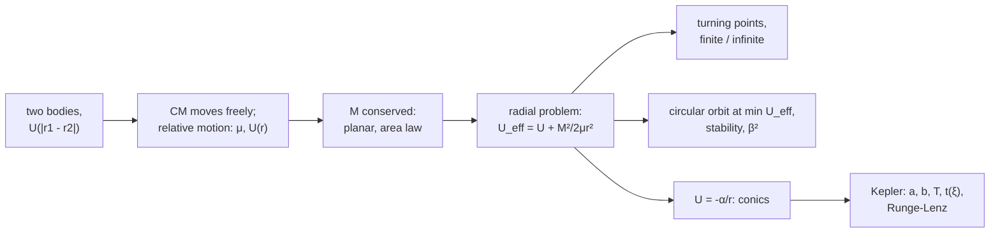
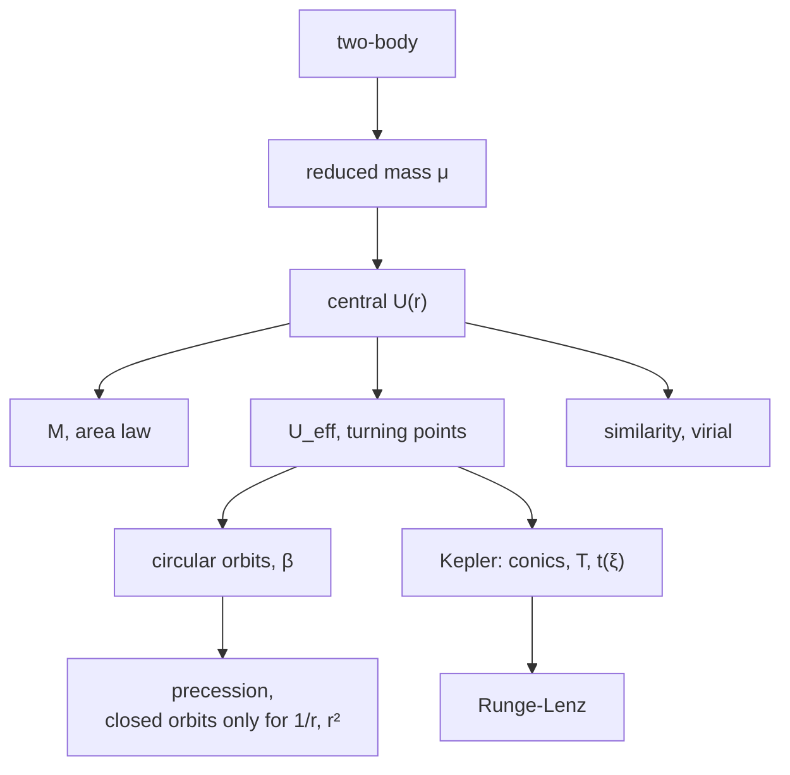

# CM04 · Central Forces and Effective One-Dimensional Motion

◀ [[CM03 Symmetries, Noether's Theorem and Conservation Laws]] · [[Classical Mechanics - Course Map]]

in course overview extra · book extra · beyond

> [!warning] Source status (every citation below was read in this session)
> Overview block 2: "applications of the equations of motion to effective one dimensional problems of motion under central force". No IISERP lecture notes exist in the folder.
>
> **Read directly:** Landau-Lifshitz Vol. 1 §10 (mechanical similarity and the virial theorem, printed pp. 22-24, read as far as (10.5)), §11 (motion in one dimension, pp. 25-26, (11.1)-(11.4)), §13 (reduced mass, pp. 29-30), §14 (motion in a central field, pp. 30-34), §15 (Kepler's problem, pp. 35-39); Goldstein-Poole-Safko 3rd ed. §3.4 (virial theorem, pp. 83-85) and §3.6 (circular orbits, stability, the exponent $\beta$, pp. 89-91), and the orbit classification by eccentricity in §3.7 (pp. 93-94). **Not cited because not read:** the end of LL §10 and §11 (period formula (11.5)), LL §12, the end of Goldstein §3.6 (the statement of Bertrand's theorem; I use LL §14's statement instead), Goldstein §3.8-3.9, Gregory Ch. 11, Thornton Ch. 8.

> [!syllabus] Syllabus map
> 🟢 **In course overview**: §1 reduction to the one-body problem, §2 conserved angular momentum, §3 effective potential and turning points, §5 the Kepler problem.
>
> 🟡 **Extra · book**: §4 circular-orbit stability and closed orbits (Goldstein §3.6, LL §14), §6 mechanical similarity and the virial theorem, §5.4 the Laplace-Runge-Lenz vector (LL (15.17), sign fixed by differentiation).
>
> 🔵 **Extra · beyond (mine)**: the Earth-Sun and Earth-Moon numbers, the perihelion advance for a perturbed power law checked by integration, the plunge threshold checked numerically, `scripts/cm04_numbers.py`, `scripts/fig_cm04.py`.

> [!key] After this chapter you can
> - reduce the **two-body problem** to a one-body problem with the **reduced mass**,
> - use the conservation of **angular momentum** (area law) and **energy** to turn central-force motion into a one-dimensional problem in the **effective potential**,
> - classify orbits by $E$ and decide when a particle can fall to the centre,
> - find **circular orbits**, test their **stability**, and relate the radial oscillation to the **apsidal angle** and closed orbits,
> - solve the **Kepler problem** fully: conics, $a$, $b$, $T$, the time dependence, the **Runge-Lenz vector**,
> - use **mechanical similarity** and the **virial theorem**.

> [!intuition] The one-sentence story
> Two bodies attracting each other along the line joining them are really one body of reduced mass moving in a fixed central field; that body's angular momentum cannot change, so its orbit stays in a plane and its radial motion is a one-dimensional problem in which angular momentum appears as a repulsive "centrifugal" barrier. For the special law $U\propto-1/r$ the radial and angular motions lock together into closed ellipses, which is why Kepler's laws are so tidy.

## 1. Reduction of the two-body problem (LL §13)
Two particles interacting through a potential that depends only on their separation have

$$L=\tfrac12m_1\dot{\mathbf r}_1^2+\tfrac12m_2\dot{\mathbf r}_2^2-U(|\mathbf r_1-\mathbf r_2|).\tag{1.1}$$

Let $\mathbf r=\mathbf r_1-\mathbf r_2$ be the relative position and put the origin at the centre of mass, $m_1\mathbf r_1+m_2\mathbf r_2=0$, so that

$$\mathbf r_1=\frac{m_2}{m_1+m_2}\,\mathbf r,\qquad\mathbf r_2=-\frac{m_1}{m_1+m_2}\,\mathbf r\quad(13.2).$$

Substituting into (1.1) gives

$$L=\tfrac12m\dot{\mathbf r}^2-U(r),\qquad m=\frac{m_1m_2}{m_1+m_2}\quad\text{(the reduced mass)}\qquad(13.3)\text{-}(13.4),$$

formally identical to the Lagrangian of **one** particle of mass $m$ in an external field $U(r)$ symmetric about a fixed origin. Solve for $\mathbf r(t)$, then $\mathbf r_1,\mathbf r_2$ follow from (13.2). (The motion of the centre of mass itself is uniform, CM03 §6.) LL's problem generalises: for one particle of mass $M$ and $n$ particles of equal mass $m$ one eliminates the centre of mass using $\mu=M+nm$ and relative vectors $\mathbf r_a=\mathbf R_a-\mathbf R$.

> [!example] Worked example 1: Earth and Moon
> $m_1=5.972\times10^{24}$ kg, $m_2=7.348\times10^{22}$ kg, separation $3.844\times10^8$ m (standard constants, mine). The reduced mass is $7.259\times10^{22}$ kg (slightly less than the Moon's mass) and the centre of mass lies $r_1=m_2d/(m_1+m_2)=4.67\times10^6$ m from the Earth's centre, **inside** the Earth (radius $6.37\times10^6$ m). Both bodies orbit that point.

## 2. Motion in a central field (LL §14)
Since $U=U(r)$ the force $\mathbf F=-U'(r)\mathbf r/r$ is directed along the radius vector. The angular momentum $\mathbf M=\mathbf r\times\mathbf p$ is conserved (CM03 §5) and is perpendicular to $\mathbf r$, so the radius vector stays in the plane perpendicular to $\mathbf M$: **the orbit is planar**. In polar coordinates $(r,\phi)$ in that plane

$$L=\tfrac12m\bigl(\dot r^2+r^2\dot\phi^2\bigr)-U(r)\qquad(14.1),$$

in which $\phi$ is cyclic, so

$$M=mr^2\dot\phi=\text{const}\qquad(14.2).$$

Geometrically $\tfrac12r^2\dot\phi\,\mathrm dt$ is the area swept by the radius vector, so $M=2m\dot f$ with $\dot f$ the **sectorial velocity**: equal areas in equal times, **Kepler's second law**, true for *every* central force (LL (14.3); sometimes called the "area integral").

### 2.1 The radial problem
Use (14.2) to eliminate $\dot\phi$ from the energy:

$$E=\tfrac12m\dot r^2+\frac{M^2}{2mr^2}+U(r)=\tfrac12m\dot r^2+U_{\mathrm{eff}}(r),\quad U_{\mathrm{eff}}=U(r)+\frac{M^2}{2mr^2}\qquad(14.4),(14.8).$$

The term $M^2/2mr^2$ is the **centrifugal energy**. The radial motion is one-dimensional motion in $U_{\mathrm{eff}}$ (LL §11: motion is possible only where $U_{\mathrm{eff}}<E$, with turning points where $U_{\mathrm{eff}}=E$; bounded by two turning points it is *finite* and oscillatory, bounded on one side or none it is *infinite*). Integrating:

$$t=\int\frac{\mathrm dr}{\sqrt{\tfrac2m\bigl[E-U(r)\bigr]-\tfrac{M^2}{m^2r^2}}}+\text{const}\quad(14.6),\qquad\phi=\int\frac{M\,\mathrm dr/r^2}{\sqrt{2m[E-U(r)]-M^2/r^2}}+\text{const}\quad(14.7).$$

(14.7) is the equation of the orbit, (14.6) gives $r(t)$ implicitly; $\phi$ always varies monotonically because $\dot\phi$ never changes sign.

> [!pitfall] $\dot r=0$ is not rest
> At a turning point $U_{\mathrm{eff}}=E$ (14.9) the radial velocity vanishes but $\dot\phi=M/mr^2\ne0$: the particle is at a perihelion or aphelion, not at rest (LL). The orbit is symmetric about the line through the centre and the turning point; it is obtained by repeating one identical segment forwards and backwards.

### 2.2 Finite motion and closed orbits
For a finite motion between $r_{\min}$ and $r_{\max}$ the radius vector turns through

$$\Delta\phi=2\int_{r_{\min}}^{r_{\max}}\frac{M\,\mathrm dr/r^2}{\sqrt{2m(E-U)-M^2/r^2}}\qquad(14.10)$$

in one radial oscillation. The orbit closes if $\Delta\phi=2\pi m'/n'$ with integers ($m'$ revolutions in $n'$ radial periods). LL: this is exceptional; for an arbitrary $U$ the orbit fills the annulus $r_{\min}\le r\le r_{\max}$ in infinite time. **Only two central fields have all finite orbits closed: $U\propto1/r$ and $U\propto r^2$** (the space oscillator).

### 2.3 Falling to the centre
The centrifugal barrier usually prevents reaching $r=0$ even in an attractive field. From $\tfrac12m\dot r^2=E-U-M^2/2mr^2\ge0$, $r\to0$ is possible only if $[r^2U(r)]_{r\to0}<-M^2/2m$ (14.11): $U\to-\infty$ either as $-\alpha/r^2$ with $\alpha>M^2/2m$, or faster than $-1/r^2$.

> [!example] Worked example 2: plunge or bounce (🔵)
> $U=-\alpha/r^2$, $m=1$, $M=1$: the threshold is $\alpha=M^2/2m=0.5$. Starting at rest in $r$ at $r=1.5$: for $\alpha=0.4$ the centrifugal term wins, $\ddot r>0$ and the particle moves outward (minimum $r=1.5$); for $\alpha=0.6$ it reaches $r=10^{-3}$ at $t=5.03$ and keeps falling.

## 3. Circular orbits and stability (🟡)
A circular orbit sits at an extremum of $U_{\mathrm{eff}}$. For a central force $f(r)$ (negative = attractive) Goldstein §3.6 gives

$$f(r_0)=-\frac{l^2}{mr_0^3}\ (3.40),\qquad E=V(r_0)+\frac{l^2}{2mr_0^2}\ (3.41)\quad(l=\text{angular momentum}),$$

so a circular orbit at any radius exists for any *attractive* force, with the angular momentum fixed by (3.40). It is **stable** if the extremum is a minimum of $V'$ (here $V'$ means the effective potential), i.e. (3.42)-(3.43) $\dfrac{\mathrm d f}{\mathrm dr}\Big|_{r_0}<-\dfrac{3f(r_0)}{r_0}$, equivalently $\dfrac{\mathrm d\ln f}{\mathrm d\ln r}>-3$. For a power law $f=-kr^n$ ($k>0$) this reads

$$\boxed{n>-3}\qquad(3.44):$$

attractive forces falling off more slowly than $1/r^3$ (potentials more slowly than $1/r^2$) allow stable circular orbits at every radius. For a slightly perturbed orbit the variable $u=1/r$ executes simple harmonic motion, $u=u_0+a\cos\beta\theta$ (3.45), with

$$\beta^2=3+\frac{\mathrm d\ln f}{\mathrm d\ln r}\Big|_{r_0}\qquad(3.46).$$

As the radius vector sweeps around the plane, $u$ goes through $\beta$ oscillations, so the radial period corresponds to an angle $2\pi/\beta$ (the apsidal angle is $\pi/\beta$). If $\beta$ is rational the perturbed orbit closes; since $\beta$ can only take discrete rational values, closure at *all* radii requires $\beta$ constant: $\mathrm d\ln f/\mathrm d\ln r=\beta^2-3$, a power law $f\propto r^{\beta^2-3}$. The two cases LL names are $\beta=1$ ($f\propto r^{-2}$, Kepler/Coulomb) and $\beta=2$ ($f\propto r$, the harmonic oscillator).

> [!example] Worked example 3: a nearly Newtonian force law (🔵)
> $f=-r^{-2.1}$ ($m=k=1$): $n=-2.1>-3$ so circular orbits are stable; $\beta^2=3+n=0.9$, $\beta=0.9487$. A slightly eccentric orbit (start $r=1$, tangential speed $1.02\times$ circular) has successive pericentres separated by $2\pi/\beta=6.6231$ rad (integration gives $6.6231,\ 6.6236,\ 6.6231$), i.e. the perihelion **advances** by $2\pi(1/\beta-1)=0.340$ rad $=19.5^\circ$ per orbit (panel C). A force law *exactly* $1/r^2$ gives $\beta=1$ and no advance; any deviation produces a rosette.

## 4. The Kepler problem (LL §15)
### 4.1 The orbit
For $U=-\alpha/r$ ($\alpha>0$: Newtonian gravity or attractive Coulomb) the effective potential

$$U_{\mathrm{eff}}=-\frac\alpha r+\frac{M^2}{2mr^2}\qquad(15.2)$$

tends to $+\infty$ as $r\to0$, to $0^-$ as $r\to\infty$, with a minimum $U_{\mathrm{eff,min}}=-m\alpha^2/2M^2$ at $r=M^2/m\alpha$ (15.3). The motion is finite for $E<0$ and infinite for $E>0$ (panel A). Inserting $U=-\alpha/r$ in (14.7) and integrating, with the origin of $\phi$ at the perihelion,

$$\frac pr=1+e\cos\phi,\qquad p=\frac{M^2}{m\alpha},\qquad e=\sqrt{1+\frac{2EM^2}{m\alpha^2}}\qquad(15.4)\text{-}(15.5):$$

a **conic section with one focus at the centre of force**; $2p$ is the latus rectum and $e$ the eccentricity. In the two-body problem each particle's orbit is a conic with one focus at the centre of mass (LL).

| $E$ | $e$ | orbit | motion |
|---|---|---|---|
| $-m\alpha^2/2M^2$ (minimum of $U_{\mathrm{eff}}$) | 0 | circle | finite |
| $<0$ | $<1$ | ellipse | finite |
| 0 | 1 | parabola, $r_{\min}=p/2$ | infinite (starts at rest at infinity) |
| $>0$ | $>1$ | hyperbola | infinite |

(The same classification appears in Goldstein §3.7.)

### 4.2 Ellipse
For $E<0$ (LL (15.6)-(15.8)):

$$a=\frac p{1-e^2}=\frac{\alpha}{2|E|},\qquad b=\frac p{\sqrt{1-e^2}}=\frac{M}{\sqrt{2m|E|}},\qquad r_{\min}=a(1-e),\quad r_{\max}=a(1+e).$$

The major axis depends **only on the energy**, not on the angular momentum. The period follows from the area law: $2m\dot f=M$ integrated over one period gives $2mf=TM$ with area $f=\pi ab$, hence

$$\boxed{\;T=2\pi a^{3/2}\sqrt{\frac m\alpha}=\pi\alpha\sqrt{\frac{m}{2|E|^3}}\;}\qquad(15.8),$$

also depending only on the energy: $T^2\propto a^3$, **Kepler's third law** (LL notes it was already derived in §10 by similarity).

### 4.3 Hyperbola, parabola, repulsion
For $E>0$ the path is a hyperbola with the origin at the internal focus, $r_{\min}=p/(e+1)=a(e-1)$ with $a=p/(e^2-1)=\alpha/2E$ (15.9). A **repulsive** field $U=\alpha/r$ gives $U_{\mathrm{eff}}$ decreasing monotonically from $+\infty$ to $0$, so $E>0$ always and the path is a hyperbola $p/r=-1+e\cos\phi$ with the centre of force at the *external* focus, $r_{\min}=a(e+1)$ (15.13)-(15.15). For the parabola $E=0$ (🔵, my derivation): $p/r=1+\cos\phi$ gives $r=\tfrac12p(1+\eta^2)$ with $\eta=\tan(\phi/2)$, and $\mathrm dt=(mr^2/M)\,\mathrm d\phi$ with $M=\sqrt{m\alpha p}$ integrates to $t=\tfrac12\sqrt{mp^3/\alpha}\,(\eta+\tfrac13\eta^3)$.

### 4.4 Time dependence
For the ellipse the substitution $r-a=-ae\cos\xi$ in (14.6) gives (LL (15.10)-(15.11))

$$r=a(1-e\cos\xi),\qquad t=\sqrt{\frac{ma^3}{\alpha}}\,(\xi-e\sin\xi),$$

$$x=a(\cos\xi-e),\qquad y=a\sqrt{1-e^2}\,\sin\xi,$$

with $x,y$ along the major and minor axes measured from the centre of the ellipse; $\xi:0\to2\pi$ is one revolution. With $2\pi t/T=\xi-e\sin\xi$ this is **Kepler's equation**. For the hyperbola, $r=a(e\cosh\xi-1)$, $t=\sqrt{ma^3/\alpha}(e\sinh\xi-\xi)$ (LL (15.12)).

### 4.5 The Runge-Lenz vector (🟡)
LL show there is an integral of motion that exists **only** for $U=\pm\alpha/r$. For the attractive case it is

$$\mathbf A=\mathbf v\times\mathbf M-\alpha\,\frac{\mathbf r}{r},\qquad\mathbf M=m\mathbf r\times\mathbf v\qquad(15.17).$$

(The sign in front of $\alpha\mathbf r/r$ is not legible in the scan's text layer; I fixed it by differentiating, below, and confirmed it numerically in Worked example 4.) *Proof (LL's argument):* $\mathrm d(\mathbf v\times\mathbf M)/\mathrm dt=\dot{\mathbf v}\times\mathbf M$ and with $m\dot{\mathbf v}=-\alpha\mathbf r/r^3$, $\mathbf M=m\mathbf r\times\mathbf v$ this equals $-\tfrac{\alpha}{r^3}\,\mathbf r\times(\mathbf r\times\mathbf v)=\alpha\mathbf v/r-\alpha\mathbf r(\mathbf r\!\cdot\!\mathbf v)/r^3$, which is exactly $\mathrm d(\alpha\mathbf r/r)/\mathrm dt$, so $\dot{\mathbf A}=0$. At perihelion $\mathbf v\perp\mathbf r$, $v_pM=M^2/mr_p=\alpha(1+e)$ and $\mathbf v\times\mathbf M$ points along $\hat{\mathbf r}$, so $\mathbf A=\alpha(1+e)\hat{\mathbf r}-\alpha\hat{\mathbf r}=\alpha e\,\hat{\mathbf r}_{\mathrm{peri}}$: LL's statement that it points along the major axis from the focus to the perihelion with magnitude $\alpha e$. It is a one-valued function of the state like $\mathbf M$ and $E$; LL tie its existence to the **degeneracy** of the motion (their §50, not read here): a further integral beyond the usual ones means the radial and angular periods coincide, so the orbit closes and does not precess.

> [!example] Worked example 4: an ellipse by integration, with every conserved quantity (🔵)
> Units $m=\alpha=1$, $p=1$, $e=0.5$: $a=1.3333$, $b=1.1547$, $E=-\alpha/2a=-0.375$, $r_{\min}=0.6667$, $r_{\max}=2$, $T=2\pi a^{3/2}=9.6736$. Integrating from perihelion (speed $\sqrt{2(E+1/r_{\min})}$): after one period the position returns to $(0.66666667,0)$; $L_z=1.000000$, $E=-0.375000$, $|\mathbf v\times\mathbf M-\mathbf r/r|=0.500000=\alpha e$, pointing along $+x$ (the perihelion direction), with variations $\le4\times10^{-12}$. Kepler's equation at $t=T/4$: $\xi-0.5\sin\xi=\pi/2$ gives $\xi=2.0210$ and $r=a(1-e\cos\xi)=1.62342$, which equals the integrated $r(T/4)=1.62342$.

> [!example] Worked example 5: the Earth's orbit (🔵)
> $GM_\odot=1.327\times10^{20}$ m³/s², $a=1.496\times10^{11}$ m, $e=0.0167$ (standard values, mine; per unit mass, $\alpha/m=GM_\odot$). $T=2\pi\sqrt{a^3/GM_\odot}=3.1558\times10^7$ s $=365.26$ d ✓. $r_{\min}=1.471\times10^{11}$ m, $r_{\max}=1.521\times10^{11}$ m, $v_p=30.29$ km/s, $v_a=29.29$ km/s; the area law checks: $r_pv_p=r_av_a=4.455\times10^{15}$ m²/s. For Mars ($a=1.524$ AU) $T=a^{3/2}=1.881$ yr.

## 5. Mechanical similarity and the virial theorem (🟡)
LL §10: multiplying $L$ by a constant does not change the equations of motion. If $U$ is homogeneous of degree $k$, $U(\alpha\mathbf r_a)=\alpha^kU(\mathbf r_a)$, then changing $\mathbf r_a\to\lambda\mathbf r_a$ and $t\to\mu t$ with $\mu=\lambda^{1-k/2}$ multiplies the Lagrangian by $\lambda^k$ and leaves the equations unchanged: geometrically similar paths exist, with

$$\frac{t'}{t}=\Bigl(\frac{l'}{l}\Bigr)^{1-k/2},\qquad\frac{v'}{v}=\Bigl(\frac{l'}{l}\Bigr)^{k/2},\quad\frac{E'}{E}=\Bigl(\frac{l'}{l}\Bigr)^k,\quad\frac{M'}{M}=\Bigl(\frac{l'}{l}\Bigr)^{1+k/2}\qquad(10.1)\text{-}(10.3).$$

Examples (LL): small oscillations ($k=2$): the period is independent of amplitude; uniform field ($k=1$): the time of fall goes as the square root of the height; Newton/Coulomb ($k=-1$): $t'/t=(l'/l)^{3/2}$, **$T^2\propto a^3$**.

**Virial theorem.** For motion in a finite region with finite velocities, average $2T=\sum\mathbf p_a\!\cdot\!\mathbf v_a=\tfrac{\mathrm d}{\mathrm dt}\sum\mathbf p_a\!\cdot\!\mathbf r_a-\sum\mathbf r_a\!\cdot\!\dot{\mathbf p}_a$ over a long time; the time derivative of a bounded function averages to zero (LL §10). With $\dot{\mathbf p}_a=\mathbf F_a=-\partial U/\partial\mathbf r_a$ this gives LL's (10.5), $2\overline T=\sum\overline{\mathbf r_a\!\cdot\!\partial U/\partial\mathbf r_a}$, and for homogeneous $U$ (Euler's theorem)

$$2\overline T=k\,\overline U.$$

Goldstein §3.4 reaches the same statement in the form $\overline T=-\tfrac12\overline{\sum\mathbf F_i\!\cdot\!\mathbf r_i}$ (3.26), "the virial of Clausius", valid when the motion is periodic or bounded. For $k=-1$: $2\overline T=-\overline U$, so $E=\overline T+\overline U=-\overline T$; for $k=2$: $\overline T=\overline U$. Check with Kepler: $E=-\alpha/2a$ and for a circle $T=\tfrac12m v^2=\alpha/2r$ so $E=-T$ ✓ (Goldstein derives $E=-\alpha/2r_0$ for circular orbits the same way).

![[fig_cm04_central.png]]

## Map of this chapter

## Common mistakes
1. Using the sum of masses instead of the reduced mass in the relative problem.
2. Reading $\dot r=0$ as the particle at rest.
3. Forgetting the centrifugal term when finding turning points.
4. Thinking the period of an ellipse depends on its eccentricity (at fixed $E$ it does not).
5. Using $U_{\mathrm{eff}}$ with the wrong angular momentum (it is $M$ of the *relative* motion, with reduced mass).
6. Claiming every central force gives closed orbits (only $1/r$ and $r^2$).

## Summary
- $L=\tfrac12m\dot{\mathbf r}^2-U(r)$, $m=m_1m_2/(m_1+m_2)$; $M=mr^2\dot\phi$ constant; area law.
- $U_{\mathrm{eff}}=U+M^2/2mr^2$; turning points $U_{\mathrm{eff}}=E$; $\Delta\phi$ per radial period (14.10).
- Circular stable iff $\mathrm d\ln f/\mathrm d\ln r>-3$; $\beta^2=3+\mathrm d\ln f/\mathrm d\ln r$; perihelion advance $2\pi(1/\beta-1)$.
- Kepler: $p/r=1+e\cos\phi$, $a=\alpha/2|E|$, $T=2\pi a^{3/2}\sqrt{m/\alpha}$, $r=a(1-e\cos\xi)$, $t=\sqrt{ma^3/\alpha}(\xi-e\sin\xi)$; Runge-Lenz conserved only for $1/r$.
- Similarity: $t'/t=(l'/l)^{1-k/2}$; virial $2\overline T=k\overline U$.
- Numbers: Earth's $T=365.26$ d; ellipse test $e=0.5$ returns to start to $10^{-8}$; $19.5^\circ$/orbit for $r^{-2.1}$.

## Practice
> [!question]- P1. Reduced mass
> Two equal masses $m$ interact: reduced mass and the positions of each relative to the CM.
> **Solution.** $\mu=m/2$; $\mathbf r_1=\mathbf r/2$, $\mathbf r_2=-\mathbf r/2$.

> [!question]- P2. Earth-Moon
> Where is the centre of mass relative to the Earth's surface?
> **Solution.** $4.67\times10^6$ m from the centre, i.e. $1.70\times10^6$ m below the surface.

> [!question]- P3. Area law
> A planet has $r_p=1.471\times10^{11}$ m, $v_p=30.29$ km/s: find $v$ at $r_a=1.521\times10^{11}$ m.
> **Solution.** $v_a=r_pv_p/r_a=29.29$ km/s.

> [!question]- P4. Effective potential extremum
> For $U=-\alpha/r$ find the circular radius and its energy.
> **Solution.** $\mathrm dU_{\mathrm{eff}}/\mathrm dr=0$: $r_0=M^2/m\alpha$, $E=-m\alpha^2/2M^2$ (LL (15.3)).

> [!question]- P5. Eccentricity
> $E=-0.375$, $M=1$, $m=\alpha=1$: find $e$ and $a$.
> **Solution.** $e=\sqrt{1+2(-0.375)}=0.5$; $a=\alpha/2|E|=1.3333$.

> [!question]- P6. Period from energy
> Show $T$ depends only on $E$.
> **Solution.** $T=\pi\alpha\sqrt{m/2|E|^3}$ (15.8).

> [!question]- P7. Stability of power laws
> For which exponent $n$ in $f=-kr^n$ are circular orbits stable? Give $\beta$ for $n=1$ and $n=-2$.
> **Solution.** $n>-3$; $\beta^2=3+n$: $n=1$ gives $\beta=2$, $n=-2$ gives $\beta=1$.

> [!question]- P8. Perihelion advance
> For $n=-2.1$ find the advance per orbit.
> **Solution.** $\beta=\sqrt{0.9}=0.9487$; advance $2\pi(1/\beta-1)=0.340$ rad $=19.5^\circ$.

> [!question]- P9. Plunge condition
> For $U=-\alpha/r^2$ with $M=1$, $m=1$, $\alpha=0.6$: does the particle reach the centre?
> **Solution.** $\alpha>M^2/2m=0.5$: yes, in finite time (5.03 for the initial conditions of Worked example 2).

> [!question]- P10. Escape speed
> From the circular orbit speed $v_c=\sqrt{\alpha/mr}$ show the escape speed is $\sqrt2v_c$.
> **Solution.** Parabola $E=0$: $\tfrac12mv^2=\alpha/r$, $v=\sqrt{2\alpha/mr}=\sqrt2\,v_c$.

> [!question]- P11. Similarity
> If the semi-major axis of an orbit doubles, how does the period change?
> **Solution.** $k=-1$: $t'/t=2^{3/2}=2.83$.

> [!question]- P12. Virial
> For a circular orbit in $U=-\alpha/r$ verify $2T=-U$.
> **Solution.** $T=\tfrac12mv^2=\alpha/2r$, $U=-\alpha/r$: $2T=\alpha/r=-U$ ✓.

> [!question]- P13. Kepler's equation
> For $e=0.5$ and $t=T/4$ solve for $\xi$ and $r/a$.
> **Solution.** $\xi-0.5\sin\xi=\pi/2\Rightarrow\xi=2.0210$; $r/a=1-0.5\cos\xi=1.2176$.

> [!question]- P14. Runge-Lenz at perihelion
> Show $|\mathbf v\times\mathbf M-\alpha\hat{\mathbf r}|=\alpha e$ at perihelion.
> **Solution.** At perihelion $\mathbf v\perp\mathbf r$, $v_p=M/mr_p$, so $\mathbf v\times\mathbf M=(M^2/mr_p)\hat{\mathbf r}$ (outward). With $r_p=p/(1+e)$ and $p=M^2/m\alpha$: $M^2/mr_p=\alpha(1+e)$. Then $\mathbf A=[\alpha(1+e)-\alpha]\hat{\mathbf r}=\alpha e\,\hat{\mathbf r}$ ✓.

> [!question]- P15. Closed orbits
> Which central potentials give closed finite orbits for all initial conditions?
> **Solution.** Only $U\propto1/r$ and $U\propto r^2$ (LL §14).

## Zettel notes
<!-- zettel:start -->
<!-- zettel:end -->

## Provenance
> [!provenance]- Source map for this chapter (all rows read in this session)
> | Topic | Source | Scope |
> |---|---|---|
> | motion in one dimension, turning points | LL Vol. 1 §11, pp. 25-26 | in overview |
> | reduced mass (13.1)-(13.4) | LL §13, pp. 29-30 | in overview |
> | central field, area law, effective potential, $\Delta\phi$, closed orbits, fall to centre (14.1)-(14.11) | LL §14, pp. 30-34 | in overview |
> | Kepler's problem (15.1)-(15.17), time dependence, repulsive field, Runge-Lenz (sign fixed by differentiation) | LL §15, pp. 35-39 | in overview |
> | mechanical similarity (10.1)-(10.3), virial theorem (10.4)-(10.5) | LL §10, pp. 22-24 | extra/book |
> | virial theorem (3.26) | Goldstein 3rd ed. §3.4, pp. 83-85 | extra/book |
> | circular orbits (3.40)-(3.41), stability (3.42)-(3.44), $\beta$ (3.45)-(3.46) | Goldstein §3.6, pp. 89-91 | extra/book |
> | orbit classification by eccentricity | Goldstein §3.7, pp. 93-94 | in overview |
> | Earth, Earth-Moon, ellipse integration, precession, plunge numbers | `scripts/cm04_numbers.py`, `scripts/fig_cm04.py` | extra/beyond |
