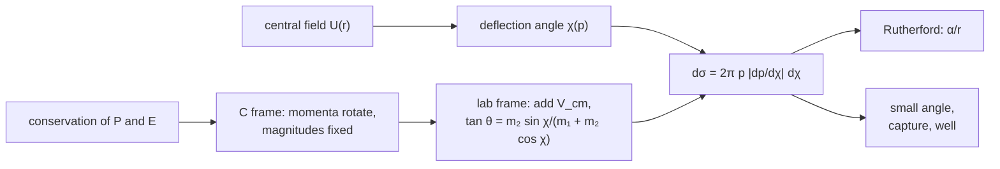
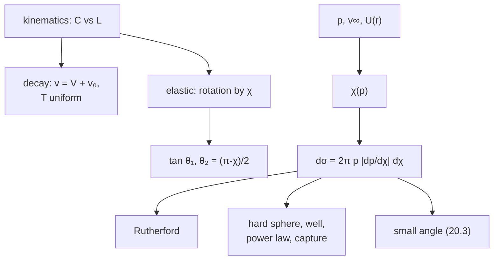

# CM05 · Scattering

◀ [[CM04 Central Forces and Effective One-Dimensional Motion]] · [[Classical Mechanics - Course Map]]

in course overview extra · book extra · beyond

> [!warning] Source status (every citation below was read in this session)
> Overview block 2: "scattering" among the applications of the equations of motion. No IISERP lecture notes exist in the folder.
>
> **Read directly:** Landau-Lifshitz Vol. 1 §16 (disintegration of particles, printed pp. 41-44), §17 (elastic collisions, pp. 44-47), §18 (scattering and its Problems 1-7, pp. 48-53), §19 (Rutherford's formula and Problems 1-2, pp. 53-55), §20 (small-angle scattering, pp. 55-56, up to (20.4)). pdf = printed + 28. **Not cited because not read:** the end of LL §16 (multi-particle breakup limit is used only as quoted), LL §20 Problem 1 onward, Goldstein §3.10-3.11 (scattering in a central force field, transformation to laboratory coordinates), Thornton Ch. 9, Gregory, José-Saletan.

> [!syllabus] Syllabus map
> 🟢 **In course overview**: §1 decay kinematics, §2 elastic collisions, §3 the scattering cross-section, §4 Rutherford.
>
> 🟡 **Extra · book**: §5 small-angle scattering, LL's Problems (hard sphere, power-law fields, capture, spherical well).
>
> 🔵 **Extra · beyond (mine)**: the numerical checks (isotropic breakup, trajectory integration of the Rutherford deflection, the well cross-section against the geometry), the gold-foil numbers, gravitational focusing numbers, `scripts/cm05_numbers.py`, `scripts/fig_cm05.py`.

> [!key] After this chapter you can
> - use momentum and energy conservation alone to analyse a **decay** or an **elastic collision**, in the **centre-of-mass (C)** and **laboratory (L)** frames, and convert angles between them,
> - compute the **deflection angle** $\chi(p)$ in a central field from the impact parameter,
> - define and compute the **differential cross-section** $\mathrm d\sigma=2\pi p\,|\mathrm dp/\mathrm d\chi|\,\mathrm d\chi$,
> - derive **Rutherford's formula** and use it with numbers,
> - treat **small-angle** scattering perturbatively and handle capture (fall to the centre, gravitational focusing).

> [!intuition] The one-sentence story
> A collision is a "rotation of the relative velocity": conservation of momentum and energy fix the *sizes* of the final momenta in the centre-of-mass frame and leave only one free quantity, the angle by which the relative velocity turns. That angle is a property of the force law and the impact parameter, and a beam of particles with a uniform spread of impact parameters turns it into a measurable angular distribution, the cross-section.

## 1. Disintegration of a particle (LL §16)
Conservation laws alone give striking results "independent of the particular type of interaction". A particle of mass $M$ at rest breaks spontaneously into two particles of masses $m_1,m_2$ and internal energies $E_{1i},E_{2i}$. In the frame where it is at rest the two fragments leave with equal and opposite momenta $p_0$, given by energy conservation: with the **disintegration energy** $\epsilon=E_i-E_{1i}-E_{2i}>0$ (16.1),

$$\epsilon=\Bigl(\frac1{2m_1}+\frac1{2m_2}\Bigr)p_0^2=\frac{p_0^2}{2m},\qquad m=\frac{m_1m_2}{m_1+m_2},\quad v_{10}=\frac{p_0}{m_1},\ v_{20}=\frac{p_0}{m_2}.$$

If instead the parent moves with velocity $\mathbf V$ (the **L system**, the C system being the one with zero total momentum), a fragment with C-velocity $\mathbf v_0$ has $\mathbf v=\mathbf V+\mathbf v_0$, so

$$v^2+V^2-2vV\cos\theta=v_0^2\qquad(16.3),$$

with $\theta$ the angle between $\mathbf v$ and $\mathbf V$: the L velocity is a vector from a point $A$ at distance $V$ from the centre of a circle (sphere) of radius $v_0$ to a point on the circle. If $V<v_0$ the fragment can go in any direction; if $V>v_0$ it can only go forward, within

$$\sin\theta_{\max}=\frac{v_0}{V}\qquad(16.4),$$

the tangent from $A$. The angles are related by $\tan\theta=v_0\sin\theta_0/(v_0\cos\theta_0+V)$ (16.5); for $V<v_0$ the relation is one-to-one, for $V>v_0$ each $\theta$ corresponds to two C-angles (16.6).

For many identical parents with random orientations, the C-frame distribution is isotropic: the fraction into $\mathrm d\Omega_0$ is $\mathrm d\Omega_0/4\pi$, i.e. $\tfrac12\sin\theta_0\,\mathrm d\theta_0$ (16.7). Because $v^2=v_0^2+V^2+2v_0V\cos\theta_0$ implies $\mathrm d(\cos\theta_0)=\mathrm d(v^2)/2v_0V$, the L-frame kinetic energy $T=\tfrac12mv^2$ is **uniformly distributed** between $T_{\min}=\tfrac12m(v_0-V)^2$ and $T_{\max}=\tfrac12m(v_0+V)^2$ (16.8): the fraction per unit energy is $\mathrm dT/(2mv_0V)$, which integrates to $1$ over a range of width $2mv_0V$. For a decay into more than two parts the energies in the C frame are not fixed, but there is an upper limit: with $m_1$ singled out and the rest treated as one system of internal energy $E_1'$, $T_{10}=(M-m_1)(E_i-E_{1i}-E_1')/M$ is greatest when $E_1'$ is least, i.e. when all the others move with the same velocity.

> [!example] Worked example 1: a decay with $V>v_0$ (🔵 numerics)
> $m=1$, $v_0=1$ (C frame), parent speed $V=2$: $\sin\theta_{\max}=0.5$, $\theta_{\max}=30^\circ$, and $T$ is uniform on $[\tfrac12(1-2)^2,\tfrac12(1+2)^2]=[0.5,\,4.5]$. A Monte-Carlo with $2\times10^6$ isotropic C-frame emissions reproduces both the angular limit ($30.000^\circ$) and the energy range exactly, with the histogram flat to $0.2\%$ (relative spread of ten bins).

## 2. Elastic collisions (LL §17)
A collision is **elastic** if the internal states do not change. In the C system the velocities before the collision are $\mathbf v_{10}=m_2\mathbf v/(m_1+m_2)$, $\mathbf v_{20}=-m_1\mathbf v/(m_1+m_2)$ with $\mathbf v=\mathbf v_1-\mathbf v_2$ (13.2). Momentum conservation keeps the two momenta equal and opposite and energy conservation keeps their magnitudes: **the collision simply rotates the velocities**. With $\mathbf n_0$ the unit vector along $\mathbf v_{10}'$,

$$\mathbf v_{10}'=\frac{m_2v}{m_1+m_2}\mathbf n_0,\qquad\mathbf v_{20}'=-\frac{m_1v}{m_1+m_2}\mathbf n_0\qquad(17.1),$$

and adding the centre-of-mass velocity returns to the L system (17.2). "No further information about the collision can be obtained from the laws of conservation": the direction $\mathbf n_0$, i.e. the C-frame **scattering angle $\chi$**, depends on the interaction (§3). Geometrically, in momentum space the final momenta $\mathbf p_1',\mathbf p_2'$ are chords from the fixed points $A,B$ to a point $C$ on a circle of radius $mv$ ($m$ the reduced mass).

**Target at rest** ($\mathbf p_2=0$): then $B$ lies on the circle; $A$ is inside it if $m_1<m_2$, outside if $m_1>m_2$. The angles $\theta_1,\theta_2$ of the two particles after the collision relative to the incident direction are

$$\tan\theta_1=\frac{m_2\sin\chi}{m_1+m_2\cos\chi},\qquad\theta_2=\tfrac12(\pi-\chi)\qquad(17.4),$$

and the speeds

$$v_1=\frac{\sqrt{m_1^2+m_2^2+2m_1m_2\cos\chi}}{m_1+m_2}v,\qquad v_2=\frac{2m_1v}{m_1+m_2}\sin\tfrac\chi2\qquad(17.5).$$

Head-on ($\chi=\pi$): $v_1'=\dfrac{m_1-m_2}{m_1+m_2}v$, $v_2'=\dfrac{2m_1}{m_1+m_2}v$ (17.6), so the **maximum energy transfer** to a target at rest is

$$\epsilon_{2,\max}=\frac{4m_1m_2}{(m_1+m_2)^2}E_1,\quad E_1=\tfrac12m_1v^2\qquad(17.7).$$

If $m_1<m_2$ the projectile may be deflected in any direction; if $m_1>m_2$ it can only be deflected by at most $\theta_{\max}$, with $\sin\theta_{\max}=m_2/m_1$ (17.8). For **equal masses** $\theta_1=\tfrac12\chi$, $\theta_2=\tfrac12(\pi-\chi)$ (17.9) and $v_1=v\cos\tfrac\chi2$, $v_2=v\sin\tfrac\chi2$ (17.10): after the collision the particles move at **right angles**.

> [!example] Worked example 2: a $\chi=90^\circ$ collision with $m_2=4m_1$
> $\tan\theta_1=4/(1+0)$ so $\theta_1=75.96^\circ$; $\theta_2=45^\circ$; $v_1/v=\sqrt{1+16}/5=0.8246$, $v_2/v=\tfrac25\sin45^\circ=0.2828$. Energy check: $m_1v_1^2+m_2v_2^2=(0.680+4\times0.080)m_1v^2=1.000\,m_1v^2$ ✓. Fraction of energy transferred: $\tfrac{4\cdot1\cdot4}{25}\sin^245^\circ=0.320$. For the reverse mass ratio ($m_1=4m_2$) the projectile can never be deflected by more than $\arcsin\tfrac14=14.48^\circ$.

## 3. The scattering cross-section (LL §18)
### 3.1 The deflection angle
An elastic collision reduces to the scattering of one particle of mass $m$ (reduced) by a fixed centre with potential $U(r)$. The path is symmetric about the line $OA$ from the centre to the nearest point (CM04 §2.1), so the two asymptotes make equal angles $\phi_0$ with it and the deflection is (LL (18.1))

$$\chi=|\pi-2\phi_0|,\qquad\phi_0=\int_{r_{\min}}^\infty\frac{(M/r^2)\,\mathrm dr}{\sqrt{2m[E-U(r)]-M^2/r^2}}\qquad(18.2).$$

For an infinite motion one uses the velocity at infinity $v_\infty$ and the **impact parameter** $p$ (the distance at which the particle would pass the centre if there were no force) in place of $E$ and $M$:

$$E=\tfrac12mv_\infty^2,\qquad M=mpv_\infty\qquad(18.3),\qquad\phi_0=\int_{r_{\min}}^\infty\frac{(p/r^2)\,\mathrm dr}{\sqrt{1-p^2/r^2-2U/mv_\infty^2}}\qquad(18.4),$$

which with (18.1) gives $\chi(p)$.

### 3.2 The effective cross-section
For a uniform beam, let $\mathrm dN$ be the number scattered per unit time into angles between $\chi$ and $\chi+\mathrm d\chi$, and $n$ the number of beam particles crossing unit area per unit time. The ratio

$$\mathrm d\sigma=\frac{\mathrm dN}{n}\qquad(18.5)$$

has dimensions of area and is the **effective scattering cross-section**: it depends only on the scattering field. If $\chi(p)$ is monotonic, only particles with impact parameters in $[p,p+\mathrm dp]$ scatter into $[\chi,\chi+\mathrm d\chi]$, and $\mathrm dN=2\pi p\,\mathrm dp\,n$, so

$$\mathrm d\sigma=2\pi p\,\mathrm dp\ (18.6)=2\pi p(\chi)\Bigl|\frac{\mathrm dp}{\mathrm d\chi}\Bigr|\mathrm d\chi\ (18.7)=\frac{p(\chi)}{\sin\chi}\Bigl|\frac{\mathrm dp}{\mathrm d\chi}\Bigr|\,\mathrm d\Omega\ (18.8),$$

with $\mathrm d\Omega=2\pi\sin\chi\,\mathrm d\chi$ the solid angle; the modulus is needed because $\mathrm dp/\mathrm d\chi$ is usually negative, and if $p(\chi)$ is many-valued the contributions of all branches add (LL's footnote).

### 3.3 Back to the laboratory
(18.7) is the cross-section as a function of the C-frame angle. For a target initially at rest, to express it in the L frame substitute $\chi(\theta_1)$ from (17.4) (for the scattered projectile) or $\chi=\pi-2\theta_2$ (for the recoil of the target).

### 3.4 LL's problems (🟡)
> [!example] Worked example 3: a hard sphere
> $U=\infty$ for $r<a$, $0$ otherwise. The path is two straight lines symmetric about the radius to the impact point: $p=a\sin\phi_0=a\cos\tfrac\chi2$. Then $\mathrm d\sigma=\tfrac12\pi a^2\sin\chi\,\mathrm d\chi=\tfrac14a^2\,\mathrm d\Omega$: the scattering is **isotropic in the C frame**, and the total cross-section is $\pi a^2$, the geometrical area. In the L frame with a sphere initially at rest, $\chi=\pi-2\theta_2$ gives $\mathrm d\sigma_2=a^2|\cos\theta_2|\,\mathrm d\Omega_2$; for equal masses the projectile has $\mathrm d\sigma_1=a^2|\cos\theta_1|\,\mathrm d\Omega_1$, and integrating over the forward hemisphere gives $2\pi a^2\int_0^{\pi/2}\cos\theta\sin\theta\,\mathrm d\theta=\pi a^2$ ✓ (numerical check). The energy lost by the projectile is uniformly distributed in $[0,\epsilon_{\max}]$: $\mathrm d\sigma=\pi a^2\,\mathrm d\epsilon/\epsilon_{\max}$ (LL P2).

> [!example] Worked example 4: other LL problems (read; numbers in P-section)
> *Power-law fields.* For $U\propto r^{-n}$, mechanical similarity (CM04 §5) gives $p\propto v_\infty^{-2/n}f(\chi)$ and so $\mathrm d\sigma\propto v_\infty^{-4/n}\,\mathrm d\Omega$ (LL P3). *Fall to the centre in $U=-\alpha/r^2$*: particles with $2\alpha>mp^2v_\infty^2$ fall, so $p_{\max}=\sqrt{2\alpha/mv_\infty^2}$ and $\sigma=2\pi\alpha/mv_\infty^2$ (LL P4, from CM04 (14.11)). *Capture by a sphere of mass $m_2$ and radius $R$ with Newtonian attraction*: the condition $r_{\min}<R$ gives $\sigma=\pi R^2\bigl(1+2\gamma m_2/Rv_\infty^2\bigr)$ (LL P6), **gravitational focusing**: it tends to the geometric $\pi R^2$ as $v_\infty\to\infty$. For the Earth, $v_{\rm esc}^2=2\gamma m_2/R$ with $v_{\rm esc}=11.19$ km/s (standard value, mine): the enhancement $1+v_{\rm esc}^2/v_\infty^2$ is $6.0$ at 5 km/s, $2.0$ at 11.19 km/s, $1.31$ at 20 km/s, $1.08$ at 40 km/s.

> [!example] Worked example 5: scattering by a spherical potential well (LL P2) and a check
> $U=-U_0$ inside radius $a$, $0$ outside: the particle is "refracted" on entering and leaving with $\sin\alpha/\sin\beta=n$, $n=\sqrt{1+2U_0/mv_\infty^2}$ (LL's §7 problem, CM03), deflection $\chi=2(\alpha-\beta)$, $p=a\sin\alpha$. Eliminating $\alpha$ and differentiating gives LL's result
>
> $$\mathrm d\sigma=\frac{a^2n^2}{4\cos\tfrac\chi2}\,\frac{(n\cos\tfrac\chi2-1)(n-\cos\tfrac\chi2)}{(n^2+1-2n\cos\tfrac\chi2)^2}\,\mathrm d\Omega,\qquad\cos\tfrac{\chi_{\max}}2=\frac1n .$$
>
> Numerical check (🔵) for $U_0=\tfrac12mv_\infty^2$, $n=\sqrt2$: $\chi_{\max}=90^\circ$; integrating the formula over $\chi\in[0,\chi_{\max}]$ gives $3.141593=\pi a^2$ (the geometric cross-section); and at $\chi=40^\circ$ the formula $0.709431\,a^2$ equals $(p/\sin\chi)|\mathrm dp/\mathrm d\chi|$ computed directly from the ray geometry.

## 4. Rutherford scattering (LL §19)
Put $U=\alpha/r$ in (18.4) and integrate:

$$\phi_0=\cos^{-1}\frac{\alpha/mv_\infty^2p}{\sqrt{1+(\alpha/mv_\infty^2p)^2}},\qquad p^2=\Bigl(\frac\alpha{mv_\infty^2}\Bigr)^2\cot^2\frac\chi2\ \ (19.1),\ \phi_0=\tfrac12(\pi-\chi).$$

Differentiating and inserting in (18.7), (18.8):

$$\mathrm d\sigma=\pi\Bigl(\frac\alpha{mv_\infty^2}\Bigr)^2\frac{\cos\tfrac\chi2}{\sin^3\tfrac\chi2}\mathrm d\chi\ (19.2)\quad\Longleftrightarrow\quad\boxed{\;\mathrm d\sigma=\Bigl(\frac\alpha{2mv_\infty^2}\Bigr)^2\frac{\mathrm d\Omega}{\sin^4\tfrac\chi2}\;}\ (19.3),$$

**Rutherford's formula**. The cross-section "is independent of the sign of $\alpha$", so it applies to both repulsive and attractive Coulomb fields. In the C frame this is (19.3). For a target initially at rest, $\chi=\pi-2\theta_2$ gives the recoil distribution $\mathrm d\sigma_2=(\alpha/mv_\infty^2)^2\,\mathrm d\Omega_2/\cos^3\theta_2$ (19.4). For the scattered projectile the general L-frame expression is "very complex"; LL give two cases. If the target is much heavier ($m_2\gg m_1$): $\chi\simeq\theta_1$ and

$$\mathrm d\sigma_1=\Bigl(\frac\alpha{4E_1}\Bigr)^2\frac{\mathrm d\Omega_1}{\sin^4\tfrac12\theta_1}\qquad(19.5),\quad E_1=\tfrac12m_1v_\infty^2.$$

For equal masses $\chi=2\theta_1$ and $\mathrm d\sigma_1=(\alpha/E_1)^2\cos\theta_1\,\mathrm d\Omega_1/\sin^4\theta_1$ (19.6); for identical particles the two outcomes are indistinguishable and the cross-sections add (19.7). Expressed through the **energy lost** $\epsilon$ by the projectile (gained by the target), $\epsilon=(2m^2/m_2)v_\infty^2\sin^2\tfrac\chi2$ (17.5), the cross-section is

$$\mathrm d\sigma=2\pi\frac{\alpha^2}{m_2v_\infty^2}\frac{\mathrm d\epsilon}{\epsilon^2}\qquad(19.8),$$

with $\epsilon$ between $0$ and $\epsilon_{\max}=(2m^2/m_2)v_\infty^2=4m_1m_2E_1/(m_1+m_2)^2$ (my arithmetic from (17.5), (17.7)).

> [!example] Worked example 6: 5 MeV alpha particles on gold (🔵 numbers, standard constants)
> $\alpha=Z_1Z_2e^2/4\pi\epsilon_0=2\times79\times1.4400$ MeV fm $=227.5$ MeV fm. Head-on closest approach (heavy target): $d=\alpha/E=45.5$ fm. Rutherford (19.5), $\mathrm d\sigma/\mathrm d\Omega=(\alpha/4E)^2/\sin^4\tfrac\theta2$:
>
> | $\theta$ | $\mathrm d\sigma/\mathrm d\Omega$ (fm²/sr) | (barn/sr) |
> |---|---|---|
> | 30° | 28 838 | 288.4 |
> | 60° | 2071 | 20.7 |
> | 90° | 518 | 5.18 |
> | 120° | 230 | 2.30 |
> | 150° | 149 | 1.49 |
>
> The ratio between $30^\circ$ and $150^\circ$ is $194$ (steep forward peaking, panel B). Recoil correction: $m_1/m_2=4/197=2.0\%$, so (19.5) is accurate to a few per cent. **Direct check of (19.1):** integrating the trajectory of a repulsive $1/r$ force with $\alpha/mv_\infty^2=0.5$ and $p=1$ from $x=-2000$ to $+2000$ gives $\chi=53.119^\circ$ against the formula $2\arctan(0.5)=53.130^\circ$; the $0.01^\circ$ difference is the truncated tail of the infinite Coulomb range (panel C).

![[fig_cm05_scattering.png]]

## 5. Small-angle scattering (LL §20) (🟡)
When the impact parameter is large the field is weak and the deflection small, and one can work in the L frame. With the $x$ axis along the initial momentum $\mathbf p_1$, the deflection is $\theta_1\simeq p_{1y}'/m_1v_\infty$ (20.1), where $p_{1y}'=\int_{-\infty}^\infty F_y\,\mathrm dt$ (20.2). To first order in the small force one may integrate along the *undeflected* straight line $y=p$, $\mathrm dt=\mathrm dx/v_\infty$, with $F_y=-(\mathrm dU/\mathrm dr)p/r$ and $r^2=x^2+p^2$. Changing the integration variable to $r$ ($\mathrm dx=r\,\mathrm dr/\sqrt{r^2-p^2}$, twice the range $p\to\infty$):

$$\theta_1=-\frac{2p}{m_1v_\infty^2}\int_p^\infty\frac{\mathrm dU}{\mathrm dr}\frac{\mathrm dr}{\sqrt{r^2-p^2}}\qquad(20.3)$$

(my sign: $\theta_1>0$ for a repulsive potential, $\mathrm dU/\mathrm dr<0$, fixed by the direction of $F_y$; the scan's text layer does not show LL's sign), and the cross-section is $\mathrm d\sigma=\dfrac p{\theta_1}\Bigl|\dfrac{\mathrm dp}{\mathrm d\theta_1}\Bigr|\mathrm d\Omega_1$ (20.4).

> [!example] Worked example 7: small-angle Coulomb (🔵 consistency check)
> $U=\alpha/r$: $\mathrm dU/\mathrm dr=-\alpha/r^2$ and $\int_p^\infty r^{-2}(r^2-p^2)^{-1/2}\mathrm dr=1/p^2$, so $\theta_1=2\alpha/(m_1v_\infty^2p)$, i.e. $p=2\alpha/(m_1v_\infty^2\theta_1)$. This is the small-angle limit of the exact $p=(\alpha/mv_\infty^2)\cot\tfrac\chi2$ (19.1) with $m=m_1$ for a heavy target. The ratio of the small-angle to the exact $p$ (with $\alpha/mv^2=1$) is $1.0002$ at $\theta=0.05$ rad, $1.0008$ at $0.1$, $1.021$ at $0.5$, $1.093$ at $1$ rad: the approximation is good to $\lesssim1\%$ for $\theta\lesssim0.15$ rad.

## Map of this chapter

## Common mistakes
1. Using the sum of masses for the C-frame relative motion (the reduced mass governs the orbit).
2. Mixing the C-frame $\chi$ and the L-frame $\theta_1$ in cross-sections.
3. Forgetting the modulus in $|\mathrm dp/\mathrm d\chi|$, or the sum over branches when $p(\chi)$ is many-valued.
4. Applying the small-angle formula to large deflections, or to potentials with $\int$ divergent.
5. Treating Rutherford's formula as valid for $\theta\to0$ (total cross-section diverges for pure Coulomb).
6. Forgetting that for equal masses the particles are indistinguishable (add the two cross-sections).

## Summary
- Decay: $p_0=\sqrt{2m\epsilon}$; $\sin\theta_{\max}=v_0/V$ if $V>v_0$; lab energies uniform on $[\tfrac12m(v_0-V)^2,\tfrac12m(v_0+V)^2]$.
- Elastic: C-frame rotation; $\tan\theta_1=m_2\sin\chi/(m_1+m_2\cos\chi)$, $\theta_2=(\pi-\chi)/2$; $\epsilon_{2,\max}=4m_1m_2E_1/(m_1+m_2)^2$; $\sin\theta_{\max}=m_2/m_1$ for $m_1>m_2$; equal masses at right angles.
- $\chi=|\pi-2\phi_0|$; $\mathrm d\sigma=2\pi p|\mathrm dp/\mathrm d\chi|\mathrm d\chi=(p/\sin\chi)|\mathrm dp/\mathrm d\chi|\mathrm d\Omega$.
- Rutherford $\mathrm d\sigma=(\alpha/2mv_\infty^2)^2\mathrm d\Omega/\sin^4\tfrac\chi2$; independent of the sign of $\alpha$.
- Hard sphere $\sigma=\pi a^2$, isotropic in C; capture $\sigma=\pi R^2(1+v_{\rm esc}^2/v_\infty^2)$.
- Numbers: $\theta_1=75.96^\circ$ ($m_2=4m_1$, $\chi=90^\circ$); gold-foil $\mathrm d\sigma/\mathrm d\Omega(90^\circ)=5.18$ b/sr; $\chi=53.12^\circ$ by integration.

## Practice
> [!question]- P1. Decay energies
> A particle decays in flight ($V=2v_0$) into equal-mass fragments: range of fragment energies and maximum lab angle?
> **Solution.** $T\in[\tfrac12m(v_0-V)^2,\tfrac12m(v_0+V)^2]=[\tfrac12mv_0^2,\tfrac92mv_0^2]$; $\theta_{\max}=\arcsin(1/2)=30^\circ$.

> [!question]- P2. Elastic collision geometry
> $m_1=m_2$, $\chi=60^\circ$ in C: find $\theta_1,\theta_2,v_1/v,v_2/v$.
> **Solution.** $\theta_1=30^\circ$, $\theta_2=60^\circ$; $v_1=v\cos30^\circ=0.866v$, $v_2=v\sin30^\circ=0.5v$; sum of squares $=1$ ✓.

> [!question]- P3. Energy transfer
> A neutron ($m_1=1$) hits a carbon nucleus ($m_2=12$) head-on: what fraction of its energy can it lose?
> **Solution.** $\epsilon_{\max}/E_1=4\cdot12/13^2=0.284$ (17.7).

> [!question]- P4. Maximum deflection
> A projectile of mass $4m$ hits a stationary mass $m$: maximum deflection?
> **Solution.** $\theta_{\max}=\arcsin(m_2/m_1)=\arcsin\tfrac14=14.48^\circ$.

> [!question]- P5. Hard-sphere cross-section
> Show $\mathrm d\sigma=\tfrac14a^2\mathrm d\Omega$ and $\sigma=\pi a^2$.
> **Solution.** $p=a\cos(\chi/2)$, $|\mathrm dp/\mathrm d\chi|=\tfrac12a\sin(\chi/2)$; $(p/\sin\chi)|\mathrm dp/\mathrm d\chi|=a\cos\frac\chi2\cdot\frac a2\sin\frac\chi2/(2\sin\frac\chi2\cos\frac\chi2)=a^2/4$.

> [!question]- P6. Rutherford from $p(\chi)$
> Derive (19.3) from (19.1).
> **Solution.** $p=b\cot(\chi/2)$ with $b=\alpha/mv_\infty^2$: $|\mathrm dp/\mathrm d\chi|=b/(2\sin^2\frac\chi2)$; $\frac p{\sin\chi}|\frac{\mathrm dp}{\mathrm d\chi}|=\frac{b\cot(\chi/2)}{2\sin\frac\chi2\cos\frac\chi2}\cdot\frac b{2\sin^2\frac\chi2}=\frac{b^2}{4\sin^4(\chi/2)}$ ✓.

> [!question]- P7. Gold foil
> At $\theta=90^\circ$ for 5 MeV $\alpha$: $\mathrm d\sigma/\mathrm d\Omega$ in fm²/sr and in barn/sr?
> **Solution.** $(227.5/20)^2/\sin^4(45^\circ)=129.4\times4=517.6$ fm²/sr $=5.18$ b/sr.

> [!question]- P8. Closest approach
> Head-on closest approach for 5 MeV $\alpha$ on gold?
> **Solution.** $d=\alpha/E=227.5/5=45.5$ fm (energy conservation at the turning point).

> [!question]- P9. Fall to the centre
> $U=-\alpha/r^2$: capture cross-section for $\alpha/mv_\infty^2=1$.
> **Solution.** $\sigma=2\pi\alpha/mv_\infty^2=6.28$ (units of the length$^2$).

> [!question]- P10. Gravitational focusing
> Earth cross-section for $v_\infty=20$ km/s relative to $\pi R^2$.
> **Solution.** $1+(11.19/20)^2=1.31$.

> [!question]- P11. Small-angle
> Derive (20.3) for $U=\alpha/r$ and compare with exact at $\theta=0.5$ rad.
> **Solution.** $\theta=2\alpha/(mv^2p)$; exact $p=b\cot(0.25)=3.916b$ vs $4b$: $2.1\%$ difference.

> [!question]- P12. Well scattering
> For the spherical well with $U_0=\tfrac12mv_\infty^2$ find the maximum deflection.
> **Solution.** $n=\sqrt2$, $\cos(\chi_{\max}/2)=1/n$, $\chi_{\max}=90^\circ$.

> [!question]- P13. Energy-loss distribution (hard sphere)
> Show $\mathrm d\sigma=\pi a^2\mathrm d\epsilon/\epsilon_{\max}$.
> **Solution.** $\mathrm d\sigma=\tfrac12\pi a^2\sin\chi\,\mathrm d\chi$, $\epsilon=\epsilon_{\max}\sin^2(\chi/2)$, $\mathrm d\epsilon=\tfrac12\epsilon_{\max}\sin\chi\,\mathrm d\chi$.

> [!question]- P14. Power-law scaling
> How does $\mathrm d\sigma/\mathrm d\Omega$ depend on $v_\infty$ for $U\propto1/r^2$?
> **Solution.** $\mathrm d\sigma\propto v_\infty^{-4/n}=v_\infty^{-2}$ (LL P3).

> [!question]- P15. Indistinguishable particles
> For identical particles (equal masses) what is the combined cross-section at L angle $\theta$?
> **Solution.** The scattered and recoiling particle both reach $\theta$: add $\mathrm d\sigma_1(\theta)+\mathrm d\sigma_2(\theta)$ (LL (19.7)).

## Zettel notes
<!-- zettel:start -->
<!-- zettel:end -->

## Provenance
> [!provenance]- Source map for this chapter (all rows read in this session)
> | Topic | Source | Scope |
> |---|---|---|
> | disintegration, L and C frames, (16.1)-(16.8) | LL Vol. 1 §16, pp. 41-44 | in overview |
> | elastic collisions, (17.1)-(17.10) | LL §17, pp. 44-47 | in overview |
> | deflection, impact parameter, cross-section (18.1)-(18.8), Problems 1-7 | LL §18, pp. 48-53 | in overview |
> | Rutherford formula (19.1)-(19.8), Problems 1-2 | LL §19, pp. 53-55 | in overview |
> | small-angle scattering (20.1)-(20.4) | LL §20, pp. 55-56 | extra/book |
> | decay Monte-Carlo, elastic numbers, trajectory check of Rutherford, gold foil, well check, focusing | `scripts/cm05_numbers.py`, `scripts/fig_cm05.py` | extra/beyond |
