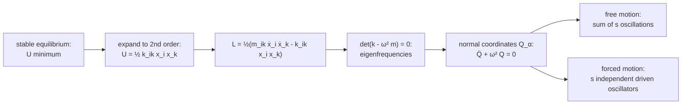
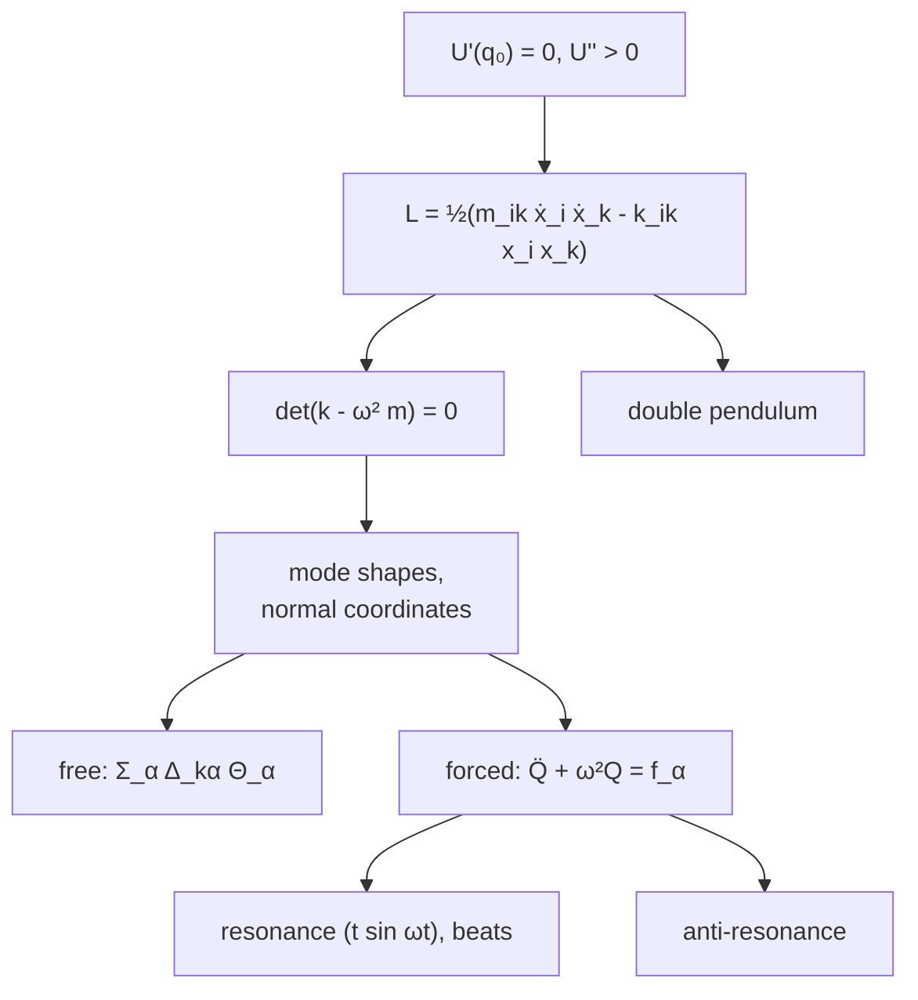

# CM06 · Small Oscillations and Normal Modes

◀ [[CM05 Scattering]] · [[Classical Mechanics - Course Map]]

in course overview extra · book extra · beyond

> [!warning] Source status (every citation below was read in this session)
> Overview block 2: "small oscillations" among the applications of the equations of motion. No IISERP lecture notes exist in the folder.
>
> **Read directly:** Landau-Lifshitz Vol. 1 §21 (free oscillations in one dimension, printed pp. 58-60), §22 (forced oscillations, resonance and beats, pp. 61-63, up to (22.9)), §23 (several degrees of freedom, pp. 65-70, including Problem 1); Alam (IISER Kolkata notes) §1.3 (the double pendulum, pp. 4-5). pdf = printed + 28. **Not cited because not read:** LL §24 (vibrations of molecules), §25 and §26 (damped and forced oscillations under friction: the damped case here is my own derivation from the Rayleigh function of CM02), §27-29 (parametric resonance, anharmonic oscillations), Goldstein Ch. 6, Thornton Ch. 12, Gregory Ch. 15, Alam §1.2 beyond its opening.

> [!syllabus] Syllabus map
> 🟢 **In course overview**: §1 expansion about equilibrium, §2 one-dimensional oscillator, §4 several degrees of freedom and normal coordinates.
>
> 🟡 **Extra · book**: §3 forced oscillations, resonance and beats (LL §22), §5 the double pendulum (Alam §1.3).
>
> 🔵 **Extra · beyond (mine)**: the damped oscillator from the Rayleigh function, the three-mass chain, the forced two-oscillator response and the **anti-resonance**, the nonlinear integration of the double pendulum on a normal mode, `scripts/cm06_numbers.py`, `scripts/fig_cm06.py`.

> [!key] After this chapter you can
> - expand a Lagrangian about a stable equilibrium into $L=\tfrac12(m_{ik}\dot x_i\dot x_k-k_{ik}x_ix_k)$,
> - find the **eigenfrequencies** from $\det(k_{ik}-\omega^2m_{ik})=0$ and the **mode shapes** from the null vectors,
> - build **normal coordinates** in which the motion is $s$ independent one-dimensional oscillators,
> - solve **forced** problems by projection onto normal coordinates, recognise **resonance**, **beats** and **anti-resonance**,
> - handle the double pendulum and other coupled systems, with numbers.

> [!intuition] The one-sentence story
> Near a stable equilibrium every system is a set of springs: potential and kinetic energy are both quadratic forms, and a single linear change of variables diagonalises both at once. The resulting normal coordinates oscillate independently, so any small motion is a superposition of $s$ simple harmonic motions at fixed frequencies; that is why the spectrum of a molecule, a bridge or a crystal is a list of numbers.

## 1. Expansion about equilibrium and the one-dimensional oscillator (LL §21)
Stable equilibrium corresponds to a minimum of the potential energy $U(q)$ at $q_0$: a displacement produces a force $-\mathrm dU/\mathrm dq$ toward $q_0$. For small displacements $x=q-q_0$ keep the first non-vanishing term of the expansion, which is generally the second-order one (LL (21.1)-(21.2)):

$$U(x)=\tfrac12kx^2,\qquad k=U''(q_0)>0,$$

measuring $U$ from its minimum. The kinetic energy $\tfrac12a(q)\dot q^2$ is evaluated at $q_0$: $a(q_0)=m$ ("$m$ is the mass only if $x$ is the Cartesian coordinate", LL's footnote). So

$$L=\tfrac12m\dot x^2-\tfrac12kx^2\quad(21.3),\qquad\ddot x+\omega^2x=0,\quad\omega=\sqrt{k/m}\ \ (21.4)\text{-}(21.6).$$

The general solution is $x=c_1\cos\omega t+c_2\sin\omega t=a\cos(\omega t+\alpha)$ (21.7)-(21.8) with amplitude $a=\sqrt{c_1^2+c_2^2}$, phase $\alpha$, $\tan\alpha=-c_2/c_1$; in terms of initial data $a=\sqrt{x_0^2+v_0^2/\omega^2}$, $\tan\alpha=-v_0/\omega x_0$ (LL Problem 1). Two points LL stress: **the frequency is independent of the amplitude**, fixed by the system alone; this relies on $U$ being quadratic and fails in higher approximations (or if the minimum is of higher order, $U\sim x^n$, $n>2$). The energy is $E=\tfrac12m\dot x^2+\tfrac12kx^2=\tfrac12m\omega^2a^2$ (21.10), proportional to the square of the amplitude. In complex form $x=\mathrm{Re}[Ae^{i\omega t}]$ with complex amplitude $A=ae^{i\alpha}$ (21.11)-(21.12): the exponential is unchanged by differentiation, so one may drop "Re" through all linear operations and take the real part at the end.

> [!example] Worked example 1: the pendulum (🔵 using CM01)
> $L=\tfrac12ml^2\dot\theta^2+mgl\cos\theta\simeq\tfrac12ml^2\dot\theta^2-\tfrac12mgl\theta^2+\text{const}$, so $m\to ml^2$, $k\to mgl$ and $\omega=\sqrt{g/l}$, $T_0=2\pi\sqrt{l/g}$. The quadratic approximation drops the amplitude dependence that CM01 Worked example 4 computed exactly: $T/T_0=1.0663$ at $\theta_0=1$ rad.

## 2. Forced oscillations, resonance and beats (🟡, LL §22)
An external field adds to the potential energy $U_e(x,t)\simeq U_e(0,t)+x[\partial U_e/\partial x]_{x=0}$; the first term is a function of time only and drops out as a total derivative; $-[\partial U_e/\partial x]_0\equiv F(t)$ is the external force at equilibrium, and

$$L=\tfrac12m\dot x^2-\tfrac12kx^2+xF(t),\qquad\ddot x+\omega^2x=\frac{F(t)}m\qquad(22.1)\text{-}(22.2).$$

For $F=f\cos(\gamma t+\beta)$ a particular solution is $b\cos(\gamma t+\beta)$ with $b=f/m(\omega^2-\gamma^2)$, so (LL (22.4))

$$x=a\cos(\omega t+\alpha)+\frac{f}{m(\omega^2-\gamma^2)}\cos(\gamma t+\beta):$$

a combination of oscillations at the intrinsic and at the driving frequency. At **resonance** $\gamma\to\omega$ the second term is $0/0$; L'Hôpital gives

$$x=a\cos(\omega t+\alpha)+\frac{f}{2m\omega}\,t\sin(\omega t+\beta)\qquad(22.5):$$

the amplitude grows **linearly in time** until the oscillations are no longer small. Near resonance, $\gamma=\omega+\epsilon$ with $\epsilon$ small, write $x=Ae^{i\omega t}+Be^{i(\omega+\epsilon)t}=[A+Be^{i\epsilon t}]e^{i\omega t}$: small oscillations of variable amplitude $C^2=a^2+b^2+2ab\cos(\epsilon t+\beta-\alpha)$ (22.6)-(22.7), varying between $|a-b|$ and $a+b$ with frequency $\epsilon$: **beats**. LL also reduce the arbitrary-force problem to the first-order complex equation $\dot\xi-i\omega\xi=F(t)/m$ for $\xi=\dot x+i\omega x$ (22.8)-(22.9).

> [!example] Worked example 2: resonance and beats, checked by integration (🔵 numbers)
> $\omega=2$, $F/m=\cos\gamma t$, $x(0)=\dot x(0)=0$. At $\gamma=\omega$: $x=\tfrac{t}{2\omega}\sin\omega t$; integration gives $x(10)=2.282363$, identical to $\tfrac{10}4\sin20=2.282363$, with envelope $t/2\omega=2.5$ at $t=10$. At $\gamma=2.1$: $x=\dfrac{\cos\gamma t-\cos\omega t}{\omega^2-\gamma^2}$, so the maximum amplitude is $2/|\omega^2-\gamma^2|=4.878$ (integrated: $4.8780$) and the beat envelope has period $2\pi/\epsilon=62.8$.

> [!note] Damping (🔵, not from LL)
> With the Rayleigh function of CM02 §6.2 ($\mathcal F=\tfrac12b\dot x^2$) the equation is $m\ddot x+b\dot x+kx=F(t)$, and for free motion $x\propto e^{-bt/2m}\cos\omega_dt$ with $\omega_d=\sqrt{\omega^2-(b/2m)^2}$ (CM02 Worked example 6: $\omega_d=1.9975$, decay rate $0.2$). The resonance peak of the forced steady state is then finite, of height $\sim f/(b\omega)$; LL §25-26 treat this, which I have not read.

## 3. Several degrees of freedom (LL §23)
### 3.1 The Lagrangian and the equations of motion
Let $U(q_1,\dots,q_s)$ have a minimum at $q_{i0}$. With $x_i=q_i-q_{i0}$ (23.1), expanding to second order gives a positive-definite quadratic form

$$U=\tfrac12\sum_{i,k}k_{ik}x_ix_k,\quad k_{ik}=k_{ki}\ \ (23.2);\qquad T=\tfrac12\sum_{i,k}m_{ik}\dot x_i\dot x_k,\quad m_{ik}=a_{ik}(q_0)=m_{ki}\ \ (23.3),$$

because $T$ is already quadratic in the velocities (CM02 §3, LL (5.5)). Hence

$$L=\tfrac12\sum_{i,k}\bigl(m_{ik}\dot x_i\dot x_k-k_{ik}x_ix_k\bigr)\qquad(23.4).$$

Using the symmetry of $m_{ik}$ and $k_{ik}$, $\partial L/\partial\dot x_i=\sum_km_{ik}\dot x_k$ and $\partial L/\partial x_i=-\sum_kk_{ik}x_k$, so Lagrange's equations are $s$ linear homogeneous ODEs with constant coefficients:

$$\sum_km_{ik}\ddot x_k+\sum_kk_{ik}x_k=0\qquad(i=1,\dots,s)\qquad(23.5).$$

### 3.2 Eigenfrequencies and mode shapes
Try $x_k=A_ke^{i\omega t}$ (23.6): $\sum_k(-\omega^2m_{ik}+k_{ik})A_k=0$ (23.7), which has non-zero solutions only if

$$\boxed{\det\bigl(k_{ik}-\omega^2m_{ik}\bigr)=0}\qquad(23.8),$$

the **characteristic equation**, of degree $s$ in $\omega^2$, with roots $\omega_\alpha^2$ ($\alpha=1,\dots,s$), the **eigenfrequencies**. The roots are **real and positive**. LL give two arguments: an imaginary part of $\omega$ would give an exponentially growing or decaying factor and so a varying energy $E=U+T$, which is impossible; and, multiplying (23.7) by $A_i^*$ and summing,

$$\omega^2=\frac{\sum k_{ik}A_i^*A_k}{\sum m_{ik}A_i^*A_k},$$

a ratio of two real positive-definite Hermitian forms. For distinct roots the amplitudes $A_{k\alpha}$ are proportional to the minors of the determinant (23.8) at $\omega=\omega_\alpha$ (the **mode shape**), and the general solution is the real part of a sum of $s$ terms,

$$x_k=\mathrm{Re}\sum_\alpha\Delta_{k\alpha}C_\alpha e^{i\omega_\alpha t}=\sum_\alpha\Delta_{k\alpha}\Theta_\alpha,\quad\Theta_\alpha=\mathrm{Re}[C_\alpha e^{i\omega_\alpha t}]\quad(23.9)\text{-}(23.10):$$

the time variation of each coordinate is a superposition of $s$ simple periodic oscillations with arbitrary amplitudes and phases but fixed frequencies.

### 3.3 Normal coordinates
Regarding (23.9) as $s$ equations for the $s$ unknowns $\Theta_\alpha$, one may express the $\Theta_\alpha$ through the $x_k$; they are new generalised coordinates, the **normal coordinates**, satisfying

$$\ddot\Theta_\alpha+\omega_\alpha^2\Theta_\alpha=0\qquad(23.11),$$

completely independent "normal oscillations". In them the Lagrangian is a sum of one-dimensional oscillators,

$$L=\sum_\alpha\tfrac12m_\alpha\bigl(\dot\Theta_\alpha^2-\omega_\alpha^2\Theta_\alpha^2\bigr)\qquad(23.12),$$

so *the transformation simultaneously diagonalises both quadratic forms $T$ and $U$*. It is usual to normalise with $Q_\alpha=\sqrt{m_\alpha}\Theta_\alpha$ (23.13) so that $L=\tfrac12\sum(\dot Q_\alpha^2-\omega_\alpha^2Q_\alpha^2)$.

**Degeneracy.** If some roots coincide, the general form (23.9) is unchanged, with the same number $s$ of terms; a multiple frequency corresponds to as many normal coordinates as its multiplicity, but their choice is not unique (any linear transformation preserving $\sum\dot Q^2$ and $\sum Q^2$). LL's example: a particle in a constant external field in three dimensions, $L=\tfrac12m(\dot x^2+\dot y^2+\dot z^2)-\tfrac12(k_1x^2+k_2y^2+k_3z^2)$ after choosing axes that diagonalise $U$ (23.14): normal oscillations along $x,y,z$ with $\omega_i=\sqrt{k_i/m}$, all equal for a central field $U=\tfrac12kr^2$.

### 3.4 Forced oscillations by projection (23.15)-(23.17)
With external forces the Lagrangian is $L=L_0+\sum_kF_k(t)x_k$; in normal coordinates $L=\sum_\alpha\tfrac12(\dot Q_\alpha^2-\omega_\alpha^2Q_\alpha^2)+\sum_\alpha f_\alpha(t)Q_\alpha$ with $f_\alpha=\sum_kF_k\Delta_{k\alpha}/\sqrt{m_\alpha}$ (projection of the force on each mode), and the equations are

$$\ddot Q_\alpha+\omega_\alpha^2Q_\alpha=f_\alpha(t),$$

"each involving only one unknown function": a forced multi-degree problem reduces to $s$ forced one-dimensional problems of §2. In particular each mode resonates when the driving frequency reaches its own $\omega_\alpha$.

> [!example] Worked example 3: two coupled identical oscillators (LL §23 Problem 1)
> $L=\tfrac12(\dot x^2+\dot y^2)-\tfrac12\omega_0^2(x^2+y^2)+\alpha xy$: equations $\ddot x+\omega_0^2x=\alpha y$, $\ddot y+\omega_0^2y=\alpha x$. Substituting (23.6): $A_x(\omega_0^2-\omega^2)=\alpha A_y$, $A_y(\omega_0^2-\omega^2)=\alpha A_x$; characteristic equation $(\omega_0^2-\omega^2)^2=\alpha^2$, so $\omega_1^2=\omega_0^2-\alpha$ (in-phase, $A_y=A_x$) and $\omega_2^2=\omega_0^2+\alpha$ (anti-phase). Normal coordinates $Q_\pm=(x\pm y)/\sqrt2$ (the mode shapes are the sum and difference). *Beats:* starting from $x=1$, $y=0$ at rest, $x=\cos\tfrac{\omega_2-\omega_1}2t\cos\bar\omega t$, $y=\sin\tfrac{\omega_2-\omega_1}2t\sin\bar\omega t$: energy swings between the two oscillators with full transfer after $\pi/(\omega_2-\omega_1)$. For $\omega_0=1$, $\alpha=0.1$: $\omega_1=0.94868$, $\omega_2=1.04881$, beat period $2\pi/(\omega_2-\omega_1)=62.75$, full transfer at $31.38$ (integrated: $x(31.377)=0$ to $10^{-5}$; panel A).

> [!example] Worked example 4: forced coupled oscillators, with an **anti-resonance** (🔵)
> Force $F\cos\gamma t$ on $x$ only. In normal coordinates the in-phase combination $Q_+=(x+y)/\sqrt2$ has frequency $\omega_1$ and the anti-phase one $Q_-=(x-y)/\sqrt2$ has $\omega_2$, and the force projects as $f_\pm=F/\sqrt2$, so $Q_+=\dfrac{F/\sqrt2}{\omega_1^2-\gamma^2}\cos\gamma t$, $Q_-=\dfrac{F/\sqrt2}{\omega_2^2-\gamma^2}\cos\gamma t$. Then $x=\tfrac1{\sqrt2}(Q_++Q_-)$ and $y=\tfrac1{\sqrt2}(Q_+-Q_-)$ give amplitudes
>
> $$x=\frac F2\Bigl[\frac1{\omega_1^2-\gamma^2}+\frac1{\omega_2^2-\gamma^2}\Bigr],\qquad y=\frac F2\Bigl[\frac1{\omega_1^2-\gamma^2}-\frac1{\omega_2^2-\gamma^2}\Bigr].$$
>
> Both diverge at $\gamma=\omega_1$ and $\omega_2$ (two resonances). Between them the two terms in $x$ have opposite signs and cancel exactly when $\gamma^2=\tfrac12(\omega_1^2+\omega_2^2)=\omega_0^2$: **the driven oscillator stands still** while its partner moves. For $\omega_0=1$, $\alpha=0.1$ (amplitudes per unit force, from solving the $2\times2$ system): $\gamma=0.5$: $(x,y)=(1.358,\,0.181)$; $\gamma=0.9$: $(7.28,\,3.83)$; $\gamma=1.0$: $(0,\,-10)$ (|y| = 10); $\gamma=1.5$: $(-0.805,\,0.064)$ (panel B). This is the principle of the **dynamic vibration absorber**: attach a tuned secondary oscillator, and the primary stops at its own resonance.

## 4. The double pendulum (🟡, Alam §1.3)
Two masses on rigid rods ($l_1,l_2$), two degrees of freedom, coordinates $\theta_1,\theta_2$. Alam writes $x_1=l_1\sin\theta_1$, $y_1=-l_1\cos\theta_1$, $x_2=l_1\sin\theta_1+l_2\sin\theta_2$, $y_2=-l_1\cos\theta_1-l_2\cos\theta_2$, with $v_2^2=l_1^2\dot\theta_1^2+l_2^2\dot\theta_2^2+2l_1l_2\dot\theta_1\dot\theta_2\cos(\theta_2-\theta_1)$ ("the cross term arises because both masses contribute to the motion of the second particle") and

$$T=\tfrac12(m_1+m_2)l_1^2\dot\theta_1^2+\tfrac12m_2l_2^2\dot\theta_2^2+m_2l_1l_2\dot\theta_1\dot\theta_2\cos(\theta_2-\theta_1),$$

$$V=-(m_1+m_2)gl_1\cos\theta_1-m_2gl_2\cos\theta_2.$$

The exact equations are "two coupled nonlinear differential equations" with complex motion (the dynamics can be chaotic at large amplitude, my remark). For small angles ($\sin\theta\simeq\theta$, $\cos(\theta_2-\theta_1)\simeq1$) the Lagrangian is the quadratic form

$$L=\tfrac12(m_1+m_2)l_1^2\dot\theta_1^2+\tfrac12m_2l_2^2\dot\theta_2^2+m_2l_1l_2\dot\theta_1\dot\theta_2-\tfrac12(m_1+m_2)gl_1\theta_1^2-\tfrac12m_2gl_2\theta_2^2,$$

"a system of coupled harmonic oscillators" in the form (23.4): here the **coupling is in the kinetic energy** ($m_{12}=m_2l_1l_2\ne0$) while $k_{ik}$ is diagonal.

> [!example] Worked example 5: equal masses and rods
> $m_1=m_2=m$, $l_1=l_2=l$: $m_{ik}=ml^2\begin{pmatrix}2&1\\1&1\end{pmatrix}$, $k_{ik}=mgl\begin{pmatrix}2&0\\0&1\end{pmatrix}$. With $\omega^2=\lambda g/l$, (23.8) reads $(2-2\lambda)(1-\lambda)-\lambda^2=0$, i.e. $2(1-\lambda)^2=\lambda^2$, so $\lambda=2\mp\sqrt2$:
>
> $$\omega_1=\sqrt{2-\sqrt2}\sqrt{\tfrac gl}=0.7654\sqrt{\tfrac gl},\qquad\omega_2=\sqrt{2+\sqrt2}\sqrt{\tfrac gl}=1.8478\sqrt{\tfrac gl}.$$
>
> Mode shapes from $(2-2\lambda)A_1=\lambda A_2$: $A_2/A_1=\sqrt2$ for the slow mode (both bobs swing the same way, the lower one further) and $-\sqrt2$ for the fast mode (anti-phase) (panel C). For $l=1$ m: $\omega_1=2.397$ s⁻¹ ($T_1=2.621$ s), $\omega_2=5.787$ s⁻¹ ($T_2=1.086$ s). **Check against the full nonlinear equations** (integrated with energy conserved to $10^{-13}$): starting on a mode at amplitude $0.02$ rad, the measured periods are $2.6211$ s and $1.0865$ s, versus $2.6211$ s and $1.0857$ s predicted: agreement to $3\times10^{-5}$ and $7\times10^{-4}$ (the small difference is the amplitude dependence the quadratic theory omits).

> [!example] Worked example 6: three equal masses on four springs (🔵)
> Fixed ends, $m_{ik}=m\delta_{ik}$, $k_{ik}=k\begin{pmatrix}2&-1&0\\-1&2&-1\\0&-1&2\end{pmatrix}$: $\omega^2/(k/m)=2-\sqrt2,\ 2,\ 2+\sqrt2$ ($0.5858,\ 2,\ 3.4142$), with mode shapes $(1,\sqrt2,1)$, $(1,0,-1)$, $(1,-\sqrt2,1)$ (the middle mass is at rest in the middle mode). In the limit of many masses this chain becomes the vibrating string and the normal modes become standing waves: the continuous version is the subject of the Waves vault ([[Waves - Course Map]]).

![[fig_cm06_oscillations.png]]

<!-- interactive:start (generated by scripts/embed_interactive.py; edit the tool in scripts/interactive/tools/, not this block) -->
> [!interactive]+ Interactive: Two coupled oscillators: normal modes and beats
> Two equal masses on springs with a coupling spring.
>
> ![[cm06_coupled.png|720]]
>
> **Try:** Start with all of the motion in the in-phase mode, then all in the anti-phase mode, then 50/50 (x=1, y=0): that is the full-transfer beat. Increase the coupling α to speed the beats.
>
> [▶ Open the tool in your browser](../Assets/interactive/cm06_coupled.html) · [absolute link](file:///home/swastik/Documents/notes/Assets/interactive/cm06_coupled.html) · all tools and coverage: [[Interactive Tools]]

> [!interactive]+ Interactive: Double pendulum: linear normal modes versus the real thing
> Equal masses and rods.
>
> ![[cm06_double_pendulum.png|720]]
>
> **Try:** Choose 'slow mode' at amplitude 0.05 rad: clean periodic motion with period 2.621 s. Raise the amplitude to 1.5 rad or choose 'generic' and watch the two copies diverge.
>
> [▶ Open the tool in your browser](../Assets/interactive/cm06_double_pendulum.html) · [absolute link](file:///home/swastik/Documents/notes/Assets/interactive/cm06_double_pendulum.html) · all tools and coverage: [[Interactive Tools]]

> [!interactive]+ Interactive: Driven damped oscillator: resonance curve, phase and transient
> x'' + b x' + ω₀²x = cos(γt), ω₀ = 2.
>
> ![[cm06_resonance.png|720]]
>
> **Try:** Set b = 0 and γ = ω₀: the amplitude grows ∝ t sin ω₀t. Put γ = 2.1 for beats with period 62.8. Then add damping and see the peak height ~ 1/(bω₀).
>
> [▶ Open the tool in your browser](../Assets/interactive/cm06_resonance.html) · [absolute link](file:///home/swastik/Documents/notes/Assets/interactive/cm06_resonance.html) · all tools and coverage: [[Interactive Tools]]

> [!interactive]+ Interactive: Superposition: standing waves and beats
> Two sinusoidal waves added together.
>
> ![[wave_standing_beats.png|720]]
>
> **Try:** Mode 'opposite directions' with amplitude ratio 1: perfect standing wave with nodes every λ/2. Lower the ratio: nodes fill in (partial standing wave, a travelling part remains). Mode 'beats': the envelope period is 2π/(k₂ − k₁).
>
> [▶ Open the tool in your browser](../Assets/interactive/wave_standing_beats.html) · [absolute link](file:///home/swastik/Documents/notes/Assets/interactive/wave_standing_beats.html) · all tools and coverage: [[Interactive Tools]]

<!-- interactive:end -->

## Map of this chapter

## Common mistakes
1. Assuming small oscillations are independent of amplitude *and* of the existence of a minimum (a higher-order minimum $U\sim x^4$ has amplitude-dependent frequency).
2. Taking $m_{ik}$ as the physical masses: it is $a_{ik}(q_0)$, which for the double pendulum has an off-diagonal part.
3. Diagonalising only $k_{ik}$ and forgetting $m_{ik}$ (the correct problem is the generalised eigenvalue equation (23.8)).
4. Treating the beats formula as valid at exact resonance (there the amplitude grows $\propto t$).
5. Forgetting the projection of the force on the mode shape: a force can leave a mode unexcited.
6. Believing the double pendulum's linear modes persist at large amplitude (they do not).

## Summary
- $L=\tfrac12(m_{ik}\dot x_i\dot x_k-k_{ik}x_ix_k)$; $\omega_\alpha^2$ from $\det(k-\omega^2m)=0$, all real and positive.
- Normal coordinates: $\ddot Q_\alpha+\omega_\alpha^2Q_\alpha=0$; both quadratic forms diagonal.
- One dimension: $\omega=\sqrt{k/m}$, $E=\tfrac12m\omega^2a^2$; forced: resonance $x\sim\tfrac{f}{2m\omega}t\sin\omega t$, beats at frequency $\epsilon$.
- Coupled equal oscillators: $\omega^2=\omega_0^2\mp\alpha$; anti-resonance at $\gamma=\omega_0$.
- Double pendulum (equal): $\omega^2=(2\mp\sqrt2)g/l$, mode ratios $\pm\sqrt2$.
- Numbers: $\omega_{1,2}=0.7654,\ 1.8478\sqrt{g/l}$; beats full transfer at $31.38$; chain $2\mp\sqrt2,\ 2$.

## Practice
> [!question]- P1. Frequency and amplitude
> A particle of mass 0.5 kg on a spring $k=8$ N/m is released from $x_0=0.1$ m with $v_0=0.4$ m/s: find $\omega$, $a$, $\alpha$ and $E$.
> **Solution.** $\omega=4$ s⁻¹; $a=\sqrt{0.01+0.16/16}=0.1414$ m; $\tan\alpha=-v_0/\omega x_0=-1$, $\alpha=-45^\circ$; $E=\tfrac12m\omega^2a^2=0.08$ J.

> [!question]- P2. Resonance growth
> $\omega=2$, $f/m=1$: amplitude at $t=10$ when driven at resonance from rest.
> **Solution.** $\tfrac{f}{2m\omega}t=\tfrac{10}4=2.5$.

> [!question]- P3. Beats
> $\omega=2$ driven at $\gamma=2.1$ from rest: maximum amplitude and beat period.
> **Solution.** $2/|\omega^2-\gamma^2|=4.878$; $2\pi/(\gamma-\omega)=62.8$.

> [!question]- P4. Coupled oscillators
> Eigenfrequencies of $\ddot x+x=0.1y$, $\ddot y+y=0.1x$ and the beat period.
> **Solution.** $\omega=\sqrt{0.9},\sqrt{1.1}=0.9487,\ 1.0488$; $T_{\rm beat}=62.75$.

> [!question]- P5. Anti-resonance
> For the same system with $F\cos\gamma t$ on $x$, at which $\gamma$ does $x$ vanish and what is $y$ there per unit force?
> **Solution.** $\gamma^2=\omega_0^2=1$; $y=\tfrac F2[1/(0.9-1)-1/(1.1-1)]=-10F$.

> [!question]- P6. Double pendulum frequencies
> Eigenfrequencies for $l=0.5$ m, $m_1=m_2$.
> **Solution.** $\omega^2=(2\mp\sqrt2)g/l$: $\omega_1=0.7654\sqrt{19.62}=3.39$ s⁻¹, $\omega_2=1.8478\sqrt{19.62}=8.18$ s⁻¹.

> [!question]- P7. Double pendulum mode shapes
> Find $A_2/A_1$ for each mode.
> **Solution.** From $(2-2\lambda)A_1=\lambda A_2$: $\lambda=2-\sqrt2$ gives $+\sqrt2$; $\lambda=2+\sqrt2$ gives $-\sqrt2$.

> [!question]- P8. Unequal masses
> Double pendulum with $m_1=3m$, $m_2=m$, $l_1=l_2=l$: set up (23.8).
> **Solution.** $m_{ik}=ml^2\begin{pmatrix}4&1\\1&1\end{pmatrix}$, $k_{ik}=mgl\begin{pmatrix}4&0\\0&1\end{pmatrix}$; $\det\begin{pmatrix}4(1-\lambda)&-\lambda\\-\lambda&1-\lambda\end{pmatrix}=4(1-\lambda)^2-\lambda^2=0$ so $\lambda=2/3$ or $2$.

> [!question]- P9. Three-mass chain
> Eigenfrequencies and shape of the middle mode.
> **Solution.** $\omega^2=(2-\sqrt2,2,2+\sqrt2)k/m$; the middle mode is $(1,0,-1)$.

> [!question]- P10. Positive definiteness
> Why must $\omega^2>0$?
> **Solution.** $\omega^2=\sum k_{ik}A_i^*A_k/\sum m_{ik}A_i^*A_k$ with both forms real and positive (LL).

> [!question]- P11. Degenerate modes
> For a particle in $U=\tfrac12k r^2$ what are the normal oscillations?
> **Solution.** $\omega=\sqrt{k/m}$, threefold degenerate; any orthogonal set of axes works.

> [!question]- P12. Normal coordinates for two springs
> Show $Q_\pm=(x\pm y)/\sqrt2$ diagonalise $L$ in Worked example 3.
> **Solution.** $\tfrac12(\dot x^2+\dot y^2)=\tfrac12(\dot Q_+^2+\dot Q_-^2)$, $\tfrac12\omega_0^2(x^2+y^2)-\alpha xy=\tfrac12(\omega_0^2-\alpha)Q_+^2+\tfrac12(\omega_0^2+\alpha)Q_-^2$.

> [!question]- P13. Force with no effect
> A force $F(t)$ on the middle mass of the three-mass chain: which normal modes are excited?
> **Solution.** The antisymmetric mode $(1,0,-1)$ has zero amplitude on the middle mass, so $f=0$ for it; only the two symmetric modes are driven.

> [!question]- P14. Energy of a mode
> A normal mode has amplitude $a$; show $E=\tfrac12m_\alpha\omega_\alpha^2a^2$ and that energies of different modes add.
> **Solution.** From (23.12) the energy separates: $E=\sum_\alpha\tfrac12m_\alpha(\dot\Theta_\alpha^2+\omega_\alpha^2\Theta_\alpha^2)$.

> [!question]- P15. Quadratic approximation limit
> At what amplitude does the pendulum's exact period differ from $T_0$ by 1%?
> **Solution.** $T/T_0\simeq1+\theta_0^2/16$ (CM01 table), so $\theta_0\simeq\sqrt{0.16}=0.40$ rad ($23^\circ$).

## Zettel notes
<!-- zettel:start -->
<!-- zettel:end -->

## Provenance
> [!provenance]- Source map for this chapter (all rows read in this session)
> | Topic | Source | Scope |
> |---|---|---|
> | expansion about equilibrium, one-dimensional oscillator, energy, complex amplitude (21.1)-(21.12) | LL Vol. 1 §21, pp. 58-60 | in overview |
> | forced oscillations, resonance, beats (22.1)-(22.9) | LL §22, pp. 61-63 | extra/book |
> | several degrees of freedom, (23.1)-(23.17), Problem 1 | LL §23, pp. 65-70 | in overview |
> | double pendulum: coordinates, $T$, $V$, small-oscillation Lagrangian | Alam, IISER Kolkata notes §1.3, pp. 4-5 | supplement |
> | damped oscillator (from CM02), pendulum, three-mass chain, anti-resonance, nonlinear check of the double pendulum | `scripts/cm06_numbers.py`, `scripts/fig_cm06.py` | extra/beyond |
