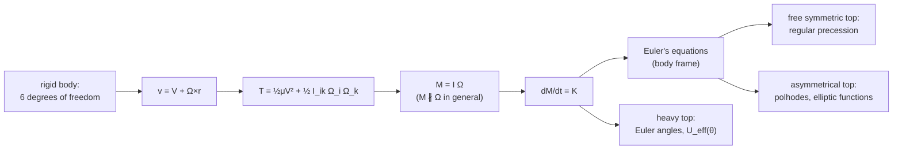
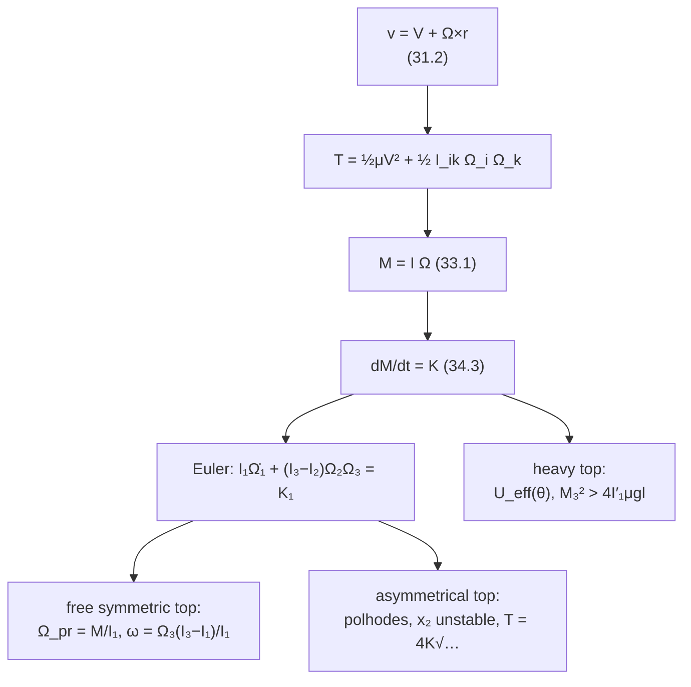

# CM07 · Rigid Bodies

◀ [[CM06 Small Oscillations and Normal Modes]] · [[Classical Mechanics - Course Map]]

in course overview extra · book extra · beyond

> [!warning] Source status (every citation below was read in this session)
> Overview block 3: "then we would move on to rigid bodies and non-inertial frames" (this chapter is the first half; non-inertial frames are CM08). No IISERP lecture notes exist in the folder.
>
> **Read directly:** Landau-Lifshitz Vol. 1, Chapter VI: §31 (angular velocity, printed pp. 96-98), §32 (the inertia tensor, pp. 98-105, including Problems 1-10), §33 (angular momentum, pp. 105-107), §34 (equations of motion, pp. 107-109), §35 (Eulerian angles, pp. 110-114, including Problems 1-3 on the heavy top), §36 (Euler's equations, pp. 114-116), §37 (the asymmetrical top, pp. 116-120, including Problem 1). on these pages the running headers give pdf = printed + 29 (the page ranges quoted are the printed numbers read from the headers). **Not cited because not read:** §38 (rigid bodies in contact) and everything after §39. **Scan note:** the text layer garbles several printed formulas (the results of §32 Problem 2, the closed form of the symmetric-top frequency in §37 Problem 1, a few exponents); wherever a printed formula could not be read with certainty it is **re-derived here and checked numerically** (`scripts/cm07_numbers.py`), never quoted.

> [!syllabus] Syllabus map
> 🟢 **In course overview** (block 3, "rigid bodies"): §1 angular velocity, §2 kinetic energy and the inertia tensor, §3 angular momentum, §4 equations of motion, §5 Euler angles, §6 Euler's equations and the free symmetric top.
>
> 🟡 **Extra · book**: §7 the asymmetrical top (energy ellipsoid, polhodes, elliptic-function solution, LL §37) and §5.2 the heavy symmetric top (LL §35 Problems 1-3).
>
> 🔵 **Extra · beyond (mine)**: the numerical verification of every formula by integrating the full rigid body (rotation matrix plus Euler's equations plus gravity torque), the moments of inertia recomputed by quadrature, the growth rate about the intermediate axis, the toy-top numbers, `scripts/cm07_numbers.py`, `scripts/fig_cm07.py`, and two interactive tools.

> [!key] After this chapter you can
> - describe a rigid body by six coordinates and write the velocity of any point as $\mathbf v=\mathbf V+\boldsymbol\Omega\times\mathbf r$,
> - compute the **inertia tensor**, its **principal axes** and **moments**, and use the parallel-axis theorem,
> - write $T=\tfrac12\mu V^2+\tfrac12I_{ik}\Omega_i\Omega_k$ and $\mathbf M=I\boldsymbol\Omega$, and say when $\mathbf M\parallel\boldsymbol\Omega$,
> - use **Euler's equations** and **Euler angles**, solve the **free symmetric top** (regular precession) and analyse the **asymmetrical top**,
> - explain why rotation about the **intermediate axis is unstable**,
> - reduce the **heavy symmetric top** to an effective one-dimensional problem and state its stability and fast-top limits.

> [!intuition] The one-sentence story
> A rigid body is a point (its centre of mass) plus an orientation, so it has six degrees of freedom; its kinetic energy splits cleanly into translation and rotation, but the rotational part is a *tensor*: the angular momentum $\mathbf M=I\boldsymbol\Omega$ points along the angular velocity only when the body spins about a principal axis. Everything strange about tops, wobbling plates and tumbling tennis rackets is that mismatch between $\mathbf M$ and $\boldsymbol\Omega$ at work: $\mathbf M$ is fixed in space, the body turns beneath it, and Euler's equations say how.

## 1. Configuration and angular velocity (LL §31)
taught

A **rigid body** is a system of particles whose mutual distances do not change (LL §31). Two coordinate systems are used: a fixed (inertial) system $XYZ$ and a moving system $x_1x_2x_3$ rigidly attached to the body, whose origin $O$ is conveniently placed at the centre of mass. The position of the body is fixed by the three components of $\mathbf R$ (the origin $O$) and three angles that orient the moving axes: **six degrees of freedom**.

An infinitesimal displacement is a translation $d\mathbf R$ of the centre of mass plus a rotation $d\boldsymbol\phi$ about it, so the displacement of a point with position $\mathbf r$ in the moving system is $d\mathbf R+d\boldsymbol\phi\times\mathbf r$. Dividing by $dt$, with $\mathbf V=d\mathbf R/dt$ and $\boldsymbol\Omega=d\boldsymbol\phi/dt$ (31.1),

$$\mathbf v=\mathbf V+\boldsymbol\Omega\times\mathbf r.$$

This is (31.2). The vector $\boldsymbol\Omega$ is the **angular velocity**, directed along the instantaneous axis of rotation. (A footnote of LL stresses that $\boldsymbol\Omega$ exists as a vector only because the rotation is infinitesimal; finite rotations do not add like vectors.)

**Shifting the origin.** If the origin of the body system is moved to $O'$ at $\mathbf a$ from $O$ (31.3),

$$\mathbf V'=\mathbf V+\boldsymbol\Omega\times\mathbf a,\qquad \boldsymbol\Omega'=\boldsymbol\Omega.$$

The angular velocity is the same for every body-fixed system: it is an "absolute" property of the body, whereas the translational velocity is not. If $\mathbf V\perp\boldsymbol\Omega$ for one origin it is so for all, and then an origin with $\mathbf V=0$ exists: the motion at that instant is a pure rotation about the **instantaneous axis** (which may lie outside the body).

> [!example] Worked example 1: the rolling wheel
> A wheel of radius $R$ rolls without slipping along a straight line; its centre moves with speed $V$. The contact point is at rest, so the instantaneous axis passes through it and $\Omega=V/R$ (the same for any parallel axis, by $\boldsymbol\Omega'=\boldsymbol\Omega$). A rim point at angle $\alpha$ from the contact point is at distance $2R\sin(\alpha/2)$ from the contact point, so its speed is $\Omega\cdot2R\sin(\alpha/2)=2V\sin(\alpha/2)$. At the contact point $\alpha=0$ the speed is $0$; at the horizontal point ($\alpha=90^\circ$) it is $\sqrt2\,V=1.4142\,V$; at the top ($\alpha=180^\circ$) it is $2V$ (`scripts/cm07_numbers.py` §1). The top of a rolling wheel moves at twice the speed of its axle.

## 2. Kinetic energy and the inertia tensor (LL §32)
taught

Treat the body as particles of mass $m$ at positions $\mathbf r$ about the centre of mass. Substituting (31.2),

$$T=\sum\tfrac12m(\mathbf V+\boldsymbol\Omega\times\mathbf r)^2=\tfrac12\mu V^2+\mathbf V\cdot\boldsymbol\Omega\times\sum m\mathbf r+\tfrac12\sum m(\boldsymbol\Omega\times\mathbf r)^2,$$

where $\mu$ is the total mass. The cross term vanishes because $\sum m\mathbf r=0$ **only when the origin is the centre of mass**; that is why the origin is placed there. Expanding $(\boldsymbol\Omega\times\mathbf r)^2=\Omega^2r^2-(\boldsymbol\Omega\cdot\mathbf r)^2$ gives (32.1)

$$T=\tfrac12\mu V^2+\tfrac12\sum m\left[\Omega^2r^2-(\boldsymbol\Omega\cdot\mathbf r)^2\right],$$

the kinetic energy of the centre of mass plus the kinetic energy of rotation about it. In tensor form, with $\Omega^2=\Omega_i\Omega_k\delta_{ik}$,

$$T=\tfrac12\mu V^2+\tfrac12I_{ik}\Omega_i\Omega_k,\qquad I_{ik}=\sum m\left(x_i^2\delta_{ik}-x_ix_k\right).\qquad(32.2),(32.3)$$

For a continuous body $I_{ik}=\int\rho\,(x_i^2\delta_{ik}-x_ix_k)\,dV$ (32.7). The Lagrangian is $L=\tfrac12\mu V^2+\tfrac12I_{ik}\Omega_i\Omega_k-U$ (32.4), with $U$ a function of the six coordinates. The **inertia tensor** is symmetric, additive over parts of the body, and has components

$$I=\begin{pmatrix}\sum m(y^2+z^2)&-\sum mxy&-\sum mxz\\-\sum mxy&\sum m(x^2+z^2)&-\sum myz\\-\sum mxz&-\sum myz&\sum m(x^2+y^2)\end{pmatrix}\qquad(32.6)$$

with the diagonal entries the **moments of inertia** about the axes.

### 2.1 Principal axes
Like any real symmetric tensor, $I_{ik}$ can be diagonalised by a choice of axes, the **principal axes**, with **principal moments** $I_1,I_2,I_3$, and then (32.8)

$$T_{\rm rot}=\tfrac12\left(I_1\Omega_1^2+I_2\Omega_2^2+I_3\Omega_3^2\right).$$

* **Triangle inequality** (32.9): no principal moment exceeds the sum of the other two, because $I_1+I_2=\sum m(x_1^2+x_2^2+2x_3^2)\ge\sum m(x_1^2+x_2^2)=I_3$.
* **Classification.** All three different: **asymmetrical top**. Two equal ($I_1=I_2\ne I_3$): **symmetrical top** (any axes perpendicular to the symmetry axis are principal). All equal: **spherical top** (any axes).
* **Symmetry helps.** The centre of mass and the principal axes share the body's symmetry: a plane of symmetry contains two principal axes and the third is normal to it; an axis of symmetry is a principal axis; if its order exceeds two the body is a symmetrical top.
* **Plane body** (all $x_3=0$), (32.10): $I_3=I_1+I_2$ exactly. A thin disc therefore has $I_3=2I_1$.
* **Rotator** (collinear particles along $x_3$), (32.11): $I_1=I_2=\sum m x_3^2$, $I_3=0$: only two rotational degrees of freedom (a line has no rotation about itself).
* **Parallel axes** (32.12): if the origin is moved by $\mathbf a$, $I'_{ik}=I_{ik}+\mu(a^2\delta_{ik}-a_ia_k)$, where $I_{ik}$ is about the centre of mass.

> [!example] Worked example 2: moments of inertia of uniform bodies (🔵 recomputed)
> LL §32 Problem 2 treats a rod, sphere, cylinder, parallelepiped, cone and ellipsoid; the scan garbles the printed results, so the values below are re-derived and **checked by quadrature** (`cm07_numbers.py` §2). Total mass $\mu$.
>
> | body | principal moments | check |
> |---|---|---|
> | thin rod, length $L$ | $I_1=I_2=\tfrac1{12}\mu L^2,\ I_3=0$ | rotator |
> | sphere, radius $R$ | $I=\tfrac25\mu R^2$ (all three) | |
> | cylinder $R$, height $h$ | $I_3=\tfrac12\mu R^2,\ I_1=I_2=\tfrac14\mu(R^2+\tfrac13h^2)$ | $R=h=1$: $0.500000,\ 0.333333$ |
> | cone, base radius $R$, height $h$ | $I_3=\tfrac3{10}\mu R^2,\ I_1=I_2=\tfrac3{20}\mu(R^2+\tfrac14h^2)$ | $R=h=1$: $0.300000,\ 0.187500$ |
> | ellipsoid, semi-axes $a,b,c$ | $I_1=\tfrac15\mu(b^2+c^2)$ and cyclic | $(3,2,1)$: $1.002,1.999,2.601$ vs $1,2,2.6$ (Monte Carlo) |
>
> The cone follows LL's route (the scan shows the method: compute the tensor about the apex, then shift to the centre of mass with (32.12)). About the apex $I'_1=\tfrac35\mu(\tfrac14R^2+h^2)$; the centre of mass lies at $\tfrac34h$ from the apex ($0.750000$ numerically), so $I_1=I'_1-\mu(\tfrac34h)^2=\tfrac3{20}\mu(R^2+\tfrac14h^2)$ ($0.750000-0.5625=0.1875$ for $R=h=1$). The ellipsoid is the unit sphere stretched, $x=a\xi$ etc., which turns $\int(y^2+z^2)dV$ into $\tfrac15\mu(b^2+c^2)$. Triangle inequality for the ellipsoid: $I_3=2.6\le I_1+I_2=3.0$.

> [!example] Worked example 3: the compound pendulum (LL §32 Problem 3)
> A body swings about a fixed horizontal axis; $l$ is the distance of the centre of mass from the axis and $\alpha,\beta,\gamma$ the angles between the principal axes and the rotation axis. With the angle $\varphi$ between the vertical and the perpendicular dropped from the centre of mass to the axis, $V=l\dot\varphi$ and the angular-velocity components along the principal axes are $\dot\varphi\cos\alpha,\dot\varphi\cos\beta,\dot\varphi\cos\gamma$, so
> $$L=\tfrac12\left(\mu l^2+I_1\cos^2\alpha+I_2\cos^2\beta+I_3\cos^2\gamma\right)\dot\varphi^2-\tfrac12\mu gl\varphi^2,\qquad\omega^2=\frac{\mu gl}{\mu l^2+I_1\cos^2\alpha+I_2\cos^2\beta+I_3\cos^2\gamma}.$$
> A uniform rod of length $L$ pivoted at one end: the axis is a principal axis ($\cos\alpha=1$), $l=L/2$, $I_1=\mu L^2/12$, so $\omega^2=\dfrac{(L/2)g}{L^2/4+L^2/12}=\dfrac{3g}{2L}$, the frequency of a simple pendulum of length $2L/3$ (numerically $14.715\ {\rm s^{-2}}$ for $L=1$ m, both ways).

> [!example] Worked example 4: a diatomic molecule as a rotator (LL §32 Problem 1a)
> For collinear atoms $I_1=I_2=\sum_{a<b}\dfrac{m_am_b}{\mu}\,l_{ab}^2$, $I_3=0$; for two atoms this is the **reduced mass times the squared separation**: $I=\dfrac{m_1m_2}{m_1+m_2}\,l^2$. The molecule has only the two rotational degrees of freedom of a rotator, and its rotational energy is $\tfrac12I\Omega^2$.

## 3. Angular momentum (LL §33)
taught

Take the angular momentum $\mathbf M=\sum m\,\mathbf r\times\mathbf v$ about the centre of mass (the "intrinsic" angular momentum). Replacing $\mathbf v$ by $\boldsymbol\Omega\times\mathbf r$ gives $\mathbf M=\sum m[r^2\boldsymbol\Omega-\mathbf r(\mathbf r\cdot\boldsymbol\Omega)]$, i.e. (33.1)

$$M_i=I_{ik}\Omega_k,\qquad\text{and on principal axes}\qquad M_1=I_1\Omega_1,\ M_2=I_2\Omega_2,\ M_3=I_3\Omega_3\quad(33.2).$$

For a **spherical top** $\mathbf M=I\boldsymbol\Omega$ (33.3): parallel. In general $\mathbf M$ is **not** parallel to $\boldsymbol\Omega$; this happens only when the body rotates about a principal axis.

**Free motion.** With no external forces $\mathbf M$ is constant. Spherical top: $\boldsymbol\Omega$ is constant: uniform rotation about a fixed axis. Rotator: $\boldsymbol\Omega\perp$ the rotator and $\mathbf M=I\boldsymbol\Omega$: uniform rotation in one plane. **Symmetric top**: choose $x_2\perp$ the plane of $\mathbf M$ and the $x_3$-axis; then $M_2=0$, so $\Omega_2=0$ by (33.2): $\mathbf M$, $\boldsymbol\Omega$ and the axis of the top are always coplanar. The velocity of every point of the axis is perpendicular to that plane, so the axis turns uniformly about $\mathbf M$ on a cone: **regular precession**, while the body spins about its own axis. With $\theta$ the angle between the axis and $\mathbf M$,

$$\Omega_3=\frac{M_3}{I_3}=\frac M{I_3}\cos\theta\ \ (33.4),\qquad \Omega_{\rm pr}=\frac M{I_1}\ \ (33.5),$$

the second because the component of $\boldsymbol\Omega$ transverse to the axis is $\Omega_1=(M/I_1)\sin\theta$ and $\Omega_{\rm pr}\sin\theta=\Omega_1$.

> [!example] Worked example 5: numbers for a free symmetric top (🔵 full integration)
> $I_1=I_2=1$, $I_3=1.5$, initial $\boldsymbol\Omega=(0.3,0,1)$. Then $\mathbf M=(0.3,0,1.5)$, $M=1.5297$, and the axis makes the constant angle $\theta=\arctan(0.3/1.5)=11.31^\circ$ with $\mathbf M$. Integrating the full rigid body (rotation matrix and Euler's equations, `cm07_numbers.py` §4) gives: $|\mathbf M|$ and $E$ conserved to $10^{-15}$; angle $11.3099^\circ$ throughout; **precession rate $1.5297=M/I_1$** (33.5); axis spin $\Omega_3=(M/I_3)\cos\theta=1.0000$ (33.4); and body-frame frequency $\omega=\Omega_3(I_3-I_1)/I_1=0.5000$ (36.6, §6), measured $0.5000$.

## 4. The equations of motion (LL §34)
taught

Six equations are needed. Summing $\dot{\mathbf p}=\mathbf f$ over the particles gives (34.1) $d\mathbf P/dt=\mathbf F$, with $\mathbf F$ the total **external** force (internal forces cancel); for a body in a potential $\mathbf F=-\partial U/\partial\mathbf R$ (34.2), which is also Lagrange's equation for the centre-of-mass coordinates. For the rotation, choose the inertial frame in which the centre of mass is momentarily at rest; then $\dot{\mathbf r}=\mathbf v$, $\dot{\mathbf r}\times\mathbf p=0$ and (34.3)

$$\frac{d\mathbf M}{dt}=\mathbf K,\qquad\mathbf K=\sum\mathbf r\times\mathbf f\qquad(34.4),$$

the **torque** about the centre of mass; by Galileo's principle it holds in every inertial frame. It is Lagrange's equation for the rotational coordinates: $\partial L/\partial\boldsymbol\Omega=\mathbf M$ and $\mathbf K=-\partial U/\partial\boldsymbol\phi$ (34.6).

**Moving the origin** by $\mathbf a$: $\mathbf K=\mathbf K'+\mathbf a\times\mathbf F$ (34.5), so the torque is independent of the origin if $\mathbf F=0$ (a **couple**). If $\mathbf F\perp\mathbf K$ there is a line of points (34.7) such that the whole effect of the forces is one force $\mathbf F$ applied on it. **Uniform field** (force on a particle $\mathbf f=e\mathbf E$ with $\mathbf E$ constant): $\mathbf F=\mathbf E\sum e$, $\mathbf K=\sum e\mathbf r\times\mathbf E$, and with $\mathbf r_0=\sum e\mathbf r/\sum e$ (34.8) the total torque is $\mathbf K=\mathbf r_0\times\mathbf F$ (34.9): the field acts as a single force at $\mathbf r_0$. For gravity $e=m$, so $\mathbf r_0$ is the **centre of mass**: a body in a uniform gravitational field behaves as if gravity acted at its centre of mass.

## 5. Euler angles and the symmetric top (LL §35)
taught (the heavy top, §5.2: extra · book)

### 5.1 The angles and the free top again
The orientation of $x_1x_2x_3$ relative to $XYZ$ (common origin) is given by three **Euler angles**: the **line of nodes** $ON$ is the intersection of the $x_1x_2$-plane with the $XY$-plane; $\theta$ is the angle between $Z$ and $x_3$ ($0\le\theta\le\pi$), $\phi$ the angle between $X$ and $ON$, $\psi$ the angle between $x_1$ and $ON$ (corkscrew sense). Resolving the three angular velocities $\dot\theta$ (along $ON$), $\dot\phi$ (along $Z$) and $\dot\psi$ (along $x_3$) on the body axes gives (35.1)

$$\Omega_1=\dot\phi\sin\theta\sin\psi+\dot\theta\cos\psi,\quad\Omega_2=\dot\phi\sin\theta\cos\psi-\dot\theta\sin\psi,\quad\Omega_3=\dot\phi\cos\theta+\dot\psi.$$

For a symmetric top the axes $x_1,x_2$ may be chosen freely, e.g. $x_1$ along $ON$ ($\psi=0$): $\Omega_1=\dot\theta$, $\Omega_2=\dot\phi\sin\theta$, $\Omega_3=\dot\phi\cos\theta+\dot\psi$ (35.3), and (35.2)

$$T_{\rm rot}=\tfrac12I_1(\dot\theta^2+\dot\phi^2\sin^2\theta)+\tfrac12I_3(\dot\psi+\dot\phi\cos\theta)^2.$$

**Free top.** Take $Z$ along the constant $\mathbf M$ and $x_1$ along $ON$. Then $M_1=I_1\dot\theta=0$, $M_2=I_1\dot\phi\sin\theta=M\sin\theta$, $M_3=I_3(\dot\phi\cos\theta+\dot\psi)=M\cos\theta$ (35.4): $\theta$ is constant, the precession rate is $\dot\phi=M/I_1$ (33.5) and the spin is $\dot\psi+\dot\phi\cos\theta=(M/I_3)\cos\theta$.

### 5.2 The heavy symmetric top (LL §35 Problems 1-3)
extra · book

A symmetric top has a fixed point $O$ and its centre of mass at distance $l$ along the axis; $\mu$ is the mass, $I'_1=I_1+\mu l^2$ the moment about the fixed point perpendicular to the axis, $I_3$ the moment about the axis, and $Z$ is vertical. The Lagrangian is

$$L=\tfrac12I'_1(\dot\theta^2+\dot\phi^2\sin^2\theta)+\tfrac12I_3(\dot\psi+\dot\phi\cos\theta)^2-\mu gl\cos\theta.$$

The coordinates $\psi$ and $\phi$ are cyclic, so there are two integrals (the components of angular momentum about the axis and about the vertical) and the energy:

$$p_\psi=I_3(\dot\psi+\dot\phi\cos\theta)=M_3,\qquad p_\phi=(I'_1\sin^2\theta+I_3\cos^2\theta)\dot\phi+I_3\dot\psi\cos\theta=M_z.$$

Eliminating $\dot\phi$ and $\dot\psi$ ($\dot\phi=(M_z-M_3\cos\theta)/I'_1\sin^2\theta$) reduces the energy to

$$E'=\tfrac12I'_1\dot\theta^2+U_{\rm eff}(\theta),\qquad U_{\rm eff}(\theta)=\frac{(M_z-M_3\cos\theta)^2}{2I'_1\sin^2\theta}-\mu gl(1-\cos\theta),$$

so $\theta(t)$ follows from an elliptic integral $t=\int d\theta/\sqrt{2[E'-U_{\rm eff}]/I'_1}$. $U_{\rm eff}\to\infty$ at $\theta\to0,\pi$ (if $M_z\ne M_3$) and has a minimum between, so $\theta$ oscillates between two roots $\theta_1,\theta_2$: **nutation**. The azimuth of the axis advances at $\dot\phi=(M_z-M_3\cos\theta)/I'_1\sin^2\theta$ and there are three kinds of path of the tip on a sphere around $O$ (LL Fig. 49): if $M_z-M_3\cos\theta$ keeps one sign over $[\theta_1,\theta_2]$ the axis **precesses monotonically** while nodding; if it changes sign the precession reverses between the limiting circles and the tip draws **loops**; if one of $\theta_{1,2}$ is a zero of $M_z-M_3\cos\theta$ then $\dot\theta$ and $\dot\phi$ vanish together there and the path has **cusps** (this is the case of a top released from rest). The three types are the panels of Fig. CM7.1 B and the first tool below.

**Problem 2 (vertical top).** For $\theta=0$ the axes coincide, $M_z=M_3$, $E'=0$; rotation about the vertical is stable if $\theta=0$ is a minimum of $U_{\rm eff}$. For small $\theta$, $(M_3(1-\cos\theta))^2/(2I'_1\sin^2\theta)\to M_3^2\theta^2/8I'_1$ and $-\mu gl(1-\cos\theta)\to-\tfrac12\mu gl\,\theta^2$, so $U_{\rm eff}\simeq\left(\dfrac{M_3^2}{8I'_1}-\dfrac{\mu gl}2\right)\theta^2$: stable iff

$$M_3^2>4I'_1\mu gl\quad\text{i.e.}\quad I_3^2\Omega_3^2>4I'_1\mu gl.$$

**Problem 3 (fast top).** When the rotational energy about the axis is large compared with the gravitational energy, neglect gravity first: free precession of the axis about $\mathbf M$ is the *nutation*, with $\Omega_{\rm nu}=M/I'_1$ (1). In the next order $\mathbf M$ itself precesses slowly about the vertical: averaging the torque $\mathbf K=\mu l\,\mathbf n_3\times\mathbf g$ over a nutation cone replaces $\mathbf n_3$ by its component along $\mathbf M$, $(\mathbf M/M)\cos\alpha$, so $d\mathbf M/dt=-(\mu l/M)\,\mathbf g\times\mathbf M\cos\alpha$ and the mean precession rate is $\Omega_{\rm pr}=-(\mu l/M)\,g\cos\alpha$ (2), small compared with $\Omega_{\rm nu}$. The magnitude is $\mu gl/M$ (for $\alpha$ small), **inversely proportional to the spin**.

> [!example] Worked example 6: the heavy top by full simulation (🔵)
> Units $\mu gl=1$, $I'_1=1$, $I_3=0.4$. I integrate the **complete rigid body** (rotation matrix, Euler's equations with the gravity torque), not the reduced equation, so the reduction is itself checked (`cm07_numbers.py` §6).
>
> **Vertical top.** The threshold is $M_3^2=4I'_1\mu gl$, i.e. $M_3=2$. Started with a tilt of $0.02$ rad ($1.15^\circ$):
>
> | $M_3$ | max tilt over 80 time units | verdict |
> |---|---|---|
> | $1.6$ | $73.8^\circ$ | falls |
> | $1.9$ | $36.6^\circ$ | falls |
> | $2.1$ | $3.7^\circ$ | stands |
> | $2.6$ | $1.8^\circ$ | stands |
>
> **Fast top.** $M_3=20$, tilt $40^\circ$: mean precession rate $0.0501$ against $\mu gl/M=0.0500$ (2), and nutation period $0.3154$ against $2\pi I'_1/M=0.3142$ (1).
>
> **Reduced problem.** $M_3=3.2$, $\theta_0=60^\circ$ released with $\dot\theta=0$ and $\dot\phi_0=2.5$: $M_z=I'_1\sin^2\theta_0\dot\phi_0+M_3\cos\theta_0=3.475$, $E'=U_{\rm eff}(60^\circ)=1.84375$, and the other turning angle is $\theta_1=9.53^\circ$; since $M_z-M_3\cos\theta>0$ on the whole range ($M_z>M_3$) the precession is monotone (Fig. CM7.1 B, panel a). With $\dot\phi_0=-0.9$ the sign changes (loops); with $\dot\phi_0=0$ the tip starts with a cusp.

## 6. Euler's equations (LL §36)
taught

Equations (34.1) and (34.3) refer to the fixed system; the simplest relation $M_i=I_i\Omega_i$ holds on the principal axes of the body. For any vector $\mathbf A$ the rates in the fixed and moving systems are related by (36.1)

$$\frac{d\mathbf A}{dt}=\frac{d'\mathbf A}{dt}+\boldsymbol\Omega\times\mathbf A,$$

so (36.2) $\dfrac{d'\mathbf P}{dt}+\boldsymbol\Omega\times\mathbf P=\mathbf F$ and $\dfrac{d'\mathbf M}{dt}+\boldsymbol\Omega\times\mathbf M=\mathbf K$. Taking components along the principal axes with $M_i=I_i\Omega_i$ gives **Euler's equations** (36.4):

$$I_1\dot\Omega_1+(I_3-I_2)\Omega_2\Omega_3=K_1,\quad I_2\dot\Omega_2+(I_1-I_3)\Omega_3\Omega_1=K_2,\quad I_3\dot\Omega_3+(I_2-I_1)\Omega_1\Omega_2=K_3,$$

and for free rotation $\mathbf K=0$ (36.5): $\dot\Omega_1+\dfrac{I_3-I_2}{I_1}\Omega_2\Omega_3=0$, etc. They conserve $E=\tfrac12\sum I_i\Omega_i^2$ and $M^2=\sum I_i^2\Omega_i^2$ (check by multiplying by $I_i\Omega_i$ and by $I_i^2\Omega_i$ and adding).

**The free symmetric top, in the body frame.** With $I_1=I_2$ the third equation gives $\Omega_3=$ const, and the first two become $\dot\Omega_1=-\omega\Omega_2$, $\dot\Omega_2=\omega\Omega_1$ with (36.6)

$$\omega=\Omega_3\,\frac{I_3-I_1}{I_1},$$

so (36.7) $\Omega_1=A\cos\omega t$, $\Omega_2=A\sin\omega t$: the transverse part of $\boldsymbol\Omega$ rotates with frequency $\omega$ at constant length, and $\boldsymbol\Omega$ and $\mathbf M$ both sweep cones about the axis of the top. LL checks that this equals the Euler-angle description: $-\dot\psi=\Omega_3(I_3-I_1)/I_1$. For $I_3>I_1$ (oblate, disc-like) the sense is the same as the spin; for $I_3<I_1$ (prolate, cigar-like) it is opposite. (For a thin disc, $I_3=2I_1$, $\omega=\Omega_3$.)

## 7. The asymmetrical top (LL §37)
extra · book

Let $I_3>I_2>I_1$ (37.1). Two integrals are known: $\sum I_i\Omega_i^2=2E$ and $M^2$, i.e. in terms of the components of $\mathbf M$ (37.3)-(37.4)

$$\frac{M_1^2}{2I_1E}+\frac{M_2^2}{2I_2E}+\frac{M_3^2}{2I_3E}=1\ \ (\text{ellipsoid}),\qquad M_1^2+M_2^2+M_3^2=M^2\ \ (\text{sphere}).$$

The tip of $\mathbf M$ moves (in the body) on the **intersection** of the energy ellipsoid, with semi-axes $\sqrt{2EI_1},\sqrt{2EI_2},\sqrt{2EI_3}$, and the momentum sphere of radius $M$; the intersection exists iff $2EI_1<M^2<2EI_3$ (37.5). The curves traced by the tip of $\boldsymbol\Omega$ are called **polhodes**. Following LL's description (Fig. 51): when $M^2$ is slightly above $2EI_1$ the sphere cuts the ellipsoid in two small closed curves round the $x_1$ poles, which shrink to points as $M^2\to2EI_1$; as $M^2$ grows the curves grow; at $M^2=2EI_2$ they become two plane curves (ellipses) crossing at the poles on $x_2$; beyond that, two closed curves appear round the $x_3$ poles, which shrink to points as $M^2\to2EI_3$. The paths are closed, so the motion of $\mathbf M$ relative to the body is **periodic**. Near the $x_1$ and $x_3$ axes the paths stay close to the poles; the paths that pass near the poles on $x_2$ go far away: **rotation about the axes of least and greatest moment is stable, rotation about the intermediate axis is unstable** (LL). Fig. CM7.1 A draws them for $I=(1,2,3)$, panel C shows the instability.

![[fig_cm07_rigid.png|940]]
*Figure CM7.1. A: polhodes of $\mathbf M$ on the unit sphere in the body frame for $I=(1,2,3)$; the red curves near the $x_2$ poles are the separatrix ($M^2=2EI_2$). B: tip paths of a heavy symmetric top (units $\mu gl=I'_1=1$, $M_3=3.2$, $\theta_0=60^\circ$): monotone precession with nutation ($\dot\phi_0=2.5$), loops ($-0.9$), cusps ($0$). C: a perturbation of $10^{-3}$ stays small about $x_1$ and $x_3$ and grows exponentially about $x_2$ (then oscillates).*

**Time dependence.** Eliminating $\Omega_1,\Omega_3$ in favour of $\Omega_2$ and integrating the second Euler equation gives an elliptic integral; with $M^2>2EI_2$ (otherwise interchange the suffixes 1 and 3), $k^2<1$ defined by (37.9) and $\tau$ a rescaled time, LL finds (37.10)

$$\Omega_1=\sqrt{\frac{2EI_3-M^2}{I_1(I_3-I_1)}}\ \mathrm{cn}\,\tau,\quad\Omega_2=\sqrt{\frac{2EI_3-M^2}{I_2(I_3-I_2)}}\ \mathrm{sn}\,\tau,\quad\Omega_3=\sqrt{\frac{M^2-2EI_1}{I_3(I_3-I_1)}}\ \mathrm{dn}\,\tau,$$

Jacobian elliptic functions with period $4K$ in $\tau$, $K$ the complete elliptic integral of the first kind (37.11), so the period in $t$ is (37.12)

$$T=4K\sqrt{\frac{I_1I_2I_3}{(I_3-I_2)(M^2-2EI_1)}},\qquad k^2=\frac{(I_2-I_1)(2EI_3-M^2)}{(I_3-I_2)(M^2-2EI_1)}.$$

For $I_1=I_2$, $k^2\to0$, $K\to\pi/2$ and the functions become circular, recovering §6. At $M^2=2EI_3$ or $2EI_1$ the rotation is uniform about $x_3$ or $x_1$. **Absolute motion.** With $Z$ along $\mathbf M$ the angles $\theta,\psi$ are periodic with the same period $T$ ((37.13)-(37.15)), but $\phi(t)$ is the sum of two periodic motions with incommensurable periods (37.17)-(37.20), so **the top never returns exactly to its original orientation**.

> [!example] Worked example 7: an asymmetrical top, checked (🔵)
> $I=(1,2,3)$, $\boldsymbol\Omega_0=(0.5,0.9,0.4)$. Then $E=1.175$, $M^2=4.93$; $2EI_1=2.35<4.93<7.05=2EI_3$ ✓ and $M^2>2EI_2=4.70$, so the formulas apply as printed. $k^2=0.821705$, $K(k)=2.309586$, so (37.12) gives $T=14.088340$. Integrating Euler's equations numerically gives a period of $\Omega_1(t)$ of **$14.088333$**, and the maximum of $\Omega_2$ is $\sqrt{(2EI_3-M^2)/I_2(I_3-I_2)}=1.02956$ in both. For the other branch ($M^2<2EI_2$, $\boldsymbol\Omega_0=(1,0.3,0.2)$, suffixes $1\leftrightarrow3$ interchanged in $k^2$ and $T$) the formula gives $10.98886$ and the integration $10.98883$. The period of $\Omega_3\propto\mathrm{dn}$ is $T/2$, which is why the check above times $\Omega_1,\Omega_2$.
>
> **Stability (perturbation $10^{-4}$, $I=(1,2,3)$, spin $1$):** about $x_1$ the transverse part stays $10^{-4}$; about $x_3$ it stays $10^{-4}$; about $x_2$ it grows to $1.155$. **Rates** (🔵, small-amplitude analysis of Euler's equations, LL §37 Problem 1 gives the stable cases): about $x_3$ the transverse motion is an ellipse in $(M_1,M_2)$ with $\omega=\Omega_3\sqrt{(I_3/I_2-1)(I_3/I_1-1)}=1.00000$, measured $1.00001$; about $x_1$, $\omega=\Omega_1\sqrt{(I_1-I_2)(I_1-I_3)/(I_2I_3)}=0.57735$, measured $0.57735$; about $x_2$ the square root becomes imaginary, so the deviation grows as $e^{\lambda t}$ with $\lambda=\Omega_2\sqrt{(I_2-I_1)(I_3-I_2)/(I_1I_3)}=0.57735$, measured $0.57727$ over $t=6..13$.

> [!note] Interactive tools
> Two tools accompany this chapter, embedded below: the **polhode and intermediate-axis explorer** (free rotation, §6-§7) and the **heavy-top explorer** ($U_{\rm eff}$, tip paths, fast-top and vertical-top limits, §5.2).

<!-- interactive:start (generated by scripts/embed_interactive.py; edit the tool in scripts/interactive/tools/, not this block) -->
> [!interactive]+ Interactive: Free rotation of a rigid body: polhodes and the unstable intermediate axis
> Euler's equations for a torque-free body with principal moments I₁ < I₂ < I₃.
>
> ![[cm07_euler_top.png|720]]
>
> **Try:** I = (1, 2, 3), start near x₂ with perturbation 0.02: the motion first stays near the axis, then flips to the opposite side and back (period ≈ 4K√… printed). Start near x₁ or x₃: only a small loop. Move I₂ toward I₁ or I₃: the body becomes a symmetric top and all polhodes are circles about its axis.
>
> [▶ Open the tool in your browser](../Assets/interactive/cm07_euler_top.html) · [absolute link](file:///home/swastik/Documents/notes/Assets/interactive/cm07_euler_top.html) · all tools and coverage: [[Interactive Tools]]

> [!interactive]+ Interactive: The heavy symmetric top: effective potential, nutation and precession
> A symmetric top with a fixed point and its centre of mass at distance l above it.
>
> ![[cm07_heavy_top.png|720]]
>
> **Try:** Defaults (I′₁ = 1, μgl = 1, M₃ = 3.2, θ₀ = 60°): φ̇₀ = 2.5 gives precession with nutation, φ̇₀ = −0.9 loops, φ̇₀ = 0 cusps. Raise M₃ to 20 (fast top): precession rate ≈ μgl/M₃ = 0.05, nutation period 2πI′₁/M₃ = 0.31. Set θ₀ near 0 and M₃ below/above 2: the sleeping top falls/stands.
>
> [▶ Open the tool in your browser](../Assets/interactive/cm07_heavy_top.html) · [absolute link](file:///home/swastik/Documents/notes/Assets/interactive/cm07_heavy_top.html) · all tools and coverage: [[Interactive Tools]]

<!-- interactive:end -->

## Map of this chapter

## Common mistakes
1. Assuming $\mathbf M\parallel\boldsymbol\Omega$: it holds only for rotation about a principal axis (or a spherical top).
2. Using $I_{ik}$ about an arbitrary point in $T=\tfrac12\mu V^2+\tfrac12I\Omega^2$: the split needs the **centre of mass** as origin.
3. Confusing the frequency of the body-frame motion, $\omega=\Omega_3(I_3-I_1)/I_1$, with the space-frame precession $\Omega_{\rm pr}=M/I_1$.
4. Writing Euler's equations in the fixed frame: they are components along the **principal axes of the body**, and $\mathbf M$ is constant only in space.
5. Treating the heavy top's precession as independent of spin: $\Omega_{\rm pr}\simeq\mu gl/M$ decreases as the spin increases.
6. Concluding that a rotation about the intermediate axis is merely "neutral": it is unstable (a perturbation grows exponentially at rate $\Omega_2\sqrt{(I_2-I_1)(I_3-I_2)/I_1I_3}$).

## Summary
- Six degrees of freedom; $\mathbf v=\mathbf V+\boldsymbol\Omega\times\mathbf r$; $\boldsymbol\Omega$ is the same for every body-fixed origin.
- $T=\tfrac12\mu V^2+\tfrac12I_{ik}\Omega_i\Omega_k$ (centre of mass origin); $I_{ik}=\sum m(x^2\delta_{ik}-x_ix_k)$; principal moments obey $I_3\le I_1+I_2$, plane body $I_3=I_1+I_2$; parallel axes $I'_{ik}=I_{ik}+\mu(a^2\delta_{ik}-a_ia_k)$.
- $\mathbf M=I\boldsymbol\Omega$, $d\mathbf M/dt=\mathbf K$ (space), Euler: $I_1\dot\Omega_1+(I_3-I_2)\Omega_2\Omega_3=K_1$ etc. (body).
- Free symmetric top: $\Omega_{\rm pr}=M/I_1$, spin $(M/I_3)\cos\theta$, body-frame $\omega=\Omega_3(I_3-I_1)/I_1$.
- Asymmetrical top: ellipsoid $\cap$ sphere; $x_1,x_3$ stable, $x_2$ unstable; $T=4K\sqrt{I_1I_2I_3/((I_3-I_2)(M^2-2EI_1))}$.
- Heavy top: $U_{\rm eff}=(M_z-M_3\cos\theta)^2/2I'_1\sin^2\theta-\mu gl(1-\cos\theta)$; vertical top stable iff $M_3^2>4I'_1\mu gl$; fast top $\Omega_{\rm pr}\simeq\mu gl/M$, $\Omega_{\rm nu}=M/I'_1$.
- Numbers: rim top speed $2V$; $14.088340$ vs $14.088333$; $\lambda=\omega=0.57735$; sleeping-top threshold $M_3=2$ ($1.9$ falls, $2.1$ stands).

## Practice
> [!question]- P1. Rolling wheel
> A wheel rolls without slipping at $V=3$ m/s. Find the speed of the rim point at $\alpha=60^\circ$ from the contact point.
>
> **Solution.** $v=2V\sin(\alpha/2)=2\cdot3\sin30^\circ=3$ m/s (equal to the axle speed). At $\alpha=180^\circ$ it would be $6$ m/s.

> [!question]- P2. Disc and ring
> A thin uniform disc of radius $R$ has $I_3=\tfrac12\mu R^2$ about its axis. Find the other principal moments and check the triangle inequality for a thin ring.
>
> **Solution.** Plane body: $I_3=I_1+I_2$ and $I_1=I_2$ by symmetry (32.10): $I_1=I_2=\tfrac14\mu R^2$. A thin ring has $I_3=\mu R^2$ and $I_1=I_2=\tfrac12\mu R^2$; the inequality $I_3\le I_1+I_2$ is an equality because the ring is planar.

> [!question]- P3. Can this body exist?
> Can a rigid body have principal moments $(1,1,3)$? And $(1,1,2)$?
>
> **Solution.** (32.9): $I_3\le I_1+I_2$. For $(1,1,3)$: $3\le2$ is false: impossible. For $(1,1,2)$: $2\le2$: possible, but only for a **planar** body (equality), e.g. a thin disc or ring.

> [!question]- P4. Parallel axes
> Moment of inertia of a uniform sphere (mass $\mu$, radius $R$) about a tangent axis.
>
> **Solution.** (32.12) with $I_{ik}$ about the centre ($\tfrac25\mu R^2$) and $a=R$ perpendicular to the axis: $I'=\tfrac25\mu R^2+\mu R^2=\tfrac75\mu R^2=1.4\,\mu R^2$.

> [!question]- P5. Disc pendulum
> A uniform disc (radius $R$) swings about a horizontal axis through its rim perpendicular to the disc. Find $\omega$ for small oscillations.
>
> **Solution.** Worked example 3 with $l=R$, axis parallel to $x_3$ ($\cos\gamma=1$), $I_3=\tfrac12\mu R^2$: $\omega^2=\dfrac{\mu gR}{\mu R^2+\tfrac12\mu R^2}=\dfrac{2g}{3R}$, a simple pendulum of length $\tfrac32R$.

> [!question]- P6. $\mathbf M$ is not parallel to $\boldsymbol\Omega$
> $I=(1,2,3)$ and $\boldsymbol\Omega=(1,1,1)$. Find $\mathbf M$ and the angle between $\mathbf M$ and $\boldsymbol\Omega$.
>
> **Solution.** $M_i=I_i\Omega_i$ (33.2): $\mathbf M=(1,2,3)$, $|\mathbf M|=3.7417$. $\cos\vartheta=\mathbf M\cdot\boldsymbol\Omega/(M\Omega)=6/(\sqrt{14}\sqrt3)=0.92582$, so $\vartheta=22.21^\circ$. They are parallel only if all $I_i$ are equal or $\boldsymbol\Omega$ lies on a principal axis.

> [!question]- P7. Prolate top
> A symmetric top has $I_1=I_2=2$, $I_3=1$ (prolate) and $\Omega_3=10$ rad/s. Find the body-frame frequency (36.6) and its sense.
>
> **Solution.** $\omega=\Omega_3(I_3-I_1)/I_1=10(1-2)/2=-5$ rad/s: the transverse part of $\boldsymbol\Omega$ rotates at $5$ rad/s in the sense **opposite** to the spin. (For an oblate top $I_3>I_1$ the sign is positive.)

> [!question]- P8. Steady rotation
> Show that rotation about a principal axis at constant $\Omega$ satisfies Euler's equations with $\mathbf K=0$, and find the torque needed to hold it if $\Omega$ lies slightly off the axis.
>
> **Solution.** If $\boldsymbol\Omega=(0,0,\Omega_3)$ then $\Omega_1=\Omega_2=0$ and every term of (36.5) vanishes: $\dot\Omega_i=0$. Slightly off axis the first equation has $(I_3-I_2)\Omega_2\Omega_3\ne0$, so $\dot\Omega_1\ne0$ and the axis wobbles: a torque $K_1=(I_3-I_2)\Omega_2\Omega_3$ (fixed in the body, i.e. rotating) would be needed to keep $\boldsymbol\Omega$ constant: the origin of the vibration of unbalanced rotors.

> [!question]- P9. Two integrals of Euler's equations
> For $\mathbf K=0$ show that $E$ and $M^2$ are conserved.
>
> **Solution.** Multiply the three equations (36.4) with $\mathbf K=0$ by $\Omega_1,\Omega_2,\Omega_3$ and add: $\sum I_i\Omega_i\dot\Omega_i+\Omega_1\Omega_2\Omega_3\left[(I_3-I_2)+(I_1-I_3)+(I_2-I_1)\right]=\dot E=0$, because the bracket is zero. Multiply instead by $I_1\Omega_1,I_2\Omega_2,I_3\Omega_3$ and add: $\tfrac12\,\dfrac d{dt}\sum I_i^2\Omega_i^2+\Omega_1\Omega_2\Omega_3\left[I_1(I_3-I_2)+I_2(I_1-I_3)+I_3(I_2-I_1)\right]=0$, and again the bracket vanishes, so $M^2=\sum I_i^2\Omega_i^2$ is conserved.

> [!question]- P10. Growth rate of the tennis-racket flip
> $I=(1,2,3)$ spin about $x_2$ at $\Omega_2=1$ rad/s. Find the $e$-folding time of a small perturbation.
>
> **Solution.** Linearise (36.5) about $\boldsymbol\Omega=(0,\Omega_2,0)$: $\dot\Omega_1=-\frac{I_3-I_2}{I_1}\Omega_2\Omega_3$, $\dot\Omega_3=-\frac{I_2-I_1}{I_3}\Omega_1\Omega_2$, so $\ddot\Omega_1=\Omega_2^2\frac{(I_3-I_2)(I_2-I_1)}{I_1I_3}\Omega_1$: exponential growth with $\lambda=\Omega_2\sqrt{(I_2-I_1)(I_3-I_2)/I_1I_3}=\sqrt{1\cdot1/3}=0.57735$ s$^{-1}$; $e$-folding time $1.73$ s. Measured $0.57727$.

> [!question]- P11. A toy top on the edge of stability
> A toy top: $I'_1=0.05$ kg m$^2$, $\mu=0.5$ kg, $l=0.04$ m, $I_3=4\times10^{-4}$ kg m$^2$, $g=9.81$ m/s$^2$. Minimum spin for the vertical top to be stable.
>
> **Solution.** $M_3^2>4I'_1\mu gl$: $M_3>2\sqrt{0.05\cdot0.5\cdot9.81\cdot0.04}=0.19809$ kg m$^2$/s. With $M_3=I_3\Omega_3$: $\Omega_3>0.19809/(4\times10^{-4})=495$ rad/s $=78.8$ rev/s.

> [!question]- P12. Fast-top precession
> The same top spun at $\Omega_3=300$ rad/s and slightly tilted. Estimate the precession and nutation frequencies.
>
> **Solution.** $M=I_3\Omega_3=0.12$ kg m$^2$/s. $\Omega_{\rm pr}\simeq\mu gl/M=0.5\cdot9.81\cdot0.04/0.12=1.635$ rad/s (period $3.8$ s) and $\Omega_{\rm nu}=M/I'_1=0.12/0.05=2.4$ rad/s. (The fast-top assumption needs $\Omega_{\rm pr}\ll\Omega_{\rm nu}$; here the ratio is $0.68$, so the estimate is crude: spin the top faster.)

> [!question]- P13. Is this motion possible?
> For $I=(1,2,3)$ and $E=1.175$, which values of $M^2$ are allowed? Which branch of the formulas is used at $M^2=4.93$?
>
> **Solution.** (37.5): $2EI_1<M^2<2EI_3$, i.e. $2.35<M^2<7.05$. Since $2EI_2=4.70$, $M^2=4.93>2EI_2$: the formulas as printed (without interchanging 1 and 3).

> [!question]- P14. Symmetric limit of the period
> Show that (37.12) reduces to the symmetric-top period when $I_1=I_2<I_3$.
>
> **Solution.** $k^2\to0$, $K\to\pi/2$. For a symmetric top $M^2-2EI_1=I_3(I_3-I_1)\Omega_3^2$ (since $M^2=I_1^2(\Omega_1^2+\Omega_2^2)+I_3^2\Omega_3^2$ and $2EI_1=I_1^2(\Omega_1^2+\Omega_2^2)+I_1I_3\Omega_3^2$). Then $T=2\pi\sqrt{\dfrac{I_1^2I_3}{(I_3-I_1)\,I_3(I_3-I_1)\Omega_3^2}}=\dfrac{2\pi I_1}{(I_3-I_1)\Omega_3}=\dfrac{2\pi}{\omega}$ with $\omega$ from (36.6).

> [!question]- P15. Turning points of a heavy top
> $\mu gl=I'_1=1$, $M_3=3.2$, released at $\theta_0=60^\circ$ with $\dot\theta=0$, $\dot\phi_0=2.5$. Find $M_z$, $E'$ and the other turning angle, and say whether the precession is monotone.
>
> **Solution.** $M_z=I'_1\sin^2\theta_0\,\dot\phi_0+M_3\cos\theta_0=0.75\cdot2.5+1.6=3.475$. $E'=U_{\rm eff}(60^\circ)=\dfrac{(3.475-1.6)^2}{2\cdot0.75}-0.5=1.84375$. The equation $U_{\rm eff}(\theta)=E'$ has the second root $\theta_1=9.53^\circ$ (found numerically), where $\dot\phi=(M_z-M_3\cos\theta_1)/\sin^2\theta_1=11.64$ rad/s against $2.5$ at $60^\circ$. Since $M_z=3.475>M_3\ge M_3\cos\theta$, $\dot\phi>0$ throughout: monotone precession with nutation.

## Zettel notes
<!-- zettel:start -->
<!-- zettel:end -->

## Provenance
> [!provenance]- Source map for this chapter (all rows read in this session)
> | Topic | Source | Scope |
> |---|---|---|
> | six degrees of freedom, $\mathbf v=\mathbf V+\boldsymbol\Omega\times\mathbf r$ (31.1)-(31.3), instantaneous axis | LL Vol. 1 §31, pp. 96-98 | in overview |
> | kinetic energy, inertia tensor (32.1)-(32.12), principal axes, classification, Problems 1-10 (rolling bodies, compound pendulum) | LL §32, pp. 98-105 | in overview |
> | $\mathbf M=I\boldsymbol\Omega$ (33.1)-(33.3), free spherical top, rotator, regular precession (33.4)-(33.5) | LL §33, pp. 105-107 | in overview |
> | $d\mathbf P/dt=\mathbf F$, $d\mathbf M/dt=\mathbf K$ (34.1)-(34.9) | LL §34, pp. 107-109 | in overview |
> | Euler angles, (35.1)-(35.4), $T_{\rm rot}$ of the symmetric top | LL §35, pp. 110-111 | in overview |
> | heavy symmetric top: $U_{\rm eff}$, nutation types, stability of the vertical top, fast top | LL §35 Problems 1-3, pp. 112-114 | extra/book |
> | Euler's equations (36.1)-(36.7), free symmetric top in the body frame | LL §36, pp. 114-116 | in overview |
> | asymmetrical top: ellipsoid and sphere, polhodes, stability of the axes, elliptic-function solution (37.1)-(37.20), Problem 1 (stable axes) | LL §37, pp. 116-120 | extra/book |
> | moments of inertia of uniform bodies (recomputed), rolling wheel, compound-pendulum rod, full rigid-body integrations, intermediate-axis growth rate, sleeping-top and fast-top simulations, tool figures | `scripts/cm07_numbers.py`, `scripts/fig_cm07.py`, `Assets/interactive/cm07_*.html` | extra/beyond |
