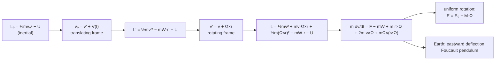
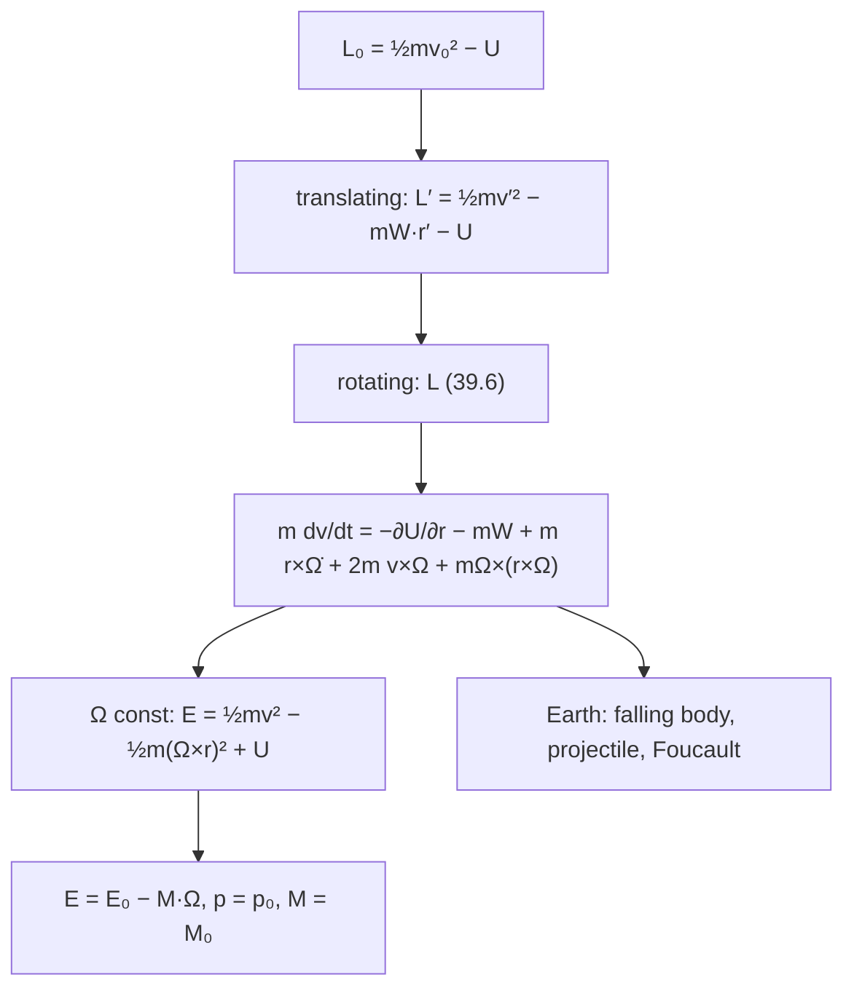

# CM08 · Non-Inertial Frames

◀ [[CM07 Rigid Bodies]] · [[Classical Mechanics - Course Map]]

in course overview extra · book extra · beyond

> [!warning] Source status (every citation below was read in this session)
> Overview: "an extension of the methods to non-inertial systems would also be shown" (objectives) and block 3, "rigid bodies and non-inertial frames". No IISERP lecture notes exist in the folder.
>
> **Read directly:** Landau-Lifshitz Vol. 1 §39 (motion in a non-inertial frame of reference), complete with Problems 1-3 (the Earth's rotation: deflection of a falling body, deviation of a projectile, the Foucault pendulum), printed pp. 126-130 (on these pages the running headers give pdf = printed + 29). **Not cited because not read:** §38 and everything after §39. Where the scan is unreadable (two exponents in Problem 2) the result is re-derived from the legible formula (2) and checked by integration (`scripts/cm08_numbers.py`).

> [!syllabus] Syllabus map
> 🟢 **In course overview**: §1 why the Lagrangian changes, §2 a translating frame, §3 a rotating frame (Coriolis, centrifugal and Euler forces), §4 uniform rotation, energy and momentum.
>
> 🟡 **Extra · book**: §5 the Earth as a rotating frame (LL §39 Problems 1-3).
>
> 🔵 **Extra · beyond (mine)**: the numerical verification of every formula by integrating the full equations (including the centrifugal term), the cart pendulum, the energy check, the Foucault rotation rates for several latitudes, `scripts/cm08_numbers.py`, `scripts/fig_cm08.py`, and an interactive tool.

> [!key] After this chapter you can
> - derive the Lagrangian of a particle in a frame that translates with acceleration $\mathbf W(t)$ and in a frame that rotates with angular velocity $\boldsymbol\Omega(t)$,
> - write the equation of motion with its four **inertial forces**: $-m\mathbf W$, Euler $m\mathbf r\times\dot{\boldsymbol\Omega}$, **Coriolis** $2m\mathbf v\times\boldsymbol\Omega$ and **centrifugal** $m\boldsymbol\Omega\times(\mathbf r\times\boldsymbol\Omega)$,
> - explain why the Coriolis force does no work and why the energy in a rotating frame has no term linear in $\mathbf v$,
> - transform energy, momentum and angular momentum between an inertial and a uniformly rotating frame ($E=E_0-\mathbf M\cdot\boldsymbol\Omega$),
> - compute the eastward deflection of a falling body and the rotation of a Foucault pendulum, with numbers.

> [!intuition] The one-sentence story
> Newton's second law is only valid in an inertial frame, but the **action principle** is not tied to a frame: write the Lagrangian of a free particle in the inertial frame, substitute the coordinates of a moving frame, and Lagrange's equations give the equation of motion there. The extra terms are the "inertial forces": they are not interactions but the shadow of the frame's own acceleration, and they are proportional to the particle's mass, which is why they act like gravity.

## 1. Why the Lagrangian changes (LL §39)
taught

Up to now every frame was inertial. For a single particle in an external field the Lagrangian $L_0=\tfrac12mv_0^2-U$ (39.1), and $m\,d\mathbf v_0/dt=-\partial U/\partial\mathbf r$, hold **only in an inertial frame** (the suffix 0 marks inertial quantities). The way out, LL stresses, is that Hamilton's principle does not depend on the frame: Lagrange's equations (39.2) hold in any coordinates, but the Lagrangian is no longer of the form (39.1) and has to be obtained by transforming $L_0$.

## 2. A translating frame (LL §39)
taught

Let $K'$ move with translational velocity $\mathbf V(t)$ relative to the inertial frame $K_0$. Then $\mathbf v_0=\mathbf v'+\mathbf V(t)$ (39.3) and

$$L'=\tfrac12m\mathbf v'^2+m\mathbf v'\cdot\mathbf V+\tfrac12m\mathbf V^2-U.$$

$\mathbf V^2(t)$ is a given function of time, the total derivative of some other function, so its term can be dropped. Also $m\mathbf V\cdot\mathbf v'=m\mathbf V\cdot d\mathbf r'/dt=d(m\mathbf V\cdot\mathbf r')/dt-m\mathbf r'\cdot d\mathbf V/dt$, and dropping the total derivative gives (39.4)

$$L'=\tfrac12m\mathbf v'^2-m\mathbf W(t)\cdot\mathbf r'-U,\qquad\mathbf W=\frac{d\mathbf V}{dt},$$

with equation of motion (39.5) $m\,d\mathbf v'/dt=-\partial U/\partial\mathbf r'-m\mathbf W(t)$. An accelerated translation is therefore equivalent to a **uniform field of force** $-m\mathbf W$, the mass times the acceleration with the opposite sign. In a frame falling freely ($\mathbf W=\mathbf g$) the term cancels uniform gravity ($U=-m\mathbf g\cdot\mathbf r$): weightlessness.

> [!example] Worked example 1: a pendulum on an accelerating cart (🔵 numbers)
> A pendulum of length $l=1$ m hangs in a cart accelerating at $W=2$ m/s$^2$. In the cart frame it feels gravity plus the uniform field $-m\mathbf W$: an effective gravity of magnitude $g_{\rm eff}=\sqrt{g^2+W^2}=10.0118$ m/s$^2$, tilted backwards by $\arctan(W/g)=11.5232^\circ$ from the vertical. The bob hangs at that angle and oscillates about it with period $2\pi\sqrt{l/g_{\rm eff}}=1.98575$ s, against $2.00607$ s at rest. Integrating the pendulum equation $l\ddot\theta=-g\sin\theta-W\cos\theta$ directly gives the equilibrium $-11.5232^\circ$ and period **$1.98576$ s** (`cm08_numbers.py` §1).

## 3. A rotating frame (LL §39)
taught

Now add a frame $K$ whose origin coincides with that of $K'$ but which rotates relative to $K'$ with angular velocity $\boldsymbol\Omega(t)$. The velocity relative to $K'$ is $\mathbf v'=\mathbf v+\boldsymbol\Omega\times\mathbf r$ ($\mathbf r$ and $\mathbf r'$ coincide). Substituting in (39.4),

$$L=\tfrac12mv^2+m\mathbf v\cdot\boldsymbol\Omega\times\mathbf r+\tfrac12m(\boldsymbol\Omega\times\mathbf r)^2-m\mathbf W\cdot\mathbf r-U\qquad(39.6),$$

the general Lagrangian of a particle in an arbitrary frame. The rotation brings a term **linear in the velocity**. The derivatives are $\partial L/\partial\mathbf v=m\mathbf v+m\boldsymbol\Omega\times\mathbf r$ and $\partial L/\partial\mathbf r=m\mathbf v\times\boldsymbol\Omega+m(\boldsymbol\Omega\times\mathbf r)\times\boldsymbol\Omega-m\mathbf W-\partial U/\partial\mathbf r$, and Lagrange's equation gives (39.7)

$$m\frac{d\mathbf v}{dt}=-\frac{\partial U}{\partial\mathbf r}-m\mathbf W+m\,\mathbf r\times\dot{\boldsymbol\Omega}+2m\,\mathbf v\times\boldsymbol\Omega+m\,\boldsymbol\Omega\times(\mathbf r\times\boldsymbol\Omega).$$

The three rotational inertial forces (LL's discussion):

* $m\,\mathbf r\times\dot{\boldsymbol\Omega}$, due to the **non-uniformity of the rotation** (the Euler force; it is absent for constant $\boldsymbol\Omega$);
* $2m\,\mathbf v\times\boldsymbol\Omega$, the **Coriolis force**: unlike any other non-dissipative force met so far, it depends on the velocity; it is perpendicular to $\mathbf v$ and so does no work;
* $m\,\boldsymbol\Omega\times(\mathbf r\times\boldsymbol\Omega)$, the **centrifugal force**: in the plane of $\mathbf r$ and $\boldsymbol\Omega$, perpendicular to the axis, directed away from it, of magnitude $m\rho\Omega^2$ with $\rho$ the distance from the axis.

> [!example] Worked example 2: one free particle, two descriptions (🔵)
> A particle moves in a straight line at constant velocity in the inertial frame. In a frame rotating at $\Omega=0.7$ about $z$ its coordinates are $\mathbf r'(t)=R_z(\Omega t)(\mathbf r_0+\mathbf v_0t)$, a curve. Differentiating this path numerically twice and comparing with the prediction of (39.9) with $U=0$, $\mathbf a'=-2\boldsymbol\Omega\times\mathbf v'-\boldsymbol\Omega\times(\boldsymbol\Omega\times\mathbf r')$, the largest discrepancy over the path is **$6\times10^{-8}$** (typical $|\mathbf a'|=0.81$): the "forces" are exactly the kinematics of the turning frame (`cm08_numbers.py` §2; Fig. CM8.1 A). **A particle at rest in the inertial frame** appears to circle clockwise at angular velocity $\Omega$ with speed $\Omega\rho$; it needs a centripetal force $m\Omega^2\rho$, and the rotating-frame equation supplies it: the Coriolis force $2m\Omega\cdot\Omega\rho$ points inward, the centrifugal force $m\Omega^2\rho$ outward, net $m\Omega^2\rho$ inward.

## 4. Uniform rotation: energy and momentum (LL §39)
taught

For $\boldsymbol\Omega=$ const and $\mathbf W=0$ the Lagrangian and equation of motion reduce to (39.8)-(39.9)

$$L=\tfrac12mv^2+m\mathbf v\cdot\boldsymbol\Omega\times\mathbf r+\tfrac12m(\boldsymbol\Omega\times\mathbf r)^2-U,\qquad m\dot{\mathbf v}=-\frac{\partial U}{\partial\mathbf r}+2m\,\mathbf v\times\boldsymbol\Omega+m\,\boldsymbol\Omega\times(\mathbf r\times\boldsymbol\Omega).$$

The canonical momentum is $\mathbf p=\partial L/\partial\mathbf v=m\mathbf v+m\boldsymbol\Omega\times\mathbf r$ (39.10) and the energy $E=\mathbf p\cdot\mathbf v-L$ is (39.11)

$$E=\tfrac12mv^2-\tfrac12m(\boldsymbol\Omega\times\mathbf r)^2+U.$$

**There is no term linear in the velocity**: rotation merely adds to the energy a term depending only on the coordinates and proportional to $\Omega^2$, the **centrifugal potential energy** $-\tfrac12m(\boldsymbol\Omega\times\mathbf r)^2=-\tfrac12m\rho^2\Omega^2$. (The Coriolis force, perpendicular to $\mathbf v$, does no work and so cannot appear in an energy.)

**Comparison with the inertial frame.** The velocities are related by $\mathbf v_0=\mathbf v+\boldsymbol\Omega\times\mathbf r$ (39.12), so the momentum $\mathbf p=m\mathbf v_0=\mathbf p_0$ of (39.10) is **the same** in both frames, and so is the angular momentum $\mathbf M=\mathbf r\times\mathbf p=\mathbf M_0$. The energies differ: substituting (39.12) in (39.11), $E=\tfrac12mv_0^2+U-m\mathbf r\times\mathbf v_0\cdot\boldsymbol\Omega$, i.e. (39.13)

$$E=E_0-\mathbf M\cdot\boldsymbol\Omega,$$

the law of transformation of energy under a change to a uniformly rotating frame; it holds for any system of particles.

> [!example] Worked example 3: $E=E_0-\mathbf M\cdot\boldsymbol\Omega$ checked (🔵)
> A free particle, $m=1.3$, $\mathbf r_0=(1,0.3,0.2)$, $\mathbf v_0=(-0.2,0.5,0.1)$, frame rotating at $\boldsymbol\Omega=(0,0,0.7)$, evaluated at $t=2$. Transforming position and velocity to the rotating frame, (39.11) gives $E=-0.314600$; the inertial energy is $E_0=\tfrac12mv_0^2=0.195000$ and $\mathbf M\cdot\boldsymbol\Omega=0.509600$, so $E_0-\mathbf M\cdot\boldsymbol\Omega=-0.314600$ ✓ (`cm08_numbers.py` §3). For a particle at rest in the rotating frame at radius $r$ the same law gives $E=-\tfrac12m\Omega^2r^2$ (all centrifugal potential) while $E_0=\tfrac12m\Omega^2r^2$ and $\mathbf M\cdot\boldsymbol\Omega=m\Omega^2r^2$.

## 5. The Earth as a rotating frame (LL §39 Problems 1-3)
extra · book

The Earth rotates with $\Omega=7.2921\times10^{-5}$ s$^{-1}$ (one turn per sidereal day, $23.9345$ h). Neglecting $\Omega^2$ (the centrifugal force: its ratio to gravity at the equator is $\Omega^2R/g=0.00345\approx1/290$ with $R=6371$ km) the equation (39.9) becomes (LL Problem 1, eq. 1)

$$\dot{\mathbf v}=2\mathbf v\times\boldsymbol\Omega+\mathbf g.$$

Take $z$ vertically up and $x$ towards the pole, so that $\Omega_x=\Omega\cos\lambda$, $\Omega_y=0$, $\Omega_z=\Omega\sin\lambda$ with $\lambda$ the (northern) latitude. ($y$ then points west.)

### 5.1 A falling body (Problem 1)
Solve by successive approximations: $\mathbf v=\mathbf v_1+\mathbf v_2$ with $\dot{\mathbf v}_1=\mathbf g$ (so $\mathbf v_1=\mathbf g t+\mathbf v_0$) and $\dot{\mathbf v}_2=2\mathbf v_1\times\boldsymbol\Omega=2t\,\mathbf g\times\boldsymbol\Omega+2\mathbf v_0\times\boldsymbol\Omega$. Integrating (LL eq. 2), $\mathbf r=\mathbf h+\mathbf v_0t+\tfrac12\mathbf gt^2+\tfrac13t^3\,\mathbf g\times\boldsymbol\Omega+t^2\,\mathbf v_0\times\boldsymbol\Omega$. For $\mathbf v_0=0$: $x=0$ and $y=-\tfrac13t^3g\Omega\cos\lambda$; with the time of fall $t=\sqrt{2h/g}$,

$$y=-\frac13\left(\frac{2h}g\right)^{3/2}g\,\Omega\cos\lambda,$$

where the **negative sign means an eastward deflection** (LL).

> [!example] Worked example 4: how far east? (🔵 full integration)
> The formula is cubic in the time of fall, so it grows as $h^{3/2}$. I integrate the full equation of motion **including the centrifugal term** and find the landing point; it agrees with the formula to five digits (`cm08_numbers.py` §4, Fig. CM8.1 B):
>
> | height $h$ | latitude | deflection east (formula) | integrated |
> |---|---|---|---|
> | $100$ m | $45^\circ$ | $1.552$ cm | $1.552$ cm |
> | $100$ m | $18.5^\circ$ | $2.082$ cm | $2.082$ cm |
> | $100$ m | $0^\circ$ | $2.195$ cm | $2.195$ cm |
> | $100$ m | $89^\circ$ | $0.038$ cm | $0.038$ cm |
> | $500$ m | $45^\circ$ | $17.353$ cm | $17.353$ cm |
>
> The maximum is at the equator ($\cos\lambda=1$), and the shift toward the pole is a second-order effect ($\approx4\times10^{-6}$ m for $h=100$ m at $45^\circ$).

### 5.2 A projectile (Problem 2)
Take the $xz$-plane to contain $\mathbf v_0$ and the initial altitude $h=0$. LL's result (2) of Problem 1 with $\mathbf v_0$ gives the lateral deviation $y=-\tfrac13t^3g\Omega_x+t^2(\Omega_xv_{0z}-\Omega_zv_{0x})$ and, with the time of flight $t=2v_{0z}/g$,

$$y=\frac{4v_{0z}^2}{g^2}\left(\frac{v_{0z}\Omega_x}3-v_{0x}\Omega_z\right)$$

(the scan garbles the printed form; this is the algebraic consequence of the legible formula). **Check** (🔵): $\mathbf v_0=(30,0,40)$ m/s at $45^\circ$ N: $y=-0.05715$ m; the full integration gives $-0.05715$ m, i.e. $5.7$ cm to the east of the coplanar path for a body thrown towards the pole (to its right, as expected in the Northern Hemisphere).

### 5.3 The Foucault pendulum (Problem 3)
For small oscillations of a pendulum of frequency $\omega$ (neglecting the vertical motion as second order and terms in $\Omega^2$), the horizontal motion obeys $\ddot x+\omega^2x=2\Omega_z\dot y$, $\ddot y+\omega^2y=-2\Omega_z\dot x$. Multiplying the second equation by $i$ and adding, with $\xi=x+iy$:

$$\ddot\xi+2i\Omega_z\dot\xi+\omega^2\xi=0.$$

For $\Omega_z\ll\omega$ the solution is $\xi=e^{-i\Omega_zt}\left[A_1e^{i\omega t}+A_2e^{-i\omega t}\right]$, that is $x+iy=(x_0+iy_0)e^{-i\Omega_zt}$, where $x_0(t),y_0(t)$ is the path without rotation: **the effect of the Earth's rotation is to turn the path about the vertical with angular velocity $-\Omega_z=-\Omega\sin\lambda$** (LL). One full turn takes $2\pi/(\Omega\sin\lambda)=23.9345\ {\rm h}/\sin\lambda$.

> [!example] Worked example 5: rotation periods of a Foucault pendulum (🔵 integration)
> I integrate the equations above for a pendulum of period $10$ s with the true $\Omega_z$ scaled up by a known factor (to keep the run short) and fit the angle of the oscillation plane; the rate scales back exactly (`cm08_numbers.py` §6, Fig. CM8.1 C for a rosette with exaggerated rotation):
>
> | latitude | $\Omega_z=\Omega\sin\lambda$ | measured rate | one turn |
> |---|---|---|---|
> | $90^\circ$ (pole) | $7.2921\times10^{-5}$ | $-7.2921\times10^{-5}$ | $23.93$ h |
> | $45^\circ$ | $5.1563\times10^{-5}$ | $-5.1563\times10^{-5}$ | $33.85$ h |
> | $18.5^\circ$ (Pune, rounded) | $2.3138\times10^{-5}$ | $-2.3138\times10^{-5}$ | $75.43$ h |
> | $10^\circ$ | $1.2663\times10^{-5}$ | $-1.2663\times10^{-5}$ | $137.83$ h |
> | $0^\circ$ (equator) | $0$ | $0$ | no turning |
>
> The sign is negative for $\lambda>0$ (clockwise seen from above in the Northern Hemisphere) and positive in the Southern Hemisphere.

![[fig_cm08_noninertial.png|940]]
*Figure CM8.1. A: one free particle described in the inertial frame (straight line) and in a frame rotating at $\Omega=0.8$ (curve); the dots mark equal times. B: eastward deflection of a falling body against height for three latitudes; the black points are full integrations at $45^\circ$ including the centrifugal term. C: the rosette traced by a Foucault pendulum when $\Omega_z/\omega=0.04$ (exaggerated), half a turn shown.*

> [!note] Interactive tool
> The tool below shows the same motion in the inertial and the rotating frame, with the Coriolis and centrifugal force vectors, and the Foucault pendulum at any latitude. The same Coriolis term is the subject of the geostrophic balance in [[CL12 Rotating Frames and the Coriolis Force]] and [[CL13 Horizontal Motion - Geostrophic Balance and Friction]].

<!-- interactive:start (generated by scripts/embed_interactive.py; edit the tool in scripts/interactive/tools/, not this block) -->
> [!interactive]+ Interactive: Rotating frames: Coriolis and centrifugal forces, and the Foucault pendulum
> The same motion in two descriptions.
>
> ![[cm08_rotating_frame.png|720]]
>
> **Try:** Free particle: change Ω and watch the straight inertial path become a spiral-like curve in the rotating view, with the Coriolis force always perpendicular to the velocity. 'At rest in the inertial frame' appears as a clockwise circle for Ω > 0. Foucault: at latitude 45° the plane turns once in 23.93 h / sin 45° = 33.85 h; at the poles once per sidereal day, at the equator not at all.
>
> [▶ Open the tool in your browser](../Assets/interactive/cm08_rotating_frame.html) · [absolute link](file:///home/swastik/Documents/notes/Assets/interactive/cm08_rotating_frame.html) · all tools and coverage: [[Interactive Tools]]

<!-- interactive:end -->

## Map of this chapter

## Common mistakes
1. Treating the centrifugal and Coriolis forces as interactions: they are not, they are proportional to the mass and exist only because the frame is not inertial.
2. Forgetting the **Euler force** $m\mathbf r\times\dot{\boldsymbol\Omega}$ when the rotation rate changes (it is zero only for constant $\boldsymbol\Omega$).
3. Adding a Coriolis term to the energy: it does no work ($\mathbf v\cdot(\mathbf v\times\boldsymbol\Omega)=0$) and the energy (39.11) has no term linear in $\mathbf v$; only the centrifugal **potential** appears.
4. Assuming $E=E_0$: the energy in the rotating frame is $E_0-\mathbf M\cdot\boldsymbol\Omega$, while $\mathbf p$ and $\mathbf M$ are the same in both frames.
5. Using the sign of $\Omega_z$ blindly: in the Northern Hemisphere $\Omega_z>0$ and the Foucault plane turns clockwise seen from above; in the Southern Hemisphere it turns the other way.
6. Expecting the falling-body deflection to be along the meridian: to first order it is purely eastward.

## Summary
- $L'=\tfrac12mv'^2-m\mathbf W\cdot\mathbf r'-U$: a translating frame is a uniform field $-m\mathbf W$.
- $L=\tfrac12mv^2+m\mathbf v\cdot\boldsymbol\Omega\times\mathbf r+\tfrac12m(\boldsymbol\Omega\times\mathbf r)^2-m\mathbf W\cdot\mathbf r-U$.
- $m\dot{\mathbf v}=-\partial U/\partial\mathbf r-m\mathbf W+m\mathbf r\times\dot{\boldsymbol\Omega}+2m\mathbf v\times\boldsymbol\Omega+m\boldsymbol\Omega\times(\mathbf r\times\boldsymbol\Omega)$.
- Uniform rotation: $E=\tfrac12mv^2-\tfrac12m(\boldsymbol\Omega\times\mathbf r)^2+U$, $\mathbf p=m\mathbf v+m\boldsymbol\Omega\times\mathbf r=\mathbf p_0$, $E=E_0-\mathbf M\cdot\boldsymbol\Omega$.
- Earth: falling body deflects east by $\tfrac13g\Omega\cos\lambda\,t^3$ ($1.55$ cm for $100$ m at $45^\circ$); Foucault plane turns at $-\Omega\sin\lambda$ ($33.85$ h at $45^\circ$).
- Numbers: cart pendulum $1.98576$ s vs $1.98575$ s; $E=-0.314600$; rim-free-particle check $6\times10^{-8}$.

## Practice
> [!question]- P1. Falling lift
> A lift is in free fall with acceleration $\mathbf g$. Show that an object released inside stays at rest relative to the lift.
>
> **Solution.** In the lift frame (39.5): $m\dot{\mathbf v}'=m\mathbf g-m\mathbf W$ with $\mathbf W=\mathbf g$, so $\dot{\mathbf v}'=0$: a released object keeps its velocity, i.e. floats (weightlessness).

> [!question]- P2. Pendulum in a lift
> A pendulum of length $1$ m hangs in a lift accelerating upward at $2$ m/s$^2$. Find its period.
>
> **Solution.** Upward acceleration $W$ adds a downward uniform field $mW$: $g_{\rm eff}=g+W=11.81$ m/s$^2$ and $T=2\pi\sqrt{l/g_{\rm eff}}=1.828$ s (against $2.006$ s at rest).

> [!question]- P3. Rounding a bend
> A ball hangs from a string in a car rounding a bend of radius $50$ m at $10$ m/s. At what angle does it hang?
>
> **Solution.** In the car's frame the centrifugal force is $mv^2/r$ (outward) and gravity $mg$ down: $\tan\vartheta=v^2/(rg)=100/(50\cdot9.81)=0.2039$, $\vartheta=11.52^\circ$ (outward from the bend). Equivalently, in the inertial frame the horizontal component of the tension supplies the centripetal force.

> [!question]- P4. Coriolis acceleration of an aircraft
> An aircraft flies at $100$ m/s horizontally at latitude $45^\circ$. Estimate the horizontal Coriolis acceleration.
>
> **Solution.** The horizontal part of $2\mathbf v\times\boldsymbol\Omega$ for a horizontal velocity is $2\Omega v\sin\lambda=2(7.2921\times10^{-5})(100)(0.7071)=0.0103$ m/s$^2$, perpendicular to the velocity (to the right in the Northern Hemisphere): tiny, but over an hour it displaces $\tfrac12(0.0103)(3600)^2\approx67$ km if uncorrected.

> [!question]- P5. Euler force
> A turntable speeds up at $\dot\Omega=0.1$ rad/s$^2$. A mass sits at $r=0.5$ m. Find the Euler acceleration and its direction.
>
> **Solution.** $\mathbf a=\mathbf r\times\dot{\boldsymbol\Omega}$ has magnitude $r\dot\Omega=0.05$ m/s$^2$ and is tangential, **opposite** to the direction of rotation (the mass lags behind a speeding-up turntable).

> [!question]- P6. Bead on a rotating rod
> A frictionless bead slides on a rod rotating at $\Omega=2$ s$^{-1}$ about a vertical axis, starting at $r_0=0.1$ m with zero radial velocity. Find $r(t)$ and $r(1\,{\rm s})$.
>
> **Solution.** Radially the rotating-frame equation is $\ddot r=\Omega^2r$ (centrifugal; the Coriolis force is perpendicular to the rod and balanced by the rod). So $r=r_0\cosh\Omega t$, and $r(1\,{\rm s})=0.1\cosh2=0.3762$ m. (Energy: $E=\tfrac12m\dot r^2-\tfrac12m\Omega^2r^2$ is conserved.)

> [!question]- P7. Coriolis does no work
> Show that the Coriolis force does no work in the rotating frame.
>
> **Solution.** The power is $\mathbf v\cdot(2m\mathbf v\times\boldsymbol\Omega)=0$ since $\mathbf v\perp\mathbf v\times\boldsymbol\Omega$. It changes the direction of $\mathbf v$, not its magnitude; accordingly (39.11) contains no velocity-linear term.

> [!question]- P8. Circle in the rotating frame
> A particle at rest at radius $r$ in the inertial frame. Find its path, speed and acceleration in a frame rotating at $\Omega$.
>
> **Solution.** The path is a circle of radius $r$ traversed in the sense opposite to the frame's rotation at angular velocity $\Omega$; speed $\Omega r$; acceleration $\Omega^2r$ directed to the centre, consistent with (39.9): $-2\boldsymbol\Omega\times\mathbf v'-\boldsymbol\Omega\times(\boldsymbol\Omega\times\mathbf r)$ has magnitude $2\Omega^2r-\Omega^2r=\Omega^2r$ inward.

> [!question]- P9. Deflection at the equator
> A body is dropped from $h=50$ m at the equator. How far east does it land?
>
> **Solution.** $t=\sqrt{2h/g}=3.193$ s; $y=\tfrac13g\Omega\cos\lambda\,t^3=\tfrac13(9.81)(7.2921\times10^{-5})(1)(32.55)=7.76\times10^{-3}$ m $=0.78$ cm.

> [!question]- P10. Foucault at a given latitude
> Period of rotation of the oscillation plane at latitude $48.9^\circ$ N.
>
> **Solution.** $T=2\pi/(\Omega\sin\lambda)=23.9345\ {\rm h}/\sin48.9^\circ=31.76$ h; the plane turns clockwise seen from above.

> [!question]- P11. Southern Hemisphere
> What changes for a Foucault pendulum at $\lambda=-30^\circ$?
>
> **Solution.** $\Omega_z=\Omega\sin\lambda<0$: the plane turns with angular velocity $-\Omega_z>0$, i.e. counter-clockwise seen from above, once in $23.9345/\sin30^\circ=47.87$ h.

> [!question]- P12. Centrifugal acceleration at the equator
> Compare $\Omega^2R$ with $g$ for $R=6371$ km.
>
> **Solution.** $\Omega^2R=(7.2921\times10^{-5})^2(6.371\times10^6)=0.0339$ m/s$^2$, $=0.00345\,g\approx g/290$: the centrifugal force reduces the effective gravity at the equator by $0.35\,\%$ (and is neglected in Problem 1).

> [!question]- P13. Energy of a particle at rest in the rotating frame
> Verify (39.13) for a particle at rest in the rotating frame at radius $r$ (with $U=0$).
>
> **Solution.** In the rotating frame $v=0$: (39.11) gives $E=-\tfrac12m\Omega^2r^2$. In the inertial frame the particle circles with $v_0=\Omega r$: $E_0=\tfrac12m\Omega^2r^2$ and $\mathbf M=\mathbf r\times m\mathbf v_0$ with magnitude $m\Omega r^2$ along $\boldsymbol\Omega$, so $E_0-\mathbf M\cdot\boldsymbol\Omega=\tfrac12m\Omega^2r^2-m\Omega^2r^2=-\tfrac12m\Omega^2r^2$ ✓.

> [!question]- P14. Derive the Foucault equation
> Show that the horizontal components of $2\mathbf v\times\boldsymbol\Omega$ for horizontal $\mathbf v=(\dot x,\dot y,0)$ are $(2\Omega_z\dot y,-2\Omega_z\dot x)$.
>
> **Solution.** $\mathbf v\times\boldsymbol\Omega=(v_y\Omega_z-v_z\Omega_y,\ v_z\Omega_x-v_x\Omega_z,\ v_x\Omega_y-v_y\Omega_x)$; with $v_z=0$, $\Omega_y=0$: $(\dot y\Omega_z,\ -\dot x\Omega_z,\ -\dot y\Omega_x)$. The vertical component $-2\dot y\Omega_x$ is absorbed by the constraint (the string); the horizontal ones give $\ddot x+\omega^2x=2\Omega_z\dot y$, $\ddot y+\omega^2y=-2\Omega_z\dot x$.

> [!question]- P15. Rotation rate that cancels gravity
> At what angular velocity would the centrifugal force cancel gravity at the Earth's equator? How long would a day be?
>
> **Solution.** $\Omega_c=\sqrt{g/R}=\sqrt{9.81/6.371\times10^6}=1.241\times10^{-3}$ s$^{-1}$, period $2\pi/\Omega_c=5063$ s $=84.4$ min (the period of a satellite grazing the surface); the actual $\Omega$ is $17$ times smaller ($\Omega_c/\Omega=17.0$), consistent with $\Omega^2R/g=1/290$.

## Zettel notes
<!-- zettel:start -->
<!-- zettel:end -->

## Provenance
> [!provenance]- Source map for this chapter (all rows read in this session)
> | Topic | Source | Scope |
> |---|---|---|
> | action principle in any frame, $L_0$ valid only in inertial frames (39.1)-(39.2) | LL Vol. 1 §39, p. 126 | in overview |
> | translating frame (39.3)-(39.5), uniform field $-m\mathbf W$ | LL §39, p. 127 | in overview |
> | rotating frame: Lagrangian (39.6), equation of motion (39.7), Coriolis, centrifugal and Euler forces | LL §39, pp. 127-128 | in overview |
> | uniform rotation (39.8)-(39.12), centrifugal potential, $E=E_0-\mathbf M\cdot\boldsymbol\Omega$ (39.13) | LL §39, pp. 128-129 | in overview |
> | Problems 1-3: falling body, projectile, Foucault pendulum | LL §39, pp. 129-130 | extra/book |
> | cart pendulum, rotating-frame kinematics check, energy check, full integrations of deflection and Foucault rates, figure, tool | `scripts/cm08_numbers.py`, `scripts/fig_cm08.py`, `Assets/interactive/cm08_rotating_frame.html` | extra/beyond |
