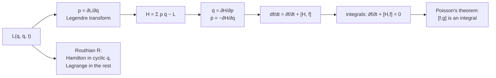
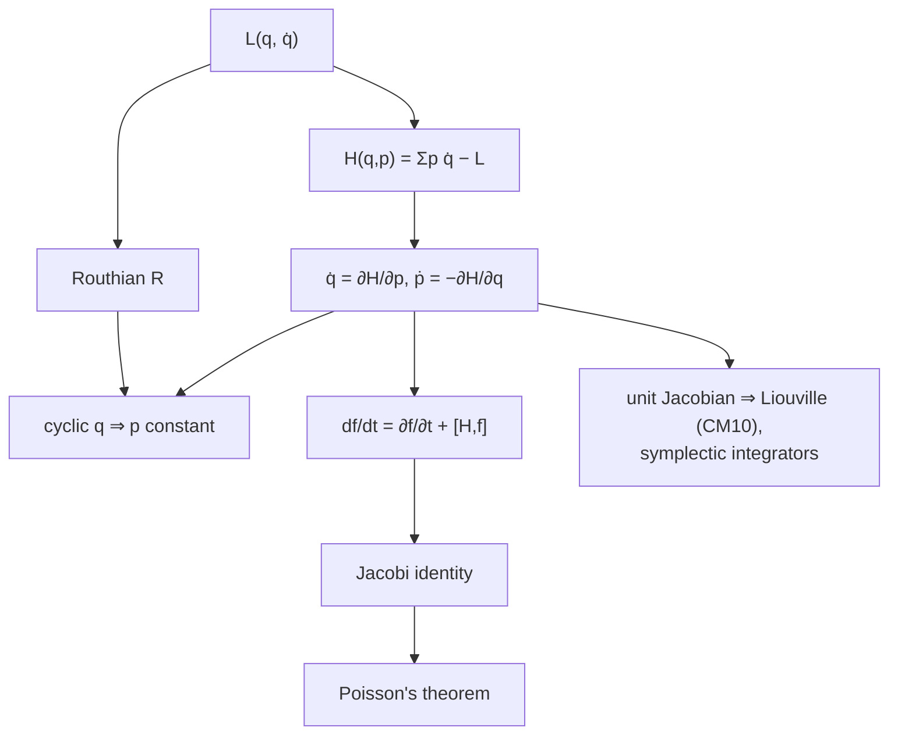

# CM09 · Hamilton's Equations and Poisson Brackets

◀ [[CM08 Non-Inertial Frames]] · [[Classical Mechanics - Course Map]]

in course overview extra · book extra · beyond

> [!warning] Source status (every citation below was read in this session)
> Overview block 4: "we will look at the problems from the standpoint of Hamilton's equations, Liouville's theorem, canonical transformation, Hamilton-Jacobi equation ... action-angle variables". No IISERP lecture notes exist in the folder.
>
> **Read directly:** Landau-Lifshitz Vol. 1, Chapter VII: §40 (Hamilton's equations, printed pp. 131-133, with Problems 1-3), §41 (the Routhian, pp. 133-135, with its Problem), §42 (Poisson brackets, pp. 135-138, with Problems 1-4). On these pages the running headers give pdf = printed + 29. **Not cited because not read:** §43 onward (action as a function of the coordinates, Maupertuis, canonical transformations, Liouville's theorem, Hamilton-Jacobi), which belong to CM10-CM11. **Convention warning:** LL define the bracket $[f,g]=\sum_k\left(\frac{\partial f}{\partial p_k}\frac{\partial g}{\partial q_k}-\frac{\partial f}{\partial q_k}\frac{\partial g}{\partial p_k}\right)$ (42.5), which has the **opposite sign** of the bracket $\{f,g\}=\sum_k\left(\frac{\partial f}{\partial q_k}\frac{\partial g}{\partial p_k}-\frac{\partial f}{\partial p_k}\frac{\partial g}{\partial q_k}\right)$ used in most other books (so LL's $[M_x,M_y]=-M_z$ is $\{M_x,M_y\}=+M_z$ elsewhere). This chapter uses LL's convention throughout and says so where it matters. Where the scan garbles a printed formula (the cylindrical and spherical Hamiltonians of Problem 1) the standard result is re-derived and checked symbolically.

> [!syllabus] Syllabus map
> 🟢 **In course overview** (block 4): §1 Hamilton's equations, §3 Poisson brackets and integrals of motion.
>
> 🟡 **Extra · book**: §2 the Routhian (LL §41), Poisson's theorem and the angular-momentum brackets (LL §42 Problems).
>
> 🔵 **Extra · beyond (mine)**: the numerical checks (the heavy top in canonical variables, the Hamiltonian of the rotating frame with the CM08 numbers, the symbolic verification of all bracket identities, the comparison of integrators), `scripts/cm09_numbers.py`, `scripts/fig_cm09.py`, and an interactive tool.

> [!key] After this chapter you can
> - pass from the Lagrangian $L(q,\dot q,t)$ to the Hamiltonian $H(q,p,t)=\sum p\dot q-L$ by a Legendre transformation and write the $2s$ first-order canonical equations $\dot q=\partial H/\partial p$, $\dot p=-\partial H/\partial q$,
> - read conservation of energy ($dH/dt=\partial H/\partial t$) and of any momentum conjugate to a cyclic coordinate off $H$,
> - use the **Routhian** to eliminate cyclic coordinates while keeping the rest in Lagrangian form,
> - compute **Poisson brackets**, use $df/dt=\partial f/\partial t+[H,f]$, and apply the **Jacobi identity** and **Poisson's theorem** (a new integral of the motion from two known ones),
> - say why symplectic integrators keep the phase-space flow honest.

> [!intuition] The one-sentence story
> The Lagrangian says the state is a point $(q,\dot q)$; the Hamiltonian trades velocities for momenta and the dynamics becomes a **flow on phase space** along the level curves of one function $H$: the vector field $(\partial H/\partial p,-\partial H/\partial q)$ is a rotated gradient of $H$, so $H$ is constant along the flow, and every other quantity changes at the rate its **Poisson bracket** with $H$ allows. All the conservation laws are brackets that vanish.

## 1. Hamilton's equations (LL §40)
taught

The Lagrangian description fixes the state by generalised coordinates and **velocities**. A description in coordinates and **momenta** is better for many general questions, and the change of independent variables is a **Legendre transformation** (LL). The total differential of $L(q,\dot q,t)$ is, since $\partial L/\partial\dot q_i=p_i$ by definition and $\partial L/\partial q_i=\dot p_i$ by Lagrange's equations (40.1),

$$dL=\sum_i\dot p_i\,dq_i+\sum_ip_i\,d\dot q_i.$$

Writing $\sum p_i\,d\dot q_i=d\!\left(\sum p_i\dot q_i\right)-\sum\dot q_i\,dp_i$ and moving the exact differential to the left,

$$d\Big(\sum p_i\dot q_i-L\Big)=-\sum\dot p_i\,dq_i+\sum\dot q_i\,dp_i.$$

The argument is the energy; expressed through $q$ and $p$ it is the **Hamiltonian** (40.2)

$$H(p,q,t)=\sum_ip_i\dot q_i-L,\qquad dH=-\sum\dot p_i\,dq_i+\sum\dot q_i\,dp_i\ \ (40.3),$$

whence **Hamilton's equations** (40.4)

$$\dot q_i=\frac{\partial H}{\partial p_i},\qquad\dot p_i=-\frac{\partial H}{\partial q_i}.$$

They are $2s$ first-order equations replacing $s$ second-order ones, and are called **canonical** for their symmetry. The total derivative of $H$ along a solution is (40.5) $dH/dt=\partial H/\partial t$, since the terms $\sum\left(\frac{\partial H}{\partial q}\dot q+\frac{\partial H}{\partial p}\dot p\right)$ cancel by (40.4): if $H$ has no explicit time dependence it is conserved (energy).

**Parameters.** If $L$ and $H$ depend on a parameter $\lambda$, then (40.6) $(\partial H/\partial\lambda)_{p,q}=-(\partial L/\partial\lambda)_{q,\dot q}$ (the suffixes name the variables held fixed); for a small correction $L=L_0+L'$ the addition to $H$ is $H'=-L'$ to first order (40.7); and for time, which is also just a parameter in the transformation, (40.8) $(\partial H/\partial t)_{p,q}=-(\partial L/\partial t)_{q,\dot q}$.

> [!example] Worked example 1: Hamiltonians of a free-standing particle (LL §40 Problem 1)
> In Cartesian coordinates $H=\dfrac1{2m}(p_x^2+p_y^2+p_z^2)+U(x,y,z)$. In cylindrical coordinates $(r,\varphi,z)$ the momenta are $p_r=m\dot r$, $p_\varphi=mr^2\dot\varphi$, $p_z=m\dot z$ and $H=\dfrac1{2m}\left(p_r^2+\dfrac{p_\varphi^2}{r^2}+p_z^2\right)+U$. In spherical coordinates $(r,\theta,\varphi)$ with $p_r=m\dot r$, $p_\theta=mr^2\dot\theta$, $p_\varphi=mr^2\sin^2\theta\,\dot\varphi$,
> $$H=\frac1{2m}\left(p_r^2+\frac{p_\theta^2}{r^2}+\frac{p_\varphi^2}{r^2\sin^2\theta}\right)+U(r,\theta,\varphi).$$
> (The scan garbles the printed forms of the last two; they are re-derived here from $L=T-U$.) If $U$ is independent of $\varphi$, $p_\varphi$ is conserved because $\partial H/\partial\varphi=0$: **a cyclic coordinate has a constant conjugate momentum** (CM03 in Hamiltonian language).

> [!example] Worked example 2: the Hamiltonian in a rotating frame (LL §40 Problem 2; 🔵 numbers from CM08)
> From (39.11) $E=\tfrac12mv^2-\tfrac12m(\boldsymbol\Omega\times\mathbf r)^2+U$ and $\mathbf p=m\mathbf v+m\boldsymbol\Omega\times\mathbf r$ (39.10), expressing $\mathbf v$ through $\mathbf p$ gives
> $$H=\frac{p^2}{2m}-\boldsymbol\Omega\cdot\mathbf r\times\mathbf p+U.$$
> Check with the numbers of [[CM08 Non-Inertial Frames]] (free particle, $m=1.3$, $\boldsymbol\Omega=(0,0,0.7)$, evaluated at $t=2$ with $\mathbf p=m\mathbf v_0$ expressed in the rotating components): $H=-0.314600$, the value of $E=E_0-\mathbf M\cdot\boldsymbol\Omega$ found there (`cm09_numbers.py` §4). The term $-\boldsymbol\Omega\cdot\mathbf M$ is the "rotation of the frame" in the Hamiltonian.

> [!example] Worked example 3: phase portraits (🔵)
> $H=p^2/2m+m\omega^2q^2/2$: the level curves are ellipses and the area enclosed by $H=E$ is $2\pi E/\omega$, so the period is $T=dA/dE=2\pi/\omega$. For the pendulum, $H=p^2/2-\cos q$ (units $ml^2=1$, $g/l=1$): the level curve $H=1$ is the **separatrix** through the unstable equilibria $q=\pm\pi$; inside it the motion librates, outside it rotates (Fig. CM9.1 A). A libration with amplitude $\theta_0=90^\circ$ has period $4K(\sin45^\circ)=7.4163$ in units of $\sqrt{l/g}$, i.e. $1.1803$ times the small-amplitude value $2\pi$.

> [!example] Worked example 4: the heavy top in canonical variables (🔵 check of CM07)
> Take the symmetric-top Lagrangian of [[CM07 Rigid Bodies]] §5.2, $L=\tfrac12I'_1(\dot\theta^2+\dot\phi^2\sin^2\theta)+\tfrac12I_3(\dot\psi+\dot\phi\cos\theta)^2-\mu gl\cos\theta$. The momenta are $p_\theta=I'_1\dot\theta$, $p_\psi=I_3(\dot\psi+\dot\phi\cos\theta)$, $p_\phi=(I'_1\sin^2\theta+I_3\cos^2\theta)\dot\phi+I_3\dot\psi\cos\theta$, and the Legendre transform is
> $$H=\frac{p_\theta^2}{2I'_1}+\frac{(p_\phi-p_\psi\cos\theta)^2}{2I'_1\sin^2\theta}+\frac{p_\psi^2}{2I_3}+\mu gl\cos\theta.$$
> With the CM07 numbers ($I'_1=1$, $I_3=0.4$, $\mu gl=1$, $p_\psi=M_3=3.2$, $p_\phi=M_z=3.475$, start at $\theta_0=60^\circ$, $p_\theta=0$) I integrate Hamilton's equations for $\theta,p_\theta$ only (the other two coordinates are cyclic): $\theta$ oscillates between **$9.5319^\circ$ and $60.0000^\circ$**, exactly the turning angles found from $U_{\rm eff}$ in CM07, and $H$ drifts by only $2.4\times10^{-10}$ (`cm09_numbers.py` §3). The reduced "effective" energy is $E'=H-p_\psi^2/2I_3-\mu gl=1.84375$, again CM07's value.

## 2. The Routhian (LL §41)
extra · book

Sometimes only **some** of the velocities should be traded for momenta. Take two coordinates $q$ and $\xi$ (the generalisation to several is evident) and replace $\dot q$ by $p=\partial L/\partial\dot q$ but keep $\dot\xi$. From $d(L-p\dot q)=\dot p\,dq-\dot q\,dp+\dots$ the **Routhian** is defined by (41.1)

$$R(q,p,\xi,\dot\xi,t)=p\dot q-L,$$

with $\dot q$ eliminated by $p=\partial L/\partial\dot q$. Its differential gives (41.3)-(41.4) $\dot q=\partial R/\partial p$, $\dot p=-\partial R/\partial q$, $\partial L/\partial\xi=-\partial R/\partial\xi$, $\partial L/\partial\dot\xi=-\partial R/\partial\dot\xi$, and the equation for $\xi$ becomes (41.5) $\dfrac d{dt}\dfrac{\partial R}{\partial\dot\xi}=\dfrac{\partial R}{\partial\xi}$. **The Routhian is a Hamiltonian with respect to $q$ and a Lagrangian with respect to $\xi$**; the energy is $E=R-\dot\xi\,\partial R/\partial\dot\xi$ (41.6).

**Use.** If $q$ is cyclic, $R$ does not depend on it, so $p$ is a constant and $\dot p=-\partial R/\partial q$ says nothing new. Replacing $p$ by its constant value in (41.5) gives equations for $\xi$ alone: **the cyclic coordinates are eliminated.** After solving for $\xi(t)$, $q(t)$ follows by direct integration of $\dot q=\partial R(p,\xi,\dot\xi)/\partial p$.

**The symmetric top (LL's problem).** For $L=\tfrac12I'_1(\dot\theta^2+\dot\phi^2\sin^2\theta)+\tfrac12I_3(\dot\psi+\dot\phi\cos\theta)^2-U(\phi,\theta)$ eliminate the cyclic $\psi$ with $p_\psi=I_3(\dot\psi+\dot\phi\cos\theta)$, i.e. $\dot\psi=p_\psi/I_3-\dot\phi\cos\theta$:

$$R=p_\psi\dot\psi-L=\frac{p_\psi^2}{2I_3}-p_\psi\dot\phi\cos\theta-\tfrac12I'_1(\dot\theta^2+\dot\phi^2\sin^2\theta)+U(\phi,\theta).$$

The first term is constant and may be dropped (LL's remark). With $\phi$ cyclic too, eliminating it as well gives $R=\tfrac12I'_1\dot\theta^2-U_{\rm eff}(\theta)$ (up to the sign convention of $R$): exactly the reduction of CM07.

> [!example] Worked example 5: the Routhian of a central-force problem (🔵)
> $L=\tfrac12m(\dot r^2+r^2\dot\varphi^2)-U(r)$ with $\varphi$ cyclic and $p_\varphi=mr^2\dot\varphi$. Then $R=p_\varphi\dot\varphi-L=\dfrac{p_\varphi^2}{2mr^2}-\tfrac12m\dot r^2+U(r)=-\left[\tfrac12m\dot r^2-U_{\rm eff}(r)\right]$ with $U_{\rm eff}=U+p_\varphi^2/2mr^2$: the effective one-dimensional potential of [[CM04 Central Forces and Effective One-Dimensional Motion]], obtained mechanically. For the Kepler potential $U=-1/r$ with $m=1$ and $p_\varphi=1.2$ the minimum of $U_{\rm eff}$ is at $r=1.4403$ (analytically $p_\varphi^2/m=1.44$) with value $-0.3472=-m/2p_\varphi^2$ (`cm09_numbers.py` §5).

## 3. Poisson brackets (LL §42)
taught

Let $f(p,q,t)$ be any function on phase space. Its total derivative along the motion is $df/dt=\partial f/\partial t+\sum_k\left(\frac{\partial f}{\partial q_k}\dot q_k+\frac{\partial f}{\partial p_k}\dot p_k\right)$, and substituting Hamilton's equations (42.1)-(42.2)

$$\frac{df}{dt}=\frac{\partial f}{\partial t}+[H,f],\qquad[f,g]=\sum_k\left(\frac{\partial f}{\partial p_k}\frac{\partial g}{\partial q_k}-\frac{\partial f}{\partial q_k}\frac{\partial g}{\partial p_k}\right)\ \ (42.5).$$

(LL's convention; see the warning at the top: most books have the opposite sign.) A function is an **integral of the motion** if $\partial f/\partial t+[H,f]=0$ (42.3); if it has no explicit time dependence, $[H,f]=0$ (42.4). In particular $\dot q_k=[H,q_k]$ and $\dot p_k=[H,p_k]$.

**Properties** (LL, directly from the definition): $[f,g]=-[g,f]$ (42.6); $[f,c]=0$ for a constant $c$ (42.7); bilinearity (42.8); Leibniz rule $[f_1f_2,g]=f_1[f_2,g]+f_2[f_1,g]$ (42.9); $\partial[f,g]/\partial t=[\partial f/\partial t,g]+[f,\partial g/\partial t]$ (42.10). If one function is a coordinate or momentum the bracket is a derivative: $[f,q_k]=\partial f/\partial p_k$ (42.11) and $[f,p_k]=-\partial f/\partial q_k$ (42.12); in particular the **fundamental brackets** (42.13)

$$[q_i,q_k]=0,\qquad[p_i,p_k]=0,\qquad[p_i,q_k]=\delta_{ik}.$$

**Jacobi's identity** (42.14): $[f,[g,h]]+[g,[h,f]]+[h,[f,g]]=0$. LL's proof: the left side is a linear homogeneous function of the second derivatives of $f,g,h$; collecting those of $f$, the first bracket has none, and the other two give $D_1D_2-D_2D_1$ with $D_1=[g,\cdot]$ and $D_2=[h,\cdot]$, a first-order differential operator with no second derivatives, so they cancel; the same holds for $g$ and $h$.

**Poisson's theorem** (42.15): *if $f$ and $g$ are integrals of the motion, so is $[f,g]$.* For $f,g$ without explicit time dependence, put $h=H$ in Jacobi: $[H,[f,g]]=-[f,[g,H]]-[g,[H,f]]=0$ if $[H,f]=[H,g]=0$. The time-dependent case works the same way through (42.16). LL cautions that the theorem does not always give a new integral: there are only $2s-1$ independent ones, and the bracket may be a constant or a function of $f$ and $g$.

**Problems (LL §42).** Define $\mathbf M=\mathbf r\times\mathbf p$. (1) $[M_x,p_y]=-\partial M_x/\partial y=-p_z$, $[M_x,p_x]=0$, $[M_x,p_z]=p_y$, and cyclic permutations. (2) $[M_x,M_y]=-M_z$, $[M_y,M_z]=-M_x$, $[M_z,M_x]=-M_y$ (valid for the total angular momentum of any system). (3) For any function $\phi$ spherically symmetric about the origin (depending only on $r^2$, $p^2$, $\mathbf r\cdot\mathbf p$), $[\phi,M_z]=0$. (4) For a vector function $\mathbf f(\mathbf r,\mathbf p)$, $[\mathbf f,M_z]=\mathbf f\times\mathbf n$ with $\mathbf n$ the unit vector along $z$.

> [!example] Worked example 6: the bracket algebra checked symbolically (🔵)
> All of these are verified with computer algebra (`cm09_numbers.py` §1). The fundamental brackets give $[x,p_x]=-1$ and $[p_x,x]=+1$ (42.13); $[M_x,p_y]=-p_z$, $[M_x,p_z]=p_y$, $[M_x,p_x]=0$ (Problem 1); $[M_x,M_y]+M_z=0$, $[M_y,M_z]+M_x=0$, $[M_z,M_x]+M_y=0$ (Problem 2); $[\phi(r^2,p^2,\mathbf r\cdot\mathbf p),M_z]=0$ (Problem 3); $[\mathbf r,M_z]=(y,-x,0)=\mathbf r\times\mathbf n$ (Problem 4); Jacobi's identity vanishes identically for three arbitrary test functions. For a central force, $[H,M_z]=0$ with $H=p^2/2m+U(r)$ ($M_z$ conserved), and Poisson's theorem applied to the integrals $M_x,M_y$ returns $[M_x,M_y]=-M_z$, an integral we already knew (LL's "trivial" case).

> [!example] Worked example 7: Poisson's theorem generates the Runge-Lenz components (🔵)
> For the Kepler problem ($m=k=1$, $H=p^2/2-1/r$) the vector $\mathbf A=\mathbf p\times\mathbf M-\hat{\mathbf r}$ is an integral (CM04). Taking the integrals $M_z$ and $A_x$ and forming their bracket in LL's convention, symbolic algebra gives $[M_z,A_x]=-A_y$ exactly (`cm09_numbers.py` §6): Poisson's theorem produces the **next component** of the Runge-Lenz vector from the first, the mechanism by which the hidden symmetry of the Kepler problem closes the algebra of angular momentum and $\mathbf A$.

### 3.1 Numerical consequences: why the structure matters (🔵)
Hamilton's equations generate a map of phase space with **unit Jacobian**: $\partial\dot q/\partial q+\partial\dot p/\partial p=\partial^2H/\partial q\partial p-\partial^2H/\partial p\partial q=0$, so areas are preserved (Liouville's theorem, CM10). A numerical integrator that shares this property is called **symplectic**. For $H=\tfrac12(p^2+q^2)$ with step $h=0.1$ the one-step Jacobian determinant is $1.0100$ for explicit Euler (exactly $1+h^2$), $0.99999999$ for RK4 and $1.00000000$ for the leapfrog (velocity Verlet) map. The consequence for the energy (Fig. CM9.1 B): after $10^5$ periods RK4 has lost $8.3\,\%$ of $H$ ($H=0.4583$ for $H_0=0.5$), explicit Euler has exploded, whereas leapfrog's energy error stays within $1.25\times10^{-3}$ forever, because it conserves a nearby Hamiltonian exactly. Fig. CM9.1 C shows the blob of initial conditions: after 45 steps of $h=0.3$ its area has become $18.6$ with explicit Euler ($0.385\to18.597$) while RK4 and leapfrog keep $0.385$.

![[fig_cm09_hamilton.png|940]]
*Figure CM9.1. A: phase portrait of the pendulum, $H=p^2/2-\cos q$; the red level curve $H=1$ is the separatrix through the saddles at $q=\pm\pi$. B: relative energy error of three integrators for the oscillator ($h=0.1$) against the number of periods. C: a blob of initial conditions after 45 steps with $h=0.3$: explicit Euler inflates it, RK4 and leapfrog keep its area.*

> [!note] Interactive tool
> The tool below draws the phase portrait of an oscillator, a pendulum or a double well, launches a trajectory and a blob of initial conditions with the integrator of your choice, and plots the energy error and the blob's area. The same Liouville picture reappears in [[SM02 Phase Space Liouville and the Microcanonical Ensemble]].

<!-- interactive:start (generated by scripts/embed_interactive.py; edit the tool in scripts/interactive/tools/, not this block) -->
> [!interactive]+ Interactive: Hamiltonian flow in phase space: portraits, conservation and integrators
> Hamilton's equations q̇ = ∂H/∂p, ṗ = −∂H/∂q turn the dynamics into a flow on the (q, p) plane along the level curves of H.
>
> ![[cm09_hamiltonian_flow.png|720]]
>
> **Try:** Oscillator, h = 0.3: explicit Euler spirals outward and the blob's area grows by (1+h²) per step; leapfrog keeps a closed orbit and area ratio 1.0000; RK4 is accurate but slowly shrinks. Pendulum: start just inside and just outside the separatrix H = 1 to see libration vs rotation.
>
> [▶ Open the tool in your browser](../Assets/interactive/cm09_hamiltonian_flow.html) · [absolute link](file:///home/swastik/Documents/notes/Assets/interactive/cm09_hamiltonian_flow.html) · all tools and coverage: [[Interactive Tools]]

> [!interactive]+ Interactive: Liouville's theorem: a cloud of states flows like an incompressible fluid
> A blob of initial conditions in the (q, p) phase space of a pendulum (or harmonic oscillator) is carried by Hamilton's equations.
>
> ![[sm_liouville.png|720]]
>
> **Try:** Harmonic oscillator: the blob rotates rigidly (area and shape unchanged). Pendulum from a blob near the separatrix: it stretches into a spiral; boundary area stays at its initial value while the coarse-grained (occupied-cells) area keeps growing. Friction 0.1: area shrinks like e^{−γt}.
>
> [▶ Open the tool in your browser](../Assets/interactive/sm_liouville.html) · [absolute link](file:///home/swastik/Documents/notes/Assets/interactive/sm_liouville.html) · all tools and coverage: [[Interactive Tools]]

<!-- interactive:end -->

## Map of this chapter

## Common mistakes
1. Writing $H=T+U$ without checking that the potential energy is independent of velocities and the constraints are time-independent: the general definition is $H=\sum p\dot q-L$ (40.2), expressed in $q,p$.
2. Substituting $\dot q$ into $H$ instead of $p$: $H$ must be a function of $q$ and $p$ **before** differentiating in (40.4).
3. Forgetting that $\partial H/\partial t=-\partial L/\partial t$ (40.8): $H$ is conserved only when it has no explicit time dependence.
4. Mixing conventions for the Poisson bracket: LL's $[f,g]$ equals $-\{f,g\}$ of other books; $[M_x,M_y]=-M_z$ here.
5. Expecting Poisson's theorem always to give a new integral: the bracket may be constant, trivial or a function of the old ones.
6. Using a non-symplectic integrator (explicit Euler, plain RK4) for long-time Hamiltonian runs: energy drifts systematically.

## Summary
- $H=\sum p\dot q-L$; $\dot q=\partial H/\partial p$, $\dot p=-\partial H/\partial q$; $dH/dt=\partial H/\partial t=-\partial L/\partial t$.
- Cyclic coordinate $\Rightarrow$ conserved momentum. Routhian $R=p\dot q-L$: Hamiltonian in $q$, Lagrangian in $\xi$; eliminates cyclic coordinates.
- $df/dt=\partial f/\partial t+[H,f]$; $[f,g]=\sum(\partial_pf\,\partial_qg-\partial_qf\,\partial_pg)$ (LL); $[p_i,q_k]=\delta_{ik}$; Jacobi; Poisson's theorem.
- $[M_x,M_y]=-M_z$ (LL convention); $[\mathbf f,M_z]=\mathbf f\times\mathbf n$; $[\phi,M_z]=0$ for scalar $\phi$.
- Numbers: rotating-frame $H=-0.3146$; heavy top $\theta\in[9.5319^\circ,60^\circ]$; $[M_z,A_x]=-A_y$; leapfrog energy error $\le1.25\times10^{-3}$ vs RK4 $-8.3\,\%$ after $10^5$ periods.

## Practice
> [!question]- P1. Legendre transform of an oscillator
> $L=\tfrac12m\dot q^2-\tfrac12kq^2$. Find $H$ and Hamilton's equations.
>
> **Solution.** $p=m\dot q$; $H=p\dot q-L=p^2/2m+\tfrac12kq^2$. $\dot q=p/m$, $\dot p=-kq$; eliminating $p$: $m\ddot q=-kq$.

> [!question]- P2. Uniform gravity
> $H=p^2/2m+mgz$. Solve Hamilton's equations with $z(0)=0$, $p(0)=0$.
>
> **Solution.** $\dot z=p/m$, $\dot p=-mg$: $p=-mgt$, $z=-\tfrac12gt^2$.

> [!question]- P3. Spherical coordinates
> Write $H$ for a particle in a potential $U(r,\theta)$ in spherical coordinates and name the conserved quantities.
>
> **Solution.** Worked example 1: $H=\frac1{2m}\left(p_r^2+p_\theta^2/r^2+p_\varphi^2/(r^2\sin^2\theta)\right)+U(r,\theta)$. $\varphi$ is cyclic: $p_\varphi=mr^2\sin^2\theta\,\dot\varphi$ is conserved; $H$ itself (no explicit time dependence) is the conserved energy.

> [!question]- P4. A time-dependent oscillator
> $L=\tfrac12m\dot q^2-\tfrac12m\omega^2(t)q^2$. Show $dH/dt\ne0$ and compute it.
>
> **Solution.** $H=p^2/2m+\tfrac12m\omega^2(t)q^2$ and (40.5) $dH/dt=\partial H/\partial t=m\omega\dot\omega\,q^2$: the energy changes only through the explicit time dependence (parametric driving).

> [!question]- P5. Pendulum period beyond small angles
> For $H=p^2/2-\cos q$ the libration of amplitude $90^\circ$ has $T=4K(k)$ with $k=\sin(\theta_0/2)$. Compute $T$ and the ratio to $2\pi$.
>
> **Solution.** $k=\sin45^\circ$, $k^2=0.5$, $K=1.85407$, $T=4K=7.4163$ (in units of $\sqrt{l/g}$); $T/2\pi=1.1803$.

> [!question]- P6. Phase-space area of an oscillator
> Show that the area enclosed by the orbit $H=E$ of $H=p^2/2m+m\omega^2q^2/2$ is $2\pi E/\omega$ and recover the period.
>
> **Solution.** The ellipse has semi-axes $\sqrt{2E/m\omega^2}$ and $\sqrt{2mE}$, area $\pi\sqrt{2E/m\omega^2}\sqrt{2mE}=2\pi E/\omega$. The period is $T=dA/dE=2\pi/\omega$.

> [!question]- P7. Routhian for the central force
> Eliminate $\varphi$ from $L=\tfrac12m(\dot r^2+r^2\dot\varphi^2)-U(r)$ with the Routhian. What is the radial equation?
>
> **Solution.** Worked example 5: $R=-\left[\tfrac12m\dot r^2-U-p_\varphi^2/2mr^2\right]$, so (41.5) gives $m\ddot r=-dU_{\rm eff}/dr$ with $U_{\rm eff}=U+p_\varphi^2/2mr^2$.

> [!question]- P8. Routhian of the symmetric top
> Obtain $R$ after eliminating $\psi$ (LL §41 Problem) and find which terms survive when $\phi$ is also cyclic.
>
> **Solution.** $R=\dfrac{p_\psi^2}{2I_3}-p_\psi\dot\phi\cos\theta-\tfrac12I'_1(\dot\theta^2+\dot\phi^2\sin^2\theta)+U$. With $\phi$ cyclic $p_\phi=\partial L/\partial\dot\phi$ is constant; replacing $\dot\phi$ through it leaves a function of $\theta,\dot\theta$ only, $\tfrac12I'_1\dot\theta^2-U_{\rm eff}(\theta)$ up to sign convention and constants (CM07 §5.2).

> [!question]- P9. A bracket by hand
> Compute $[x,p^2]$ and $[q^2,p^2]$ in LL's convention for one degree of freedom.
>
> **Solution.** $[f,g]=\partial_pf\,\partial_qg-\partial_qf\,\partial_pg$. $[q,p^2]=0\cdot0-1\cdot2p=-2p$. $[q^2,p^2]=0-2q\cdot2p=-4qp$.

> [!question]- P10. Virial from the bracket
> For $H=p^2/2m+U(q)$ compute $d(qp)/dt$.
>
> **Solution.** $d(qp)/dt=[H,qp]=\dfrac{\partial H}{\partial p}\dfrac{\partial(qp)}{\partial q}-\dfrac{\partial H}{\partial q}\dfrac{\partial(qp)}{\partial p}=\dfrac pm\,p-U'q=p^2/m-qU'$. Averaging over a bounded motion gives the virial theorem $2\langle T\rangle=\langle qU'\rangle$.

> [!question]- P11. $[\mathbf r,M_z]$
> Use LL Problem 4 to find $[x,M_z]$, $[y,M_z]$ and interpret.
>
> **Solution.** $[\mathbf r,M_z]=\mathbf r\times\mathbf n=(y,-x,0)$, so $[x,M_z]=y$ and $[y,M_z]=-x$: the bracket with $M_z$ rotates the coordinates about $z$ (the angular momentum generates rotations).

> [!question]- P12. Poisson's theorem
> If $M_x$ and $M_y$ are conserved for a system, what follows?
>
> **Solution.** $[M_x,M_y]=-M_z$ (LL Problem 2), so by Poisson's theorem $M_z$ is conserved: the whole vector $\mathbf M$ is conserved (e.g. for a central force).

> [!question]- P13. Jacobi by example
> Verify Jacobi's identity for $f=q$, $g=p$, $h=q^2$.
>
> **Solution.** $[g,h]=[p,q^2]=\partial_pp\,\partial_qq^2=2q$; $[f,[g,h]]=[q,2q]=0$. $[h,f]=[q^2,q]=0$ so $[g,[h,f]]=0$. $[f,g]=[q,p]=-1$; $[h,[f,g]]=[q^2,-1]=0$ (42.7). The sum is $0$ ✓.

> [!question]- P14. Rotating-frame Hamiltonian at rest
> A particle at rest in the rotating frame at distance $\rho$ from the axis: find $H$.
>
> **Solution.** $\mathbf p=m\boldsymbol\Omega\times\mathbf r$ (since $\mathbf v=0$), $|\mathbf p|=m\Omega\rho$, $\boldsymbol\Omega\cdot\mathbf r\times\mathbf p=\Omega\cdot m\Omega\rho^2$. $H=\tfrac12m\Omega^2\rho^2-m\Omega^2\rho^2=-\tfrac12m\Omega^2\rho^2$, equal to $E$ of CM08 P13.

> [!question]- P15. Phase-space volume
> Show that Hamilton's equations have a divergence-free flow.
>
> **Solution.** The flow field is $(\dot q,\dot p)=(\partial H/\partial p,-\partial H/\partial q)$ and $\nabla\cdot=\dfrac{\partial^2H}{\partial q\,\partial p}-\dfrac{\partial^2H}{\partial p\,\partial q}=0$. So phase-space volume is preserved (Liouville's theorem, CM10).

## Zettel notes
<!-- zettel:start -->
<!-- zettel:end -->

## Provenance
> [!provenance]- Source map for this chapter (all rows read in this session)
> | Topic | Source | Scope |
> |---|---|---|
> | Legendre transformation, $H$, Hamilton's equations (40.1)-(40.8), Problems 1-3 | LL Vol. 1 §40, pp. 131-133 | in overview |
> | Routhian (41.1)-(41.6), cyclic coordinates, symmetric-top problem | LL §41, pp. 133-135 | extra/book |
> | Poisson brackets (42.1)-(42.16), Jacobi identity, Poisson's theorem | LL §42, pp. 135-137 | in overview |
> | angular-momentum brackets, Problems 1-4 | LL §42, pp. 137-138 | extra/book |
> | symbolic bracket checks, heavy top in canonical variables, rotating-frame $H$, Routhian effective potential, Kepler $[M_z,A_x]=-A_y$, integrator comparison, figure, tool | `scripts/cm09_numbers.py`, `scripts/fig_cm09.py`, `Assets/interactive/cm09_hamiltonian_flow.html` | extra/beyond |
