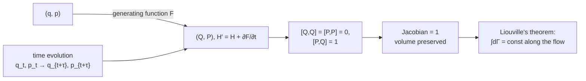
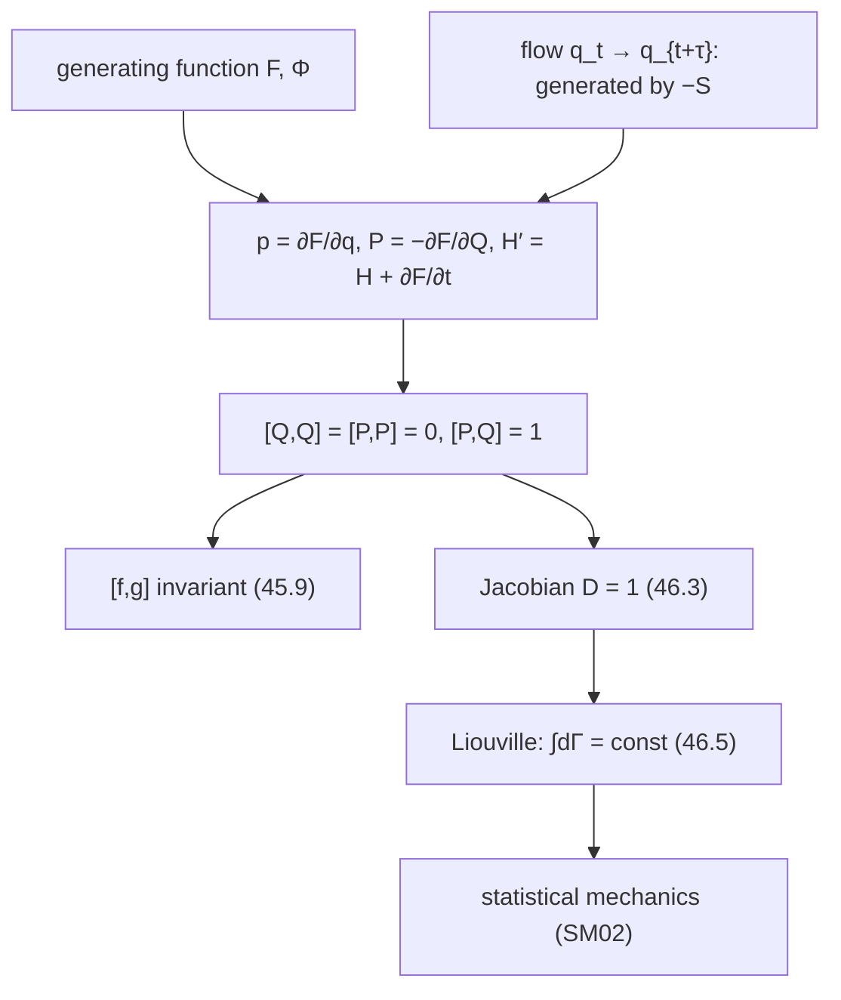

# CM10 · Liouville's Theorem and Canonical Transformations

◀ [[CM09 Hamilton's Equations and Poisson Brackets]] · [[Classical Mechanics - Course Map]]

in course overview extra · book extra · beyond

> [!warning] Source status (every citation below was read in this session)
> Overview block 4: "Liouville's Theorem, canonical transformation". No IISERP lecture notes exist in the folder.
>
> **Read directly:** Landau-Lifshitz Vol. 1 §45 (canonical transformations, printed pp. 143-146) and §46 (Liouville's theorem, pp. 146-147); on these pages the running headers give pdf = printed + 29. I also read the end of §44 (Jacobi's form of the principle, p. 142). **Also read afterwards (while writing CM11):** §43 (the action as a function of the coordinates, pp. 138-140), including (43.2)-(43.7): the statements about (45.4) and (43.7) used below are therefore taken from pages I have read. §47 onward belongs to CM11. LL's bracket $[f,g]=\sum(\partial_pf\,\partial_qg-\partial_qf\,\partial_pg)$ has the opposite sign to the one in most books (see [[CM09 Hamilton's Equations and Poisson Brackets]]); this chapter uses LL's.

> [!syllabus] Syllabus map
> 🟢 **In course overview** (block 4): §1 canonical transformations and generating functions, §3 Liouville's theorem.
>
> 🟡 **Extra · book**: §2 invariance of the Poisson bracket and the bracket conditions, §4 the flow as a canonical transformation (LL §45 end).
>
> 🔵 **Extra · beyond (mine)**: the action-angle transformation of the oscillator and its generating function, the numerical check of $-S$ as generating function, area conservation and coarse-graining for the pendulum, examples of non-canonical maps, `scripts/cm10_numbers.py`, `scripts/fig_cm10.py`, and an interactive tool.

> [!key] After this chapter you can
> - say when a change of variables $(q,p)\to(Q,P)$ is **canonical**, in three equivalent ways: it preserves the form of Hamilton's equations, it has a **generating function**, it satisfies $[Q_i,Q_k]=[P_i,P_k]=0$, $[P_i,Q_k]=\delta_{ik}$,
> - derive $p,P,H'$ from a generating function of any of the four standard types,
> - use the **invariance of Poisson brackets** under canonical maps,
> - prove **Liouville's theorem** (the Jacobian of a canonical map is 1) and explain why the phase flow itself is a canonical transformation,
> - recognise that in Hamiltonian mechanics the distinction between "coordinates" and "momenta" is largely a matter of naming.

> [!intuition] The one-sentence story
> In the Lagrangian picture you may relabel the coordinates $q\to Q(q,t)$ freely; in the Hamiltonian picture you may mix **coordinates and momenta together**, as long as the new variables still obey Hamilton's equations for some $H'$. Those maps are exactly the ones that preserve areas in phase space (they are the "rotations" of the symplectic plane), and since time evolution is itself such a map, a cloud of states flows through phase space like an incompressible fluid: this is Liouville's theorem, the starting point of statistical mechanics.

## 1. Canonical transformations (LL §45)
taught

The generalised coordinates are arbitrary; Lagrange's equations keep their form under **point transformations** $Q_i=Q_i(q,t)$ (45.1), and so do Hamilton's. But in the Hamiltonian treatment $p$ and $q$ are independent variables on an equal footing, so one may extend the transformation to all $2s$ variables (45.2)

$$Q_i=Q_i(p,q,t),\qquad P_i=P_i(p,q,t).$$

The equations of motion do not keep their canonical form under every such transformation. We ask for those after which they read $\dot Q_i=\partial H'/\partial P_i$, $\dot P_i=-\partial H'/\partial Q_i$ (45.3) for some new Hamiltonian $H'(P,Q,t)$: these are the **canonical transformations**.

Hamilton's equations follow from the principle of least action in the form $\delta\int\left(\sum p_i\,dq_i-H\,dt\right)=0$ with all $p,q$ varied independently (45.4), LL's result of §43. If the new variables also satisfy Hamilton's equations then $\delta\int\left(\sum P_i\,dQ_i-H'dt\right)=0$ (45.5). The two are certainly equivalent if the integrands differ by the total differential of a function $F$ of coordinates, momenta and time:

$$\sum p_i\,dq_i-H\,dt=\sum P_i\,dQ_i-H'dt+dF.$$

($F$ contributes only boundary terms, which do not affect the variation.) $F$ is the **generating function**. Written as $dF=\sum p_i\,dq_i-\sum P_i\,dQ_i+(H'-H)\,dt$ (45.6), it gives, when $F=F(q,Q,t)$ (45.7),

$$p_i=\frac{\partial F}{\partial q_i},\qquad P_i=-\frac{\partial F}{\partial Q_i},\qquad H'=H+\frac{\partial F}{\partial t}.$$

Given $F$, these equations define the transformation and the new Hamiltonian. It is often convenient to use old coordinates and **new momenta** as independent variables: a Legendre transformation of (45.6) gives $d(F+\sum P_iQ_i)=\sum p_i\,dq_i+\sum Q_i\,dP_i+(H'-H)dt$, so for $\Phi(q,P,t)=F+\sum P_iQ_i$ (45.8)

$$p_i=\frac{\partial\Phi}{\partial q_i},\qquad Q_i=\frac{\partial\Phi}{\partial P_i},\qquad H'=H+\frac{\partial\Phi}{\partial t}.$$

(LL note that generating functions depending on $p,Q$ or on $p,P$ follow in the same way.) The relation between the two Hamiltonians is always the same: **$H'-H$ is the partial time derivative of the generating function**, so for a time-independent generating function $H'=H$ expressed in the new variables.

**Special cases** (LL). $\Phi=\sum f_i(q,t)P_i$ gives $Q_i=f_i(q,t)$: a point transformation, a particular canonical one. $\Phi=\sum q_iP_i$ is the identity. $F=\sum q_iQ_i$ gives $Q_i=p_i$, $P_i=-q_i$ (45.7): the coordinates and momenta simply exchange names, and the equations keep their form. This shows that **the distinction between $Q$ and $P$ is essentially one of nomenclature**; the variables are called **canonically conjugate**. A footnote adds that the form of the equations is also preserved when the two integrands differ by a constant factor $a$, e.g. $P_i=ap_i$, $Q_i=q_i$, $H'=aH$ (not canonical in the strict sense).

> [!example] Worked example 1: simple maps and their brackets (🔵 symbolic)
> Using LL's condition $[P,Q]=1$ (one degree of freedom; $[Q,Q]=[P,P]=0$ is then automatic) I check each map symbolically (`cm10_numbers.py` §1):
>
> | map | $[P,Q]$ | Jacobian | verdict |
> |---|---|---|---|
> | $Q=p,\ P=-q$ | $1$ | $1$ | canonical ($F=qQ$) |
> | $Q=aq,\ P=p/a$ | $1$ | $1$ | canonical (squeeze) |
> | $Q=q,\ P=p+cq$ | $1$ | $1$ | canonical (shear) |
> | $Q=q+kp,\ P=p$ | $1$ | $1$ | canonical (shear) |
> | $Q=q^2,\ P=p/(2q)$ | $1$ | $1$ | canonical |
> | $Q=q^2,\ P=p$ | $2q$ | $2q$ | **not** canonical |
> | $Q=q,\ P=2p$ | $2$ | $2$ | scale factor $a=2$, $H'=2H$ (LL footnote) |
>
> Fig. CM10.1 C draws the unit square under the first-listed shear, the canonical $Q=q^2$ map and the non-canonical one: areas $1.000$, $1.000$ and $2.000$.

> [!example] Worked example 2: the oscillator in action-angle variables (🔵)
> For $H=p^2/2m+\tfrac12m\omega^2q^2$ use $F(q,Q)=\tfrac12m\omega q^2\cot Q$. Then (45.7) $p=\partial F/\partial q=m\omega q\cot Q$ and $P=-\partial F/\partial Q=m\omega q^2/(2\sin^2Q)$, i.e.
> $$q=\sqrt{\frac{2P}{m\omega}}\sin Q,\qquad p=\sqrt{2m\omega P}\cos Q,\qquad H'=H=\omega P.$$
> $F$ is time-independent so $H'=H$, and the new Hamiltonian depends **only on $P$**: $\dot Q=\partial H'/\partial P=\omega$, $\dot P=0$, so $Q=\omega t+Q_0$ and $P=E/\omega$ is the constant. Symbolically (`cm10_numbers.py` §2): $[P,Q]=1$, Jacobian $=1$ and $H-\omega P=0$ identically. The level curves of $H$ (ellipses) become horizontal lines $P=$ const (Fig. CM10.1 B); $P$ times $2\pi$ is the area enclosed by the orbit, the **action variable** of CM11.

## 2. Invariance of Poisson brackets (LL §45)
extra · book

LL prove that the Poisson bracket of two quantities is **the same whichever canonical variables are used** (45.9): $[f,g]_{p,q}=[f,g]_{P,Q}$. Argument: time enters the transformations (45.7)-(45.8) only as a parameter, so it suffices to take $f,g$ without explicit time dependence. Regard $g$ formally as the Hamiltonian of a fictitious system; by (42.1) $[f,g]_{p,q}=-df/dt$ along its motion, and $df/dt$ depends only on the properties of that motion, not on the choice of variables. Combined with the fundamental brackets (42.13) this gives the **conditions for a transformation to be canonical** (45.10)

$$[Q_i,Q_k]_{p,q}=0,\qquad[P_i,P_k]_{p,q}=0,\qquad[P_i,Q_k]_{p,q}=\delta_{ik}.$$

> [!example] Worked example 3: bracket invariance, numerically (🔵)
> Take $f=q^2p$ and $g=p^2+q$ and the oscillator map above with $m=\omega=1$. At the point $(q,p)=(0.8,0.5)$, $[f,g]_{p,q}=-0.160000$. Expressing $f,g$ through $Q,P$ and computing the bracket in the new variables at the image point $(Q,P)=(1.0122,0.4450)$ gives $[f,g]_{P,Q}=-0.160000$ (`cm10_numbers.py` §4): equal, as (45.9) says.

## 3. Time evolution is a canonical transformation (LL §45)
extra · book

Let $q_t,p_t$ be the canonical variables at time $t$ and $q_{t+\tau},p_{t+\tau}$ their values a time $\tau$ later: the latter are functions of the former and of $\tau$. **Regarded as a transformation from $(q_t,p_t)$ to $(q_{t+\tau},p_{t+\tau})$ it is canonical**, and LL show that **$-S$ is its generating function**, where $S(q_{t+\tau},q_t,t,\tau)$ is the action along the true path through the two points (from the differential $dS=\sum(p_{t+\tau}dq_{t+\tau}-p_t\,dq_t)-(H_{t+\tau}-H_t)\,dt$, eq. (43.7), compared with (45.6)).

> [!example] Worked example 4: the generating function of the oscillator's flow (🔵 check)
> For $m=\omega=1$ the action along the true path from $q_0$ to $q_t$ in time $T$ is $S=\dfrac{(q_t^2+q_0^2)\cos T-2q_tq_0}{2\sin T}$. Take $q_0=0.8$, $p_0=0.5$, $T=1.1$: the exact motion gives $q_t=0.808481$, $p_t=-0.486168$. Then $\partial S/\partial q_t=-0.486168=p_t$ and $-\partial S/\partial q_0=0.500000=p_0$ (central differences), and the integral $\int L\,dt$ along the true path, evaluated by quadrature, equals $-0.396529$, the closed form (`cm10_numbers.py` §3). So $p_t=\partial S/\partial q_t$ and $p_0=-\partial S/\partial q_0$: $-S$ generates the flow as the generating function $F(q_t,q_{t+\tau})$ of (45.7), as LL state.

## 4. Liouville's theorem (LL §46)
taught

**Phase space** is the $2s$-dimensional space with axes $q_1\dots q_s,p_1\dots p_s$; each point is a state, and the representative point of a moving system traces a **phase path**. The element of volume is $d\Gamma=dq_1\dots dq_s\,dp_1\dots dp_s$. LL first show that **the volume of a region is invariant under canonical transformations** (46.1):

$$\int\!\!\cdots\!\!\int dq_1\dots dq_s\,dp_1\dots dp_s=\int\!\!\cdots\!\!\int dQ_1\dots dQ_s\,dP_1\dots dP_s.$$

Equivalently the Jacobian $D=\partial(Q_1\dots Q_s,P_1\dots P_s)/\partial(q_1\dots q_s,p_1\dots p_s)$ equals $1$ (46.2)-(46.3). **Proof (LL).** Treat Jacobians like fractions, dividing numerator and denominator by $\partial(q_1\dots q_s,P_1\dots P_s)$:

$$D=\frac{\partial(Q,P)}{\partial(q,P)}\Big/\frac{\partial(q,p)}{\partial(q,P)}=\left.\frac{\partial(Q_1\dots Q_s)}{\partial(q_1\dots q_s)}\right|_{P}\Big/\left.\frac{\partial(p_1\dots p_s)}{\partial(P_1\dots P_s)}\right|_{q}\qquad(46.4),$$

since Jacobians with repeated variables held fixed reduce to smaller ones. With the generating function $\Phi(q,P)$ of (45.8), the $(i,k)$ element of the numerator determinant is $\partial Q_i/\partial q_k=\partial^2\Phi/\partial q_k\partial P_i$ and of the denominator $\partial p_i/\partial P_k=\partial^2\Phi/\partial q_i\partial P_k$: the two determinants differ only by the interchange of rows and columns, so they are equal and $D=1$.

**Liouville's theorem.** Let every point of a region of phase space move according to the equations of motion; the region moves and deforms, **but its volume is constant** (46.5):

$$\int d\Gamma=\text{const}.$$

It follows at once from the invariance of volume and the fact (end of §45, my §3) that the change of $p,q$ in time is a canonical transformation. In the same way the integrals $\iint\sum_i dq_i\,dp_i$ over two-dimensional manifolds, $\iiiint\sum_{i\ne k}dq_i\,dp_i\,dq_k\,dp_k$ over four-dimensional ones, etc. are invariant.

**Direct check** (my remark, consistent with the above). The flow field is $(\dot q,\dot p)=(\partial H/\partial p,-\partial H/\partial q)$ and $\nabla\cdot(\dot q,\dot p)=\partial^2H/\partial q\partial p-\partial^2H/\partial p\partial q=0$: a divergence-free flow, an incompressible fluid.

> [!example] Worked example 5: area conserved, coarse-grained area grows (🔵)
> A small disc of initial conditions (radius $0.4$, centre $(q,p)=(1.5,0.3)$) of the pendulum $H=p^2/2-\cos q$ is stretched into a thin filament that winds around the phase portrait (Fig. CM10.1 A). I integrate its boundary (4000 points) with a tight-tolerance integrator: the enclosed area is $0.502655$ at $t=0$ and **$0.502655$ at $t=2,5,10,15$** (ratio $1.000000$). Counting occupied $0.12\times0.12$ cells of 4000 interior points ("coarse-grained" area) gives $0.7200,\ 0.7488,\ 0.8352,\ 0.9504,\ 1.1520$: the fine-grained area is exactly conserved while the **coarse-grained** area grows as the filament spreads (`cm10_numbers.py` §5). This is the mechanical origin of the arrow of time in [[SM02 Phase Space Liouville and the Microcanonical Ensemble]] and [[SM06 Entropy Information and the Arrow of Time]].

![[fig_cm10_canonical.png|940]]
*Figure CM10.1. A: a disc of initial conditions of the pendulum after $t=0,4,8,12$: a filament with the same boundary area $0.5027$. B: the oscillator in action-angle variables: circles (blue) and rays (orange) of the $(q,p)$ plane become straight lines in $(Q,P)$. C: the unit square under a canonical shear, the canonical map $Q=q^2,P=p/2q$ and the non-canonical $Q=q^2,P=p$: areas $1,1,2$.*

> [!note] Interactive tool
> The tool below shows any of these maps acting on a grid and a small square, with the numerical Jacobian and the bracket $[P,Q]$ at the chosen point; canonical maps always show $[P,Q]=1$ and unit Jacobian. It complements the Hamiltonian-flow explorer of [[CM09 Hamilton's Equations and Poisson Brackets]].

<!-- interactive:start (generated by scripts/embed_interactive.py; edit the tool in scripts/interactive/tools/, not this block) -->
> [!interactive]+ Interactive: Canonical transformations: which maps of phase space keep Hamilton's equations?
> A change of variables (q, p) → (Q, P) is canonical when the Poisson bracket [P, Q] = 1 (Landau–Lifshitz convention (45.10)), equivalently when its Jacobian determinant is 1 and it preserves areas of every region.
>
> ![[cm10_canonical_map.png|720]]
>
> **Try:** Q = q², P = p is not canonical (Jacobian 2q, [P,Q] = 2q): the square's area changes. Q = q², P = p/(2q) is canonical: the square is distorted but its area stays 1. Oscillator action–angle map: circles become horizontal lines P = const (so H′ = ωP depends only on P).
>
> [▶ Open the tool in your browser](../Assets/interactive/cm10_canonical_map.html) · [absolute link](file:///home/swastik/Documents/notes/Assets/interactive/cm10_canonical_map.html) · all tools and coverage: [[Interactive Tools]]

<!-- interactive:end -->

## Map of this chapter

## Common mistakes
1. Calling any invertible change of $(q,p)$ canonical: it must satisfy $[P,Q]=1$ (equivalently Jacobian $1$ in one degree of freedom, and the symplectic condition in general; Jacobian $1$ alone is necessary but not sufficient for $s>1$).
2. Forgetting the sign in $P=-\partial F/\partial Q$ (45.7): with $F=qQ$ one gets $P=-q$, not $+q$.
3. Mixing generating-function types: $F(q,Q)$ and $\Phi(q,P)$ give different formulae (45.7) vs (45.8).
4. Assuming $H'=H$ always: $H'=H+\partial F/\partial t$, equal only for a time-independent generating function.
5. Using LL's bracket sign with another book's formulas (the conditions $[P_i,Q_k]=\delta_{ik}$ read $\{Q_i,P_k\}=\delta_{ik}$ elsewhere).
6. Reading Liouville's theorem as "the system's state is conserved": volume of a **region** is conserved, individual points move.

## Summary
- Canonical ⇔ the integrands $\sum p\,dq-H\,dt$ and $\sum P\,dQ-H'dt$ differ by $dF$: $p=\partial F/\partial q$, $P=-\partial F/\partial Q$, $H'=H+\partial F/\partial t$; type $\Phi(q,P)$: $p=\partial\Phi/\partial q$, $Q=\partial\Phi/\partial P$.
- Conditions: $[Q_i,Q_k]=[P_i,P_k]=0$, $[P_i,Q_k]=\delta_{ik}$ (LL); brackets are invariant.
- Time evolution is canonical with generating function $-S$.
- Liouville: $D=1$, $\int d\Gamma=$ const along the flow; $\sum\int dq\,dp$ over 2D surfaces also invariant.
- Numbers: oscillator $P=\tfrac{p^2+m^2\omega^2q^2}{2m\omega}$, $H'=\omega P$; flow generating function $S$ checked to 6 digits; pendulum blob area $0.502655$ at all times, coarse-grained $0.72\to1.15$.

## Practice
> [!question]- P1. Swap
> Show that $F=qQ$ generates $Q=p$, $P=-q$ and find $H'$ for $H=p^2/2m+\tfrac12kq^2$.
>
> **Solution.** (45.7): $p=\partial F/\partial q=Q$, $P=-\partial F/\partial Q=-q$; $F$ is time-independent so $H'=H$ in the new variables: $H'=Q^2/2m+\tfrac12kP^2$.

> [!question]- P2. Point transformation
> Show that $\Phi=\sum f_i(q,t)P_i$ produces $Q_i=f_i$ and give $p$ in terms of $P$.
>
> **Solution.** (45.8): $Q_i=\partial\Phi/\partial P_i=f_i(q,t)$; $p_k=\partial\Phi/\partial q_k=\sum_iP_i\,\partial f_i/\partial q_k$: the new momenta are the old ones transformed by the transpose Jacobian (covariant transformation).

> [!question]- P3. Check a map
> Is $Q=\ln q$, $P=pq$ canonical?
>
> **Solution.** $[P,Q]=\partial_pP\,\partial_qQ-\partial_qP\,\partial_pQ=q\cdot(1/q)-p\cdot0=1$ ✓. Canonical ($\Phi=P\ln q$).

> [!question]- P4. A non-canonical map
> Show $Q=q+p$, $P=q-p$ is not canonical and find a rescaling that fixes it.
>
> **Solution.** $[P,Q]=\partial_pP\,\partial_qQ-\partial_qP\,\partial_pQ=(-1)(1)-(1)(1)=-2\ne1$. Replacing $P$ by $(p-q)/2$ gives $[P,Q]=\tfrac12\cdot1-(-\tfrac12)(1)=1$: canonical (Jacobian $1$).

> [!question]- P5. New Hamiltonian
> $F(q,Q,t)=qQ\,e^{-t}$ and $H=p^2/2$. Find the transformation and $H'$.
>
> **Solution.** (45.7): $p=\partial F/\partial q=Qe^{-t}$, $P=-\partial F/\partial Q=-qe^{-t}$, $H'=H+\partial F/\partial t=p^2/2-qQe^{-t}$. Substituting $p=Qe^{-t}$ and $q=-Pe^{t}$: $H'=\tfrac12Q^2e^{-2t}+PQ$.

> [!question]- P6. Action-angle values
> For the oscillator with $m=1$, $\omega=2$ and energy $E=3$ find $P$ and the period.
>
> **Solution.** $H'=\omega P$, so $P=E/\omega=1.5$; $\dot Q=\omega=2$, period $2\pi/\omega=\pi=3.1416$. The enclosed area is $2\pi P=9.4248=2\pi E/\omega$.

> [!question]- P7. Bracket invariance
> With $f=q$, $g=p$ show $[f,g]$ is the same in $(Q,P)$ for $Q=p$, $P=-q$.
>
> **Solution.** $[q,p]=-1$ (LL). In the new variables $f=-P$, $g=Q$: $[f,g]_{P,Q}=[-P,Q]=-[P,Q]=-1$ ✓.

> [!question]- P8. Liouville in one dimension
> A free particle: show the Jacobian of $(q_0,p_0)\to(q_0+p_0t/m,p_0)$ is 1.
>
> **Solution.** $\partial(q_t,p_t)/\partial(q_0,p_0)=\begin{vmatrix}1&t/m\\0&1\end{vmatrix}=1$. A square of initial conditions becomes a sheared parallelogram of equal area.

> [!question]- P9. Oscillator flow
> Show the oscillator flow matrix has determinant 1.
>
> **Solution.** $q_t=q_0\cos\omega t+(p_0/m\omega)\sin\omega t$, $p_t=-m\omega q_0\sin\omega t+p_0\cos\omega t$: determinant $=\cos^2\omega t+\sin^2\omega t=1$ (a rotation in scaled variables).

> [!question]- P10. Phase volume of the oscillator shell
> The number of states between energies $E$ and $E+dE$ per unit area: find the area of the shell for the oscillator.
>
> **Solution.** Area inside $H=E$ is $2\pi E/\omega$, so the shell between $E$ and $E+dE$ has area $2\pi\,dE/\omega$, independent of $E$: the density of states is constant (used in SM02).

> [!question]- P11. Coarse-graining
> A disc of area $0.5027$ is spread over occupied cells of side $0.12$; why does the cell count grow while the true area does not?
>
> **Solution.** The region becomes a long thin filament of constant area; its width falls while its length grows, so it touches more cells. The cell count measures the area of the cells touched, which grows toward the available region (cf. worked example 5).

> [!question]- P12. Generating function from the flow
> For a free particle $S(q_t,q_0,\tau)=m(q_t-q_0)^2/2\tau$. Derive the map $(q_0,p_0)\to(q_t,p_t)$.
>
> **Solution.** $p_t=\partial S/\partial q_t=m(q_t-q_0)/\tau$ and $p_0=-\partial S/\partial q_0=m(q_t-q_0)/\tau$: $p_t=p_0$, $q_t=q_0+p_0\tau/m$ ✓ (the generating function is $-S$, with these signs).

> [!question]- P13. Symplectic condition for $s=2$
> Give an $s=2$ map with Jacobian $1$ that is not canonical.
>
> **Solution.** $Q_1=q_1$, $Q_2=q_2$, $P_1=p_1+a\,p_2$, $P_2=p_2$: the Jacobian matrix is triangular with ones on the diagonal, so $D=1$, but $[P_1,Q_2]=\partial_{p_2}P_1\,\partial_{q_2}Q_2=a\ne0$ violates $[P_i,Q_k]=\delta_{ik}$ (45.10). So $D=1$ is necessary (46.3) but not sufficient for canonicity when $s>1$.

> [!question]- P14. Energy shift
> For $F=qQ+\tfrac12\alpha tQ^2$ and a free particle $H=p^2/2m$, find $H'$.
>
> **Solution.** $p=\partial F/\partial q=Q$, $P=-\partial F/\partial Q=-q-\alpha tQ$, and $H'=H+\partial F/\partial t=Q^2/2m+\tfrac12\alpha Q^2$: since $F$ depends on time, the new Hamiltonian is not simply $H$ rewritten.

> [!question]- P15. Four types of generating function
> List the four standard types and their relations to $p,q$ for $s=1$.
>
> **Solution.** From (45.6)-(45.8): $F_1(q,Q)$: $p=\partial_qF_1$, $P=-\partial_QF_1$. $F_2=\Phi(q,P)$: $p=\partial_q\Phi$, $Q=\partial_P\Phi$. $F_3(p,Q)$: $q=-\partial_pF_3$, $P=-\partial_QF_3$. $F_4(p,P)$: $q=-\partial_pF_4$, $Q=\partial_PF_4$. In every case $H'=H+\partial F/\partial t$ (LL write down the first two; the other two follow "in the same way" and are derived by the same Legendre transformation).

## Zettel notes
<!-- zettel:start -->
<!-- zettel:end -->

## Provenance
> [!provenance]- Source map for this chapter (all rows read in this session)
> | Topic | Source | Scope |
> |---|---|---|
> | point transformations, canonical transformations, generating functions (45.1)-(45.8), special cases and footnotes | LL Vol. 1 §45, pp. 143-144 | in overview |
> | invariance of Poisson brackets (45.9), conditions (45.10) | LL §45, p. 145 | extra/book |
> | time evolution as a canonical transformation, $-S$ as generating function | LL §45, p. 146 (cites (43.7) of §43) | extra/book |
> | phase space, volume invariance, Jacobian $D=1$, Liouville's theorem (46.1)-(46.5) | LL §46, pp. 146-147 | in overview |
> | oscillator action-angle transformation and generating function, non-canonical examples, check of $-S$, bracket invariance, pendulum blob area, figure, tool | `scripts/cm10_numbers.py`, `scripts/fig_cm10.py`, `Assets/interactive/cm10_canonical_map.html` | extra/beyond |
