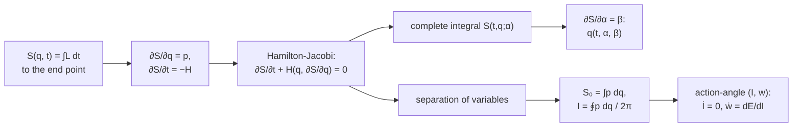
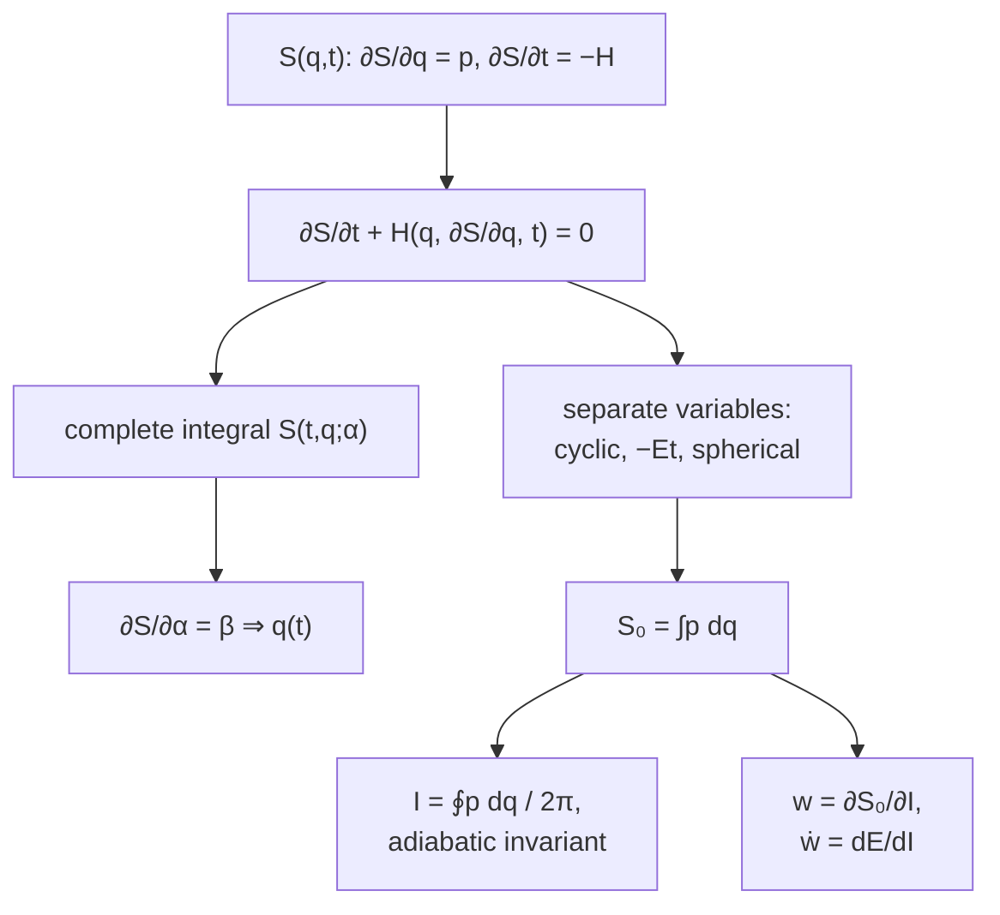

# CM11 · Hamilton-Jacobi Theory and Action-Angle Variables

◀ [[CM10 Liouville's Theorem and Canonical Transformations]] · [[Classical Mechanics - Course Map]]

in course overview extra · book extra · beyond

> [!warning] Source status (every citation below was read in this session)
> Overview block 4: "Hamilton-Jacobi equation and its solution and some ideas of Action-angle variables". No IISERP lecture notes exist in the folder.
>
> **Read directly:** Landau-Lifshitz Vol. 1 §43 (the action as a function of the coordinates, printed pp. 138-140), §47 (the Hamilton-Jacobi equation, pp. 147-149), §48 (separation of the variables, pp. 149-152: the general method, the cyclic coordinate, spherical coordinates, and the opening of the parabolic-coordinate example), §49 from p. 155 (adiabatic invariants: the averaging argument, $I=\oint p\,dq/2\pi$, the oscillator), §50 (canonical variables, pp. 157-158). On these pages the running headers give pdf = printed + 29. **Not cited because not read:** the first page of §49 (p. 154), the end of §48 (parabolic coordinates beyond (48.15)) and the problems of §48-§50, §51-§52. The garbled printed formula (48.9) is checked below by quadrature.

> [!syllabus] Syllabus map
> 🟢 **In course overview** (block 4): §1 the Hamilton-Jacobi equation and its complete integral, §2 separation of variables, §3 action-angle variables ("some ideas").
>
> 🟡 **Extra · book**: §3 adiabatic invariants (LL §49), the pendulum's action and frequency.
>
> 🔵 **Extra · beyond (mine)**: numerical checks of the Hamilton-Jacobi solutions (oscillator, Kepler), the pendulum's $I(E)$ and $\omega=dE/dI$ against the elliptic-integral period, adiabatic invariance under a frequency ramp, `scripts/cm11_numbers.py`, `scripts/fig_cm11.py`, and an interactive tool.

> [!key] After this chapter you can
> - state that $\partial S/\partial q=p$ and $\partial S/\partial t=-H$ for the action as a function of its end point, and so write the **Hamilton-Jacobi equation** $\partial S/\partial t+H(q,\partial S/\partial q,t)=0$,
> - use a **complete integral** $S(t,q;\alpha)$ as the generating function of a canonical transformation to constants of motion and so solve the motion by $\partial S/\partial\alpha_i=\beta_i$,
> - **separate variables** (cyclic coordinates, time, spherical coordinates) and reduce the solution to quadratures,
> - define the **adiabatic invariant** $I=\frac1{2\pi}\oint p\,dq$ and the canonical **action-angle variables** $(I,w)$, with $\dot I=0$, $\dot w=\omega(I)=dE/dI$.

> [!intuition] The one-sentence story
> The action of the true path, regarded as a function of where it ends, is a wave-like function on configuration space whose gradient is the momentum and whose time derivative is minus the energy; finding that function solves mechanics. A complete solution is a canonical transformation to variables in which nothing moves ($H'=0$), so the old coordinates are read off from the constants. For a periodic system the best constants are the **action** (the area of the orbit in phase space, $2\pi I$), which stays constant even when the system is changed slowly, and the **angle** that increases uniformly at the frequency $dE/dI$.

## 1. The action as a function of the coordinates (LL §43)
taught

So far the action $S=\int_{t_1}^{t_2}L\,dt$ was compared for neighbouring paths with the same end points. Now regard $S$ as a property of the **true** path (a solution of Lagrange's equations) and compare paths that start at the same point $q^{(1)}$ but end at different points $q^{(2)}=q$ at the time $t$: $S=S(q,t)$. The variation of the action between two such neighbouring true paths is, since the integral of the Lagrange-equation bracket vanishes and only the end-point term survives, $\delta S=p\,\delta q$ or in general (43.2)

$$\delta S=\sum_ip_i\,\delta q_i\qquad\Longrightarrow\qquad\frac{\partial S}{\partial q_i}=p_i\ \ (43.3).$$

For the time derivative: along the path $dS/dt=L$ (43.4), while regarding $S$ as a function of $q$ and $t$, $dS/dt=\partial S/\partial t+\sum\frac{\partial S}{\partial q_i}\dot q_i=\partial S/\partial t+\sum p_i\dot q_i$. Comparing, $\partial S/\partial t=L-\sum p_i\dot q_i$, i.e. (43.5)

$$\frac{\partial S}{\partial t}=-H,\qquad dS=\sum_ip_i\,dq_i-H\,dt\ \ (43.6).$$

If the beginning of the path is also varied (43.7), $dS=\sum p_i^{(2)}dq_i^{(2)}-H^{(2)}dt^{(2)}-\sum p_i^{(1)}dq_i^{(1)}+H^{(1)}dt^{(1)}$. LL remark that this expression must be a perfect differential for every possible motion: **the principle of least action restricts which final states can follow from which initial states**, independently of the form of the Lagrangian (the result used in CM10 to identify $-S$ as the generating function of the flow).

## 2. The Hamilton-Jacobi equation (LL §47)
taught

Replace the momenta in $H$ by $\partial S/\partial q$ in $\partial S/\partial t=-H$: (47.1)

$$\boxed{\frac{\partial S}{\partial t}+H\!\left(q_1,\dots,q_s;\frac{\partial S}{\partial q_1},\dots,\frac{\partial S}{\partial q_s};t\right)=0}$$

a first-order partial differential equation for $S(q,t)$, "the basis of a general method of integrating the equations of motion" (LL). Every first-order PDE has a **general integral** (containing an arbitrary function), but in mechanics the **complete integral** matters: one with as many arbitrary constants as independent variables, here $s+1$ ($s$ coordinates and time). Since $S$ enters only through its derivatives one constant is additive:

$$S=f(t,q_1,\dots,q_s;\alpha_1,\dots,\alpha_s)+A\qquad(47.2).$$

**How it solves the motion.** Make a canonical transformation from $(q,p)$ to new variables taking $f(t,q;\alpha)$ as the generating function and the constants $\alpha_i$ as the new momenta; the new coordinates are $\beta_i$. By (45.8), $p_i=\partial f/\partial q_i$, $\beta_i=\partial f/\partial\alpha_i$, $H'=H+\partial f/\partial t$. But $f$ satisfies (47.1), so $H'=H+\partial S/\partial t=0$. Hamilton's equations in the new variables are $\dot\alpha_i=0$, $\dot\beta_i=0$ (47.3): **all the new variables are constants.** The $s$ equations $\partial f/\partial\alpha_i=\beta_i$ (47.4) can be solved for $q_i(t;\alpha,\beta)$, the general solution with its $2s$ constants; then $p_i=\partial S/\partial q_i$.

**Recipe** (LL). Form (47.1) from $H$; find a complete integral; differentiate with respect to the constants $\alpha$ and set the results equal to new constants $\beta$ (47.4); solve for $q(t)$; get $p=\partial S/\partial q$. An incomplete integral with fewer than $s$ constants gives only some relations among $q_i$ and $t$.

**Conservative systems.** If $H$ does not depend on $t$, the time enters only through $-Et$ (47.5): $S=S_0(q)-Et$, and the abbreviated action satisfies (47.6)

$$H\!\left(q_1,\dots,q_s;\frac{\partial S_0}{\partial q_1},\dots,\frac{\partial S_0}{\partial q_s}\right)=E.$$

## 3. Separation of variables (LL §48)
taught

A complete integral can often be found by **separating variables**. Suppose a coordinate $q_1$ and its derivative $\partial S/\partial q_1$ enter the Hamilton-Jacobi equation only through a combination $\phi(q_1,\partial S/\partial q_1)$ (48.1). Try $S=S'(q_{\rm rest},t)+S_1(q_1)$ (48.2). Substituting gives (48.3) an equation which must hold for every value of $q_1$; since $q_1$ appears only in $\phi$, $\phi$ must be a constant:

$$\phi\!\left(q_1,\frac{dS_1}{dq_1}\right)=\alpha_1,\qquad\text{and the rest}=\alpha_1\ \text{(an equation with fewer variables)}\qquad(48.4),(48.5).$$

The first is an ordinary differential equation integrated by quadrature. If all $s$ coordinates separate in a conservative system, the complete integral is (48.6) $S=\sum_kS_k(q_k;\alpha_1,\dots,\alpha_s)-E(\alpha_1,\dots,\alpha_s)\,t$, the energy being obtained by inserting $S_0=\sum S_k$ in (47.6). **A cyclic coordinate** $q_1$ is a special case: $\phi=\partial S/\partial q_1$, so $S_1=\alpha_1q_1$ and (48.7) $S=S'(q_{\rm rest},t)+\alpha_1q_1$ with $\alpha_1=p_1$ the constant momentum. The $-Et$ term is the separation of the "cyclic variable" $t$. All the simplifications by cyclic variables of the earlier chapters are therefore special cases of separation, and (LL) **the Hamilton-Jacobi method is the most powerful method of finding the general integral**.

**Spherical coordinates (LL example 1).** The Hamiltonian is $H=\frac1{2m}\left(p_r^2+\frac{p_\theta^2}{r^2}+\frac{p_\phi^2}{r^2\sin^2\theta}\right)+U$. The variables separate for $U=a(r)+b(\theta)/r^2+c(\phi)/(r^2\sin^2\theta)$; LL take $U=a(r)+b(\theta)/r^2$ (48.8). Since $\phi$ is cyclic put $S_0=p_\phi\phi+S_1(r)+S_2(\theta)$:

$$\left(\frac{dS_2}{d\theta}\right)^2+2mb(\theta)+\frac{p_\phi^2}{\sin^2\theta}=\beta,\qquad\frac1{2m}\left(\frac{dS_1}{dr}\right)^2+a(r)+\frac{\beta}{2mr^2}=E,$$

and integrating, (48.9)

$$S=-Et+p_\phi\phi+\int\sqrt{\beta-2mb(\theta)-\frac{p_\phi^2}{\sin^2\theta}}\,d\theta+\int\sqrt{2m[E-a(r)]-\frac\beta{r^2}}\,dr.$$

The constants are $p_\phi$, $\beta$ and $E$; differentiating with respect to them and setting the results equal to new constants gives the general solution.

> [!example] Worked example 1: a free particle and the oscillator (🔵 checked)
> **Free particle**, $H=p^2/2m$: $S=-Et+\sqrt{2mE}\,q$ with $\alpha=p=\sqrt{2mE}$ gives $S=pq-\dfrac{p^2}{2m}t$; (47.4) $\beta=\partial S/\partial p=q-pt/m$, so $q=\beta+pt/m$. **Harmonic oscillator**, $H=p^2/2m+\tfrac12m\omega^2q^2$: (47.6) $S_0=\int\sqrt{2mE-m^2\omega^2q^2}\,dq$ and $\beta=\partial S/\partial E=\int\dfrac{m\,dq}{\sqrt{2mE-m^2\omega^2q^2}}-t$, i.e. $t+\beta=\dfrac1\omega\arcsin\dfrac qA$ with $A=\sqrt{2E/m\omega^2}$: $q=A\sin\omega(t+\beta)$, the exact motion. Numerically ($m=1$, $\omega=2$, $E=3$, $A=1.224745$): the integral at $q=0.4,0.9,1.2$ is $0.166351,\ 0.412720,\ 0.684719$, identical to $\frac1\omega\arcsin(q/A)$ (`cm11_numbers.py` §1).

> [!example] Worked example 2: Kepler's problem by Hamilton-Jacobi (🔵 numerical check of (48.9))
> Take $a(r)=-k/r$ and $b=0$ in (48.9). The $\theta$-equation then says $p_\theta^2+p_\phi^2/\sin^2\theta=\beta$, so $\beta=M^2$ is the squared total angular momentum, and $S=-Et+p_\phi\phi+\dots+\int\sqrt{2m(E+k/r)-M^2/r^2}\,dr$. The orbit follows from $\partial S/\partial M=$ const; in the orbital plane this gives $\phi-\phi_0=\int\dfrac{M\,dr}{r^2\sqrt{2m(E+k/r)-M^2/r^2}}$. For $m=k=1$, $E=-0.3$, $M=1.1$: the conic parameters are $p=M^2/mk=1.21$, $e=\sqrt{1+2EM^2/mk^2}=0.52345$, $r_{\min}=0.79425$, $r_{\max}=2.53908$, and the quadrature from $r_{\min}$ gives $\phi-\phi_0=0.852600,\ 1.703444,\ 2.247450,\ 2.605441$ at $r=0.90,1.30,1.80,2.20$, exactly equal to $\arccos\!\big[(p/r-1)/e\big]$ at the same radii (`cm11_numbers.py` §2). So the HJ orbit is the conic $p/r=1+e\cos(\phi-\phi_0)$ ([[CM04 Central Forces and Effective One-Dimensional Motion]]).

## 4. Adiabatic invariants (LL §49)
extra · book

Let a one-dimensional system have a Hamiltonian $H(q,p;\lambda)$ with a parameter $\lambda(t)$ that varies **slowly** compared with the period of the motion. If $\lambda$ were constant the motion would be periodic with energy $E$ and period $T(E)$; with $\lambda(t)$ the energy changes, $dE/dt=\dfrac{\partial H}{\partial\lambda}\dot\lambda$ (49.2). Averaging over a period (taking the slowly varying $\dot\lambda$ outside) and over the unperturbed motion (49.3)-(49.5), then using two identities (replace $dt$ by $dq/(\partial H/\partial p)$, and $\partial H/\partial\lambda\,/\,\partial H/\partial p=-\partial p/\partial\lambda$ at fixed $E$), LL arrive at $\overline{dI/dt}=0$ (49.6) with

$$I=\frac1{2\pi}\oint p\,dq\qquad(49.7),$$

the integral taken over the orbit for given $E$ and $\lambda$. **$I$ is the adiabatic invariant**: in the approximation of slow variation it stays constant. It is a function of $E$ and $\lambda$; its derivative gives the period, $dE/dI=\omega=2\pi/T$ (49.9). Geometrically $I$ is the **area enclosed by the phase path divided by $2\pi$**, $I=\iint dp\,dq/2\pi$ (49.10).

**Oscillator.** For $H=p^2/2m+\tfrac12m\omega^2q^2$ the phase path is an ellipse with semi-axes $\sqrt{2mE}$ and $\sqrt{2E/m\omega^2}$; its area divided by $2\pi$ is (49.12)

$$I=\frac E\omega.$$

So when the parameters of an oscillator vary slowly the **energy is proportional to the frequency**.

> [!example] Worked example 3: slow versus fast ramps (🔵 integrations)
> $H=p^2/2+\tfrac12\omega(t)^2q^2$ with $\omega$ ramped linearly from $1$ to $2$ over a time $\tau$, then constant; $I=E/\omega$ is measured over a period after the ramp, for 8 initial phases (`cm11_numbers.py` §4, Fig. CM11.1 C):
>
> | ramp time $\tau$ | $E_f/E_0$ (mean) | $I_f/I_0$: mean | range over initial phases |
> |---|---|---|---|
> | $2$ | $2.0234$ | $1.0117$ | $[0.866,\ 1.157]$ |
> | $10$ | $2.0023$ | $1.0012$ | $[0.954,\ 1.049]$ |
> | $50$ | $2.0001$ | $1.0000$ | $[0.9918,\ 1.0083]$ |
> | $300$ | $2.0000$ | $1.0000$ | $[0.9984,\ 1.0016]$ |
>
> The energy doubles (it follows $\omega$) while the action returns to its original value as the ramp slows: the spread shrinks roughly like $1/\tau$.

## 5. Canonical variables: action and angle (LL §50)
extra · book

Now hold $\lambda$ constant (a closed system) and transform to variables with $I$ as the new "momentum". The generating function is the abbreviated action $S_0(q,E;\lambda)=\int p(q,E;\lambda)\,dq$ (50.1); since $I$ depends on $E$ alone, $S_0$ may be written $S_0(q,I;\lambda)$ and $(\partial S_0/\partial q)_E=(\partial S_0/\partial q)_I$. By (45.8):

$$p=\frac{\partial S_0(q,I;\lambda)}{\partial q}\ \ (50.2),\qquad w=\frac{\partial S_0(q,I;\lambda)}{\partial I}\ \ (50.3).$$

$I$ is the **action variable**, $w$ the **angle variable**. $S_0$ is time-independent, so the new Hamiltonian is the energy as a function of the action, $H'=E(I)$, and (50.4)-(50.5)

$$\dot I=0,\qquad\dot w=\frac{dE(I)}{dI}=\omega(I)\ \Longrightarrow\ w=\omega(I)\,t+\text{const}:$$

the angle is the phase of the oscillation. $S_0$ is many-valued: over a period it increases by $\Delta S_0=2\pi I$ (50.6) and so $\Delta w=\partial(\Delta S_0)/\partial I=2\pi$ (50.7). Conversely any single-valued function $F(q,p)$ expressed through $(I,w)$ is **periodic in $w$ with period $2\pi$**. If $\lambda$ depends on time, the same formulae (50.2)-(50.3) define the transformation with $S_0$ evaluated as if $\lambda$ were fixed and then replaced by $\lambda(t)$; $S_0$ now depends explicitly on $t$, and (50.8) $H'=E(I;\lambda)+\partial S_0/\partial t=E(I;\lambda)+\dfrac{\partial S_0}{\partial\lambda}\dot\lambda$.

> [!example] Worked example 4: the oscillator in action-angle form (🔵) and the pendulum (🔵 numerics)
> **Oscillator.** $S_0(q,I)=\int\sqrt{2m\omega I-m^2\omega^2q^2}\,dq$ and $w=\partial S_0/\partial I=\int\dfrac{m\omega\,dq}{\sqrt{2m\omega I-m^2\omega^2q^2}}=\arcsin\!\Big(q\sqrt{m\omega/2I}\Big)$: $q=\sqrt{2I/m\omega}\,\sin w$, $p=\sqrt{2m\omega I}\cos w$, $E=\omega I$, $\dot w=\omega$: the transformation of [[CM10 Liouville's Theorem and Canonical Transformations]] §1 (there $P=I$, $Q=w$). For $m=1$, $\omega=2$, $E=3$: $I=1.5$ and the orbit area is $2\pi I=9.4248$.
>
> **Pendulum**, $H=p^2/2-\cos q$ ($ml^2=1$, $g/l=1$): $I(E)=\frac1{2\pi}\oint p\,dq=\frac1\pi\int_{-q_0}^{q_0}\sqrt{2(E+\cos q)}\,dq$ by quadrature; the frequency $\omega=dE/dI$ computed by differencing equals $\pi/2K(k)$ with $k=\sin(\theta_0/2)$ to six digits (`cm11_numbers.py` §3, Fig. CM11.1 B):
>
> | amplitude | $E$ | $I$ | $\omega=dE/dI$ | $\pi/2K(k)$ |
> |---|---|---|---|---|
> | $20^\circ$ | $-0.93969$ | $0.060537$ | $0.992389$ | $0.992389$ |
> | $60^\circ$ | $-0.50000$ | $0.517316$ | $0.931808$ | $0.931808$ |
> | $90^\circ$ | $0$ | $1.078705$ | $0.847213$ | $0.847213$ |
> | $120^\circ$ | $0.50000$ | $1.711048$ | $0.728396$ | $0.728396$ |
>
> For small amplitude $I\to E+1$ (the oscillator value $E/\omega$ measured from the bottom).

![[fig_cm11_actionangle.png|940]]
*Figure CM11.1. A: pendulum orbits of amplitudes $40^\circ,90^\circ,140^\circ$; the shaded area divided by $2\pi$ is the action $I$; the dashed curve is the separatrix. B: $E+1$ and $\omega=dE/dI=\pi/2K$ against $I$. C: a frequency ramp $\omega:1\to2$ of duration $3$ and $60$: $E$ doubles in both, $I=E/\omega$ is conserved for the slow ramp and wobbles for the fast one.*

> [!note] Interactive tool
> The tool below ramps the frequency of an oscillator at a speed you choose and shows $E/E_0$, $\omega$ and $I/I_0$ together with the phase-space orbit whose area is $2\pi I$.

<!-- interactive:start (generated by scripts/embed_interactive.py; edit the tool in scripts/interactive/tools/, not this block) -->
> [!interactive]+ Interactive: Adiabatic invariants and the action variable: the energy changes, the phase-space area does not
> An oscillator whose frequency ω(t) is slowly ramped from ω₁ to ω₂.
>
> ![[cm11_adiabatic_action.png|720]]
>
> **Try:** ω: 1 → 2. Ramp time τ = 300: E ends at 2.0000 E₀ and I/I₀ stays within ±0.2 % of 1. τ = 2 (a fast ramp): I/I₀ ranges over about 0.87–1.16 depending on the phase at which the ramp starts. The orbit keeps the same area while it changes shape (it becomes a thinner ellipse).
>
> [▶ Open the tool in your browser](../Assets/interactive/cm11_adiabatic_action.html) · [absolute link](file:///home/swastik/Documents/notes/Assets/interactive/cm11_adiabatic_action.html) · all tools and coverage: [[Interactive Tools]]

<!-- interactive:end -->

## Map of this chapter

## Common mistakes
1. Confusing the **action as a functional** (integral of $L$ over a path) with the **action function** $S(q,t)$ of the end point: $\partial S/\partial q=p$ holds only for the latter.
2. Forgetting the additive constant and the $-Et$ term: a complete integral for $s$ degrees of freedom has $s$ separation constants $\alpha_i$ plus the additive one, and for a conservative system the energy is one function of the $\alpha$'s.
3. Using $\partial S/\partial\alpha_i=\beta_i$ without remembering the $\beta_i$ are new constants: that is how the time dependence enters (through the $-Et$ term).
4. Treating the adiabatic invariant as exact: $I$ is conserved only up to terms that vanish as the parameter varies more slowly (the table above: spread $\sim1/\tau$).
5. Using $I=E/\omega$ for anharmonic systems: it holds for the oscillator; in general $I(E)$ is the area integral (49.7), e.g. the pendulum.
6. Reading the angle variable as a physical angle: it is the phase, increasing by $2\pi$ per period.

## Summary
- $\partial S/\partial q=p$, $\partial S/\partial t=-H$; $\partial S/\partial t+H(q,\partial S/\partial q,t)=0$; complete integral $S=f(t,q;\alpha)+A$; $\partial S/\partial\alpha_i=\beta_i$ gives $q(t)$; conservative: $S=S_0-Et$, $H(q,\partial S_0/\partial q)=E$.
- Separation: $\phi(q_1,S_1')=\alpha_1$; cyclic coordinate $S=\alpha_1q_1+\dots$; spherical (48.9) with constants $p_\phi,\beta,E$.
- Adiabatic invariant $I=\oint p\,dq/2\pi=$ phase-space area$/2\pi$; oscillator $I=E/\omega$; $dE/dI=\omega$.
- Action-angle: $p=\partial S_0/\partial q$, $w=\partial S_0/\partial I$, $H'=E(I)$, $\dot I=0$, $\dot w=\omega(I)$, $\Delta w=2\pi$.
- Numbers: oscillator $q=A\sin\omega(t+\beta)$ from the HJ integral; Kepler HJ orbit $p/r=1+e\cos\phi$ to 6 digits; pendulum $\omega=dE/dI=\pi/2K$; ramp $\omega:1\to2$ gives $I_f/I_0\in[0.9984,1.0016]$ at $\tau=300$.

## Practice
> [!question]- P1. Free particle by Hamilton-Jacobi
> Solve $H=p^2/2m$ with the HJ method.
>
> **Solution.** Worked example 1: $S=pq-p^2t/2m$ with $\alpha=p$; $\beta=\partial S/\partial p=q-pt/m$, so $q=\beta+pt/m$ and $p=\partial S/\partial q$ is constant.

> [!question]- P2. Uniform gravity
> $H=p^2/2m+mgz$. Find the abbreviated action and $z(t)$.
>
> **Solution.** (47.6): $S_0=\int\sqrt{2m(E-mgz)}\,dz=-\dfrac{(2m(E-mgz))^{3/2}}{3m^2g}$; $\partial S/\partial E=\int m\,dz/\sqrt{2m(E-mgz)}=-\dfrac{\sqrt{2m(E-mgz)}}{mg}=t+\beta$, giving $E-mgz=\tfrac12mg^2(t+\beta)^2$, i.e. $z=E/mg-\tfrac12g(t+\beta)^2$ ✓.

> [!question]- P3. Oscillator action
> Compute $I$ for $m=2$, $\omega=3$, $E=6$ and the period.
>
> **Solution.** $I=E/\omega=2$; the orbit area is $2\pi I=12.566$; period $2\pi/\omega=2.094$.

> [!question]- P4. Cyclic coordinate
> A system has $H=p_1^2/2m+p_2^2/2m+U(q_2)$. Write the complete integral.
>
> **Solution.** $q_1$ is cyclic: $S=-Et+\alpha_1q_1+\int\sqrt{2m(E-\alpha_1^2/2m-U(q_2))}\,dq_2$ with $\alpha_1=p_1$ (48.7).

> [!question]- P5. Adiabatic oscillator
> The frequency of an oscillator with energy $E_0$ slowly doubles. What is the final energy, and the final amplitude?
>
> **Solution.** $I=E/\omega$ constant: $E=2E_0$. Amplitude $A=\sqrt{2E/m\omega^2}$: $A\propto\sqrt{E}/\omega=\sqrt{2}/2$ times the original: $A_f=A_0/\sqrt2$.

> [!question]- P6. Pendulum length
> A pendulum's string is slowly shortened to a quarter of its length. How do amplitude and energy of a small oscillation change?
>
> **Solution.** $I=E/\omega$ with $\omega=\sqrt{g/l}$ doubling: $E_f=2E_0$ (for the same mass). Small amplitude $\theta_0$: $E=\tfrac12mgl\theta_0^2$; $E\propto l\theta_0^2$ with $l\to l/4$: $E_f/E_0=\tfrac14(\theta_f/\theta_0)^2=2\Rightarrow\theta_f=2\sqrt2\,\theta_0$.

> [!question]- P7. Area of the orbit
> Show that the area enclosed by the phase path equals $2\pi I$.
>
> **Solution.** $\oint p\,dq$ is the area enclosed by the closed curve in the $(q,p)$ plane (Green's theorem); dividing by $2\pi$ gives (49.7)/(49.10).

> [!question]- P8. Angle variable
> Show $\dot w=\omega(I)$ and that $w$ increases by $2\pi$ per period.
>
> **Solution.** $H'=E(I)$ gives $\dot w=\partial H'/\partial I=dE/dI$ (50.4); with $I=\oint p\,dq/2\pi$, $dI/dE=T/2\pi$ (49.9), so $\dot w=2\pi/T$ and $\Delta w=2\pi$ per period (50.7).

> [!question]- P9. Pendulum action at small amplitude
> Check $I\approx E+1$ for small amplitude using the table.
>
> **Solution.** Amplitude $20^\circ$: $E+1=0.060307$, $I=0.060537$ (relative difference $0.4\,\%$, a second-order anharmonic correction).

> [!question]- P10. Separatrix action
> Estimate $I$ at the pendulum's separatrix ($E=1$).
>
> **Solution.** $I=\frac1\pi\int_{-\pi}^{\pi}\sqrt{2(1+\cos q)}\,dq=\frac1\pi\int2\cos(q/2)\,dq=\frac1\pi[4\sin(q/2)]_{-\pi}^{\pi}=8/\pi=2.5465$, the endpoint of the plot in Fig. CM11.1 B; $\omega=dE/dI\to0$ (infinite period).

> [!question]- P11. Spherical coordinates
> In (48.9) what is the physical meaning of $\beta$ when $b=0$?
>
> **Solution.** $\beta=p_\theta^2+p_\phi^2/\sin^2\theta$ is the squared magnitude of the angular momentum, $M^2$ (conserved for a central field).

> [!question]- P12. HJ for the Kepler orbit
> Show from (48.9) that $r_{\min},r_{\max}$ are the roots of $2m(E+k/r)=M^2/r^2$.
>
> **Solution.** The radial integrand $\sqrt{2m(E+k/r)-M^2/r^2}$ vanishes at the turning points; for $m=k=1$, $E=-0.3$, $M=1.1$: $0.79425$ and $2.53908$ (worked example 2).

> [!question]- P13. A time-dependent Hamiltonian
> $H=p^2/2m+\tfrac12m\omega^2(t)q^2$ is not conservative. How does the HJ method change?
>
> **Solution.** There is no $-Et$ separation; $S$ depends on $t$ through the full (47.1). If $\omega(t)$ varies slowly, the adiabatic result $E\propto\omega$ (49.12) gives the approximate solution (CM11 table).

> [!question]- P14. Two invariants
> Does the derivation above give an adiabatic invariant for $s>1$ degrees of freedom?
>
> **Solution.** No: the averaging argument of §49 as read here is for one degree of freedom (a single closed phase path). For several degrees of freedom the corresponding statements need separable, conditionally periodic motion, which is outside what was read for this chapter.

> [!question]- P15. Generating function check
> For the oscillator verify $p=\partial S_0/\partial q$ gives the correct $p$.
>
> **Solution.** $S_0=\int\sqrt{2m\omega I-m^2\omega^2q^2}\,dq$, so $\partial S_0/\partial q=\sqrt{2m\omega I-m^2\omega^2q^2}=\sqrt{2mE-m^2\omega^2q^2}=p$ ✓.

## Zettel notes
<!-- zettel:start -->
<!-- zettel:end -->

## Provenance
> [!provenance]- Source map for this chapter (all rows read in this session)
> | Topic | Source | Scope |
> |---|---|---|
> | $\delta S=\sum p\,\delta q$, $\partial S/\partial q=p$, $\partial S/\partial t=-H$, $dS$ (43.2)-(43.7) | LL Vol. 1 §43, pp. 138-139 | in overview |
> | Hamilton-Jacobi equation, complete integral, (47.1)-(47.6) | LL §47, pp. 147-149 | in overview |
> | separation of variables (48.1)-(48.7), spherical-coordinate example (48.8)-(48.9) | LL §48, pp. 149-151 | in overview |
> | adiabatic invariants (49.2)-(49.7), (49.9), (49.10), oscillator (49.12) | LL §49, pp. 155-157 | extra/book |
> | canonical variables $I,w$ (50.1)-(50.8) | LL §50, pp. 157-158 | in overview |
> | oscillator and Kepler HJ checks, pendulum $I(E)$ and $\omega$, adiabatic ramp, figure, tool | `scripts/cm11_numbers.py`, `scripts/fig_cm11.py`, `Assets/interactive/cm11_adiabatic_action.html` | extra/beyond |
