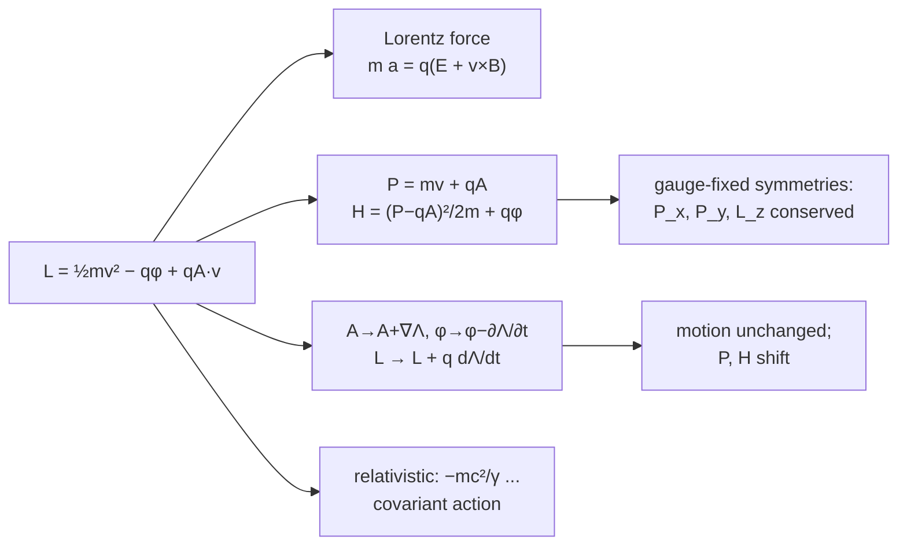
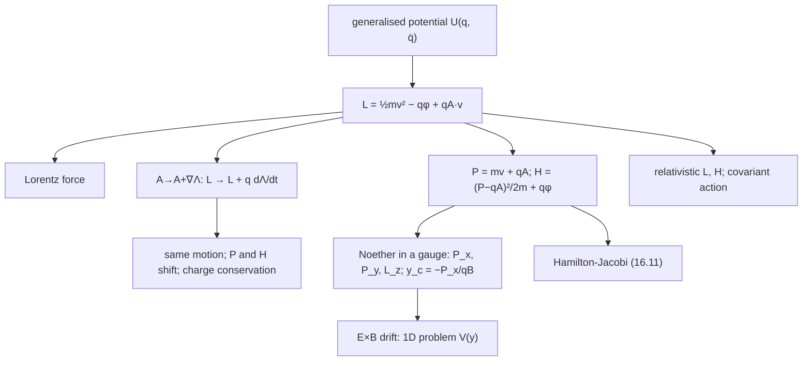

# CMX2 · The Electromagnetic Lagrangian and Gauge Symmetry

◀ [[CM11 Hamilton-Jacobi Theory and Action-Angle Variables]] · [[Classical Mechanics - Course Map]] · see also [[ED08 Potentials and Gauge Transformations]], [[ED11 Relativistic Electrodynamics]]

extra · book extra · beyond

> [!warning] Source status (every citation below was read in this session)
> This chapter is an extra (🟡): the PH2213 overview does not list it. **Sources:** Goldstein-Poole-Safko (3rd ed.; printed pp., pdf = printed + 19): §1.5 "Velocity-dependent potentials" pp. 22-23, Exercises 8-9 p. 31 (read from a rendering of the page), the example in §8.1 pp. 341-342, §7.9 pp. 314-315 ((7.140)-(7.142)), §7.10 pp. 322-323 ((7.165)-(7.168)), §8.4 pp. 350-351 ((8.55)-(8.56)); Landau-Lifshitz Vol. 1 §2 p. 4 (the Lagrangian is defined up to a total time derivative); Landau-Lifshitz Vol. 2 (*The Classical Theory of Fields*; printed = djvu page - 10) §16 "Four-potential of a field" pp. 47-49, §17 "Equations of motion of a charge in a field" pp. 49-52, §18 "Gauge invariance" pp. 52-53, the start of §19 p. 53; Jackson §12.1 pp. 579-584 (pdf = printed + 26); and, as a **credited supplement**, §1.5 of the student notes by Mahfooz Alam (IISER Kolkata, 2026), pp. 9-11, which carry the same derivation (not a primary source). **Units:** Goldstein §1.5, §7.9 and §8.1 and this chapter use SI ($L=\tfrac12mv^2-q\phi+q\mathbf A\cdot\mathbf v$); **Landau-Lifshitz Vol. 2 and Jackson Ch. 12 are Gaussian** (running header "-G": $L=\ldots+\tfrac ec\mathbf A\cdot\mathbf v-e\phi$): the dictionary here is $e\mathbf A/c\leftrightarrow q\mathbf A$, $e\phi\leftrightarrow q\phi$. Goldstein's Exercise 9 prints the Gaussian-style gauge pair $\phi\to\phi-\frac1c\partial\psi/\partial t$ although his text of §1.5 is SI ($\phi\to\phi-\partial\psi/\partial t$ in SI). **Not cited because not read:** Jackson §12.2 onwards (drifts, the field Lagrangian of §12.7), Goldstein §13 (field theory), LL2 §19 onwards. All numbers are computed in `scripts/cmx2_numbers.py` and marked 🔵.

> [!syllabus] Syllabus map
> 🟡 **Extra · book**: §1 the Lagrangian of a charge, §2 canonical momentum and Hamiltonian, §3 gauge invariance, §6 the relativistic and covariant forms and the Hamilton-Jacobi equation of a charge.
>
> 🔵 **Extra · beyond (mine)**: the symbolic check of the Lorentz force and of the gauge shift for generic potentials, the same orbit in three gauges with different canonical momenta, the physical meaning of the conserved canonical momenta ($P_x=-qBy_c$, $L_z=\frac{qB}2(R_c^2-\rho^2)$), the $\mathbf E\times\mathbf B$ drift as a one-dimensional problem, `scripts/cmx2_numbers.py`, `scripts/fig_cmx2.py`, an interactive tool.

> [!key] After this chapter you can
> - write $L=\tfrac12mv^2-q\phi+q\mathbf A\cdot\mathbf v$ and derive the Lorentz force from Lagrange's equations,
> - distinguish **canonical** $\mathbf P=m\mathbf v+q\mathbf A$ from **kinetic** momentum $m\mathbf v$, and write $H=(\mathbf P-q\mathbf A)^2/2m+q\phi$,
> - show that $\mathbf A\to\mathbf A+\nabla\Lambda$, $\phi\to\phi-\partial_t\Lambda$ changes $L$ by $q\,d\Lambda/dt$ and therefore changes $\mathbf P$ and $H$ but **not** the motion,
> - use a gauge symmetry (translation in $x$, rotation) to find conserved canonical momenta and interpret them physically,
> - state the relativistic Lagrangian $L=-mc^2/\gamma-q\phi+q\mathbf A\cdot\mathbf v$, Hamiltonian $H=c\sqrt{(\mathbf P-q\mathbf A)^2+m^2c^2}+q\phi$ and the covariant action.

> [!intuition] The one-sentence story
> A force that depends on velocity can still come from a Lagrangian if $U$ is allowed to depend on $\dot q$; the magnetic force does exactly this, $\mathbf A$ enters as a shift of the momentum ($\mathbf P=m\mathbf v+q\mathbf A$), and the freedom $\mathbf A\to\mathbf A+\nabla\Lambda$ is just the old freedom of adding a total time derivative to $L$, which changes what you call momentum but never what the particle does.

## 1. The Lagrangian of a charge (Goldstein §1.5, LL2 §16-§17, Alam §1.5)
extra · book

**Generalised potentials.** Lagrange's equations survive even when there is no potential energy $V(q)$ in the usual sense, provided the generalised forces come from a function $U(q_j,\dot q_j)$ by $Q_j=-\frac{\partial U}{\partial q_j}+\frac d{dt}\left(\frac{\partial U}{\partial\dot q_j}\right)$ (Goldstein 1.58), with $L=T-U$ (1.59): "a generalized potential, or velocity-dependent potential"; "it applies to one very important type of force field, namely the electromagnetic forces on moving charges".

**The charge.** A charge $q$ of mass $m$ moving at $\mathbf v$ in fields $\mathbf E,\mathbf B$ feels $\mathbf F=q[\mathbf E+\mathbf v\times\mathbf B]$ (1.60), with $\mathbf E=-\nabla\phi-\partial\mathbf A/\partial t$ (1.61a) and $\mathbf B=\nabla\times\mathbf A$ (1.61b). The force derives from the velocity-dependent potential energy $U=q\phi-q\mathbf A\cdot\mathbf v$ (1.62), so (1.63)

$$\boxed{L=\tfrac12mv^2-q\phi+q\mathbf A\cdot\mathbf v}$$

(Goldstein; Alam gives the same with $U=q\phi-q\mathbf v\cdot\mathbf A$; Landau-Lifshitz (16.9) in Gaussian units, $L=\frac{mv^2}2+\frac ecA\cdot v-e\phi$, as the low-velocity limit of (16.4)). **The Lorentz force from Lagrange's equations.** For the $x$ component, $\frac d{dt}\left(m\dot x+qA_x\right)=\frac{\partial L}{\partial x}=-q\frac{\partial\phi}{\partial x}+q\,\mathbf v\cdot\frac{\partial\mathbf A}{\partial x}$ (Goldstein 1.64); with the total derivative $\frac{dA_x}{dt}=\frac{\partial A_x}{\partial t}+\mathbf v\cdot\nabla A_x$ (1.65) and $\mathbf B=\nabla\times\mathbf A$ this becomes $m\ddot x=q[E_x+(\mathbf v\times\mathbf B)_x]$ (1.66), "identical to (1.60)". Landau-Lifshitz do it in vector form: $\frac{\partial L}{\partial\mathbf r}=\frac ec\nabla(\mathbf A\cdot\mathbf v)-e\nabla\phi$, expand $\nabla(\mathbf a\cdot\mathbf b)$ and use $\frac{d\mathbf A}{dt}=\frac{\partial\mathbf A}{\partial t}+(\mathbf v\cdot\nabla)\mathbf A$ to get (17.2) $\frac{d\mathbf p}{dt}=-\frac ec\frac{\partial\mathbf A}{\partial t}-e\nabla\phi+\frac ec\mathbf v\times{\rm curl}\,\mathbf A$, whose velocity-independent part is $e\mathbf E$ (17.3) and the other part $\frac ec\mathbf v\times\mathbf H$ with $\mathbf H={\rm curl}\,\mathbf A$ (17.4)-(17.5), "the Lorentz force". Two consequences: the rate of change of the kinetic energy is $\frac{d\mathcal E_{\rm kin}}{dt}=e\mathbf E\cdot\mathbf v$ (17.7), "work is done on the charge only by the electric field; the magnetic field does no work"; and (17.8)-(17.9) the equation of motion is invariant under $t\to-t$, $\mathbf E\to\mathbf E$, $\mathbf H\to-\mathbf H$ (so $\phi\to\phi$, $\mathbf A\to-\mathbf A$).

> [!example] Worked example 1: the Lorentz force for generic potentials, exactly (🔵)
> Take **random polynomial** potentials $\phi(x,y,z,t)$ and $A_i(x,y,z,t)$ with mixed terms (e.g. $xy$, $zt$, $x^2y$, $t^2$), build $L=\frac m2\dot{\mathbf r}^2-q\phi+q\mathbf A\cdot\dot{\mathbf r}$, apply the Euler-Lagrange operator $\frac d{dt}\frac{\partial L}{\partial\dot x_i}-\frac{\partial L}{\partial x_i}$ and subtract $m\ddot x_i-q(E_i+(\mathbf v\times\mathbf B)_i)$ with $\mathbf E,\mathbf B$ computed from the potentials: the residual simplifies to exactly $0$ for $x$, $y$ and $z$ (`cmx2_numbers.py` §1, sympy). So no assumption (static, uniform, small velocity) enters the derivation.

## 2. Canonical momentum and the Hamiltonian (Goldstein §8.1, LL2 §16, Jackson §12.1)
extra · book

With Cartesian coordinates the canonical momentum is (Goldstein (8.33); Alam)

$$\mathbf P=\frac{\partial L}{\partial\mathbf v}=m\mathbf v+q\mathbf A,\qquad H=\mathbf P\cdot\mathbf v-L=\frac{(\mathbf P-q\mathbf A)^2}{2m}+q\phi\ \ (8.34)\text{-}(8.35),$$

"the total energy of the particle" because "the potential energy in an electromagnetic field is determined by $\phi$ alone" (Goldstein; the term linear in the velocities, $q\mathbf A\cdot\mathbf v$, makes $H\ne T+V$ in form but not in value); Landau-Lifshitz (16.10) in Gaussian form $H=\frac1{2m}(\mathbf P-\frac ec\mathbf A)^2+e\phi$ with $\mathbf p=m\mathbf v=\mathbf P-\frac ec\mathbf A$. "The mechanical momentum $m\mathbf v$ differs from the canonical momentum due to the field contribution" (Alam). Hamilton's equations in the gauge you chose: $\dot{\mathbf r}=\frac{\mathbf P-q\mathbf A}m$, $\dot P_i=\frac qm\sum_j(P_j-qA_j)\frac{\partial A_j}{\partial x_i}-q\frac{\partial\phi}{\partial x_i}$ (my expansion of $-\partial H/\partial x_i$), the form used in the interactive tool. Goldstein remarks that Hamilton's equations treat $q$ and $p$ asymmetrically (the minus sign) and introduces the symplectic matrix notation (8.36)-(8.40) used in CM09-CM10.

## 3. Gauge invariance (Goldstein Ex. 1.9, LL1 §2, LL2 §18, Jackson §12.1)
extra · book

Landau-Lifshitz Vol. 1 §2: if two Lagrangians differ by a total time derivative $\frac{df(q,t)}{dt}$, the actions "differ by a quantity which gives zero on variation, so that the conditions $\delta S'=0$ and $\delta S=0$ are equivalent, and the form of the equations of motion is unchanged. Thus the Lagrangian is defined only to within an additive total time derivative of any function of co-ordinates and time" (Goldstein Exercise 8: $L'=L+\frac{dF(q_1,\ldots,q_n,t)}{dt}$ also satisfies Lagrange's equations). **Now the potentials.** Goldstein's Exercise 9 asks: under the gauge transformation $\mathbf A\to\mathbf A+\nabla\psi$, $\phi\to\phi-\partial\psi/\partial t$ (SI form), "what effect does this have on the Lagrangian of a particle moving in the electromagnetic field? Is the motion affected?" The answer (Alam's derivation, here with $\Lambda$ for the gauge function):

$$L'=\tfrac12mv^2+q(\mathbf A+\nabla\Lambda)\cdot\mathbf v-q\left(\phi-\frac{\partial\Lambda}{\partial t}\right)=L+q\left(\frac{\partial\Lambda}{\partial t}+\mathbf v\cdot\nabla\Lambda\right)=L+q\frac{d\Lambda}{dt},$$

so $S'=S+q\Lambda\big|_{t_1}^{t_2}$, a boundary term, $\delta S'=\delta S$ and the equations of motion are unchanged. Landau-Lifshitz (§18): the field is characterised by its effect on a charge, which involves only $\mathbf E$ and $\mathbf H$, so potentials that give the same $\mathbf E,\mathbf H$ are physically identical; adding $-\partial f/\partial x^k$ to $A_k$ (18.1) adds to the action (16.1) the term $\frac ec\int\frac{\partial f}{\partial x^k}dx^k=\frac ec\,df$ (18.2), "a total differential and has no effect on the equations of motion"; in three-dimensional form $\mathbf A'=\mathbf A+{\rm grad}\,f$, $\phi'=\phi-\frac1c\frac{\partial f}{\partial t}$ (18.3). "Only those quantities have physical meaning which are invariant with respect to the transformation (18.3)... This invariance is called gauge invariance." In a footnote: the gauge invariance of electrodynamics and the **conservation of charge** "are closely related", since (18.2) is a total differential only because $e$ is constant. They also note that one can always choose $\phi=0$ (since one function $f$ is free), but not $\mathbf A=0$ (three conditions). Jackson (p. 583): the equations of motion are invariant, the Lagrangian involving the potentials explicitly is **not**, "in spite of this lack of invariance of $L$ it can be shown (Problem 12.2) that the change is a total time derivative".

**What changes and what does not** (my derivation, verified symbolically below):

| quantity | under $\mathbf A\to\mathbf A+\nabla\Lambda$, $\phi\to\phi-\partial_t\Lambda$ |
|---|---|
| $\mathbf E,\mathbf B$, trajectory, $m\mathbf v$ (kinetic momentum), kinetic energy | unchanged |
| $L$ | $L+q\,d\Lambda/dt$ |
| canonical momentum $\mathbf P=m\mathbf v+q\mathbf A$ | $\mathbf P+q\nabla\Lambda$ |
| energy function $H=\mathbf P\cdot\mathbf v-L$ | $H-q\,\partial\Lambda/\partial t$ |

so with a **static** $\Lambda$ the value of $H$ is gauge-independent while $\mathbf P$ is not, and with a time-dependent $\Lambda$ even the value of $H$ changes.

> [!example] Worked example 2: three gauges, one orbit (🔵)
> (i) Exact (sympy, random polynomial potentials and a random polynomial $\Lambda$; `cmx2_numbers.py` §2): $L'-L-q\,d\Lambda/dt=0$; the Euler-Lagrange expressions of $L'$ and $L$ differ by $0$ in all three components; $\mathbf P'-\mathbf P-q\nabla\Lambda=0$; $h'-h=-q\,\partial\Lambda/\partial t$ exactly. (ii) Numerics: a proton in $B=1$ T and $E=10^5$ V/m (along $y$), launched with kinetic velocity $(3,1)\times10^4$ m/s from the origin; Hamilton's equations integrated in the **canonical** variables for the Landau-$x$ gauge $\mathbf A=(-By,0,0)$, the Landau-$y$ gauge $\mathbf A=(0,Bx,0)$ and the symmetric gauge $\mathbf A=\frac B2(-y,x,0)$, each with and without the extra gauge term $\lambda\nabla(xy)$ ($\lambda=0.7$). Over 20 cyclotron periods the orbits differ from the Landau-$x$ orbit by at most $7\times10^{-15}$ of the orbit size in all six cases, while the range of the canonical $P_x$ is $0$, $2.4\times10^{-22}$, $1.2\times10^{-22}$ kg m/s (and with $\lambda$: $1.7,\,4.0,\,2.8\times10^{-22}$): the momentum depends on the gauge, the motion does not. The mean drift is $1.000000\times10^5$ m/s $=E/B$.

## 4. Conserved canonical momenta: Noether in a chosen gauge (CM03 link)
extra · beyond

A gauge in which the potentials do not depend on a coordinate gives a conserved canonical momentum (cyclic coordinate, CM03). **Uniform $\mathbf B=B\hat{\mathbf z}$:** in the Landau-$x$ gauge $\mathbf A=(-By,0,0)$ the Hamiltonian $H=\frac{(P_x+qBy)^2+P_y^2}{2m}$ does not contain $x$, so $P_x=m\dot x-qBy$ is conserved; it fixes the **guiding centre**: from $m\ddot x=qB\dot y$ one has $\dot x=\omega(y-y_c)$ with $\omega=qB/m$, hence

$$P_x=-qB\,y_c,\qquad y_c=-\frac{P_x}{qB}\ \ \text{(the $y$ coordinate of the centre of the circle)}.$$

The Landau-$y$ gauge $\mathbf A=(0,Bx,0)$ conserves $P_y$ and fixes $x_c$ analogously. In the **symmetric gauge** $\mathbf A=\frac B2(-y,x,0)$ it is the canonical angular momentum $L_z=xP_y-yP_x=m(xv_y-yv_x)+\frac{qB}2(x^2+y^2)$ that is conserved (rotational symmetry); the kinetic $m(xv_y-yv_x)$ is **not** conserved. For a circular orbit of gyroradius $\rho=mv_\perp/qB$ whose centre is at distance $R_c$ from the origin,

$$L_z=\frac{qB}2\left(R_c^2-\rho^2\right)$$

(my result, verified numerically; for $R_c=0$ it gives $-\frac{qB}2\rho^2$, i.e. kinetic $-qB\rho^2$ for clockwise motion plus the field term $\frac{qB}2\rho^2$). So the conserved canonical angular momentum combines the distance of the guiding centre and the gyroradius; the gauge-independent physical content of both conserved momenta is the position of the guiding centre. (In quantum mechanics these become the degeneracy of the Landau levels; see the quantum-mechanics vault.)

> [!example] Worked example 3: what the conserved momenta mean (🔵)
> Proton, $B=1$ T, $E=0$, 20 periods (`cmx2_numbers.py` §4). Landau-$x$: $P_x$ constant to $0$ (relative variation $0.00$) while $P_y$ oscillates by $1.1\times10^{-22}$ kg m/s; Landau-$y$ the mirror image. Symmetric gauge, start at $(2,1)$ mm with $\mathbf v=(3,1)\times10^4$ m/s: canonical $L_z$ constant to $1.6\times10^{-10}$ (relative), kinetic $m(xv_y-yv_x)$ varying by $1.7\times$ its own size. The orbit centre $\mathbf r+\frac m{qB}(v_y,-v_x)=(2.1044,\,0.68681)$ mm stays at distance $\rho=0.330132$ mm from the particle (to 7 digits), $R_c=2.2136$ mm, and $\frac{qB}2(R_c^2-\rho^2)=3.838179\times10^{-25}$ kg m$^2$/s equals the measured $L_z$. Landau gauge: $y_c=-P_x/qB=-3.131905\times10^{-4}$ m, equal to the centre $(y_{\min}+y_{\max})/2$ of the simulated orbit.

## 5. The $\mathbf E\times\mathbf B$ drift as a one-dimensional problem (🔵 beyond)
extra · beyond

Add $\mathbf E=E\hat{\mathbf y}$ ($\phi=-Ey$) to the Landau-$x$ gauge: $H=\frac{p_y^2}{2m}+V(y)$ with $V(y)=\frac{(P_x+qBy)^2}{2m}-qEy$, and $P_x$ conserved. The problem has become a one-dimensional oscillator of frequency $\omega=qB/m$ about the minimum $y_0=\dfrac{mE/B-P_x}{qB}$, where the kinetic velocity along $x$ is $\dot x=\frac{P_x+qBy_0}m=\dfrac EB$, **independent of $q$, $m$ and $P_x$**: the drift of Griffiths §5.1 (ED02 worked example 1) and of ED11 worked example 5, now obtained from a conservation law instead of an integration.

> [!example] Worked example 4: the numbers (🔵)
> Proton, $E=10^5$ V/m, $B=1$ T, $P_x=0$ (`cmx2_numbers.py` §6): $\omega=9.578833\times10^7$ rad/s, $y_0=mE/qB^2=1.043968$ mm, $\dot x(y_0)=1.000000\times10^5$ m/s $=E/B$. A particle released at rest at $y=0$ (energy $V(0)=0$) oscillates between $y=0$ and $y=2y_0=2.09$ mm, the cycloid of Griffiths' §5.1 (Fig. CMX2.1 C).

## 6. The relativistic Lagrangian and the covariant action (Goldstein §7.9-7.10, §8.4, LL2 §16, Jackson §12.1)
extra · book

**Non-covariant form.** The free-particle Lagrangian is proportional to $\gamma^{-1}$: $L_{\rm free}=-mc^2\sqrt{1-v^2/c^2}$ (Jackson (12.7), from the requirement that $\gamma L$ be Lorentz invariant, since $dt=\gamma d\tau$ makes $A=\int\gamma L\,d\tau$ invariant; Goldstein's (7.141) is the full Lagrangian with the electromagnetic terms). Jackson (12.9)-(12.11) fixes the interaction by demanding that $\gamma L_{\rm int}$ be invariant, linear in the charge and the potentials, translation invariant and without higher than first time derivatives: $L_{\rm int}=-e\Phi+\frac ec\mathbf u\cdot\mathbf A$. Together (Goldstein (7.141), Jackson (12.12), Landau-Lifshitz (16.4)), in SI,

$$L=-mc^2\sqrt{1-\frac{v^2}{c^2}}-q\phi+q\mathbf A\cdot\mathbf v,\qquad\mathbf P=\gamma m\mathbf v+q\mathbf A,\qquad H=c\sqrt{(\mathbf P-q\mathbf A)^2+m^2c^2}+q\phi,$$

(Goldstein (7.142), (8.56); Jackson (12.13)-(12.17); LL (16.5)-(16.8)): "the canonical momentum is no longer $m\mathbf u$ [...] exactly the same additional term was found in the earlier treatment: this phenomenon is not a relativistic one", and "(12.17) is an expression for the total energy $W$: it differs from the free-particle energy by $e\Phi$ and by $\mathbf p\to\mathbf P-\frac ec\mathbf A$". Landau-Lifshitz obtain the **Hamilton-Jacobi equation** by replacing $\mathbf P\to\partial S/\partial\mathbf r$ and $H\to-\partial S/\partial t$ (16.11): $\left(\nabla S-\frac ec\mathbf A\right)^2-\frac1{c^2}\left(\frac{\partial S}{\partial t}+e\phi\right)^2+m^2c^2=0$.

**Covariant form.** Landau-Lifshitz (16.1): the action is $S=\int_a^b\left(-mc\,ds-\frac ecA_i\,dx^i\right)$, the interaction term involving the four-potential $A_i=(\phi,-\mathbf A)$ in their $(+,-,-,-)$ convention. Jackson §12.1B: replace $\mathbf x,\mathbf u$ by four-vectors; because of the constraint $u_\alpha u^\alpha=c^2$ he writes the action as a length in four-space with an arbitrary parameter $s$ (12.25) and the charged-particle action (12.29), $A=-\int\left[mc\sqrt{g_{\alpha\beta}\frac{dx^\alpha}{ds}\frac{dx^\beta}{ds}}+\frac ec\frac{dx^\alpha}{ds}A_\alpha(x)\right]ds$; the Euler-Lagrange equations give

$$m\frac{d^2x^\alpha}{d\tau^2}=\frac ec\left(\partial^\alpha A^\beta-\partial^\beta A^\alpha\right)\frac{dx_\beta}{d\tau}=\frac ecF^{\alpha\beta}u_\beta\ \ (12.32),$$

"the covariant equation of motion (12.3)", i.e. the Minkowski-force law $K^\mu=q\eta_\nu F^{\mu\nu}$ of ED11 (Goldstein's covariant Lagrangian, (7.165): $\Lambda=\frac12mu^\mu u_\mu+qu^\mu A_\mu(x^\mu)$, with canonical momentum $\mathcal P_\mu=mu_\mu+qA_\mu$ (7.166); Goldstein: "the momentum conjugate to the time coordinate is proportional to the total energy", $\mathcal P^0=\mathcal E/c$ with $\mathcal E=E+q\phi$ the total energy, and $E^2=(\mathbf P-q\mathbf A)^2c^2+m^2c^4$ (7.168), and Jackson's remark that "the total energy $W/c$ acts as the time component of a canonically conjugate 4-momentum"). **Gauge invariance** takes its covariant form: $A_\mu\to A_\mu+\partial_\mu\Lambda$ changes the action by $q\int\partial_\mu\Lambda\,dx^\mu=q\Lambda\big|_a^b$, a boundary term; $F^{\mu\nu}$ is unchanged. This is the potential formulation of ED11 §8 (Griffiths (12.133)-(12.135)).

> [!example] Worked example 5: a relativistic proton in a magnetic field (🔵)
> $\gamma=3$ proton in $B=1$ T (`cmx2_numbers.py` §5), symmetric gauge, Hamilton's equations from $H=c\sqrt{(\mathbf P-q\mathbf A)^2+m^2c^2}$ integrated for five periods: $\gamma$ stays $3.0000000000$; the orbit radius is $R=\gamma mv/qB=8.852238$ m, equal to the radius read off the orbit; the period is $2\pi\gamma m/qB=1.967834\times10^{-7}$ s ($3\times$ the non-relativistic $6.5594\times10^{-8}$ s); $H=4.509833\times10^{-10}$ J $=\gamma mc^2$ conserved to $10^{-11}$.

![[fig_cmx2_gauge.png|940]]
*Figure CMX2.1. A: the orbit of a proton in crossed $\mathbf E$ and $\mathbf B$ computed with Hamilton's equations in three gauges: the three curves coincide. B: the canonical momentum $P_x$ is gauge dependent: constant in Landau-$x$, equal to the kinetic $m\dot x$ in Landau-$y$ (where $A_x=0$), and shifted by $-qBy/2$ in the symmetric gauge. C: the conserved $P_x$ reduces the problem to the one-dimensional potential $V(y)$, whose minimum $y_0=mE/qB^2$ is where $\dot x=E/B$.*

<!-- interactive:start (generated by scripts/embed_interactive.py; edit the tool in scripts/interactive/tools/, not this block) -->
> [!interactive]+ Interactive: Gauge freedom: one orbit, many canonical momenta
> A charge in a uniform magnetic field B (and optionally an electric field E along y), described with the Hamiltonian H = (P − qA)²/2m + qφ in three different gauges (Landau-x: A = (−By, 0), Landau-y: A = (0, Bx), symmetric: A = ½B(−y, x)) plus an extra gauge term A → A + λ∇(xy).
>
> ![[cmx2_gauge_orbit.png|720]]
>
> **Try:** Keep E = 0 and switch gauges: the grey and blue orbits stay on top of each other, but the readout shows P_x conserved only for Landau-x, P_y only for Landau-y and L_z only for the symmetric gauge. Drag λ: the orbit does not move at all while P_x(t) and P_y(t) change shape. Then switch E on: the orbit becomes a trochoid drifting with speed E/B, still gauge independent.
>
> [▶ Open the tool in your browser](../Assets/interactive/cmx2_gauge_orbit.html) · [absolute link](file:///home/swastik/Documents/notes/Assets/interactive/cmx2_gauge_orbit.html) · all tools and coverage: [[Interactive Tools]]

<!-- interactive:end -->

## Map of this chapter

## Common mistakes
1. Taking the canonical momentum $\mathbf P$ for the physical momentum: $m\mathbf v=\mathbf P-q\mathbf A$ is what is measured (gauge invariant), $\mathbf P$ is not.
2. Believing a conserved $\mathbf P$ in one gauge is conserved in every gauge: $P_x$ is conserved in Landau-$x$ but not in Landau-$y$ or the symmetric gauge (worked example 2).
3. Forgetting that $H$ equals the energy only for **static** potentials; a time-dependent gauge function changes its value by $-q\partial_t\Lambda$.
4. Mixing Gaussian and SI: Landau-Lifshitz and Jackson carry $e/c$ in front of $\mathbf A$, Goldstein's text does not (and his Exercise 9 does).
5. Using $\mathbf A\to\mathbf A+\nabla\Lambda$ alone: the scalar potential must transform too, $\phi\to\phi-\partial_t\Lambda$, or $\mathbf E$ changes.
6. Thinking gauge invariance is about $\mathbf E,\mathbf B$ only: it is also the statement that $L$ changes by a total derivative, which requires $q$ to be constant (charge conservation, LL2 §18 footnote).
7. Writing the relativistic canonical momentum as $m\mathbf v+q\mathbf A$: it is $\gamma m\mathbf v+q\mathbf A$.

## Summary
- $L=\frac12mv^2-q\phi+q\mathbf A\cdot\mathbf v$ gives $m\mathbf a=q(\mathbf E+\mathbf v\times\mathbf B)$; $U=q\phi-q\mathbf A\cdot\mathbf v$ is a generalised potential; the magnetic force does no work.
- $\mathbf P=m\mathbf v+q\mathbf A$, $H=\frac{(\mathbf P-q\mathbf A)^2}{2m}+q\phi$ (total energy for static potentials).
- Gauge: $\mathbf A\to\mathbf A+\nabla\Lambda$, $\phi\to\phi-\partial_t\Lambda$ gives $L\to L+q\,d\Lambda/dt$, $S\to S+q\Lambda|_{t_1}^{t_2}$; motion, $m\mathbf v$, $\mathbf E$, $\mathbf B$ unchanged; $\mathbf P\to\mathbf P+q\nabla\Lambda$, $H\to H-q\partial_t\Lambda$.
- Landau-$x$: $P_x=-qBy_c$; symmetric gauge: $L_z=\frac{qB}2(R_c^2-\rho^2)$; $\mathbf E\times\mathbf B$ drift $=E/B$ from the 1D problem $V(y)$.
- Relativistic: $L=-mc^2/\gamma-q\phi+q\mathbf A\cdot\mathbf v$, $\mathbf P=\gamma m\mathbf v+q\mathbf A$, $H=c\sqrt{(\mathbf P-q\mathbf A)^2+m^2c^2}+q\phi$; covariant action $-mc^2\int d\tau+q\int A_\mu dx^\mu$-type term; $m\,d^2x^\alpha/d\tau^2\propto F^{\alpha\beta}u_\beta$.
- Numbers: Lorentz force and gauge shift exact (sympy); orbits agree to $10^{-15}$ across gauges; $\gamma=3$ proton: $R=8.852$ m, $T=1.968\times10^{-7}$ s.

## Practice
> [!question]- P1. The Lorentz force from $L$
> Derive the $y$ component of the Lorentz force from $L=\frac12mv^2-q\phi+q\mathbf A\cdot\mathbf v$.
>
> **Solution.** $\frac d{dt}(m\dot y+qA_y)=-q\partial_y\phi+q(\dot x\partial_yA_x+\dot y\partial_yA_y+\dot z\partial_yA_z)$. Use $\dot A_y=\partial_tA_y+\dot x\partial_xA_y+\dot y\partial_yA_y+\dot z\partial_zA_y$: $m\ddot y=-q\partial_y\phi-q\partial_tA_y+q[\dot x(\partial_yA_x-\partial_xA_y)+\dot z(\partial_yA_z-\partial_zA_y)]=q[E_y+\dot zB_x-\dot xB_z]=q[E_y+(\mathbf v\times\mathbf B)_y]$ (using $B_x=\partial_yA_z-\partial_zA_y$, $B_z=\partial_xA_y-\partial_yA_x$).

> [!question]- P2. Goldstein's Exercise 9
> What does the gauge transformation do to $L$? Is the motion affected?
>
> **Solution.** $L\to L+q\,d\Lambda/dt$ (section 3); the added term is a total time derivative, so the action changes only by the boundary term $q\Lambda|_{t_1}^{t_2}$, which has zero variation: Lagrange's equations, and hence the motion, are unaffected. $\mathbf P$ and the value of $H$ do change.

> [!question]- P3. Canonical against kinetic
> A proton in $B=1$ T, Landau-$x$ gauge, at $y=1$ mm with $v_x=10^5$ m/s. Find $P_x$ and the guiding-centre $y_c$.
>
> **Solution.** $P_x=mv_x-qBy=1.6726\times10^{-22}-1.6022\times10^{-22}=7.045\times10^{-24}$ kg m/s (nearly cancelling); $y_c=-P_x/qB=-4.40\times10^{-5}$ m. The gyroradius is $mv/qB=1.044$ mm, so the orbit passes from $y_c-\rho$ to $y_c+\rho$ and contains the starting point $y=1$ mm (which is at $y_c+\rho$ here since $v_y=0$).

> [!question]- P4. The Hamiltonian is the energy
> Show that $H=\frac{(\mathbf P-q\mathbf A)^2}{2m}+q\phi$ equals $\frac12mv^2+q\phi$ and is conserved for static potentials; what if $\Lambda=\Lambda(t)$ is added?
>
> **Solution.** $\mathbf P-q\mathbf A=m\mathbf v$ so $H=\frac12mv^2+q\phi$; $\partial L/\partial t=0$ for static potentials gives $dH/dt=0$ (CM03). A gauge function with $\partial_t\Lambda\neq0$ makes $L'$ explicitly time-dependent and $H'=H-q\partial_t\Lambda$ (sympy check, §2).

> [!question]- P5. Landau gauge conservation
> Show $P_x$ is conserved for $\mathbf A=(-By,0,0)$ and find the equation for $y$.
>
> **Solution.** $H=\frac{(P_x+qBy)^2+P_y^2}{2m}$ has no $x$: $\dot P_x=0$. Then $\dot y=P_y/m$ and $\dot P_y=-\partial H/\partial y=-\frac{qB}m(P_x+qBy)$, so $\ddot y=-\omega^2(y-y_c)$ with $\omega=qB/m$ and $y_c=-P_x/qB$: harmonic oscillation about the guiding centre.

> [!question]- P6. Symmetric gauge
> The same $\mathbf B$ in $\mathbf A=\frac B2(-y,x,0)$: which momentum is conserved, and how does it relate to guiding-centre geometry? Give the number for $R_c=2.2136$ mm, $\rho=0.330132$ mm.
>
> **Solution.** Rotational symmetry: $L_z=xP_y-yP_x=m(xv_y-yv_x)+\frac{qB}2r^2$. $L_z=\frac{qB}2(R_c^2-\rho^2)=\frac{1.602\times10^{-19}}2(4.900\times10^{-6}-1.09\times10^{-7})=3.838\times10^{-25}$ kg m$^2$/s.

> [!question]- P7. $\mathbf E\times\mathbf B$ drift from the reduction
> $E=10^5$ V/m, $B=1$ T, proton, $P_x=0$: $y_0$ and the drift.
>
> **Solution.** $V(y)=\frac{(qBy)^2}{2m}-qEy$ has its minimum at $y_0=\frac{mE}{qB^2}=1.044$ mm, where $\dot x=\frac{qBy_0}m=\frac EB=10^5$ m/s; the particle released at rest oscillates between $0$ and $2y_0$.

> [!question]- P8. Relativistic gyroradius
> $\gamma=3$ proton in $B=1$ T: radius and period.
>
> **Solution.** $R=\frac{\gamma mv}{qB}=\frac{pc}{qBc}$ with $v=c\sqrt{8}/3=0.9428c$: $8.852$ m; $T=2\pi\gamma m/qB=1.9678\times10^{-7}$ s, three times the non-relativistic period.

> [!question]- P9. Relativistic Hamiltonian
> Show $H=c\sqrt{(\mathbf P-q\mathbf A)^2+m^2c^2}+q\phi=\gamma mc^2+q\phi$.
>
> **Solution.** $\mathbf P-q\mathbf A=\gamma m\mathbf v=\mathbf p$ and $c\sqrt{p^2+m^2c^2}=\gamma mc^2$ (energy-momentum relation); Jackson (12.16, Gaussian): $\mathbf u=\frac{c(c\mathbf P-e\mathbf A)}{\sqrt{(c\mathbf P-e\mathbf A)^2+m^2c^4}}$.

> [!question]- P10. Covariant equation of motion
> Show that $m\,d^2x^\alpha/d\tau^2=\frac ecF^{\alpha\beta}u_\beta$ reproduces ED11's $K^\mu=q\eta_\nu F^{\mu\nu}$.
>
> **Solution.** Up to the metric convention (Jackson $(+,-,-,-)$, $F^{\alpha\beta}=\partial^\alpha A^\beta-\partial^\beta A^\alpha$, $u_\beta=g_{\beta\gamma}u^\gamma$; Griffiths $(-,+,+,+)$, $F^{\mu\nu}$ with $F^{01}=E_x/c$), the right-hand side is the same contraction of the field tensor with the four-velocity; both reduce to $\gamma q(\mathbf E+\mathbf v\times\mathbf B)$ for the spatial part (ED11 worked example 7).

> [!question]- P11. Gauge change of the Hamilton-Jacobi action
> How does $S$ in the Hamilton-Jacobi equation change under a gauge transformation?
>
> **Solution.** $\mathbf P\to\mathbf P+q\nabla\Lambda$ with $\mathbf P=\nabla S$ means $S\to S+q\Lambda$ (up to a constant); check: $(\nabla S'-q\mathbf A')=\nabla S-q\mathbf A$ and $\partial_tS'+q\phi'=\partial_tS+q\phi$, so the HJ equation $\frac1{2m}(\nabla S-q\mathbf A)^2+q\phi+\partial_tS=0$ is form invariant. (This is the classical shadow of the phase change $\psi\to e^{iq\Lambda/\hbar}\psi$ of quantum mechanics.)

> [!question]- P12. Hamilton-Jacobi for a charge
> Derive the non-relativistic Hamilton-Jacobi equation from $H$.
>
> **Solution.** Replace $\mathbf P\to\nabla S$ and $H\to-\partial S/\partial t$ (the rule of LL2 (16.11)): $\frac1{2m}(\nabla S-q\mathbf A)^2+q\phi+\frac{\partial S}{\partial t}=0$; its relativistic form is LL2 (16.11).

> [!question]- P13. Charge conservation and gauge invariance
> Why does the footnote of LL2 §18 link gauge invariance to charge conservation?
>
> **Solution.** The added action term $\frac ec\int\partial_kf\,dx^k=\frac ec\,df$ is a pure total differential only if $e$ is constant; if $e$ depended on position or time it would no longer be a boundary term and the equations of motion would change (LL2 §18 footnote).

> [!question]- P14. Temporal gauge
> Show that one can always choose $\phi=0$ and find $\Lambda$.
>
> **Solution.** Choose $\Lambda(\mathbf r,t)=\int^t\phi(\mathbf r,t')dt'$: then $\phi'=\phi-\partial_t\Lambda=0$ and $\mathbf A'=\mathbf A+\nabla\Lambda$; $\mathbf E=-\partial_t\mathbf A'$. One gauge function can remove only one condition: $\mathbf A=0$ (three conditions) is generally impossible (LL2 §18).

> [!question]- P15. A uniform time-dependent potential
> $\mathbf A=A_0\cos(\omega t)\hat{\mathbf x}$, $\phi=0$ (a uniform oscillating $\mathbf E=\omega A_0\sin\omega t\,\hat{\mathbf x}$, $\mathbf B=0$). Find $\dot x$ and the energy.
>
> **Solution.** $L=\frac12m\dot x^2+qA(t)\dot x$ has no $x$: $P=m\dot x+qA(t)$ is conserved, so $\dot x=\frac{P-qA_0\cos\omega t}m$, and $\frac d{dt}(m\dot x)=q\omega A_0\sin\omega t=qE$ as it must be. The energy $\frac12m\dot x^2$ is **not** conserved ($\partial L/\partial t\ne0$) although $P$ is.

## Zettel notes
<!-- zettel:start -->
<!-- zettel:end -->

## Provenance
> [!provenance]- Source map for this chapter (all rows read in this session)
> | Topic | Source | Scope |
> |---|---|---|
> | generalised potentials, $L$ of a charge, Lorentz force from Lagrange's equations | Goldstein §1.5, (1.57)-(1.66), pp. 22-23; LL2 §16-§17, (16.1)-(16.4), (17.2)-(17.9), pp. 47-52; Alam §1.5, pp. 9-10 | extra/book |
> | canonical momentum, Hamiltonian | Goldstein §8.1, (8.32)-(8.35), pp. 341-342; LL2 (16.5)-(16.10), pp. 48-49; Jackson (12.13)-(12.17), p. 582 | extra/book |
> | gauge invariance | LL1 §2 p. 4; Goldstein Exercises 8-9 p. 31; LL2 §18, (18.1)-(18.3), pp. 52-53; Jackson p. 583; Alam pp. 10-11 | extra/book |
> | relativistic Lagrangian, Hamiltonian, covariant action | Goldstein §7.9-7.10, (7.140)-(7.143), (7.165)-(7.168), §8.4, (8.55)-(8.56), pp. 314-315, 322-323, 350-351; Jackson §12.1, (12.6)-(12.33), pp. 580-584; LL2 (16.11) p. 49 | extra/book |
> | symbolic and numerical checks, conserved momenta and their meaning, the 1D reduction, figure, tool | `scripts/cmx2_numbers.py`, `scripts/fig_cmx2.py`, `Assets/interactive/cmx2_gauge_orbit.html` | extra/beyond |
