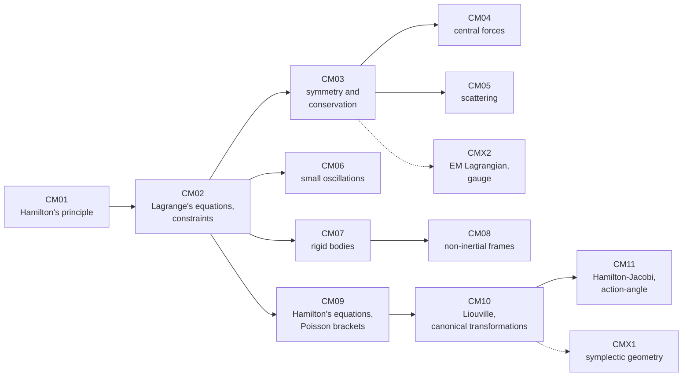

# Classical Mechanics: Course Map

<span class="scope-taught">in course overview</span> <span class="scope-extra-book">extra · book</span> <span class="scope-extra-beyond">extra · beyond</span>

Planned as **eleven core chapters and two extras** on **analytical mechanics**, built on the IISER Pune course **PH2213 Classical Mechanics\* (E)** (Jan 2025 outline, coordinator Dr. A. Bhattacharyay) with **Landau–Lifshitz, *Mechanics* (Vol. 1)** as the main text, as the overview prescribes.

> [!warning] What is and is not in the sources
> - **"In course overview" (🟢)** means *listed in the PH2213 course-content page* (`physics/classical-mechanics/lecture-notes-slides/PH2213.pdf`, 2 pages). That page is only an outline of four blocks; there are **no IISERP lecture notes, slides or problem sets in the folder**, so nothing here is "taught" in the sense used for QM or Differential Geometry. Ordering inside a block is mine.
> - The only note-like file is *Mahfooz Alam, Classical Mechanics (student notes, May 2026)*, 17 pp. from **IISER Kolkata**, a different course. It is used as a **supplement** (action principle, constraints/coupled oscillators, double pendulum, Hamiltonian mechanics, EM Lagrangian and gauge symmetry, Legendre transforms, Poisson brackets) and is credited wherever used; it is never the primary source.
> - **Extra · book (🟡)** is material from Arnold, José–Saletan, Goldstein, Greiner, Calkin that goes beyond the outline. **Extra · beyond (🔵)** is mine (numerical checks, comparisons), always labelled.
> - **Assessments (overview):** Quiz 1 15 %, Mid-sem 35 %, Quiz 2 15 %, End-sem 35 %. Pre-requisite: Newtonian mechanics.


> [!info] Shared drive: related books, past papers and old decks on the shared drive are listed in [[physics/classical-mechanics/shared-drive-sources|shared-drive sources (7 files)]].

## The four blocks of the overview, as storyline

Central thread: **one scalar, the action $S=\int L\,dt$, determines the motion (CM01-CM02); its symmetries are the conserved quantities (CM03), which solve the central-force, scattering and oscillation problems (CM04-CM06); the same machinery with a rotating frame gives rigid bodies and fictitious forces (CM07-CM08); and trading velocities for momenta turns the dynamics into the geometry of phase space (CM09-CM11), where the action itself becomes the generating function of the solution.**

## Chapters (planned)

Source columns for unwritten chapters are *tbc*: under the vault rule (cite only what was read, see PROGRESS) each is filled in after the passages are read.

| # | Chapter | Overview block | Primary sources | Status |
|---|---|---|---|---|
| 01 | [[CM01 Variational Calculus and Hamilton's Principle]] | 1 | LL §1-2; Gregory; Alam §1.1 | **pilot draft** |
| 02 | [[CM02 Lagrange's Equations, Constraints and Generalised Coordinates]] | 1 | LL §1, §5; Goldstein §1.3-1.5, §2.4 | draft |
| 03 | [[CM03 Symmetries, Noether's Theorem and Conservation Laws]] | 2 | LL §6-9; Goldstein §2.6-2.7; Arnold §20 | draft |
| 04 | [[CM04 Central Forces and Effective One-Dimensional Motion]] | 2 | LL §10-11, §13-15; Goldstein §3.4, §3.6-3.7 | draft |
| 05 | [[CM05 Scattering]] | 2 | LL §16-20 | draft |
| 06 | [[CM06 Small Oscillations and Normal Modes]] | 2 | LL §21-23; Alam §1.3 | draft |
| 07 | [[CM07 Rigid Bodies]] | 3 | LL §31-§37 (incl. §35 Problems 1-3, §37 Problem 1) | draft |
| 08 | [[CM08 Non-Inertial Frames]] | 3 | LL §39 (incl. Problems 1-3) | draft |
| 09 | [[CM09 Hamilton's Equations and Poisson Brackets]] | 4 | LL §40-§42 (incl. Problems) | draft |
| 10 | [[CM10 Liouville's Theorem and Canonical Transformations]] | 4 | LL §45-§46 (end of §44) | draft |
| 11 | [[CM11 Hamilton-Jacobi Theory and Action-Angle Variables]] | 4 | LL §43, §47-§50 (from p. 155 of §49) | draft |
| X1 | CMX1 Geometric Mechanics (🟡) | extra | tbc (sources chosen and read before writing) | todo |
| X2 | [[CMX2 The Electromagnetic Lagrangian and Gauge Symmetry]] (🟡) | extra | Goldstein §1.5, §7.9-7.10, §8.1, §8.4; LL1 §2; LL2 §16-§18; Jackson §12.1; Alam §1.5 (supplement) | draft |

```dataview
TABLE chapter AS "#", scope AS "Scope", status AS "Status"
FROM #subject/classical-mechanics AND #type/chapter
SORT chapter ASC
```

## Connections to other vaults
- **Quantum Mechanics:** the action principle is the classical limit of the path integral; Poisson brackets become commutators ([[QM01 From Waves to Probabilities]] for the stage; ladder operators in [[QM05 The Harmonic Oscillator]]). Small oscillations (CM06) is the classical twin of QM05.
- **Thermodynamics and Statistical Mechanics:** Liouville's theorem (CM10) is the starting point of [[SM02 Phase Space Liouville and the Microcanonical Ensemble]]; Legendre transforms (CM09) are the same as in thermodynamic potentials.
- **Differential Geometry:** CMX1 uses tangent and cotangent bundles ([[DM04 The Tangent Bundle and the Rank Theorem]]); flows of Hamiltonian vector fields are [[DM12 Integral Curves, Flows and Flowouts]].
- **Group Theory:** Noether's theorem pairs one-parameter symmetry groups with conserved charges ([[Group Theory - Course Map]]); rotations in CM07.
- **Waves:** normal modes (CM06) are the discrete skeleton of [[Waves - Course Map]].
- **Electrodynamics:** CMX2 and ED08/ED11 share the gauge story ([[Electrodynamics - Course Map]]).

## Sources

| Role | Source (in `physics/classical-mechanics/books/`) |
|---|---|
| Main text (overview) | L. D. Landau, E. M. Lifshitz, *Mechanics*, Vol. 1, 3rd ed. (1976); pdf page = printed + 28 |
| References (overview) | Goldstein-Poole-Safko 3rd ed. (and Goldstein 2nd ed. with Reid's solutions); Thornton-Marion; R. D. Gregory (and solutions); José-Saletan; Greiner (*Systems of Particles and Hamiltonian Dynamics*) |
| Not on the overview list, present in folder | Arnold, *Mathematical Methods of Classical Mechanics*; Calkin; Hamill; Kleppner-Kolenkow; Morin; Raychaudhuri; Spiegel; de Lange-Pierrus; Feynman Vol. 1; Schwichtenberg |
| Course outline | `lecture-notes-slides/PH2213.pdf` |
| Student notes (supplement, other institute) | `lecture-notes-slides/Mahfooz Alam - Classical Mechanics (student notes, 2026)-IISERKol.pdf` |
