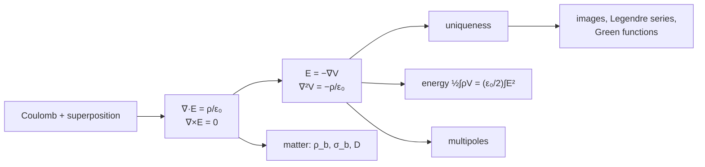
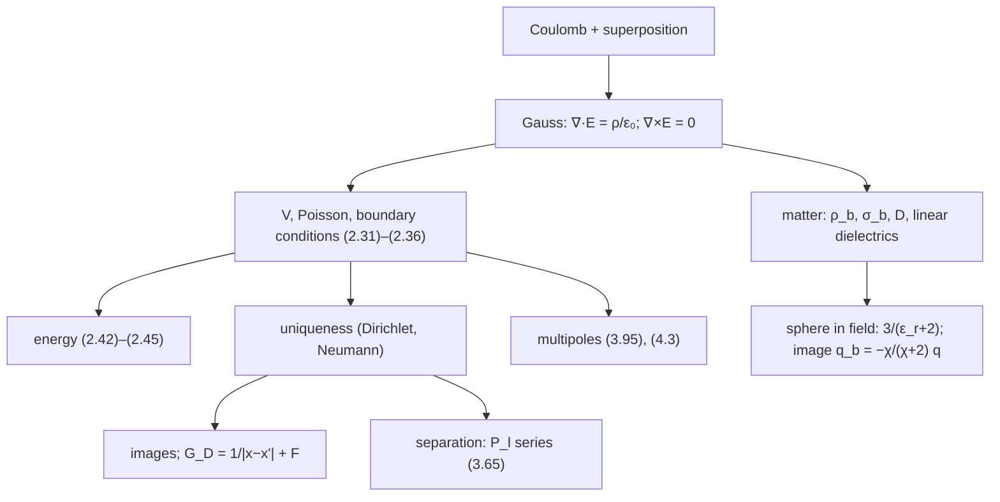

# ED01 · Electrostatics: Review

◀ [[Electrodynamics - Course Map]] · ▶ [[ED02 Magnetostatics - Review]]

in course overview extra · book extra · beyond

> [!warning] Source status (every citation below was read in this session)
> Overview item *"review of electro- and magnetostatics"* (PH3114 outline; the stated prerequisite is Griffiths Chapters 1-6, so ED01-ED02 are **deliberately short reviews** that fix the statements and the numbers used in ED03-ED11). **Griffiths and Jackson carry equal weight.**
>
> **Read directly (Griffiths, printed pp., pdf = printed + 19):** §2.2.2 (divergence of $\mathbf E$) and §2.2.4 (curl) pp. 71, 77-78; §2.3 (potential, Poisson's equation, boundary conditions) pp. 78-90; §2.4 (work and energy, Example 2.9, the comments on self-energy) pp. 91-97; §2.5.3 (surface charge, force on a conductor) pp. 103-104; §3.1.5-3.1.6 (uniqueness theorems) pp. 119-122; §3.2.1-3.2.2 (the classic image problem) pp. 124-126; §3.3.1 (the start of separation of variables) pp. 131-133 and the spherical-coordinate general solution (3.53)-(3.69) pp. 141-146 (equation numbers and the lines around them); §3.4.1-3.4.2 (multipole expansion, dipole term) pp. 151-155; §4.2-4.4 (bound charges, $\mathbf D$, linear dielectrics, boundary conditions, Examples 4.7-4.8, energy) pp. 173-198 (key passages). **Jackson (Ch. 1-4 are SI, running headers "-SI"; printed pp., pdf = printed + 26):** §1.3-1.5 pp. 27-30; §1.8-1.10 (Green's identities, uniqueness, Green functions) pp. 36-40; §1.11 pp. 40-41; §2.1-2.2 pp. 57-59; §4.1 pp. 145-147; §4.3-4.4 pp. 151-159.
>
> **Not cited because not read:** Griffiths §2.1, §2.5 apart from §2.5.3, §3.1.1-3.1.4, §3.3 beyond the passages above, §3.4.3-3.4.4, §4.1; Jackson §1.1-1.2, §1.6-1.7, §1.12-1.13, §2.3-2.12, Ch. 3, §4.2, §4.5-4.7. Jackson's equations that are garbled in my text copy ((4.9), (4.45), (4.54), (4.56)) are described, not quoted. All numbers in the worked examples are computed in `scripts/ed01_numbers.py` and marked 🔵.

> [!syllabus] Syllabus map
> 🟢 **In course overview** (review): §1 the two field equations and the potential, §2 boundary conditions and conductors, §3 energy, §4 uniqueness, §5 images and separation of variables, §6 multipoles, §7 matter.
>
> 🟡 **Extra · book**: Jackson's Green-function formulation of the boundary-value problem (§4.2), Griffiths' discussion of the self-energy of a point charge.
>
> 🔵 **Extra · beyond (mine)**: relaxation numerics for uniqueness, the convergence of the multipole expansion as numbers, the dielectric half-space checked against the interface conditions, `scripts/ed01_numbers.py`, `scripts/fig_ed01.py`, an interactive tool.

> [!key] After this chapter you can
> - state and use $\nabla\cdot\mathbf E=\rho/\epsilon_0$, $\nabla\times\mathbf E=0$, $\mathbf E=-\nabla V$, $\nabla^2V=-\rho/\epsilon_0$ and the boundary conditions across a surface charge,
> - compute electrostatic energy three ways ($\tfrac12\int\rho V$, $\tfrac{\epsilon_0}2\int E^2$, assembling) and explain why they differ for point charges,
> - state the two uniqueness theorems and say why they license the **method of images**,
> - expand a potential in multipoles and know the error you make when you truncate,
> - handle matter with $\rho_b=-\nabla\cdot\mathbf P$, $\sigma_b=\mathbf P\cdot\hat{\mathbf n}$, $\mathbf D=\epsilon_0\mathbf E+\mathbf P$, $\nabla\cdot\mathbf D=\rho_f$ and the interface conditions.

> [!intuition] The one-sentence story
> Electrostatics is two experimental facts, superposition and Coulomb's inverse-square law, from which follow $\nabla\cdot\mathbf E=\rho/\epsilon_0$ and $\nabla\times\mathbf E=0$; the second lets you hide the vector field in a scalar potential obeying Poisson's equation, and uniqueness theorems turn "find a solution" into "guess any solution that fits the boundary data".

## 1. The field equations and the potential (Griffiths §2.2-2.3, Jackson §1.3-1.5)
taught

**Gauss's law.** Jackson (1.7)-(1.11) obtains it for a point charge from the solid angle: $\mathbf E\cdot\hat{\mathbf n}\,da=\frac q{4\pi\epsilon_0}d\Omega$, so the flux through a closed surface is $q/\epsilon_0$ if the charge is inside and zero if it is outside; for a continuous density $\oint_S\mathbf E\cdot\hat{\mathbf n}\,da=\frac1{\epsilon_0}\int_V\rho\,d^3x$ (1.11). Jackson notes that it holds only because the force is inverse-square, central and linear in the sources ("clearly, then, Gauss's law holds for Newtonian gravitational fields"). The differential form follows from the divergence theorem, $\nabla\cdot\mathbf E=\rho/\epsilon_0$ (1.13). Griffiths gets the same result in a second way: from $\mathbf E(\mathbf r)=\frac1{4\pi\epsilon_0}\int\frac{\hat{\boldsymbol{\mathfrak r}}}{\mathfrak r^2}\rho\,d\tau'$ (2.15) and $\nabla\cdot(\hat{\boldsymbol{\mathfrak r}}/\mathfrak r^2)=4\pi\delta^3(\boldsymbol{\mathfrak r})$ (Eq. 1.100) he finds $\nabla\cdot\mathbf E=\rho/\epsilon_0$ (2.16), the differential form (2.14), and reverses the argument for the integral form (2.13). Example 2.3 (charge $q$ in a uniform ball): outside, "the field is exactly the same as it would have been if all the charge had been concentrated at the center"; Gauss's law is always true, but only useful when symmetry lets you pull $|\mathbf E|$ out of the integral.

**Curl.** For a point charge $\int_a^b\mathbf E\cdot d\mathbf l=\frac q{4\pi\epsilon_0}\left(\frac1{r_a}-\frac1{r_b}\right)$ (2.18) depends only on the end points, so $\oint\mathbf E\cdot d\mathbf l=0$ (2.19) and $\nabla\times\mathbf E=0$ (2.20); superposition extends it to any static distribution. Jackson (1.14)-(1.15): $\nabla\times\mathbf E=0$ follows because $(\mathbf x-\mathbf x')/|\mathbf x-\mathbf x'|^3=-\nabla(1/|\mathbf x-\mathbf x'|)$, and it uses only that the force is **central** and depends on relative distances (not the inverse-square law itself).

**Potential.** Because the line integral is path-independent one defines (Griffiths 2.21) $V(\mathbf r)=-\int_O^{\mathbf r}\mathbf E\cdot d\mathbf l$ with a reference point $O$, equivalently $\mathbf E=-\nabla V$ (Jackson 1.16, with $\Phi$ for $V$), $V(\mathbf r)=\frac1{4\pi\epsilon_0}\int\frac{\rho(\mathbf r')}{\mathfrak r}d\tau'$ (Griffiths 2.29, Jackson 1.17), arbitrary up to a constant. The work done by the field on a test charge moved from $A$ to $B$ is $q(\Phi_B-\Phi_A)$ (Jackson 1.18)-(1.19, with the sign convention that the work is done *against* the field). The potential obeys Poisson's equation $\nabla^2V=-\rho/\epsilon_0$ (Griffiths 2.24; Jackson 1.28), which is Laplace's equation (2.25) where $\rho=0$; the singular nature of the Laplacian of $1/r$ is $\nabla^2(1/|\mathbf x-\mathbf x'|)=-4\pi\delta(\mathbf x-\mathbf x')$ (Jackson 1.31). Griffiths' triangle (Fig. 2.35) relates the three fundamental quantities $\rho$, $\mathbf E$, $V$; "it is generally to your advantage to calculate the potential first".

> [!example] Worked example 1: the uniformly charged ball, checked field by field (🔵)
> $q=1$ nC, $R=10$ cm. Inside, $\mathbf E=\frac{q\mathbf r}{4\pi\epsilon_0R^3}$; outside $\frac{q\hat{\mathbf r}}{4\pi\epsilon_0r^2}$. Finite-difference derivatives at $r=3.7$ cm give $\nabla\cdot\mathbf E=2.696266\times10^4$ V/m² $=\rho/\epsilon_0$ and $|\nabla\times\mathbf E|=0$; at $r=26.9$ cm (outside) $\nabla\cdot\mathbf E=0$ to $2\times10^{-8}$. Flux through a sphere of radius 5 cm is $14.1176$ V m, i.e. $(r/R)^3\,q/\epsilon_0$; at 20 cm it is $112.9409=q/\epsilon_0$ (`ed01_numbers.py` §1). The potential at the centre is $\frac32\cdot\frac{q}{4\pi\epsilon_0R}=134.8$ V, against $89.9$ V on the surface.

## 2. Boundary conditions and conductors (Griffiths §2.3.5, §2.5.3)
taught

A thin Gaussian pillbox gives the jump of the normal component of $\mathbf E$ across a surface charge $\sigma$ (Griffiths (2.31)); a thin Amperian loop shows the tangential component is continuous (2.32):

$$E^\perp_{\rm above}-E^\perp_{\rm below}=\frac\sigma{\epsilon_0},\qquad E^\parallel_{\rm above}=E^\parallel_{\rm below},\qquad\mathbf E_{\rm above}-\mathbf E_{\rm below}=\frac\sigma{\epsilon_0}\hat{\mathbf n}\ \ (2.33),$$

with $\hat{\mathbf n}$ pointing from below to above. The potential is continuous (2.34), $V_{\rm above}=V_{\rm below}$, and its normal derivative jumps: $\nabla V_{\rm above}-\nabla V_{\rm below}=-\frac1{\epsilon_0}\sigma\hat{\mathbf n}$ (2.35), $\partial V_{\rm above}/\partial n-\partial V_{\rm below}/\partial n=-\sigma/\epsilon_0$ (2.36). The field of the local patch alone is $\pm\frac\sigma{2\epsilon_0}\hat{\mathbf n}$; the entire discontinuity is attributable to that patch (Griffiths footnote 8). Jackson notes the same structure in the Green's-theorem surface integral: it represents the potential of a surface charge $\sigma=\epsilon_0\,\partial\Phi/\partial n'$ plus a dipole layer $D=-\epsilon_0\Phi$ (p. 37).

**Conductors.** Since $\mathbf E=0$ inside, (2.33) gives $\mathbf E=\frac\sigma{\epsilon_0}\hat{\mathbf n}$ at the surface (2.48), and $\sigma=-\epsilon_0\,\partial V/\partial n$ (2.49). The force per unit area is $\mathbf f=\sigma\mathbf E_{\rm average}=\frac\sigma2(\mathbf E_{\rm above}+\mathbf E_{\rm below})$ (2.50): the field of the patch cannot push the patch itself, so one uses the field of "everything else", which is continuous and equals the average. For a conductor $\mathbf f=\frac{\sigma^2}{2\epsilon_0}\hat{\mathbf n}$ (2.51), an outward pressure "tending to draw the conductor into the field, regardless of the sign of $\sigma$", $P=\frac{\epsilon_0}2E^2$ (2.52).

## 3. Energy (Griffiths §2.4, Jackson §1.11)
taught

Bringing a charge $q$ from infinity to $\mathbf r$ costs $qV(\mathbf r)$ (2.39, Jackson 1.47). For a set of point charges, adding them one at a time,

$$W=\frac12\sum_i q_iV(\mathbf r_i)\ \ (2.42),\qquad W=\frac12\int\rho V\,d\tau\ \ (2.43),\qquad W=\frac{\epsilon_0}2\int_{\rm all\ space}E^2\,d\tau\ \ (2.45),$$

(Jackson (1.51)-(1.53): the $i=j$ "infinite self-energy terms" omitted for point charges). The step from (2.43) to (2.45) uses $\rho=\epsilon_0\nabla\cdot\mathbf E$ and integration by parts, $W=\frac{\epsilon_0}2\left[\int(-\mathbf E\cdot\nabla V)d\tau+\oint V\mathbf E\cdot d\mathbf a\right]$ (2.44), valid for any volume enclosing the charge: enlarging it increases the volume integral and decreases the surface integral by the same amount, and over all space the surface term vanishes. The energy density is $\frac{\epsilon_0}2E^2$ (2.46); for two sources $W=W_1+W_2+\epsilon_0\int\mathbf E_1\cdot\mathbf E_2d\tau$ (2.47), **the cross term shows that energy does not obey superposition**.

**The "inconsistency" (Griffiths §2.4.4).** (2.45) is always positive but (2.42) can be negative: for two opposite charges at distance $r$, $-q^2/4\pi\epsilon_0r$. Both are right but answer different questions: (2.42) leaves out the work needed to make the point charges themselves, since (2.45) shows that the energy of a point charge is infinite ($\propto\int dr/r^2$ from 0). "The infinite energy of a point charge is a recurring source of embarrassment for electromagnetic theory, afflicting the quantum version as well as the classical" (Griffiths defers it to his Chapter 11).

> [!example] Worked example 2: three energies of one ball (🔵)
> Uniform ball, $q=1$ nC, $R=10$ cm (`ed01_numbers.py` §2): $V(r)=\frac{q}{8\pi\epsilon_0R}(3-r^2/R^2)$ inside. (i) $\frac12\int\rho V\,d\tau=5.392531\times10^{-8}$ J; (ii) $\frac{\epsilon_0}2\int E^2d\tau$ over all space $=5.392531\times10^{-8}$ J; (iii) assembling the ball layer by layer ("snowball", Griffiths Problem 2.35) $=5.392531\times10^{-8}$ J, all equal to $\frac{3q^2}{20\pi\epsilon_0R}$. The energy stored **inside** the ball is exactly $1/6$ of the total, $5/6$ is in the field outside. For the thin shell of Example 2.9 the three routes give $\frac{q^2}{8\pi\epsilon_0R}=4.493776\times10^{-8}$ J. The conductor pressure (2.52) for the surface of a charged sphere is $3.576033\times10^{-6}$ Pa, equal to $\sigma^2/2\epsilon_0$.

## 4. Uniqueness and Green functions (Griffiths §3.1.5-3.1.6, Jackson §1.8-1.10)
taught · Green functions: extra · book

**Griffiths.** The *first uniqueness theorem*: the solution of Laplace's equation in a volume is uniquely determined if $V$ is specified on **the** boundary (including any islands inside, with the outer boundary possibly at infinity). Proof: the difference $V_3=V_1-V_2$ obeys Laplace's equation and vanishes on all boundaries; Laplace's equation allows no local maxima or minima, so $V_3=0$. Corollary: with a specified charge density $\rho$ both $\nabla^2V_i=-\rho/\epsilon_0$ and the argument is the same. *Second theorem*: in a volume surrounded by conductors and containing a specified $\rho$, the **field** is uniquely determined if the total charge on each conductor is given. Example 3.1: the potential is constant, and the field zero, inside an empty cavity of a conductor. "The uniqueness theorem is a license to your imagination": a solution is right if it satisfies Laplace's (Poisson's) equation and has the correct boundary values, however you found it.

**Jackson.** Green's first identity (1.34), $\int_V(\phi\nabla^2\psi+\nabla\phi\cdot\nabla\psi)d^3x=\oint_S\phi\frac{\partial\psi}{\partial n}da$, and the second identity (1.35), $\int_V(\phi\nabla^2\psi-\psi\nabla^2\phi)d^3x=\oint_S\left(\phi\frac{\partial\psi}{\partial n}-\psi\frac{\partial\phi}{\partial n}\right)da$. Taking $\psi=1/|\mathbf x-\mathbf x'|$ gives (1.36), an integral relation for $\Phi$ with *both* $\Phi$ and $\partial\Phi/\partial n$ on the surface (not a solution of a boundary-value problem; the specification of both, Cauchy conditions, over-determines the problem). Uniqueness (1.37)-(1.38): two solutions differ by $U$ with $\nabla^2U=0$, and (1.34) with $\phi=\psi=U$ gives $\int\nabla U\cdot\nabla U\,d^3x=\oint U\,\partial U/\partial n\,da=0$ for **Dirichlet** ($U=0$ on $S$) or **Neumann** ($\partial U/\partial n=0$) data, so $U$ is constant: unique for Dirichlet, unique up to a constant for Neumann, also unique for mixed data. "Electrostatic problems are specified only by Dirichlet or Neumann boundary conditions on a closed surface."

**Green functions** (Jackson §1.10). $\nabla'^2G(\mathbf x,\mathbf x')=-4\pi\delta(\mathbf x-\mathbf x')$ (1.39), $G=\frac1{|\mathbf x-\mathbf x'|}+F(\mathbf x,\mathbf x')$ (1.40) with $\nabla'^2F=0$ inside $V$ (1.41). For Dirichlet data choose $G_D=0$ for $\mathbf x'$ on $S$ (1.43); then

$$\Phi(\mathbf x)=\frac1{4\pi\epsilon_0}\int_V\rho(\mathbf x')G_D(\mathbf x,\mathbf x')d^3x'-\frac1{4\pi}\oint_S\Phi(\mathbf x')\frac{\partial G_D}{\partial n'}da'\ \ (1.44).$$

$G_D$ is symmetric (the physical interchangeability of source and observation points), and "the physical meaning of $F(\mathbf x,\mathbf x')/4\pi\epsilon_0$": it is the potential of a system of charges **outside** $V$ chosen to cancel the potential of the point charge on $S$; so **the method of images is the physical equivalent of finding $F$**, and for conductors $F/4\pi\epsilon_0$ is the potential of the charge induced on them.

> [!example] Worked example 3: uniqueness seen numerically (🔵)
> A unit square with $V=0$ on three sides and $V=V_0=1$ on the top. Jacobi relaxation ($41\times41$ grid) from three different starting guesses (all zero, random in $[-5,5]$, all 3): the value at the centre after $10/100/1000/6000$ sweeps is $0,\,0.00485,\,0.23159,\,0.25$; $-0.081,\,0.169,\,0.243,\,0.25$; $3.0,\,2.947,\,0.453,\,0.25$. After 6000 sweeps the three grids differ by at most $4.4\times10^{-8}$ (Fig. ED01.1 C). The centre value is $V_0/4$ exactly, by symmetry: rotating the square permutes the four sides, so four copies of the problem with $V_0$ on each side in turn add up to the constant solution $V_0$. The Fourier (separation-of-variables) solution $V=\sum_{n\ {\rm odd}}\frac{4V_0}{n\pi}\sin(n\pi x)\frac{\sinh n\pi y}{\sinh n\pi}$ gives $0.25000000$ at the centre and $0.095414$ at $(0.5,0.25)$ against $0.095451$ from the grid (the $O(h^2)$ discretisation error). Derived here with Griffiths' method of Example 3.3.

## 5. Images and separation of variables (Griffiths §3.2, §3.3; Jackson §2.1-2.2)
taught

**Images.** Griffiths' classic problem: a charge $q$ at height $d$ above an infinite grounded plane. Conditions: $V=0$ at $z=0$, $V\to0$ far away. The uniqueness corollary says that any function that satisfies them and solves Poisson's equation with the single charge in $z>0$ is *the* answer; the potential of $+q$ at $(0,0,d)$ and $-q$ at $(0,0,-d)$ does (3.9), $V=\frac1{4\pi\epsilon_0}\left[\frac q{\sqrt{x^2+y^2+(z-d)^2}}-\frac q{\sqrt{x^2+y^2+(z+d)^2}}\right]$, "the lower region is completely different, but who cares?" The induced charge $\sigma=-\epsilon_0\partial V/\partial z=-\dfrac{qd}{2\pi(x^2+y^2+d^2)^{3/2}}$ (3.10) integrates to $-q$ (3.11), and the force on $q$ equals the force from the image, $\mathbf F=-\frac1{4\pi\epsilon_0}\frac{q^2}{(2d)^2}\hat{\mathbf z}$ (3.12). Jackson §2.2: a grounded sphere of radius $a$ and a charge $q$ at distance $y$ from the centre: one image on the same ray, $q'=-\frac ayq$ at $y'=\frac{a^2}y$ (2.4), chosen so that $\Phi(|\mathbf x|=a)=0$ for all $\mathbf n\cdot\mathbf n'$ (2.1)-(2.3); "the image charges must be external to the volume of interest" because their potentials must satisfy Laplace's equation inside it.

**Separation of variables** (Griffiths Example 3.3 and §3.3.2). For $\nabla^2V=0$ look for products $X(x)Y(y)$ (3.22); dividing by $V$ gives $f(x)+g(y)=0$ so each is constant (3.25): $X''=k^2X$, $Y''=-k^2Y$ (3.26), $V=(Ae^{kx}+Be^{-kx})(C\sin ky+D\cos ky)$ (3.27); the boundary conditions fix $k=n\pi/a$ and one superposes the infinite family because Laplace's equation is linear. In spherical coordinates with azimuthal symmetry $V=R(r)\Theta(\theta)$ with $\frac{d}{dr}(r^2R')=l(l+1)R$ (3.58), $R=Ar^l+B/r^{l+1}$ (3.59), $\Theta=P_l(\cos\theta)$ (3.61) and

$$V(r,\theta)=\sum_{l=0}^\infty\left(A_lr^l+\frac{B_l}{r^{l+1}}\right)P_l(\cos\theta)\ \ (3.65),\qquad A_l=\frac{2l+1}{2R^l}\int_0^\pi V_0(\theta)P_l(\cos\theta)\sin\theta\,d\theta\ \ (3.69),$$

with $P_l(1)=1$ (3.63) and Rodrigues' formula (3.62) (the second form of (3.69), "$A_l=\frac{2l+1}{2R^l}\int\dots$", is the standard projection by orthogonality of the $P_l$; Griffiths' printed form (3.69) was partly garbled in my copy and I re-derived it).

> [!example] Worked example 4: images for a plane and a sphere (🔵)
> Plane, $q=1$ nC, $d=5$ cm (`ed01_numbers.py` §3): $\sigma(0)=-6.366198\times10^{-8}$ C/m²; $\int\sigma\,da=-1.0000\times10^{-9}$ C; force $-8.987552\times10^{-7}$ N (attractive); $V=0$ on $z=0$ exactly; $E_z(0,0,0^+)=-7190.04$ V/m $=\sigma/\epsilon_0$ (the field points into the conductor). Grounded sphere $a=10$ cm with the charge at $y=25$ cm: $q'=-0.4$ nC at $y'=4$ cm; $|V|\le7\times10^{-15}$ V at six random surface points (scale $kq/a=89.9$ V); $\int\epsilon_0E_r\,da=-4.000000\times10^{-10}$ C $=q'$; force $-8.15197\times10^{-8}$ N (attractive); as $y\to\infty$, $q'\to0$ like $a/y$.

## 6. The multipole expansion (Griffiths §3.4, Jackson §4.1)
taught

For a localised charge distribution at points far from it Griffiths writes $\frac1{\mathfrak r}=\frac1r\sum_{n=0}^\infty\left(\frac{r'}r\right)^nP_n(\cos\alpha)$ (3.94; the Legendre polynomials appear as the coefficients, $1/\mathfrak r$ is their generating function, footnote 16) and therefore the **multipole expansion**

$$V(\mathbf r)=\frac1{4\pi\epsilon_0}\sum_{n=0}^\infty\frac1{r^{n+1}}\int(r')^nP_n(\cos\alpha)\rho(\mathbf r')d\tau'\ \ (3.95),$$

exact, but useful as an approximation: the lowest non-zero term gives the potential at large $r$. The monopole is $\frac1{4\pi\epsilon_0}\frac Qr$ (3.97) (the exact potential of a point charge), the dipole term is $V_{\rm dip}=\frac1{4\pi\epsilon_0}\frac{\hat{\mathbf r}\cdot\mathbf p}{r^2}$ with $\mathbf p=\int\mathbf r'\rho\,d\tau'$ (3.98)-(3.99), $\mathbf p=\sum q_i\mathbf r_i$ (3.100) and $\mathbf p=q\mathbf d$ (3.101) for a physical dipole. A **pure dipole** needs $d\to0$, $q\to\infty$ with $qd=p$ fixed; a physical dipole has higher multipoles. Hierarchy: monopole $V\sim1/r$, dipole $1/r^2$, quadrupole $1/r^3$, octopole $1/r^4$ (Fig. 3.27), each made of two opposite members of the previous one. **Jackson** (4.1)-(4.3): the potential outside a sphere containing all charge is $\Phi=\frac1{\epsilon_0}\sum_{l,m}\frac{1}{2l+1}q_{lm}\frac{Y_{lm}(\theta,\phi)}{r^{l+1}}$ with the multipole moments $q_{lm}=\int Y^*_{lm}(\theta',\phi')\,r'^l\rho(\mathbf x')d^3x'$ (4.3), the $(2l+1)$ moments of order $l$ being linear combinations of the Cartesian $q$, $\mathbf p=\int\mathbf x'\rho\,d^3x'$ (4.8) and the **traceless** quadrupole tensor $Q_{ij}$ (4.9); the dipole field is (4.13) $\mathbf E=\frac1{4\pi\epsilon_0}\frac{3\hat{\mathbf n}(\hat{\mathbf n}\cdot\mathbf p)-\mathbf p}{|\mathbf x-\mathbf x_0|^3}$ with $\hat{\mathbf n}$ from the dipole to the field point.

> [!example] Worked example 5: how fast does it converge? (🔵)
> (i) The generating function at $s=r'/r=0.3$, $\alpha=40^\circ$: the Legendre sum to order $N=0,1,2,4,8$ has errors $2.6\times10^{-1},\,3.0\times10^{-2},\,4.5\times10^{-3},\,1.3\times10^{-3},\,7.7\times10^{-6}$ of the order of the first omitted term $s^{N+1}=3\times10^{-1},\,9\times10^{-2},\,2.7\times10^{-2},\,2.4\times10^{-3},\,2\times10^{-5}$ (Fig. ED01.1 B, top axis). (ii) A physical dipole ($\pm q$ at $z=\pm d/2$, $d=1$ cm) evaluated at $60^\circ$: the relative error of the pure-dipole potential is $2.5\times10^{-2}$, $2.2\times10^{-3}$, $2.4\times10^{-4}$, $2.2\times10^{-5}$ at $r/d=3,10,30,100$, tracking $\frac14(d/r)^2$ (the octopole-to-dipole ratio). (iii) The linear quadrupole $+q,-2q,+q$ at $z=a,0,-a$ has $V=kqa^2\cdot2/z^3$ on its axis; relative error of this term alone is $6\times10^{-2},\,1.0\times10^{-2},\,1.1\times10^{-3}$ at $z/a=4,10,30$ (the next non-zero term is $l=4$, $\propto(a/z)^2$), and $Q_{zz}=1.6\times10^{-12}$ C m², $Q_{xx}=Q_{yy}=-8\times10^{-13}$ C m² (sum zero: traceless).

![[fig_ed01_methods.png|940]]
*Figure ED01.1. A: field lines of a point charge above a grounded plane in $z>0$ (those of $q$ and its image) and the induced $\sigma(\rho)$. B: the error of the pure-dipole approximation (orange, $\theta=60^\circ$) falls as $\frac14(d/r)^2$; the Legendre sum for $1/\mathfrak r$ at $s=0.3$ converges as $s^{N+1}$ (blue, top axis). C: relaxation of Laplace's equation on the square with $V_0$ on the top side from three different starting guesses reaches the same solution ($V_0/4$ at the centre): uniqueness.*

## 7. Electrostatics in matter (Griffiths Ch. 4, Jackson §4.3-4.4)
taught

**Bound charge.** A polarised object (dipole moment per unit volume $\mathbf P$; Jackson (4.28) $\mathbf P=\sum_iN_i\langle\mathbf p_i\rangle$) produces the potential $V=\frac1{4\pi\epsilon_0}\int\frac{\mathbf P(\mathbf r')\cdot\hat{\boldsymbol{\mathfrak r}}}{\mathfrak r^2}d\tau'$ (4.9), which after integrating by parts is that of a surface charge and a volume charge (Griffiths (4.10)-(4.13); Jackson (4.31) and below):

$$\boxed{\sigma_b=\mathbf P\cdot\hat{\mathbf n},\qquad\rho_b=-\nabla\cdot\mathbf P}$$

(Griffiths' uniformly polarised sphere: $\mathbf E=-\frac1{3\epsilon_0}\mathbf P$ inside (4.14), a pure dipole $\mathbf p=\frac43\pi R^3\mathbf P$ outside (4.15)-(4.16).) The *macroscopic* field is the average over a region containing many molecules; Griffiths shows with the sphere average that the macroscopic field is given by (4.19) $V(\mathbf r)=\frac1{4\pi\epsilon_0}\int\frac{\mathbf P\cdot\hat{\boldsymbol{\mathfrak r}}}{\mathfrak r^2}d\tau'$ over the whole dielectric, and Jackson notes that the averaged $\nabla\times\mathbf E=0$ still holds (4.27), "so the electric field is still derivable from a potential".

**Displacement.** With $\rho=\rho_b+\rho_f$ (4.20), Gauss's law becomes

$$\mathbf D\equiv\epsilon_0\mathbf E+\mathbf P\ \ (4.21),\qquad\nabla\cdot\mathbf D=\rho_f\ \ (4.22),\qquad\oint\mathbf D\cdot d\mathbf a=Q_{f,{\rm enc}}\ \ (4.23),$$

"a particularly useful way to express Gauss's law, because it makes reference only to free charges, and free charge is the stuff we control". Caution (Griffiths §4.3.2, "a deceptive parallel"): $\nabla\times\mathbf D=\nabla\times\mathbf P\neq0$ in general (4.25), so $\mathbf D$ is **not** a "$\mathbf E$ with only free charges": symmetry is needed to find $\mathbf D$ from $\rho_f$ alone. Example 4.4: a line charge $\lambda$ in rubber insulation has $\mathbf D=\frac\lambda{2\pi s}\hat{\mathbf s}$ (4.24) both inside and outside the insulation. **Boundary conditions:** $D^\perp_{\rm above}-D^\perp_{\rm below}=\sigma_f$ (4.26), $\mathbf D^\parallel_{\rm above}-\mathbf D^\parallel_{\rm below}=\mathbf P^\parallel_{\rm above}-\mathbf P^\parallel_{\rm below}$ (4.27), $E^\perp_{\rm above}-E^\perp_{\rm below}=\sigma/\epsilon_0$ with total $\sigma$ (4.28), $\mathbf E^\parallel$ continuous (4.29); Jackson (4.40): normal $\mathbf D$ jumps by $\sigma$ (the free surface charge), tangential $\mathbf E$ continuous.

**Linear dielectrics.** $\mathbf P=\epsilon_0\chi_e\mathbf E$ (4.30), so $\mathbf D=\epsilon_0(1+\chi_e)\mathbf E=\epsilon\mathbf E$ (4.31)-(4.33), $\epsilon_r=1+\chi_e=\epsilon/\epsilon_0$ the dielectric constant (4.34) (Jackson (4.36)-(4.38)). In a uniform linear medium $\rho_b=-\frac{\chi_e}{1+\chi_e}\rho_f$ (4.39), fields from given free charges are reduced by $\epsilon_0/\epsilon$, the capacitance rises to $C=\epsilon_rC_{\rm vac}$ (4.37). Interface conditions in terms of $V$: $\epsilon_{\rm above}\frac{\partial V_{\rm above}}{\partial n}-\epsilon_{\rm below}\frac{\partial V_{\rm below}}{\partial n}=-\sigma_f$ (4.41), $V$ continuous (4.42). **Energy:** $W=\frac12\int\mathbf D\cdot\mathbf E\,d\tau$ (4.58) for linear media (it rederives from $\delta W=\int\delta\mathbf D\cdot\mathbf E\,d\tau$ (4.57)); Griffiths' (4.55) $\frac{\epsilon_0}2\int E^2$ is the vacuum case only.

**Boundary-value problems.** *Sphere in a uniform field* (Griffiths Example 4.7, Jackson (4.48)-(4.58)): $V_{\rm in}=\sum A_lr^lP_l$, $V_{\rm out}=-E_0r\cos\theta+\sum B_lr^{-(l+1)}P_l$, with $V$ continuous and $\epsilon\,\partial_rV$ continuous at $r=R$ (no free surface charge) gives only $l=1$ and the field inside is **uniform**:

$$\mathbf E_{\rm in}=\frac3{\epsilon_r+2}\mathbf E_0\ \ (4.49),$$

Jackson's (4.55) $E_{\rm in}=\frac{3\epsilon_0}{\epsilon+2\epsilon_0}E_0$, "$<E_0$ if $\epsilon>\epsilon_0$"; outside the sphere the field is $\mathbf E_0$ plus that of a dipole at the origin (his (4.56), garbled in my copy), the polarisation is uniform and its surface charge $\sigma_b=P\cos\theta$ produces an internal field opposed to $\mathbf E_0$. *Point charge above a dielectric half-space* (Griffiths Example 4.8, Jackson (4.41)-(4.47)): for $z>0$ vacuum with $q$ at $(0,0,d)$ and $z<0$ a dielectric, the surface bound charge is $\sigma_b=-\dfrac1{2\pi}\dfrac{\chi_e}{\chi_e+2}\dfrac{qd}{(r^2+d^2)^{3/2}}$ (4.50), with total $q_b=-\dfrac{\chi_e}{\chi_e+2}q$ (4.51), the potential in $z>0$ that of $q$ plus an image $q_b$ at $(0,0,-d)$ (4.52), and in $z<0$ that of $q+q_b$ at the position of $q$ (4.53), and the force (4.54) $\mathbf F=-\frac1{4\pi\epsilon_0}\frac{\chi_e}{\chi_e+2}\frac{q^2}{(2d)^2}\hat{\mathbf z}$ (from the garbled printout $F=\frac{1}{4\pi\epsilon_0}\frac{qq_b}{(2d)^2}\hat{\mathbf z}$, equal to this). Jackson writes two image charges $q'$ (above) and $q''$ (the source of the field below) for media $\epsilon_1,\epsilon_2$; in the limit $\epsilon_2\gg\epsilon_1$ the dielectric behaves like a conductor.

> [!example] Worked example 6: dielectric sphere and half-space checked numerically (🔵)
> (i) Imposing the two boundary conditions at $r=R$ on a Legendre series truncated at $l=6$ gives $E_{\rm in}/E_0=0.75000000,\ 0.42857143,\ 0.03658537$ for $\epsilon_r=2,5,80$, equal to $3/(\epsilon_r+2)$, with every coefficient $l\neq1$ equal to zero (`ed01_numbers.py` §5). Water ($\epsilon_r=80$) in $E_0=10^5$ V/m: inside $3.6585\times10^3$ V/m, and a polar surface charge density $\sigma_b=3\epsilon_0\frac{\epsilon_r-1}{\epsilon_r+2}E_0=2.559\times10^{-6}$ C/m² (derived: $P=\epsilon_0(\epsilon_r-1)E_{\rm in}$). (ii) Half-space, image charges $q'=-\frac{\epsilon_r-1}{\epsilon_r+1}q$ above and $q''=\frac{2\epsilon_r}{\epsilon_r+1}q$ below (my derivation, equal to $-\frac{\chi_e}{\chi_e+2}q$ above, consistent with Griffiths (4.51)): potential and $D_z$ match at random interface points to $3\times10^{-16}$ for $\epsilon_r=2$ and $2\times10^{-16}$ for $\epsilon_r=5$; the numerical integral of $\sigma_b$ is $-3.3334\times10^{-10}$ C and $-6.6668\times10^{-10}$ C against $q_b=-\frac13q$, $-\frac23q$ for $q=1$ nC; the force is $-2.9959\times10^{-7}$ N and $-5.9917\times10^{-7}$ N. (iii) Capacitor ($A=1$ cm², $d=1$ mm, $\epsilon_r=4$, $Q=1$ nC): $C=3.5417\times10^{-12}$ F $=4C_0$; $\frac12\int\mathbf D\cdot\mathbf E\,d\tau=1.411761\times10^{-7}$ J $=Q^2/2C$, a quarter of the vacuum value $5.647\times10^{-7}$ J at the same $Q$.

## Map of this chapter

## Common mistakes
1. Using the $\frac12\sum_i q_iV(\mathbf r_i)$ energy including the point-charge self-terms, or mixing it with $\frac{\epsilon_0}2\int E^2$ which does include them (infinite for a point charge).
2. Forgetting that the force on a surface charge uses the **average** of the fields on the two sides.
3. Believing a solution found by images is valid **everywhere**: it is valid only in the region where the image charges are absent (the "lower region is completely different").
4. Treating $\mathbf D$ like $\mathbf E$ with free charges only: $\nabla\times\mathbf D=\nabla\times\mathbf P\ne0$ in general; use Gauss's law for $\mathbf D$ only when symmetry fixes it.
5. In a dielectric, applying $\nabla\cdot\mathbf E=\rho_f/\epsilon_0$: use $\rho_f/\epsilon$ in a uniform linear medium, or $\rho_f+\rho_b$ in general.
6. For the dielectric sphere in a field, forgetting that the field *inside* is uniform and reduced ($3/(\epsilon_r+2)$), and that the dipole field outside is **added** to $\mathbf E_0$.
7. Specifying both $V$ and $\partial V/\partial n$ on a closed surface (Cauchy data): generally inconsistent; give one or the other (Jackson §1.9).

## Summary
- $\nabla\cdot\mathbf E=\rho/\epsilon_0$ (Gauss), $\nabla\times\mathbf E=0$, $\mathbf E=-\nabla V$, $\nabla^2V=-\rho/\epsilon_0$; jump $E^\perp$ by $\sigma/\epsilon_0$, $V$ continuous, conductors $\sigma=-\epsilon_0\partial_nV$, pressure $\sigma^2/2\epsilon_0$.
- $W=\frac12\int\rho V=\frac{\epsilon_0}2\int E^2$; uniform ball $\frac{3q^2}{20\pi\epsilon_0R}$ (1/6 of it inside), shell $\frac{q^2}{8\pi\epsilon_0R}$.
- Uniqueness: Dirichlet (unique) or Neumann (unique up to a constant) on a closed surface; second theorem: conductor charges; images and $G_D=1/|\mathbf x-\mathbf x'|+F$ with $F$ the potential of charges outside $V$.
- Spherical Laplace series (3.65); multipoles (3.95), $\mathbf p$, traceless $Q_{ij}$; error of a pure dipole $\sim\frac14(d/r)^2$.
- Matter: $\sigma_b=\mathbf P\cdot\hat{\mathbf n}$, $\rho_b=-\nabla\cdot\mathbf P$, $\mathbf D=\epsilon_0\mathbf E+\mathbf P$, $\nabla\cdot\mathbf D=\rho_f$; linear: $\epsilon=\epsilon_0(1+\chi_e)$, $C=\epsilon_rC_0$, $W=\frac12\int\mathbf D\cdot\mathbf E$; sphere in field $E_{\rm in}=3E_0/(\epsilon_r+2)$; half-space image $-\frac{\chi_e}{\chi_e+2}q$.

## Practice
> [!question]- P1. Field inside a charged ball
> $q=1$ nC uniformly in a ball of radius $R=10$ cm. Find $E$ at $r=5$ cm and $r=20$ cm.
>
> **Solution.** Inside, $E=\frac{qr}{4\pi\epsilon_0R^3}=\frac{8.9876\times10^9\cdot10^{-9}\cdot0.05}{10^{-3}}=449.4$ V/m; outside, $E=\frac{q}{4\pi\epsilon_0r^2}=224.7$ V/m. The flux through the 5 cm sphere is $(r/R)^3q/\epsilon_0=14.12$ V m.

> [!question]- P2. Potential at the centre
> Show that $V(0)=\frac32V(R)$ for the ball.
>
> **Solution.** $V(r)=-\int_\infty^rE\,dr$: outside $V=\frac{kq}r$; inside $V=\frac{kq}R+\int_r^R\frac{kqr'}{R^3}dr'=\frac{kq}{2R}\left(3-\frac{r^2}{R^2}\right)$, so $V(0)=\frac32\frac{kq}R=134.8$ V against $89.9$ V.

> [!question]- P3. Energy of the ball
> Compute the energy of the uniformly charged ball two ways and find the fraction stored inside.
>
> **Solution.** $\frac{\epsilon_0}2\int E^2d\tau=\frac{\epsilon_0}2\left[\int_0^R\left(\frac{kqr}{R^3}\right)^24\pi r^2dr+\int_R^\infty\left(\frac{kq}{r^2}\right)^24\pi r^2dr\right]=\frac{q^2}{8\pi\epsilon_0R}\left[\frac15+1\right]=\frac{3q^2}{20\pi\epsilon_0R}$; the inside gets $\frac{1/5}{6/5}=\frac16$. Or $\frac12\int\rho V\,d\tau$ with $V$ from P2: same. For the numbers: $5.3925\times10^{-8}$ J.

> [!question]- P4. Why the average field?
> A conductor carries $\sigma$. Why is the force per area $\frac{\sigma^2}{2\epsilon_0}$, not $\frac{\sigma^2}{\epsilon_0}$?
>
> **Solution.** The field is $0$ inside and $\sigma/\epsilon_0$ outside; the patch cannot push itself, so use the field of everything else: the average $\sigma/2\epsilon_0$ (Griffiths (2.50)); $f=\sigma\cdot\frac\sigma{2\epsilon_0}$. For $q=1$ nC on a sphere $R=10$ cm: $\sigma=7.96\times10^{-8}$ C/m², $P=3.576\times10^{-6}$ Pa.

> [!question]- P5. Charge above a plane
> $q=1$ nC at $d=5$ cm above a grounded plane: $\sigma(0)$, the induced total charge, the force.
>
> **Solution.** $\sigma(0)=-\frac{q}{2\pi d^2}=-6.366\times10^{-8}$ C/m² (3.10); total $-q$ (3.11); force $-\frac{q^2}{16\pi\epsilon_0d^2}=-8.988\times10^{-7}$ N toward the plane (3.12). Check: the work done by the force while bringing $q$ in from infinity is $\int_d^\infty\frac{q^2}{16\pi\epsilon_0z^2}dz=\frac{q^2}{16\pi\epsilon_0d}$, so the energy of the system is $-\frac{q^2}{16\pi\epsilon_0d}$: half the pair energy $-\frac{q^2}{8\pi\epsilon_0d}$ of the real charges $q,-q$ at separation $2d$, because the field exists only in $z>0$.

> [!question]- P6. Grounded sphere
> $a=10$ cm, $q=1$ nC at $y=25$ cm. Image, induced charge, force.
>
> **Solution.** (2.4): $q'=-\frac ayq=-0.4$ nC at $y'=a^2/y=4$ cm; total induced charge $q'$; force $\frac{qq'}{4\pi\epsilon_0(y-y')^2}=-8.152\times10^{-8}$ N.

> [!question]- P7. A hollow conductor
> Prove that the field inside an empty cavity of a conductor is zero.
>
> **Solution.** The cavity wall is an equipotential (item (iv) of Griffiths §2.5.1, quoted in Ex. 3.1), $V=V_0$; $V=V_0$ everywhere inside obeys Laplace's equation with the correct boundary value, and by the first uniqueness theorem it is the only solution, so $\mathbf E=-\nabla V=0$ (Griffiths Example 3.1).

> [!question]- P8. Neumann data
> Show that Neumann data determine the potential only up to a constant, and that they must satisfy a consistency condition.
>
> **Solution.** If $\partial U/\partial n=0$ on $S$ and $\nabla^2U=0$, Jackson's (1.38) gives $\int|\nabla U|^2d^3x=0$ so $U$ is constant, which the data cannot fix. Consistency: $\oint\partial_n\Phi\,da=\int\nabla^2\Phi\,d^3x=-Q_{\rm enc}/\epsilon_0$, so the data cannot be arbitrary.

> [!question]- P9. Pure dipole or physical dipole?
> A $\pm q$ pair with $d=1$ cm: at what $r/d$ is the pure-dipole potential at $60^\circ$ accurate to 0.1%?
>
> **Solution.** The error is $\approx\frac14(d/r)^2$ (the octopole-to-dipole ratio at this angle, numbers in worked example 5: $2.2\times10^{-3}$ at $r/d=10$, $2.4\times10^{-4}$ at 30); $\frac14(d/r)^2<10^{-3}\Rightarrow r/d>15.8$, so about 16 separations.

> [!question]- P10. Linear quadrupole
> Charges $+q,-2q,+q$ at $z=a,0,-a$. Show the potential on the $z$ axis is $\frac{2qa^2}{4\pi\epsilon_0z^3}[1+O(a^2/z^2)]$.
>
> **Solution.** $V=\frac{q}{4\pi\epsilon_0}\left[\frac1{z-a}+\frac1{z+a}-\frac2z\right]=\frac q{4\pi\epsilon_0z}\left[\frac{2}{1-a^2/z^2}-2\right]=\frac q{4\pi\epsilon_0z}\cdot2\frac{a^2/z^2}{1-a^2/z^2}$; the monopole and dipole vanish; the first correction is relative $a^2/z^2$ ($l=4$). Numbers: $6\times10^{-2}$ at $z/a=4$, $10^{-2}$ at 10.

> [!question]- P11. Displacement of a line charge
> A line charge $\lambda$ along a wire is surrounded by insulator out to radius $a$. Find $\mathbf D$ and $\mathbf E$ outside.
>
> **Solution.** Gauss's law for $\mathbf D$ (4.23): $D\cdot2\pi sL=\lambda L$, $\mathbf D=\frac\lambda{2\pi s}\hat{\mathbf s}$ (4.24) everywhere; outside the insulator $\mathbf E=\mathbf D/\epsilon_0$; inside $\mathbf E=\mathbf D/\epsilon$ if the insulator is linear (Griffiths Example 4.4: "inside the rubber the electric field cannot be determined" without $\mathbf P$).

> [!question]- P12. Water drop in a field
> A sphere with $\epsilon_r=80$ in $E_0=10^5$ V/m: field inside, bound charge at the pole.
>
> **Solution.** $E_{\rm in}=\frac{3}{82}E_0=3.66\times10^3$ V/m; $P=\epsilon_0(\epsilon_r-1)E_{\rm in}$ so $\sigma_b(\theta=0)=P=2.56\times10^{-6}$ C/m² (and $\sigma_b=P\cos\theta$).

> [!question]- P13. Capacitor energy
> A parallel-plate capacitor with $\epsilon_r=4$ is charged to $Q=1$ nC. Energy with and without the dielectric; what changes if it is held at fixed $V$?
>
> **Solution.** At fixed $Q$: $\frac{Q^2}{2C}$ with $C=\epsilon_rC_0$: $1.4118\times10^{-7}$ J against $5.647\times10^{-7}$ J in vacuum; $\frac12\int\mathbf D\cdot\mathbf E\,d\tau$ gives the same ($D=Q/A$ unchanged, $E=D/\epsilon$ smaller by $\epsilon_r$). At fixed $V$, $W=\frac12CV^2$ rises by $\epsilon_r$ (the battery supplies the extra free charge).

> [!question]- P14. Dielectric half-space force
> A charge above a dielectric slab with $\epsilon_r=4$: compare with a conductor.
>
> **Solution.** The image is $q_b=-\frac{\chi_e}{\chi_e+2}q=-\frac35q$, so the force is $\frac35$ of the conducting-plane value (worked example 6); as $\epsilon_r\to\infty$ it tends to the conductor ($q_b\to-q$).

> [!question]- P15. The Green function of a half-space
> Write $G_D$ for $z>0$ with a grounded plane at $z=0$ and recover (3.9).
>
> **Solution.** $G_D(\mathbf x,\mathbf x')=\frac1{|\mathbf x-\mathbf x'|}-\frac1{|\mathbf x-\bar{\mathbf x}'|}$ with $\bar{\mathbf x}'$ the mirror image; here $F=-1/|\mathbf x-\bar{\mathbf x}'|$ is the potential of the charge outside the region, and $G_D=0$ for $\mathbf x'$ on $z=0$ (1.43). With $\Phi=0$ on the plane, (1.44) gives $\Phi(\mathbf x)=\frac1{4\pi\epsilon_0}\int\rho(\mathbf x')G_D\,d^3x'$, i.e. for a point charge exactly Griffiths' (3.9).

## Zettel notes
<!-- zettel:start -->
<!-- zettel:end -->

## Provenance
> [!provenance]- Source map for this chapter (all rows read in this session)
> | Topic | Source | Scope |
> |---|---|---|
> | Gauss's law, divergence, curl, potential, Poisson | Griffiths §2.2-2.3 pp. 71-84; Jackson §1.3-1.5, (1.7)-(1.19), (1.31) pp. 27-37 | review |
> | boundary conditions, conductors, force and pressure | Griffiths §2.3.5, §2.5.3, (2.31)-(2.37), (2.48)-(2.52), pp. 88-90, 103-104 | review |
> | energy of charge distributions, comments on self-energy | Griffiths §2.4, (2.38)-(2.47), Example 2.9, pp. 91-97; Jackson §1.11, (1.47)-(1.53), pp. 40-41 | review |
> | uniqueness theorems | Griffiths §3.1.5-3.1.6 pp. 119-122; Jackson §1.9, (1.37)-(1.38) pp. 37-38 | review |
> | Green's identities, Green functions | Jackson §1.8, §1.10, (1.34)-(1.44) pp. 36-39 | extra/book |
> | images: plane, sphere | Griffiths §3.2.1-3.2.2, (3.9)-(3.12) pp. 124-126; Jackson §2.1-2.2, (2.1)-(2.4) pp. 57-59 | review |
> | separation of variables, Legendre series | Griffiths §3.3.1, Ex. 3.3 pp. 131-133; §3.3.2, (3.53)-(3.69) pp. 141-146 | review |
> | multipole expansion | Griffiths §3.4, (3.90)-(3.101) pp. 151-155; Jackson §4.1, (4.1)-(4.13) pp. 145-147 | review |
> | bound charge, $\mathbf D$, linear dielectrics, boundary conditions | Griffiths §4.2-4.4, (4.8)-(4.42) pp. 173-192; Jackson §4.3, (4.27)-(4.40) pp. 152-154 | review |
> | dielectric sphere, half-space, energy | Griffiths Ex. 4.7-4.8, (4.43)-(4.58) pp. 193-198; Jackson §4.4, (4.41)-(4.58) pp. 154-159 | review |
> | the numbers (§1-§7), figure, tool | `scripts/ed01_numbers.py`, `scripts/fig_ed01.py`, `Assets/interactive/ed01_image_charges.html` | extra/beyond |
