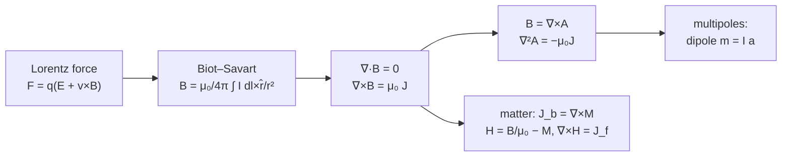
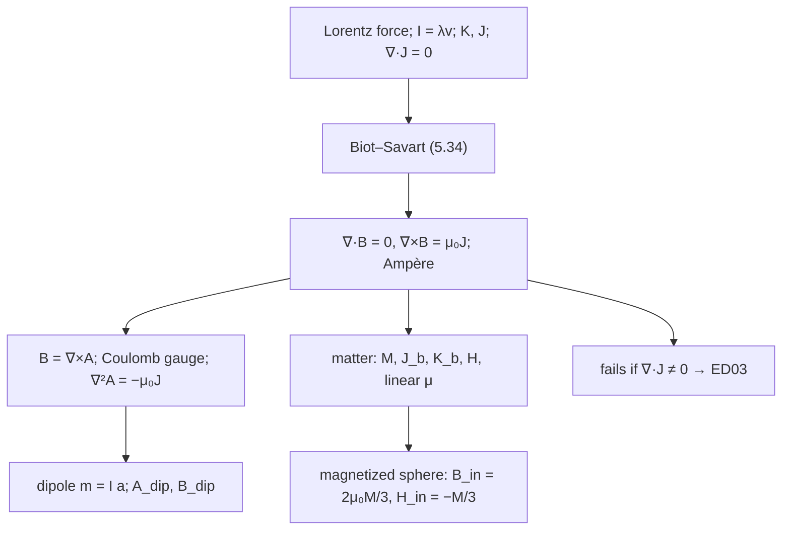

# ED02 · Magnetostatics: Review

◀ [[ED01 Electrostatics - Review]] · [[Electrodynamics - Course Map]] · ▶ [[ED03 Maxwell's Equations and Boundary Conditions]]

in course overview extra · book extra · beyond

> [!warning] Source status (every citation below was read in this session)
> Overview item *"review of electro- and magnetostatics"* (PH3114 outline; stated prerequisite Griffiths Ch. 1-6, so this is a **short review** that fixes the statements and numbers used in ED03-ED11). **Griffiths and Jackson carry equal weight.**
>
> **Read directly (Griffiths, printed pp., pdf = printed + 19):** §5.1 (Lorentz force, currents; equation-numbered passages and the cycloid) pp. 212-222; §5.2 (Biot-Savart, wire, force between wires, loop on the axis) pp. 223-228; §5.3 (divergence and curl of $\mathbf B$, Ampère's law, examples) pp. 229-238; §5.4 (vector potential, gauge, boundary conditions, multipole expansion, dipole) pp. 243-256, 263-264; §6.1-6.4 (magnetization, bound currents, $\mathbf H$, boundary conditions, linear media) pp. 267-287 and the equations (6.34)-(6.35) as stated in problems. **Jackson (Ch. 5 is SI, running header "-SI"; printed pp., pdf = printed + 26):** §5.1-5.4 pp. 174-181; §5.5 (the circular loop, partly) pp. 181-184; §5.6 (localized current distribution, magnetic moment) pp. 184-186; §5.8 (macroscopic equations, boundary conditions on $\mathbf B$ and $\mathbf H$) pp. 191-194; §5.10 (uniformly magnetized sphere) pp. 198-200.
>
> **Not cited because not read:** Griffiths §5.3.4 (comparison of magnetostatics and electrostatics), §6.1.1-6.1.3 (atomic origin of dia-/paramagnetism), §6.4.2 beyond a mention (ferromagnetism); Jackson §5.7 (force, torque and energy of a localized distribution; only its last page, p. 191, was read), §5.9, §5.11-5.14 and Faraday's law §5.15 onwards. Jackson's equations garbled in my copy ((5.82), (5.88)-(5.89), (5.105)) are described, not quoted. All numbers in the worked examples are computed in `scripts/ed02_numbers.py` and marked 🔵.

> [!syllabus] Syllabus map
> 🟢 **In course overview** (review): §1 forces and currents, §2 Biot-Savart, §3 divergence, curl and Ampère's law, §4 vector potential and gauge, §5 the magnetic dipole, §6 matter.
>
> 🟡 **Extra · book**: Jackson's elliptic-integral treatment of the circular loop, the uniformly magnetized sphere solved three ways.
>
> 🔵 **Extra · beyond (mine)**: numerical checks of every formula, the Helmholtz and anti-Helmholtz pairs and solenoids in the tool, the $\mathbf E\times\mathbf B$ drift as a bridge to ED11, `scripts/ed02_numbers.py`, `scripts/fig_ed02.py`, an interactive tool.

> [!key] After this chapter you can
> - state the Lorentz force law and why the magnetic force does no work,
> - compute $\mathbf B$ from Biot-Savart for a wire, a loop on its axis, and a solenoid, and use Ampère's law when symmetry allows,
> - write $\nabla\cdot\mathbf B=0$, $\nabla\times\mathbf B=\mu_0\mathbf J$, $\mathbf B=\nabla\times\mathbf A$, $\nabla^2\mathbf A=-\mu_0\mathbf J$ (Coulomb gauge) and the boundary conditions on $\mathbf B$ and $\mathbf A$,
> - expand a localized current distribution in multipoles: $\mathbf m=I\mathbf a=\frac12\int\mathbf r\times\mathbf J\,d\tau$, $\mathbf A_{\rm dip}=\frac{\mu_0}{4\pi}\frac{\mathbf m\times\hat{\mathbf r}}{r^2}$,
> - handle matter: $\mathbf J_b=\nabla\times\mathbf M$, $\mathbf K_b=\mathbf M\times\hat{\mathbf n}$, $\mathbf H=\mathbf B/\mu_0-\mathbf M$, $\nabla\times\mathbf H=\mathbf J_f$, and linear media $\mathbf B=\mu\mathbf H$.

> [!intuition] The one-sentence story
> Magnetostatics is electrostatics with the roles of divergence and curl exchanged: there are no free magnetic charges, so $\nabla\cdot\mathbf B=0$ and a vector potential exists; currents are the sources and appear in the curl; and matter responds by magnetic dipoles whose net effect is a bound current, which is why $\mathbf B$ is the fundamental field and $\mathbf H$ the bookkeeping field for free currents.

## 1. Forces and currents (Griffiths §5.1, Jackson §5.1)
taught

**Lorentz force.** A charge $Q$ with velocity $\mathbf v$ in a magnetic field feels $\mathbf F_{\rm mag}=Q(\mathbf v\times\mathbf B)$ (5.1), and with an electric field $\mathbf F=Q[\mathbf E+(\mathbf v\times\mathbf B)]$ (5.2). In a uniform $\mathbf B$ a charge on a circle has $p=QBR$ (5.3), cyclotron frequency $\omega=QB/m$ (5.4). **The magnetic force does no work**: $dW=Q(\mathbf v\times\mathbf B)\cdot\mathbf v\,dt=0$ (5.11). Griffiths' example of crossed fields ($\mathbf E\perp\mathbf B$) integrates the equations $\ddot y=\omega\dot z$, $\ddot z=\omega(E/B-\dot y)$ (5.5), finds $y(t)=R(\omega t-\sin\omega t)$, $z(t)=R(1-\cos\omega t)$ with $R\equiv E/\omega B$ (5.7)-(5.8), i.e. the circle $(y-R\omega t)^2+(z-R)^2=R^2$ (5.9) rolling with the drift speed $u=\omega R=E/B$ (5.10): a cycloid.

**Currents.** A line charge $\lambda$ moving at $v$ is a current $I=\lambda v$ (5.13), a vector along the wire (5.14); the force on a current element is $d\mathbf F=I(d\mathbf l\times\mathbf B)$ (5.16)-(5.17). Surface and volume currents: $\mathbf K=\sigma\mathbf v$ (5.22)-(5.23), $\mathbf J=\rho\mathbf v$ (5.25)-(5.26), with $d\mathbf F=(\mathbf K\times\mathbf B)da$ (5.24), $d\mathbf F=(\mathbf J\times\mathbf B)d\tau$ (5.27); the current through a surface is $I=\int\mathbf J\cdot d\mathbf a$ (5.28); charge conservation $\nabla\cdot\mathbf J=-\partial\rho/\partial t$ (5.29), which in **magnetostatics** (steady currents, $\partial\rho/\partial t=0$) becomes $\nabla\cdot\mathbf J=0$ (5.33). Jackson defines $\mathbf B$ operationally by the torque on a small magnetic moment, $\mathbf N=\boldsymbol\mu\times\mathbf B$ (5.1), and writes the same continuity equation (5.2) and its steady-state form $\nabla\cdot\mathbf J=0$ (5.3); the force and torque on a current distribution in an external $\mathbf B$ are $\mathbf F=\int\mathbf J\times\mathbf B\,d^3x$ (5.12) and $\mathbf N=\int\mathbf x\times(\mathbf J\times\mathbf B)d^3x$ (5.13).

> [!example] Worked example 1: crossed fields and the energy balance (🔵)
> A proton in $E=10^5$ V/m and $B=1$ T (perpendicular), starting at rest (`ed02_numbers.py` §8): $\omega=9.57883\times10^7$ rad/s, period $6.5594\times10^{-8}$ s, $R=E/\omega B=1.0440$ mm; averaged over 20 periods the displacement along the drift direction is $1.000000\times10^5$ m/s $=E/B$. Integrating the Lorentz force numerically, $|\,\tfrac12mv^2-qEz\,|\le1.6\times10^{-10}$ of the maximum kinetic energy at all times: only the electric field does work (5.11). This is the same drift as in the boost argument of ED11 (worked example 5 there).

## 2. The Biot-Savart law (Griffiths §5.2, Jackson §5.2, §5.5)
taught

For a steady current,

$$\mathbf B(\mathbf r)=\frac{\mu_0}{4\pi}\int\frac{\mathbf I\times\hat{\boldsymbol{\mathfrak r}}}{\mathfrak r^2}dl'=\frac{\mu_0}{4\pi}I\int\frac{d\mathbf l'\times\hat{\boldsymbol{\mathfrak r}}}{\mathfrak r^2}\ \ (5.34),\qquad\mu_0=4\pi\times10^{-7}\ {\rm N/A^2}\ (5.35),$$

with the tesla $1\,{\rm T}=1\,{\rm N/(A\,m)}$ (5.36) and the surface and volume versions (5.42) $\frac{\mu_0}{4\pi}\int\frac{\mathbf K\times\hat{\boldsymbol{\mathfrak r}}}{\mathfrak r^2}da'$, $\frac{\mu_0}{4\pi}\int\frac{\mathbf J\times\hat{\boldsymbol{\mathfrak r}}}{\mathfrak r^2}d\tau'$, and the (approximate, low-speed) field of a point charge $\mathbf B=\frac{\mu_0}{4\pi}\frac{q\mathbf v\times\hat{\boldsymbol{\mathfrak r}}}{\mathfrak r^2}$ (5.43). Jackson (5.4): $d\mathbf B=k\,I\,\frac{d\mathbf l\times\mathbf x}{|\mathbf x|^3}$ with $k=\mu_0/4\pi=10^{-7}$ N/A² in SI and $k=1/c$ in Gaussian units; he warns that (5.4) has meaning only as one element of a sum over a closed circuit ("the continuity equation (5.3) is not satisfied for the current element $I\,d\mathbf l$ standing alone") and that (5.5), the field of a moving charge, is valid only at speeds small compared to $c$ and without acceleration (ED09 gives the exact field). In SI "$\mathbf E$ and $c\mathbf B$ form the field-strength tensor", which is why they share a transformation law in ED11.

**A straight wire:** with the angles $\theta_1,\theta_2$ to the ends, $B=\frac{\mu_0I}{4\pi s}(\sin\theta_2-\sin\theta_1)$ (5.37), and for an infinite wire (5.38)-(5.39)

$$\mathbf B=\frac{\mu_0I}{2\pi s}\hat{\boldsymbol\phi},\qquad\text{force per unit length between two parallel wires: }f=\frac{\mu_0I_1I_2}{2\pi d}\ \ (5.40),$$

attractive for parallel currents (Jackson (5.7)-(5.11): the elementary law $d\mathbf F=I_1(d\mathbf l_1\times\mathbf B)$ and Ampère's law of force between loops, which Jackson rewrites in a form symmetric in the two loops obeying Newton's third law). **A circular loop** of radius $R$, on its axis: $B(z)=\frac{\mu_0I}{2}\frac{R^2}{(R^2+z^2)^{3/2}}$ (5.41). Jackson §5.5 treats the same loop off the axis: $A_\phi$ as an integral (5.36) that "can be expressed in terms of the complete elliptic integrals $K$ and $E$", and as a series in Legendre functions (5.46)-(5.49): for $r\gg a$ the leading term is the dipole field (5.41), for $r\ll a$ the leading term is "$\mu_0I/2a$ in the $z$ direction". He notes "associated Legendre polynomials appear" because of the vector character of the current.

> [!example] Worked example 2: Biot-Savart numerically (🔵)
> (`ed02_numbers.py` §1-§2.) For a unit loop ($a=1$, $I=1$) the numerical Biot-Savart integral gives on the axis $B_z=6.28318531,\ 4.49588143,\ 2.22144147,\ 0.561985178\times10^{-7}$ T at $z/a=0,0.5,1,2$, equal to $\frac{\mu_0Ia^2}{2(a^2+z^2)^{3/2}}$ to nine digits, and at $(\rho,z)=(0.6a,0.4a)$ the components $(B_\rho,B_z)=(2.27409777,\,5.06928315)\times10^{-7}$ T equal the elliptic-integral formula used by the interactive tool. A finite wire of length $1,10,100,1000$ m at $s=5$ cm, $I=10$ A, gives $3.980149,\ 3.999800,\ 3.999998,\ 4.000000\times10^{-5}$ T against the infinite-wire value $4.000000\times10^{-5}$ T; two 1 A wires 1 m apart attract with $2.000000\times10^{-7}$ N/m.

## 3. Divergence, curl and Ampère's law (Griffiths §5.3, Jackson §5.3)
taught

From (5.47) $\mathbf B=\frac{\mu_0}{4\pi}\int\frac{\mathbf J\times\hat{\boldsymbol{\mathfrak r}}}{\mathfrak r^2}d\tau'$, Griffiths computes the divergence using $\nabla\cdot(\mathbf J\times\hat{\boldsymbol{\mathfrak r}}/\mathfrak r^2)=\ldots$ and $\nabla\times(\hat{\boldsymbol{\mathfrak r}}/\mathfrak r^2)=0$ (5.48)-(5.50): $\nabla\cdot\mathbf B=0$. For the curl he uses $\nabla\cdot(\hat{\boldsymbol{\mathfrak r}}/\mathfrak r^2)=4\pi\delta^3$ (5.53) and $\nabla\cdot\mathbf J=0$, obtaining

$$\boxed{\nabla\cdot\mathbf B=0,\qquad\nabla\times\mathbf B=\mu_0\mathbf J}\ \ (5.50),(5.56),\qquad\oint\mathbf B\cdot d\mathbf l=\mu_0I_{\rm enc}\ \ (5.44),(5.57).$$

Jackson (5.16)-(5.22) arrives at the same pair, noting that $\nabla\cdot\mathbf B=0$ "is the first equation of magnetostatics and corresponds to $\nabla\times\mathbf E=0$ in electrostatics", and that $\nabla\times\mathbf B=\mu_0\mathbf J$ (5.22) needs $\nabla\cdot\mathbf J=0$ in the step from (5.20) to (5.21); Ampère's law (5.25), $\oint\mathbf B\cdot d\mathbf l=\mu_0I$, is the integral form, "just as Gauss's law can be used … in highly symmetric situations". Where $\mathbf J=0$, $\nabla\times\mathbf B=0$ permits a magnetic scalar potential $\mathbf B=-\nabla\Phi_M$ obeying Laplace's equation (Jackson, after (5.26); Griffiths (5.67)). **Beyond magnetostatics:** taking the divergence of $\nabla\times\mathbf B=\mu_0\mathbf J$ gives $\nabla\cdot\mathbf J=0$, which fails when charge accumulates; Griffiths' problem asks the reader to "show that Ampère's law cannot be valid, in general, outside magnetostatics": the starting point of ED03.

Ampère's law in use (Griffiths §5.3.3): an infinite plane current $\mathbf K=K\hat{\mathbf x}$ gives $\mathbf B=\mp\frac{\mu_0}2K\hat{\mathbf y}$ above and below (5.58); a long solenoid with $n$ turns per unit length has $\mathbf B=\mu_0nI\hat{\mathbf z}$ inside and zero outside (5.59); a toroid gives $\propto1/s$ inside the coil (5.60).

> [!example] Worked example 3: the two equations checked by differentiation (🔵)
> A long cylinder of radius $R=2$ cm carries $I=5$ A uniformly: $B=\frac{\mu_0Is}{2\pi R^2}$ inside, $\frac{\mu_0I}{2\pi s}$ outside. Central finite differences at $s=8.1$ mm give $(\nabla\times\mathbf B)_z=5.000000\times10^{-3}$ T/m, exactly $\mu_0J_z=\mu_0I/\pi R^2$, and $\nabla\cdot\mathbf B=-1.7\times10^{-14}$ T/m; at $s=3.6$ cm (outside) $\nabla\times\mathbf B=3\times10^{-14}$ and $\nabla\cdot\mathbf B=5\times10^{-14}$ T/m, i.e. zero to rounding; the Amperian loop at $s=3$ cm gives $B\cdot2\pi s=6.283185\times10^{-6}$ T m $=\mu_0I$. For the long solenoid ($n=2000$ m$^{-1}$, $I=1$ A, $a=2$ cm), summing loops gives the central field $B=1.1242\times10^{-3}$, $2.3336\times10^{-3}$, $2.5008\times10^{-3}$, $2.5128\times10^{-3}$ T for lengths $L/a=1,5,20,100$ against $\mu_0nI=2.5133\times10^{-3}$ T; the exact finite-length value $\frac{\mu_0nIL}{2\sqrt{(L/2)^2+a^2}}$ matches to $10^{-4}$ or better.

## 4. The vector potential and boundary conditions (Griffiths §5.4, Jackson §5.4)
taught

Because $\nabla\cdot\mathbf B=0$ one can write $\mathbf B=\nabla\times\mathbf A$ (5.61) (Griffiths: authorized by Theorem 2 of Sect. 1.6.2; Jackson (5.27)). Then $\nabla\cdot\mathbf B=0$ is automatic and Ampère's law becomes $\nabla(\nabla\cdot\mathbf A)-\nabla^2\mathbf A=\mu_0\mathbf J$ (5.62). $\mathbf A$ is ambiguous by a gradient: $\mathbf A\to\mathbf A+\nabla\lambda$ (Jackson (5.29), "a gauge transformation"). One can always arrange $\nabla\cdot\mathbf A=0$: if $\mathbf A_0$ has divergence, add $\nabla\lambda$ with $\nabla^2\lambda=-\nabla\cdot\mathbf A_0$, which is Poisson's equation with $\nabla\cdot\mathbf A_0$ as source (Griffiths pp. 243-244). In this **Coulomb gauge** (Jackson footnote: "the choice is called the Coulomb gauge, for a reason that will become apparent in Section 6.3"):

$$\nabla\cdot\mathbf A=0\ (5.63),\qquad\nabla^2\mathbf A=-\mu_0\mathbf J\ (5.64),\qquad\mathbf A(\mathbf r)=\frac{\mu_0}{4\pi}\int\frac{\mathbf J(\mathbf r')}{\mathfrak r}d\tau'\ (5.65),$$

three Poisson equations, one per **Cartesian** component (Griffiths footnote 19: in curvilinear coordinates the unit vectors vary, so $\nabla^2A_r\ne-\mu_0J_r$); line and surface versions (5.66); Jackson (5.28)-(5.32): the general solution is $\mathbf A=\frac{\mu_0}{4\pi}\int\frac{\mathbf J(\mathbf x')}{|\mathbf x-\mathbf x'|}d^3x'+\nabla\psi$ (5.28), and in the Coulomb gauge $\psi$ is a constant (5.32) (his reason: $\nabla\cdot\mathbf A=0$ reduces to $\nabla^2\psi=0$ since $\nabla'\cdot\mathbf J=0$). Griffiths' examples: a spinning charged shell (Example 5.11) has $\mathbf A\propto\boldsymbol\omega\times\mathbf r$ inside, $\mathbf A=\frac{\mu_0R\sigma}{3}(\boldsymbol\omega\times\mathbf r)$ (5.68)-(5.69), and a uniform interior field $\mathbf B=\frac23\mu_0\sigma R\boldsymbol\omega$ (5.70); an **infinite solenoid** has

$$\mathbf A=\frac{\mu_0nI}2s\hat{\boldsymbol\phi}\ (s\le R),\qquad\mathbf A=\frac{\mu_0nIR^2}{2s}\hat{\boldsymbol\phi}\ (s\ge R)\ \ (5.72),(5.73),$$

with $\oint\mathbf A\cdot d\mathbf l=\int\mathbf B\cdot d\mathbf a=\Phi$ (5.71). **Boundary conditions across a surface current $\mathbf K$:** $B^\perp$ continuous (5.74), $B^\parallel$ jumps by $\mu_0K$ (5.75), combined $\mathbf B_{\rm above}-\mathbf B_{\rm below}=\mu_0(\mathbf K\times\hat{\mathbf n})$ (5.76); the vector potential is continuous (5.77) with $\partial\mathbf A_{\rm above}/\partial n-\partial\mathbf A_{\rm below}/\partial n=-\mu_0\mathbf K$ (5.78).

> [!example] Worked example 4: the solenoid potential in numbers (🔵)
> $n=2000$ m$^{-1}$, $I=1$ A, $R=3$ cm (`ed02_numbers.py` §4): $\nabla\times\mathbf A$ from finite differences gives $(0,0,2.513\times10^{-3})$ T inside $=\mu_0nI$ and exactly $0$ outside, while $\mathbf A\ne0$ outside; the circulation of $\mathbf A$ around $s=5$ cm is $7.106115\times10^{-6}$ T m$^2$ and equals $B\pi R^2=7.106115\times10^{-6}$ T m$^2$. The field vanishes outside but the potential does not: only its curl is physical here, which is the first hint of why ED08 treats $\mathbf A$ and $V$ as the fundamental objects of electrodynamics.

## 5. The magnetic dipole (Griffiths §5.4.3, Jackson §5.6)
taught

With $1/\mathfrak r=\sum(r')^nP_n(\cos\alpha)/r^{n+1}$ (5.79) the vector potential of a current loop expands as (5.80) $\mathbf A=\frac{\mu_0I}{4\pi}\sum\frac1{r^{n+1}}\oint(r')^nP_n(\cos\alpha)d\mathbf l'$. **The monopole term vanishes**, $\oint d\mathbf l'=0$ (5.82): "no magnetic monopoles in nature (an assumption contained in $\nabla\cdot\mathbf B=0$)". The dipole term is $\mathbf A_{\rm dip}=\frac{\mu_0I}{4\pi r^2}\oint(\hat{\mathbf r}\cdot\mathbf r')d\mathbf l'$ (5.83), which becomes (5.85)-(5.86)

$$\mathbf A_{\rm dip}=\frac{\mu_0}{4\pi}\frac{\mathbf m\times\hat{\mathbf r}}{r^2},\qquad\mathbf m\equiv I\int d\mathbf a=I\mathbf a\ \ (5.86),\qquad\mathbf B_{\rm dip}=\frac{\mu_0m}{4\pi r^3}(2\cos\theta\,\hat{\mathbf r}+\sin\theta\,\hat{\boldsymbol\theta})=\frac{\mu_0}{4\pi r^3}[3(\mathbf m\cdot\hat{\mathbf r})\hat{\mathbf r}-\mathbf m]\ \ (5.88),(5.89),$$

with $\mathbf a$ the vector area (right-hand rule), and for a volume current (as stated in the problem following (5.89)) $\mathbf m=\frac12\int(\mathbf r\times\mathbf J)d\tau$ (5.90). The magnetic dipole moment is **independent of the origin** because the monopole term is zero, unlike the electric dipole; a pure dipole needs a vanishing loop with $m=Ia$ fixed; the dipole field is identical in structure to the electric dipole field (3.103), although "up close the field of a physical magnetic dipole (a small current loop) looks quite different from the field of a physical electric dipole" (Fig. 5.55). Griffiths also gives the contact term: the exact dipole field includes a $\delta^3(\mathbf r)$ piece (5.94), $\frac{\mu_0}{4\pi}\frac{8\pi}{3}\mathbf m\,\delta^3(\mathbf r)=\frac23\mu_0\mathbf m\,\delta^3(\mathbf r)$ (my reading of the garbled equation, consistent with the average of $\mathbf B$ over a sphere enclosing the current, (5.93), which equals $\frac{\mu_0}{4\pi}\frac{2\mathbf m}{R^3}$ and agrees with $\frac23\mu_0\mathbf M$ for the uniformly magnetized sphere). Jackson's hyperfine discussion (end of §5.7, p. 191) uses the same "contact" term, whose coefficient $8\pi/3$ would be $-4\pi/3$ if intrinsic moments were made of magnetic charges: the 21 cm line would be at 42 cm and the singlet and triplet reversed, so the experiments support moments made of electric currents. **Jackson (5.50)-(5.56):** expanding $1/|\mathbf x-\mathbf x'|$ (5.50), the divergenceless localized $\mathbf J$ gives no monopole term (5.52 with $f=1$, $g=x_i$) and the dipole term involves the magnetization $\mathscr M=\frac12\mathbf x\times\mathbf J$ (5.53), $\mathbf m=\frac12\int\mathbf x'\times\mathbf J\,d^3x'$ (5.54), $\mathbf A=\frac{\mu_0}{4\pi}\frac{\mathbf m\times\mathbf x}{|\mathbf x|^3}$ (5.55) and $\mathbf B=\frac{\mu_0}{4\pi}\frac{3\hat{\mathbf n}(\hat{\mathbf n}\cdot\mathbf m)-\mathbf m}{|\mathbf x|^3}$ (5.56), "exactly the form (4.13) of the field of an electric dipole". For a plane loop $m=IA$.

> [!example] Worked example 5: how good is the dipole field of a loop? (🔵)
> A loop with $a=1$ cm, $I=1$ A ($m=\pi a^2I=3.14\times10^{-4}$ A m$^2$) at $\theta=60^\circ$ (`ed02_numbers.py` §5): the relative difference between the numerical Biot-Savart field and the dipole formula is $1.094\times10^{-1}$, $1.007\times10^{-2}$, $1.121\times10^{-3}$ at $r/a=3,10,30$: it follows $(a/r)^2=1.11\times10^{-1},\,1.00\times10^{-2},\,1.11\times10^{-3}$, the relative size of the next multipole (Fig. ED02.1 B). On the axis at $z=10$ cm the dipole field is $\mu_0m/2\pi z^3=6.283\times10^{-8}$ T and the exact loop field is smaller by $(1+a^2/z^2)^{-3/2}\approx1-\frac32\times10^{-2}$.

## 6. Magnetic fields in matter (Griffiths Ch. 6, Jackson §5.8, §5.10)
taught

**Torque and force on a dipole.** $\mathbf N=\mathbf m\times\mathbf B$ (6.1) and, for an infinitesimal loop, $\mathbf F=\nabla(\mathbf m\cdot\mathbf B)$ (6.3); the energy of a dipole in a field is $U=-\mathbf m\cdot\mathbf B$ (6.34, derived in Griffiths' Problem as stated) and the interaction of two dipoles $U=\frac{\mu_0}{4\pi r^3}[\mathbf m_1\cdot\mathbf m_2-3(\mathbf m_1\cdot\hat{\mathbf r})(\mathbf m_2\cdot\hat{\mathbf r})]$ (6.35, as stated).

**Bound currents.** Magnetization $\mathbf M$ is the dipole moment per unit volume (6.9) (Jackson (5.76), $\mathbf M=\sum N_i\langle\mathbf m_i\rangle$). The potential of a magnetized object, $\mathbf A=\frac{\mu_0}{4\pi}\int\frac{\mathbf M(\mathbf r')\times\hat{\boldsymbol{\mathfrak r}}}{\mathfrak r^2}d\tau'$ (6.11), rewrites after integration by parts as that of a volume and a surface current (6.12)-(6.15):

$$\boxed{\mathbf J_b=\nabla\times\mathbf M,\qquad\mathbf K_b=\mathbf M\times\hat{\mathbf n}}$$

(Jackson (5.77)-(5.79): "the magnetization is seen to contribute an effective current density $\mathbf J_M=\nabla\times\mathbf M$"). The macroscopic field is the average over many atoms (Griffiths §6.2.3), and $\nabla\cdot\mathbf B=0$ still holds for it (Jackson (5.75)). **The auxiliary field:** with $\mathbf J=\mathbf J_b+\mathbf J_f$ (6.17),

$$\mathbf H\equiv\frac1{\mu_0}\mathbf B-\mathbf M\ \ (6.18),\qquad\nabla\times\mathbf H=\mathbf J_f\ \ (6.19),\qquad\oint\mathbf H\cdot d\mathbf l=I_{f,{\rm enc}}\ \ (6.20)$$

(Jackson (5.81)-(5.82)), "completely analogous to the introduction of $\mathbf D$ for the electrostatic field"; $\mathbf H$ lets Ampère's law refer only to free current, "which we control directly". But $\mathbf H$ is not an "$\mathbf B$ with only free currents": $\nabla\cdot\mathbf H=-\nabla\cdot\mathbf M\ne0$ in general (6.23), so symmetry is needed. Example 6.2: a long copper rod (weakly diamagnetic) of radius $R$ with free current $I$ has $\mathbf H=\frac{I}{2\pi R^2}s\hat{\boldsymbol\phi}$ inside and $\frac I{2\pi s}\hat{\boldsymbol\phi}$ outside (6.21)-(6.22), independent of the material. **Boundary conditions** (Griffiths): $H^\perp_{\rm above}-H^\perp_{\rm below}=-(M^\perp_{\rm above}-M^\perp_{\rm below})$ (6.24), $\mathbf H^\parallel_{\rm above}-\mathbf H^\parallel_{\rm below}=\mathbf K_f\times\hat{\mathbf n}$ (6.25), $B^\perp$ continuous (6.26), $\mathbf B^\parallel_{\rm above}-\mathbf B^\parallel_{\rm below}=\mu_0(\mathbf K\times\hat{\mathbf n})$ (6.27) with $\mathbf K$ the total current; Jackson (5.86)-(5.87): $(\mathbf B_2-\mathbf B_1)\cdot\mathbf n=0$ and $\mathbf n\times(\mathbf H_2-\mathbf H_1)=\mathbf K$ with $\mathbf K$ the free surface current.

**Linear media.** Custom writes $\mathbf M=\chi_m\mathbf H$ (6.29) (not $\mathbf M\propto\mathbf B$, (6.28), "incorrect!"): then $\mathbf B=\mu_0(1+\chi_m)\mathbf H=\mu\mathbf H$ (6.30)-(6.32), and $\mathbf J_b=\chi_m\mathbf J_f$ (6.33). Jackson (5.84): $\mathbf B=\mu\mathbf H$ for isotropic dia- and paramagnetic substances, $\mu/\mu_0$ differing from unity by a few parts in $10^5$ ($\mu>\mu_0$ paramagnetic, $\mu<\mu_0$ diamagnetic); for ferromagnets $\mathbf B=F(\mathbf H)$ (5.85), hysteresis, not single valued, with incremental permeability up to $10^6\mu_0$. At the surface of a medium of very high permeability $\mathbf H$ is normal to the surface "the same as for the electric field at the surface of a conductor", so electrostatic potential theory can be used (Jackson p. 194).

**The uniformly magnetized sphere.** Griffiths (§6.2.1): the field of a uniformly magnetized sphere equals that of a spinning charged shell with $\sigma R\omega\to M$, hence **inside $\mathbf B=\frac23\mu_0\mathbf M$** (6.16) (uniform), outside a perfect dipole; "curiously different $\frac23$ in place of $-\frac13$" from the electric case (4.14). Jackson (§5.10, three methods: magnetic scalar potential with $\sigma_M=\hat{\mathbf n}\cdot\mathbf M=M_0\cos\theta$, direct integration, and the vector potential from the surface current): $\mathbf H_{\rm in}=-\frac13\mathbf M$ (5.105) and $\mathbf B_{\rm in}$ parallel to $\mathbf M$ while $\mathbf H_{\rm in}$ is antiparallel; outside, a dipole of moment $\mathbf m=\frac{4\pi a^3}3\mathbf M$ (5.107); "for this special geometry (and this only) there are no higher multipoles"; the lines of $\mathbf B$ are closed, those of $\mathbf H$ end on the surface where the effective surface magnetic charge $\sigma_M$ resides (Fig. 5.11).

> [!example] Worked example 6: the magnetized sphere and a filled solenoid (🔵)
> $M=10^5$ A/m, $R=5$ cm (`ed02_numbers.py` §6-§7). Summing the bound-current rings $K_b=M\sin\theta$ gives $B(0)=8.37758041\times10^{-2}$ T $=\frac23\mu_0M$ and $H(0)=B/\mu_0-M=-3.333333\times10^4$ A/m $=-M/3$; on the axis at $z=20$ cm the sum of rings is $1.30899694\times10^{-3}$ T, equal to the dipole value $\mu_0m/2\pi z^3$ with $m=\frac43\pi R^3M$ to eight digits: no higher multipoles. A long solenoid ($n=2000$ m$^{-1}$, $I=1$ A) filled with a linear medium has $H=nI=2000$ A/m for any $\chi_m$; for $\chi_m=-10^{-5}$ (an assumed diamagnet), $2\times10^{-4}$ and $10^3$: $B=\mu_0(1+\chi_m)H=2.513249\times10^{-3}$, $2.513777\times10^{-3}$, $2.515787$ T; the bound surface current is $K_b=M=\chi_mH=-2\times10^{-2}$, $0.4$, $2\times10^6$ A/m, i.e. $\chi_m$ times the free one (6.33).

> [!example] Worked example 7: Helmholtz and anti-Helmholtz pairs (🔵 beyond)
> Two coaxial loops of radius $a$ with the same current at separation $d$: the on-axis field is the sum of two (5.41) terms. The second derivative of $B_z$ at the centre is $-2.29\times10^{-6}$, $-2\times10^{-12}$ (zero), $+9.9\times10^{-7}$ T/a² for $d/a=0.5,1,1.5$ (units $\mu_0I=4\pi\times10^{-7}$ with $I=1$ A): it vanishes at $d=a$ (Helmholtz), where $B(0)=(4/5)^{3/2}\mu_0I/a=8.991763\times10^{-7}$ T. In the interactive tool the central $B_z$ is $1.431\,\mu_0I/2a$, and the line pattern shows why the interior is flat. Reversed currents give $B(0)=0$ with a nonzero gradient.

![[fig_ed02_magnetostatics.png|940]]
*Figure ED02.1. A: field lines of a circular current loop in a plane containing the axis ($\odot$ current out of the page, $\otimes$ into it): they are closed. B: the relative difference between the field of a loop and the pure-dipole field at $\theta=60^\circ$ falls as $(a/r)^2$. C: a uniformly magnetized sphere: $\mathbf B$ (blue, left half) is parallel to $\mathbf M$ inside and forms closed loops; $\mathbf H$ (orange, right half) is antiparallel to $\mathbf M$ inside and its lines begin and end on the surface.*

<!-- interactive:start (generated by scripts/embed_interactive.py; edit the tool in scripts/interactive/tools/, not this block) -->
> [!interactive]+ Interactive: Fields of current loops: single loop, Helmholtz pair, anti-Helmholtz pair and solenoid
> The magnetic field of circular current loops of radius a, computed exactly from the Biot–Savart law (elliptic integrals).
>
> ![[ed02_biot_savart.png|720]]
>
> **Try:** Single loop: compare the axis curve with the dipole curve far away. Pair: set the separation to exactly 1 and watch the central part of the B_z curve go flat (this is the Helmholtz condition). Solenoid: raise the number of turns at fixed length (more current per length, field up) and lengthen it at fixed n to see B at the centre → μ₀nI and the field outside → 0.
>
> [▶ Open the tool in your browser](../Assets/interactive/ed02_biot_savart.html) · [absolute link](file:///home/swastik/Documents/notes/Assets/interactive/ed02_biot_savart.html) · all tools and coverage: [[Interactive Tools]]

<!-- interactive:end -->

## Map of this chapter

## Common mistakes
1. Using Ampère's law $\nabla\times\mathbf B=\mu_0\mathbf J$ when charge is accumulating ($\nabla\cdot\mathbf J\ne0$): that is ED03's displacement current.
2. Treating $I\,d\mathbf l$ as the analogue of $q$ and the Biot-Savart law as the magnetic Coulomb law: it holds only summed over a closed circuit (Jackson's caution).
3. Applying $\nabla^2\mathbf A=-\mu_0\mathbf J$ in curvilinear coordinates componentwise ($\nabla^2A_r\ne-\mu_0J_r$).
4. Believing $\mathbf B=0$ implies $\mathbf A=0$ (the infinite solenoid has $\mathbf A\ne0$ outside).
5. Using $\mathbf H$ as "the field of the free currents": $\nabla\cdot\mathbf H=-\nabla\cdot\mathbf M\ne0$ and $\oint\mathbf H\cdot d\mathbf l=I_f$ gives $\mathbf H$ only when the symmetry fixes it.
6. Writing $\mathbf M=\chi_m\mathbf B/\mu_0$ instead of $\chi_m\mathbf H$: the sign and size differ for ferromagnets.
7. Forgetting that the magnetic force does no work: the energy that lifts a weight with a current loop comes from the source that sustains the current.

## Summary
- $\mathbf F=q(\mathbf E+\mathbf v\times\mathbf B)$, $d\mathbf F=I\,d\mathbf l\times\mathbf B$; $\nabla\cdot\mathbf J=0$ for steady currents; magnetic force does no work (drift $E/B$ in crossed fields).
- $\mathbf B=\frac{\mu_0}{4\pi}\int\frac{I\,d\mathbf l'\times\hat{\boldsymbol{\mathfrak r}}}{\mathfrak r^2}$; wire $\frac{\mu_0I}{2\pi s}$; loop axis $\frac{\mu_0I}2\frac{R^2}{(R^2+z^2)^{3/2}}$; solenoid $\mu_0nI$; parallel wires attract with $\frac{\mu_0I_1I_2}{2\pi d}$ per length.
- $\nabla\cdot\mathbf B=0$, $\nabla\times\mathbf B=\mu_0\mathbf J$; $\mathbf B=\nabla\times\mathbf A$, Coulomb gauge $\nabla\cdot\mathbf A=0$, $\nabla^2\mathbf A=-\mu_0\mathbf J$; $B^\perp$ continuous, $\Delta B^\parallel=\mu_0K$; solenoid $A=\mu_0nIs/2$ inside.
- Dipole: no monopole; $\mathbf m=I\mathbf a$ independent of the origin; $\mathbf A=\frac{\mu_0}{4\pi}\frac{\mathbf m\times\hat{\mathbf r}}{r^2}$; error of the dipole field $\sim(a/r)^2$.
- Matter: $\mathbf J_b=\nabla\times\mathbf M$, $\mathbf K_b=\mathbf M\times\hat{\mathbf n}$, $\mathbf H=\mathbf B/\mu_0-\mathbf M$, $\nabla\times\mathbf H=\mathbf J_f$, linear $\mathbf B=\mu\mathbf H$; magnetized sphere $\mathbf B_{\rm in}=\frac23\mu_0\mathbf M$, $\mathbf H_{\rm in}=-\frac13\mathbf M$.

## Practice
> [!question]- P1. A long straight wire
> $I=10$ A. Find $B$ at $s=5$ cm. How long must a finite wire be for the infinite formula to be good to 1%, to $10^{-4}$?
>
> **Solution.** $B=\frac{\mu_0I}{2\pi s}=4.0\times10^{-5}$ T. For a finite wire symmetric about the foot of the perpendicular, $B=\frac{\mu_0I}{4\pi s}\cdot2\sin\theta$ with $\sin\theta=\frac{L/2}{\sqrt{(L/2)^2+s^2}}$ (5.37): $L=1$ m gives $3.980\times10^{-5}$ T (0.5% low); $L=10$ m gives $3.9998\times10^{-5}$ T ($5\times10^{-5}$ relative error). (The 1% level is reached already at $L\approx0.7$ m.)

> [!question]- P2. Loop at the centre
> A circular loop of radius $5$ cm carries $2$ A. Find $B$ at the centre.
>
> **Solution.** (5.41) at $z=0$: $B=\frac{\mu_0I}{2R}=\frac{4\pi\times10^{-7}\cdot2}{0.1}=2.513\times10^{-5}$ T.

> [!question]- P3. Uniform current in a cylinder
> $I=5$ A in a cylinder of radius $2$ cm. Find $B$ at $s=1$ cm and $s=3$ cm.
>
> **Solution.** Ampère (5.44): inside $B=\frac{\mu_0Is}{2\pi R^2}=2.5\times10^{-5}$ T; outside $B=\frac{\mu_0I}{2\pi s}=3.33\times10^{-5}$ T.

> [!question]- P4. A finite solenoid
> $n=2000$ m$^{-1}$, $I=1$ A, radius 2 cm: central field for $L/a=5$ and 20, as a fraction of $\mu_0nI$.
>
> **Solution.** $B=\frac{\mu_0nIL}{2\sqrt{(L/2)^2+a^2}}$: $2.3335\times10^{-3}$ T ($0.9285\,\mu_0nI$) and $2.5008\times10^{-3}$ T ($0.9950\,\mu_0nI$).

> [!question]- P5. Why $\mathbf A\ne0$ outside a solenoid?
> Show that $\oint\mathbf A\cdot d\mathbf l=\Phi$ forces $A_\phi=\Phi/2\pi s$ outside, with $\Phi=7.1\times10^{-6}$ T m$^2$ for $R=3$ cm, $n=2000$ m$^{-1}$, $I=1$ A.
>
> **Solution.** Stokes: $\oint\mathbf A\cdot d\mathbf l=\int\mathbf B\cdot d\mathbf a=B\pi R^2=\mu_0nI\pi R^2=7.106\times10^{-6}$ T m$^2$; by symmetry $A_\phi\cdot2\pi s=\Phi$, so $A_\phi=\frac{\mu_0nIR^2}{2s}$ (5.73), non-zero although $\mathbf B=0$ there.

> [!question]- P6. Dipole moment and field of a loop
> A loop with $a=1$ cm and $I=1$ A: $m$, and the dipole-approximation field at $z=10$ cm on the axis; relative error?
>
> **Solution.** $m=\pi a^2I=3.14\times10^{-4}$ A m$^2$; $B=\frac{\mu_0m}{2\pi z^3}=6.28\times10^{-8}$ T; the exact loop field $\frac{\mu_0Ia^2}{2(a^2+z^2)^{3/2}}$ is smaller than the dipole value by the factor $(1+a^2/z^2)^{-3/2}$, so the dipole approximation overestimates by $\approx\frac32\frac{a^2}{z^2}=1.5\%$.

> [!question]- P7. Origin independence
> Why is $\mathbf m$ independent of the origin but $\mathbf p$ is not (in general)?
>
> **Solution.** Shifting the origin by $\mathbf d$ changes $\mathbf p\to\mathbf p-Q\mathbf d$, which vanishes only if the total charge $Q=0$. For $\mathbf m=I\mathbf a$ the vector area of a closed loop is unchanged by a shift (the monopole term $\oint d\mathbf l=0$, (5.82)): "since the magnetic monopole moment is always zero, it is not really surprising that the magnetic dipole moment is always independent of origin".

> [!question]- P8. Magnetized cylinder
> A long cylinder with uniform axial magnetization $\mathbf M$. Find $\mathbf J_b$, $\mathbf K_b$ and $\mathbf B$ inside.
>
> **Solution.** $\mathbf J_b=\nabla\times\mathbf M=0$; $\mathbf K_b=\mathbf M\times\hat{\mathbf s}=M\hat{\boldsymbol\phi}$ (surface current $M$ per unit length, like a solenoid with $nI\to M$): $\mathbf B=\mu_0\mathbf M$ inside, zero outside; $\mathbf H=\mathbf B/\mu_0-\mathbf M=0$ inside.

> [!question]- P9. Uniformly magnetized sphere
> $M=10^5$ A/m. Find $\mathbf B$ and $\mathbf H$ inside and the dipole moment for $R=5$ cm.
>
> **Solution.** $B_{\rm in}=\frac23\mu_0M=0.0838$ T parallel to $\mathbf M$ (6.16); $H_{\rm in}=B/\mu_0-M=-M/3=-3.33\times10^4$ A/m (antiparallel, Jackson (5.105)); $m=\frac43\pi R^3M=52.4$ A m$^2$ (5.107).

> [!question]- P10. $\mathbf H$ of a copper rod
> A long rod of radius $R$ carries free current $I$ uniformly. Find $\mathbf H$ inside and outside, and compare $\mathbf B$ with the vacuum value.
>
> **Solution.** $\oint\mathbf H\cdot d\mathbf l=I_{f,{\rm enc}}$ gives $\mathbf H=\frac{Is}{2\pi R^2}\hat{\boldsymbol\phi}$ inside, $\frac{I}{2\pi s}\hat{\boldsymbol\phi}$ outside (6.21)-(6.22) for any material; $\mathbf B=\mu\mathbf H=\mu_0(1+\chi_m)\mathbf H$ inside differs from the vacuum value by the tiny factor $1+\chi_m$ (copper is weakly diamagnetic), and outside (where $\mathbf M=0$) $\mathbf B=\mu_0\mathbf H$ exactly.

> [!question]- P11. A filled solenoid
> $n=2000$ m$^{-1}$, $I=1$ A, linear core with $\chi_m=2\times10^{-4}$. Find $H$, $B$, $M$, $K_b$.
>
> **Solution.** $H=nI=2000$ A/m; $B=\mu_0(1+\chi_m)H=2.5138\times10^{-3}$ T; $M=\chi_mH=0.4$ A/m $=K_b$ (surface bound current per length), i.e. $\chi_m$ times the free surface current $nI$ (6.33).

> [!question]- P12. Current sheet
> A sheet with $K=10$ A/m: the field on both sides and the jump.
>
> **Solution.** (5.58): $B=\pm\frac{\mu_0}{2}K=\pm6.28\times10^{-6}$ T (parallel to the sheet, opposite on the two sides); $\mathbf B_{\rm above}-\mathbf B_{\rm below}=\mu_0(\mathbf K\times\hat{\mathbf n})$ (5.76), a jump of $\mu_0K=1.26\times10^{-5}$ T.

> [!question]- P13. Crossed fields
> A proton in $E=10^5$ V/m, $B=1$ T (perpendicular). Drift speed, cyclotron frequency, radius of the rolling circle.
>
> **Solution.** Drift $E/B=10^5$ m/s (5.10); $\omega=qB/m=9.58\times10^7$ s$^{-1}$ (5.4); $R=E/\omega B=1.04$ mm (5.8). Proton and electron drift the same way (the drift is independent of charge and mass).

> [!question]- P14. No work, yet a magnet lifts
> The magnetic force does no work (5.11). Explain how a current loop in a magnetic field can lift a weight.
>
> **Solution.** The force on the loop is the sum over carriers: the vertical component lifts, and as the carriers acquire the vertical velocity of the loop the magnetic force acquires a horizontal component opposing the carriers' motion along the wire (Griffiths (5.19)-(5.21)); the source driving the current must supply the corresponding work, the magnetic field only redirects it.

> [!question]- P15. A dipole in a field
> $m=0.3$ A m$^2$ in $B=0.1$ T at $30^\circ$: torque and energy.
>
> **Solution.** $N=mB\sin\theta=0.015$ N m (6.1); $U=-\mathbf m\cdot\mathbf B=-mB\cos\theta=-0.0260$ J (6.34, with the sign that the aligned state has the lowest energy).

## Zettel notes
<!-- zettel:start -->
<!-- zettel:end -->

## Provenance
> [!provenance]- Source map for this chapter (all rows read in this session)
> | Topic | Source | Scope |
> |---|---|---|
> | Lorentz force, no work, cycloid, currents $I,\mathbf K,\mathbf J$, continuity | Griffiths §5.1, (5.1)-(5.33), pp. 212-224; Jackson §5.1-5.2, (5.1)-(5.3), (5.12)-(5.13), pp. 174-178 | review |
> | Biot-Savart, wire, force between wires, loop on the axis | Griffiths §5.2, (5.34)-(5.43), pp. 224-228; Jackson §5.2, (5.4)-(5.11), pp. 175-178; §5.5, (5.33)-(5.49), pp. 181-184 | review |
> | divergence, curl, Ampère, examples | Griffiths §5.3, (5.44)-(5.60), pp. 230-238; Jackson §5.3, (5.16)-(5.26), pp. 179-180 | review |
> | vector potential, gauge, boundary conditions | Griffiths §5.4, (5.61)-(5.78), pp. 243-251; Jackson §5.4, (5.27)-(5.32), pp. 180-181 | review |
> | magnetic dipole, multipole expansion | Griffiths §5.4.3, (5.79)-(5.94), pp. 252-264; Jackson §5.6, (5.50)-(5.56), pp. 184-186 | review |
> | magnetization, bound currents, $\mathbf H$, boundary conditions, linear media | Griffiths §6.1-6.4, (6.1)-(6.35), pp. 267-292; Jackson §5.8, (5.75)-(5.89), pp. 191-194 | review |
> | uniformly magnetized sphere | Griffiths §6.2.1, (6.16), p. 276; Jackson §5.10, (5.104)-(5.111), pp. 198-200 | extra/book |
> | numbers, figure, tool (Helmholtz pair as an extension) | `scripts/ed02_numbers.py`, `scripts/fig_ed02.py`, `Assets/interactive/ed02_biot_savart.html` | extra/beyond |
