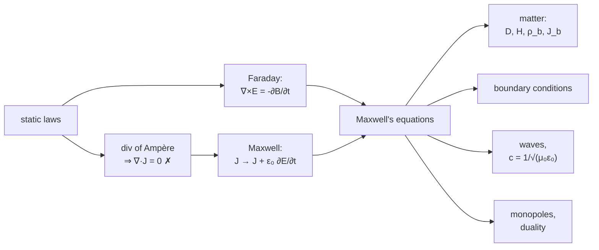
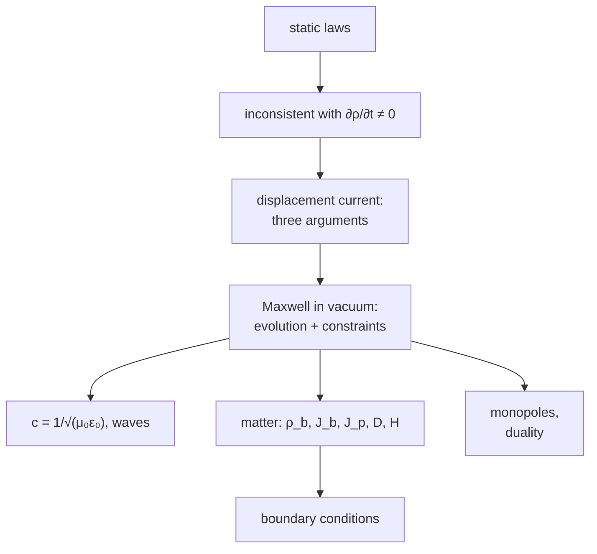

# ED03 · Maxwell's Equations and Boundary Conditions

◀ ED02 Magnetostatics: Review · [[Electrodynamics - Course Map]] · [[ED04 Conservation Laws - Energy, Momentum, Angular Momentum]] ▶

in course overview extra · book extra · beyond

> [!warning] Source status (every citation below was read in this session)
> Overview item *"Maxwell's equations"* (PH3114 outline; no lecture notes in the folder). **Griffiths and Jackson carry equal weight** (decision of 2026-11-04). Landau-Lifshitz Vol. 8 (named in the overview) is the third voice.
>
> **Read directly:** Griffiths §7.2.1 (printed pp. 312-317) and **all of §7.3** (pp. 332-344, i.e. 7.3.1-7.3.6; pdf = printed + 19); Jackson Introduction §I.5 (pp. 16-18), **§6.1** (pp. 237-239), **§6.6** (pp. 248-257), **§6.11** (pp. 273-275) and Problem 6.14 (pdf = printed + 26); Landau-Lifshitz Vol. 8 §75 (pp. 257-259) and the opening of §76 (p. 260-262). **Not cited because not read:** Griffiths §7.1 and §§7.2.2-7.2.4, Jackson §§6.2-6.5, 6.7 onward, Feynman Vol. 2 (not in the folder).
>
> **Conventions.** Jackson 3rd ed. §6.1 states that its Maxwell equations are in SI (the chapter running header says "-SI"); Landau-Lifshitz Vol. 8 is Gaussian. Griffiths takes the interface normal from medium 2 to 1, Jackson from 1 to 2 (§6).

> [!syllabus] Syllabus map
> 🟢 **In course overview**: §1-2 inconsistency and displacement current, §4 Maxwell's equations, §5 macroscopic equations ($\mathbf D,\mathbf H$), §6 boundary conditions.
>
> 🟡 **Extra · book**: §3 Faraday's law and Lenz (Griffiths §7.2 lies *outside* the stated prerequisite Ch. 1-6), §5.1 Jackson's spatial-averaging derivation, §7 magnetic charge and duality (Griffiths §7.3.4, Jackson §6.11).
>
> 🔵 **Extra · beyond (mine)**: the exact (Bessel) charging-capacitor solution, the counting of equations and constraints (§4.2), relaxation time and conductor/dielectric crossover numbers, field-line refraction numbers, `scripts/ed03_numbers.py`, `scripts/fig_ed03.py`.

> [!key] After this chapter you can
> - show that Ampère's law $\nabla\times\mathbf B=\mu_0\mathbf J$ **contradicts charge conservation** off the steady state, and repair it with the **displacement current** (three independent arguments),
> - state Faraday's law correctly and separate it from the **flux rule**,
> - write the four Maxwell equations in vacuum and in matter, differential and integral, and explain which equations are *constraints*,
> - identify bound charge, bound current and the **polarization current**, and say what Jackson's averaging adds,
> - derive and apply the four **boundary conditions** (and their perfect-conductor limit),
> - state what magnetic charge would do to the equations and why $\mathbf B=\nabla\times\mathbf A$ rests on its absence.

> [!intuition] The one-sentence story
> Four laws were found from steady experiments; Faraday supplied one time-dependent term ($\partial_t\mathbf B$ in the curl of $\mathbf E$), but Ampère's law has *no* partner term, and without one the system contradicts conservation of charge. Maxwell's single added term, $\mu_0\epsilon_0\,\partial_t\mathbf E$, closes the system and, as a bonus, makes the fields propagate as waves at $1/\sqrt{\mu_0\epsilon_0}$.

## 1. The static laws and their inconsistency
Griffiths (§7.3.1, "Electrodynamics Before Maxwell") lists the four laws known in the mid-nineteenth century, and Jackson (§6.1, (6.1)) lists the same four, with $\nabla\!\cdot\!\mathbf D=\rho$ and $\nabla\!\times\!\mathbf H=\mathbf J$ where Griffiths has $\mathbf E,\mathbf B$:

$$\nabla\!\cdot\!\mathbf E=\frac{\rho}{\epsilon_0},\qquad\nabla\!\cdot\!\mathbf B=0,\qquad\nabla\!\times\!\mathbf E=-\frac{\partial\mathbf B}{\partial t},\qquad\nabla\!\times\!\mathbf B=\mu_0\mathbf J .$$

Applying the divergence to each curl equation: for Faraday it gives $-\partial_t(\nabla\!\cdot\!\mathbf B)=0$, consistent with $\nabla\!\cdot\!\mathbf B=0$. For Ampère it gives

$$\nabla\!\cdot(\nabla\!\times\!\mathbf B)=0=\mu_0\,\nabla\!\cdot\!\mathbf J ,\tag{1.1}$$

yet charge is conserved locally,

$$\nabla\!\cdot\!\mathbf J+\frac{\partial\rho}{\partial t}=0 .\tag{1.2}$$

Equation (1.1) holds only for steady currents. Griffiths gives a second, picture-based version: charge a capacitor, and apply $\oint\mathbf B\!\cdot\!\mathrm d\mathbf l=\mu_0I_{\mathrm{enc}}$ to a loop around the wire. Using the flat disc spanning the loop (pierced by the wire) gives $I_{\mathrm{enc}}=I$; using a balloon-shaped surface that bulges between the plates (nothing pierces it) gives $I_{\mathrm{enc}}=0$. "The current enclosed by the loop" is ill-defined once charge piles up, so Ampère's law cannot be right outside magnetostatics. Jackson says the same in his own words: the four equations "are inconsistent as they stand", and Ampère's law is the faulty one.

## 2. Maxwell's repair: the displacement current
**Argument A (Griffiths §7.3.2, Jackson (6.2)-(6.5)).** Eliminate $\rho$ with Gauss: $\partial_t\rho=\epsilon_0\nabla\!\cdot\!\partial_t\mathbf E$, so (1.2) reads

$$\nabla\!\cdot\!\Bigl(\mathbf J+\epsilon_0\frac{\partial\mathbf E}{\partial t}\Bigr)=0 .$$

Replacing $\mathbf J$ in Ampère's law by this divergence-free combination gives

$$\boxed{\;\nabla\!\times\!\mathbf B=\mu_0\mathbf J+\mu_0\epsilon_0\frac{\partial\mathbf E}{\partial t}\;},\qquad\mathbf J_d\equiv\epsilon_0\frac{\partial\mathbf E}{\partial t}\ \text{(displacement current)}.\tag{2.1}$$

Both books note that the correction is invisible in the laboratory when $\partial_t\mathbf E$ is small (Griffiths: it "must compete for attention with $\mathbf J$", which is why Faraday never saw it) and decisive for rapidly varying fields: Jackson says that without it "there would be no electromagnetic radiation". Griffiths adds that Maxwell's own motivation was a now-discredited model of the ether, and that the modern consistency argument is the stronger one; the real confirmation was Hertz's 1888 experiments on electromagnetic waves.

**Argument B (Landau-Lifshitz Vol. 8 §75): no assumption about $\mathbf J$.** Put *extraneous* charges $\rho_{\mathrm{ex}}$ into a dielectric. Then $\nabla\!\cdot\!\mathbf D=4\pi\rho_{\mathrm{ex}}$ (Gaussian), and with $\partial_t\rho_{\mathrm{ex}}+\nabla\!\cdot\!\mathbf j_{\mathrm{ex}}=0$ one gets $\nabla\!\cdot\!\bigl(\partial_t\mathbf D+4\pi\mathbf j_{\mathrm{ex}}\bigr)=0$. A divergence-free vector is a curl, so it may be written as $c\,\nabla\times\mathbf H$, i.e.

$$\nabla\times\mathbf H=\frac{4\pi}{c}\mathbf j_{\mathrm{ex}}+\frac1c\frac{\partial\mathbf D}{\partial t}.$$

Landau-Lifshitz then identify $\mathbf H$ by matching to the static magnetic field and the vacuum equation. The logic is the same: **a field equation whose divergence is not zero cannot be a curl equation.**

**Argument C (symmetry, Griffiths §7.3.2).** "A changing magnetic field induces an electric field" (Faraday) deserves the converse "a changing electric field induces a magnetic field". Griffiths warns (footnote 21) that "induces" is slippery: charges and currents are the ultimate sources, and $\partial_t\mathbf E$ merely delivers their news.

> [!example] Worked example 1: the charging capacitor ($R=5$ cm plates, $d=2$ mm, wire current $I=2$ A)
> Between plates close together $E=Q/(\epsilon_0\pi R^2)$ and (Griffiths) $\partial_tE=I/(\epsilon_0\pi R^2)=2.876\times10^{13}$ V m⁻¹ s⁻¹. Resolve the paradox of §1: in integral form $\oint\mathbf B\!\cdot\!\mathrm d\mathbf l=\mu_0I_{\mathrm{enc}}+\mu_0\epsilon_0\int(\partial_t\mathbf E)\!\cdot\!\mathrm d\mathbf a$. For the flat surface, $\mathbf E=0$ there and $I_{\mathrm{enc}}=I$; for the balloon, $I_{\mathrm{enc}}=0$ but $\epsilon_0\int\partial_t\mathbf E\cdot\mathrm d\mathbf a=I$. Same answer, the first from conduction current and the second from displacement current.
>
> Now the field *inside* the gap. By symmetry $\mathbf B$ is azimuthal; on a circle of radius $r<R$,
>
> $$2\pi rB=\mu_0\epsilon_0\,\dot E\,\pi r^2\ \Longrightarrow\ B=\frac{\mu_0Ir}{2\pi R^2}\quad(r<R),\qquad B=\frac{\mu_0I}{2\pi r}\quad(r>R).$$
>
> At $r=2$ cm: $B=3.20\ \mu$T and the enclosed displacement current is $I(r/R)^2=0.32$ A; at $r=5$ and $10$ cm, $B=8.0$ and $4.0\ \mu$T, identical to the wire's field. The displacement current in the gap carries the full $I$, so $B$ is continuous across the plate edge.

> [!example] Worked example 2 (Griffiths Example 7.14): a current that makes no magnetic field
> Two concentric spherical shells (radii $a<b$) carry charges $\pm Q(t)$; the space between is Ohmic with conductivity $\sigma$. Radial current $\mathbf J=\sigma\mathbf E=\dfrac{\sigma Q}{4\pi\epsilon_0r^2}\hat{\mathbf r}$, so $I=-\dot Q=\sigma Q/\epsilon_0$ and $Q=Q_0e^{-\sigma t/\epsilon_0}$. By spherical symmetry $\mathbf B$ must be radial, and $\nabla\!\cdot\!\mathbf B=0$ forces $B=0$: *a current with no magnetic field*, because $\mathbf J_d=\epsilon_0\partial_t\mathbf E=-\sigma\mathbf E=-\mathbf J$ **exactly cancels** the conduction current in (2.1). With $Q_0=1$ nC and $\sigma=10^{-3}$ S/m (vacuum permittivity): $\tau=\epsilon_0/\sigma=8.85$ ns and the initial current is $\sigma Q_0/\epsilon_0=0.113$ A.

> [!example] Worked example 3: the exact capacitor at high frequency (setting of Jackson Problem 6.14, solved here)
> Jackson's Problem 6.14 asks for the fields in an ideal circular parallel-plate capacitor ($d\ll a$, fringing neglected) fed by axial leads with $I(t)=I_0\cos\omega t$, to second order in $\omega$, and an estimate of the resonant frequency $\omega_{\mathrm{res}}=2\sqrt2\,c/a$. Here is the all-orders solution. With $\mathbf E=E_z(r)e^{-i\omega t}\hat{\mathbf z}$ in vacuum, the wave equation reduces to $\tfrac1r(rE_z')'+k^2E_z=0$, $k=\omega/c$, so
>
> $$E_z=E_0J_0(kr).$$
>
> The Ampère-Maxwell equation $\tfrac1r(rB_\phi)'=-i\omega\mu_0\epsilon_0E_z$ then gives
>
> $$B_\phi=-\frac{i}{c}E_0J_1(kr).$$
>
> Low-frequency limits: $J_0(x)\simeq1-x^2/4$ (so $E_z\simeq E_0[1-(\omega r/2c)^2]$, Jackson's "second order") and $J_1(x)\simeq x/2$ (recovering $B=\mu_0\epsilon_0\omega E_0r/2$ of Worked example 1). Numerically $J_1(x)/(x/2)=0.9988,\ 0.9691,\ 0.8801$ at $x=0.1,\ 0.5,\ 1.0$. The first zero of $J_0$ is $x=2.405$, so $E_z$ first vanishes at the rim when $\omega a/c=2.405$, a resonance; Jackson's estimate $2\sqrt2=2.828$ is $17.6\%$ high (it comes from truncating the series).

## 3. Faraday's law (🟡: outside the Ch. 1-6 prerequisite)
Griffiths §7.2.1 describes Faraday's three experiments: (1) pull a loop through a static $\mathbf B$; (2) move the magnet and hold the loop still; (3) hold both still and change the field strength. In all three a current flows. The **flux rule**

$$\mathcal E=-\frac{\mathrm d\Phi}{\mathrm dt}\tag{3.1}$$

covers all of them (Griffiths (7.17)). But Griffiths insists, and I follow him, that there are **two different mechanisms** behind (3.1): in experiment 1 the loop moves and the emf is magnetic, a Lorentz force on charges; in experiments 2 and 3 the loop is at rest, a magnetic force cannot act on stationary charges, and so *an electric field is induced by the changing $\mathbf B$*. That second statement is **Faraday's law**:

$$\oint\mathbf E\!\cdot\!\mathrm d\mathbf l=-\int\frac{\partial\mathbf B}{\partial t}\!\cdot\!\mathrm d\mathbf a\ \Longleftrightarrow\ \nabla\!\times\!\mathbf E=-\frac{\partial\mathbf B}{\partial t}\quad(\text{Griffiths }(7.15)\text{-}(7.16)),$$

reducing to $\oint\mathbf E\!\cdot\!\mathrm d\mathbf l=0$ in the static case. That the *same* formula (3.1) describes both mechanisms is, in Griffiths's words, a "peculiar accident" of classical electrodynamics, the observation that led Einstein to special relativity (ED11).

**Lenz's law** ("nature abhors a change in flux"): the induced current flows so that its flux opposes the *change* of flux, not the flux itself. Griffiths Example 7.5 (a cylindrical magnet through a ring) gives two emf spikes of opposite sign; Example 7.6 (the jumping ring) explains the ring jumping because the induced current is opposite to the coil's, and opposite currents repel.

> [!example] Worked example 4 (Griffiths Problem 7.12 setting): loop inside an AC solenoid
> A long solenoid of radius $a$ has $\mathbf B=B_0\cos\omega t\,\hat{\mathbf z}$ inside. A coaxial circular loop of radius $a/2$ and resistance $R$ sees flux $\Phi=B_0\cos\omega t\,\pi a^2/4$, so $\mathcal E=\omega B_0\,\tfrac{\pi a^2}{4}\sin\omega t$ and $I=\mathcal E/R$. For $a=10$ cm, $B_0=0.1$ T, 50 Hz, $R=0.1\ \Omega$: $\mathcal E_0=0.2467$ V and $I_0=2.47$ A.

## 4. Maxwell's equations in vacuum
### 4.1 The equations
Griffiths §7.3.3 collects them, first in the traditional form (7.40) and then, in his words "logically preferable" (7.43), with the *fields on the left and the sources on the right*; this is also Jackson's (6.6) with $\mathbf D=\epsilon_0\mathbf E$, $\mathbf H=\mathbf B/\mu_0$:

$$\boxed{\;\nabla\!\cdot\!\mathbf E=\frac{\rho}{\epsilon_0},\quad\nabla\!\times\!\mathbf E+\frac{\partial\mathbf B}{\partial t}=0,\quad\nabla\!\cdot\!\mathbf B=0,\quad\nabla\!\times\!\mathbf B-\mu_0\epsilon_0\frac{\partial\mathbf E}{\partial t}=\mu_0\mathbf J\;}$$

together with the Lorentz force $\mathbf F=q(\mathbf E+\mathbf v\times\mathbf B)$ (Griffiths (7.41)), which "summarize the entire theoretical content of classical electrodynamics" (apart from matter). Griffiths footnote 23 reminds us that, like any differential equations, they need **boundary conditions**, which are so often obvious ($\mathbf E,\mathbf B\to0$ far from a localized source) that one forgets their role.

**Integral form** (Gauss and Stokes, fixed $V$ and $S$): for a closed surface $\partial V$ and a loop $\partial S$,

$$\oint_{\partial V}\mathbf E\!\cdot\!\mathrm d\mathbf a=\frac{Q_{\mathrm{enc}}}{\epsilon_0},\qquad\oint_{\partial S}\mathbf E\!\cdot\!\mathrm d\mathbf l=-\frac{\mathrm d\Phi_B}{\mathrm dt},$$

$$\oint_{\partial V}\mathbf B\!\cdot\!\mathrm d\mathbf a=0,\qquad\oint_{\partial S}\mathbf B\!\cdot\!\mathrm d\mathbf l=\mu_0\Bigl(I_{\mathrm{enc}}+\epsilon_0\frac{\mathrm d\Phi_E}{\mathrm dt}\Bigr).$$

### 4.2 Counting equations and constraints (🔵)
Eight scalar equations for six unknown field components looks overdetermined. The resolution: the two divergence equations are **constraints**, and the two curl equations are the **evolution** equations. Indeed, the divergence of Faraday's law gives $\partial_t(\nabla\!\cdot\!\mathbf B)=0$, so if $\nabla\!\cdot\!\mathbf B=0$ at $t=0$ it holds for all $t$. And the divergence of the Ampère-Maxwell equation gives $\mu_0\nabla\!\cdot\!\mathbf J+\mu_0\epsilon_0\partial_t(\nabla\!\cdot\!\mathbf E)=0$, which with continuity (1.2) says $\partial_t\bigl(\epsilon_0\nabla\!\cdot\!\mathbf E-\rho\bigr)=0$: Gauss's law is preserved. So **charge conservation is built into the equations** (Griffiths notes it can be derived by applying the divergence to (iv)), and the sources are not independent of the fields they generate.

### 4.3 First consequences
In vacuum ($\rho=\mathbf J=0$) take the curl of Faraday's law, use $\nabla\!\times\!(\nabla\!\times\!\mathbf E)=-\nabla^2\mathbf E$ (since $\nabla\!\cdot\!\mathbf E=0$) and the Ampère-Maxwell equation:

$$\nabla^2\mathbf E=\mu_0\epsilon_0\frac{\partial^2\mathbf E}{\partial t^2},\qquad c=\frac1{\sqrt{\mu_0\epsilon_0}}=2.99792\times10^{8}\ \text{m/s}$$

(computed). The same step works for $\mathbf B$. Landau-Lifshitz's (75.13) gives the speed in a homogeneous dielectric as $c/\sqrt{\epsilon\mu}$ (Gaussian). Waves are developed in ED05.

## 5. Maxwell's equations in matter
### 5.1 Where $\mathbf D$ and $\mathbf H$ come from (Jackson §6.6)
Jackson sets out to give "a serious derivation" of the macroscopic equations from the microscopic ones (6.64) for electrons and nuclei. Key steps (all read):

* **Only spatial averaging is needed**, not time averaging. A time average alone would fail for, e.g., an ionic crystal with small zero-point vibrations around fixed sites. The spatial average over a test function $f(\mathbf x)$, normalized to 1, is $\langle F\rangle(\mathbf x,t)=\int\mathrm d^3x'\,f(\mathbf x')F(\mathbf x-\mathbf x',t)$ (6.65). Its smallest sensible scale is $L_0\sim10^{-8}$ m, because visible-light reflection is well described by a continuous dielectric constant while x-ray diffraction exposes the atoms; a cube of side $L_0$ still contains $\sim10^6$ nuclei and electrons.
* **Averaging commutes with $\partial_t$ and $\nabla$** (6.67), so the two homogeneous microscopic equations average at once to the macroscopic ones with $\mathbf E=\langle\mathbf e\rangle$, $\mathbf B=\langle\mathbf b\rangle$ (6.68).
* The averaged inhomogeneous equations (6.70) involve $\langle\eta\rangle$ and $\langle\mathbf j\rangle$ (microscopic charge and current densities). Splitting charges into free ones and molecular ones and Taylor-expanding each molecule's charge about its centre gives the molecular multipole moments, and
$$\langle\eta\rangle=\rho-\nabla\!\cdot\!\mathbf P+\sum_{\alpha\beta}\frac{\partial^2}{\partial x_\alpha\partial x_\beta}Q'_{\alpha\beta}+\cdots\quad(6.87),$$
which defines $\mathbf D=\epsilon_0\mathbf E+\mathbf P-\nabla\!\cdot\!Q'+\cdots$ (6.92); the quadrupole and higher terms are "almost invariably negligible", leaving $\mathbf D=\epsilon_0\mathbf E+\mathbf P$.
* The current gives $\mathbf H=\mathbf B/\mu_0-\mathbf M$ (6.63) plus small terms involving molecular electric dipoles times molecular velocities (6.99); these vanish except for a *moving* medium, for which Jackson finds $\mathbf B/\mu_0-\mathbf H=\mathbf M+(\mathbf D-\epsilon_0\mathbf E)\times\mathbf v$ (6.100), a nonrelativistic limit of Minkowski's electrodynamics of moving media. Landau-Lifshitz §76 treats the moving-dielectric problem relativistically and finds $\mathbf D=\epsilon\mathbf E+(\epsilon\mu-1)\,\mathbf v\times\mathbf H/c$ to first order in $v/c$ (Gaussian).

### 5.2 Bound charge and polarization current (Griffiths §7.3.5)
Griffiths proceeds by physical argument. A polarization $\mathbf P$ gives bound charge $\rho_b=-\nabla\!\cdot\!\mathbf P$ (7.47) and a magnetization $\mathbf M$ gives bound current $\mathbf J_b=\nabla\times\mathbf M$ (7.48). The **new nonstatic feature**: if $\mathbf P$ changes, bound charge *moves*. In a tiny chunk, the end faces carry $\pm\sigma_b=\pm P$; if $P$ grows, the end charge changes and $\mathrm dI=(\partial_tP)\,\mathrm da_\perp$, so

$$\mathbf J_p=\frac{\partial\mathbf P}{\partial t}\quad(7.49).$$

Check: $\nabla\!\cdot\!\mathbf J_p=\partial_t(\nabla\!\cdot\!\mathbf P)=-\partial_t\rho_b$, so $\mathbf J_p$ is *essential* to the conservation of bound charge. (A changing magnetization needs no analogous term.) Hence

$$\rho=\rho_f-\nabla\!\cdot\!\mathbf P,\qquad\mathbf J=\mathbf J_f+\nabla\times\mathbf M+\frac{\partial\mathbf P}{\partial t}.$$

Inserting these into the vacuum equations and defining $\mathbf D=\epsilon_0\mathbf E+\mathbf P$, $\mathbf H=\mathbf B/\mu_0-\mathbf M$ gives (Griffiths (7.56), Jackson (6.62)):

$$\boxed{\;\nabla\!\cdot\!\mathbf D=\rho_f,\quad\nabla\!\times\!\mathbf E=-\partial_t\mathbf B,\quad\nabla\!\cdot\!\mathbf B=0,\quad\nabla\!\times\!\mathbf H=\mathbf J_f+\partial_t\mathbf D\;}\tag{5.1}$$

Griffiths cautions that (5.1) are "in no way more general" than the vacuum form (7.40): they are only a convenient split into free and non-free parts, with the disadvantage of hybrid notation, so they must be supplemented by **constitutive relations**. For linear media, $\mathbf P=\epsilon_0\chi_e\mathbf E$ and $\mathbf M=\chi_m\mathbf H$, so

$$\mathbf D=\epsilon\mathbf E,\quad\epsilon=\epsilon_0(1+\chi_e),\qquad\mathbf B=\mu\mathbf H,\quad\mu=\mu_0(1+\chi_m),$$

and (Griffiths (7.59)) $\mathbf J_d\equiv\partial_t\mathbf D$.

> [!pitfall] The polarization current is bound, not free
> $\partial_t\mathbf P$ sources $\mathbf B$ inside a time-dependent dielectric. If you use $\mu_0\mathbf J_f+\mu_0\epsilon_0\partial_t\mathbf E$ only, you break continuity for the bound charge. In (5.1) it is hidden inside $\partial_t\mathbf D=\epsilon_0\partial_t\mathbf E+\partial_t\mathbf P$.

### 5.3 Conductor or dielectric? (Landau-Lifshitz §75)
For a medium with $\mathbf J=\sigma\mathbf E$ and a field of angular frequency $\omega$, Landau-Lifshitz (75.10) write $\nabla\times\mathbf H=\tfrac{4\pi\sigma}{c}\mathbf E+\tfrac{\epsilon}{c}\partial_t\mathbf E$ (Gaussian) and note that the ratio of the second term to the first is $\epsilon\omega/4\pi\sigma$: if small, the body is an ordinary conductor; for $\omega\gg4\pi\sigma/\epsilon$ it behaves as a dielectric. They add that for true metals the displacement term is "pointless" because spatial-non-uniformity corrections matter sooner. In SI the same ratio is $\omega\epsilon/\sigma$ (the dimensionless statement is independent of units).

> [!example] Worked example 5: how large is $\mathbf J_d$ compared to $\mathbf J$?
> * Copper at 1 GHz: $\omega\epsilon_0/\sigma=9.3\times10^{-10}$ (negligible), and the crossover $\omega=\sigma/\epsilon_0$ lies at $f_c\approx10^{18}$ Hz.
> * Sea water at 1 MHz ($\epsilon_r\approx80$, $\sigma\approx4$ S/m): $1.1\times10^{-3}$; crossover $f_c=\sigma/2\pi\epsilon=0.90$ GHz, relaxation time $\tau=\epsilon/\sigma=0.18$ ns.
> * Griffiths Problem 7.40 data (sea water at $\nu=4\times10^8$ Hz, $\epsilon=81\epsilon_0$, resistivity $0.23\ \Omega$ m, i.e. $\sigma=4.35$ S/m): $J_{\mathrm{cond}}/J_{\mathrm{disp}}=\sigma/\omega\epsilon=2.41$.
>
> The relaxation time also controls how fast free charge disappears (P15).

## 6. Boundary conditions
Let $\hat{\mathbf n}$ point **from medium 1 into medium 2** (Jackson's convention), with free surface charge $\sigma_f$ and free surface current $\mathbf K_f$ on the interface. Jackson (Introduction §I.5) casts (5.1) in integral form and uses an infinitesimal **pillbox** straddling the surface (the side contributes nothing as its height $\to0$) and an infinitesimal **loop** with long arms parallel to it. For the loop he notes that $\partial\mathbf B/\partial t$ is *finite* at the surface, so its flux through the vanishing area is zero, and likewise for $\partial_t\mathbf D$; only a $\delta$-function surface current survives. The results (I.17)-(I.20):

$$\boxed{(\mathbf D_2-\mathbf D_1)\!\cdot\!\hat{\mathbf n}=\sigma_f,\quad(\mathbf B_2-\mathbf B_1)\!\cdot\!\hat{\mathbf n}=0,\quad\hat{\mathbf n}\times(\mathbf E_2-\mathbf E_1)=0,\quad\hat{\mathbf n}\times(\mathbf H_2-\mathbf H_1)=\mathbf K_f}$$

Griffiths (7.60)-(7.63) takes the normal from 2 to 1: $D_1^\perp-D_2^\perp=\sigma_f$, $B_1^\perp-B_2^\perp=0$, $\mathbf E_1^\parallel-\mathbf E_2^\parallel=0$, $\mathbf H_1^\parallel-\mathbf H_2^\parallel=\mathbf K_f\times\hat{\mathbf n}$. The two sets are identical: flipping $\hat{\mathbf n}\to-\hat{\mathbf n}$ and using $\hat{\mathbf n}\times(\mathbf K\times\hat{\mathbf n})=\mathbf K$ for tangential $\mathbf K$ turns one into the other. For linear media (Griffiths (7.64)): $\epsilon_1E_1^\perp-\epsilon_2E_2^\perp=\sigma_f$, $B^\perp$ continuous, $\mathbf E^\parallel$ continuous, $\tfrac1{\mu_1}\mathbf B_1^\parallel-\tfrac1{\mu_2}\mathbf B_2^\parallel=\mathbf K_f\times\hat{\mathbf n}$; with no free charge or current, (7.65).

> [!intuition] Mnemonic
> Normal **D** jumps by free charge; normal **B** is continuous; tangential **E** is continuous; tangential **H** jumps by free surface current. Time derivatives drop out because they are bounded.

**Perfect conductor.** In a perfect conductor $\mathbf E=0$ inside and $\mathbf B$ is constant in time (Griffiths Prob. 7.44a-b), so any time-dependent part of $\mathbf B$ vanishes inside. Taking medium 1 = conductor, $\hat{\mathbf n}$ out of it: $\hat{\mathbf n}\!\cdot\!\mathbf E=\sigma_f/\epsilon_0$, $\hat{\mathbf n}\times\mathbf E=0$, $\hat{\mathbf n}\!\cdot\!\mathbf B=0$, $\hat{\mathbf n}\times\mathbf B=\mu_0\mathbf K_f$: field lines meet the surface at right angles ($\mathbf E$) or run along it ($\mathbf B$). This is the waveguide boundary condition (ED07).

> [!example] Worked example 6: refraction of field lines
> **Dielectric.** $\epsilon_2/\epsilon_1=4$, no free charge. $E_t$ and $D_n=\epsilon E_n$ are continuous, so $\tan\theta_2/\tan\theta_1=\epsilon_2/\epsilon_1$. For $\theta_1=60^\circ$: $\tan\theta_2=6.928$, $\theta_2=81.79^\circ$, $E_{2n}=E_{1n}/4$: lines bend toward the surface in the higher-$\epsilon$ medium.
>
> **Iron.** With $B_n$ and $H_t$ continuous, $\tan\theta_2/\tan\theta_1=\mu_2/\mu_1$. For $\mu_2/\mu_1=1000$ and $\theta_1=10^\circ$: $\theta_2=89.68^\circ$: field lines in iron run almost parallel to the surface, which is why iron cores guide flux.

![[fig_ed03_maxwell.png]]

## 7. Magnetic charge and duality (🟡)
In free space the equations have a striking symmetry (Griffiths §7.3.4): replace $\mathbf E\to\mathbf B$ and $\mathbf B\to-\mu_0\epsilon_0\mathbf E$ and the first pair turns into the second and vice versa. Charges and currents spoil it. What if both existed? Griffiths (7.44) and Jackson (6.150) write

$$\nabla\!\cdot\!\mathbf E=\frac{\rho_e}{\epsilon_0},\quad\nabla\!\cdot\!\mathbf B=\mu_0\rho_m,\quad\nabla\!\times\!\mathbf E=-\mu_0\mathbf J_m-\frac{\partial\mathbf B}{\partial t},\quad\nabla\!\times\!\mathbf B=\mu_0\mathbf J_e+\mu_0\epsilon_0\frac{\partial\mathbf E}{\partial t},$$

with both charges conserved: $\nabla\!\cdot\!\mathbf J_m=-\partial_t\rho_m$ (from the divergence of the Faraday equation). No monopole has been found in spite of a diligent search; Griffiths remarks that in quantum electrodynamics it is "a more than merely aesthetic shame" that magnetic charge seems not to exist, because Dirac showed that a single monopole would explain why electric charge is quantized.

Jackson §6.11 sharpens the question. The equations are invariant under a **duality rotation** by a real (pseudoscalar) angle $\xi$ (his (6.151)-(6.152)), e.g. $\mathbf E=\mathbf E'\cos\xi+Z_0\mathbf H'\sin\xi$, mixing $\mathbf E$ with $Z_0\mathbf H$ and $\rho_e$ with $\rho_m/Z_0$, where $Z_0=\sqrt{\mu_0/\epsilon_0}$; this leaves $\mathbf E\times\mathbf H$, $\mathbf E\!\cdot\!\mathbf D+\mathbf B\!\cdot\!\mathbf H$ and the Maxwell stress tensor unchanged. Consequently "it is a matter of convention to speak of a particle possessing an electric charge, but not magnetic charge": the only meaningful question is whether *all* particles share the same ratio of magnetic to electric charge. If they do, a duality rotation sets $\rho_m=0$ and gives the usual equations. Jackson quotes the experimental limit $|q_m(\text{nucleon})|<2\times10^{-24}Z_0e$ from the Earth's surface field ($\lesssim10^{-4}$ T). He also notes that $\rho_m$ would be a pseudoscalar odd under time reversal, so a particle with both charges would violate P and T, in itself no impossibility.

## 8. Unit systems
Jackson §6.1 states that (6.6) is in SI and that the Appendix (Tables 2-4) gives the dictionary between SI and the commoner systems (Table 3 converts equations, Table 4 amounts of a variable). Landau-Lifshitz Vol. 8 is Gaussian: its (75.9) is $\nabla\times\mathbf H=\tfrac1c\partial_t\mathbf D$ and its wave speed $c/\sqrt{\epsilon\mu}$ matches SI $1/\sqrt{\epsilon\mu}$ with $\epsilon,\mu$ the SI permittivity and permeability. Gaussian vacuum form (standard form, *not taken from a read passage here*; verify against Jackson's Table 2): $\nabla\!\cdot\!\mathbf E=4\pi\rho$, $\nabla\!\times\!\mathbf E+\tfrac1c\partial_t\mathbf B=0$, $\nabla\!\cdot\!\mathbf B=0$, $\nabla\!\times\!\mathbf B-\tfrac1c\partial_t\mathbf E=\tfrac{4\pi}{c}\mathbf J$.

<!-- interactive:start (generated by scripts/embed_interactive.py; edit the tool in scripts/interactive/tools/, not this block) -->
> [!interactive]+ Interactive: Displacement current: charging a capacitor
> A circular parallel-plate capacitor (plate radius R) is charged by a steady current I.
>
> ![[ed03_capacitor.png|720]]
>
> **Try:** Drag r across the plate radius R: B grows linearly inside the gap (only the part of the displacement current enclosed counts) and falls as 1/r outside, joining the wire's field. Untick 'include displacement current' to see Ampère's law fail (B = 0 in the gap).
>
> [▶ Open the tool in your browser](../Assets/interactive/ed03_capacitor.html) · [absolute link](file:///home/swastik/Documents/notes/Assets/interactive/ed03_capacitor.html) · all tools and coverage: [[Interactive Tools]]

<!-- interactive:end -->

## Map of this chapter

## Common mistakes
1. Using $I_{\mathrm{enc}}$ in Ampère's law without the displacement term whenever charge accumulates.
2. Calling the flux rule "Faraday's law" without noting the two mechanisms (moving loop vs changing field).
3. Forgetting $\partial_t\mathbf P$ in the bound current, or treating (5.1) as more general than the vacuum form.
4. Mixing the two normal conventions (Griffiths 2→1, Jackson 1→2) in one calculation.
5. Applying $B_n$ continuity to $\mathbf H$ or $D_n$ continuity to $\mathbf E$ in a magnetic or dielectric interface problem.
6. Treating Gauss's law and $\nabla\!\cdot\!\mathbf B=0$ as independent of the evolution equations (§4.2).

## Summary
- Static Ampère implies $\nabla\!\cdot\!\mathbf J=0$; conservation of charge says otherwise; so $\mathbf J\to\mathbf J+\epsilon_0\partial_t\mathbf E$ (three arguments: A, B, C of §2).
- Faraday's law is $\nabla\!\times\!\mathbf E=-\partial_t\mathbf B$; the flux rule is broader and has two mechanisms.
- Vacuum: $\nabla\!\cdot\!\mathbf E=\rho/\epsilon_0$, $\nabla\!\times\!\mathbf E=-\partial_t\mathbf B$, $\nabla\!\cdot\!\mathbf B=0$, $\nabla\!\times\!\mathbf B=\mu_0\mathbf J+\mu_0\epsilon_0\partial_t\mathbf E$; the divergences are constraints preserved by the curls plus continuity.
- Matter: $\nabla\!\cdot\!\mathbf D=\rho_f$, $\nabla\!\times\!\mathbf H=\mathbf J_f+\partial_t\mathbf D$, with $\mathbf J_b=\nabla\times\mathbf M+\partial_t\mathbf P$; $\mathbf D,\mathbf H$ come from spatial averaging (Jackson).
- Interface (n from 1 to 2): $\Delta D_n=\sigma_f$, $\Delta B_n=0$, $\hat{\mathbf n}\times\Delta\mathbf E=0$, $\hat{\mathbf n}\times\Delta\mathbf H=\mathbf K_f$.
- Capacitor: $B=\mu_0Ir/2\pi R^2$ in the gap; exact solution $E_z=E_0J_0(\omega r/c)$, $B_\phi=-iE_0J_1/c$.
- Duality: only the *ratio* of magnetic to electric charge is physical.

## Practice
> [!question]- P1. Charge conservation from Maxwell
> Derive $\partial_t\rho+\nabla\!\cdot\!\mathbf J=0$ from the four vacuum equations.
> **Solution.** $\partial_t\rho=\epsilon_0\nabla\!\cdot\!\partial_t\mathbf E$ (Gauss). The divergence of the Ampère-Maxwell equation gives $0=\mu_0\nabla\!\cdot\!\mathbf J+\mu_0\epsilon_0\nabla\!\cdot\!\partial_t\mathbf E$. Combine. ∎

> [!question]- P2. Field in the gap
> For $R=5$ cm, $I=2$ A, find the enclosed displacement current and $B$ at $r=2$ cm.
> **Solution.** $E=Q/(\epsilon_0\pi R^2)$ so $I_{d,\mathrm{enc}}=\dot Q\,r^2/R^2=2(0.4)^2=0.32$ A and $B=\mu_0I_{d,\mathrm{enc}}/(2\pi r)=3.2\ \mu$T.

> [!question]- P3. A fat wire with a narrow gap (Griffiths Problem 7.34)
> A wire of radius $a$ carries a steady current $I$ uniformly over its cross-section, interrupted by a narrow gap of width $w\ll a$ (a parallel-plate capacitor). Find $B$ in the gap at distance $s<a$ from the axis.
> **Solution.** Charge density $\pm\sigma$ on the facing ends grows with $\dot\sigma=I/(\pi a^2)$, so $\partial_tE=\dot\sigma/\epsilon_0=I/(\pi a^2\epsilon_0)$, uniform. Then $2\pi sB=\mu_0\epsilon_0\,\partial_tE\,\pi s^2$, so $B=\mu_0Is/(2\pi a^2)$, the same as the field *inside* the wire itself.

> [!question]- P4. Expanding charge (Griffiths Problem 7.37)
> Show that $\mathbf E=\dfrac{q}{4\pi\epsilon_0r^2}\theta(vt-r)\,\hat{\mathbf r}$, $\mathbf B=0$ satisfies all of Maxwell's equations and find $\rho,\mathbf J$ ($t>0$).
> **Solution.** $\nabla\!\cdot\!\mathbf E=\dfrac{q}{\epsilon_0}\delta^3(\mathbf r)\theta(vt)-\dfrac{q}{4\pi\epsilon_0r^2}\delta(r-vt)$, so $\rho=q\,\delta^3(\mathbf r)-\dfrac{q\,\delta(r-vt)}{4\pi r^2}$. Since $\mathbf B=0$, $\nabla\times\mathbf B=0$ requires $\mathbf J=-\epsilon_0\partial_t\mathbf E=-\dfrac{qv}{4\pi r^2}\delta(r-vt)\hat{\mathbf r}$, which is exactly $\rho_{\mathrm{shell}}\,v\,\hat{\mathbf r}$ with $\rho_{\mathrm{shell}}=-q\delta(r-vt)/4\pi r^2$. Faraday and $\nabla\!\cdot\!\mathbf B=0$ hold trivially: a radial field depending only on $r$ and $t$ has zero curl, and $\mathbf B=0$. Physical picture: a charge $q$ stays at the origin while a spherical shell of charge $-q$ expands outward at speed $v$; outside the shell the total enclosed charge is zero, so $\mathbf E=0$.

> [!question]- P5. Conduction vs displacement in sea water
> With the data of Griffiths Problem 7.40 (sea water, $\nu=4\times10^8$ Hz, $\epsilon=81\epsilon_0$, resistivity $0.23\ \Omega$ m), what is the ratio of conduction to displacement current?
> **Solution.** $\sigma=1/0.23=4.35$ S/m; ratio $=\sigma/(2\pi\nu\epsilon)=4.35/1.80=2.41$: conduction wins by about 2.4. The crossover frequency $\sigma/2\pi\epsilon\approx0.97$ GHz.

> [!question]- P6. Induced current in a loop (Griffiths Problem 7.12 setting)
> A coaxial loop of radius $a/2$ ($a=10$ cm) and resistance $0.1\ \Omega$ sits inside a long solenoid with $B=0.1\cos(2\pi\cdot50\,t)$ T. Find the amplitude of the current.
> **Solution.** $\Phi=B\pi(a/2)^2$; $\mathcal E_0=\omega B_0\pi(a/2)^2=314.2\times0.1\times7.854\times10^{-3}=0.2467$ V; $I_0=2.47$ A.

> [!question]- P7. Derive $\hat{\mathbf n}\times\Delta\mathbf H=\mathbf K_f$ and match to Griffiths' form
> **Solution.** A thin loop of length $\ell$ along the surface: $\oint\mathbf H\!\cdot\!\mathrm d\mathbf l\to(\mathbf H_{2t}-\mathbf H_{1t})\!\cdot\!\hat{\mathbf t}\,\ell$ with $\hat{\mathbf t}$ in the surface. The right-hand side is $I_{f,\mathrm{enc}}+\partial_t\!\int\mathbf D\!\cdot\!\mathrm d\mathbf a$; the second term vanishes with the loop area and $I_{f,\mathrm{enc}}=\mathbf K_f\!\cdot\!(\hat{\mathbf n}\times\hat{\mathbf t})\,\ell$ for the orientation with $\hat{\mathbf n}$ from 1 to 2. Hence $\hat{\mathbf n}\times\Delta\mathbf H=\mathbf K_f$. Griffiths' $\hat{\mathbf n}_G=-\hat{\mathbf n}$ and $\Delta\to-\Delta$ give $\mathbf H_1-\mathbf H_2=\mathbf K_f\times\hat{\mathbf n}_G$, the same equation.

> [!question]- P8. Dielectric refraction
> $\epsilon_2/\epsilon_1=4$, $\theta_1=60^\circ$: find $\theta_2$ and $E_{2n}/E_{1n}$.
> **Solution.** $\theta_2=81.79^\circ$, $E_{2n}/E_{1n}=1/4$.

> [!question]- P9. Magnetic refraction
> $\mu_2/\mu_1=1000$, $\theta_1=10^\circ$.
> **Solution.** $\tan\theta_2/\tan\theta_1=\mu_2/\mu_1$ so $\theta_2=89.68^\circ$.

> [!question]- P10. Polarization current
> A slab has uniform $\mathbf P=P_0\sin\omega t\,\hat{\mathbf z}$. Find $\rho_b$ and $\mathbf J_b$.
> **Solution.** $\nabla\!\cdot\!\mathbf P=0$ so $\rho_b=0$ in the bulk (surface charge $\pm P$ on the faces); $\mathbf J_p=\partial_t\mathbf P=\omega P_0\cos\omega t\,\hat{\mathbf z}$ and $\nabla\times\mathbf M=0$.

> [!question]- P11. Wave speed
> From the vacuum equations derive $\nabla^2\mathbf E=\mu_0\epsilon_0\partial_t^2\mathbf E$ and evaluate $c$.
> **Solution.** $\nabla\times(\nabla\times\mathbf E)=-\nabla^2\mathbf E$ (with $\nabla\!\cdot\!\mathbf E=0$) $=-\partial_t(\nabla\times\mathbf B)=-\mu_0\epsilon_0\partial_t^2\mathbf E$. $1/\sqrt{4\pi\times10^{-7}\cdot8.854\times10^{-12}}=2.9979\times10^8$ m/s.

> [!question]- P12. Perfect-conductor boundary
> Show that at the surface of a perfect conductor $\mathbf B$ is tangential and $\mathbf E$ normal.
> **Solution.** Inside, $\mathbf E=0$ and the oscillating part of $\mathbf B$ is $0$. Then $\hat{\mathbf n}\times\Delta\mathbf E=0\Rightarrow\hat{\mathbf n}\times\mathbf E_{\mathrm{out}}=0$ and $\Delta B_n=0\Rightarrow B_{n,\mathrm{out}}=0$, with $\sigma_f=\epsilon_0E_n$ and $\mathbf K_f=\hat{\mathbf n}\times\mathbf B_{\mathrm{out}}/\mu_0$.

> [!question]- P13. Constraints are preserved
> Show $\nabla\!\cdot\!\mathbf B=0$ at $t=0$ implies it for all $t$, and Gauss's law is preserved given continuity.
> **Solution.** §4.2: $\partial_t\nabla\!\cdot\!\mathbf B=-\nabla\!\cdot\!(\nabla\times\mathbf E)=0$; and $\partial_t(\epsilon_0\nabla\!\cdot\!\mathbf E-\rho)=-\nabla\!\cdot\!\mathbf J-\partial_t\rho=0$.

> [!question]- P14. Duality of the free-space equations
> Show that under $\mathbf E\to\mathbf B$, $\mathbf B\to-\mu_0\epsilon_0\mathbf E$ the equation $\nabla\times\mathbf E=-\partial_t\mathbf B$ becomes $\nabla\times\mathbf B=\mu_0\epsilon_0\partial_t\mathbf E$.
> **Solution.** Substituting: $\nabla\times\mathbf B=-\partial_t(-\mu_0\epsilon_0\mathbf E)=\mu_0\epsilon_0\partial_t\mathbf E$ ✓. Likewise $\nabla\!\cdot\!\mathbf E=0\to\nabla\!\cdot\!\mathbf B=0$, and $\nabla\times\mathbf B=\mu_0\epsilon_0\partial_t\mathbf E\to-\mu_0\epsilon_0\nabla\times\mathbf E=\mu_0\epsilon_0\partial_t\mathbf B$, which is Faraday's law ✓.

> [!question]- P15. Relaxation of free charge
> In an Ohmic medium ($\mathbf J=\sigma\mathbf E$, permittivity $\epsilon$) show $\rho(t)=\rho_0e^{-t/\tau}$ with $\tau=\epsilon/\sigma$, and evaluate $\tau$ for copper and sea water.
> **Solution.** Continuity $\partial_t\rho=-\nabla\!\cdot\!\mathbf J=-\sigma\nabla\!\cdot\!\mathbf E=-(\sigma/\epsilon)\rho$. Copper ($\epsilon_0$, $5.96\times10^7$ S/m): $\tau=1.5\times10^{-19}$ s; sea water ($80\epsilon_0$, 4 S/m): $1.8\times10^{-10}$ s. The same $\tau$ appears in Worked example 2.

## Zettel notes
<!-- zettel:start -->
<!-- zettel:end -->

## Provenance
> [!provenance]- Source map for this chapter (all rows read in this session)
> | Topic | Source | Scope |
> |---|---|---|
> | static laws, inconsistency, balloon surface, displacement current, Maxwell's equations (7.40), (7.43), force law, footnote 23 | Griffiths §§7.3.1-7.3.3 (pp. 332-338) | in overview |
> | same, $\nabla\!\cdot\!\mathbf J$ argument, no radiation without $\mathbf J_d$, (6.1)-(6.6), units remark | Jackson §6.1 (pp. 237-239) | in overview |
> | displacement current from extraneous charges; conductor/dielectric criterion; wave speed | Landau-Lifshitz Vol. 8 §75 (pp. 257-259) | in overview |
> | bound charge and polarization current (7.47)-(7.49), (7.56)-(7.59) | Griffiths §7.3.5 (pp. 340-342) | in overview |
> | microscopic-to-macroscopic derivation (6.62)-(6.102), moving media (6.100) | Jackson §6.6 (pp. 248-257) | extra/book |
> | moving dielectrics, Minkowski relations | Landau-Lifshitz Vol. 8 §76 (pp. 260-262) | extra/book |
> | boundary conditions (7.60)-(7.65), Prob. 7.44 | Griffiths §7.3.6 (pp. 342-347) | in overview |
> | boundary conditions (I.13)-(I.20) | Jackson §I.5 (pp. 16-18) | in overview |
> | three experiments, flux rule vs Faraday's law, Lenz, Examples 7.5-7.6 | Griffiths §7.2.1 (pp. 312-316) | extra/book (prereq gap) |
> | magnetic charge (7.44)-(7.45); duality (6.150)-(6.152); limits | Griffiths §7.3.4 (pp. 338-339); Jackson §6.11 (pp. 273-274) | extra/book |
> | Examples 7.14, Problems 7.34, 7.37, 7.40, 7.12; Jackson Problem 6.14 (statement only) | Griffiths pp. 315-346; Jackson Problem 6.14 | extra/book |
> | capacitor numbers, exact Bessel solution, relaxation times, crossovers, refraction angles | `scripts/ed03_numbers.py`, `scripts/fig_ed03.py` | extra/beyond |
