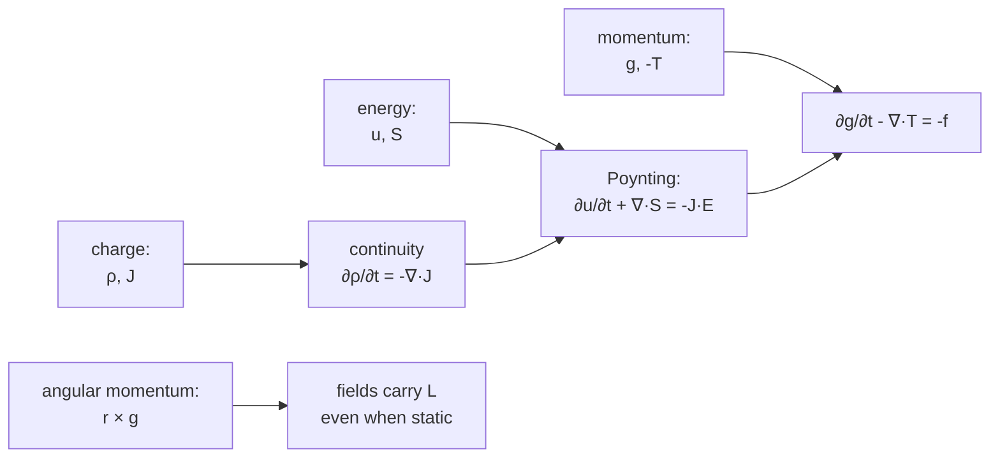
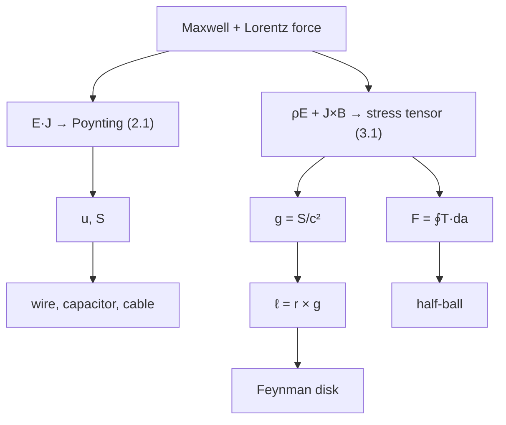

# ED04 · Conservation Laws: Energy, Momentum, Angular Momentum

◀ [[ED03 Maxwell's Equations and Boundary Conditions]] · [[Electrodynamics - Course Map]] 

in course overview extra · book extra · beyond

> [!warning] Source status (every citation below was read in this session)
> Overview item *"conservation laws"* (PH3114 outline; no lecture notes in the folder). **Griffiths and Jackson carry equal weight.**
>
> **Read directly:** Griffiths §8.1 (printed pp. 356-360, continuity equation and Poynting's theorem, Example 8.1, Problem 8.2), §8.2 (pp. 360-372: Newton's third law, the stress tensor, Example 8.2, conservation of momentum, Example 8.3, angular momentum, Example 8.4); Jackson §6.7 (pp. 258-262, up to and including (6.123)) and the opening of §6.8 (p. 262). pdf = printed + 19 (Griffiths), + 26 (Jackson). **Not cited because not read:** Griffiths §8.3, Jackson §§6.8-6.9 beyond the opening, Jackson Problem 6.10, Landau-Lifshitz Vol. 8 on the stress tensor, Feynman Vol. 2 (not in the folder).

> [!syllabus] Syllabus map
> 🟢 **In course overview**: §1 local conservation laws, §2 energy (Poynting), §3 momentum and the stress tensor, §4 angular momentum.
>
> 🟡 **Extra · book**: §3.4 the Minkowski/Abraham remark (Jackson (6.123)), §2.3 the ambiguity of $\mathbf S$.
>
> 🔵 **Extra · beyond (mine)**: the capacitor and solenoid energy bookkeeping with numbers, the hemisphere force verified by quadrature, the coaxial-cable field momentum, the angular-momentum budget plotted, `scripts/ed04_numbers.py`, `scripts/fig_ed04.py`.

> [!key] After this chapter you can
> - state each conservation law as a **local continuity equation** (density, flux, source) for charge, energy, momentum and angular momentum,
> - derive **Poynting's theorem** and use $u=\tfrac12(\epsilon_0E^2+B^2/\mu_0)$ and $\mathbf S=\mathbf E\times\mathbf B/\mu_0$,
> - explain why **Newton's third law fails** for moving charges and how field momentum $\mathbf g=\epsilon_0\mathbf E\times\mathbf B$ restores momentum conservation,
> - build and use the **Maxwell stress tensor** to compute forces on objects as surface integrals,
> - account for angular momentum stored in static fields (Feynman's disk paradox),
> - do each of these with numbers.

> [!intuition] The one-sentence story
> Charge conservation is the paradigm: a density $\rho$, a current $\mathbf J$, and $\partial_t\rho+\nabla\!\cdot\!\mathbf J=0$. Energy, momentum and angular momentum obey the same kind of *local* law once the fields are given their own density and flux, so that whatever the charges lose the fields gain, and the bookkeeping is done point by point, not just for the universe.

## 1. Local conservation: the paradigm
Griffiths (§8.1.1) begins with charge: global conservation (the total charge is constant) is weak; **local conservation** is the strong statement that if the charge in a region changes, exactly that amount flowed across its boundary ("the tiger can't simply rematerialize outside the cage"). With $Q=\int_V\rho\,\mathrm d\tau$ and $\mathrm dQ/\mathrm dt=-\oint_S\mathbf J\!\cdot\!\mathrm d\mathbf a$ the divergence theorem gives

$$\frac{\partial\rho}{\partial t}=-\nabla\!\cdot\!\mathbf J .\tag{1.1}$$

This is derivable from Maxwell's equations (ED03 §4.2), so "conservation of charge is not an independent assumption"; it is a **constraint on the sources**, and Griffiths notes (footnote 1) that it is the only such constraint: any $\rho(\mathbf r,t)$, $\mathbf J(\mathbf r,t)$ consistent with it admit solutions. The chapter then builds the analogs: energy density $u$ with energy current $\mathbf S$, momentum density $\mathbf g$ with momentum current $-\overleftrightarrow T$.

## 2. Energy: Poynting's theorem
### 2.1 Derivation
The Lorentz force $q(\mathbf E+\mathbf v\times\mathbf B)$ does work $q\mathbf E\!\cdot\!\mathbf v\,\mathrm dt$ on a charge (Griffiths; Jackson: "The magnetic field does no work, since the magnetic force is perpendicular to the velocity"). For continuous distributions the rate of work on all charges in $V$ is

$$\frac{\mathrm dW}{\mathrm dt}=\int_V\mathbf E\!\cdot\!\mathbf J\,\mathrm d\tau\quad(\text{Griffiths (8.6), Jackson (6.103)}).$$

Eliminate $\mathbf J$ with the Ampère-Maxwell law, $\mathbf J=\tfrac1{\mu_0}\nabla\times\mathbf B-\epsilon_0\partial_t\mathbf E$, and use the product rule $\nabla\!\cdot\!(\mathbf E\times\mathbf B)=\mathbf B\!\cdot\!(\nabla\times\mathbf E)-\mathbf E\!\cdot\!(\nabla\times\mathbf B)$ with Faraday's law $\nabla\times\mathbf E=-\partial_t\mathbf B$:

$$\mathbf E\!\cdot\!\mathbf J=-\frac1{\mu_0}\nabla\!\cdot\!(\mathbf E\times\mathbf B)-\frac12\frac{\partial}{\partial t}\Bigl(\epsilon_0E^2+\frac1{\mu_0}B^2\Bigr)\quad(\text{Griffiths (8.8)}).$$

Integrating over $V$ and applying the divergence theorem gives **Poynting's theorem**

$$\boxed{\;\frac{\mathrm dW}{\mathrm dt}=-\frac{\mathrm d}{\mathrm dt}\int_Vu\,\mathrm d\tau-\oint_S\mathbf S\!\cdot\!\mathrm d\mathbf a\;},\qquad u=\tfrac12\Bigl(\epsilon_0E^2+\frac{B^2}{\mu_0}\Bigr),\quad\mathbf S=\frac1{\mu_0}\mathbf E\times\mathbf B,\tag{2.1}$$

(Griffiths (8.9)-(8.11)). In local form $\partial_tu+\nabla\!\cdot\!\mathbf S=-\mathbf J\!\cdot\!\mathbf E$ (Jackson (6.108)); in empty space $\partial_tu=-\nabla\!\cdot\!\mathbf S$ (Griffiths (8.12)), a continuity equation with $u$ playing $\rho$ and $\mathbf S$ playing $\mathbf J$. Interpretation: the work done on charges = decrease of field energy in $V$ minus the energy that flowed out. Charges and fields exchange energy back and forth; "you must include the contributions of both the matter and the fields".

### 2.2 In matter (Jackson §6.7-6.8)
Jackson takes the same steps with $\mathbf D,\mathbf H$: $\mathbf S=\mathbf E\times\mathbf H$ (6.109) and $u=\tfrac12(\mathbf E\!\cdot\!\mathbf D+\mathbf B\!\cdot\!\mathbf H)$ (6.106). He states **two assumptions**: the medium is linear *with negligible dispersion or losses*, and the sum of the static energy expressions represents the total energy density even for time-varying fields. For real media there is always dispersion with losses, then $\mathbf E\!\cdot\!\partial_t\mathbf D$ is not $\partial_t(\mathbf E\!\cdot\!\mathbf D/2)$ because $\mathbf D(t)$ is a nonlocal functional of $\mathbf E(t)$; he treats this in §6.8 (opening read: Fourier decomposition, $\mathbf D(\omega)=\epsilon(\omega)\mathbf E(\omega)$) and refers to §7.10. With the total energy of the particles in $V$ called $E_{\mathrm{mech}}$ and no particles leaving, (6.110)-(6.112) give

$$\frac{\mathrm d}{\mathrm dt}\bigl(E_{\mathrm{mech}}+E_{\mathrm{field}}\bigr)=-\oint_S\mathbf S\!\cdot\!\mathbf n\,\mathrm da,\qquad E_{\mathrm{field}}=\frac{\epsilon_0}{2}\int_V\bigl(E^2+c^2B^2\bigr)\mathrm d^3x .$$

### 2.3 What is $\mathbf S$, exactly?
Only $\nabla\!\cdot\!\mathbf S$ appears, so one could add the curl of any vector field to $\mathbf S$: Jackson says such a term "can, however, have no physical consequences" and that relativistic considerations (his §12.10) show (6.109) is unique. Griffiths (footnote 3) makes the matching point: Poynting's theorem proves only that $\oint\mathbf S\!\cdot\!\mathrm d\mathbf a$ is the power through a *closed* surface; that $\mathbf S\!\cdot\!\mathrm d\mathbf a$ is the power through an *open* one is the "obvious and natural" interpretation, but "the precise location of energy is not really determined in electrodynamics" (his reference to Sect. 2.4.4).

> [!example] Worked example 1 (Griffiths Example 8.1): Joule heating, seen as a Poynting flux
> A wire of radius $a$, length $L$, carrying a uniform current $I$ with potential drop $V$: $E=V/L$ along it, $B=\mu_0I/2\pi a$ circumferential at the surface. $\mathbf S=\mathbf E\times\mathbf B/\mu_0$ points **radially inward**, $S=\dfrac{VI}{2\pi aL}$, so the power entering is $S\cdot2\pi aL=VI$, "exactly what we concluded on much more direct grounds" (Griffiths §7.1.1). Numbers for copper ($\rho=1.68\times10^{-8}\ \Omega\,$m), $a=1$ mm, $L=1$ m, $I=10$ A: $R=5.35$ m$\Omega$, $V=53.5$ mV, $S=85.1$ W/m², power $=0.535$ W $=I^2R$.

> [!example] Worked example 2: the charging capacitor, where does the energy come from? (setting of Griffiths Problem 8.2)
> $R=5$ cm plates, $d=2$ mm, constant $I=2$ A (ED03 Worked example 1). In the gap $E=It/(\epsilon_0\pi R^2)$ (growing) and $B=\mu_0Ir/2\pi R^2$ (constant in time), azimuthal. $\mathbf S=\mathbf E\times\mathbf B/\mu_0$ then points **radially inward**: the energy enters the gap *through the rim*, not along the wires. Power through the rim: $S(R)\cdot2\pi Rd=\dfrac{E\,I}{2\pi R}\cdot2\pi Rd=EId$. The field energy is $U=\tfrac12\epsilon_0E^2\pi R^2d$ ($B$ is constant, so the magnetic energy does not change), $\dfrac{\mathrm dU}{\mathrm dt}=\epsilon_0E\dot E\,\pi R^2d=EId$ ✓. Numbers at $t=1$ ns: $E=2.876\times10^4$ V/m, $V=Ed=57.5$ V, power $=115.04$ W from both the Poynting flux and $\mathrm dU/\mathrm dt$ and from $VI$ (panel A). Here $W=0$ (no charge in the gap).

> [!example] Worked example 3 (Griffiths Example 8.3, first half): power down a coaxial cable
> Inner radius $a$, outer $b$, charge per length $\lambda$ on the inner conductor, current $I$: $E=\dfrac{\lambda}{2\pi\epsilon_0s}\hat{\mathbf s}$, $B=\dfrac{\mu_0I}{2\pi s}\hat{\boldsymbol\phi}$, $\mathbf S=\dfrac{\lambda I}{4\pi^2\epsilon_0s^2}\hat{\mathbf z}$. Power: $P=\int_a^b\dfrac{\lambda I}{4\pi^2\epsilon_0s^2}2\pi s\,\mathrm ds=\dfrac{\lambda I}{2\pi\epsilon_0}\ln\frac ba=IV$, with $V=\dfrac{\lambda}{2\pi\epsilon_0}\ln\frac ba$: the energy flows *in the space between the conductors*.

## 3. Momentum
### 3.1 Newton's third law fails
Griffiths (§8.2.1): two identical charges moving at the same speed along perpendicular tracks (the $x$ and $y$ axes, approaching the origin). Each moving charge's $\mathbf E$ still points radially from its instantaneous position and $\mathbf B$ circulates around its axis (proved in his Ch. 10). The electric forces are equal and opposite, but the magnetic force of $q_1$ on $q_2$ points along $+x$ while that of $q_2$ on $q_1$ points along $+y$: "equal but not opposite". In electro- and magnetostatics the third law holds, in electrodynamics it does not. Since conservation of momentum rests on the cancellation of internal forces, *the fields must carry momentum*: "whatever momentum is lost to the particles is gained by the fields".

### 3.2 The stress tensor
The force on the charges in $V$ is $\mathbf F=\int(\rho\mathbf E+\mathbf J\times\mathbf B)\,\mathrm d\tau$, i.e. a force density $\mathbf f=\rho\mathbf E+\mathbf J\times\mathbf B$ (Griffiths (8.13)-(8.14); Jackson (6.114)). Eliminating $\rho$ and $\mathbf J$ with Maxwell's equations (Jackson (6.115)-(6.116)) and using $\partial_t(\mathbf E\times\mathbf B)=\partial_t\mathbf E\times\mathbf B-\mathbf E\times(\nabla\times\mathbf E)$ gives

$$\mathbf f+\epsilon_0\frac{\partial}{\partial t}(\mathbf E\times\mathbf B)=\epsilon_0\bigl[\mathbf E(\nabla\!\cdot\!\mathbf E)-\mathbf E\times(\nabla\times\mathbf E)+c^2\mathbf B(\nabla\!\cdot\!\mathbf B)-c^2\mathbf B\times(\nabla\times\mathbf B)\bigr].$$

The key algebra (Jackson (6.119)) is, componentwise,

$$\bigl[\mathbf E(\nabla\!\cdot\!\mathbf E)-\mathbf E\times(\nabla\times\mathbf E)\bigr]_\alpha=\sum_\beta\frac{\partial}{\partial x_\beta}\bigl(E_\alpha E_\beta-\tfrac12E^2\delta_{\alpha\beta}\bigr),$$

and the same for $\mathbf B$ (using $\nabla\!\cdot\!\mathbf B=0$). Hence the **Maxwell stress tensor**

$$\boxed{\;T_{ij}=\epsilon_0\Bigl(E_iE_j-\tfrac12\delta_{ij}E^2\Bigr)+\frac1{\mu_0}\Bigl(B_iB_j-\tfrac12\delta_{ij}B^2\Bigr)\;}\tag{3.1}$$

(Jackson (6.120) writes $\epsilon_0[E_\alpha E_\beta+c^2B_\alpha B_\beta-\tfrac12(E^2+c^2B^2)\delta_{\alpha\beta}]$, the same thing), and the force density is $\mathbf f=\nabla\!\cdot\!\overleftrightarrow T-\epsilon_0\mu_0\,\partial_t\mathbf S$ (Griffiths (8.19)), the total force

$$\mathbf F=\oint_S\overleftrightarrow T\!\cdot\!\mathrm d\mathbf a-\epsilon_0\mu_0\frac{\mathrm d}{\mathrm dt}\int_V\mathbf S\,\mathrm d\tau,\qquad\mathbf F=\oint_S\overleftrightarrow T\!\cdot\!\mathrm d\mathbf a\ \ (\text{static}).\tag{3.2}$$

**Meaning.** $T_{ij}$ is the force per unit area in direction $i$ on a surface element oriented along $j$: the diagonal entries are **pressures**, the off-diagonal ones **shears** (Griffiths). Jackson notes that $\sum_\beta T_{\alpha\beta}n_\beta$ is "the force per unit area transmitted across the surface $S$ and acting on the combined system of particles and fields inside $V$", so (6.122) "can be used to calculate the forces acting on material objects in electromagnetic fields by enclosing the objects with a boundary surface $S$". For a uniform field $E\hat{\mathbf z}$: $T_{zz}=+\tfrac12\epsilon_0E^2$ (tension along the field lines) and $T_{xx}=T_{yy}=-\tfrac12\epsilon_0E^2$ (pressure across them).

### 3.3 Momentum conservation
With $\mathbf p_{\mathrm{mech}}$ the mechanical momentum in $V$ (only electromagnetic forces assumed), Griffiths (8.27) and Jackson (6.121)-(6.122) say

$$\frac{\mathrm d\mathbf p_{\mathrm{mech}}}{\mathrm dt}=-\epsilon_0\mu_0\frac{\mathrm d}{\mathrm dt}\int_V\mathbf S\,\mathrm d\tau+\oint_S\overleftrightarrow T\!\cdot\!\mathrm d\mathbf a .$$

Reading it as a conservation law: the **momentum density** of the fields is

$$\boxed{\;\mathbf g=\epsilon_0\mu_0\mathbf S=\epsilon_0\,\mathbf E\times\mathbf B=\frac1{c^2}\mathbf S\;}\tag{3.3}$$

(Griffiths (8.29); Jackson (6.117)-(6.118): "this momentum density is proportional to the energy-flux density $\mathbf S$, with proportionality constant $c^{-2}$"), and $-\overleftrightarrow T$ is the **momentum flux** (momentum current density). In empty space $\partial_t\mathbf g=\nabla\!\cdot\!\overleftrightarrow T$ (Griffiths (8.30)). When charges are present neither the field momentum nor the mechanical momentum is separately conserved; only the sum.

> [!note] Dual roles
> Griffiths stresses that $\mathbf S$ appears in two roles (energy per area per time, and $c^2\times$ momentum per volume) and $\overleftrightarrow T$ in two roles (stress, and minus the momentum current).

### 3.4 Momentum in media (🟡)
Jackson (6.123) warns: a treatment with the macroscopic equations leads to an *apparent* momentum density $\mathbf g=\mathbf D\times\mathbf B$ (Minkowski, 1908), but "the generally accepted expression for a medium at rest" is $\mathbf g=\tfrac1{c^2}\mathbf E\times\mathbf H=\tfrac1{c^2}\mathbf S$. He adds that $\mathbf g$ is the momentum associated with the fields, and that there is an *additional co-travelling momentum within the medium* from the mechanical momentum of the electrons in the molecular dipoles; the Minkowski momentum of a plane wave is the "pseudomomentum" of the wave vector ($\hbar\mathbf k=n\hbar\omega/c$ for a photon). He also refers to Landau-Lifshitz Vol. 8 for the statistical details (§§10, 15, 16, 31, 35 of the Continuous Media volume, cited in his text; not read here).

> [!example] Worked example 4 (Griffiths Example 8.2): force on a charged half-ball
> The northern half of a uniformly charged solid ball (radius $R$, charge $Q$). Surround it by the "bowl" (hemisphere of radius $R$) plus the equatorial disk. On the bowl $E=\dfrac{Q}{4\pi\epsilon_0R^2}\hat{\mathbf r}$ and $T_{zj}\mathrm da_j=\dfrac{\epsilon_0}{2}E^2\sin\theta\cos\theta\,R^2\,\mathrm d\theta\,\mathrm d\phi$ (Griffiths (8.22)-(8.23)): $F_{\mathrm{bowl}}=\dfrac1{4\pi\epsilon_0}\dfrac{Q^2}{8R^2}$. On the disk (inside the ball, $\mathbf E=\dfrac{Q\mathbf r}{4\pi\epsilon_0R^3}$, $T_{zz}=-\tfrac{\epsilon_0}2E_\perp^2$, $\mathrm d\mathbf a=-\hat{\mathbf z}\,r\,\mathrm dr\,\mathrm d\phi$): $F_{\mathrm{disk}}=\dfrac1{4\pi\epsilon_0}\dfrac{Q^2}{16R^2}$. Total (8.26):
>
> $$F=\frac{1}{4\pi\epsilon_0}\frac{3Q^2}{16R^2}.$$
>
> Numerically for $Q=1$ nC and $R=1$ cm: bowl $11.23\ \mu$N, disk $5.62\ \mu$N, total $16.85\ \mu$N (checked by direct quadrature). Griffiths notes any surface enclosing all the charge in question (and no other) works, e.g. the whole $z=0$ plane: the exterior plane ($r>R$) alone gives the same $Q^2/(4\pi\epsilon_0\,8R^2)$ as the bowl (panel B). "The stress tensor sniffs out what is going on inside": a surface integral replaces a volume integral.

> [!example] Worked example 5 (Griffiths Example 8.3, second half): momentum in a coaxial cable
> With $\mathbf S=\dfrac{\lambda I}{4\pi^2\epsilon_0s^2}\hat{\mathbf z}$ the stored field momentum is $\mathbf p=\mu_0\epsilon_0\!\int\mathbf S\,\mathrm d\tau=\dfrac{\mu_0\lambda Il}{2\pi}\ln\dfrac ba\,\hat{\mathbf z}=\dfrac{IVl}{c^2}\hat{\mathbf z}$ (my arithmetic from his set-up and (8.28)). For $V=100$ V, $I=10$ A, $l=1$ m: $p=1.11\times10^{-14}$ kg m s⁻¹, tiny, because it is simply (power × length)$/c^2$.

## 4. Angular momentum
The field's angular momentum density is $\boldsymbol\ell=\mathbf r\times\mathbf g=\epsilon_0\,\mathbf r\times(\mathbf E\times\mathbf B)$ (Griffiths (8.33)). Griffiths states the striking consequence: *"even perfectly static fields can harbor momentum and angular momentum, as long as $\mathbf E\times\mathbf B$ is non-zero"*, and the conservation laws hold only when the field contributions are included. (Jackson does not derive angular-momentum conservation in the text: he leaves it as Problem 6.10, which I have not read.)

> [!example] Worked example 6 (Griffiths Example 8.4, a version of Feynman's disk paradox): where does the angular momentum come from?
> A long solenoid (radius $R$, $n$ turns/length, current $I$). Coaxial with it, two long non-conducting cylindrical shells (length $l\gg b$): the inner one (radius $a<R$) carries $+Q$, the outer one (radius $b>R$) carries $-Q$. Switch the current down to zero slowly; the cylinders begin to rotate. Whence the angular momentum?
>
> *Before:* $\mathbf E=\dfrac{Q}{2\pi\epsilon_0l}\dfrac1s\hat{\mathbf s}$ between the cylinders and $\mathbf B=\mu_0nI\hat{\mathbf z}$ inside the solenoid, so in $a<s<R$ the momentum density is $\mathbf g=-\dfrac{\mu_0nIQ}{2\pi ls}\hat{\boldsymbol\phi}$ and $(\mathbf r\times\mathbf g)_z=-\dfrac{\mu_0nIQ}{2\pi l}$ (constant). Multiplying by the volume $\pi(R^2-a^2)l$ gives the field angular momentum (Griffiths (8.34))
>
> $$\mathbf L_{\mathrm{em}}=-\tfrac12\mu_0nIQ\,(R^2-a^2)\,\hat{\mathbf z}.$$
>
> *During the switch-off:* Faraday's law induces $E_\phi=-\tfrac12\mu_0n\dot I\,s$ ($s<R$) and $-\tfrac12\mu_0n\dot IR^2/s$ ($s>R$). Torques on the cylinders: $N_b=\tfrac12\mu_0nQR^2\dot I\,\hat{\mathbf z}$ and $N_a=-\tfrac12\mu_0nQa^2\dot I\,\hat{\mathbf z}$; integrating from $I$ to $0$: $\mathbf L_b=-\tfrac12\mu_0nIQR^2\hat{\mathbf z}$ and $\mathbf L_a=+\tfrac12\mu_0nIQa^2\hat{\mathbf z}$. Sum: $\mathbf L_a+\mathbf L_b=\mathbf L_{\mathrm{em}}$. The angular momentum stored in the fields is transferred to the cylinders; total conserved.
>
> Numbers: $n=1000$ m⁻¹, $I=1$ A, $Q=1\ \mu$C, $R=2$ cm, $a=1$ cm: $L_{\mathrm{em}}=-1.885\times10^{-13}$ J s (panel C).

## 5. The pattern
| conserved | density | flux (current) | source term |
|---|---|---|---|
| charge | $\rho$ | $\mathbf J$ | 0 |
| energy | $u=\tfrac12(\epsilon_0E^2+B^2/\mu_0)$ | $\mathbf S=\mathbf E\times\mathbf B/\mu_0$ | $-\mathbf J\!\cdot\!\mathbf E$ |
| momentum | $\mathbf g=\epsilon_0\mathbf E\times\mathbf B$ | $-\overleftrightarrow T$ | $-\mathbf f=-(\rho\mathbf E+\mathbf J\times\mathbf B)$ |
| angular momentum | $\mathbf r\times\mathbf g$ | $-\mathbf r\times\overleftrightarrow T$ | torque density (not derived here) |

(The last row is by analogy; Griffiths gives the density, and the flux and torque rows are my extrapolation, flagged as not read.)

![[fig_ed04_conservation.png]]

## Map of this chapter

## Common mistakes
1. Using $\oint\mathbf S\!\cdot\!\mathrm d\mathbf a$ as the power through an *open* surface without comment (§2.3).
2. Dropping the $\epsilon_0\mu_0\,\mathrm d(\int\mathbf S)/\mathrm dt$ term in (3.2) for time-dependent problems.
3. Believing the wire carries energy along its length: in steady flow $\mathbf S$ points *into* the wire (Ex. 1) and *along the cable between the conductors* (Ex. 3).
4. Forgetting that the capacitor gap is charged from the **rim** (Ex. 2).
5. Treating $T_{ij}$ as symmetric in meaning: first index = force direction, second = surface orientation.
6. In media: using $\mathbf D\times\mathbf B$ and $\mathbf E\times\mathbf H/c^2$ interchangeably (§3.4).

## Summary
- $\partial_t\rho+\nabla\!\cdot\!\mathbf J=0$; $\partial_tu+\nabla\!\cdot\!\mathbf S=-\mathbf J\!\cdot\!\mathbf E$; $\mathbf g=\mathbf S/c^2$; $\mathbf f=\nabla\!\cdot\!\overleftrightarrow T-\partial_t\mathbf g$.
- $u=\tfrac12(\epsilon_0E^2+B^2/\mu_0)$, $\mathbf S=\mathbf E\times\mathbf B/\mu_0$; matter (no dispersion): $\tfrac12(\mathbf E\!\cdot\!\mathbf D+\mathbf B\!\cdot\!\mathbf H)$ and $\mathbf E\times\mathbf H$.
- Force on an object $=\oint\overleftrightarrow T\!\cdot\!\mathrm d\mathbf a$ (static); the third law fails; field momentum restores conservation.
- Static fields can hold angular momentum $-\tfrac12\mu_0nIQ(R^2-a^2)$ (Ex. 6).
- Numbers: wire 0.535 W, capacitor gap 115 W at 1 ns, half-ball force $16.85\ \mu$N, cable momentum $1.11\times10^{-14}$ kg m/s, $L_{\mathrm{em}}=-1.885\times10^{-13}$ J s.

## Practice
> [!question]- P1. Poynting's theorem in a vacuum region
> Derive $\partial_tu=-\nabla\!\cdot\!\mathbf S$ for $\rho=\mathbf J=0$.
> **Solution.** With $\mathbf J=0$: $0=\mathbf E\!\cdot\!(\nabla\times\mathbf B)/\mu_0-\epsilon_0\mathbf E\!\cdot\!\partial_t\mathbf E$. Use $\mathbf E\!\cdot\!(\nabla\times\mathbf B)=\mathbf B\!\cdot\!(\nabla\times\mathbf E)-\nabla\!\cdot\!(\mathbf E\times\mathbf B)$ and Faraday: $\mathbf B\!\cdot\!(\nabla\times\mathbf E)=-\mathbf B\!\cdot\!\partial_t\mathbf B$. So $\partial_t(\tfrac12\epsilon_0E^2+B^2/2\mu_0)=-\nabla\!\cdot\!\mathbf S$. ∎

> [!question]- P2. Joule heating from Poynting
> Wire of radius 1 mm, length 1 m, $I=10$ A, $\rho=1.68\times10^{-8}\ \Omega$ m. Find $\mathbf S$ at the surface and the power.
> **Solution.** $R=\rho L/\pi a^2=5.35$ m$\Omega$, $V=0.0535$ V; $S=VI/2\pi aL=85.1$ W/m² inward; $P=S\cdot2\pi aL=0.535$ W $=I^2R$.

> [!question]- P3. Capacitor energy budget
> For the $R=5$ cm, $d=2$ mm, $I=2$ A capacitor, compute the Poynting power through the rim at $t=1$ ns and compare with $\mathrm dU/\mathrm dt$.
> **Solution.** $E=It/\epsilon_0\pi R^2=2.876\times10^4$ V/m; $P=EId=115.04$ W; $\mathrm dU/\mathrm dt=\epsilon_0E\dot E\pi R^2d=EId=115.04$ W; also $VI=57.52\times2=115.04$ W ✓.

> [!question]- P4. Cable power and momentum
> A coaxial cable carries $I=10$ A at $V=100$ V over $l=1$ m. Find the power and the field momentum.
> **Solution.** $P=IV=1000$ W; $p=IVl/c^2=1.11\times10^{-14}$ kg m/s.

> [!question]- P5. Stress-tensor force on a half-ball
> $Q=1$ nC, $R=1$ cm: find the force on the northern hemisphere.
> **Solution.** $F=\dfrac{3Q^2}{4\pi\epsilon_0\,16R^2}=8.988\times10^9\times\dfrac{3\times10^{-18}}{16\times10^{-4}}=1.685\times10^{-5}$ N.

> [!question]- P6. Pressure on plates
> Surface charge $\sigma=1\ \mu$C/m² on a conducting plate: find the pressure pulling it.
> **Solution.** Outside $E=\sigma/\epsilon_0$ and inside $0$; the stress-tensor flux through a surface enclosing a patch gives $\tfrac12\epsilon_0E^2=\sigma^2/2\epsilon_0=0.0565$ N/m² outward.

> [!question]- P7. Energy densities
> Compare $u$ for $E=10^6$ V/m and $B=1$ T, and find the $E$ with the same $u$ as $B=1$ T.
> **Solution.** $u_E=\tfrac12\epsilon_0E^2=4.43$ J/m³; $u_B=B^2/2\mu_0=3.98\times10^5$ J/m³; equal when $E=cB=3.0\times10^8$ V/m.

> [!question]- P8. The field momentum density
> Show $\mathbf g=\mathbf S/c^2$ and give its dimensions.
> **Solution.** $\epsilon_0\mathbf E\times\mathbf B=\epsilon_0\mu_0\,\mathbf E\times\mathbf B/\mu_0=\mathbf S/c^2$. Units: (W/m²)/(m²/s²) = kg m⁻² s⁻¹, momentum per volume.

> [!question]- P9. Angular momentum budget
> Evaluate $L_{\mathrm{em}}$ for $n=1000$ m⁻¹, $I=1$ A, $Q=1\ \mu$C, $R=2$ cm, $a=1$ cm and verify $L_a+L_b=L_{\mathrm{em}}$.
> **Solution.** $L_{\mathrm{em}}=-\tfrac12\mu_0nIQ(R^2-a^2)=-1.885\times10^{-13}$ J s; $L_a=\tfrac12\mu_0nIQa^2=6.28\times10^{-14}$, $L_b=-\tfrac12\mu_0nIQR^2=-2.51\times10^{-13}$; sum $-1.885\times10^{-13}$ ✓.

> [!question]- P10. No self-force
> Show that the net stress-tensor force on a spherical surface centred on a point charge vanishes.
> **Solution.** On the sphere $E$ is radial, so $T_{ij}n_j=\epsilon_0(E_iE_n-\tfrac12E^2n_i)=\tfrac12\epsilon_0E^2n_i$: radial with constant magnitude on the sphere, and $\oint\hat{\mathbf n}\,\mathrm da=0$, so the net force is zero.

> [!question]- P11. Why momentum is conserved
> In Griffiths' perpendicular-tracks setup the mechanical momenta change at rates $F_{12}$ and $F_{21}$ that are not equal and opposite. Where does the missing momentum go?
> **Solution.** Into the field momentum $\mathbf g=\epsilon_0\mathbf E\times\mathbf B$: the total $\mathbf p_{\mathrm{mech}}+\mathbf p_{\mathrm{field}}$ is conserved by (3.2) (3.3).

> [!question]- P12. Ambiguity of $\mathbf S$
> Show $\mathbf S\to\mathbf S+\nabla\times\mathbf A$ leaves the local conservation law unchanged.
> **Solution.** $\nabla\!\cdot\!(\nabla\times\mathbf A)=0$, so $\partial_tu+\nabla\!\cdot\!\mathbf S=-\mathbf J\!\cdot\!\mathbf E$ is unchanged (Jackson's remark; the extra term has no physical consequence).

> [!question]- P13. Resistor energy balance
> In steady current $\partial_tu=0$, show $\nabla\!\cdot\!\mathbf S=-\mathbf J\!\cdot\!\mathbf E$ and interpret.
> **Solution.** Directly from the local law: the Poynting flux converges on the resistor to supply the Joule heating $\mathbf J\!\cdot\!\mathbf E=\sigma E^2>0$ (Ex. 1).

> [!question]- P14. Energy into a solenoid
> A long solenoid ($n$, radius $R$) carries $I(t)$. Show the Poynting flux through its surface equals $\mathrm d/\mathrm dt$ of the stored magnetic energy per unit length.
> **Solution.** Inside $B=\mu_0nI$; Faraday gives $E_\phi(R)=-\tfrac12\mu_0n\dot IR$. $|S|=EB/\mu_0=\tfrac12\mu_0n^2I\dot IR$ (inward when $I$ grows), power per length $=S\cdot2\pi R=\pi\mu_0n^2I\dot IR^2$, and $\dfrac{\mathrm d}{\mathrm dt}\Bigl(\dfrac{B^2}{2\mu_0}\pi R^2\Bigr)=\pi\mu_0n^2I\dot IR^2$ ✓.

> [!question]- P15. Dimensional check of $T_{ij}$
> Verify $T_{ij}$ has units of pressure.
> **Solution.** $\epsilon_0E^2$: J/m³ = N/m². $B^2/\mu_0$ likewise.

## Zettel notes
<!-- zettel:start -->
<!-- zettel:end -->

## Provenance
> [!provenance]- Source map for this chapter (all rows read in this session)
> | Topic | Source | Scope |
> |---|---|---|
> | local charge conservation, continuity equation, footnote 1 | Griffiths §8.1.1 (pp. 356-357) | in overview |
> | Poynting's theorem (8.5)-(8.12), Example 8.1, Problem 8.2, footnote 3 | Griffiths §8.1.2 (pp. 357-360) | in overview |
> | energy and momentum conservation, (6.103)-(6.123), uniqueness of $\mathbf S$, Minkowski vs $\mathbf g=\mathbf S/c^2$ | Jackson §6.7 (pp. 258-262) | in overview |
> | dispersive-media version (opening only) | Jackson §6.8 (p. 262) | extra/book |
> | Newton's third law, stress tensor (8.13)-(8.21), Example 8.2 | Griffiths §8.2.1-8.2.2 (pp. 360-366) | in overview |
> | momentum conservation (8.27)-(8.30), Example 8.3 | Griffiths §8.2.3 (pp. 366-368) | in overview |
> | angular momentum (8.32)-(8.34), Example 8.4, Problems 8.8-8.10 statements | Griffiths §8.2.4 (pp. 370-373) | in overview |
> | capacitor, solenoid, cable, half-ball, angular-momentum numbers | `scripts/ed04_numbers.py`, `scripts/fig_ed04.py` | extra/beyond |
