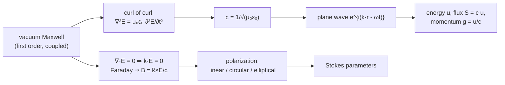
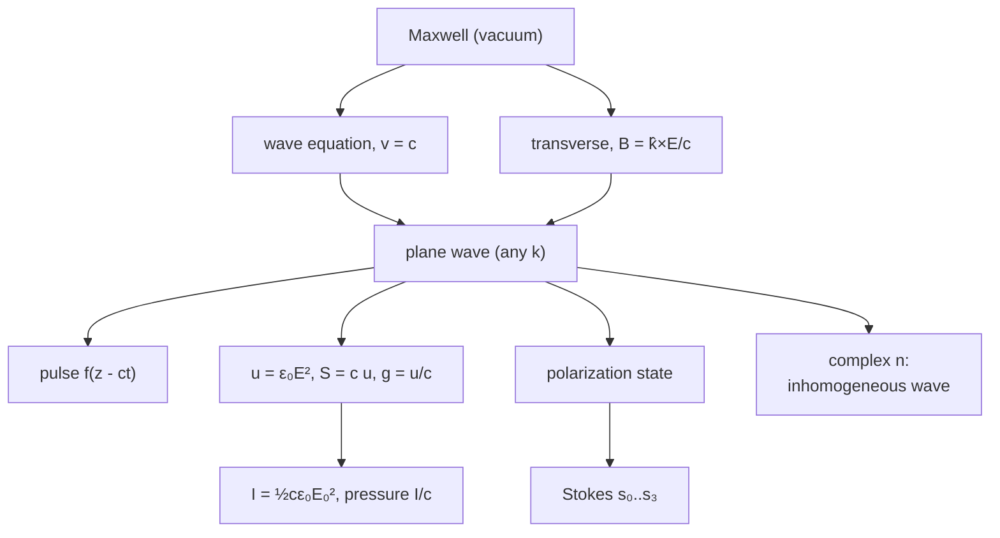

# ED05 · Electromagnetic Waves in Vacuum

◀ [[ED04 Conservation Laws - Energy, Momentum, Angular Momentum]] · [[Electrodynamics - Course Map]] · [[ED06 Waves in Matter, Reflection and Dispersion]] ▶

in course overview extra · book extra · beyond

> [!warning] Source status (every citation below was read in this session)
> Overview item *"electromagnetic waves in vacuum and in matter"* (PH3114 outline; no lecture notes in the folder). **Griffiths and Jackson carry equal weight.**
>
> **Read directly:** Griffiths §9.1.4 (polarization, pp. 391-393), §9.2 (pp. 393-400: wave equation, monochromatic plane waves, Example 9.2, energy and momentum, radiation pressure, Table 9.1, Problems 9.9-9.11 as stated); Jackson §7.1 (pp. 295-299, plane waves in a nonconducting medium, equations (7.1)-(7.17)) and §7.2 (pp. 299-302, linear and circular polarization, Stokes parameters (7.18)-(7.28)). pdf = printed + 19 (Griffiths), + 26 (Jackson). **Not cited because not read:** Griffiths §9.1.1-9.1.3, Jackson §7.3 onward, Landau-Lifshitz Vol. 8 chapter on waves (only §75 was read for ED03), Feynman Vol. 2 (not in the folder).

> [!syllabus] Syllabus map
> 🟢 **In course overview**: §1 the wave equation, §2 monochromatic plane waves and their structure, §3 energy, momentum, radiation pressure, §4 polarization.
>
> 🟡 **Extra · book**: §5 Stokes parameters (Jackson §7.2), §6 inhomogeneous plane waves (Jackson (7.15)-(7.17)), §2.4 non-sinusoidal plane waves (Jackson (7.7)).
>
> 🔵 **Extra · beyond (mine)**: the numerical Maxwell check of an oblique wave, the pulse solution, the laser force, circular-versus-linear energy flux, `scripts/ed05_numbers.py`, `scripts/fig_ed05.py`.

> [!key] After this chapter you can
> - derive the **wave equation** for $\mathbf E$ and $\mathbf B$ from Maxwell's equations and identify its speed with $c$,
> - write the **monochromatic plane wave** in any direction and prove it is **transverse**, with $\mathbf E\perp\mathbf B\perp\mathbf k$ and $B=E/c$,
> - compute $u$, $\mathbf S$, $\mathbf g$, **intensity** and **radiation pressure**, with numbers,
> - describe **linear, circular and elliptical polarization**, helicity, and the **Stokes parameters**,
> - explain what is special about non-sinusoidal and inhomogeneous plane waves.

> [!intuition] The one-sentence story
> Maxwell's equations in empty space are first-order and coupled; decoupling them costs a derivative and returns an ordinary wave equation for each field component, travelling at $1/\sqrt{\mu_0\epsilon_0}$, a number found from electrostatic and magnetostatic experiments with no reference to light. The first-order equations then pin down the *vector* structure: the wave is transverse, $\mathbf E$ and $\mathbf B$ in phase, perpendicular, with $|\mathbf E|=c|\mathbf B|$.

## 1. The wave equation
In a region with no charge or current Maxwell's equations read (Griffiths (9.40))

$$\nabla\!\cdot\!\mathbf E=0,\quad\nabla\!\times\!\mathbf E=-\frac{\partial\mathbf B}{\partial t},\quad\nabla\!\cdot\!\mathbf B=0,\quad\nabla\!\times\!\mathbf B=\mu_0\epsilon_0\frac{\partial\mathbf E}{\partial t},$$

a coupled first-order system. Apply the curl to Faraday's law and use $\nabla\times(\nabla\times\mathbf E)=\nabla(\nabla\!\cdot\!\mathbf E)-\nabla^2\mathbf E=-\nabla^2\mathbf E$ and the Ampère-Maxwell equation:

$$\nabla^2\mathbf E=\mu_0\epsilon_0\frac{\partial^2\mathbf E}{\partial t^2},\qquad\nabla^2\mathbf B=\mu_0\epsilon_0\frac{\partial^2\mathbf B}{\partial t^2}\quad(\text{Griffiths (9.41)}).$$

Griffiths' comment: "We now have separate equations for $\mathbf E$ and $\mathbf B$, but they are of second order; that's the price you pay for decoupling them." Each Cartesian component satisfies the 3D wave equation $\nabla^2f=\tfrac1{v^2}\partial_t^2f$ with

$$v=\frac{1}{\sqrt{\mu_0\epsilon_0}}=3.00\times10^8\ \text{m/s}=c\qquad(9.42).$$

> [!note] The history in one paragraph
> Griffiths stresses how $\epsilon_0$ and $\mu_0$ entered electromagnetism: as constants in Coulomb's law and the Biot-Savart law, measured with pith balls, batteries and wires, "experiments having nothing whatever to do with light", yet their combination is the speed of light. He quotes Maxwell: "We can scarcely avoid the inference that light consists in the transverse undulations of the same medium which is the cause of electric and magnetic phenomena." And he notes that without Maxwell's displacement-current term the wave equation would not emerge, so there would be no electromagnetic theory of light (ED03).

Jackson (§7.1) runs the same argument with harmonic time dependence $e^{-i\omega t}$ in a uniform isotropic linear medium ($\mathbf D=\epsilon\mathbf E$, $\mathbf B=\mu\mathbf H$): the equations (7.2), $\nabla\times\mathbf E-i\omega\mathbf B=0$ and $\nabla\times\mathbf B+i\omega\mu\epsilon\mathbf E=0$, combine into the Helmholtz equation (7.3), and a plane wave $e^{ikx-i\omega t}$ requires

$$k=\omega\sqrt{\mu\epsilon},\qquad v=\frac\omega k=\frac1{\sqrt{\mu\epsilon}}=\frac cn,\quad n=\sqrt{\frac{\mu\epsilon}{\mu_0\epsilon_0}}\quad(7.4)\text{-}(7.5),$$

with the **index of refraction** $n$ (usually a function of frequency; ED06). In vacuum $n=1$. He also notes (7.2) contains the divergence equations: they are not independent, being obtained by taking divergences, consistent with ED03 §4.2.

> [!pitfall] Wave equation ≠ Maxwell
> "Whereas every solution to Maxwell's equations (in empty space) must obey the wave equation, the converse is not true; Maxwell's equations impose extra constraints" (Griffiths §9.2.2). A solution of $\nabla^2\mathbf E=\mu_0\epsilon_0\ddot{\mathbf E}$ need not be divergence-free, and the $\mathbf B$ associated with a given $\mathbf E$ is fixed by Faraday's law, not free.

## 2. Monochromatic plane waves
### 2.1 The fields
Seek fields of definite frequency depending on one Cartesian direction (Griffiths (9.43)): $\tilde{\mathbf E}=\tilde{\mathbf E}_0e^{i(kz-\omega t)}$, $\tilde{\mathbf B}=\tilde{\mathbf B}_0e^{i(kz-\omega t)}$, $\omega=ck$, the physical fields being the real parts. They are called *plane* waves because the fields are uniform over every plane perpendicular to the direction of propagation. For a general direction, with the propagation vector $\mathbf k=k\hat{\mathbf k}$ (Griffiths (9.49)), write $\tilde{\mathbf E}=\tilde E_0e^{i(\mathbf k\cdot\mathbf r-\omega t)}\hat{\mathbf n}$ (Jackson (7.8): $\mathbf E=\boldsymbol{\mathcal E}e^{ik\mathbf n\cdot\mathbf x-i\omega t}$ with $\mathbf n$ a real unit vector).

### 2.2 What Maxwell's equations require
Replace $\nabla\to i\mathbf k$ and $\partial_t\to-i\omega$:

* $\nabla\!\cdot\!\mathbf E=0$: $\mathbf k\!\cdot\!\mathbf E_0=0$, and likewise $\mathbf k\!\cdot\!\mathbf B_0=0$ (Griffiths (9.44), Jackson (7.10)): the wave is **transverse**.
* Faraday: $\mathbf k\times\mathbf E_0=\omega\mathbf B_0$, i.e.

$$\mathbf B_0=\frac1c\,\hat{\mathbf k}\times\mathbf E_0\qquad(\text{Griffiths (9.46), (9.49); Jackson (7.11)}).$$

So $\mathbf E$ and $\mathbf B$ are in phase and mutually perpendicular, with $B_0=E_0/c$ (Griffiths (9.47)); Jackson's phrasing for a medium: $cB$ and $E$ "have the same dimensions" and "the same magnitude for plane electromagnetic waves in free space and differ by the index of refraction in ponderable media", $\mathbf B=\sqrt{\mu\epsilon}\,\mathbf n\times\mathbf E$ (7.11).
* The fourth equation gives nothing new: with $\mathbf B_0$ above, $\mathbf k\times\mathbf B_0=-\tfrac{k}{c}\mathbf E_0=-\omega\mu_0\epsilon_0\mathbf E_0$ ✓ ("it simply reproduces" the Faraday condition, Griffiths).

The real fields (Griffiths (9.51)-(9.52)):

$$\mathbf E=E_0\cos(\mathbf k\!\cdot\!\mathbf r-\omega t+\delta)\,\hat{\mathbf n},\qquad\mathbf B=\frac{E_0}{c}\cos(\mathbf k\!\cdot\!\mathbf r-\omega t+\delta)\,(\hat{\mathbf k}\times\hat{\mathbf n}),$$

with $\hat{\mathbf n}\!\cdot\!\hat{\mathbf k}=0$. Jackson's triad: real orthonormal $(\boldsymbol\epsilon_1,\boldsymbol\epsilon_2,\mathbf n)$ with $\boldsymbol{\mathcal E}=\boldsymbol\epsilon_1E_0$ and $\boldsymbol{\mathcal B}=\boldsymbol\epsilon_2\sqrt{\mu\epsilon}E_0$ (7.12). In terms of the magnetic field $\mathbf H$, $\mathbf H=\mathbf n\times\mathbf E/Z$ with the impedance $Z=\sqrt{\mu/\epsilon}$ (7.11'); in vacuum

$$Z_0=\sqrt{\mu_0/\epsilon_0}=376.7\ \Omega,$$

"the impedance of free space" (Jackson). For $E_0=100$ V/m: $H_0=E_0/Z_0=0.265$ A/m.

> [!example] Worked example 1 (Griffiths Problem 9.9b): a wave along $(1,1,1)$
> Take $\lambda=500$ nm, so $k=1.2566\times10^7$ rad/m and $\omega=ck=3.767\times10^{15}$ rad/s; propagation $\hat{\mathbf k}=(1,1,1)/\sqrt3$; polarization parallel to the $xz$ plane means $\hat{\mathbf n}$ in the $xz$ plane and perpendicular to $\hat{\mathbf k}$: $\hat{\mathbf n}=(1,0,-1)/\sqrt2$. Then $\hat{\mathbf k}\times\hat{\mathbf n}=(-1,\,2,\,-1)/\sqrt6$ and, with $E_0=100$ V/m,
>
> $$\mathbf E=E_0\cos(\mathbf k\!\cdot\!\mathbf r-\omega t)\tfrac{(1,0,-1)}{\sqrt2},\qquad\mathbf B=\tfrac{E_0}{c}\cos(\mathbf k\!\cdot\!\mathbf r-\omega t)\tfrac{(-1,2,-1)}{\sqrt6}.$$
>
> Numerical check by central differences at a random point: $\nabla\!\cdot\!\mathbf E$, $\nabla\!\cdot\!\mathbf B\approx0$ (both below $10^{-12}$ of the natural scales $E_0k$ and $E_0k/c$), and the residuals of Faraday's and the Ampère-Maxwell equations are $1.8\times10^{-6}$ of the terms compared, set by the finite-difference step. So the wave is an exact solution.

### 2.3 Superposition
Maxwell's equations are linear, so sums of solutions are solutions: an arbitrary wave is a Fourier superposition of plane monochromatic waves (Jackson: harmonic solutions "from which we can build an arbitrary solution by Fourier superposition").

### 2.4 Non-sinusoidal plane waves (🟡)
If the medium is nondispersive the general one-dimensional solution is $u(x,t)=f(x-vt)+g(x+vt)$ with arbitrary $f,g$ (Jackson (7.7)); if the medium is dispersive the basic solution (7.6) still holds but the wave "changes shape as it propagates" (ED06). In vacuum there is no dispersion, so any pulse travels rigidly.

> [!example] Worked example 2: an arbitrary pulse (🔵)
> Let $\mathbf E=f(z-ct)\hat{\mathbf x}$ and $\mathbf B=\tfrac1cf(z-ct)\hat{\mathbf y}$. Then $\nabla\!\cdot\!\mathbf E=\partial_xf=0$, $\nabla\!\cdot\!\mathbf B=0$; $\nabla\times\mathbf E=\partial_zE_x\hat{\mathbf y}=f'\hat{\mathbf y}$ and $-\partial_t\mathbf B=-\tfrac1c(-cf')\hat{\mathbf y}=f'\hat{\mathbf y}$ ✓; $\nabla\times\mathbf B=-\partial_zB_y\hat{\mathbf x}=-\tfrac1cf'\hat{\mathbf x}$ and $\mu_0\epsilon_0\partial_t\mathbf E=\tfrac1{c^2}(-cf')\hat{\mathbf x}=-\tfrac1cf'\hat{\mathbf x}$ ✓. Any shape $f$ works: a Gaussian pulse, a square pulse (idealised), a single half-cycle. Its energy density is $u=\epsilon_0f^2$ and its flux $S=cu$.

## 3. Energy, momentum, intensity
### 3.1 Energy and flux
For the monochromatic wave, $B^2=E^2/c^2=\mu_0\epsilon_0E^2$ (Griffiths (9.54)), so the electric and magnetic contributions to $u=\tfrac12(\epsilon_0E^2+B^2/\mu_0)$ are **equal**:

$$u=\epsilon_0E^2=\epsilon_0E_0^2\cos^2(kz-\omega t+\delta)\quad(9.55).$$

The Poynting vector is $\mathbf S=\tfrac1{\mu_0}\mathbf E\times\mathbf B=c\epsilon_0E_0^2\cos^2(kz-\omega t+\delta)\hat{\mathbf z}=cu\,\hat{\mathbf z}$ (9.57): energy density times the wave velocity, as it must be, since in time $\Delta t$ a length $c\Delta t$ passes through area $A$ carrying energy $uAc\Delta t$ (Griffiths). The momentum density is $\mathbf g=\mathbf S/c^2=\tfrac uc\hat{\mathbf z}$ (9.58)-(9.59).

At optical frequencies only averages matter; the average of $\cos^2$ over a cycle is $\tfrac12$:

$$\langle u\rangle=\tfrac12\epsilon_0E_0^2,\quad\langle\mathbf S\rangle=\tfrac12c\epsilon_0E_0^2\hat{\mathbf z},\quad\langle\mathbf g\rangle=\frac1{2c}\epsilon_0E_0^2\hat{\mathbf z}\quad(9.60)\text{-}(9.62),$$

and the **intensity** is $I\equiv\langle S\rangle=\tfrac12c\epsilon_0E_0^2$ (9.63). Jackson, in complex notation, writes the time-averaged flux as the real part of $\tfrac12\mathbf E\times\mathbf H^*$, getting $\bar S=\tfrac12\sqrt{\epsilon/\mu}\,|\mathcal E_0|^2\mathbf n$ (7.13) and $\bar u=\tfrac\epsilon2|\mathcal E_0|^2$ (7.14); "the ratio ... shows that the speed of energy flow is $v=1/\sqrt{\mu\epsilon}$, as expected" (his words). The two books agree for vacuum.

### 3.2 Radiation pressure
When light at normal incidence falls on a **perfect absorber** it delivers its momentum: in time $\Delta t$, $\Delta p=gAc\Delta t$, so the average pressure is

$$P=\frac{\Delta p}{A\,\Delta t}=\tfrac12\epsilon_0E_0^2=\frac Ic\qquad(9.64),$$

and twice as great for a perfect reflector (the momentum reverses). Qualitatively (Griffiths): $\mathbf E$ drives charges along $x$, then $q\mathbf v\times\mathbf B$ pushes them along $z$.

> [!example] Worked example 3 (Griffiths Problem 9.10 data): sunlight
> $I=1300$ W/m². Then $E_0=\sqrt{2I/c\epsilon_0}=990$ V/m, $B_0=E_0/c=3.30\ \mu$T, $\langle u\rangle=I/c=4.34\times10^{-6}$ J/m³; pressure on a perfect absorber $4.34\times10^{-6}$ Pa, on a perfect reflector $8.67\times10^{-6}$ Pa, a fraction $4.3\times10^{-11}$ of atmospheric pressure ($101\,325$ Pa).

> [!example] Worked example 4: a laser (🔵)
> A 1 W beam focused to a 1 mm² spot: $I=10^6$ W/m², $E_0=2.74\times10^4$ V/m; the force on an absorber is $P/c=3.3$ nN (and $6.7$ nN for a mirror).

### 3.3 The electromagnetic spectrum
Griffiths' Table 9.1 labels the bands by frequency: x-rays near $10^{18}$ Hz, microwaves near $10^{10}$ Hz, TV and FM near $10^8$ Hz, AM near $10^6$ Hz; and in the visible range the longest red is about $3.9\times10^{14}$ Hz ($7.6\times10^{-7}$ m) and the shortest blue about $7.5\times10^{14}$ Hz ($4.0\times10^{-7}$ m). Same equations, different $\omega$.

![[fig_ed05_plane_waves.png]]

## 4. Polarization
### 4.1 The definition
Griffiths (§9.1.4) introduces polarization for transverse waves on a string: the displacement can lie along any direction in the plane perpendicular to the propagation, $\tilde f=\tilde Ae^{i(kz-\omega t)}\hat{\mathbf n}$, with the **polarization vector** $\hat{\mathbf n}$, $\hat{\mathbf n}\!\cdot\!\hat{\mathbf z}=0$, $\hat{\mathbf n}=\cos\theta\,\hat{\mathbf x}+\sin\theta\,\hat{\mathbf y}$ (9.38); flipping the sign of $\hat{\mathbf n}$ is the same as advancing the phase by $180^\circ$ (his footnote 2). By convention the **polarization of an EM wave is the direction of $\mathbf E$** (Griffiths after Example 9.2). Electromagnetic waves are transverse, so there are exactly two independent polarization states.

### 4.2 Linear, circular, elliptical
Jackson (§7.2): the two linearly polarized waves $\mathbf E_j=E_j\boldsymbol\epsilon_je^{i\mathbf k\cdot\mathbf x-i\omega t}$ ($j=1,2$) combine into the most general homogeneous plane wave

$$\mathbf E=(E_1\boldsymbol\epsilon_1+E_2\boldsymbol\epsilon_2)\,e^{i\mathbf k\cdot\mathbf x-i\omega t}\quad(7.18)\text{-}(7.19),$$

with complex amplitudes $E_1,E_2$ (a phase difference is allowed).

* **Linear:** $E_1,E_2$ in phase: polarization vector at angle $\theta=\tan^{-1}(E_2/E_1)$ to $\boldsymbol\epsilon_1$, magnitude $\sqrt{E_1^2+E_2^2}$.
* **Circular:** equal magnitudes, phase difference $90^\circ$: $\mathbf E=E_0(\boldsymbol\epsilon_1\pm i\boldsymbol\epsilon_2)e^{i\mathbf k\cdot\mathbf x-i\omega t}$ (7.20), whose real part has components $E_x=E_0\cos(kz-\omega t)$ and $E_y=\mp E_0\sin(kz-\omega t)$ for the upper and lower signs (my reading of the real part); at a fixed point the field vector has constant magnitude and sweeps a circle at frequency $\omega$. For the upper sign the rotation is counterclockwise when the observer faces the oncoming wave: "left circularly polarized" in optics but **positive helicity** in modern-physics language, because such a wave has a positive projection of angular momentum on the $z$ axis (Jackson refers to his Problem 7.29, not read); the lower sign is right circularly polarized (optics), negative helicity. (Griffiths footnote 3: "an elegant notation for circular (or elliptical) polarization is to use a complex $\hat{\mathbf n}$" which he does not do.)
* **Elliptical:** otherwise. Equivalent description in the **circular basis** $\boldsymbol\epsilon_\pm=(\boldsymbol\epsilon_1\pm i\boldsymbol\epsilon_2)/\sqrt2$ (7.22): $\mathbf E=(E_+\boldsymbol\epsilon_++E_-\boldsymbol\epsilon_-)e^{i\mathbf k\cdot\mathbf x-i\omega t}$ (7.24). If $E_-/E_+=r$ real the ellipse has its axes along $\boldsymbol\epsilon_{1,2}$ with ratio of semi-major to semi-minor axis $|(1+r)/(1-r)|$; if $E_-/E_+=re^{i\sigma}$ the axes are rotated by $\sigma/2$; $r=\pm1$ gives linear polarization.

> [!example] Worked example 5: how the circle and the ellipse look
> $E_x=3\cos\omega t$, $E_y=3\cos(\omega t+\delta)$: $\delta=0$ linear at $45^\circ$; $\delta=90^\circ$ circle; $a_1=3,a_2=4,\delta=60^\circ$ a tilted ellipse (panel B). With $r=0,0.2,0.5$ the axis ratios are $1,\ 1.5,\ 3$.

> [!example] Worked example 6: circular light has a steady flux (🔵)
> A circularly polarized wave with $|\mathbf E|=E_0$ at all times has $S=c\epsilon_0E_0^2$ constant in time, whereas a linearly polarized wave of amplitude $E_0$ has $S=c\epsilon_0E_0^2\cos^2$, average $\tfrac12c\epsilon_0E_0^2$ (panel C). For $E_0=100$ V/m: $26.54$ W/m² versus an average of $13.27$ W/m²: a circular wave of *component* amplitude $E_0/\sqrt2$ would carry the same average as the linear one.

### 4.3 Stokes parameters (🟡)
To determine the state of polarization experimentally, Jackson introduces the four **Stokes parameters** (proposed by G. G. Stokes in 1852), quadratic in the fields and measurable from intensities using a linear polarizer and a quarter-wave plate. Writing the coefficients in (7.19) as $E_j=a_je^{i\delta_j}$ (7.26), in the linear basis (7.27):

$$s_0=a_1^2+a_2^2,\quad s_1=a_1^2-a_2^2,\quad s_2=2a_1a_2\cos(\delta_2-\delta_1),\quad s_3=2a_1a_2\sin(\delta_2-\delta_1).$$

$s_0$ is the intensity measure, $s_1$ the preponderance of $x$- over $y$-linear polarization, $s_2,s_3$ carry the phase information. In the circular basis (7.28), $s_3$ becomes the difference of the positive- and negative-helicity intensities, while $s_1,s_2$ carry the phase information (Jackson's statement of the rearranged roles). Only three quantities ($a_1,a_2,\delta_2-\delta_1$) specify a fully polarized wave, so the four parameters are dependent: here $s_0^2=s_1^2+s_2^2+s_3^2$ (direct: $(a_1^2+a_2^2)^2=(a_1^2-a_2^2)^2+4a_1^2a_2^2$).

> [!example] Worked example 7: Stokes parameters
> $a_1=3$, $a_2=4$, $\delta_2-\delta_1=60^\circ$: $s_0=25$, $s_1=-7$, $s_2=12$, $s_3=20.78$, and $s_1^2+s_2^2+s_3^2=49+144+432=625=s_0^2$ ✓. Linear $45^\circ$ ($a_1=a_2$, $\delta=0$): $(s_0,s_1,s_2,s_3)=(2a^2,0,2a^2,0)$. Circular ($a_1=a_2$, $\delta=90^\circ$): $(2a^2,0,0,2a^2)$.

## 5. Inhomogeneous plane waves (🟡)
If the unit vector $\mathbf n$ is allowed to be **complex**, $\mathbf n=\mathbf n_R+i\mathbf n_I$ (Jackson (7.15)-(7.17)), the exponential becomes $e^{ik\mathbf n_R\cdot\mathbf x}e^{-k\mathbf n_I\cdot\mathbf x}$: the wave grows or decays exponentially in some direction, with planes of constant amplitude and of constant phase no longer parallel. The conditions $\mathbf n\!\cdot\!\mathbf n=1$ become $n_R^2-n_I^2=1$ and $\mathbf n_R\!\cdot\!\mathbf n_I=0$; a convenient parametrisation is $\mathbf n=\mathbf e_1\cosh\theta+i\mathbf e_2\sinh\theta$ (7.16). Such waves reappear in total internal reflection and in refraction into conductors (ED06) and are the basis for treating boundary-value problems.

## Map of this chapter

## Common mistakes
1. Believing a solution of the wave equation is automatically a Maxwell solution (§1 pitfall).
2. Forgetting the factor $\tfrac12$ when going from $E_0^2$ to the average intensity (and the factor 2 for a reflector).
3. Putting $\mathbf B$ in the wrong direction: $\mathbf B\propto\hat{\mathbf k}\times\hat{\mathbf n}$ (right-handed triple $\mathbf E,\mathbf B,\mathbf k$).
4. Mixing optics and physics conventions for circular polarization (left/right versus helicity).
5. Using $c\epsilon_0E_0^2$ for linear light's average flux (it is half that).
6. Treating $B_0=E_0/c$ as valid in a medium: there $B_0=nE_0/c$ (§2.2, Jackson (7.11)).

## Summary
- $\nabla^2\mathbf E=\mu_0\epsilon_0\ddot{\mathbf E}$, same for $\mathbf B$; $c=1/\sqrt{\mu_0\epsilon_0}$.
- Plane wave: $\mathbf k\!\cdot\!\mathbf E_0=0$, $\mathbf B_0=\hat{\mathbf k}\times\mathbf E_0/c$; $B_0=E_0/c$; $E_0/H_0=Z_0=376.7\ \Omega$.
- $u=\epsilon_0E^2$, $\mathbf S=cu\,\hat{\mathbf k}$, $\mathbf g=\mathbf S/c^2$; $I=\tfrac12c\epsilon_0E_0^2$; pressure $I/c$ (absorber), $2I/c$ (reflector).
- Polarization: $\mathbf E=(E_1\boldsymbol\epsilon_1+E_2\boldsymbol\epsilon_2)e^{i(kz-\omega t)}$; circular if $|E_1|=|E_2|$ and $90^\circ$ apart; elliptical in general; helicity ⟷ angular momentum projection.
- Stokes: $s_0=a_1^2+a_2^2$, $s_1=a_1^2-a_2^2$, $s_{2,3}=2a_1a_2\{\cos,\sin\}(\delta_2-\delta_1)$; $s_0^2=s_1^2+s_2^2+s_3^2$ for a fully polarized wave.
- Numbers: sunlight $E_0=990$ V/m, pressure $4.3\ \mu$Pa; laser force $3.3$ nN; $Z_0=376.73\ \Omega$.

## Practice
> [!question]- P1. Derive the wave equation
> From the vacuum Maxwell equations derive $\nabla^2\mathbf B=\mu_0\epsilon_0\partial_t^2\mathbf B$.
> **Solution.** $\nabla\times(\nabla\times\mathbf B)=-\nabla^2\mathbf B=\mu_0\epsilon_0\partial_t(\nabla\times\mathbf E)=-\mu_0\epsilon_0\partial_t^2\mathbf B$ (using $\nabla\!\cdot\!\mathbf B=0$).

> [!question]- P2. Transversality and $B=E/c$
> From $\nabla\!\cdot\!\mathbf E=0$ and Faraday's law derive $\mathbf k\!\cdot\!\mathbf E_0=0$ and $\mathbf B_0=\hat{\mathbf k}\times\mathbf E_0/c$.
> **Solution.** §2.2.

> [!question]- P3. Sunlight
> $I=1300$ W/m²: find $E_0$, $B_0$ and the pressures.
> **Solution.** $E_0=\sqrt{2I/c\epsilon_0}=990$ V/m; $B_0=3.30\ \mu$T; absorber $4.34\ \mu$Pa, reflector $8.67\ \mu$Pa.

> [!question]- P4. Laser force
> A 5 mW pointer beam is absorbed by a card: force?
> **Solution.** $F=P_{\mathrm{beam}}/c=5\times10^{-3}/3\times10^8=1.7\times10^{-11}$ N (3.3 nN per watt).

> [!question]- P5. A wave along $(1,1,1)$
> Give $\hat{\mathbf n}$ and $\hat{\mathbf k}\times\hat{\mathbf n}$ for polarization in the $xz$ plane (Worked example 1) and check $\mathbf E\times\mathbf B\parallel\hat{\mathbf k}$.
> **Solution.** $\hat{\mathbf n}=(1,0,-1)/\sqrt2$, $\hat{\mathbf k}\times\hat{\mathbf n}=(-1,2,-1)/\sqrt6$; $\hat{\mathbf n}\times(\hat{\mathbf k}\times\hat{\mathbf n})=\hat{\mathbf k}$ since $\hat{\mathbf n}\perp\hat{\mathbf k}$.

> [!question]- P6. Circular versus linear
> Compare the flux of a circular wave with $|\mathbf E|=E_0$ and a linear wave of amplitude $E_0$.
> **Solution.** Circular $c\epsilon_0E_0^2$ (constant); linear $\langle S\rangle=\tfrac12c\epsilon_0E_0^2$.

> [!question]- P7. Stokes
> Compute $s_{0..3}$ for $a_1=3$, $a_2=4$, $\delta_2-\delta_1=60^\circ$.
> **Solution.** $(25,-7,12,20.78)$, with $s_1^2+s_2^2+s_3^2=625$.

> [!question]- P8. Elliptical ratio
> For $E_-/E_+=0.5$ (real) find the axis ratio.
> **Solution.** $(1+r)/(1-r)=1.5/0.5=3$.

> [!question]- P9. Impedance
> Find $H_0$ for $E_0=100$ V/m and $Z_0$.
> **Solution.** $Z_0=\sqrt{\mu_0/\epsilon_0}=376.73\ \Omega$; $H_0=100/376.73=0.265$ A/m.

> [!question]- P10. Pulse solution
> Verify $\mathbf E=f(z-ct)\hat{\mathbf x}$, $\mathbf B=f(z-ct)\hat{\mathbf y}/c$ satisfy all four equations.
> **Solution.** Worked example 2.

> [!question]- P11. Wave in a medium
> A nonconducting medium has $\epsilon=4\epsilon_0$, $\mu=\mu_0$. Find the phase velocity and $B_0$ for $E_0=100$ V/m.
> **Solution.** $n=2$, $v=c/2$; $B_0=nE_0/c=\sqrt{\mu\epsilon}E_0=6.67\times10^{-7}$ T (Jackson (7.11)).

> [!question]- P12. Helicity
> For $\mathbf E=\mathrm{Re}\,[(\hat{\mathbf x}+i\hat{\mathbf y})e^{i(kz-\omega t)}]$ describe the motion of $\mathbf E$ at $z=0$.
> **Solution.** $E_x=\cos\omega t$, $E_y=\sin\omega t$ at $z=0$: counterclockwise rotation as seen facing the oncoming wave: positive helicity (Jackson's upper sign).

> [!question]- P13. Time average
> Show $\langle\cos^2(kz-\omega t+\delta)\rangle=\tfrac12$.
> **Solution.** $\cos^2=\tfrac12(1+\cos2\phi)$ and the average of $\cos2\phi$ over a period is zero.

> [!question]- P14. Energy equality
> Show the electric and magnetic energy densities are equal in a plane wave.
> **Solution.** $B^2/\mu_0=E^2/(c^2\mu_0)=\epsilon_0E^2$ (Griffiths (9.54)).

> [!question]- P15. Continuity for the wave
> Verify $\partial_tu+\nabla\!\cdot\!\mathbf S=0$ for $\mathbf E=E_0\cos(kz-\omega t)\hat{\mathbf x}$.
> **Solution.** $u=\epsilon_0E_0^2\cos^2\phi$, $\partial_tu=2\epsilon_0E_0^2\omega\cos\phi\sin\phi$; $S_z=c\epsilon_0E_0^2\cos^2\phi$, $\partial_zS_z=-2c\epsilon_0E_0^2k\cos\phi\sin\phi=-2\epsilon_0E_0^2\omega\cos\phi\sin\phi$ (since $ck=\omega$); sum $=0$ ✓.

## Zettel notes
<!-- zettel:start -->
<!-- zettel:end -->

## Provenance
> [!provenance]- Source map for this chapter (all rows read in this session)
> | Topic | Source | Scope |
> |---|---|---|
> | polarization of waves on a string, $\hat{\mathbf n}$, (9.34)-(9.38) | Griffiths §9.1.4 (pp. 391-393) | in overview |
> | wave equation (9.40)-(9.42), Maxwell quote, monochromatic plane waves (9.43)-(9.52), Example 9.2, Problem 9.9 | Griffiths §9.2.1-9.2.2 (pp. 393-398) | in overview |
> | $u$, $\mathbf S$, $\mathbf g$, averages, intensity, radiation pressure (9.53)-(9.64), Table 9.1, Problems 9.10-9.11 | Griffiths §9.2.3 (pp. 398-400), Table 9.1 (p. 396) | in overview |
> | plane waves in a nonconducting medium (7.1)-(7.14), impedance (7.11'), general solution (7.7) | Jackson §7.1 (pp. 295-298) | in overview |
> | inhomogeneous plane waves (7.15)-(7.17) | Jackson §7.1 (p. 298) | extra/book |
> | linear, circular, elliptical polarization, helicity, circular basis (7.18)-(7.24) | Jackson §7.2 (pp. 299-300) | in overview |
> | Stokes parameters (7.25)-(7.28) | Jackson §7.2 (pp. 300-302) | extra/book |
> | oblique-wave check, pulse, laser force, circular flux, Stokes numbers | `scripts/ed05_numbers.py`, `scripts/fig_ed05.py` | extra/beyond |
