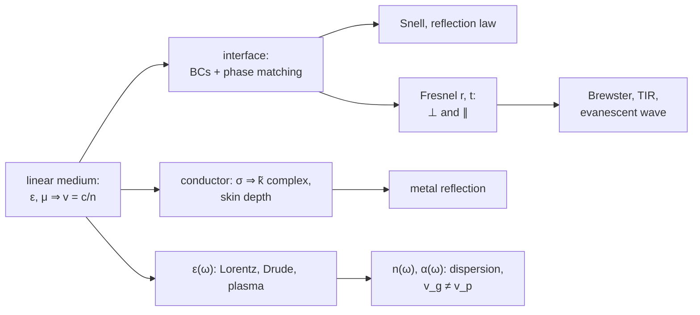
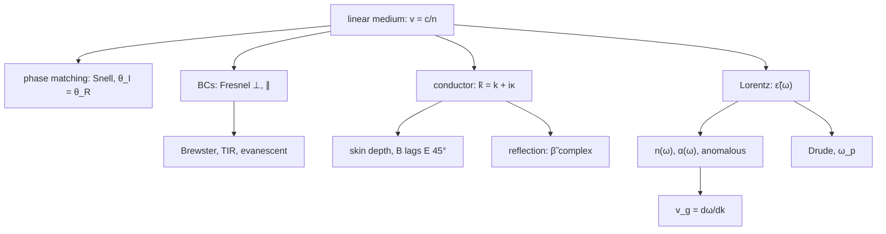

# ED06 · Waves in Matter, Reflection and Dispersion

◀ [[ED05 Electromagnetic Waves in Vacuum]] · [[Electrodynamics - Course Map]] · [[ED07 Guided Waves]] ▶

in course overview extra · book extra · beyond

> [!warning] Source status (every citation below was read in this session)
> Overview item *"electromagnetic waves in vacuum and in matter"* (PH3114 outline; no lecture notes in the folder). **Griffiths and Jackson carry equal weight.**
>
> **Read directly:** Griffiths §9.3.1-9.3.3 (printed pp. 401-411: linear media, normal and oblique incidence, Fresnel's equations, Brewster's angle), §9.4.1-9.4.3 (pp. 412-423: conductors, reflection at a conducting surface, the Lorentz model, anomalous dispersion), with Problems 9.14, 9.19-9.22 as stated; Jackson §7.3 (pp. 302-306, kinematics and the two Fresnel cases), §7.4 (pp. 306-309, Brewster angle, total internal reflection, Goos-Hänchen), §7.5 (pp. 310-314: the absorption relations (7.54)-(7.55), low-frequency conductivity and the Drude model, the plasma frequency, liquid water). pdf = printed + 19 (Griffiths), + 26 (Jackson). **Not cited because not read:** the opening of Jackson §7.5 (the oscillator model equation (7.51)), Jackson §7.6 onward (Kramers-Kronig is deferred to EDX2), Griffiths Problems 9.17 and 9.26, Landau-Lifshitz Vol. 8 chapters on dispersion.

> [!syllabus] Syllabus map
> 🟢 **In course overview**: §1 propagation in linear media, §2 reflection and refraction, §3 waves in conductors, §4 dispersion and absorption.
>
> 🟡 **Extra · book**: §2.4 Goos-Hänchen, §4.3 plasma and Drude models, the free-electron picture of metals (Jackson §7.5), §4.4 group velocity.
>
> 🔵 **Extra · beyond (mine)**: all numbers (Fresnel curves, evanescent depth, skin depths, Lorentz-model values), the derivations of the good- and poor-conductor limits, the plasma phase/group velocity product, `scripts/ed06_numbers.py`, `scripts/fig_ed06.py`.

> [!key] After this chapter you can
> - give the speed, impedance-like relations, energy and intensity of a wave in a **linear medium**,
> - derive the **laws of reflection and refraction** from phase matching and the **Fresnel amplitudes** from the boundary conditions, for both polarizations,
> - find the **Brewster** and **critical** angles, and describe the **evanescent wave** in total internal reflection,
> - solve the wave equation in a **conductor** (complex $\tilde k$), compute the **skin depth** and the reflection from a metal,
> - model **dispersion** and **absorption** with the damped-oscillator (Lorentz) model, and the **plasma frequency** with the free-electron limit,
> - distinguish **phase velocity** from **group velocity**.

> [!intuition] The one-sentence story
> A medium changes the wave only through $\epsilon$ and $\mu$ (and $\sigma$): inside a transparent linear medium everything of ED05 survives with $c\to v=c/n$; at an interface the boundary conditions force the three waves to share a phase pattern, which gives the geometry of optics, and fix their amplitudes, which give Fresnel's equations; making $\epsilon$ complex and frequency-dependent encodes absorption and dispersion at once, and a conductor is simply a medium whose $\epsilon$ has a pole at $\omega=0$.

## 1. Propagation in linear media
Inside matter with no free charge or current, Maxwell's equations are (Griffiths (9.65)) $\nabla\!\cdot\!\mathbf D=0$, $\nabla\times\mathbf E=-\partial_t\mathbf B$, $\nabla\!\cdot\!\mathbf B=0$, $\nabla\times\mathbf H=\partial_t\mathbf D$. For a **linear homogeneous** medium, $\mathbf D=\epsilon\mathbf E$, $\mathbf H=\mathbf B/\mu$, they differ from the vacuum equations only in $\mu_0\epsilon_0\to\mu\epsilon$ (9.67). Hence waves travel at

$$v=\frac1{\sqrt{\epsilon\mu}}=\frac cn,\qquad n\equiv\sqrt{\frac{\epsilon\mu}{\epsilon_0\mu_0}}\simeq\sqrt{\epsilon_r}\quad(9.68)\text{-}(9.70),$$

the same result as Jackson (7.4)-(7.5) $k=\omega\sqrt{\mu\epsilon}$. "All of our previous results carry over with the simple transcription $\epsilon_0\to\epsilon$, $\mu_0\to\mu$, and hence $c\to v$" (Griffiths): $u=\tfrac12(\epsilon E^2+B^2/\mu)$ (9.71), $\mathbf S=\mathbf E\times\mathbf B/\mu$ (9.72), $B_0=E_0/v$, and the intensity $I=\tfrac12\epsilon vE_0^2$ (9.73). Jackson's complex-amplitude form gives $\bar S=\tfrac12\sqrt{\epsilon/\mu}\,|\mathcal E_0|^2$ and $\bar u=\tfrac\epsilon2|\mathcal E_0|^2$ (7.13)-(7.14), the same.

> [!note] Three footnotes worth reading
> * *Transparency is a conspiracy* (Griffiths footnote 10): as the wave passes, the fields polarize and magnetize the molecules, and the resulting oscillating dipoles radiate fields which combine with the original ones into a single wave of the same frequency but a different speed, "the Ewald-Oseen extinction theorem", "a distinctly nontrivial consequence of linearity".
> * $\epsilon_r$ depends on frequency (footnote 11): the static dielectric constant of water gives $n=8.9$, "wildly off, for visible light ($n=1.33$)". Jackson's §7.5E agrees: $n\simeq9$ at very low frequencies, $1.34$ in the visible.
> * The momentum carried by a wave in matter is controversial (footnote 13; compare ED04 §3.4).

## 2. Reflection and refraction at a plane interface
### 2.1 Kinematics: phase matching
A wave $\mathbf E_I\propto e^{i(\mathbf k_I\cdot\mathbf r-\omega t)}$ meets the plane $z=0$ between media 1 and 2 and produces a reflected and a transmitted wave of the same frequency. The boundary conditions must hold at every point of the plane at every instant, so the phase factors must agree there (Jackson (7.34)): $(\mathbf k_I\!\cdot\!\mathbf x)_{z=0}=(\mathbf k_R\!\cdot\!\mathbf x)_{z=0}=(\mathbf k_T\!\cdot\!\mathbf x)_{z=0}$. Consequences (Jackson (7.35)-(7.36), Griffiths (9.99)-(9.100)): the three wave vectors and the normal lie in one plane (the **plane of incidence**), and

$$k_I\sin\theta_I=k_R\sin\theta_R=k_T\sin\theta_T,\quad\theta_I=\theta_R,\quad\frac{\sin\theta_T}{\sin\theta_I}=\frac{n_1}{n_2}\ \ (\text{Snell}).$$

Griffiths' remark: "It is remarkable how little actual electrodynamics went into them: we have yet to invoke any specific boundary conditions"; any waves (water, sound) obey the same "optical" laws. Jackson puts it as the division into *kinematic* properties (independent of the nature of the waves and of the boundary conditions) and *dynamic* ones (intensities, phases, polarization), which depend entirely on the boundary conditions.

### 2.2 Dynamics: normal incidence
Take $\hat{\mathbf x}$ polarization, incident from the left on the $xy$ plane (Griffiths (9.75)-(9.80)). Tangential $\mathbf E$ continuous: $\tilde E_{0I}+\tilde E_{0R}=\tilde E_{0T}$; tangential $\mathbf H$ continuous: $\tilde E_{0I}-\tilde E_{0R}=\beta\tilde E_{0T}$ with

$$\beta\equiv\frac{\mu_1v_1}{\mu_2v_2}=\frac{\mu_1n_2}{\mu_2n_1}\ (9.81),\qquad\tilde E_{0R}=\frac{1-\beta}{1+\beta}\tilde E_{0I},\quad\tilde E_{0T}=\frac2{1+\beta}\tilde E_{0I}\ (9.82).$$

For $\mu_1\approx\mu_2$ ($\beta=v_1/v_2=n_2/n_1$):

$$E_{0R}=\frac{n_1-n_2}{n_1+n_2}E_{0I},\qquad E_{0T}=\frac{2n_1}{n_1+n_2}E_{0I}\quad(9.85),$$

(Jackson (7.42) with $n\leftrightarrow n'$ labelled differently), and the reflected wave is in phase if $v_2>v_1$, upside down if $v_2<v_1$. Intensities: $R\equiv I_R/I_I=\bigl(\tfrac{n_1-n_2}{n_1+n_2}\bigr)^2$ (9.86), $T\equiv I_T/I_I=\tfrac{4n_1n_2}{(n_1+n_2)^2}$ (9.87), and $R+T=1$ (9.88). Griffiths' example: air to glass, $R=0.04$, $T=0.96$.

> [!example] Worked example 1: air to glass, and the exact $R+T=1$ with permeabilities (Griffiths Problem 9.14)
> $n_1=1$, $n_2=1.5$: $E_{0R}/E_{0I}=-0.200$, $E_{0T}/E_{0I}=0.800$, $R=0.0400$, $T=0.9600$. Without assuming $\mu_1=\mu_2=\mu_0$ (🔵 my derivation): with $\epsilon v=1/\mu v$, the intensity ratio gives $T=\tfrac{\epsilon_2v_2}{\epsilon_1v_1}\bigl(\tfrac2{1+\beta}\bigr)^2=\beta\tfrac4{(1+\beta)^2}$ and $R=\tfrac{(1-\beta)^2}{(1+\beta)^2}$, so $R+T=\tfrac{(1-\beta)^2+4\beta}{(1+\beta)^2}=1$ ✓.

### 2.3 Dynamics: oblique incidence, the Fresnel equations
The boundary conditions (Griffiths (9.101), Jackson (7.37)): normal $\mathbf D$ and $\mathbf B$ continuous, tangential $\mathbf E$ and $\mathbf H$ continuous. Treat two polarizations (a general state is a combination, Jackson).

**$\mathbf E$ in the plane of incidence** (Griffiths (9.105)-(9.109); Jackson's "parallel" case (7.40)-(7.41)). The conditions reduce to $\tilde E_{0I}-\tilde E_{0R}=\beta\tilde E_{0T}$ and $\tilde E_{0I}+\tilde E_{0R}=\alpha\tilde E_{0T}$ with $\alpha\equiv\cos\theta_T/\cos\theta_I$, so

$$\tilde E_{0R}=\frac{\alpha-\beta}{\alpha+\beta}\tilde E_{0I},\qquad\tilde E_{0T}=\frac2{\alpha+\beta}\tilde E_{0I}\quad(9.109),$$

These are **Fresnel's equations** for in-plane polarization (in Jackson's notation, for $\mu=\mu'$: $E_0''/E_0=\dfrac{n'^2\cos i-n\sqrt{n'^2-n^2\sin^2i}}{n'^2\cos i+n\sqrt{n'^2-n^2\sin^2i}}$). The transmitted wave is always in phase with the incident one; the reflected wave is in phase if $\alpha>\beta$ and $180^\circ$ out of phase if $\alpha<\beta$ (Griffiths; his footnote 15 notes the phase convention is ambiguous, since flipping the sign of the polarization vector equals a $180^\circ$ phase shift).

**$\mathbf E$ perpendicular to the plane of incidence** (Jackson (7.38)-(7.39), Griffiths leaves it to Problem 9.17): for $\mu=\mu'$,

$$\frac{E_0'}{E_0}=\frac{2n\cos i}{n\cos i+\sqrt{n'^2-n^2\sin^2i}},\qquad\frac{E_0''}{E_0}=\frac{n\cos i-\sqrt{n'^2-n^2\sin^2i}}{n\cos i+\sqrt{n'^2-n^2\sin^2i}},$$

where the square root is $n'\cos r$ with Snell's law used (Jackson). For normal incidence both polarizations reduce to (9.85) / (7.42). Jackson notes these formulas also hold for complex dielectric constants. The power striking the interface is $\mathbf S\!\cdot\!\hat{\mathbf z}$, so the intensities carry cosines: $I_I=\tfrac12\epsilon_1v_1E_{0I}^2\cos\theta_I$, $I_R=\tfrac12\epsilon_1v_1E_{0R}^2\cos\theta_R$, $I_T=\tfrac12\epsilon_2v_2E_{0T}^2\cos\theta_T$ (Griffiths (9.113)-(9.114)).

> [!example] Worked example 2: Fresnel at $30^\circ$, air to glass
> $n_1=1$, $n_2=1.5$, $\theta_I=30^\circ$ so $\sin\theta_T=\tfrac13$, $\theta_T=19.47^\circ$. In-plane polarization: $\alpha=0.9427/0.8660=1.0886$, $\beta=1.5$: $E_{0R}/E_{0I}=-0.1589$ (out of phase, $\alpha<\beta$), $R=0.0252$, and with the cosine factor $T=0.9748$: $R+T=1.0000$ ✓. Perpendicular: $R=0.0578$. At normal incidence both are $0.0400$; at $70^\circ$ they are $0.0425$ (in plane) and $0.2996$ (perpendicular), at $56.3^\circ$: $0.0000$ and $0.1479$ (panel A). Jackson's two forms agree numerically with Griffiths' $(\alpha-\beta)/(\alpha+\beta)$.

### 2.4 Brewster's angle, grazing incidence, total internal reflection
* **Grazing incidence** ($\theta_I\to90^\circ$): $\alpha$ diverges and the wave is totally reflected (Griffiths: "painfully familiar to anyone who has driven at night on a wet road").
* **Brewster's angle.** For in-plane polarization there is an angle at which the reflected wave vanishes: $\alpha=\beta$ (Griffiths (9.111)), and for $\mu_1\approx\mu_2$

$$\tan\theta_B\simeq\frac{n_2}{n_1}\quad(9.112),\ \text{Jackson (7.43)}.$$

For $n'/n=1.5$, Jackson gives $\theta_B=56^\circ$. Light of mixed polarization incident at $\theta_B$ is reflected as **completely plane-polarized light with polarization perpendicular to the plane of incidence**; even away from $\theta_B$ the reflection is predominantly of that polarization, which is why polarizing sunglasses (selective for the other direction) cut glare (Jackson).
* **Total internal reflection** (Jackson §7.4, for $n>n'$). Snell's law gives $r>i$; at the **critical angle** $i_0=\sin^{-1}(n'/n)$ (7.44) the refracted wave grazes the surface. For $i>i_0$, $\sin r>1$ and $\cos r=i\sqrt{(\sin i/\sin i_0)^2-1}$ is purely imaginary (7.45), so the transmitted wave factor becomes

$$e^{i\mathbf k'\cdot\mathbf x}=e^{-k'[(\sin i/\sin i_0)^2-1]^{1/2}z}\,e^{ik'(\sin i/\sin i_0)x}\quad(7.46),$$

propagating only along the surface and decaying exponentially into the second medium: an **evanescent wave** with $\delta^{-1}=k\sqrt{\sin^2i-\sin^2i_0}$. There is **no energy flow** across the surface: $\mathbf S\!\cdot\!\mathbf n=-\frac1{2\omega\mu'}\mathrm{Re}[(\mathbf n\!\cdot\!\mathbf k')|E_0'|^2]=0$ because $\mathbf n\!\cdot\!\mathbf k'=k'\cos r$ is imaginary (7.47). The Fresnel ratios have modulus one but acquire polarization-dependent phase shifts, usable to convert polarization states: **Fresnel's rhombus** turns linear light with equal in-plane and perpendicular amplitudes into circular light with two total internal reflections each giving a $45^\circ$ phase change (Jackson). The penetration of the evanescent wave is the origin of the **Goos-Hänchen effect**: a beam of finite width emerges displaced laterally; naively $D=2\delta\sin i$, and a more careful first-order calculation gives $D_\perp=\dfrac{\lambda}{\pi}\dfrac{\sin i}{\sqrt{\sin^2i-\sin^2i_0}}$ for perpendicular polarization (Jackson (7.48), with $\lambda$ the wavelength in the medium of higher index; the parallel-polarization expression is different and not quoted here).

> [!example] Worked example 3: TIR in glass
> Glass $n=1.5$ to air: $i_0=\sin^{-1}(1/1.5)=41.81^\circ$ (panel B); Brewster for air to glass $\theta_B=\tan^{-1}1.5=56.31^\circ$. For light of vacuum wavelength 600 nm, $\lambda_{\rm glass}=400$ nm; at $i=60^\circ$: $\sqrt{\sin^2i-\sin^2i_0}=0.5528$, so the evanescent decay length is $\delta=1/(k\cdot0.5528)=115$ nm and the Goos-Hänchen shift (7.48) is $D_\perp=199$ nm. Less than a wavelength, as Jackson's phrase "within a very few wavelengths of the boundary" implies.

![[fig_ed06_matter.png]]

## 3. Waves in conductors
### 3.1 The wave equation
In a conductor $\mathbf J_f=\sigma\mathbf E$ (Ohm's law, Griffiths (9.117)), so Ampère-Maxwell reads $\nabla\times\mathbf B=\mu\sigma\mathbf E+\mu\epsilon\partial_t\mathbf E$ (9.118). First, free charge disappears: $\partial_t\rho_f=-\sigma\nabla\!\cdot\!\mathbf E=-(\sigma/\epsilon)\rho_f$, so $\rho_f(t)=e^{-(\sigma/\epsilon)t}\rho_f(0)$ (9.120), with **relaxation time** $\tau=\epsilon/\sigma$: a "good" conductor has $\tau\ll1/\omega$, a "poor" one $\tau\gg1/\omega$. Griffiths' footnote 17: for copper $\tau\sim10^{-19}$ s is absurdly short compared with the collision time $\tau_c\sim10^{-14}$ s, because Ohm's law itself fails on time scales shorter than $\tau_c$; the free charge still dissipates quickly, "exactly how long the process takes is beside the point". With $\rho_f=0$:

$$\nabla^2\mathbf E=\mu\epsilon\frac{\partial^2\mathbf E}{\partial t^2}+\mu\sigma\frac{\partial\mathbf E}{\partial t}\ \ (9.122),\qquad\tilde{\mathbf E}=\tilde{\mathbf E}_0e^{i(\tilde kz-\omega t)},\quad\tilde k^2=\mu\epsilon\omega^2+i\mu\sigma\omega\ \ (9.123)\text{-}(9.124).$$

Writing $\tilde k=k+i\kappa$ (9.125),

$$k=\omega\sqrt{\frac{\epsilon\mu}2}\Bigl[\sqrt{1+\bigl(\tfrac\sigma{\epsilon\omega}\bigr)^2}+1\Bigr]^{1/2},\qquad\kappa=\omega\sqrt{\frac{\epsilon\mu}2}\Bigl[\sqrt{1+\bigl(\tfrac\sigma{\epsilon\omega}\bigr)^2}-1\Bigr]^{1/2}\quad(9.126).$$

The imaginary part attenuates the wave, $e^{-\kappa z}$; the **skin depth** is $d\equiv1/\kappa$ (9.128), and $k$ gives the wavelength $2\pi/k$, speed $\omega/k$ and index $ck/\omega$ (9.129). The fields are transverse (9.130)-(9.131) with $\tilde{\mathbf B}=(\tilde k/\omega)\tilde E_0e^{-\kappa z}e^{i(kz-\omega t)}\hat{\mathbf y}$, so **$\mathbf B$ lags $\mathbf E$ by $\phi=\tan^{-1}(\kappa/k)$** (9.134)-(9.136) and the real amplitudes are related by $B_0/E_0=K/\omega$ with $K=|\tilde k|=\omega\sqrt{\epsilon\mu}\,\bigl[1+(\sigma/\epsilon\omega)^2\bigr]^{1/4}$ (9.133), (9.137) (the scan's text layer loses the root signs; the fourth root follows from $|\tilde k^2|=\mu\epsilon\omega^2\sqrt{1+(\sigma/\epsilon\omega)^2}$ and reduces to $K=\sqrt{\mu\sigma\omega}$ for a good conductor).

**Limits** (the statements are in Griffiths Problem 9.20; the derivations are mine, 🔵). *Poor conductor* $\sigma\ll\epsilon\omega$: $\kappa\simeq\tfrac\sigma2\sqrt{\mu/\epsilon}$ so $d=\tfrac2\sigma\sqrt{\epsilon/\mu}$, independent of frequency. *Good conductor* $\sigma\gg\epsilon\omega$: $\tilde k^2\simeq i\mu\sigma\omega$, $\tilde k=\sqrt{\mu\sigma\omega/2}\,(1+i)$, so $k=\kappa$,

$$d=\sqrt{\frac2{\omega\mu\sigma}}=\frac\lambda{2\pi},\qquad\phi=45^\circ,\qquad\frac{B_0}{E_0}=\sqrt{\frac{\mu\sigma}\omega}.$$

Also (Griffiths Problem 9.21, as stated): in a conductor the time-averaged magnetic energy dominates, $\langle u\rangle=(k^2/2\mu\omega^2)E_0^2e^{-2\kappa z}$ (with the intensity $(k/2\mu\omega)E_0^2e^{-2\kappa z}$).

> [!example] Worked example 4: copper ($\sigma=5.96\times10^7$ S/m)
> | $f$ | skin depth $d$ | wavelength $2\pi/k$ | speed $\omega/k$ | air wavelength |
> |---|---|---|---|---|
> | 50 Hz | 9.22 mm | 57.9 mm | 2.90 m/s | $6.0\times10^6$ m |
> | 1 MHz | 65.2 $\mu$m | 0.410 mm | 410 m/s | 300 m |
> | 10 GHz | 0.652 $\mu$m | 4.10 $\mu$m | $4.1\times10^4$ m/s | 3.0 cm |
>
> The 1 MHz row answers Griffiths Problem 9.19c: the wave is $\sim10^6$ times shorter and slower than in air. At every frequency $\phi=45^\circ$ and $B_0/E_0=\sqrt{\mu\sigma/\omega}=3.45\times10^{-3}$ s/m at 1 MHz, a million times larger than the vacuum $1/c=3.3\times10^{-9}$ s/m: inside a good conductor the wave is almost purely magnetic. Relaxation time $\tau=\epsilon_0/\sigma=1.5\times10^{-19}$ s; for a poor conductor such as glass ($\sigma\sim10^{-12}$ S/m, an order-of-magnitude figure, mine) $\tau\sim9$ s.

### 3.2 Reflection at a conducting surface
Griffiths §9.4.2: for ohmic conductors there is no free surface current (it would need an infinite field), and the boundary conditions give the same algebra as for dielectrics with a *complex* $\tilde\beta$:

$$\tilde E_{0R}=\frac{1-\tilde\beta}{1+\tilde\beta}\tilde E_{0I},\quad\tilde E_{0T}=\frac2{1+\tilde\beta}\tilde E_{0I},\quad\tilde\beta\equiv\frac{\mu_1v_1}{\mu_2\omega}\tilde k_2\quad(9.145)\text{-}(9.147).$$

For a perfect conductor $\sigma=\infty$, $\tilde\beta=\infty$ and $\tilde E_{0R}=-\tilde E_{0I}$, $\tilde E_{0T}=0$: total reflection with a $180^\circ$ phase shift (9.148), which is why good conductors make good mirrors (Griffiths: silver is painted on the back of a pane of glass, whose only role is to support it, and the skin depth at optical frequencies is under $100$ Å).

> [!example] Worked example 5: silver in the constant-$\sigma$ model (Griffiths Problem 9.22 data; the number is mine)
> $\sigma=6\times10^7$ S/m, $\omega=4\times10^{15}$ s⁻¹, $\epsilon=\epsilon_0$, $\mu=\mu_0$: $\sigma/\epsilon\omega=1694$, $\tilde\beta=(c/\omega)\tilde k_2=29.11+29.10i$, and $R=|(1-\tilde\beta)/(1+\tilde\beta)|^2=0.934$. Caution: the Drude model (§4.3) shows that at these frequencies $\sigma$ is itself complex and frequency-dependent, so $0.934$ is an illustration of the method, not a prediction for silver. Optical skin depth for $\sigma=10^7$ S/m, $\omega=10^{15}$ s⁻¹ is $12.6$ nm: metals are opaque.

## 4. Dispersion and absorption
### 4.1 The Lorentz (damped oscillator) model
Griffiths §9.4.3 models each electron in a nonconductor as a mass on a spring with natural frequency $\omega_0$ and linear damping $\gamma$: $m\ddot x+m\gamma\dot x+m\omega_0^2x=qE_0\cos\omega t$ (9.154). (He justifies the spring: any binding force is harmonic for small displacements, from a Taylor expansion of the potential about the minimum; the damping includes radiation.) Steady state $\tilde x=\dfrac{q/m}{\omega_0^2-\omega^2-i\gamma\omega}\tilde E_0$ (9.157); the dipole moment lags the field by $\tan^{-1}[\gamma\omega/(\omega_0^2-\omega^2)]$, small for $\omega\ll\omega_0$ and approaching $\pi$ for $\omega\gg\omega_0$. With $N$ molecules per volume and $f_j$ electrons of frequency $\omega_j$, damping $\gamma_j$ per molecule, the complex dielectric constant is

$$\tilde\epsilon_r=1+\frac{Nq^2}{m\epsilon_0}\sum_j\frac{f_j}{\omega_j^2-\omega^2-i\gamma_j\omega}\qquad(9.161).$$

The wave number is complex, $\tilde k=\sqrt{\tilde\epsilon\mu_0}\,\omega=k+i\kappa$ (9.164)-(9.165); the intensity decays as $e^{-2\kappa z}$ so the **absorption coefficient** is $\alpha=2\kappa$ (9.167) and $n=ck/\omega$ (9.168). Jackson's complementary statement (7.54): with $\tilde k=\beta+i\alpha/2$,

$$\beta^2-\frac{\alpha^2}4=\frac{\omega^2}{c^2}\frac{\mathrm{Re}\,\epsilon}{\epsilon_0},\qquad\beta\alpha=\frac{2\omega^2}{c^2}\frac{\mathrm{Im}\,\epsilon}{\epsilon_0},$$

and for $\alpha\ll\beta$, $\alpha\simeq\dfrac{\mathrm{Im}\,\epsilon}{\mathrm{Re}\,\epsilon}\beta$ (7.55): the fractional decrease in intensity per wavelength divided by $2\pi$ is the ratio $\mathrm{Im}\,\epsilon/\mathrm{Re}\,\epsilon$. (Jackson notes that $\mathrm{Im}\,\epsilon<0$ would mean the medium gives energy to the wave: maser or laser amplification.)

For a dilute gas, expanding the square root (9.169), Griffiths finds

$$n\simeq1+\frac{Nq^2}{2m\epsilon_0}\sum_j\frac{f_j(\omega_j^2-\omega^2)}{(\omega_j^2-\omega^2)^2+\gamma_j^2\omega^2}\ (9.170),\qquad\alpha\simeq\frac{Nq^2\omega^2}{m\epsilon_0c}\sum_j\frac{f_j\gamma_j}{(\omega_j^2-\omega^2)^2+\gamma_j^2\omega^2}\ (9.171).$$

Away from resonances the damping can be dropped, $n=1+\dfrac{Nq^2}{2m\epsilon_0}\sum_j\dfrac{f_j}{\omega_j^2-\omega^2}$ (9.172); for transparent materials the nearest resonances lie in the ultraviolet, so $\omega<\omega_j$ and $1/(\omega_j^2-\omega^2)\simeq\omega_j^{-2}(1+\omega^2/\omega_j^2)$ (Griffiths): $n$ **rises with frequency** (normal dispersion) and blue light bends more than red (a prism, a raindrop).

Near a resonance $n$ drops sharply: **anomalous dispersion**, which occurs exactly where the absorption is maximal (the material may be nearly opaque). Above the resonance $n<1$, "suggesting that the wave speed exceeds $c$", no cause for alarm since energy does not travel at the phase velocity; other resonances add a background that may keep $n>1$ (Griffiths).

> [!example] Worked example 6: a dilute gas with one effective resonance (🔵 numbers)
> $N=2.5\times10^{25}$ m⁻³ (air-like), $f=1$, $\omega_0=1.5\times10^{16}$ s⁻¹ (ultraviolet), $\gamma=10^{14}$ s⁻¹. Then $Nq^2/m\epsilon_0=7.96\times10^{28}$ s⁻², and (9.170) gives $n-1=1.96\times10^{-4}$ at 400 nm, $1.87\times10^{-4}$ at 540 nm, $1.83\times10^{-4}$ at 700 nm: the right size for air and decreasing toward the red, as in Griffiths' Fig. 9.19. At resonance (9.171) gives $\alpha=Nq^2/(m\epsilon_0c\gamma)=2.65\times10^6$ m⁻¹: an absorption length of $0.38\ \mu$m (panel C).

### 4.2 Group velocity
In a dispersive medium a pulse made of many frequencies changes shape. Each sinusoidal component moves at the phase velocity $v=\omega/k$ (9.149), while the envelope moves at the **group velocity** $v_g=\mathrm d\omega/\mathrm dk$ (9.150). Griffiths' pond-ripple illustration: the packet moves at $v_g$ and the ripples within it at $v=2v_g$ for water waves. He stresses that the energy carried by a packet in a dispersive medium does not travel at the phase velocity, "so don't be too alarmed if $v$ comes out greater than $c$"; footnote 19 adds that even $v_g$ can exceed $c$ near a resonance in this model, that no causal signal can exceed $c$, and quotes a paper identifying eight distinct "velocities" of a wave.

### 4.3 Conductors as dispersive media: Drude and the plasma frequency (🟡)
Jackson §7.5 (read parts C-E). If a fraction $f_0$ of the electrons per molecule are "free", with $\omega_0=0$, the dielectric constant has a pole at $\omega=0$: $\epsilon(\omega)=\epsilon_b(\omega)+i\dfrac{Ne^2f_0}{m\omega(\gamma_0-i\omega)}$ (7.56). Comparing with Maxwell-Ampère plus Ohm's law, $\nabla\times\mathbf H=-i\omega(\epsilon_b+i\sigma/\omega)\mathbf E$ (7.57), identifies the **Drude** conductivity

$$\sigma(\omega)=\frac{f_0Ne^2}{m(\gamma_0-i\omega)}\qquad(7.58).$$

For copper ($N=8\times10^{28}$ m⁻³, $\sigma=5.9\times10^7$ S/m) Jackson finds $\gamma_0/f_0\simeq4\times10^{13}$ s⁻¹ (my check: $Ne^2/m\sigma=3.8\times10^{13}$ s⁻¹), so up to well beyond microwave frequencies the conductivity is essentially real and frequency-independent; at infrared and higher frequencies it is complex. His conclusion: "the distinction between dielectrics and conductors is an artificial one, at least away from $\omega=0$": a medium with free electrons is a conductor at low frequency, otherwise an insulator; the dispersive properties can equally be described by a complex dielectric constant.

At frequencies far above the highest resonance, $\epsilon(\omega)/\epsilon_0=1-\omega_p^2/\omega^2$ (7.59) with the **plasma frequency**

$$\omega_p^2=\frac{NZe^2}{\epsilon_0m}\qquad(7.60),\qquad ck=\sqrt{\omega^2-\omega_p^2}\ \Longleftrightarrow\ \omega^2=\omega_p^2+c^2k^2\ \ (7.61).$$

For $\omega<\omega_p$ the wave number is purely imaginary: waves are reflected and the fields decay inside; at $\omega=0$ the attenuation constant is $\alpha_{\rm plasma}=2\omega_p/c$ (7.62). Jackson quotes laboratory densities $10^{18}$-$10^{22}$ m⁻³, giving $\omega_p=6\times10^{10}$-$6\times10^{12}$ s⁻¹ and attenuation lengths of order $0.2$ cm to $2\times10^{-3}$ cm. The reflectivity of metals at optical frequencies comes from the same behaviour with the conduction electrons' $\omega_p$ (and an effective mass $m^*$); when $\epsilon(\omega)$ becomes positive the metal suddenly transmits: the **ultraviolet transparency of metals**, from whose onset one learns the electron density or effective mass.

> [!example] Worked example 7: plasma numbers (🔵)
> $\omega_p=\sqrt{Ne^2/\epsilon_0m}=5.64\times10^{4}\sqrt{N}$ s⁻¹ ($N$ in m⁻³). Ionosphere, $N=10^{12}$ m⁻³: $\omega_p=5.64\times10^7$ s⁻¹, $f_p=8.98$ MHz: AM radio (1 MHz) is reflected, FM (100 MHz) passes through. Laboratory plasma, $N=10^{18}$ m⁻³: $\omega_p=5.64\times10^{10}$ s⁻¹ and a static attenuation length $c/2\omega_p=2.7$ mm, matching Jackson's range. Copper's free-electron value ($N=8\times10^{28}$ m⁻³): $\omega_p=1.6\times10^{16}$ s⁻¹ (ultraviolet). At $\omega=2\omega_p$: $v_p=\omega/k=1.155c$ and $v_g=\mathrm d\omega/\mathrm dk=c^2k/\omega=0.866c$, with $v_pv_g=c^2$ for every $\omega>\omega_p$ (from $\omega^2=\omega_p^2+c^2k^2$); the phase velocity exceeds $c$ but the group velocity (and energy transport) does not (panel D).

> [!example] Worked example 8: liquid water over twenty decades (Jackson §7.5E)
> Jackson's survey: $n\simeq9$ at very low frequency, falling smoothly above $10^{10}$ Hz to the infrared structure; $n=1.34$ in the visible. The absorption coefficient rises to $10^4$ m⁻¹ near $10^{11}$ Hz (an attenuation length of $100\ \mu$m, "the well-known microwave absorption by water", which ended the trend to shorter-wavelength radar in World War II), reaches $\sim10^6$ m⁻¹ in the infrared bands, then drops over seven and a half decades to $<0.3$ m⁻¹ between $4\times10^{14}$ and $8\times10^{14}$ Hz: the visible window, rising again by more than eight decades by $2\times10^{15}$ Hz.

<!-- interactive:start (generated by scripts/embed_interactive.py; edit the tool in scripts/interactive/tools/, not this block) -->
> [!interactive]+ Interactive: Reflection and refraction: Snell, Fresnel, Brewster, total internal reflection
> A plane wave meets a flat interface between media of index n₁ and n₂.
>
> ![[ed06_fresnel.png|720]]
>
> **Try:** n₁ = 1, n₂ = 1.5: the parallel curve touches zero at the Brewster angle 56.3°. Swap to n₁ = 1.5, n₂ = 1: total internal reflection beyond 41.8°, with an evanescent decay length ~λ/(2π√(sin²θ − sin²θ_c)).
>
> [▶ Open the tool in your browser](../Assets/interactive/ed06_fresnel.html) · [absolute link](file:///home/swastik/Documents/notes/Assets/interactive/ed06_fresnel.html) · all tools and coverage: [[Interactive Tools]]

> [!interactive]+ Interactive: Dispersion and absorption: the Lorentz oscillator and the plasma
> Electrons modelled as damped springs give ε(ω) = 1 + ω_P²/(ω₀² − ω² − iγω).
>
> ![[ed06_lorentz_dispersion.png|720]]
>
> **Try:** Narrow the damping γ and watch the anomalous region shrink onto the absorption peak. Move the probe frequency in the plasma panel below ω_p: k becomes imaginary and the wave cannot propagate.
>
> [▶ Open the tool in your browser](../Assets/interactive/ed06_lorentz_dispersion.html) · [absolute link](file:///home/swastik/Documents/notes/Assets/interactive/ed06_lorentz_dispersion.html) · all tools and coverage: [[Interactive Tools]]

> [!interactive]+ Interactive: Wave packets: phase velocity versus group velocity
> A packet is a superposition of plane waves ψ(x,t) = ∫ A(k) e^{i(kx − ω(k)t)} dk with a Gaussian A(k) centred on k₀.
>
> ![[wave_dispersion_packet.png|720]]
>
> **Try:** Deep water: v_g = v_p/2 (ripples run through the packet). Waveguide/plasma: v_p·v_g = c², ripples faster than c but the packet slower. Schrödinger: ω = k²/2, v_g = 2v_p. Non-dispersive: nothing spreads.
>
> [▶ Open the tool in your browser](../Assets/interactive/wave_dispersion_packet.html) · [absolute link](file:///home/swastik/Documents/notes/Assets/interactive/wave_dispersion_packet.html) · all tools and coverage: [[Interactive Tools]]

<!-- interactive:end -->

## Map of this chapter

## Common mistakes
1. Using $R+T=1$ with amplitude ratios squared at oblique incidence (the cosine and $\epsilon v$ factors of (9.113)-(9.114) matter).
2. Taking the Brewster angle for the wrong polarization (it exists for in-plane $\mathbf E$ only, for $\mu_1=\mu_2$).
3. Saying "no wave" in total internal reflection: there is an evanescent wave but no energy flux.
4. Using the static $\epsilon_r$ to get $n$ at optical frequencies.
5. Setting $\kappa=0$ in a "good" conductor: $k=\kappa$ there and the wave is strongly damped.
6. Confusing the phase velocity (can exceed $c$) with the group velocity and energy velocity.

## Summary
- Linear media: $v=c/n$, $n=\sqrt{\epsilon\mu/\epsilon_0\mu_0}$; $u,\mathbf S,I$ with $c\to v$, $\epsilon_0\to\epsilon$, $\mu_0\to\mu$.
- Phase matching gives $\theta_I=\theta_R$ and Snell; boundary conditions give Fresnel: $r=(\alpha-\beta)/(\alpha+\beta)$ (in plane), $r_\perp=(n\cos i-\sqrt{n'^2-n^2\sin^2i})/(n\cos i+\sqrt{\cdots})$.
- $\tan\theta_B=n_2/n_1$; $\sin i_0=n'/n$; evanescent depth $\delta^{-1}=k\sqrt{\sin^2i-\sin^2i_0}$.
- Conductor: $\tilde k^2=\mu\epsilon\omega^2+i\mu\sigma\omega$; good: $d=\sqrt{2/\omega\mu\sigma}$, $\phi=45^\circ$; relaxation $\tau=\epsilon/\sigma$.
- Lorentz: $\tilde\epsilon_r=1+\frac{Nq^2}{m\epsilon_0}\sum f_j/(\omega_j^2-\omega^2-i\gamma_j\omega)$; $\alpha=2\kappa$; anomalous dispersion at resonance.
- Plasma: $\omega^2=\omega_p^2+c^2k^2$, $v_pv_g=c^2$; Drude $\sigma=f_0Ne^2/m(\gamma_0-i\omega)$.
- Numbers: glass $R=0.04$; $\theta_B=56.31^\circ$; $i_0=41.81^\circ$; copper $d=65\ \mu$m at 1 MHz; ionosphere $f_p=9$ MHz.

## Practice
> [!question]- P1. Air to water
> $n=1.33$: find $R$ and $T$ at normal incidence.
> **Solution.** $R=(0.33/2.33)^2=0.0201$, $T=0.9799$.

> [!question]- P2. Characteristic angles of water
> Find Brewster's angle for air to water and the critical angle water to air.
> **Solution.** $\tan^{-1}1.33=53.06^\circ$; $\sin^{-1}(1/1.33)=48.75^\circ$.

> [!question]- P3. Snell
> Light at $40^\circ$ in air enters glass $n=1.5$: find $\theta_T$.
> **Solution.** $\sin\theta_T=\sin40^\circ/1.5=0.4285$, $\theta_T=25.37^\circ$.

> [!question]- P4. Exact $R+T=1$
> Show $R+T=1$ at normal incidence for arbitrary $\mu_1,\mu_2$ (Griffiths Problem 9.14).
> **Solution.** Worked example 1: $R=(1-\beta)^2/(1+\beta)^2$, $T=4\beta/(1+\beta)^2$.

> [!question]- P5. Evanescent depth
> Glass-air, $\lambda_0=600$ nm, $i=60^\circ$: find $\delta$.
> **Solution.** $\lambda_g=400$ nm, $k=1.571\times10^7$ m⁻¹, $\sqrt{\sin^260^\circ-(1/1.5)^2}=0.5528$, $\delta=115$ nm.

> [!question]- P6. Goos-Hänchen shift
> Evaluate $D_\perp$ for the same case.
> **Solution.** $D_\perp=(\lambda/\pi)\sin i/\sqrt{\sin^2i-\sin^2i_0}=(400\text{ nm}/\pi)(0.866/0.5528)=199$ nm.

> [!question]- P7. Good and poor conductor limits
> Derive $d=\sqrt{2/\omega\mu\sigma}$ and $d=(2/\sigma)\sqrt{\epsilon/\mu}$.
> **Solution.** §3.1: $\tilde k^2\simeq i\mu\sigma\omega$ gives $\tilde k=\sqrt{\mu\sigma\omega/2}(1+i)$; for $\sigma\ll\epsilon\omega$, $\tilde k\simeq\omega\sqrt{\mu\epsilon}(1+i\sigma/2\epsilon\omega)$ so $\kappa=\tfrac\sigma2\sqrt{\mu/\epsilon}$.

> [!question]- P8. Mains skin depth
> Skin depth of copper at 50 Hz?
> **Solution.** $d=\sqrt{2/(2\pi\cdot50\cdot4\pi\times10^{-7}\cdot5.96\times10^7)}=9.2$ mm.

> [!question]- P9. Sea water
> $\sigma=4$ S/m at 1 kHz: skin depth?
> **Solution.** $d=\sqrt{2/\omega\mu_0\sigma}=\sqrt{2/(6283\cdot1.2566\times10^{-6}\cdot4)}=7.96$ m (good conductor: $\omega\epsilon\ll\sigma$).

> [!question]- P10. Relaxation time
> Evaluate $\epsilon_0/\sigma$ for copper and sea water ($\epsilon=80\epsilon_0$, $\sigma=4$ S/m).
> **Solution.** Copper $1.5\times10^{-19}$ s; sea water $1.8\times10^{-10}$ s.

> [!question]- P11. Sign of $n-1$ in the Lorentz model
> Show $n-1>0$ below a resonance and $<0$ above.
> **Solution.** (9.172): $n-1\propto1/(\omega_j^2-\omega^2)$.

> [!question]- P12. Plasma frequency
> $N=10^{18}$ m⁻³: $\omega_p$ and static attenuation length?
> **Solution.** $\omega_p=5.64\times10^{10}$ s⁻¹; $c/2\omega_p=2.66$ mm.

> [!question]- P13. Ionospheric cutoff
> Which frequency band is reflected by an ionosphere of density $10^{12}$ m⁻³?
> **Solution.** $f<f_p=8.98$ MHz.

> [!question]- P14. Plasma velocities
> Show $v_pv_g=c^2$ and evaluate at $\omega=2\omega_p$.
> **Solution.** $v_p=\omega/k$, $v_g=c^2k/\omega$ from $\omega^2=\omega_p^2+c^2k^2$; at $2\omega_p$: $1.155c$ and $0.866c$.

> [!question]- P15. Perfect mirror
> Show a perfect conductor reflects with a $180^\circ$ phase shift and transmits nothing.
> **Solution.** $\sigma\to\infty$ gives $\tilde k_2\to\infty$, $\tilde\beta\to\infty$: $\tilde E_{0R}/\tilde E_{0I}=(1-\tilde\beta)/(1+\tilde\beta)\to-1$, $\tilde E_{0T}\to0$ (9.148).

## Zettel notes
<!-- zettel:start -->
<!-- zettel:end -->

## Provenance
> [!provenance]- Source map for this chapter (all rows read in this session)
> | Topic | Source | Scope |
> |---|---|---|
> | propagation in linear media, footnotes on Ewald-Oseen, water, momentum | Griffiths §9.3.1 (pp. 401-403) | in overview |
> | normal incidence (9.75)-(9.88), Problem 9.14 | Griffiths §9.3.2 (pp. 403-405) | in overview |
> | laws of reflection and refraction, Fresnel (9.99)-(9.114), Brewster | Griffiths §9.3.3 (pp. 405-411) | in overview |
> | kinematics (7.34)-(7.36), boundary conditions (7.37), perpendicular and parallel Fresnel (7.38)-(7.42) | Jackson §7.3 (pp. 302-306) | in overview |
> | Brewster (7.43), TIR (7.44)-(7.47), Fresnel rhombus, Goos-Hänchen (7.48) | Jackson §7.4 (pp. 306-309) | in overview |
> | conductors: relaxation, complex $\tilde k$, skin depth, phase lag, Problems 9.19-9.21 | Griffiths §9.4.1 (pp. 412-416) | in overview |
> | reflection at a conducting surface (9.139)-(9.148), Problem 9.22 | Griffiths §9.4.2 (pp. 416-417) | in overview |
> | Lorentz model (9.149)-(9.172), group velocity, anomalous dispersion | Griffiths §9.4.3 (pp. 417-423) | in overview |
> | absorption relations (7.54)-(7.55), Drude (7.56)-(7.58), plasma frequency (7.59)-(7.62), UV transparency, water | Jackson §7.5 (pp. 310-314) | extra/book |
> | numbers: Fresnel curves, evanescent depth, skin depths, Lorentz and plasma values | `scripts/ed06_numbers.py`, `scripts/fig_ed06.py` | extra/beyond |
