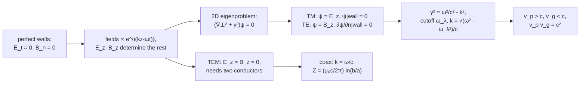
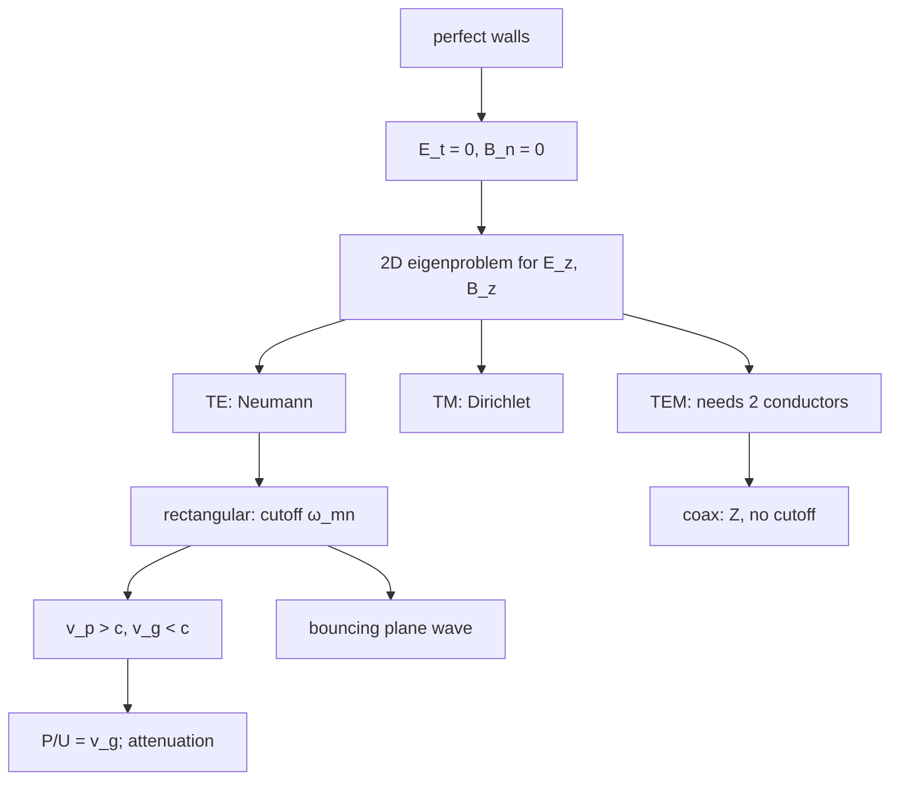

# ED07 · Guided Waves

◀ [[ED06 Waves in Matter, Reflection and Dispersion]] · [[Electrodynamics - Course Map]] · [[ED08 Potentials and Gauge Transformations]] ▶

in course overview extra · book extra · beyond

> [!warning] Source status (every citation below was read in this session)
> Overview item *"guided waves"* (PH3114 outline; no lecture notes in the folder). **Griffiths and Jackson carry equal weight.**
>
> **Read directly:** Griffiths §9.5.1-9.5.3 (printed pp. 425-432: waveguides, TE waves in a rectangular guide, the coaxial line, with Problems 9.27-9.32 as stated); Jackson §8.2 (pp. 356-359, cylindrical guides, the TEM mode, boundary conditions), §8.3 (pp. 359-361, TM and TE waves, cutoff), §8.4 (pp. 361-362, rectangular guide, the TE$_{10}$ mode and the table of cutoff ratios), §8.5 (pp. 363-365 up to (8.62), energy flow, group velocity, attenuation). pdf = printed + 19 (Griffiths), + 26 (Jackson). **Not cited because not read:** Jackson §8.1 (fields at a conductor surface, apart from the formulas quoted inside §8.5), §8.6 onward (cavities, perturbations, Q), Jackson Problems 8.1-8.2, Griffiths Problem 9.26.
>
> **Notation.** Griffiths writes the rectangular guide with height $a$ (along $x$) and width $b$ (along $y$); Jackson uses $a,b$ with $a>b$. Here: $a$ along $x$, $b$ along $y$, as in Griffiths, and $a>b$ for the dominant mode as in Jackson.

> [!syllabus] Syllabus map
> 🟢 **In course overview**: §1 boundary conditions, §2 TE, TM, TEM classification and cutoff, §3 the rectangular guide, §4 the coaxial line.
>
> 🟡 **Extra · book**: §3.3 the plane-wave (bouncing) picture, §5 energy flow, group velocity and wall attenuation (Jackson §8.5).
>
> 🔵 **Extra · beyond (mine)**: the TM$_{11}$ cutoff ratio, the coaxial impedance, the numerical Maxwell check of TE$_{10}$ and of $P/U=v_g$, the below-cutoff attenuation in decibels, the photon-mass analogy, `scripts/ed07_numbers.py`, `scripts/fig_ed07.py`.

> [!key] After this chapter you can
> - impose the **perfect-conductor boundary conditions** on a wave travelling in a hollow cylinder,
> - reduce the problem to a **two-dimensional eigenvalue problem** for $E_z$ (TM) and $B_z$ (TE), and explain why a hollow guide has **no TEM mode**,
> - find the **cutoff frequencies**, **phase velocity**, **group velocity** and **guide wavelength** of a rectangular guide, with numbers,
> - interpret a guided mode as a **plane wave bouncing** between the walls,
> - treat the **coaxial line** as a TEM line with a characteristic impedance,
> - relate **power flow** to **group velocity** and understand wall attenuation.

> [!intuition] The one-sentence story
> Confine a wave to a pipe and the sideways standing-wave pattern imposed by the walls eats part of the wave's $\omega/c$: only what is left, $k=\sqrt{\omega^2-\omega_c^2}/c$, can travel along the pipe. Below the cutoff $\omega_c$ nothing propagates; above it the phase fronts race along faster than $c$ while the energy crawls at $c\sqrt{1-\omega_c^2/\omega^2}<c$. A second conductor down the middle changes everything: the transverse-electromagnetic wave of the coaxial cable needs no cutoff at all.

## 1. Waves in a hollow conducting pipe
Take a cylinder of uniform cross-section along $z$ with **perfectly conducting walls** (Griffiths §9.5.1, Jackson §8.2). Inside the metal $\mathbf E=\mathbf B=0$ (Griffiths footnote 21 recalls: $\mathbf E=0$ in a perfect conductor, so by Faraday's law $\partial_t\mathbf B=0$, and a field that started at zero stays zero). The boundary conditions at the inner wall are

$$\mathbf E_\parallel=0,\qquad B_\perp=0\qquad(\text{Griffiths (9.175); Jackson: }\hat{\mathbf n}\times\mathbf E=0,\ \hat{\mathbf n}\!\cdot\!\mathbf B=0),$$

the same as ED03 §6 for a perfect conductor. Free charges and currents induced on the surface enforce them; Griffiths' footnote 22 notes that in a real conductor the currents extend to roughly the skin depth, and in the limit of perfect conduction are squeezed into a true surface current. Jackson adds that if the cylinder has end surfaces it is called a *cavity*, otherwise a *waveguide*, and that losses in real walls "can be accounted for adequately by the methods of Section 8.1" (§5).

Seek waves travelling down the pipe (Griffiths (9.176), Jackson (8.18)):

$$\tilde{\mathbf E}=\tilde{\mathbf E}_0(x,y)\,e^{i(kz-\omega t)},\qquad\tilde{\mathbf B}=\tilde{\mathbf B}_0(x,y)\,e^{i(kz-\omega t)},$$

with $k$ real in the cases of interest. Jackson notes that appropriate linear combinations give travelling or standing waves in $z$ and that $k$ is "an unknown parameter that may be real or complex". Confined waves are *not* in general transverse: the walls force longitudinal components $E_z$ and $B_z$ (Griffiths (9.178)).

## 2. Reduction to a two-dimensional eigenvalue problem
Putting the $z$-dependence into Maxwell's curl equations gives six relations (Griffiths (9.179)); solving them for the transverse components in terms of the longitudinal ones,

$$E_x=\frac{i}{(\omega/c)^2-k^2}\Bigl(k\frac{\partial E_z}{\partial x}+\omega\frac{\partial B_z}{\partial y}\Bigr),\quad E_y=\frac{i}{(\omega/c)^2-k^2}\Bigl(k\frac{\partial E_z}{\partial y}-\omega\frac{\partial B_z}{\partial x}\Bigr),$$

$$B_x=\frac{i}{(\omega/c)^2-k^2}\Bigl(k\frac{\partial B_z}{\partial x}-\frac\omega{c^2}\frac{\partial E_z}{\partial y}\Bigr),\quad B_y=\frac{i}{(\omega/c)^2-k^2}\Bigl(k\frac{\partial B_z}{\partial y}+\frac\omega{c^2}\frac{\partial E_z}{\partial x}\Bigr)\qquad(9.180),$$

(Jackson (8.26a,b) is the same statement for a medium with $\epsilon,\mu$). So it suffices to find $E_z$ and $B_z$, and the remaining Maxwell equations decouple them:

$$\Bigl[\frac{\partial^2}{\partial x^2}+\frac{\partial^2}{\partial y^2}+\Bigl(\frac\omega c\Bigr)^2-k^2\Bigr]\Bigl\{{E_z\atop B_z}\Bigr\}=0\qquad(9.181),\ \text{Jackson (8.19)}.$$

Classification (Griffiths): $E_z=0$ gives **TE** (transverse electric) waves, $B_z=0$ gives **TM** (transverse magnetic), both zero gives **TEM**. In Jackson's formulation each mode has a scalar function $\psi$ ($E_z$ for TM, $H_z$ for TE) satisfying

$$\bigl(\nabla_\perp^2+\gamma^2\bigr)\psi=0,\qquad\gamma^2=\mu\epsilon\omega^2-k^2\quad(8.34)\text{-}(8.35),$$

with boundary conditions

$$\psi|_S=0\ \ (\text{TM}),\qquad\frac{\partial\psi}{\partial n}\Big|_S=0\ \ (\text{TE})\qquad(8.36),$$

which follow from $\mathbf n\times\mathbf E=0$ (so $E_z|_S=0$, (8.29)) and $\mathbf n\!\cdot\!\mathbf B=0$ (so $\partial B_z/\partial n|_S=0$, (8.30)). This is an eigenvalue problem: $\gamma^2$ cannot be negative (the function must oscillate between opposite walls), and there is a spectrum $\gamma_\lambda^2$, $\lambda=1,2,\dots$, of orthogonal **modes**. For each mode (Jackson (8.37)-(8.39)):

$$k_\lambda^2=\mu\epsilon\omega^2-\gamma_\lambda^2,\qquad\omega_\lambda=\frac{\gamma_\lambda}{\sqrt{\mu\epsilon}},\qquad k_\lambda=\sqrt{\mu\epsilon}\,\sqrt{\omega^2-\omega_\lambda^2},$$

so the **cutoff frequency** $\omega_\lambda$ separates $k_\lambda$ real ($\omega>\omega_\lambda$: propagation) from $k_\lambda$ imaginary (a *cutoff* or *evanescent* mode). At any frequency only a finite number of modes propagate, and one often chooses the dimensions so that only the lowest does. The wavelength in the guide exceeds the free-space wavelength and the **phase velocity** is

$$v_p=\frac\omega k=\frac{1}{\sqrt{\mu\epsilon}}\frac1{\sqrt{1-(\omega_\lambda/\omega)^2}}>\frac1{\sqrt{\mu\epsilon}}\qquad(8.40),$$

which becomes infinite exactly at cutoff (Jackson).

### 2.1 No TEM wave in a hollow guide
For $E_z=B_z=0$ the transverse field obeys the two-dimensional *electrostatic* equations. Griffiths' proof: $E_z=0$ and Gauss's law give $\partial_xE_x+\partial_yE_y=0$; $B_z=0$ and Faraday's law give $\partial_xE_y-\partial_yE_x=0$; so $\tilde{\mathbf E}_0$ has zero divergence and zero curl in the cross-section and is the gradient of a potential obeying Laplace's equation. But $\mathbf E_\parallel=0$ makes the wall an equipotential, and since Laplace's equation has no local maxima or minima, the potential is constant and the field vanishes: no wave. Jackson reaches the same conclusion and adds the positive statements for a TEM mode: $k=k_0=\omega\sqrt{\mu\epsilon}$ (8.27), $\mathbf B_{\rm TEM}=\pm\sqrt{\mu\epsilon}\,\hat{\mathbf z}\times\mathbf E_{\rm TEM}$ (8.28) (as for plane waves), and **no cutoff frequency**. The argument applies only to a completely empty single conductor: "if you run a separate conductor down the middle, the potential at its surface need not be the same as on the outer wall." Jackson names the coaxial cable and the parallel-wire line as the structures for which this is the dominant mode (§4).

## 3. The rectangular guide
### 3.1 TE modes
Griffiths takes a guide with sides $a$ (along $x$) and $b$ (along $y$) and solves (9.181) for $B_z$ by separation of variables, $B_z=X(x)Y(y)$:

$$\frac1X\frac{\mathrm d^2X}{\mathrm dx^2}=-k_x^2,\quad\frac1Y\frac{\mathrm d^2Y}{\mathrm dy^2}=-k_y^2,\quad-k_x^2-k_y^2+\Bigl(\frac\omega c\Bigr)^2-k^2=0\quad(9.182)\text{-}(9.183).$$

The boundary condition is $B_x=0$, hence by (9.180) $\mathrm dX/\mathrm dx=0$, at $x=0,a$ (and similarly in $y$), which leaves cosines:

$$k_x=\frac{m\pi}a,\ k_y=\frac{n\pi}b\ \ (m,n=0,1,2,\dots)\quad(9.184)\text{-}(9.185),\qquad B_z=B_0\cos\frac{m\pi x}a\cos\frac{n\pi y}b,$$

$$k=\sqrt{\Bigl(\frac\omega c\Bigr)^2-\pi^2\Bigl[\Bigl(\frac ma\Bigr)^2+\Bigl(\frac nb\Bigr)^2\Bigr]}.\tag{3.1}$$

Jackson's (8.41)-(8.44) is the same ($\psi=H_z=H_0\cos\tfrac{m\pi x}a\cos\tfrac{n\pi y}b$, cutoff $\omega_{mn}=\tfrac\pi{\sqrt{\mu\epsilon}}\bigl(\tfrac{m^2}{a^2}+\tfrac{n^2}{b^2}\bigr)^{1/2}$) for a medium of $\epsilon,\mu$, with $m$ and $n$ not both zero. In vacuum the **cutoff frequency** is

$$\omega_{mn}=c\pi\sqrt{(m/a)^2+(n/b)^2}\qquad(9.188),$$

and for $\omega<\omega_{mn}$ the wave number is imaginary: the fields are exponentially attenuated, not travelling. With $a>b$ the lowest cutoff belongs to **TE$_{10}$**, $\omega_{10}=c\pi/a$ (9.189): half a free-space wavelength fits across the guide; lower frequencies do not propagate at all. In terms of the cutoff,

$$k=\frac1c\sqrt{\omega^2-\omega_{mn}^2}\ (9.190),\qquad v=\frac\omega k=\frac{c}{\sqrt{1-(\omega_{mn}/\omega)^2}}\ (9.191),\qquad v_g=\frac{1}{\mathrm dk/\mathrm d\omega}=c\sqrt{1-(\omega_{mn}/\omega)^2}\ (9.192).$$

The wave velocity exceeds $c$, but the energy travels at the group velocity $<c$ (§5); $v\,v_g=c^2$. Jackson writes the TE$_{10}$ fields explicitly (8.46): $H_z=H_0\cos(\pi x/a)e^{ikz-i\omega t}$, $H_x=-(ika/\pi)H_0\sin(\pi x/a)e^{ikz-i\omega t}$, $E_y=\ldots\sin(\pi x/a)$; the factor $i$ means a $90^\circ$ phase difference between $H_x$ (and $E_y$) and $H_z$ along the guide. He notes that TE$_{10}$ has the lowest cutoff of all TE *and* TM modes and so is the one used in practice. For $a=2b$ the cutoffs relative to $\omega_{10}$ are (Jackson's table):

| $m\backslash n$ | 0 | 1 | 2 | 3 |
|---|---|---|---|---|
| 0 | — | 2.00 | 4.00 | 6.00 |
| 1 | 1.00 | 2.24 | 4.13 | |

### 3.2 TM modes (🔵 outline; Griffiths Problem 9.31)
For TM, $\psi=E_z$ with $E_z|_S=0$: $E_z=E_0\sin\tfrac{m\pi x}a\sin\tfrac{n\pi y}b$, and now $m,n\ge1$ (a zero index would make $E_z\equiv0$). The cutoff formula is the same, so the lowest TM mode is **TM$_{11}$**, whose cutoff exceeds the TE$_{10}$ cutoff by $\sqrt{1+(a/b)^2}$ (2.47 for $a/b=2.26$, as in Worked example 1).

### 3.3 The bouncing-plane-wave picture (🟡)
Griffiths gives a vivid reading. An ordinary plane wave travelling at angle $\theta$ to the $z$ axis reflects perfectly off the conducting walls; in $x$ and $y$ the multiply reflected waves interfere into standing waves with $\lambda_x=2a/m$, $\lambda_y=2b/n$ (so $k_x=m\pi/a$, $k_y=n\pi/b$), while along $z$ it travels with $k_z=k$. The "original" propagation vector is $\mathbf k'=\tfrac{m\pi}a\hat{\mathbf x}+\tfrac{n\pi}b\hat{\mathbf y}+k\hat{\mathbf z}$ and $\omega=c|\mathbf k'|=\sqrt{(ck)^2+\omega_{mn}^2}$. Only certain angles fit the standing patterns: $\cos\theta=k/|\mathbf k'|=\sqrt{1-(\omega_{mn}/\omega)^2}$. The plane wave moves at $c$ but at angle $\theta$, so its net velocity down the guide is $v_g=c\cos\theta$; the **wave fronts** (like a line of breakers meeting the beach) move at $v=c/\cos\theta$, faster than $c$. At cutoff $\theta=90^\circ$: the wave just bounces across the guide and goes nowhere.

> [!example] Worked example 1: Griffiths Problem 9.29's guide, $2.28\times1.01$ cm
> Cutoffs $f_{mn}=\tfrac c2\sqrt{(m/a)^2+(n/b)^2}$ (panel B):
>
> | mode | $f_c$ (GHz) | free-space $\lambda_c$ (cm) |
> |---|---|---|
> | TE$_{10}$ | 6.574 | 4.560 |
> | TE$_{20}$ | 13.149 | 2.280 |
> | TE$_{01}$ | 14.841 | 2.020 |
> | TE$_{11}$ | 16.232 | 1.847 |
> | TE$_{30}$ | 19.723 | 1.520 |
> | TE$_{21}$ | 19.828 | 1.512 |
>
> At $1.70\times10^{10}$ Hz the propagating TE modes are **TE$_{10}$, TE$_{20}$, TE$_{01}$, TE$_{11}$**. To excite only one mode (TE$_{10}$) use $6.574<f<13.149$ GHz, i.e. free-space wavelengths between $2.28$ and $4.56$ cm. (The TE$_{00}$ "mode" cannot exist: Griffiths Problem 9.28, P1.) TM$_{11}$ has the same cutoff as TE$_{11}$, $16.232$ GHz; the lowest-TM/lowest-TE ratio is $\sqrt{1+(2.28/1.01)^2}=2.47$.

> [!example] Worked example 2: TE$_{10}$ at 10 GHz in the same guide
> $f_c=6.574$ GHz, $\omega_c/\omega=0.6574$, $\sqrt{1-0.4322}=0.7535$. Then $k=157.9$ rad/m, guide wavelength $\lambda_g=2\pi/k=3.979$ cm (free space $3.000$ cm), $v_p=1.327c$, $v_g=0.7535c$ with $v_pv_g=c^2$, and the bounce angle $\cos\theta=0.7535$, $\theta=41.1^\circ$ (panels A and C). At $f=5$ GHz, below cutoff, $k$ is imaginary: $\kappa=(2\pi/c)\sqrt{f_c^2-f^2}=89.5\ \mathrm m^{-1}$, so the field falls by $1/e$ in $1.12$ cm, by a factor $1.3\times10^{-4}$ in $10$ cm (power down $77.7$ dB): a short stub of guide below cutoff is an excellent filter.

## 4. The coaxial transmission line (TEM)
Griffiths §9.5.3: a long wire of radius $a$ surrounded by a cylindrical sheath of radius $b$ **does** admit modes with $E_z=0$ and $B_z=0$ (the no-TEM proof fails because the two conductors can sit at different potentials). Then (9.179) gives

$$k=\frac\omega c\ (9.193),\qquad cB_y=E_x,\ cB_x=-E_y\ (9.194),$$

waves at speed $c$, nondispersive, with $\mathbf E\perp\mathbf B$, and the transverse fields obey the 2D equations of electro- and magnetostatics (9.195), whose cylindrically symmetric solutions are those of an infinite line charge and an infinite straight current:

$$\mathbf E=\frac{A\cos(kz-\omega t)}s\,\hat{\mathbf s},\qquad\mathbf B=\frac{A\cos(kz-\omega t)}{cs}\,\hat{\boldsymbol\phi}\qquad(9.197).$$

(Griffiths Problem 9.32 asks to verify this and to find the charge density and current on the inner conductor.)

> [!example] Worked example 3: verifying (9.197) and finding $\lambda$, $I$, $Z$ (🔵)
> *Maxwell:* $\nabla\!\cdot\!\mathbf E=0$ (the radial $1/s$ field is divergence-free) and $\nabla\times\mathbf E=\partial_zE_s\,\hat{\boldsymbol\phi}=-\tfrac{kA}s\sin(kz-\omega t)\hat{\boldsymbol\phi}$ equals $-\partial_t\mathbf B=-\tfrac{\omega A}{cs}\sin(kz-\omega t)\hat{\boldsymbol\phi}$ since $\omega=ck$ ✓; similarly for Ampère-Maxwell. *Boundary conditions:* $\mathbf E$ is radial and $\mathbf B$ azimuthal at both conductors, so $\mathbf E_\parallel=0$ and $B_\perp=0$ ✓. *Sources:* the surface charge on the inner conductor gives $\lambda(z,t)=2\pi a\,\epsilon_0E_s(a)=2\pi\epsilon_0A\cos(kz-\omega t)$ and Ampère's law gives $I(z,t)=2\pi aB_\phi(a)/\mu_0=2\pi\epsilon_0cA\cos(kz-\omega t)$, so $I=c\lambda$ for the forward wave (charge moving at $c$). *Voltage and impedance:* $V=\int_a^bE_s\,\mathrm ds=A\ln(b/a)\cos(kz-\omega t)$, hence the **characteristic impedance**
>
> $$Z=\frac VI=\frac{\mu_0c}{2\pi}\ln\frac ba=59.96\ \Omega\times\ln\frac ba.$$
>
> $b/a=3.5$ gives $75.1\ \Omega$; $50\ \Omega$ needs $b/a=2.30$, $75\ \Omega$ needs $3.49$. With a dielectric of $\epsilon_r=2.25$ filling the line, $v=c/1.5$ and $Z$ is divided by $1.5$ ($b/a=3.5$ then gives $50.1\ \Omega$). The power flow is $P=\tfrac12V_0I_0$: from $S=A^2\cos^2/(\mu_0cs^2)$ one finds $\langle P\rangle=\pi A^2\ln(b/a)/\mu_0c$, equal to $\tfrac12V_0I_0$ ✓ (consistent with ED04 Worked example 3).

## 5. Energy flow, group velocity and attenuation (🟡, Jackson §8.5)
For a single mode the complex Poynting vector is $\mathbf S=\tfrac12\mathbf E\times\mathbf H^*$ (8.47). Its transverse part is reactive (for real $\psi$ it is purely imaginary, "circulatory flow", representing stored energy only); the axial part gives the time-averaged flow along the guide. Integrating over the cross-section and using Green's identity with the boundary conditions (8.36), the total power is

$$P\propto\Bigl(\frac\omega{\omega_\lambda}\Bigr)^{2}\Bigl(1-\frac{\omega_\lambda^2}{\omega^2}\Bigr)^{1/2}\Bigl\{{\epsilon\atop\mu}\Bigr\}\int_A\psi^*\psi\,\mathrm da\quad(8.51)$$

(upper line TM, lower TE; I give the frequency dependence, the numerical prefactor in the book is not legible in the scan's text layer), and the field energy per unit length $U$ turns out proportional to $P$ (8.52). The proportionality constant has the dimension of a velocity and is the group velocity:

$$\frac PU=v_g=\frac1{\sqrt{\mu\epsilon}}\sqrt{1-\frac{\omega_\lambda^2}{\omega^2}}\qquad(8.53),\qquad v_pv_g=\frac1{\mu\epsilon}\quad(8.54).$$

$v_g$ is less than the infinite-medium velocity and falls to zero at cutoff; (8.54) follows from $\omega\,\mathrm d\omega\propto k\,\mathrm dk$. This is the statement Griffiths asks to confirm in Problem 9.30.

> [!example] Worked example 4: TE$_{10}$ verified numerically, including $P/U=v_g$ (🔵)
> Build the fields from Griffiths' (9.180) with $E_z=0$, $B_z=B_0\cos(\pi x/a)e^{i(kz-\omega t)}$, so that $B_x=\tfrac{ik}{(\omega/c)^2-k^2}\partial_xB_z$ and $E_y=-\tfrac{i\omega}{(\omega/c)^2-k^2}\partial_xB_z$, at $10$ GHz in the guide of Example 1. Central differences at a point give residuals of $3.5\times10^{-9}$ (Faraday) and $3.7\times10^{-9}$ (Ampère-Maxwell) relative to the terms compared; $E_y$ and $B_x$ vanish at $x=0,a$ ✓. Integrating the time-averaged $S_z=\tfrac1{2\mu_0}\mathrm{Re}(\mathbf E\times\mathbf B^*)_z$ and $u=\tfrac14(\epsilon_0|\mathbf E|^2+|\mathbf B|^2/\mu_0)$ over the cross-section gives $P/U=2.2590\times10^8$ m/s $=0.7535c$, equal to $v_g$ to six digits.

**Attenuation** (Jackson). With finite wall conductivity the wave number acquires small additional real and imaginary parts, $k_\lambda=k_\lambda^{(0)}+\alpha_\lambda+i\beta_\lambda$ (8.55); the real change is unimportant except near cutoff. The power decays as $P(z)=P_0e^{-2\beta_\lambda z}$ (8.56), so $\beta_\lambda=\tfrac12(-\mathrm dP/\mathrm dz)/P$ (8.57), where the loss per unit length, from the skin-depth treatment of his §8.1, is $-\tfrac{\mathrm dP}{\mathrm dz}=\tfrac1{2\sigma\delta}\oint|\hat{\mathbf n}\times\mathbf H|^2\,\mathrm dl$ (8.58). Since the transverse derivatives of $\psi$ are fixed by the guide's size and shape, the frequency dependence of the loss can be displayed explicitly and its magnitude estimated, without knowing the shape, from $\gamma^2\sim\mu\epsilon\omega_\lambda^2$ (8.60)-(8.62).

> [!note] A photon with a mass (🔵)
> $\omega^2=\omega_c^2+c^2k^2$ is the dispersion relation of a relativistic particle: multiplying by $\hbar^2$ gives $E^2=(\hbar\omega_c)^2+(\hbar ck)^2$, i.e. a quantum of the guided wave behaves as a particle of mass $m_{\rm eff}=\hbar\omega_c/c^2$. It is the same equation as the plasma dispersion relation of ED06 §4.3 with $\omega_p\to\omega_c$ (Jackson makes the same remark: "the wave number is real and varies with frequency as for a mode in a waveguide with cutoff frequency $\omega_p$").

![[fig_ed07_guides.png]]

## Map of this chapter

## Common mistakes
1. Using $v_p>c$ as the speed of a signal (energy and information move at $v_g<c$).
2. Allowing $m=n=0$ for TE or a zero index for TM in a rectangular guide.
3. Using Dirichlet conditions for $B_z$ (it is $\partial B_z/\partial n=0$) or Neumann for $E_z$.
4. Looking for a TEM mode in a hollow single-conductor pipe.
5. Forgetting that below cutoff the field still exists (evanescent) but carries no net power.
6. Mixing Griffiths' $a,b$ labelling (height, width) with Jackson's ($a>b$).

## Summary
- Perfect walls: $\mathbf E_\parallel=0$, $B_\perp=0$; $E_z|_S=0$ (TM), $\partial_nB_z|_S=0$ (TE).
- $(\nabla_\perp^2+\gamma^2)\psi=0$, $\gamma^2=\mu\epsilon\omega^2-k^2$; $k=\sqrt{\mu\epsilon}\sqrt{\omega^2-\omega_\lambda^2}$.
- Rectangular: $\omega_{mn}=c\pi\sqrt{(m/a)^2+(n/b)^2}$; TE$_{10}$ dominant; TM starts at TM$_{11}$.
- $v_p=c/\sqrt{1-(\omega_c/\omega)^2}$, $v_g=c\sqrt{1-(\omega_c/\omega)^2}$, $v_pv_g=c^2$; $P/U=v_g$.
- No TEM in a hollow guide; coax: $k=\omega/c$, $\mathbf E=A\cos(kz-\omega t)\hat{\mathbf s}/s$, $Z=(\mu_0c/2\pi)\ln(b/a)$.
- Numbers: $f_{10}=6.574$ GHz for $2.28$ cm; at 10 GHz $\lambda_g=3.98$ cm, $v_g=0.7535c$; below cutoff $77.7$ dB per $10$ cm at $5$ GHz.

## Practice
> [!question]- P1. TE$_{00}$ cannot occur (Griffiths Problem 9.28)
> Show there is no TE$_{00}$ mode in a rectangular guide.
> **Solution.** $m=n=0$ means $B_z$ constant, $\omega=ck$ (so (9.180) is indeterminate and one must use (9.179)). Faraday's law in integral form over the cross-section: $\oint\mathbf E\!\cdot\!\mathrm d\mathbf l=i\omega B_0A$; the left side vanishes because $\mathbf E_\parallel=0$ on the wall, so $B_0=0$: it would be a TEM mode, impossible in a hollow guide.

> [!question]- P2. Propagating modes (Griffiths Problem 9.29)
> Which TE modes propagate at $1.70\times10^{10}$ Hz in the $2.28\times1.01$ cm guide, and what frequency range gives a single mode?
> **Solution.** Worked example 1: TE$_{10}$, TE$_{20}$, TE$_{01}$, TE$_{11}$; $6.574<f<13.149$ GHz, wavelengths $2.28$-$4.56$ cm.

> [!question]- P3. TM versus TE cutoff
> Ratio of the lowest TM cutoff to the lowest TE cutoff for this guide.
> **Solution.** TM$_{11}$ over TE$_{10}$: $\sqrt{1+(a/b)^2}=\sqrt{1+5.096}=2.469$.

> [!question]- P4. Velocities and guide wavelength
> TE$_{10}$ at 10 GHz in this guide.
> **Solution.** $v_p=1.327c$, $v_g=0.7535c$, $\lambda_g=3.98$ cm.

> [!question]- P5. Below cutoff
> Attenuation at 5 GHz over 10 cm.
> **Solution.** $\kappa=89.5\ \mathrm m^{-1}$, amplitude factor $1.3\times10^{-4}$, $77.7$ dB in power.

> [!question]- P6. Bounce angle
> Show $\cos\theta=v_g/c$ and find $\theta$ at $\omega=2\omega_c$.
> **Solution.** $\cos\theta=k/|\mathbf k'|=\sqrt{1-\omega_c^2/\omega^2}$; at $2\omega_c$: $0.866$, $\theta=30^\circ$.

> [!question]- P7. Phase times group
> Show $v_pv_g=c^2$.
> **Solution.** $v_p=c/\sqrt{1-(\omega_c/\omega)^2}$, $v_g=c\sqrt{1-(\omega_c/\omega)^2}$.

> [!question]- P8. $P/U=v_g$ for TE$_{10}$
> Outline the verification (Griffiths Problem 9.30).
> **Solution.** Time-average $S_z$ and $u$, integrate over the cross-section, take the ratio: numerically $2.2590\times10^8$ m/s $=0.7535c$ at 10 GHz (Worked example 4).

> [!question]- P9. Coax impedance
> $b/a=3.5$ in vacuum: $Z$? What $b/a$ gives $50\ \Omega$?
> **Solution.** $59.96\ln3.5=75.1\ \Omega$; $b/a=e^{50/59.96}=2.30$.

> [!question]- P10. No hollow TEM
> Prove it.
> **Solution.** §2.1: $\mathbf E_\perp$ is curl- and divergence-free, a gradient of a harmonic potential constant on the wall, hence constant: $\mathbf E=0$.

> [!question]- P11. Coax fields (Griffiths Problem 9.32a)
> Verify (9.197) satisfies Faraday's law.
> **Solution.** $(\nabla\times\mathbf E)_\phi=\partial_zE_s=-kA\sin(kz-\omega t)/s$; $-\partial_tB_\phi=-\omega A\sin(kz-\omega t)/(cs)$; equal since $\omega=ck$.

> [!question]- P12. Coax sources (Griffiths Problem 9.32b)
> Charge per length and current on the inner conductor.
> **Solution.** $\lambda=2\pi\epsilon_0A\cos(kz-\omega t)$, $I=c\lambda$.

> [!question]- P13. Dielectric-filled guide
> The same $2.28$ cm guide filled with $\epsilon_r=2.25$: cutoff of TE$_{10}$?
> **Solution.** $f_c=c/(2an)=6.574/1.5=4.383$ GHz (Jackson's $\omega_{10}=\pi/a\sqrt{\mu\epsilon}$).

> [!question]- P14. Bandwidth for $a=2b$
> Single-mode frequency range?
> **Solution.** TE$_{10}$ only between $\omega_{10}$ and $\omega_{20}=\omega_{01}=2\omega_{10}$: an octave (Jackson's table: 1.00 to 2.00).

> [!question]- P15. Effective photon mass
> Interpret $\omega^2=\omega_c^2+c^2k^2$ as a massive particle: $m_{\rm eff}$ for $f_c=6.574$ GHz.
> **Solution.** $m_{\rm eff}=\hbar\omega_c/c^2=h f_c/c^2=4.85\times10^{-41}$ kg ($\approx5\times10^{-11}$ electron masses).

## Zettel notes
<!-- zettel:start -->
<!-- zettel:end -->

## Provenance
> [!provenance]- Source map for this chapter (all rows read in this session)
> | Topic | Source | Scope |
> |---|---|---|
> | waveguide boundary conditions, (9.176)-(9.181), TE/TM/TEM, no TEM, Problem 9.27 | Griffiths §9.5.1 (pp. 425-427) | in overview |
> | TE waves in a rectangular guide (9.182)-(9.192), plane-wave picture, Problems 9.28-9.31 | Griffiths §9.5.2 (pp. 428-431) | in overview |
> | coaxial line (9.193)-(9.197), Problem 9.32 | Griffiths §9.5.3 (pp. 431-432) | in overview |
> | cylindrical guides, TEM mode, (8.16)-(8.30) | Jackson §8.2 (pp. 356-359) | in overview |
> | TM and TE waves, (8.31)-(8.40) | Jackson §8.3 (pp. 359-361) | in overview |
> | rectangular guide, TE$_{10}$, cutoff table (8.41)-(8.46) | Jackson §8.4 (pp. 361-362) | in overview |
> | energy flow, group velocity, attenuation (8.47)-(8.62) | Jackson §8.5 (pp. 363-365) | extra/book |
> | TM$_{11}$ ratio, coax $Z$, TE$_{10}$ numeric Maxwell and $P/U$ check, below-cutoff attenuation, photon-mass note | `scripts/ed07_numbers.py`, `scripts/fig_ed07.py` | extra/beyond |
