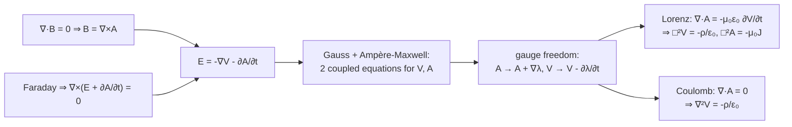
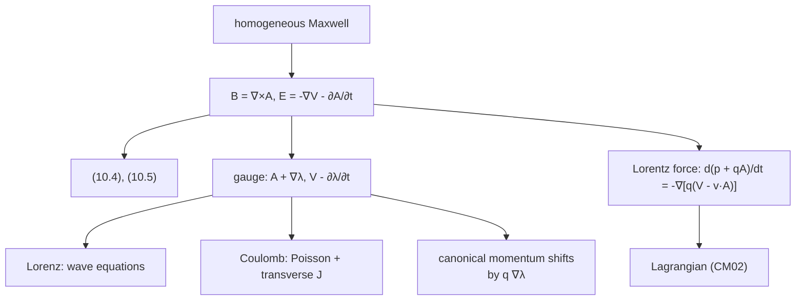

# ED08 · Potentials and Gauge Transformations

◀ [[ED07 Guided Waves]] · [[Electrodynamics - Course Map]]

in course overview extra · book extra · beyond

> [!warning] Source status (every citation below was read in this session)
> Overview items *"scalar and vector potentials"* and *"gauge transformations"* (PH3114 outline; no lecture notes in the folder). **Griffiths and Jackson carry equal weight.**
>
> **Read directly:** Griffiths §10.1.1-10.1.4 (printed pp. 436-444: scalar and vector potentials, Example 10.1, gauge transformations, Coulomb and Lorenz gauges, the Lorentz force in potential form, with Problems 10.1-10.7 as stated); Jackson §6.2 (pp. 239-240, vector and scalar potentials) and §6.3 (pp. 240-243, gauge transformations, Lorenz and Coulomb gauges, the transverse-current decomposition (6.25)-(6.31)). pdf = printed + 19 (Griffiths), + 26 (Jackson). **Not cited because not read:** Jackson §6.4-6.5 (Green functions and retarded potentials, developed in ED09), Jackson §11.9 (the covariant Lorenz condition, ED11), Griffiths §10.2-10.3, the papers cited in the footnotes.

> [!syllabus] Syllabus map
> 🟢 **In course overview**: §1 the potentials, §2 gauge freedom, §3 Lorenz gauge, §4 Coulomb gauge.
>
> 🟡 **Extra · book**: §4.2 transverse and longitudinal currents (Jackson (6.25)-(6.30)), §5 the Lorentz force in potential form (Griffiths §10.1.4).
>
> 🔵 **Extra · beyond (mine)**: the numerical checks of Griffiths' current-sheet potentials, of gauge invariance under an arbitrary $\lambda(\mathbf r,t)$ and of the restricted Lorenz transformation, the Coulomb-gauge solution for a charging point charge, the Landau/symmetric gauge trajectory test, the counting of degrees of freedom, `scripts/ed08_numbers.py`, `scripts/fig_ed08.py`.

> [!key] After this chapter you can
> - write $\mathbf E=-\nabla V-\partial_t\mathbf A$, $\mathbf B=\nabla\times\mathbf A$ and say which two Maxwell equations this satisfies **identically**,
> - derive the coupled equations for $V$ and $\mathbf A$ and bring them to the **wave-equation form** in the **Lorenz gauge**,
> - perform a **gauge transformation**, show the fields are unchanged and the **canonical momentum** is not,
> - use the **Coulomb gauge** and explain the apparent "instantaneous" scalar potential,
> - write the **Lorentz force law in potential form** and relate it to the Lagrangian of CM02.

> [!intuition] The one-sentence story
> The two homogeneous Maxwell equations say that $\mathbf B$ is a curl and that $\mathbf E+\partial_t\mathbf A$ is a gradient; once those are solved identically by writing the fields through $(V,\mathbf A)$, four functions replace six, and the potentials are still only defined up to a gauge function $\lambda(\mathbf r,t)$, a freedom you spend to make the remaining equations as simple as possible: either the symmetric wave equations of the Lorenz gauge, or the instantaneous Poisson equation of the Coulomb gauge.

## 1. The potentials
Maxwell's equations (Griffiths (10.1)) $\nabla\!\cdot\!\mathbf E=\rho/\epsilon_0$, $\nabla\!\cdot\!\mathbf B=0$, $\nabla\times\mathbf E=-\partial_t\mathbf B$, $\nabla\times\mathbf B=\mu_0\mathbf J+\mu_0\epsilon_0\partial_t\mathbf E$ ask: given $\rho(\mathbf r,t)$ and $\mathbf J(\mathbf r,t)$, what are $\mathbf E(\mathbf r,t)$ and $\mathbf B(\mathbf r,t)$? "This is not an easy problem, and it pays to begin by representing the fields in terms of potentials" (Griffiths). In electrostatics $\nabla\times\mathbf E=0$ allowed $\mathbf E=-\nabla V$; now $\nabla\times\mathbf E\ne0$. But $\mathbf B$ is still divergenceless, so

$$\mathbf B=\nabla\times\mathbf A\qquad(10.2),\ \text{Jackson (6.7)}.$$

Faraday's law then reads $\nabla\times(\mathbf E+\partial_t\mathbf A)=0$, and a curl-free vector is a gradient:

$$\mathbf E=-\nabla V-\frac{\partial\mathbf A}{\partial t}\qquad(10.3),\ \text{Jackson (6.9)}.$$

"The definition of $\mathbf B$ and $\mathbf E$ in terms of the potentials satisfies identically the two homogeneous Maxwell equations" (Jackson), $\nabla\!\cdot\!\mathbf B=0$ and Faraday. What remains are the two inhomogeneous ones. Substituting:

$$\nabla^2V+\frac\partial{\partial t}(\nabla\!\cdot\!\mathbf A)=-\frac\rho{\epsilon_0}\qquad(10.4),\ \text{Jackson (6.10)},$$

$$\Bigl(\nabla^2\mathbf A-\mu_0\epsilon_0\frac{\partial^2\mathbf A}{\partial t^2}\Bigr)-\nabla\Bigl(\nabla\!\cdot\!\mathbf A+\mu_0\epsilon_0\frac{\partial V}{\partial t}\Bigr)=-\mu_0\mathbf J\qquad(10.5),\ \text{Jackson (6.11)},$$

(the second uses $\nabla\times(\nabla\times\mathbf A)=\nabla(\nabla\!\cdot\!\mathbf A)-\nabla^2\mathbf A$). Griffiths: "Equations 10.4 and 10.5 contain all the information in Maxwell's equations." In the more symmetrical form of his Problem 10.1, with the d'Alembertian $\square^2\equiv\nabla^2-\mu_0\epsilon_0\partial_t^2$ and $L\equiv\nabla\!\cdot\!\mathbf A+\mu_0\epsilon_0\partial_tV$,

$$\square^2V+\frac{\partial L}{\partial t}=-\frac\rho{\epsilon_0},\qquad\square^2\mathbf A-\nabla L=-\mu_0\mathbf J\qquad(10.6),$$

which one checks by adding and subtracting $\mu_0\epsilon_0\partial_t^2V$ in (10.4). Jackson: "we have now reduced the set of four Maxwell equations to two equations. But they are still coupled equations."

> [!example] Worked example 1 (Griffiths Example 10.1): a current sheet switched on at $t=0$
> The potentials $V=0$, $\mathbf A=\dfrac{\mu_0k}{4c}(ct-|x|)^2\hat{\mathbf z}$ for $|x|<ct$ and $0$ for $|x|>ct$ give, from (10.2)-(10.3),
>
> $$\mathbf E=-\partial_t\mathbf A=-\frac{\mu_0k}2(ct-|x|)\hat{\mathbf z},\qquad\mathbf B=\nabla\times\mathbf A=\pm\frac{\mu_0k}{2c}(ct-|x|)\hat{\mathbf y}\ \ (+\text{ for }x>0)$$
>
> for $|x|<ct$, and $\mathbf E=\mathbf B=0$ outside. All Maxwell equations hold with $\rho=\mathbf J=0$ except on the plane $x=0$ where $\mathbf B$ jumps by $\mu_0kt$: a uniform surface current $\mathbf K=kt\hat{\mathbf z}$ starting at $t=0$ and growing linearly. "The news travels out (in both directions) at the speed of light": for $|x|>ct$ the message "current is now flowing" has not arrived. Numerical check (units $c=\mu_0=\epsilon_0=1$, $k=1$, central differences at $x=0.3$, $t=1$): $E_z=-0.350000$ and $B_y=+0.350000$ as predicted, and the Faraday and Ampère-Maxwell residuals are $3.5\times10^{-9}$ and $2.1\times10^{-8}$. (Numbers in SI: $K=kt$ with $k=10^6$ A m⁻¹ s⁻¹ and $t=5\ \mu$s gives $B_y(0^\pm)=\pm\mu_0kt/2=\pm3.14\ \mu$T, $E_z(0)=-\mu_0kct/2=-942$ V/m, and fields filling $|x|<ct=1.5$ km.)

![[fig_ed08_gauge.png]]

## 2. Gauge freedom
Equations (10.2)-(10.3) do not define the potentials uniquely. Suppose $(V,\mathbf A)$ and $(V',\mathbf A')=(V+\beta,\mathbf A+\boldsymbol\alpha)$ give the same fields (Griffiths §10.1.2). Equal $\mathbf B$ requires $\nabla\times\boldsymbol\alpha=0$, so $\boldsymbol\alpha=\nabla\lambda$; equal $\mathbf E$ requires $\nabla\beta+\partial_t\boldsymbol\alpha=0$, i.e. $\nabla(\beta+\partial_t\lambda)=0$, so $\beta=-\partial_t\lambda+k(t)$, and $k(t)$ can be absorbed into $\lambda$. Conclusion:

$$\boxed{\;\mathbf A'=\mathbf A+\nabla\lambda,\qquad V'=V-\frac{\partial\lambda}{\partial t}\;}\qquad(10.7),\ \text{Jackson (6.12)-(6.13)}.$$

For any scalar $\lambda(\mathbf r,t)$ one may add $\nabla\lambda$ to $\mathbf A$ provided one simultaneously subtracts $\partial_t\lambda$ from $V$: this does not affect the physical $\mathbf E$ and $\mathbf B$ (**gauge invariance**). Griffiths' accounting: we have reduced six problems (the components of $\mathbf E$ and $\mathbf B$) to four ($V$ and the three components of $\mathbf A$), and the gauge freedom lets us impose one extra condition, typically on $\nabla\!\cdot\!\mathbf A$, to simplify (10.4)-(10.5). "In electrodynamics the situation is not so clear cut, and the most convenient gauge depends to some extent on the problem at hand."

> [!example] Worked example 2 (Griffiths Problem 10.3, solved here): a static charge from $V=0$
> $V=0$, $\mathbf A=-\dfrac{1}{4\pi\epsilon_0}\dfrac{qt}{r^2}\hat{\mathbf r}$. Then $\mathbf B=\nabla\times\mathbf A=0$ (a radial function) and $\mathbf E=-\partial_t\mathbf A=\dfrac{q}{4\pi\epsilon_0r^2}\hat{\mathbf r}$: the Coulomb field of a *static* charge $q$ at the origin, with $\rho=q\delta^3(\mathbf r)$ and $\mathbf J=0$. Now apply $\lambda=-\dfrac{1}{4\pi\epsilon_0}\dfrac{qt}r$: $\nabla\lambda=+\dfrac{qt}{4\pi\epsilon_0r^2}\hat{\mathbf r}$ (since $\nabla(1/r)=-\hat{\mathbf r}/r^2$), so $\mathbf A'=\mathbf A+\nabla\lambda=0$ and $V'=V-\partial_t\lambda=\dfrac q{4\pi\epsilon_0r}$: the textbook electrostatic potentials. The two descriptions are very different (one has $V=0$ and a vector potential growing linearly in time, the other has no vector potential) but identical physics (panel C). Neither original gauge condition holds *at the origin* for the first set, because $\nabla\!\cdot(\hat{\mathbf r}/r^2)=4\pi\delta^3(\mathbf r)$ gives $\nabla\!\cdot\!\mathbf A=-(qt/\epsilon_0)\delta^3(\mathbf r)\ne0$.

> [!example] Worked example 3: the gauge function really does nothing to the fields (🔵 numerical)
> Take the sheet potentials of Example 1 and a deliberately wild gauge function $\lambda(\mathbf r,t)=\sin(x+2y-3z+0.7t)\,e^{-0.1r^2}(1+t)$. At $(0.3,0.2,0.1)$, $t=1$: the potentials change by $|\mathbf A'-\mathbf A|=3.3$, yet recomputing $\mathbf E',\mathbf B'$ by central differences gives differences of only $1.8\times10^{-7}$ and $1.4\times10^{-7}$ (finite-difference error): the fields are unchanged.

## 3. The Lorenz gauge
### 3.1 The condition and the wave equations
Choose

$$\nabla\!\cdot\!\mathbf A=-\mu_0\epsilon_0\frac{\partial V}{\partial t}\quad\Bigl(\text{Jackson }(6.14):\ \nabla\!\cdot\!\mathbf A+\frac1{c^2}\frac{\partial V}{\partial t}=0\Bigr)\qquad(10.12).$$

In the language of (10.6) this sets $L=0$ and kills the coupling term in (10.5). The potentials then obey (Griffiths (10.13)-(10.16); Jackson (6.15)-(6.16))

$$\boxed{\;\square^2V=-\frac\rho{\epsilon_0},\qquad\square^2\mathbf A=-\mu_0\mathbf J,\qquad\square^2\equiv\nabla^2-\frac1{c^2}\frac{\partial^2}{\partial t^2}\;}$$

two **uncoupled inhomogeneous wave equations**, treating $V$ and $\mathbf A$ "on an equal footing". Jackson: (6.14)-(6.16) form "a set of equations equivalent in all respects to the Maxwell equations in vacuum". Griffiths: this "democratic treatment" is especially nice for special relativity, where the d'Alembertian is the natural four-dimensional Laplacian and (10.16) are "four-dimensional versions of Poisson's equation"; Jackson gives both reasons for its popularity: the wave equations, and that the Lorenz condition "is a concept independent of the coordinate system chosen and so fits naturally into the considerations of special relativity" (his §11.9, ED11). From now on Griffiths uses the Lorenz gauge exclusively, "and the whole of electrodynamics reduces to the problem of solving the inhomogeneous wave equation for a specified source" (ED09). (Footnote: the name honours L. V. Lorenz, 1867, not H. A. Lorentz; Jackson cites "Lorenz condition (1867)".)

### 3.2 Can it always be imposed?
Yes. Suppose $(V,\mathbf A)$ satisfy (10.4)-(10.5) but not the Lorenz condition. A gauge transformation to $(V',\mathbf A')$ satisfies it if

$$\nabla^2\lambda-\frac1{c^2}\frac{\partial^2\lambda}{\partial t^2}=-\Bigl(\nabla\!\cdot\!\mathbf A+\frac1{c^2}\frac{\partial V}{\partial t}\Bigr)\qquad(6.18),$$

an inhomogeneous wave equation for $\lambda$, which always has solutions (Griffiths Problem 10.6 asks the same). There is **residual freedom**: the restricted transformations with $\square^2\lambda=0$ (Jackson (6.19)-(6.20)) preserve the Lorenz condition, and "all potentials in this restricted class are said to belong to the Lorenz gauge".

> [!example] Worked example 4: a restricted transformation and a plane wave (Griffiths Problem 10.4 setting)
> $V=0$, $\mathbf A=A_0\sin(kx-\omega t)\hat{\mathbf y}$: $\nabla\!\cdot\!\mathbf A=0$ and $\partial_tV=0$, so this is in the Coulomb **and** the Lorenz gauge ("these gauges are not mutually exclusive", Griffiths). Then $\mathbf E=-\partial_t\mathbf A=\omega A_0\cos(kx-\omega t)\hat{\mathbf y}$ and $\mathbf B=\nabla\times\mathbf A=kA_0\cos(kx-\omega t)\hat{\mathbf z}$, with $E/B=\omega/k$; Maxwell's equations in vacuum hold only if $\omega=ck$ (so $E=cB$, ED05). Now transform with $\lambda=\sin(kx-\omega t)$: $\square^2\lambda=-(k^2-\omega^2/c^2)\sin(kx-\omega t)=0$ precisely when $\omega=ck$, so this $\lambda$ is in the restricted class: the new potentials $A_x'=k\cos(kx-\omega t)$, $V'=\omega\cos(kx-\omega t)$ still satisfy the Lorenz condition ($\nabla\!\cdot\!\mathbf A'+c^{-2}\partial_tV'=-k^2\sin+\omega^2c^{-2}\sin=0$) but no longer the Coulomb condition, and give the same $\mathbf E,\mathbf B$.

## 4. The Coulomb gauge
### 4.1 The scalar potential is instantaneous
Choose $\nabla\!\cdot\!\mathbf A=0$ (Griffiths (10.8); Jackson (6.21), "the Coulomb, radiation, or transverse gauge"), as in magnetostatics. Then (10.4) becomes Poisson's equation,

$$\nabla^2V=-\frac\rho{\epsilon_0},\qquad V(\mathbf r,t)=\frac1{4\pi\epsilon_0}\int\frac{\rho(\mathbf r',t)}{|\mathbf r-\mathbf r'|}\,\mathrm d\tau'\qquad(10.9)\text{-}(10.10),\ (6.22)\text{-}(6.23):$$

the instantaneous Coulomb potential of the charge distribution *now*, whence the name. Griffiths calls this "a very peculiar thing": if I move an electron in my laboratory the potential on the moon immediately records the change, which seems to contradict special relativity. His resolution (and Jackson's): *$V$ alone is not measurable*; what is measured is $\mathbf E=-\nabla V-\partial_t\mathbf A$, and in the Coulomb gauge the combination changes only after the news arrives, because the vector potential compensates. Jackson adds that the vector potential obeys a wave equation with finite speed $c$, and that the source for it, the transverse current (§4.2), "extends over all space, even if $\mathbf J$ is localized". "It is the fields, not the potentials, that concern us."

### 4.2 The vector potential and the transverse current (🟡)
In this gauge (10.5) becomes $\nabla^2\mathbf A-\mu_0\epsilon_0\partial_t^2\mathbf A=-\mu_0\mathbf J+\mu_0\epsilon_0\nabla(\partial_tV)$ (Griffiths (10.11), Jackson (6.24)). Griffiths' verdict: the scalar potential is "particularly simple to calculate"; the disadvantages are the acausal-looking $V$ and that $\mathbf A$ is "particularly difficult to calculate". Jackson explains the structure of the awkward term. The $\nabla\partial_tV$ term is a gradient (curl-free). Write any current as $\mathbf J=\mathbf J_l+\mathbf J_t$ with $\nabla\times\mathbf J_l=0$ (longitudinal, irrotational) and $\nabla\!\cdot\!\mathbf J_t=0$ (transverse, solenoidal), constructed explicitly as

$$\mathbf J_l=-\frac1{4\pi}\nabla\!\int\frac{\nabla'\!\cdot\!\mathbf J(\mathbf x')}{|\mathbf x-\mathbf x'|}\mathrm d^3x'\ (6.27),\qquad\mathbf J_t=\frac1{4\pi}\nabla\times\nabla\times\!\int\frac{\mathbf J(\mathbf x')}{|\mathbf x-\mathbf x'|}\mathrm d^3x'\ (6.28)$$

(from $\nabla\times\nabla\times\mathbf J=\nabla(\nabla\!\cdot\!\mathbf J)-\nabla^2\mathbf J$ and $\nabla^2|\mathbf x-\mathbf x'|^{-1}=-4\pi\delta^3$). With the continuity equation and (6.23) the gradient term exactly cancels $\mu_0\mathbf J_l$ (6.29), so

$$\nabla^2\mathbf A-\frac1{c^2}\frac{\partial^2\mathbf A}{\partial t^2}=-\mu_0\mathbf J_t\qquad(6.30):$$

the source is entirely the transverse current, hence the name "transverse gauge". "Radiation gauge" because the transverse radiation fields are given by the vector potential alone and the instantaneous Coulomb potential contributes only to the near fields; Jackson notes the gauge is particularly useful in quantum electrodynamics, where photons arise from quantizing only $\mathbf A$. With **no sources** the Coulomb gauge is the simplest: $V=0$, $\mathbf A$ satisfies the homogeneous wave equation, and

$$\mathbf E=-\frac{\partial\mathbf A}{\partial t},\qquad\mathbf B=\nabla\times\mathbf A\qquad(6.31),$$

as in Worked example 4.

> [!example] Worked example 5 (Griffiths Problem 10.7, solved here): a point charge that is changing
> $\rho=q(t)\delta^3(\mathbf r)$ fed by the current $\mathbf J=-\dfrac1{4\pi}\dfrac{\dot q}{r^2}\hat{\mathbf r}$ (Griffiths' form). Charge conservation: away from the origin $\nabla\!\cdot\!\mathbf J=0=-\partial_t\rho$; at the origin the delta function in $\nabla\!\cdot\!\mathbf J=-\dot q\,\delta^3(\mathbf r)$ balances $\partial_t\rho=\dot q\,\delta^3$ ✓. **Coulomb gauge:** $V=\dfrac{q(t)}{4\pi\epsilon_0r}$ (instantaneous, from (10.10)) and $\mathbf A=0$ solves (10.11): its right-hand side is $-\mu_0\mathbf J+\mu_0\epsilon_0\nabla(\partial_tV)=-\mu_0\mathbf J+\dfrac{\mu_0\dot q}{4\pi}\nabla\dfrac1r=-\mu_0\mathbf J-\dfrac{\mu_0\dot q}{4\pi}\dfrac{\hat{\mathbf r}}{r^2}=0$ ✓ (the longitudinal current is cancelled exactly). The fields are $\mathbf E=\dfrac{q(t)}{4\pi\epsilon_0r^2}\hat{\mathbf r}$, $\mathbf B=0$, and Ampère-Maxwell checks: $0=\mu_0\mathbf J+\mu_0\epsilon_0\partial_t\mathbf E=\mu_0\mathbf J+\dfrac{\mu_0\dot q}{4\pi r^2}\hat{\mathbf r}$ ✓. The field at distance $r$ changes *instantly* when $q(t)$ changes: this looks acausal but the source is a pathological, spherically symmetric current that has no transverse part (a point charge changing without moving charge flowing in from elsewhere in a physically causal way); in the Lorenz gauge the same fields arise from retarded potentials (ED09).

## 5. The Lorentz force in potential form (🟡, Griffiths §10.1.4)
The force on a charge is $\mathbf F=\dfrac{\mathrm d\mathbf p}{\mathrm dt}=q(\mathbf E+\mathbf v\times\mathbf B)=q\bigl[-\nabla V-\partial_t\mathbf A+\mathbf v\times(\nabla\times\mathbf A)\bigr]$ (10.17). With $\nabla(\mathbf v\!\cdot\!\mathbf A)=\mathbf v\times(\nabla\times\mathbf A)+(\mathbf v\!\cdot\!\nabla)\mathbf A$ ($\mathbf v$ is a function of time, not of position),

$$\frac{\mathrm d\mathbf p}{\mathrm dt}=-q\Bigl[\frac{\partial\mathbf A}{\partial t}+(\mathbf v\!\cdot\!\nabla)\mathbf A\Bigr]-q\nabla\bigl(V-\mathbf v\!\cdot\!\mathbf A\bigr)\qquad(10.18).$$

The bracket is the **convective derivative** $\mathrm d\mathbf A/\mathrm dt$, the rate of change of $\mathbf A$ at the moving location of the particle (10.19): it changes for two reasons, because $\mathbf A$ varies in time and because the particle moves to where $\mathbf A$ differs. So

$$\frac{\mathrm d}{\mathrm dt}\bigl(\mathbf p+q\mathbf A\bigr)=-\nabla\bigl[q(V-\mathbf v\!\cdot\!\mathbf A)\bigr]\qquad(10.20),$$

"reminiscent of the standard formula from mechanics, for the motion of a particle whose potential energy $U$ is a specified function of position", $\mathrm d\mathbf p/\mathrm dt=-\nabla U$: the role of $\mathbf p$ is played by the **canonical momentum** $\mathbf p_{\rm can}=\mathbf p+q\mathbf A$ (10.21) and that of $U$ by the velocity-dependent $U_{\rm vel}=q(V-\mathbf v\!\cdot\!\mathbf A)$ (10.22). This is exactly the velocity-dependent potential and the Lagrangian $L=\tfrac12mv^2-qV+q\mathbf A\!\cdot\!\mathbf v$ of **CM02 §6.1** (Goldstein (1.62)-(1.63)), and the canonical momentum of CM03 §2: Euler-Lagrange for this $L$ is (10.20). A gauge transformation changes the Lagrangian by a total derivative, $L'=L+q(\partial_t\lambda+\mathbf v\!\cdot\!\nabla\lambda)=L+q\,\mathrm d\lambda/\mathrm dt$ (CM02 P9, CM01 §5): same equations of motion, but $\mathbf p_{\rm can}\to\mathbf p_{\rm can}+q\nabla\lambda$. This is why *physical* predictions involve $\mathbf p_{\rm can}-q\mathbf A=m\mathbf v$ and never $\mathbf p_{\rm can}$ alone. (In quantum mechanics this becomes minimal coupling, $\mathbf p\to\mathbf p-q\mathbf A$; my remark, not from the sources.)

> [!example] Worked example 6: Landau versus symmetric gauge (🔵, ties to CM03 Worked example 1)
> Uniform $\mathbf B=B\hat{\mathbf z}$ has two standard vector potentials, $\mathbf A_1=(0,Bx,0)$ and $\mathbf A_2=\tfrac B2(-y,x,0)$, both with $\nabla\times\mathbf A=B\hat{\mathbf z}$. Their difference is $\mathbf A_1-\mathbf A_2=\tfrac B2(y,x,0)=\nabla\lambda$ with $\lambda=Bxy/2$. Hamilton's equations $H=(\mathbf p-q\mathbf A)^2/2m$ in each gauge, with $q=m=1$, $B=2$, started from the same position $(1,0)$ and velocity $(0.5,0.3)$: the canonical momenta differ ($\mathbf p_1=(0.5,2.3)$, $\mathbf p_2=(0.5,1.3)$, difference $q\nabla\lambda=(0,1)$ at that point) but the trajectories coincide: at $t=5$ the positions are $(1.139855,-0.541371)$ in both gauges.

## 6. Counting what is physical (🔵)
Six field components, $\mathbf E$ and $\mathbf B$, become four potential components. One gauge function $\lambda$ removes one combination, and Gauss's law is an equation of constraint on the remaining three (ED03 §4.2); what is left is two independent field degrees of freedom per point: the two polarizations of a free wave (ED05 §4). In the Lorenz gauge the residual freedom $\square^2\lambda=0$ plays the same role; in the Coulomb gauge with no sources $V=0$ and the condition $\nabla\!\cdot\!\mathbf A=0$ makes $\mathbf A$ transverse, with exactly two components.

## Map of this chapter

## Common mistakes
1. Treating $V$ and $\mathbf A$ as measurable: only $\mathbf E$ and $\mathbf B$ are (and $\mathbf p-q\mathbf A$ for a charge).
2. Changing $\mathbf A$ by $\nabla\lambda$ without changing $V$ by $-\partial_t\lambda$ (or the reverse).
3. Using the Coulomb-gauge $V$ as a signal: it is instantaneous but $\mathbf E$ is not.
4. Believing the Lorenz gauge is a unique choice: residual gauge transformations with $\square^2\lambda=0$ remain.
5. Dropping the longitudinal-current cancellation when deriving the Coulomb-gauge equation for $\mathbf A$.
6. Assuming gauges are mutually exclusive: a pure plane wave with $V=0$, $\nabla\!\cdot\!\mathbf A=0$ is in both.

## Summary
- $\mathbf B=\nabla\times\mathbf A$, $\mathbf E=-\nabla V-\partial_t\mathbf A$ solve $\nabla\!\cdot\!\mathbf B=0$ and Faraday identically; the other two give (10.4)-(10.5).
- Gauge transformation $\mathbf A'=\mathbf A+\nabla\lambda$, $V'=V-\partial_t\lambda$; $\mathbf E,\mathbf B$ invariant.
- Lorenz gauge $\nabla\!\cdot\!\mathbf A=-\mu_0\epsilon_0\partial_tV$: $\square^2V=-\rho/\epsilon_0$, $\square^2\mathbf A=-\mu_0\mathbf J$; residual $\square^2\lambda=0$.
- Coulomb gauge $\nabla\!\cdot\!\mathbf A=0$: $\nabla^2V=-\rho/\epsilon_0$ (instantaneous), $\square^2\mathbf A=-\mu_0\mathbf J_t$; source-free: $V=0$.
- Force: $\mathrm d(\mathbf p+q\mathbf A)/\mathrm dt=-\nabla[q(V-\mathbf v\!\cdot\!\mathbf A)]$; $\mathbf p_{\rm can}\to\mathbf p_{\rm can}+q\nabla\lambda$, $L\to L+q\,\mathrm d\lambda/\mathrm dt$.
- Numbers: sheet field $B_y=3.14\ \mu$T at $t=5\ \mu$s; fields invariant to $10^{-7}$ under a wild $\lambda$; trajectories identical in both gauges to $10^{-8}$.

## Practice
> [!question]- P1. Homogeneous equations
> Show $\nabla\!\cdot\!\mathbf B=0$ and Faraday's law hold identically for (10.2)-(10.3).
> **Solution.** $\nabla\!\cdot(\nabla\times\mathbf A)=0$; $\nabla\times\mathbf E=-\nabla\times\nabla V-\partial_t\nabla\times\mathbf A=-\partial_t\mathbf B$.

> [!question]- P2. Derive (10.4)
> Insert $\mathbf E=-\nabla V-\partial_t\mathbf A$ into Gauss's law.
> **Solution.** $\nabla\!\cdot\!\mathbf E=-\nabla^2V-\partial_t(\nabla\!\cdot\!\mathbf A)=\rho/\epsilon_0$.

> [!question]- P3. Symmetric form (Griffiths Problem 10.1)
> Show (10.4)-(10.5) are equivalent to (10.6).
> **Solution.** Add $\mp\mu_0\epsilon_0\partial_t^2V$: $\nabla^2V+\partial_t\nabla\!\cdot\!\mathbf A=\square^2V+\mu_0\epsilon_0\partial_t^2V+\partial_t\nabla\!\cdot\!\mathbf A=\square^2V+\partial_tL$; (10.5) is $\square^2\mathbf A-\nabla L=-\mu_0\mathbf J$ directly.

> [!question]- P4. Gauge freedom
> Prove the most general change of potentials leaving $\mathbf E,\mathbf B$ unchanged is (10.7).
> **Solution.** §2: $\nabla\times\boldsymbol\alpha=0\Rightarrow\boldsymbol\alpha=\nabla\lambda$; $\nabla(\beta+\partial_t\lambda)=0$.

> [!question]- P5. Lorenz equations
> Derive $\square^2V=-\rho/\epsilon_0$ and $\square^2\mathbf A=-\mu_0\mathbf J$ from (10.6).
> **Solution.** $L=0$ in the Lorenz gauge.

> [!question]- P6. Imposing the Lorenz condition
> Find the equation $\lambda$ must satisfy to bring $(V,\mathbf A)$ into the Lorenz gauge.
> **Solution.** (6.18): $\square^2\lambda=-(\nabla\!\cdot\!\mathbf A+c^{-2}\partial_tV)$.

> [!question]- P7. Static charge, two gauges
> From $V=0$, $\mathbf A=-qt\hat{\mathbf r}/4\pi\epsilon_0r^2$ find $\mathbf E,\mathbf B$ and the gauge function giving the Coulomb potential.
> **Solution.** Worked example 2: $\mathbf E=q\hat{\mathbf r}/4\pi\epsilon_0r^2$, $\mathbf B=0$; $\lambda=-qt/4\pi\epsilon_0r$.

> [!question]- P8. Plane wave in a gauge (Griffiths Problem 10.4)
> $V=0$, $\mathbf A=A_0\sin(kx-\omega t)\hat{\mathbf y}$: find $\mathbf E,\mathbf B$ and the condition on $\omega,k$.
> **Solution.** $\mathbf E=\omega A_0\cos(\cdot)\hat{\mathbf y}$, $\mathbf B=kA_0\cos(\cdot)\hat{\mathbf z}$; $\omega=ck$.

> [!question]- P9. Which gauge?
> For Examples 1, 2 and 4: Coulomb, Lorenz, both or neither?
> **Solution.** Example 1: $\nabla\!\cdot\!\mathbf A=0$ and $V=0$: both. Example 4: both. Example 2 ($V=0$, $\mathbf A\propto t\hat{\mathbf r}/r^2$): $\nabla\!\cdot\!\mathbf A=0$ away from the origin but $-(qt/\epsilon_0)\delta^3$ at it: neither at the origin.

> [!question]- P10. Sheet numbers
> A sheet current $K=kt$, $k=10^6$ A m⁻¹ s⁻¹: find $B$ and $E$ at the sheet at $t=5\ \mu$s and the extent of the fields.
> **Solution.** $B=\mu_0kt/2=3.14\ \mu$T, $|E|=\mu_0kct/2=942$ V/m, region $|x|<ct=1.5$ km.

> [!question]- P11. Causality of the Coulomb gauge
> Explain why the instantaneous $V$ does not violate relativity.
> **Solution.** $V$ is not measurable; $\mathbf E=-\nabla V-\partial_t\mathbf A$ depends also on $\mathbf A$, which obeys a wave equation with finite speed and a transverse source extending over all space.

> [!question]- P12. Coulomb-gauge $\mathbf A$
> Show the longitudinal part of $\mathbf J$ cancels the $\nabla\partial_tV$ term in (10.11).
> **Solution.** Taking the divergence of Ampère-Maxwell with continuity and (10.9): $\mu_0\epsilon_0\nabla\partial_tV=\mu_0\mathbf J_l$ (6.29).

> [!question]- P13. Two gauges for uniform $B$
> Find $\lambda$ with $\mathbf A_1-\mathbf A_2=\nabla\lambda$.
> **Solution.** $\lambda=Bxy/2$.

> [!question]- P14. Canonical momentum
> By how much does $\mathbf p_{\rm can}$ change under a gauge transformation, and what does $L$ pick up?
> **Solution.** $\mathbf p_{\rm can}\to\mathbf p_{\rm can}+q\nabla\lambda$; $L\to L+q\,\mathrm d\lambda/\mathrm dt$.

> [!question]- P15. Degrees of freedom
> Count the independent field degrees of freedom of a free wave from the potentials.
> **Solution.** Four potential components, minus one for gauge, minus one for Gauss's constraint: two (the polarizations).

## Zettel notes
<!-- zettel:start -->
<!-- zettel:end -->

## Provenance
> [!provenance]- Source map for this chapter (all rows read in this session)
> | Topic | Source | Scope |
> |---|---|---|
> | potentials (10.2)-(10.6), Example 10.1, Problems 10.1-10.2 | Griffiths §10.1.1 (pp. 436-439) | in overview |
> | gauge transformations (10.7), Problems 10.3-10.4; Coulomb and Lorenz gauges (10.8)-(10.16), Problems 10.5-10.7, footnotes | Griffiths §10.1.2-10.1.3 (pp. 439-442) | in overview |
> | Lorentz force in potential form (10.17)-(10.22) | Griffiths §10.1.4 (pp. 442-444) | extra/book |
> | vector and scalar potentials (6.7)-(6.11) | Jackson §6.2 (pp. 239-240) | in overview |
> | gauge transformations, Lorenz gauge (6.12)-(6.20), Coulomb/radiation gauge (6.21)-(6.31), causality remark | Jackson §6.3 (pp. 240-243) | in overview |
> | sheet numbers, gauge-invariance test, restricted gauge, Coulomb-gauge point charge, Landau/symmetric trajectories | `scripts/ed08_numbers.py`, `scripts/fig_ed08.py` | extra/beyond |
