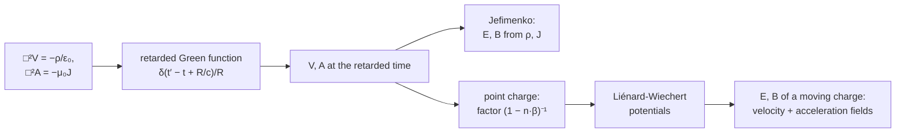
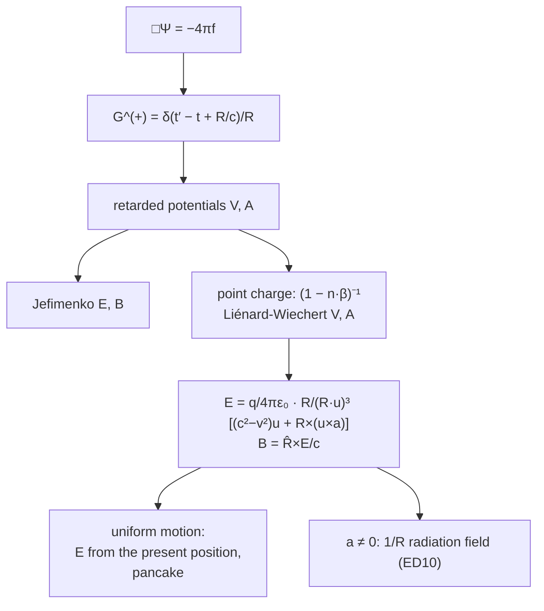

# ED09 · Retarded Potentials and Liénard-Wiechert Fields

◀ [[ED08 Potentials and Gauge Transformations]] · [[Electrodynamics - Course Map]]

in course overview extra · book extra · beyond

> [!warning] Source status (every citation below was read in this session)
> Overview item *"retarded potentials"* (PH3114 outline; no lecture notes in the folder). **Griffiths and Jackson carry equal weight.**
>
> **Read directly:** Griffiths §10.2 (continuous distributions: retarded potentials, the proof that they solve the wave equation, advanced potentials, Example 10.2, Jefimenko's equations, Problems 10.10-10.14 as stated) and §10.3 (point charges: Liénard-Wiechert potentials and fields, Examples 10.3-10.4, Problems 10.15-10.18 as stated), printed pp. 444-461 (pdf = printed + 19). Jackson §6.4 (Green functions for the wave equation, pp. 243-246), §6.5 (retarded solutions for the fields, Jefimenko's generalisations, pp. 246-248) and §14.1 (Liénard-Wiechert potentials and fields, pp. 661-664) (pdf = printed + 26). **Units:** Griffiths and Jackson §6 are SI. **Jackson's Chapter 14 is in Gaussian units** (the running header reads "Radiation by Moving Charges-G"), which settles the question left open in the Course Map: Jackson's Ch. 6 is SI, Ch. 13-14 are Gaussian. This chapter uses SI; where Jackson's Gaussian formula is quoted it is converted ($e\to q/4\pi\epsilon_0$ in the field formulas, $\mathbf B=\hat{\mathbf n}\times\mathbf E/c$ in SI against $\mathbf B=\hat{\mathbf n}\times\mathbf E$ in Gaussian). **Not cited because not read:** Jackson §12.11 (the covariant retarded Green function (12.133) used for (14.1)), §11.10, and Griffiths Ch. 11 (radiation).

> [!syllabus] Syllabus map
> 🟢 **In course overview**: §1 the retarded Green function and retarded potentials, §3 Liénard-Wiechert potentials, §4 the fields of a moving point charge.
>
> 🟡 **Extra · book**: §2.3 advanced potentials and causality, §3 Jefimenko's equations (Griffiths §10.2.2, Jackson §6.5), the quasi-static comparison.
>
> 🔵 **Extra · beyond (mine)**: the numerical verification of every formula (the wire switched on, Liénard-Wiechert potentials for uniform and circular motion, the fields (10.72)-(10.73) against $-\nabla V-\partial_t\mathbf A$ and $\nabla\times\mathbf A$, the Lorenz condition, the crossover between velocity and radiation fields), `scripts/ed09_numbers.py`, `scripts/fig_ed09.py`, and an interactive tool.

> [!key] After this chapter you can
> - write the retarded Green function $\delta(t'-[t-|\mathbf x-\mathbf x'|/c])/|\mathbf x-\mathbf x'|$ and the **retarded potentials** $V=\frac1{4\pi\epsilon_0}\int\frac{[\rho]_{\rm ret}}{R}d\tau'$, $\mathbf A=\frac{\mu_0}{4\pi}\int\frac{[\mathbf J]_{\rm ret}}{R}d\tau'$,
> - explain why retardation changes the effective volume of a moving charge by $(1-\hat{\mathbf n}\cdot\boldsymbol\beta)^{-1}$ and derive the **Liénard-Wiechert potentials**,
> - write the **fields of a point charge in arbitrary motion** $\mathbf E=\frac q{4\pi\epsilon_0}\frac{\mathcal R}{(\mathcal R\cdot\mathbf u)^3}[(c^2-v^2)\mathbf u+\mathcal R\times(\mathbf u\times\mathbf a)]$, $\mathbf B=\hat{\mathcal R}\times\mathbf E/c$, and separate the **velocity** and **acceleration (radiation)** fields,
> - recover the field of a charge in **uniform motion**, pointing from its *present* position and flattened into a pancake,
> - state Jefimenko's generalisations of the Coulomb and Biot-Savart laws and say why the quasi-static approximation works better than it should.

> [!intuition] The one-sentence story
> Electromagnetic news travels at $c$, so the potential at $(\mathbf r,t)$ is built from the sources as they were at the **retarded time** $t_r=t-R/c$, not as they are now; for a moving point charge the retarded integral hides a geometrical factor $(1-\hat{\mathbf n}\cdot\boldsymbol\beta)^{-1}$ (an approaching charge looks bigger, like an approaching train looks longer), and differentiating the resulting potentials gives two fields: a velocity field that falls off as $1/R^2$ and an acceleration field that falls off as $1/R$ and carries the radiation.

## 1. The wave equation and its Green function (Jackson §6.4)
taught

The potential equations of [[ED08 Potentials and Gauge Transformations]] in the Lorenz gauge all have the form (Jackson (6.32), with $f$ a known source)

$$\nabla^2\Psi-\frac1{c^2}\frac{\partial^2\Psi}{\partial t^2}=-4\pi f(\mathbf x,t),$$

(for $V$ the source is $f=\rho/4\pi\epsilon_0$, for each component of $\mathbf A$, $f=\mu_0J/4\pi$). Following the electrostatic method, Jackson looks for a Green function with no boundary surfaces. Fourier transform in time, $\Psi(\mathbf x,t)=\frac1{2\pi}\int\Psi(\mathbf x,\omega)e^{-i\omega t}d\omega$ (6.33): each transform obeys the **Helmholtz equation** $(\nabla^2+k^2)\Psi=-4\pi f$, $k=\omega/c$ (6.35), with Green function satisfying $(\nabla^2+k^2)G_k=-4\pi\delta(\mathbf x-\mathbf x')$ (6.36). With spherical symmetry in $R=|\mathbf x-\mathbf x'|$ it reduces to $\frac1R\frac{d^2}{dR^2}(RG_k)+k^2G_k=-4\pi\delta(\mathbf R)$ (6.37); away from $R=0$, $RG_k=Ae^{ikR}+Be^{-ikR}$, and the delta function fixes the normalisation as in electrostatics (6.38), so that (6.39)-(6.40)

$$G_k^{(\pm)}(R)=\frac{e^{\pm ikR}}{R}\qquad(A+B=1\text{ in general}).$$

With the $e^{-i\omega t}$ convention the first term is a **diverging** spherical wave leaving the origin, the second a **converging** one. Transforming back to time (6.42), for a non-dispersive medium the frequency integral is a delta function and the time-dependent Green functions satisfying $(\nabla^2-c^{-2}\partial_t^2)G=-4\pi\delta(\mathbf x-\mathbf x')\delta(t-t')$ (6.41) are (6.44)

$$G^{(\pm)}(\mathbf x,t;\mathbf x',t')=\frac{\delta\!\left(t'-\left[t\mp\frac{|\mathbf x-\mathbf x'|}{c}\right]\right)}{|\mathbf x-\mathbf x'|}.$$

$G^{(+)}$ is the **retarded** Green function: an effect at $\mathbf x$ at time $t$ is caused by a source a distance $R$ away at the earlier time $t'=t-R/c$. $G^{(-)}$ is the **advanced** one. Which to use depends on the boundary conditions in time (Jackson): if the source is quiescent until some time and a wave $\Psi_{\rm in}$ exists at $t\to-\infty$, the complete solution is $\Psi=\Psi_{\rm in}+\iint G^{(+)}f\,d^3x'dt'$ (6.45); if instead the wave at $t\to+\infty$ is $\Psi_{\rm out}$, then $\Psi=\Psi_{\rm out}+\iint G^{(-)}f$ (6.46). The commonest situation is $\Psi_{\rm in}=0$ (6.47):

$$\Psi(\mathbf x,t)=\int\frac{[f(\mathbf x',t')]_{\rm ret}}{|\mathbf x-\mathbf x'|}\,d^3x',\qquad t'=t-\frac{|\mathbf x-\mathbf x'|}{c}.$$

## 2. Retarded potentials (Griffiths §10.2.1, Jackson §6.5)
taught

### 2.1 The potentials
The static potentials are $V=\frac1{4\pi\epsilon_0}\int\frac{\rho(\mathbf r')}{\mathfrak r}d\tau'$ and $\mathbf A=\frac{\mu_0}{4\pi}\int\frac{\mathbf J(\mathbf r')}{\mathfrak r}d\tau'$ (Griffiths (10.24), with $\mathfrak r=|\mathbf r-\mathbf r'|$). In the non-static case "electromagnetic news travels at the speed of light", so what matters is the source at the **retarded time** (Griffiths (10.25))

$$t_r\equiv t-\frac{\mathfrak r}c,$$

and the **retarded potentials** are (10.26), identical to Jackson's (6.48) (written there with $R=\mathbf x-\mathbf x'$, $[\ ]_{\rm ret}$ meaning "evaluated at $t'=t-R/c$"):

$$V(\mathbf r,t)=\frac1{4\pi\epsilon_0}\int\frac{\rho(\mathbf r',t_r)}{\mathfrak r}\,d\tau',\qquad\mathbf A(\mathbf r,t)=\frac{\mu_0}{4\pi}\int\frac{\mathbf J(\mathbf r',t_r)}{\mathfrak r}\,d\tau'.$$

More distant parts of the distribution have earlier retarded times, "just like the night sky": the light we see now left each star at the retarded time of that star's distance. The static case is recovered because $\rho,\mathbf J$ do not depend on time. Griffiths warns that the same logic applied to the **fields** gives the wrong answer: $\mathbf E\ne\frac1{4\pi\epsilon_0}\int\frac{\rho(\mathbf r',t_r)}{\mathfrak r^2}\hat{\mathfrak r}\,d\tau'$ (see §3).

### 2.2 They solve the wave equation
Griffiths proves that (10.26) satisfy the inhomogeneous wave equation of ED08. In $\nabla^2V$ the integrand depends on $\mathbf r$ explicitly through $\mathfrak r$ and implicitly through $t_r=t-\mathfrak r/c$, so $\nabla\rho=\dot\rho\,\nabla t_r=-\frac1c\dot\rho\,\nabla\mathfrak r$ (10.28) and (10.29)

$$\nabla V=\frac1{4\pi\epsilon_0}\int\left[-\frac{\dot\rho}{c}\frac{\hat{\mathfrak r}}{\mathfrak r}-\rho\frac{\hat{\mathfrak r}}{\mathfrak r^2}\right]d\tau'.$$

Taking the divergence and using $\nabla\cdot(\hat{\mathfrak r}/\mathfrak r)=1/\mathfrak r^2$ and $\nabla\cdot(\hat{\mathfrak r}/\mathfrak r^2)=4\pi\delta^3(\boldsymbol{\mathfrak r})$ gives $\nabla^2V=\frac1{4\pi\epsilon_0}\int\left[\frac1{c^2}\frac{\ddot\rho}{\mathfrak r}-4\pi\rho\,\delta^3(\boldsymbol{\mathfrak r})\right]d\tau'=\frac1{c^2}\frac{\partial^2V}{\partial t^2}-\frac1{\epsilon_0}\rho(\mathbf r,t)$: **the wave equation with its source**. The vector potential works the same way; that they obey the Lorenz condition is Griffiths Problem 10.10.

### 2.3 Advanced potentials and causality
The same proof works for the **advanced potentials** (10.30), with $\rho,\mathbf J$ evaluated at $t_a=t+\mathfrak r/c$ (10.31). They are consistent with Maxwell's equations but violate causality: the potential would depend on what the sources *will* be, "the effect precedes the cause" (Griffiths). Because the d'Alembertian involves $\partial_t^2$, the theory itself is time-reversal invariant; **time asymmetry enters when we choose retarded over advanced** (Griffiths footnote 9), reflecting the belief that influences propagate forward.

> [!example] Worked example 1: a current switched on in a long wire (Griffiths Example 10.2; 🔵 checked)
> A neutral infinite wire along $z$ carries $I(t)=0$ for $t\le0$ and $I_0$ for $t>0$. The scalar potential vanishes and $\mathbf A=\frac{\mu_0}{4\pi}\hat{\mathbf z}\int\frac{I(t_r)}{\mathfrak r}dz$. For $t<s/c$ the news has not reached the point at distance $s$ and $\mathbf A=0$; for $t>s/c$ only the segment $|z|\le\sqrt{(ct)^2-s^2}$ contributes (10.32) and
> $$\mathbf A=\frac{\mu_0I_0}{2\pi}\ln\!\left[\frac{ct+\sqrt{(ct)^2-s^2}}{s}\right]\hat{\mathbf z},\quad\mathbf E=-\frac{\partial\mathbf A}{\partial t}=-\frac{\mu_0I_0c}{2\pi\sqrt{(ct)^2-s^2}}\hat{\mathbf z},\quad\mathbf B=\frac{\mu_0I_0}{2\pi s}\frac{ct}{\sqrt{(ct)^2-s^2}}\hat{\boldsymbol\phi}.$$
> As $t\to\infty$, $\mathbf E\to0$ and $\mathbf B\to\mu_0I_0/2\pi s$, the static result. Numerically ($\mu_0=c=I_0=1$, $s=1$, $t=2$, `ed09_numbers.py` §1): the retarded integral by quadrature gives $A=0.20960036$, the closed form $0.20960036$; $E_z=-\partial_tA=-0.09188815$ by finite difference and by the formula; $B=0.18377630$ by both, against the static $0.15915494$, i.e. $B/B_{\rm static}=ct/\sqrt{(ct)^2-s^2}=1.1547$. The field is infinite at $ct=s$ (the wavefront) and approaches its static value as $s/ct$ (Fig. ED9.1 A).

## 3. Jefimenko's equations (Griffiths §10.2.2, Jackson §6.5)
extra · book

From $\mathbf E=-\nabla V-\partial_t\mathbf A$ and $\mathbf B=\nabla\times\mathbf A$ with (10.26): the integrands depend on $\mathbf r$ through $\mathfrak r$ and through $t_r$, so the derivatives produce **new terms** with time derivatives of the sources. Using $\nabla V$ from (10.29), $\partial\mathbf A/\partial t=\frac{\mu_0}{4\pi}\int\dot{\mathbf J}/\mathfrak r\,d\tau'$ (10.35) and $c^2=1/\mu_0\epsilon_0$ (Griffiths (10.36)),

$$\mathbf E(\mathbf r,t)=\frac1{4\pi\epsilon_0}\int\left[\frac{\rho(\mathbf r',t_r)}{\mathfrak r^2}\hat{\mathfrak r}+\frac{\dot\rho(\mathbf r',t_r)}{c\,\mathfrak r}\hat{\mathfrak r}-\frac{\dot{\mathbf J}(\mathbf r',t_r)}{c^2\mathfrak r}\right]d\tau',$$

the time-dependent generalisation of Coulomb's law. For the curl one needs $\nabla\times\mathbf J=\frac1c\dot{\mathbf J}\times\hat{\mathfrak r}$ (10.37), giving (10.38)

$$\mathbf B(\mathbf r,t)=\frac{\mu_0}{4\pi}\int\left[\frac{\mathbf J(\mathbf r',t_r)}{\mathfrak r^2}+\frac{\dot{\mathbf J}(\mathbf r',t_r)}{c\,\mathfrak r}\right]\times\hat{\mathfrak r}\;d\tau',$$

the generalised Biot-Savart law. Jackson arrives at the same pair (6.55)-(6.56) from the wave equations for the fields (6.49)-(6.50) with retarded solutions (6.51)-(6.52): the subtlety is that the gradient of a retarded quantity taken inside the bracket (at fixed $t'$) differs from the gradient outside (at fixed $t$) by a term $\mp\frac{\hat{\mathbf R}}c[\partial_{t'}\ldots]$ (6.53)-(6.54), and after an integration by parts the explicit static limits and the corrections appear. For time-independent sources they reduce to the static laws. Jackson also gives the identity $[\partial f/\partial t']_{\rm ret}=\partial_t[f]_{\rm ret}$ (6.57) and specialises to a point charge (6.58)-(6.61), the Heaviside-Feynman expressions. Griffiths comments that Jefimenko's equations (first stated explicitly by Jefimenko in 1966) are of limited practical use, since it is easier to differentiate the retarded potentials, but they close the theory: the fields are **not** the static formulas with $t\to t_r$; "completely new terms (involving derivatives of $\rho$ and $\mathbf J$) appear".

**The quasi-static approximation (Griffiths Problems 10.13-10.14, stated results).** If $\mathbf J$ is constant in time (so $\rho=\rho(\mathbf r,0)+\dot\rho(\mathbf r,0)t$), Coulomb's law holds with $\rho$ evaluated at the **present** time $t$. If $\mathbf J$ varies slowly enough that $\mathbf J(t_r)\approx\mathbf J(t)+(t_r-t)\dot{\mathbf J}$, a cancellation in (10.38) gives the Biot-Savart law with $\mathbf J$ at the non-retarded time: "the two errors (neglecting retardation and dropping the second term) cancel one another, to first order".

> [!example] Worked example 2: how good is quasi-statics? A wire with $I=kt$ (🔵)
> For $I(t)=kt$ ($t>0$) the retarded integral is $\mathbf A=\frac{\mu_0k}{2\pi}\left[t\ln\frac{ct+\sqrt{(ct)^2-s^2}}{s}-\frac1c\sqrt{(ct)^2-s^2}\right]\hat{\mathbf z}$, and $B=-\partial_sA_z$ simplifies to $B=\dfrac{\mu_0k}{2\pi}\dfrac{\sqrt{(ct)^2-s^2}}{cs}$. The quasi-static Biot-Savart value is $\mu_0I(t)/2\pi s=\mu_0kt/2\pi s$, so
> $$\frac{B_{\rm exact}}{B_{\rm quasi-static}}=\sqrt{1-\left(\frac s{ct}\right)^2}.$$
> Numerically ($s=1$, numerical quadrature and differentiation, `ed09_numbers.py` §6): $ct/s=1.2,\ 2,\ 5,\ 20$ give ratios $0.5527708,\ 0.8660254,\ 0.9797959,\ 0.9987492$, equal to the formula to 7 digits. The error is of **second** order in $s/ct$ ($\approx\tfrac12(s/ct)^2$), consistent with the first-order cancellation quoted above.

## 4. Point charges: the Liénard-Wiechert potentials (Griffiths §10.3.1, Jackson §14.1)
taught

For a point charge $q$ on a prescribed trajectory $\mathbf w(t)$ one might read (10.26) as $V=\frac1{4\pi\epsilon_0}\frac q{\mathfrak r}$ with $\mathfrak r$ the distance to the retarded position. This is **wrong** (Griffiths): the remaining integral $\int\rho(\mathbf r',t_r)d\tau'$ is not the charge of the particle, because the retardation $t_r=t-\mathfrak r/c$ makes different parts of an extended charge be evaluated at different times, and the point charge must be regarded as the limit of an extended charge of vanishing size. The result is (10.42)

$$\int\rho(\mathbf r',t_r)\,d\tau'=\frac q{1-\hat{\mathfrak r}\cdot\mathbf v/c},$$

with $\mathbf v$ the velocity at the retarded time. **The train analogy** (Griffiths): the light seen now from the caboose left earlier than the light from the engine, when the train was farther away. If the light from the caboose has to travel the extra distance $L'$ while the train moves $L'-L$, then $L'/c=(L'-L)/v$, i.e. $L'=L/(1-v/c)$; more generally with the velocity at angle $\theta$ to the line of sight, $L'=L/(1-v\cos\theta/c)$ (the dimensions perpendicular to the motion are not distorted). So an approaching train looks longer by $(1-v/c)^{-1}$, a receding one shorter by $(1+v/c)^{-1}$ (Griffiths stresses this has nothing to do with Lorentz contraction), and the apparent volume is (10.43)

$$\tau'=\frac\tau{1-\hat{\mathfrak r}\cdot\mathbf v/c}.$$

The factor does not depend on the size of the particle, so it applies equally to a point charge.

**Retarded time.** For a point charge $t_r$ is defined implicitly by (10.44)-(10.45)

$$|\mathbf r-\mathbf w(t_r)|=c\,(t-t_r),\qquad\boldsymbol{\mathfrak r}=\mathbf r-\mathbf w(t_r),$$

and **at most one point of the trajectory is in communication with $\mathbf r$ at any time**: two retarded times $t_1,t_2$ would require $|\mathbf r-\mathbf w(t_i)|=c(t-t_i)$, so $\mathfrak r_1-\mathfrak r_2=c(t_2-t_1)$ and the average speed of the particle toward $\mathbf r$ would be $c$, impossible (Griffiths; his bear who growls twice at the speed of sound is heard in two places, but the observer sees the charge in one). Jackson makes the same point with the light cone: the covariant Green function is non-zero only on the backward light cone of the observation point, and the world line cuts it at two points, one earlier and one later than $x^0$; **only the earlier (retarded) point contributes** (Jackson Fig. 14.1).

The result is the **Liénard-Wiechert potentials** (10.46)-(10.47)

$$V(\mathbf r,t)=\frac1{4\pi\epsilon_0}\frac{qc}{\mathfrak rc-\boldsymbol{\mathfrak r}\cdot\mathbf v},\qquad\mathbf A(\mathbf r,t)=\frac{\mu_0}{4\pi}\frac{qc\,\mathbf v}{\mathfrak rc-\boldsymbol{\mathfrak r}\cdot\mathbf v}=\frac{\mathbf v}{c^2}V(\mathbf r,t),$$

with $\mathbf v$ and $\boldsymbol{\mathfrak r}$ at the retarded time. **Jackson's covariant derivation** (§14.1, in Gaussian units): the 4-potential of a point charge is $A^\mu(x)=\frac{e\,V^\mu(\tau)}{V\cdot[x-r(\tau)]}\Big|_{\tau=\tau_0}$ (14.6), obtained by inserting the retarded Green function and the current $J^\mu(x')=ec\int d\tau\,V^\mu(\tau)\delta^{(4)}[x'-r(\tau)]$ (14.2) in the integral (14.1) and using the light-cone condition $[x-r(\tau_0)]^2=0$ (14.4) with $x^0>r^0$, together with the rule for a delta function of a function. With $V^\mu=(\gamma c,\gamma c\boldsymbol\beta)$ and $R=|\mathbf x-\mathbf r(\tau_0)|$, $V\cdot(x-r)=\gamma cR(1-\boldsymbol\beta\cdot\hat{\mathbf n})$ (14.7), giving the familiar form (14.8)

$$\Phi=\left[\frac e{(1-\boldsymbol\beta\cdot\hat{\mathbf n})R}\right]_{\rm ret},\qquad\mathbf A=\left[\frac{e\boldsymbol\beta}{(1-\boldsymbol\beta\cdot\hat{\mathbf n})R}\right]_{\rm ret}\ \ (\text{Gaussian}),$$

identical to the SI result with $e\to q/4\pi\epsilon_0$ and $\mathfrak r\to R$, $\hat{\mathfrak r}\to\hat{\mathbf n}$. For $v\ll c$ they reduce to the Coulomb potential.

> [!example] Worked example 3: a charge in uniform motion (Griffiths Example 10.3; 🔵 checked)
> For $\mathbf w(t)=\mathbf vt$ the retardation condition $|\mathbf r-\mathbf vt_r|=c(t-t_r)$ is a quadratic in $t_r$ with the root (10.48) $t_r=\dfrac{(c^2t-\mathbf r\cdot\mathbf v)-\sqrt{(c^2t-\mathbf r\cdot\mathbf v)^2+(c^2-v^2)(r^2-c^2t^2)}}{c^2-v^2}$ (the minus sign fixed by the limit $v\to0$, $t_r=t-r/c$), and
> $$V=\frac1{4\pi\epsilon_0}\frac{qc}{\sqrt{(c^2t-\mathbf r\cdot\mathbf v)^2+(c^2-v^2)(r^2-c^2t^2)}},\qquad\mathbf A=\frac{\mathbf v}{c^2}V\quad(10.49,10.50).$$
> Griffiths' Problem 10.16 states that this equals $V=\frac1{4\pi\epsilon_0}\frac{q}{R\sqrt{1-v^2\sin^2\theta/c^2}}$ (10.51), where $\mathbf R=\mathbf r-\mathbf vt$ is the vector from the **present** position and $\theta$ its angle to $\mathbf v$. Check ($c=1$, $q/4\pi\epsilon_0=1$, $v=0.6$, observer at $(0.7,1.1,0.4)$, $t=2$; `ed09_numbers.py` §2): solving the retardation condition numerically gives $t_r=0.81014319$ and $V=0.94205570$ from (10.46), $0.94205570$ from (10.49) and $0.94205570$ from (10.51).

## 5. The fields of a moving point charge (Griffiths §10.3.2, Jackson §14.1)
taught

Now $\mathbf E=-\nabla V-\partial_t\mathbf A$, $\mathbf B=\nabla\times\mathbf A$ with (10.53). The differentiation is tricky because $\boldsymbol{\mathfrak r}=\mathbf r-\mathbf w(t_r)$ and $\mathbf v=\dot{\mathbf w}(t_r)$ are both evaluated at the retarded time, which is itself a function of $\mathbf r$ and $t$ through (10.55); Griffiths does it by brute force, using $\nabla\mathfrak r=-c\nabla t_r$ (10.57), $\nabla(\boldsymbol{\mathfrak r}\cdot\mathbf v)=\mathbf v+(\boldsymbol{\mathfrak r}\cdot\mathbf a-v^2)\nabla t_r$ (10.65), the result $\nabla t_r=-\boldsymbol{\mathfrak r}/(\mathfrak rc-\boldsymbol{\mathfrak r}\cdot\mathbf v)$ (10.68), and $\mathbf a=\dot{\mathbf v}$ the acceleration at the retarded time (10.59). Jackson takes a different, covariant route: differentiate (14.3) with respect to $x^\mu$, integrate by parts in $\tau$, and read off the field tensor (14.11)

$$F^{\alpha\beta}=\frac e{V\cdot(x-r)}\frac d{d\tau}\left[\frac{(x-r)^\alpha V^\beta-(x-r)^\beta V^\alpha}{V\cdot(x-r)}\right]_{\tau_0}.$$

Writing it out with $V^\mu$, $dV^\mu/d\tau$ and $d[V\cdot(x-r)]/d\tau$ (14.12) gives Jackson's (14.13)-(14.14) (Gaussian); Griffiths' form with $\mathbf u\equiv c\hat{\boldsymbol{\mathfrak r}}-\mathbf v$ (10.71) is, in SI,

$$\boxed{\mathbf E(\mathbf r,t)=\frac q{4\pi\epsilon_0}\frac{\mathfrak r}{(\boldsymbol{\mathfrak r}\cdot\mathbf u)^3}\Big[(c^2-v^2)\mathbf u+\boldsymbol{\mathfrak r}\times(\mathbf u\times\mathbf a)\Big],\qquad\mathbf B(\mathbf r,t)=\frac1c\hat{\boldsymbol{\mathfrak r}}\times\mathbf E(\mathbf r,t)}\quad(10.72,10.73).$$

Everything on the right is evaluated at the retarded time. Equivalent Gaussian form (Jackson (14.13)-(14.14)): $\mathbf B=[\hat{\mathbf n}\times\mathbf E]_{\rm ret}$ and
$$\mathbf E=e\left[\frac{\hat{\mathbf n}-\boldsymbol\beta}{\gamma^2(1-\boldsymbol\beta\cdot\hat{\mathbf n})^3R^2}\right]_{\rm ret}+\frac ec\left[\frac{\hat{\mathbf n}\times\{(\hat{\mathbf n}-\boldsymbol\beta)\times\dot{\boldsymbol\beta}\}}{(1-\boldsymbol\beta\cdot\hat{\mathbf n})^3R}\right]_{\rm ret}.$$
(The two forms agree: $\mathbf u=c(\hat{\mathbf n}-\boldsymbol\beta)$, $\boldsymbol{\mathfrak r}\cdot\mathbf u=\mathfrak rc(1-\boldsymbol\beta\cdot\hat{\mathbf n})$, and $(c^2-v^2)=c^2/\gamma^2$.) Evidently the magnetic field is always **perpendicular to $\mathbf E$ and to the vector from the retarded point**.

**Velocity and acceleration fields.** The first term in $\mathbf E$ (with $(c^2-v^2)\mathbf u$) does not depend on the acceleration and falls off as $1/\mathfrak r^2$: the **generalised Coulomb field** or **velocity field**; for $\mathbf v=\mathbf a=0$ it is Coulomb's law. The second term (with $\boldsymbol{\mathfrak r}\times(\mathbf u\times\mathbf a)$) is proportional to $\mathbf a$, falls off as $1/\mathfrak r$ and so dominates at large distance: the **radiation field** or **acceleration field**, with $\mathbf E,\mathbf B$ both transverse to the line of sight (Jackson: "typical radiation fields, both $\mathbf E$ and $\mathbf B$ being transverse to the radius vector and varying as $R^{-1}$"); radiation is the subject of ED10. Together with the Lorentz force law, (10.72)-(10.73) give the force of one charge on another (10.74): "the entire theory of classical electrodynamics is contained in that equation".

### 5.1 Uniform motion (Griffiths Example 10.4; Jackson §14.1)
With $\mathbf a=0$ and $\mathbf w=\mathbf vt$ one finds $\mathfrak r\mathbf u=c(\mathbf r-\mathbf vt)=c\mathbf R$ and $\boldsymbol{\mathfrak r}\cdot\mathbf u=c R\sqrt{1-v^2\sin^2\theta/c^2}$, hence (10.75)

$$\mathbf E=\frac q{4\pi\epsilon_0}\frac{1-v^2/c^2}{\left(1-v^2\sin^2\theta/c^2\right)^{3/2}}\frac{\hat{\mathbf R}}{R^2},\qquad\mathbf B=\frac1{c^2}\mathbf v\times\mathbf E.$$

**$\mathbf E$ points along the line from the present position of the charge**, "an extraordinary coincidence, since the message came from the retarded position". Because of the $\sin^2\theta$ in the denominator the field of a fast charge is **flattened like a pancake perpendicular to the motion**: in the forward and backward directions $E$ is reduced by $1-v^2/c^2$ relative to the field of a charge at rest, and in the perpendicular direction enhanced by $1/\sqrt{1-v^2/c^2}$ (Griffiths Fig. 10.10; Fig. ED9.1 B). Jackson notes that for uniform motion the second term of (14.14) is absent and the first must coincide with the Lorentz-transformed Coulomb field of his §11.10; the transformation from present to retarded position is carried out geometrically with Fig. 14.2 ($[(1-\boldsymbol\beta\cdot\hat{\mathbf n})R]^2=r^2-\beta^2R^2\sin^2\theta$ with $b=R\sin\theta$ the impact parameter).

> [!example] Worked example 4: uniform motion, checked two ways (🔵)
> Using the same numbers as example 3: $\mathbf E$ from the general formula (10.72) with $\mathbf a=0$ at the retarded point equals $(-0.267534,\ 0.588576,\ 0.214028)$, and (10.75) from the present position gives the same vector (difference $3\times10^{-16}$); $\mathbf E\times\mathbf R=0$ to $10^{-16}$. The pancake factors: $v/c=0.5$: $E(0^\circ)/E_{\rm static}=0.7500$, $E(90^\circ)/E_{\rm static}=1.1547$; $v/c=0.9$: $0.1900$ and $2.2942$; $v/c=0.99$: $0.0199$ and $7.0888$ (`ed09_numbers.py` §3; the second equals $\gamma$).

> [!example] Worked example 5: an accelerated charge: the formulas against the potentials (🔵)
> A charge circles with radius $a=1$ and speed $v=0.4c$ ($\omega=0.4$, $c=1$, $q/4\pi\epsilon_0=1$). At the point $(3,2,1.5)$ at $t=5$ I solve the retardation condition numerically and evaluate $V,\mathbf A$ from (10.46)-(10.47) at neighbouring points and times, then form $-\nabla V-\partial_t\mathbf A$ and $\nabla\times\mathbf A$ by central differences. The result agrees with the closed forms (10.72)-(10.73): $\mathbf E=(0.068659,\ 0.036440,\ 0.017868)$ both ways (difference $3\times10^{-12}$), $\mathbf B=(-0.010425,\ 0.020456,\ -0.001660)$ both ways ($2\times10^{-12}$). The Lorenz condition $\nabla\cdot\mathbf A+c^{-2}\partial_tV$ is $3.5\times10^{-12}$ (zero), $\mathbf E\cdot\mathbf B=6\times10^{-20}$ (perpendicular) and $|\mathbf B|/|\mathbf E|=0.28861$ (`ed09_numbers.py` §4). This checks the whole chain: Liénard-Wiechert potentials, the Lorenz gauge, (10.72), (10.73).

> [!example] Worked example 6: where does the radiation field take over? (🔵)
> For the circular motion above fix the retarded time ($t_r=10$) and the direction $\hat{\mathbf n}=(0.3,0.9,0.3)/|\cdot|$ and vary the retarded distance $\mathfrak r$ (observing at $t=t_r+\mathfrak r/c$). The velocity field is exactly $\propto\mathfrak r^{-2}$ ($|E_v|\mathfrak r^2=0.67353$) and the acceleration field exactly $\propto\mathfrak r^{-1}$ ($|E_a|\mathfrak r=0.08645$), in units $q/4\pi\epsilon_0$, $a_{\rm orbit}=c=1$. They are **equal at $\mathfrak r^*=7.79$** orbit radii; at $\mathfrak r=100$ the ratio acceleration/velocity is $12.8$ and at $\mathfrak r=1000$ it is $128$ (`ed09_numbers.py` §5; Fig. ED9.1 C). At distances much larger than $\mathfrak r^*$ only the $1/\mathfrak r$ field carries energy to infinity.

![[fig_ed09_retarded.png|940]]
*Figure ED9.1. A: the fields at distance $s$ from a long wire in which a current is switched on at $t=0$ (Griffiths Example 10.2): $B$ approaches its static value $\mu_0I_0/2\pi s$ from above and $E$ decays; both are singular at the wavefront $ct=s$. B: $E R^2$ of a uniformly moving charge against the angle $\theta$ from the velocity for $v/c=0,0.5,0.9,0.99$ (units $q/4\pi\epsilon_0$): the field is squeezed into the plane perpendicular to the motion. C: velocity field ($\propto\mathfrak r^{-2}$) and acceleration field ($\propto\mathfrak r^{-1}$) of a charge in circular motion at $v=0.4c$, crossing at $\mathfrak r^*\approx7.8$ orbit radii.*

> [!note] Interactive tool
> The tool below lets you choose a trajectory, click an observer into the plane, and see the retarded and present positions, the retardation condition solved numerically, and the velocity and acceleration parts of $\mathbf E$ as functions of distance. Arrows over the plane show the whole field; for uniform motion they all point away from the present position.

<!-- interactive:start (generated by scripts/embed_interactive.py; edit the tool in scripts/interactive/tools/, not this block) -->
> [!interactive]+ Interactive: Fields of a moving point charge: the retarded position and the Liénard–Wiechert field
> Choose a trajectory (uniform motion, circular motion or a linear oscillation) and click to place an observer.
>
> ![[ed09_retarded_charge.png|720]]
>
> **Try:** Uniform motion at v = 0.9c: the arrows all point from the present position (blue), although the news came from the retarded one (orange); the field is flattened into a pancake perpendicular to v. Circular motion: far from the charge the radiation field takes over (ratio accel/velocity ∝ r, crossing near r* ≈ 7.8 orbit radii for v = 0.4c).
>
> [▶ Open the tool in your browser](../Assets/interactive/ed09_retarded_charge.html) · [absolute link](file:///home/swastik/Documents/notes/Assets/interactive/ed09_retarded_charge.html) · all tools and coverage: [[Interactive Tools]]

<!-- interactive:end -->

## Map of this chapter

## Common mistakes
1. Using the Coulomb or Biot-Savart formulas with $\rho,\mathbf J$ at the retarded time: for the **fields** this is wrong (Jefimenko's extra terms with $\dot\rho,\dot{\mathbf J}$ are needed); it is only the potentials that are the static ones with $t\to t_r$.
2. Writing the potential of a moving point charge as $q/4\pi\epsilon_0\mathfrak r$: the factor $(1-\hat{\mathfrak r}\cdot\mathbf v/c)^{-1}$ is essential even for a point charge.
3. Mixing the two separation vectors: $\boldsymbol{\mathfrak r}=\mathbf r-\mathbf w(t_r)$ (from the **retarded** position) and $\mathbf R=\mathbf r-\mathbf vt$ (from the **present** position, uniform motion only); $\mathbf E$ of uniform motion is along $\mathbf R$.
4. Evaluating $\mathbf v$ and $\mathbf a$ at time $t$ instead of $t_r$ in (10.72): both are at the retarded time.
5. Forgetting that the retardation condition fixes $t_r$ implicitly (and uniquely): it is solved, not given; the minus sign in (10.48) is selected by the limit $v\to0$.
6. Reading the "pancake" as Lorentz contraction of the charge: it is the field pattern of a moving charge, derived here without special relativity from retardation alone (Griffiths footnote: the train effect has "nothing whatever to do with" Lorentz contraction).
7. Taking Jackson's Chapter 14 formulas as SI: they are Gaussian (replace $e\to q/4\pi\epsilon_0$ and $B=n\times E\to B=n\times E/c$).

## Summary
- $G^{(\pm)}=\delta(t'-[t\mp R/c])/R$; retarded: effect after cause. $V=\frac1{4\pi\epsilon_0}\int\frac{\rho(t_r)}{\mathfrak r}d\tau'$, $\mathbf A=\frac{\mu_0}{4\pi}\int\frac{\mathbf J(t_r)}{\mathfrak r}d\tau'$, $t_r=t-\mathfrak r/c$; they solve the wave equation and the Lorenz condition; advanced potentials violate causality.
- Jefimenko: $\mathbf E=\frac1{4\pi\epsilon_0}\int\big[\frac{\rho}{\mathfrak r^2}\hat{\mathfrak r}+\frac{\dot\rho}{c\mathfrak r}\hat{\mathfrak r}-\frac{\dot{\mathbf J}}{c^2\mathfrak r}\big]$, $\mathbf B=\frac{\mu_0}{4\pi}\int\big[\frac{\mathbf J}{\mathfrak r^2}+\frac{\dot{\mathbf J}}{c\mathfrak r}\big]\times\hat{\mathfrak r}$; quasi-static error is second order ($\sqrt{1-(s/ct)^2}$ for $I=kt$).
- Point charge: $\int\rho\,d\tau'=q/(1-\hat{\mathfrak r}\cdot\mathbf v/c)$; $V=\frac1{4\pi\epsilon_0}\frac{qc}{\mathfrak rc-\boldsymbol{\mathfrak r}\cdot\mathbf v}$, $\mathbf A=\mathbf vV/c^2$; unique retarded point.
- $\mathbf E=\frac q{4\pi\epsilon_0}\frac{\mathfrak r}{(\boldsymbol{\mathfrak r}\cdot\mathbf u)^3}[(c^2-v^2)\mathbf u+\boldsymbol{\mathfrak r}\times(\mathbf u\times\mathbf a)]$, $\mathbf u=c\hat{\boldsymbol{\mathfrak r}}-\mathbf v$, $\mathbf B=\hat{\boldsymbol{\mathfrak r}}\times\mathbf E/c$; velocity field $\propto\mathfrak r^{-2}$, radiation field $\propto a\,\mathfrak r^{-1}$.
- Uniform motion: $\mathbf E=\frac q{4\pi\epsilon_0}\frac{1-v^2/c^2}{(1-v^2\sin^2\theta/c^2)^{3/2}}\frac{\hat{\mathbf R}}{R^2}$ along the present-position line; pancake with factors $1-v^2/c^2$ and $\gamma$.
- Numbers: wire switched on $B/B_{\rm st}=ct/\sqrt{(ct)^2-s^2}=1.1547$ at $ct=2s$; $V=0.94205570$ three ways; accelerated-charge check $3\times10^{-12}$; crossover $\mathfrak r^*=7.79$.

## Practice
> [!question]- P1. Retardation of a radio source
> A transmitter is $3$ km from the receiver. By how much does the received signal lag the source?
>
> **Solution.** $t-t_r=\mathfrak r/c=3000/2.998\times10^8=1.0007\times10^{-5}$ s $\approx10$ µs.

> [!question]- P2. Sunlight
> How old is the light reaching Earth from the Sun ($1.496\times10^{11}$ m)?
>
> **Solution.** $t-t_r=1.496\times10^{11}/2.998\times10^8=499.0$ s $=8.32$ min: the Sun is seen "as it was" 8.3 minutes ago (the retarded time).

> [!question]- P3. Static limit
> Show the retarded potential of a point charge at rest at $\mathbf w$ is Coulomb's.
>
> **Solution.** With $\mathbf v=0$ in (10.46): $V=\frac1{4\pi\epsilon_0}\frac{qc}{\mathfrak rc}=\frac1{4\pi\epsilon_0}\frac q{\mathfrak r}$ and $\mathbf A=0$; $\mathfrak r$ is the (time-independent) distance to $\mathbf w$.

> [!question]- P4. Wire switched on: values at $ct=3s$
> Evaluate $B/B_{\rm static}$ and $|E|$ (in units $\mu_0I_0c/2\pi s$) at $ct=3s$.
>
> **Solution.** $B/B_{\rm static}=ct/\sqrt{(ct)^2-s^2}=3/\sqrt8=1.0607$; $|E|=s/\sqrt{(ct)^2-s^2}=1/\sqrt8=0.3536$ in units $\mu_0I_0c/2\pi s$ (these two values are printed by `ed09_numbers.py` §1 at $t=3$).

> [!question]- P5. Quasi-static error
> For $I=kt$ in a long wire, how large must $ct/s$ be for the quasi-static $B$ to be within $1\,\%$?
>
> **Solution.** $B_{\rm exact}/B_{\rm qs}=\sqrt{1-(s/ct)^2}\ge0.99\Rightarrow(s/ct)^2\le1-0.9801=0.0199\Rightarrow ct/s\ge7.09$.

> [!question]- P6. The apparent train
> A train $200$ m long moves directly toward you at $v=0.5c$ (ignore relativity, Griffiths' argument). How long does it look, and how long if it recedes?
>
> **Solution.** $L'=L/(1-v/c)=200/0.5=400$ m approaching; $L'=L/(1+v/c)=200/1.5=133$ m receding.

> [!question]- P7. Pancake at $0.8c$
> Compare $E$ at $\theta=0$ and $90^\circ$ with the static value for $v=0.8c$.
>
> **Solution.** (10.75): $\theta=0$: $1-v^2/c^2=0.36$; $\theta=90^\circ$: $1/\sqrt{1-0.64}=1.667=\gamma$. The ratio is $\gamma^3=4.63$.

> [!question]- P8. Potential ahead of and behind a charge
> A charge moves at $0.6c$ along a line; compare $V$ at a point on the line ahead of it and behind it for the same retarded distance $\mathfrak r$.
>
> **Solution.** (10.46) with $\hat{\mathfrak r}\cdot\mathbf v=\pm v$: ahead ($\hat{\mathfrak r}\parallel\mathbf v$) $V=\frac q{4\pi\epsilon_0\mathfrak r(1-0.6)}=2.5\times$ static; behind $V=\frac q{4\pi\epsilon_0\mathfrak r(1+0.6)}=0.625\times$ static. An approaching charge looks bigger.

> [!question]- P9. Only one retarded point
> Explain why for $v<c$ the equation $|\mathbf r-\mathbf w(t_r)|=c(t-t_r)$ has exactly one root.
>
> **Solution.** Let $f(t_r)=c(t-t_r)-|\mathbf r-\mathbf w(t_r)|$. Then $f'(t_r)=-c+\hat{\boldsymbol{\mathfrak r}}\cdot\mathbf v\le-(c-v)<0$, so $f$ is strictly decreasing and has exactly one zero (the same conclusion as Griffiths' argument with the average speed).

> [!question]- P10. Radiation field at low speed
> Show that for $v\ll c$ (10.72) gives $\mathbf E_{\rm rad}=\dfrac q{4\pi\epsilon_0c^2\mathfrak r}\,\hat{\mathfrak r}\times(\hat{\mathfrak r}\times\mathbf a)$.
>
> **Solution.** For $v=0$, $\mathbf u=c\hat{\mathfrak r}$, $\boldsymbol{\mathfrak r}\cdot\mathbf u=c\mathfrak r$ and the second term of (10.72) is $\frac q{4\pi\epsilon_0}\frac{\mathfrak r}{c^3\mathfrak r^3}\,\boldsymbol{\mathfrak r}\times(c\hat{\mathfrak r}\times\mathbf a)=\frac q{4\pi\epsilon_0c^2\mathfrak r}\hat{\mathfrak r}\times(\hat{\mathfrak r}\times\mathbf a)=-\frac q{4\pi\epsilon_0c^2\mathfrak r}\mathbf a_\perp$, transverse to $\hat{\mathfrak r}$ and $\propto1/\mathfrak r$.

> [!question]- P11. Size of a radiation field
> An electron has acceleration $10^{15}$ m/s$^2$ perpendicular to the line of sight. Find $E_{\rm rad}$ at $1$ m.
>
> **Solution.** $E=\dfrac{q\,a_\perp}{4\pi\epsilon_0c^2\mathfrak r}=\dfrac{(1.4400\times10^{-9}\ {\rm V\,m})(10^{15})}{(8.988\times10^{16})(1)}=1.60\times10^{-11}$ V/m.

> [!question]- P12. $\mathbf B$ and $\mathbf E$
> Show from (10.73) that $\mathbf B\perp\mathbf E$ and $|\mathbf B|=|\mathbf E_\perp|/c$ where $\mathbf E_\perp$ is the component of $\mathbf E$ transverse to $\hat{\mathfrak r}$.
>
> **Solution.** $\mathbf B=\hat{\mathfrak r}\times\mathbf E/c$ is perpendicular to both $\hat{\mathfrak r}$ and $\mathbf E$, so $\mathbf B\cdot\mathbf E=0$; its magnitude is $|\hat{\mathfrak r}\times\mathbf E|/c=E\sin\alpha/c$ with $\alpha$ the angle between $\hat{\mathfrak r}$ and $\mathbf E$, i.e. $E_\perp/c$. (Worked example 5: $|\mathbf B|/|\mathbf E|=0.2886=\sin\alpha$.)

> [!question]- P13. Jefimenko in the static limit
> Reduce (10.36) and (10.38) to Coulomb and Biot-Savart for static sources.
>
> **Solution.** Time-independent $\rho,\mathbf J$ have $\dot\rho=\dot{\mathbf J}=0$ and no dependence on $t_r$; the extra terms vanish and (10.36) $\to\frac1{4\pi\epsilon_0}\int\frac{\rho}{\mathfrak r^2}\hat{\mathfrak r}\,d\tau'$, (10.38) $\to\frac{\mu_0}{4\pi}\int\frac{\mathbf J\times\hat{\mathfrak r}}{\mathfrak r^2}d\tau'$.

> [!question]- P14. Retarded versus advanced Green function
> Which of $G^{(\pm)}$ is nonzero when the observation time $t$ is before the source time $t'$?
>
> **Solution.** $G^{(+)}\propto\delta(t'-t+R/c)$ requires $t'=t-R/c<t$: zero for $t<t'$. The advanced $G^{(-)}\propto\delta(t'-t-R/c)$ requires $t'=t+R/c>t$: it responds to sources that act after $t$ (acausal).

> [!question]- P15. Gaussian to SI
> Convert Jackson's $\Phi=e/[(1-\boldsymbol\beta\cdot\hat{\mathbf n})R]_{\rm ret}$ and $\mathbf B=\hat{\mathbf n}\times\mathbf E$ to SI.
>
> **Solution.** The potential becomes $\Phi=\frac1{4\pi\epsilon_0}\frac q{(1-\boldsymbol\beta\cdot\hat{\mathbf n})R}$ (Griffiths (10.46)); the fields: $\mathbf E_{\rm SI}$ is obtained from (14.14) by $e\to q/4\pi\epsilon_0$ and $\mathbf B_{\rm SI}=\hat{\mathbf n}\times\mathbf E_{\rm SI}/c$ (Griffiths (10.73)), because in SI $E$ and $cB$ have the same units and in Gaussian $E$ and $B$ do.

## Zettel notes
<!-- zettel:start -->
<!-- zettel:end -->

## Provenance
> [!provenance]- Source map for this chapter (all rows read in this session)
> | Topic | Source | Scope |
> |---|---|---|
> | Green function of the wave equation, retarded and advanced, (6.32)-(6.47) | Jackson §6.4, pp. 243-246 | in overview |
> | retarded potentials (10.24)-(10.26), proof (10.27)-(10.29), advanced potentials (10.30)-(10.31), Example 10.2 | Griffiths §10.2.1, pp. 444-448 | in overview |
> | retarded solutions (6.48), field wave equations (6.49)-(6.52), Jefimenko (6.55)-(6.56), point-charge forms (6.58)-(6.61) | Jackson §6.5, pp. 246-248 | extra/book |
> | Jefimenko's equations (10.33)-(10.38), Problems 10.13-10.14 | Griffiths §10.2.2, pp. 449-451 | extra/book |
> | $(1-\hat{\mathfrak r}\cdot\mathbf v/c)^{-1}$, train analogy, retarded time, Liénard-Wiechert potentials (10.39)-(10.51) | Griffiths §10.3.1, pp. 451-456 | in overview |
> | covariant retarded potential (14.1)-(14.8), field tensor (14.11)-(14.14) (Gaussian), uniform-motion consistency (14.15)-(14.16) | Jackson §14.1, pp. 661-664 | in overview |
> | fields of a moving point charge (10.53)-(10.75), Example 10.4 | Griffiths §10.3.2, pp. 456-461 | in overview |
> | numerical checks, wire switched on, $I=kt$ quasi-static ratio, uniform and circular motion, crossover radius, figure, tool | `scripts/ed09_numbers.py`, `scripts/fig_ed09.py`, `Assets/interactive/ed09_retarded_charge.html` | extra/beyond |
