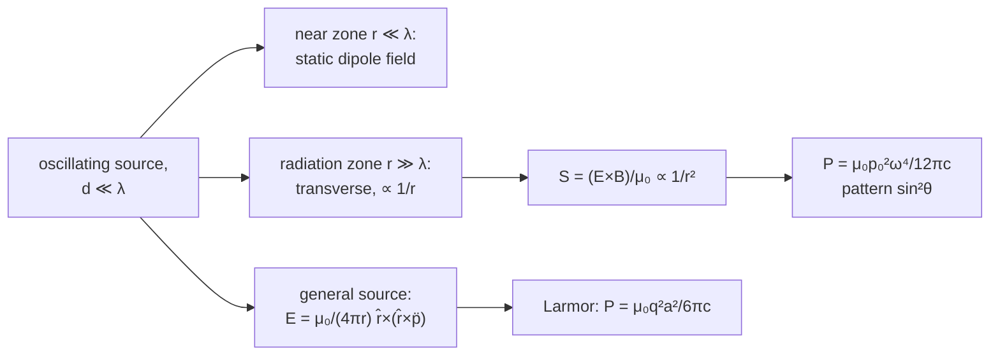
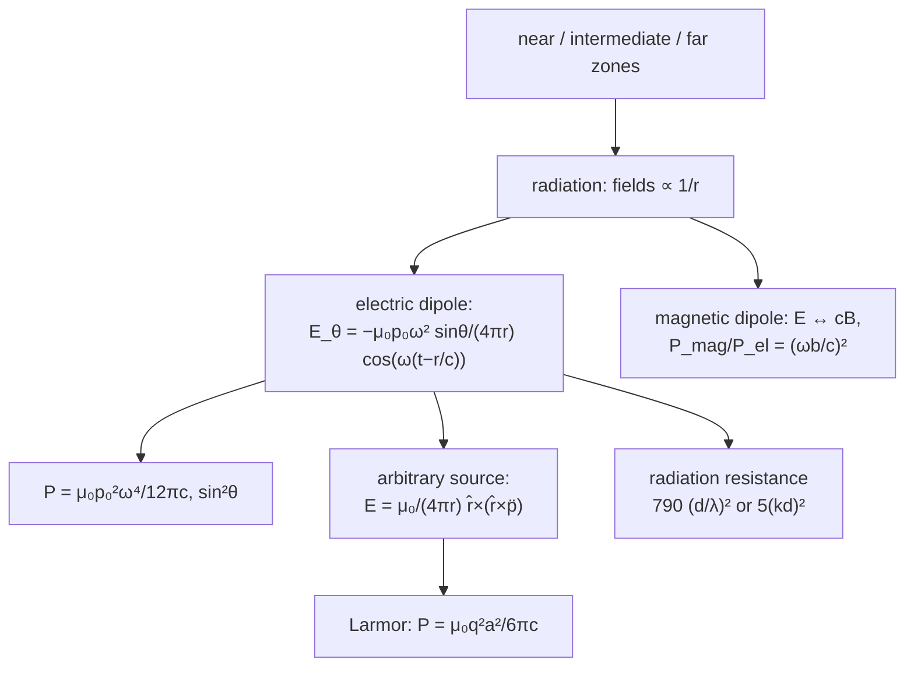

# ED10 · Dipole Radiation

◀ [[ED09 Retarded Potentials and Liénard-Wiechert Fields]] · [[Electrodynamics - Course Map]]

in course overview extra · book extra · beyond

> [!warning] Source status (every citation below was read in this session)
> Overview item *"dipole radiation"* (PH3114 outline; no lecture notes in the folder). **Griffiths and Jackson carry equal weight.**
>
> **Read directly:** Griffiths §11.1 (what is radiation; electric dipole radiation; magnetic dipole radiation; radiation from an arbitrary source; Example 11.1 and 11.2; Problems 11.1-11.11 as stated) and the opening of §11.2.1 (the fields (11.62)-(11.64)), printed pp. 466-482 (pdf = printed + 19). Jackson §9.1 (fields and radiation of a localized oscillating source), §9.2 (electric dipole fields and radiation, with the short centre-fed antenna), the opening of §9.3 (magnetic dipole fields by duality; the electric quadrupole only as far as (9.45), not used), printed pp. 407-414, and §14.2 (Larmor's formula, first page), p. 665 (pdf = printed + 26). **Units:** Griffiths and Jackson Ch. 9 are **SI** (Ch. 9's running header ends "-SI"); Jackson §14.2 is **Gaussian** and is converted. **Not cited because not read:** the rest of Griffiths §11.2 (the derivation of Larmor's formula from the fields, radiation reaction), Jackson's multipole fields from §9.6 on, the relativistic Larmor generalisation in §14.2.

> [!syllabus] Syllabus map
> 🟢 **In course overview**: §1 radiation and the three zones, §2 electric dipole radiation, §3 magnetic dipole radiation, §4 radiation from a general localized source and Larmor's formula.
>
> 🟡 **Extra · book**: §2.3 radiation resistance (Griffiths Problem 11.3, Jackson's short antenna (9.25)-(9.29)), the blue sky (Griffiths Example 11.1), the electric-quadrupole remark.
>
> 🔵 **Extra · beyond (mine)**: the numerical comparison of Griffiths' far-field formula with the exact retarded fields of a finite dipole, the equality of Griffiths' and Jackson's power formulas in SI numbers, the radiation resistances, the capacitor-discharge estimate, `scripts/ed10_numbers.py`, `scripts/fig_ed10.py`, and an interactive tool.

> [!key] After this chapter you can
> - define **radiation** as energy carried irreversibly to infinity, $P_{\rm rad}(t_0)=\lim_{r\to\infty}\oint\mathbf S\cdot d\mathbf a$ at the retarded time, and say why only fields falling as $1/r$ radiate,
> - distinguish the **near**, **intermediate** and **radiation** zones of a source of size $d\ll\lambda$,
> - derive the fields of an **oscillating electric dipole** and write $\mathbf E_{\rm rad}=-\dfrac{\mu_0p_0\omega^2}{4\pi}\dfrac{\sin\theta}{r}\cos[\omega(t-r/c)]\hat{\boldsymbol\theta}$, $\mathbf B=\hat{\mathbf r}\times\mathbf E/c$, the $\sin^2\theta$ pattern and the power $P=\mu_0p_0^2\omega^4/12\pi c$,
> - obtain **magnetic dipole radiation** (same pattern, $E\leftrightarrow cB$, power $\mu_0m_0^2\omega^4/12\pi c^3$) and explain why it is weaker by $(\omega b/c)^2$,
> - write the radiation from an arbitrary small source, $\mathbf E=\dfrac{\mu_0}{4\pi r}\hat{\mathbf r}\times(\hat{\mathbf r}\times\ddot{\mathbf p})$, and recover **Larmor's formula** $P=\mu_0q^2a^2/6\pi c$.

> [!intuition] The one-sentence story
> A static source has fields falling at least as fast as $1/r^2$, so its Poynting flux falls as $r^{-4}$ and nothing escapes; a **changing** dipole adds fields $\propto\ddot{\mathbf p}/r$ (the terms with $\dot\rho,\dot{\mathbf J}$ in Jefimenko's equations), whose Poynting flux $\propto r^{-2}$ is just enough to carry a finite power through every sphere. The lowest-order radiator allowed by charge conservation is the electric dipole, whose power grows as the fourth power of frequency and which is silent along its own axis.

## 1. What is radiation? The three zones (Griffiths §11.1.1, Jackson §9.1)
taught

When charges accelerate their fields can transport energy irreversibly out to infinity: **radiation** (Griffiths uses the word in this restricted sense; in everyday language it covers any field with a non-zero Poynting vector). Take the source localised near the origin and a gigantic sphere of radius $r$. The power through it is (11.1)

$$P(r,t)=\oint\mathbf S\cdot d\mathbf a=\frac1{\mu_0}\oint(\mathbf E\times\mathbf B)\cdot d\mathbf a,$$

and since the news travels at $c$ the energy crossing the sphere at time $t$ left the source at $t_0=t-r/c$, so (11.2)

$$P_{\rm rad}(t_0)=\lim_{r\to\infty}P\!\left(r,\,t_0+\frac rc\right)$$

with $t_0$ held fixed. The area is $4\pi r^2$, so **radiation requires $S$ to fall no faster than $1/r^2$**. Static fields (Coulomb, Biot-Savart) fall as $1/r^2$ or faster, $S\sim1/r^4$, and so static sources do not radiate. Jefimenko's equations (ED09 §3) show that time-dependent fields include terms containing $\dot\rho$ and $\dot{\mathbf J}$ that fall as $1/r$; these are the radiation terms. The study of radiation is picking out the parts of $\mathbf E$ and $\mathbf B$ that go as $1/r$, building the $1/r^2$ part of $S$, integrating over a large sphere and letting $r\to\infty$.

**The three zones (Jackson §9.1).** A source oscillating as $e^{-i\omega t}$ has (Lorenz gauge) $\mathbf A(\mathbf x)=\frac{\mu_0}{4\pi}\int\mathbf J(\mathbf x')\frac{e^{ik|\mathbf x-\mathbf x'|}}{|\mathbf x-\mathbf x'|}d^3x'$ (9.3), $\mathbf H=\frac1{\mu_0}\nabla\times\mathbf A$ (9.4) and, outside the source, $\mathbf E=\frac{iZ_0}k\nabla\times\mathbf H$ (9.5), where $k=\omega/c$ and $Z_0=\sqrt{\mu_0/\epsilon_0}$ is the impedance of free space. If the source has size $d\ll\lambda=2\pi c/\omega$ there are three regions:

| zone | condition | character |
|---|---|---|
| **near (static)** | $d\ll r\ll\lambda$ | quasi-stationary: $e^{ikr}\to1$, fields are static multipole fields oscillating as $e^{-i\omega t}$ |
| **intermediate (induction)** | $d\ll r\sim\lambda$ | all powers of $kr$ matter |
| **far (radiation)** | $d\ll\lambda\ll r$ | $\lvert\mathbf x-\mathbf x'\rvert\approx r-\hat{\mathbf n}\cdot\mathbf x'$; transverse fields falling as $1/r$ |

In the far zone (9.8) $\mathbf A\to\frac{\mu_0}{4\pi}\frac{e^{ikr}}r\int\mathbf J(\mathbf x')e^{-ik\hat{\mathbf n}\cdot\mathbf x'}d^3x'$, an outgoing spherical wave with an angle-dependent coefficient; expanding the exponential (9.9) gives terms of order $(kd)^n$, so **the radiation comes mainly from the first non-vanishing term**. For the scalar potential, charge conservation makes the total charge $q$ of a localised source time-independent: **an electric monopole does not radiate** (Jackson); Griffiths adds that a charged sphere whose radius oscillates does not radiate either, since Gauss's law gives exactly $Q/4\pi\epsilon_0r^2$ outside.

## 2. Electric dipole radiation (Griffiths §11.1.2, Jackson §9.2)
taught

### 2.1 Griffiths' construction
Two small metal spheres a distance $d$ apart joined by a wire carry charges $\pm q(t)$, $q=q_0\cos\omega t$: an oscillating dipole $\mathbf p(t)=p_0\cos(\omega t)\hat{\mathbf z}$, $p_0=q_0d$ (11.3)-(11.4). The retarded potential (10.26) is $V=\frac1{4\pi\epsilon_0}\left[\frac{q_0\cos\omega(t-r_+/c)}{r_+}-\frac{q_0\cos\omega(t-r_-/c)}{r_-}\right]$ (11.5), with $r_\pm=\sqrt{r^2\mp rd\cos\theta+(d/2)^2}$ (11.6). Three approximations make it a **perfect dipole in the radiation zone**:

$$d\ll r\ \ (11.7),\qquad d\ll\frac c\omega\ \ (11.10),\qquad r\gg\frac c\omega\ \ (11.13),$$

i.e. $d\ll\lambda\ll r$. To first order in $d$, $\frac1{r_\pm}\approx\frac1r\left(1\pm\frac d{2r}\cos\theta\right)$ (11.9) and $\cos\omega(t-r_\pm/c)\approx\cos\omega(t-r/c)\mp\frac{\omega d}{2c}\cos\theta\sin\omega(t-r/c)$ (11.11), so (11.12)

$$V=\frac{p_0\cos\theta}{4\pi\epsilon_0r}\left\{-\frac\omega c\sin[\omega(t-r/c)]+\frac1r\cos[\omega(t-r/c)]\right\}.$$

The second term is the static dipole potential ($\omega\to0$); in the radiation zone only the first survives (11.14). The current in the wire is $I=\dot q=-q_0\omega\sin\omega t\,\hat{\mathbf z}$ (11.15) and, to first order in $d$ (11.16)-(11.17),

$$\mathbf A=-\frac{\mu_0p_0\omega}{4\pi r}\sin[\omega(t-r/c)]\,\hat{\mathbf z}.$$

Computing $\mathbf E=-\nabla V-\partial_t\mathbf A$ and $\mathbf B=\nabla\times\mathbf A$ and keeping only $1/r$ terms:

$$\boxed{\mathbf E=-\frac{\mu_0p_0\omega^2}{4\pi}\frac{\sin\theta}r\cos[\omega(t-r/c)]\hat{\boldsymbol\theta},\qquad\mathbf B=-\frac{\mu_0p_0\omega^2}{4\pi c}\frac{\sin\theta}r\cos[\omega(t-r/c)]\hat{\boldsymbol\phi}}\quad(11.18),(11.19)$$

monochromatic spherical waves travelling radially at $c$: in phase, mutually perpendicular, transverse, $E_0/B_0=c$. (Griffiths: for large $r$ they are approximately plane over small regions, "just as the surface of the earth is reasonably flat, locally".) The Poynting vector is $\mathbf S=\frac1{\mu_0}\mathbf E\times\mathbf B=\frac{\mu_0}c\left(\frac{p_0\omega^2}{4\pi}\frac{\sin\theta}r\right)^2\cos^2[\omega(t-r/c)]\hat{\mathbf r}$ (11.20); averaged over a cycle (11.21)

$$\langle\mathbf S\rangle=\frac{\mu_0p_0^2\omega^4}{32\pi^2c}\frac{\sin^2\theta}{r^2}\hat{\mathbf r},\qquad P=\oint\langle\mathbf S\rangle\cdot d\mathbf a=\frac{\mu_0p_0^2\omega^4}{12\pi c}\ \ (11.22).$$

**There is no radiation along the axis of the dipole** ($\sin\theta=0$): the intensity profile is a donut with its maximum in the equatorial plane (Fig. ED10.1 A), and the power goes as $\omega^4$.

### 2.2 Jackson's construction
Jackson keeps only the first term of (9.9), $\mathbf A(\mathbf x)=\frac{\mu_0}{4\pi}\frac{e^{ikr}}r\int\mathbf J(\mathbf x')d^3x'$ (9.13), "valid everywhere outside the source, not just in the far zone", and uses the continuity equation $i\omega\rho=\nabla\cdot\mathbf J$ (9.15) to integrate by parts: $\int\mathbf J\,d^3x'=-\int\mathbf x'(\nabla'\cdot\mathbf J)d^3x'=-i\omega\int\mathbf x'\rho\,d^3x'$ (9.14), so

$$\mathbf A=-\frac{i\mu_0\omega}{4\pi}\mathbf p\,\frac{e^{ikr}}r,\qquad\mathbf p=\int\mathbf x'\rho(\mathbf x')\,d^3x'\ \ (9.16),(9.17).$$

The complete fields, at **every** distance, are (9.18)

$$\mathbf H=\frac{ck^2}{4\pi}(\hat{\mathbf n}\times\mathbf p)\frac{e^{ikr}}r\left(1-\frac1{ikr}\right),$$
$$\mathbf E=\frac1{4\pi\epsilon_0}\left\{k^2(\hat{\mathbf n}\times\mathbf p)\times\hat{\mathbf n}\frac{e^{ikr}}r+[3\hat{\mathbf n}(\hat{\mathbf n}\cdot\mathbf p)-\mathbf p]\left(\frac1{r^3}-\frac{ik}{r^2}\right)e^{ikr}\right\}.$$

$\mathbf H$ is transverse to $\hat{\mathbf n}$ at all distances; $\mathbf E$ has components parallel and perpendicular to $\hat{\mathbf n}$. In the **radiation zone** (9.19), $\mathbf H=\frac{ck^2}{4\pi}(\hat{\mathbf n}\times\mathbf p)\frac{e^{ikr}}r$, $\mathbf E=Z_0\mathbf H\times\hat{\mathbf n}$; in the **near zone** (9.20), $\mathbf H=\frac{i\omega}{4\pi}(\hat{\mathbf n}\times\mathbf p)\frac1{r^2}$ and $\mathbf E=\frac1{4\pi\epsilon_0}[3\hat{\mathbf n}(\hat{\mathbf n}\cdot\mathbf p)-\mathbf p]\frac1{r^3}$: apart from its oscillation, the static dipole field, with $Z_0H$ smaller than $E$ by a factor $kr$, so near fields are essentially electric. The time-averaged power per solid angle is $\frac{dP}{d\Omega}=\frac12{\rm Re}[r^2\hat{\mathbf n}\cdot\mathbf E\times\mathbf H^*]$ (9.21):

$$\frac{dP}{d\Omega}=\frac{c^2Z_0}{32\pi^2}k^4\left|(\hat{\mathbf n}\times\mathbf p)\times\hat{\mathbf n}\right|^2\ \ (9.22)\ \to\ \frac{c^2Z_0}{32\pi^2}k^4|\mathbf p|^2\sin^2\theta\ \ (9.23),\qquad P=\frac{c^2Z_0k^4}{12\pi}|\mathbf p|^2\ \ (9.24),$$

where the vector inside the absolute value gives the **polarisation** and $P$ is independent of the relative phases of the components of $\mathbf p$. Since $c^2Z_0k^4=c^2(\mu_0c)\omega^4/c^4=\mu_0\omega^4/c$, (9.24) is exactly Griffiths' (11.22) with $|\mathbf p|=p_0$ the amplitude.

> [!example] Worked example 1: how good is "the radiation zone"? (🔵 exact check of Griffiths' approximations)
> Griffiths' result (11.18) rests on three approximations. To test them I take a **finite** oscillating dipole (charges $\pm q_0\cos\omega t$ at $z=\pm d/2$, $d=0.02\lambda$, joined by a wire carrying $-q_0\omega\sin\omega t$), compute the *exact* retarded potentials (11.5) and $\mathbf A$ by quadrature along the wire, form $-\nabla V-\partial_t\mathbf A$ by central differences, and compare $E_\theta$ at $\theta=60^\circ$ with (11.18) over 8 phases of the cycle (`ed10_numbers.py` §1, units $\mu_0/4\pi=1/4\pi\epsilon_0=c=1$). The largest discrepancy relative to the amplitude is
>
> | distance $r$ | relative error | $1/kr$ |
> |---|---|---|
> | $3\lambda$ | $5.30\times10^{-2}$ | $5.31\times10^{-2}$ |
> | $10\lambda$ | $1.59\times10^{-2}$ | $1.59\times10^{-2}$ |
> | $30\lambda$ | $5.30\times10^{-3}$ | $5.31\times10^{-3}$ |
> | $100\lambda$ | $1.59\times10^{-3}$ | $1.59\times10^{-3}$ |
>
> The error is exactly the dropped $1/kr$ relative correction (approximation 3), so (11.18) is accurate to $\sim1/kr$ and the finite size $d=0.02\lambda$ contributes negligibly (Fig. ED10.1 B). The transition from near to far zone is visible in Jackson's exact (9.18): for $\theta=45^\circ$ the transverse field $|E_\theta|$ follows the static $1/(kr)^3$ law for $kr\ll1$ and the $1/kr$ radiation law for $kr\gg1$, with the crossover at $kr\approx1$, i.e. $r\approx\lambda/2\pi$; the longitudinal $|E_r|$, absent from (11.18), decays as $1/(kr)^3$ and is lost already at $kr\sim$ few (Fig. ED10.1 C).

> [!example] Worked example 2: Griffiths and Jackson give the same power (🔵 SI numbers)
> A dipole with amplitude $p_0=10^{-12}$ C m oscillating at $1$ MHz ($\omega=6.283\times10^6$ s$^{-1}$, $\lambda=300$ m): Griffiths' (11.22) gives $P=1.732916\times10^{-13}$ W; Jackson's (9.24) $c^2Z_0k^4p_0^2/12\pi=1.732916\times10^{-13}$ W; and integrating $\langle S\rangle$ of (11.21) over a sphere of radius $10$ m numerically gives $1.732916\times10^{-13}$ W. At $\theta=90^\circ$ both give $dP/d\Omega=2.068516\times10^{-14}$ W/sr (`ed10_numbers.py` §2). Doubling the frequency multiplies the power by $2^4=16$.

> [!example] Worked example 3: the blue sky (Griffiths Example 11.1; 🔵 numbers)
> Sunlight stimulates atmospheric atoms to oscillate as tiny dipoles; the re-radiated power goes as $\omega^4$ (11.22), so blue is scattered more strongly than red, which is why the sky is blue: for 450 nm against 650 nm the ratio is $(650/450)^4=4.35$, and for 400 nm against 700 nm it is $9.38$. Because electromagnetic waves are transverse the atmospheric dipoles oscillate in a plane perpendicular to the sun's rays; in the arc of sky at right angles to the rays a dipole oscillating along the line of sight sends nothing toward you ($\sin^2\theta$ in (11.21)), so **the light received there is polarised perpendicular to the sun's rays**. The redness of the sunset is the other side of the coin: light arriving tangentially crosses a much longer stretch of atmosphere and has lost much of its blue (Griffiths).

### 2.3 Radiation resistance (Griffiths Problem 11.3, Jackson §9.2)
extra · book

The **radiation resistance** is the resistance that would dissipate the same average power as the dipole radiates. Griffiths' dipole carries the **uniform** current $I_0=q_0\omega$ along the wire, so $P=\frac12I_0^2R$ with (11.22) gives $R=\frac{\mu_0d^2\omega^2}{6\pi c}=\frac{Z_0(kd)^2}{6\pi}=790\,(d/\lambda)^2\ \Omega$ (the value stated in Problem 11.3). Jackson's **short centre-fed antenna** of length $d\ll\lambda$ carries a current falling linearly from $I_0$ at the gap to zero at the ends (9.25), so the charge per unit length is constant on each arm, $\rho'(z)=\pm2iI_0/\omega d$ (9.26), the dipole moment is $p=-iI_0d/2\omega$ (9.27) (**half** that of the uniform-current dipole), and

$$\frac{dP}{d\Omega}=\frac{Z_0I_0^2}{128\pi^2}(kd)^2\sin^2\theta\ \ (9.28),\qquad P=\frac{Z_0I_0^2}{48\pi}(kd)^2\ \ (9.29),$$

so $R_{\rm rad}=Z_0(kd)^2/24\pi=5(kd)^2\ \Omega$ (Jackson states $R_{\rm rad}=5(kd)^2$ ohms), four times smaller than Griffiths' because the effective dipole moment per unit input current is halved.

> [!example] Worked example 4: radiation resistances compared (🔵)
> $Z_0=376.7303\ \Omega$ gives the coefficients $Z_0\cdot2\pi/3=789.02$ (Griffiths: "790") and $Z_0/24\pi=4.9965$ (Jackson: "5"). For $d/\lambda=0.01,0.05,0.1$: uniform current $0.0789,\ 1.973,\ 7.890\ \Omega$; triangular current $0.0197,\ 0.493,\ 1.973\ \Omega$ (`ed10_numbers.py` §3). For an ordinary radio wire with $d=5$ cm: at $100$ MHz ($\lambda=3$ m) $R=790(0.05/3)^2=0.22\ \Omega$, at $1$ MHz ($\lambda=300$ m) $R=2.2\times10^{-5}\ \Omega$: negligible compared to ordinary wire resistance, as Griffiths' question suggests.

## 3. Magnetic dipole radiation (Griffiths §11.1.3, Jackson §9.3)
taught

A wire loop of radius $b$ carries $I=I_0\cos\omega t$ (11.23): an oscillating magnetic dipole $\mathbf m(t)=\pi b^2I(t)\hat{\mathbf z}=m_0\cos(\omega t)\hat{\mathbf z}$, $m_0=\pi b^2I_0$ (11.24)-(11.25). The loop is neutral so $V=0$ and $\mathbf A=\frac{\mu_0}{4\pi}\oint\frac{I_0\cos\omega(t-\mathfrak r/c)}{\mathfrak r}d\mathbf l'$ (11.26); with $b\ll\mathfrak r$ and $b\ll c/\omega$ (approximations 1-2, (11.29)-(11.31)) and $\mathfrak r\approx r(1-\frac br\sin\theta\cos\phi')$, the $\phi'$ integral over $\cos^2\phi'$ gives (11.33)

$$\mathbf A=\frac{\mu_0m_0\sin\theta}{4\pi r}\left\{\frac1r\cos[\omega(t-r/c)]-\frac\omega c\sin[\omega(t-r/c)]\right\}\hat{\boldsymbol\phi},$$

the static magnetic dipole potential for $\omega\to0$; in the radiation zone only the second term survives (11.35). The fields (11.36)-(11.37)

$$\mathbf E=\frac{\mu_0m_0\omega^2}{4\pi c}\frac{\sin\theta}r\cos[\omega(t-r/c)]\hat{\boldsymbol\phi},\qquad\mathbf B=-\frac{\mu_0m_0\omega^2}{4\pi c^2}\frac{\sin\theta}r\cos[\omega(t-r/c)]\hat{\boldsymbol\theta}$$

are in phase, perpendicular, transverse, $E_0/B_0=c$: structurally the electric-dipole fields **with the roles exchanged** ($\mathbf B$ along $\hat{\boldsymbol\theta}$, $\mathbf E$ along $\hat{\boldsymbol\phi}$). The intensity $\langle\mathbf S\rangle=\frac{\mu_0m_0^2\omega^4}{32\pi^2c^3}\frac{\sin^2\theta}{r^2}\hat{\mathbf r}$ (11.39) is the same donut, and the power is (11.40)

$$P=\frac{\mu_0m_0^2\omega^4}{12\pi c^3}.$$

**Jackson's route (duality).** The next term of (9.9) gives $\mathbf A=\frac{\mu_0}{4\pi}\frac{e^{ikr}}r\left(1-\frac1{ikr}\right)ik\int\mathbf J(\hat{\mathbf n}\cdot\mathbf x')d^3x'$ (9.30); splitting the integrand into a symmetric and an antisymmetric part, $(\hat{\mathbf n}\cdot\mathbf x')\mathbf J=\frac12[(\hat{\mathbf n}\cdot\mathbf x')\mathbf J+(\hat{\mathbf n}\cdot\mathbf J)\mathbf x']+\frac12(\mathbf x'\times\mathbf J)\times\hat{\mathbf n}$ (9.31), the antisymmetric part is the magnetisation $\mathbf M=\frac12\mathbf x\times\mathbf J$ (9.32) and gives $\mathbf A=\frac{ik\mu_0}{4\pi}(\hat{\mathbf n}\times\mathbf m)\frac{e^{ikr}}r\left(1-\frac1{ikr}\right)$ (9.33) with $\mathbf m=\frac12\int\mathbf x'\times\mathbf J\,d^3x'$ (9.34); the symmetric part is an **electric quadrupole** (9.37)-(9.45), not used here. Since (9.33) is proportional to $\mathbf H$ of the electric dipole (9.18), the magnetic-dipole fields follow by **duality**: $\mathbf H_{\rm mag}$ is $1/Z_0$ times $\mathbf E_{\rm el}$ with $\mathbf p\to\mathbf m/c$ (9.35), and $\mathbf E_{\rm mag}=-Z_0\mathbf H_{\rm el}(\mathbf p\to\mathbf m/c)$, i.e. (9.36) $\mathbf E=-\frac{Z_0}{4\pi}k^2(\hat{\mathbf n}\times\mathbf m)\frac{e^{ikr}}r\left(1-\frac1{ikr}\right)$. "The radiation pattern and total power are the same for the two kinds of dipole"; the only difference is the polarisation: for an electric dipole $\mathbf E$ lies in the plane of $\hat{\mathbf n}$ and $\mathbf p$, for a magnetic dipole $\mathbf E$ is perpendicular to the plane of $\hat{\mathbf n}$ and $\mathbf m$. (The two forms agree: Jackson's far-zone $|\mathbf E|=\frac{Z_0}{4\pi}k^2m_0\frac{\sin\theta}r=\frac{\mu_0m_0\omega^2\sin\theta}{4\pi c\,r}$ is Griffiths' amplitude in (11.36).)

**Electric versus magnetic.** Comparing (11.22) and (11.40), $P_{\rm mag}/P_{\rm el}=(m_0/p_0c)^2$ (11.41); with $I_0=q_0\omega$ and $d=\pi b$ for the sake of comparison, (11.42)

$$\frac{P_{\rm mag}}{P_{\rm el}}=\left(\frac{\omega b}c\right)^2,$$

and $\omega b/c$ is precisely the quantity assumed small in approximation 2, here appearing **squared**: "ordinarily, then, one should expect electric dipole radiation to dominate"; magnetic dipole radiation shows itself only if the system is contrived to exclude the electric contribution (as for the neutral current loop).

> [!example] Worked example 5: the magnetic dipole is weak (🔵 numbers)
> Loop radius $b=1$ cm, wavelength $\lambda=1$ m ($\omega b/c=2\pi b/\lambda=0.0628$): evaluating (11.22) with $p_0=q_0\pi b$, $I_0=q_0\omega$ and (11.40) with $m_0=\pi b^2I_0$ gives $P_{\rm mag}/P_{\rm el}=3.947842\times10^{-3}$, equal to $(\omega b/c)^2=3.947842\times10^{-3}$ (`ed10_numbers.py` §4): about a quarter of a percent.

## 4. Radiation from an arbitrary localised source (Griffiths §11.1.4)
taught

Now let the charge and current distribution be arbitrary but contained near the origin. The retarded potential is $V=\frac1{4\pi\epsilon_0}\int\frac{\rho(\mathbf r',t-\mathfrak r/c)}{\mathfrak r}d\tau'$ (11.43) with $\mathfrak r=\sqrt{r^2+r'^2-2\mathbf r\cdot\mathbf r'}$ (11.44). Assume (approximation 1) $r'\ll r$ (11.45), so $\mathfrak r\approx r\left(1-\frac{\hat{\mathbf r}\cdot\mathbf r'}r\right)$ and $\frac1{\mathfrak r}\approx\frac1r\left(1+\frac{\hat{\mathbf r}\cdot\mathbf r'}r\right)$ (11.46)-(11.47). Expanding $\rho$ about the retarded time at the origin $t_0=t-r/c$ (11.48),

$$\rho(\mathbf r',t-\mathfrak r/c)\approx\rho(\mathbf r',t_0)+\dot\rho(\mathbf r',t_0)\frac{\hat{\mathbf r}\cdot\mathbf r'}c+\cdots\qquad(11.49),$$

valid (approximation 2) provided $r'\ll c/|\ddot\rho/\dot\rho|^{1/2},\ c/|\dddot\rho/\dot\rho|^{1/3},\dots$, which for an oscillating system reduces to $r'\ll c/\omega$. Inserting in $V$ and keeping first order in $r'$, with $Q$ the (constant) total charge and $\mathbf p$ the dipole moment, (11.51)

$$V\approx\frac1{4\pi\epsilon_0}\left[\frac Qr+\frac{\hat{\mathbf r}\cdot\mathbf p(t_0)}{r^2}+\frac{\hat{\mathbf r}\cdot\dot{\mathbf p}(t_0)}{rc}\right].$$

The first two terms are the monopole and dipole of the static multipole expansion; the third (retardation) is new. For the vector potential, to first order only $\mathfrak r\to r$ is needed, and since $\int\mathbf J\,d\tau'=\dot{\mathbf p}$ (Griffiths Prob. 5.7), (11.52)-(11.54)

$$\mathbf A\approx\frac{\mu_0}{4\pi r}\dot{\mathbf p}(t_0).$$

Now keep only terms going as $1/r$ (approximation 3, (11.55)): the radiation comes entirely from terms where the argument $t_0$ is differentiated, $\nabla t_0=-\hat{\mathbf r}/c$. Then $\nabla V\approx-\frac1{4\pi\epsilon_0c^2}\frac{\hat{\mathbf r}\cdot\ddot{\mathbf p}}{r}\hat{\mathbf r}$, $\nabla\times\mathbf A\approx-\frac{\mu_0}{4\pi rc}\hat{\mathbf r}\times\ddot{\mathbf p}$ and $\partial_t\mathbf A\approx\frac{\mu_0}{4\pi r}\ddot{\mathbf p}$, so with $\ddot{\mathbf p}$ at $t_0$ (11.56)-(11.57)

$$\boxed{\mathbf E=\frac{\mu_0}{4\pi r}\left[(\hat{\mathbf r}\cdot\ddot{\mathbf p})\hat{\mathbf r}-\ddot{\mathbf p}\right]=\frac{\mu_0}{4\pi r}\,\hat{\mathbf r}\times(\hat{\mathbf r}\times\ddot{\mathbf p}),\qquad\mathbf B=-\frac{\mu_0}{4\pi rc}\,\hat{\mathbf r}\times\ddot{\mathbf p}}.$$

With $z$ along $\ddot{\mathbf p}$, (11.58) $\mathbf E=\frac{\mu_0\ddot p\sin\theta}{4\pi r}\hat{\boldsymbol\theta}$, $\mathbf B=\frac{\mu_0\ddot p\sin\theta}{4\pi cr}\hat{\boldsymbol\phi}$ with the sign of $\hat{\mathbf z}\cdot\ddot{\mathbf p}$ understood; **perpendicular, transverse, $E/B=c$**. The Poynting vector is (11.59) $\mathbf S=\frac{\mu_0}{16\pi^2c}[\ddot p(t_0)]^2\frac{\sin^2\theta}{r^2}\hat{\mathbf r}$, and the power through a large sphere, the total radiated power, is (11.60)

$$P_{\rm rad}(t_0)=\frac{\mu_0}{6\pi c}\left[\ddot{\mathbf p}(t_0)\right]^2.$$

> [!example] Worked example 6: two special cases (Griffiths Example 11.2)
> (a) For $\mathbf p=p_0\cos(\omega t)$, $\ddot{\mathbf p}=-\omega^2p_0\cos\omega t$ and (11.60) averaged over a cycle ($\langle\cos^2\rangle=\frac12$) gives $\frac{\mu_0p_0^2\omega^4}{12\pi c}$, recovering §2. (b) For a **single point charge** $q$ at position $\mathbf d(t)$, $\mathbf p=q\mathbf d$, $\ddot{\mathbf p}=q\mathbf a$ and (11.61)
> $$P=\frac{\mu_0q^2a^2}{6\pi c}\qquad\text{(Larmor's formula)},$$
> proportional to the **square of the acceleration**. Numbers (`ed10_numbers.py` §6): an electron with $a=10^{15}$ m/s$^2$ radiates $5.7083\times10^{-24}$ W; at $10^{18}$ and $10^{20}$ m/s$^2$ the power scales as $a^2$ to $5.7083\times10^{-18}$ and $5.7083\times10^{-14}$ W. The monopole term does not radiate because charge is conserved; if it were not, $V_{\rm mono}=Q(t_0)/4\pi\epsilon_0r$ would give $\mathbf E_{\rm mono}=\dot Q(t_0)\hat{\mathbf r}/4\pi\epsilon_0cr$ (Griffiths). If $\ddot{\mathbf p}=0$ the next term (second order in $r'$) splits into a magnetic dipole and an electric quadrupole contribution; and so on to magnetic quadrupole and electric octopole.

## 5. Larmor's formula: SI and Gaussian (Griffiths §11.2.1 opening, Jackson §14.2)
taught

Griffiths starts §11.2.1 from the exact fields of a point charge (ED09 (10.72)-(10.73), here (11.62)-(11.63)): $\mathbf E=\frac q{4\pi\epsilon_0}\frac{\mathfrak r}{(\boldsymbol{\mathfrak r}\cdot\mathbf u)^3}[(c^2-v^2)\mathbf u+\boldsymbol{\mathfrak r}\times(\mathbf u\times\mathbf a)]$, $\mathbf B=\frac1c\hat{\boldsymbol{\mathfrak r}}\times\mathbf E$, the first term the velocity field, the second the acceleration field, and the Poynting vector (11.64) $\mathbf S=\frac1{\mu_0c}[E^2\hat{\boldsymbol{\mathfrak r}}-(\hat{\boldsymbol{\mathfrak r}}\cdot\mathbf E)\mathbf E]$. Jackson's §14.2 (Gaussian) restricts to a charge observed with $v\ll c$, where the acceleration field of (14.14) is (14.18) $\mathbf E_a=\frac ec\left[\frac{\hat{\mathbf n}\times(\hat{\mathbf n}\times\dot{\boldsymbol\beta})}R\right]_{\rm ret}$, the energy flux $\mathbf S=\frac c{4\pi}E_a^2\hat{\mathbf n}$ (14.19), and the power per unit solid angle (14.20)-(14.21)

$$\frac{dP}{d\Omega}=\frac{e^2}{4\pi c^3}|\dot{\mathbf v}|^2\sin^2\Theta,\qquad P=\frac{2e^2}{3c^3}|\dot{\mathbf v}|^2\ \ (14.22),$$

with $\Theta$ the angle between $\dot{\mathbf v}$ and $\hat{\mathbf n}$: the characteristic $\sin^2\Theta$ pattern, the radiation polarised in the plane of $\dot{\mathbf v}$ and $\hat{\mathbf n}$. This is the "familiar Larmor result for a nonrelativistic, accelerated charge". **Conversion:** $e^2\to q^2/4\pi\epsilon_0$ gives $P=\frac{2q^2a^2}{3\cdot4\pi\epsilon_0c^3}=\frac{q^2a^2}{6\pi\epsilon_0c^3}=\frac{\mu_0q^2a^2}{6\pi c}$, Griffiths' (11.61) (using $\mu_0\epsilon_0c^2=1$); and $\int\sin^2\Theta\,d\Omega=8\pi/3$ turns (14.21) into (14.22) (numerically $8.377580$ for both).

![[fig_ed10_dipole.png|940]]
*Figure ED10.1. A: the radiation pattern $\langle S\rangle\propto\sin^2\theta$ of an oscillating electric dipole (and, with $\mathbf E\leftrightarrow c\mathbf B$, of a magnetic dipole), seen in a plane containing the axis. B: the relative error of Griffiths' far-field formula (11.18) against the exact retarded fields of a finite dipole falls as $1/kr$ (points: $r=3,10,30,100\,\lambda$). C: near zone to far zone from Jackson's exact (9.18) at $\theta=45^\circ$: $|E_r|$ and $|E_\theta|$ follow the static $(kr)^{-3}$ law for $kr\ll1$; $|E_\theta|$ takes over as $1/kr$ for $kr\gg1$.*

> [!example] Worked example 7: does a discharging capacitor radiate? (Griffiths Problem 11.8; 🔵 numbers)
> A parallel-plate capacitor $C$ with plate separation $d$ and initial charge $\pm Q_0$ discharges through a resistor $R$, $Q=Q_0e^{-t/RC}$. It is a dipole $p=Qd$, so (11.60) gives $P=\frac{\mu_0}{6\pi c}\left(\frac{Q_0d}{(RC)^2}\right)^2e^{-2t/RC}$ and the total radiated energy is $\frac{\mu_0Q_0^2d^2}{12\pi c(RC)^3}$, i.e. a fraction
> $$\frac{E_{\rm rad}}{Q_0^2/2C}=\frac{\mu_0d^2}{6\pi c\,R^3C^2}$$
> of the initial energy. For $C=1$ pF, $R=1000\ \Omega$, $d=0.1$ mm ($RC=1$ ns) numerical integration gives $E_{\rm rad}=1.1119\times10^{-15}$ J against $E_0=5.0\times10^{-7}$ J for $Q_0=1$ nC: a fraction $2.2238\times10^{-9}$, equal to the formula (`ed10_numbers.py` §7). Electronics rightly ignores radiative losses in this regime.

<!-- interactive:start (generated by scripts/embed_interactive.py; edit the tool in scripts/interactive/tools/, not this block) -->
> [!interactive]+ Interactive: The oscillating electric dipole: from the static near field to the radiation zone
> The exact field of a point electric dipole p = p₀ẑ oscillating at frequency ω (Jackson 9.18, valid at every distance): E = (1/4πε₀){k²(n×p)×n e^{ikr}/r + [3n(n·p) − p](1/r³ − ik/r²)e^{ikr}}.
>
> ![[ed10_dipole_field.png|720]]
>
> **Try:** Set the window to ±0.3λ: the arrows have the static-dipole pattern and flip sign together, with no outward travel. Set it to ±4λ: bands of transverse arrows move outward at one wavelength per period; along the axis (θ = 0) the field is purely longitudinal (E_θ ∝ sinθ = 0, so nothing radiates), in the equatorial plane it is purely transverse and strongest. Click a point to read E_r, E_θ and the zone (kr < 1 is the near zone).
>
> [▶ Open the tool in your browser](../Assets/interactive/ed10_dipole_field.html) · [absolute link](file:///home/swastik/Documents/notes/Assets/interactive/ed10_dipole_field.html) · all tools and coverage: [[Interactive Tools]]

<!-- interactive:end -->

## Map of this chapter

## Common mistakes
1. Using the near-zone (static dipole) fields at large distance, or the radiation fields (11.18)-(11.19) inside $r\lesssim\lambda$: $\mathbf E$ has a longitudinal component and $1/r^2,1/r^3$ terms there.
2. Forgetting the **retarded time**: $\ddot{\mathbf p}$ in (11.56) is evaluated at $t_0=t-r/c$.
3. Mixing time-domain and complex-amplitude conventions: Griffiths uses real $p_0\cos\omega t$ and averages with $\frac12$; Jackson's $\mathbf p$ is a complex amplitude and his $P=c^2Z_0k^4|\mathbf p|^2/12\pi$ is already time-averaged (they are equal).
4. Expecting the dipole to radiate along its axis: $\sin^2\theta$ vanishes there.
5. Claiming a time-dependent total charge radiates as a monopole: charge conservation forbids it.
6. Treating magnetic dipole radiation as comparable to electric: it is down by $(\omega b/c)^2\ll1$ unless the electric part is absent.
7. Using Jackson's Gaussian (14.22) in SI units: $P=\frac23\frac{e^2a^2}{c^3}$ becomes $\frac23\frac{q^2a^2}{4\pi\epsilon_0c^3}$.

## Summary
- Radiation: $P_{\rm rad}(t_0)=\lim_{r\to\infty}\oint\mathbf S\cdot d\mathbf a$ at $t=t_0+r/c$; needs fields $\propto1/r$; static sources do not radiate; zones $d\ll r\ll\lambda$, $r\sim\lambda$, $r\gg\lambda$.
- Electric dipole: $\mathbf E=-\frac{\mu_0p_0\omega^2}{4\pi}\frac{\sin\theta}r\cos[\omega(t-r/c)]\hat{\boldsymbol\theta}$, $\mathbf B=\hat{\mathbf r}\times\mathbf E/c$; $\langle S\rangle=\frac{\mu_0p_0^2\omega^4}{32\pi^2c}\frac{\sin^2\theta}{r^2}$; $P=\frac{\mu_0p_0^2\omega^4}{12\pi c}$ $(=c^2Z_0k^4|p|^2/12\pi)$.
- Exact dipole fields (Jackson 9.18); near zone = static dipole; $E$ transverse and $\propto1/r$ far away.
- Magnetic dipole: $P=\frac{\mu_0m_0^2\omega^4}{12\pi c^3}$; $P_{\rm mag}/P_{\rm el}=(\omega b/c)^2$; duality $\mathbf E\to Z_0\mathbf H$, $\mathbf p\to\mathbf m/c$.
- General: $\mathbf E=\frac{\mu_0}{4\pi r}\hat{\mathbf r}\times(\hat{\mathbf r}\times\ddot{\mathbf p})$, $P=\frac{\mu_0}{6\pi c}\ddot p^2$; Larmor $P=\frac{\mu_0q^2a^2}{6\pi c}=\frac{2e^2a^2}{3c^3}$ (Gaussian).
- Numbers: error of (11.18) is exactly $1/kr$; $P=1.7329\times10^{-13}$ W for $p_0=10^{-12}$ C m at 1 MHz (both books); $R_{\rm rad}=790(d/\lambda)^2$ vs $5(kd)^2\ \Omega$; $P_{\rm mag}/P_{\rm el}=3.95\times10^{-3}$; blue/red $=4.35$; capacitor fraction $2.2\times10^{-9}$.

## Practice
> [!question]- P1. Which zone?
> A $1$ MHz transmitter ($\lambda=300$ m) has a $5$ cm antenna. Which zone is a point $3$ m away? And $3$ km?
>
> **Solution.** $kr=2\pi r/\lambda$: at $3$ m, $kr=0.063\ll1$ (near zone: static dipole field); at $3$ km, $kr=63\gg1$ (radiation zone).

> [!question]- P2. Why $1/r$?
> Show that a fixed power $P_{\rm rad}$ through all large spheres requires $E,B\propto1/r$.
>
> **Solution.** $P=\oint S\,da\propto4\pi r^2S$ must be independent of $r$, so $S\propto r^{-2}$; since $S=EB/\mu_0\propto E^2/\mu_0c$, $E\propto1/r$.

> [!question]- P3. From (11.21) to (11.22)
> Integrate $\langle S\rangle$ over a sphere.
>
> **Solution.** $P=\frac{\mu_0p_0^2\omega^4}{32\pi^2c}\int\frac{\sin^2\theta}{r^2}r^2\sin\theta\,d\theta\,d\phi=\frac{\mu_0p_0^2\omega^4}{32\pi^2c}\cdot2\pi\cdot\frac43=\frac{\mu_0p_0^2\omega^4}{12\pi c}$.

> [!question]- P4. Frequency scaling
> By what factor does the radiated power change if the frequency of a fixed-amplitude dipole is tripled?
>
> **Solution.** $P\propto\omega^4$: $3^4=81$.

> [!question]- P5. Blue versus violet
> Compare scattered power at $400$ nm and $450$ nm.
>
> **Solution.** $(450/400)^4=1.6$: violet is scattered $1.6$ times more than blue (the sky looks blue rather than violet because of the spectrum of sunlight and the eye's response, not because of $\omega^4$).

> [!question]- P6. $E/B=c$
> Show from (11.18) and (11.19) that $E_0/B_0=c$.
>
> **Solution.** $E_0=\frac{\mu_0p_0\omega^2\sin\theta}{4\pi r}$ and $B_0=\frac{\mu_0p_0\omega^2\sin\theta}{4\pi cr}$, so $E_0/B_0=c$; $\hat{\boldsymbol\theta}\times\hat{\boldsymbol\phi}=\hat{\mathbf r}$ so $\mathbf E\times\mathbf B$ points radially outward.

> [!question]- P7. Magnetic dipole by duality
> From Jackson (9.36) show the far-zone electric field amplitude of a magnetic dipole equals Griffiths' (11.36).
>
> **Solution.** $|\mathbf E|=\frac{Z_0}{4\pi}k^2m_0\frac{\sin\theta}r$ with $Z_0=\mu_0c$ and $k=\omega/c$: $\frac{\mu_0c}{4\pi}\frac{\omega^2}{c^2}\frac{m_0\sin\theta}r=\frac{\mu_0m_0\omega^2}{4\pi c}\frac{\sin\theta}r$, which is (11.36).

> [!question]- P8. Radio wire
> Radiation resistance of a $5$ cm wire at $100$ MHz and $1$ MHz (Griffiths' formula).
>
> **Solution.** $R=790(d/\lambda)^2$: $100$ MHz: $\lambda=3$ m, $R=790(0.0167)^2=0.22\ \Omega$; $1$ MHz: $\lambda=300$ m, $R=2.2\times10^{-5}\ \Omega$ (worked example 4).

> [!question]- P9. Antenna power
> A short centre-fed antenna ($d/\lambda=0.05$) has input current amplitude $I_0=1$ A. Power radiated (Jackson)?
>
> **Solution.** (9.29): $P=\frac{Z_0I_0^2}{48\pi}(kd)^2$ with $kd=2\pi\cdot0.05=0.314$: $P=\frac{376.73}{150.8}(0.0987)=0.2465$ W, i.e. $\frac12I_0^2R_{\rm rad}$ with $R_{\rm rad}=0.493\ \Omega$ (worked example 4).

> [!question]- P10. Proton versus electron
> Same acceleration: which radiates more?
>
> **Solution.** Larmor's $P=\mu_0q^2a^2/6\pi c$ depends on the charge and the acceleration, not the mass: equal for the same $a$. (For the same force the electron's acceleration is 1836 times larger and its power $\sim3\times10^6$ times larger.)

> [!question]- P11. An optical electron
> An electron oscillates with acceleration amplitude $a_0=10^{21}$ m/s$^2$ (amplitude $1$ nm at $\omega=10^{15}$ s$^{-1}$). Average radiated power?
>
> **Solution.** $\langle a^2\rangle=\frac12a_0^2$: $P=\frac{\mu_0q^2a_0^2}{12\pi c}=2.85\times10^{-12}$ W.

> [!question]- P12. Rotating dipole
> A dipole of constant magnitude $p_0$ rotates at $\omega$ in a plane. Power (by (11.60))?
>
> **Solution.** $\mathbf p=p_0(\cos\omega t,\sin\omega t,0)$, $\ddot{\mathbf p}=-\omega^2\mathbf p$, $|\ddot{\mathbf p}|^2=\omega^4p_0^2$ (constant): $P=\frac{\mu_0\omega^4p_0^2}{6\pi c}$, exactly twice the linear-oscillator average. The two perpendicular linear dipoles (90° out of phase) radiate $\frac{\mu_0p_0^2\omega^4}{12\pi c}$ each, and their cross terms average to zero, so powers add here although power does not satisfy superposition in general.

> [!question]- P13. Larmor from the dipole formula
> Derive (11.61) from (11.60).
>
> **Solution.** A point charge at $\mathbf d(t)$ has dipole moment $\mathbf p=q\mathbf d$, so $\ddot{\mathbf p}=q\mathbf a$ and (11.60) gives $P=\frac{\mu_0}{6\pi c}q^2a^2$.

> [!question]- P14. Breathing charged sphere
> Does a uniformly charged sphere whose radius oscillates radiate?
>
> **Solution.** No: by Gauss's law the field outside is exactly $Q/4\pi\epsilon_0r^2$ whatever the radius does (Griffiths); a spherically symmetric distribution has no dipole moment and, with charge conserved, no monopole radiation.

> [!question]- P15. Gaussian to SI
> Convert Jackson's $P=\frac23\frac{e^2}{c^3}|\dot{\mathbf v}|^2$ and $\mathbf E_a$ amplitude to SI.
>
> **Solution.** $e^2\to q^2/4\pi\epsilon_0$: $P=\frac23\frac{q^2a^2}{4\pi\epsilon_0c^3}=\frac{q^2a^2}{6\pi\epsilon_0c^3}=\frac{\mu_0q^2a^2}{6\pi c}$ (Griffiths 11.61). The acceleration field amplitude $\frac{e}{c^2R}a_\perp\to\frac{q}{4\pi\epsilon_0c^2R}a_\perp$ and, in SI, $B=E/c$.

## Zettel notes
<!-- zettel:start -->
<!-- zettel:end -->

## Provenance
> [!provenance]- Source map for this chapter (all rows read in this session)
> | Topic | Source | Scope |
> |---|---|---|
> | what is radiation, (11.1)-(11.2), static sources do not radiate | Griffiths §11.1.1, pp. 466-467 | in overview |
> | near, intermediate, far zones, (9.1)-(9.12), no monopole radiation | Jackson §9.1, pp. 407-410 | in overview |
> | electric dipole radiation (11.3)-(11.22), Example 11.1, Problems 11.1-11.4 | Griffiths §11.1.2, pp. 467-473 | in overview |
> | electric dipole fields and radiation (9.13)-(9.24), short antenna (9.25)-(9.29) | Jackson §9.2, pp. 410-413 | in overview |
> | magnetic dipole radiation (11.23)-(11.42), Problems 11.5-11.7 | Griffiths §11.1.3, pp. 473-477 | in overview |
> | magnetic dipole fields by duality (9.30)-(9.36), quadrupole (9.37)-(9.45) | Jackson §9.3, pp. 413-414 | extra/book |
> | arbitrary localised source (11.43)-(11.61), Example 11.2, Problems 11.8-11.11 | Griffiths §11.1.4, pp. 477-482 | in overview |
> | fields of a point charge as the starting point of §11.2.1 (11.62)-(11.64) | Griffiths §11.2.1, p. 482 | in overview |
> | Larmor's formula (14.18)-(14.22) (Gaussian) | Jackson §14.2, p. 665 | in overview |
> | finite-dipole check, power in SI numbers, radiation resistances, magnetic/electric ratio, blue sky, Larmor numbers, capacitor discharge, figure, tool | `scripts/ed10_numbers.py`, `scripts/fig_ed10.py`, `Assets/interactive/ed10_dipole_field.html` | extra/beyond |
