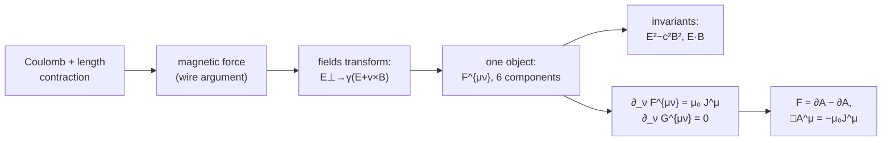
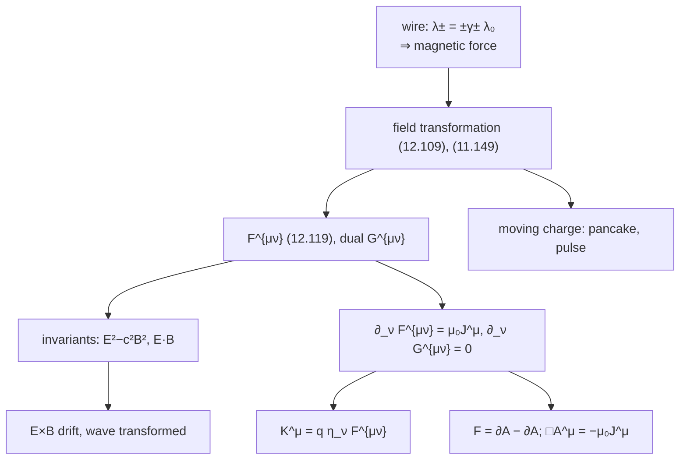

# ED11 · Relativistic Electrodynamics

◀ [[ED10 Dipole Radiation]] · [[Electrodynamics - Course Map]]

in course overview extra · book extra · beyond

> [!warning] Source status (every citation below was read in this session)
> Overview item *"relativistic electrodynamics"* (PH3114 outline; no lecture notes in the folder). **Griffiths and Jackson carry equal weight.**
>
> **Read directly:** Griffiths §12.3 in full (§12.3.1 magnetism as a relativistic phenomenon, §12.3.2 how the fields transform with Examples 12.14-12.15, §12.3.3 the field tensor, §12.3.4 electrodynamics in tensor notation, §12.3.5 relativistic potentials, and Problems 12.42-12.58 as stated), printed pp. 550-570 (pdf = printed + 19); and from §12.1-12.2 only the Lorentz transformations (12.10)-(12.19) (§12.1.3), the four-vector definitions (12.21)-(12.33) (§12.1.4(i)), and the lines defining proper time, proper velocity and the 4-velocity (12.37)-(12.44) and the Minkowski force (12.68)-(12.69) (§12.2.1, §12.2.4). Jackson §11.9 (invariance of charge, covariance of electrodynamics) and §11.10 (transformation of fields, the field of a uniformly moving charge) in full, printed pp. 553-561 (pdf = printed + 26), with the problems 11.13-11.14 as stated, and the first page of §11.11. **Units:** Griffiths is SI; **Jackson Ch. 11 is Gaussian** (running header "-G", confirmed; this also settles the open question in the Course Map units note: Ch. 11 and Ch. 12 are Gaussian). Jackson's metric is $(+,-,-,-)$ and Griffiths' is $(-,+,+,+)$; the chapter says which one each formula uses.
>
> **Not cited because not read:** the rest of Griffiths §12.1-12.2 (simultaneity, contraction, velocity addition, relativistic energy-momentum, kinematics, dynamics), Jackson §11.1-11.8 (the Thomas precession included) and §11.11-11.12, Jackson Ch. 12 (Lagrangian formulation, covariant conservation laws; used in CMX2). The numbers in this chapter's worked examples are checked in `scripts/ed11_numbers.py`; I mark them 🔵.

> [!syllabus] Syllabus map
> 🟢 **In course overview**: §2 the four-vector toolkit as used here, §4 transformation of $\mathbf E$ and $\mathbf B$, §5 the field tensor, §6 Maxwell's equations and the Lorentz force in tensor form, §7 the four-potential and gauge.
>
> 🟡 **Extra · book**: §3 magnetism from electrostatics and length contraction (Griffiths' wire argument), §4.3 the field of a uniformly moving charge and its equivalence to a light pulse (Griffiths Examples 12.14-12.15, Jackson (11.152)-(11.154)), the experimental invariance of charge (Jackson §11.9).
>
> 🔵 **Extra · beyond (mine)**: invariants as numbers, the plane-wave transformation, the $\mathbf E\times\mathbf B$ drift as a boost, agreement of the boosted Coulomb field with the retarded Liénard-Wiechert field of ED09 to $4\times10^{-16}$, `scripts/ed11_numbers.py`, `scripts/fig_ed11.py`, an interactive tool.

> [!key] After this chapter you can
> - show that a neutral current-carrying wire is **charged** in the rest frame of a moving test charge, and recover $\mathbf F=q\mathbf u\times\mathbf B$ from Coulomb's law plus Lorentz contraction,
> - transform $\mathbf E$ and $\mathbf B$ between frames: $\bar E_y=\gamma(E_y-vB_z)$, $\bar B_z=\gamma(B_z-vE_y/c^2)$, parallel components unchanged,
> - write the **field tensor** $F^{\mu\nu}$ and its dual, name the two invariants $E^2-c^2B^2$ and $\mathbf E\cdot\mathbf B$ and use them to decide which frames exist,
> - derive the field of a uniformly moving charge by boosting the Coulomb field and explain the "pancake" and the pulse seen by a fixed observer,
> - write Maxwell's equations as $\partial_\nu F^{\mu\nu}=\mu_0J^\mu$ and $\partial_\nu G^{\mu\nu}=0$, the Lorentz force as $K^\mu=q\eta_\nu F^{\mu\nu}$, and the potentials as $\square A^\mu=-\mu_0J^\mu$ in Lorenz gauge.

> [!intuition] The one-sentence story
> Electric and magnetic fields are not two things but two faces of one six-component object, the antisymmetric tensor $F^{\mu\nu}$; what you call $\mathbf E$ and $\mathbf B$ depends on your velocity, and Maxwell's equations, unlike Newton's, needed no change when Einstein arrived: the tensor notation merely makes their covariance visible, and the current-carrying wire shows that magnetism is what electrostatics looks like to a moving observer.

## 1. Electrodynamics was already relativistic (Griffiths §12.3.1, Jackson §11.9)
taught

Griffiths opens §12.3 with the point that **classical electrodynamics is already consistent with special relativity**: Maxwell's equations and the Lorentz force law apply legitimately in any inertial frame, "what one observer interprets as an electrical process another may regard as magnetic, but the actual particle motions they predict will be identical"; the failure of Lorentz and others in the late nineteenth century "lay with the nonrelativistic mechanics they used, not with the electrodynamics". We do **not** change the rules, only the notation, so that their relativistic character is exposed.

Jackson (§11.9) states the same as **covariance**: the invariance in form of the Maxwell and Lorentz force equations under Lorentz transformations "was shown by Lorentz and Poincaré before the formulation of the special theory" and implies that $\rho,\mathbf J,\mathbf E,\mathbf B$ transform in well-defined ways. His argument runs backwards from the Lorentz force: written with the proper time $\tau$, the force law and the energy-change law are (11.125)-(11.126)

$$\frac{d\mathbf p}{d\tau}=\frac qc(U^0\mathbf E+\mathbf U\times\mathbf B),\qquad\frac{dp^0}{d\tau}=\frac qc\,\mathbf U\cdot\mathbf E,$$

the left sides are components of a 4-vector $dp^\alpha/d\tau$, so if the right sides are to be too and if $q$ and $U^\alpha$ are known to transform as an invariant and a 4-vector, then **the fields must be the components of a second-rank tensor**: $\mathbf E\cdot\mathbf U=F^{0\beta}U_\beta$.

**Charge is invariant.** Both books assume it; Jackson quotes the evidence: the magnitudes of the charges of elementary particles are integer multiples of the proton charge, the fractional difference between the electron and proton charges is below $10^{-19}$ (King's unpublished results push it further), King found no net charge per molecule of H$_2$ or He above $10^{-19}e$ (the electrons in He move twice as fast as those in H$_2$), and Fraser, Carlson and Hughes found no deflection of neutral Cs and K beams, limiting the fractional difference to $3.5\times10^{-19}$ (the K-shell electrons of Cs move at about $0.4c$). Hence "the charge of the electron cannot depend significantly on its speed". **Charge density** is not invariant: charge is invariant but volume contracts. Jackson's proof that $(c\rho,\mathbf J)$ is a 4-vector: $\rho'd^3x'=\rho\,d^3x$ for charge at rest in a small volume, and $d^4x=dx^0d^3x$ is invariant, so $c\rho$ transforms like $x^0$ (11.128).

## 2. The four-vector toolkit used here (Griffiths §12.1.3-12.1.4, §12.2; Jackson §11.9)
taught

Griffiths' Lorentz transformations for $\bar S$ moving at $v$ along $x$ (12.18), with $\gamma=1/\sqrt{1-v^2/c^2}$:

$$\bar x=\gamma(x-vt),\quad\bar y=y,\quad\bar z=z,\quad\bar t=\gamma\left(t-\frac v{c^2}x\right),$$

and in the notation $x^0=ct$, $\beta=v/c$, $x^1,x^2,x^3=x,y,z$ (12.21)-(12.25) $\bar x^\mu=\Lambda^\mu{}_\nu x^\nu$ with $\Lambda$ the matrix with $\gamma$ on the diagonal of the $(0,1)$ block, $-\gamma\beta$ off the diagonal, and 1 on the other diagonal entries (12.24). A **4-vector** transforms like $x^\mu$ (12.26); the invariant product is $a^\mu b_\mu=-a^0b^0+a^1b^1+a^2b^2+a^3b^3$ (12.28)-(12.33) with the Minkowski metric $g_{\mu\nu}={\rm diag}(-1,1,1,1)$ (12.31) lowering indices. The **proper time** (12.37) $d\tau=\sqrt{1-u^2/c^2}\,dt$ is invariant; the **proper velocity** $\eta=d\mathbf l/d\tau=\mathbf u/\sqrt{1-u^2/c^2}$ (12.40) and the 4-velocity $\eta^\mu=dx^\mu/d\tau$ (12.41), $\eta^0=c/\sqrt{1-u^2/c^2}=\gamma c$ (12.42); the **Minkowski force** $K^\mu\equiv dp^\mu/d\tau$ (12.68) is a 4-vector whose spatial part is $\mathbf K=\mathbf F/\sqrt{1-u^2/c^2}$ (12.69), and Griffiths concludes that the Lorentz force is an "ordinary" force $\mathbf F$ (derived in §6 below).

Two conventions, one physics (the signs matter when you switch books):

| | Griffiths (SI) | Jackson (Gaussian) |
|---|---|---|
| metric | $(-,+,+,+)$ (12.31) | $(+,-,-,-)$: $\partial^\alpha=(\partial/\partial x^0,-\nabla)$ (read on p. 556) |
| 4-current | $J^\mu=(c\rho,\mathbf J)$ (12.124) | $J^\alpha=(c\rho,\mathbf J)$ (11.128) |
| 4-potential | $A^\mu=(V/c,\mathbf A)$ (12.132) | $A^\alpha=(\Phi,\mathbf A)$ (11.132) |
| field tensor | $F^{01}=E_x/c$, $F^{12}=B_z$ (12.119) | $F^{\alpha\beta}=\partial^\alpha A^\beta-\partial^\beta A^\alpha$ so $F^{01}=-E_x$, $F^{23}=-B_x$ (from 11.135) |
| field transformation | $\bar E_y=\gamma(E_y-vB_z)$ (12.103) | $E_2'=\gamma(E_2-\beta B_3)$ (11.148) |
| force | $\mathbf F=q(\mathbf E+\mathbf u\times\mathbf B)$ | $q(\mathbf E+\mathbf v\times\mathbf B/c)$ (11.124) |

Dictionary SI to Gaussian for these linear transformations: $\mathbf E_{\rm G}\leftrightarrow\mathbf E$, $\mathbf B_{\rm G}\leftrightarrow c\mathbf B$ (so that $vB_z\to\beta B_3$), the overall constants relating the two unit systems are common to all fields and drop out of linear laws; for the *source* equations the full dictionary is in Jackson's Appendix on units, which I did not read, so ED11 quotes the source equations in each book's own units (Griffiths: $\mu_0J^\mu$; Jackson: $4\pi J^\beta/c$) and does not convert them.

## 3. Magnetism as a relativistic phenomenon (Griffiths §12.3.1)
extra · book

Griffiths (after Purcell) shows that **electrostatics plus relativity implies magnetism**. In frame $S$ a positive line charge $+\lambda$ moves right at $v$ and superposed on it a negative line $-\lambda$ moves left at $v$: net current $I=2\lambda v$ (12.76), net charge zero. A charge $q$ moves right at $u<v$ at distance $s$; in $S$ there is no electric force (the lines cancel). In the frame $\bar S$ moving with $q$ (so $q$ is at rest) the velocities of the two lines are (12.77)

$$v_\pm=\frac{v\mp u}{1\mp vu/c^2}.$$

Since $v_->v_+$ the negative spacing is contracted **more**, so the wire carries a **net negative charge** in $\bar S$: $\lambda_\pm=\pm\gamma_\pm\lambda_0$ (12.78)-(12.79) with $\lambda_0$ the rest density of the positive line and $\lambda=\gamma\lambda_0$ (12.80). With $\gamma_\pm=\gamma\,\dfrac{1\mp uv/c^2}{\sqrt{1-u^2/c^2}}$ (12.82), the net line charge is (12.83)

$$\lambda_{\rm tot}=\lambda_0(\gamma_+-\gamma_-)=-\frac{2\lambda uv}{c^2\sqrt{1-u^2/c^2}}.$$

A neutral current-carrying wire is **charged** in another inertial system. The field $E=\lambda_{\rm tot}/2\pi\epsilon_0s$ gives the force on $q$ in $\bar S$ (12.84), $\bar F=-\dfrac{\lambda v}{\pi\epsilon_0c^2s}\dfrac{qu}{\sqrt{1-u^2/c^2}}$. Since $\bar F$ is perpendicular to $u$ and $q$ is at rest in $\bar S$, the force in $S$ is $F=\sqrt{1-u^2/c^2}\,\bar F$ (12.85) (Griffiths' force transformation (12.67)), so with $c^2=1/\epsilon_0\mu_0$ and $\lambda v=I/2$ (12.86)

$$F=-qu\left(\frac{\mu_0I}{2\pi s}\right),$$

"precisely what we would have obtained by using the Lorentz force law in system $S$": a force that is purely electrical in $\bar S$ (charged wire, $q$ at rest) is "distinctly nonelectrical" in $S$ (neutral wire).

> [!example] Worked example 1: the wire argument in numbers (🔵)
> $\lambda=2\ \mu$C/m (the density of the positive line in $S$), $v=0.6c$, $u=0.3c$, $s=5$ cm, $q=1$ nC. Velocity addition (12.77): $v_+=0.36585\,c$ and $v_-=0.76271\,c$; the script computes $\gamma_\pm$ from these velocities and confirms $\gamma_\pm=\gamma_v\gamma_u(1\mp uv/c^2)=1.0745,\ 1.5462$ to nine digits (`ed11_numbers.py` §1). Then $\lambda_{\rm tot}=-7.547651\times10^{-7}$ C/m both from $\lambda_0(\gamma_+-\gamma_-)$ and from the closed form (12.83); the force $\sqrt{1-u^2/c^2}\,\bar F=-2.588415\times10^{-4}$ N equals $-quI\mu_0/2\pi s$ with $I=2\lambda v$, ratio $1.000000000000$. The sign is attractive (toward the wire): parallel currents attract, and $q$ moving along $I$ is a parallel current.

## 4. How the fields transform (Griffiths §12.3.2, Jackson §11.10)
taught

### 4.1 Derivation from capacitors and a solenoid (Griffiths)
Griffiths assumes (a) charge is invariant and (b) the transformation rules are the same however the fields were produced. A parallel-plate capacitor at rest in $S_0$ with surface charges $\pm\sigma_0$ has $\mathbf E_0=\dfrac{\sigma_0}{\epsilon_0}\hat{\mathbf y}$ (12.87). In $S$ moving at $v_0$ along $x$ the plates are Lorentz-contracted along $x$ so $\sigma=\gamma_0\sigma_0$ (12.89)-(12.90), hence $E^\perp=\gamma_0E_0^\perp$ (12.91); with the plates in the $yz$ plane the plate separation contracts but $\sigma$ does not, so $E^\parallel=E_0^\parallel$ (12.92). Starting from a frame with both fields (a capacitor in the $xz$ plane: $E_y=\sigma/\epsilon_0$ and, from the surface currents $K_\pm=\mp\sigma v_0\hat{\mathbf x}$, $B_z=-\mu_0\sigma v_0$ (12.94)-(12.96)), a third frame $\bar S$ with $\bar\sigma=\bar\gamma\sigma_0$ gives, after $\bar\gamma/\gamma_0=\gamma(1+vv_0/c^2)$ (12.101), (12.103)

$$\bar E_y=\gamma(E_y-vB_z),\qquad\bar B_z=\gamma\left(B_z-\frac v{c^2}E_y\right);$$

a capacitor in the $xy$ plane gives (12.104) $\bar E_z=\gamma(E_z+vB_y)$, $\bar B_y=\gamma(B_y+\frac v{c^2}E_z)$; $\bar E_x=E_x$ (12.105); and a **solenoid** along $x$ ($B_x=\mu_0nI$, $\bar n=\gamma n$, $\bar I=I/\gamma$ because of time dilation) gives $\bar B_x=B_x$ (12.106)-(12.108). The complete set (12.109), in Griffiths' SI form for a frame $\bar S$ moving at $v\hat{\mathbf x}$:

$$\boxed{\begin{aligned}\bar E_x&=E_x,&\bar E_y&=\gamma(E_y-vB_z),&\bar E_z&=\gamma(E_z+vB_y),\\\bar B_x&=B_x,&\bar B_y&=\gamma\left(B_y+\tfrac v{c^2}E_z\right),&\bar B_z&=\gamma\left(B_z-\tfrac v{c^2}E_y\right).\end{aligned}}$$

**Special cases (Griffiths).** If $\mathbf B=0$ in $S$ then $\bar{\mathbf B}=-\dfrac1{c^2}\mathbf v\times\bar{\mathbf E}$ (12.110); if $\mathbf E=0$ in $S$ then $\bar{\mathbf E}=\mathbf v\times\bar{\mathbf B}$ (12.111).

### 4.2 Jackson's form
Jackson gets the same result from the tensor character: $F'^{\alpha\beta}=\dfrac{\partial x'^\alpha}{\partial x^\gamma}\dfrac{\partial x'^\beta}{\partial x^\delta}F^{\gamma\delta}$ (11.146), $F'=\tilde AFA$ (11.147), so for a boost along $x^1$ (11.148)

$$E_1'=E_1,\ E_2'=\gamma(E_2-\beta B_3),\ E_3'=\gamma(E_3+\beta B_2),\qquad B_1'=B_1,\ B_2'=\gamma(B_2+\beta E_3),\ B_3'=\gamma(B_3-\beta E_2),$$

and for a boost with arbitrary velocity $\mathbf v=c\boldsymbol\beta$ (11.149)

$$\mathbf E'=\gamma(\mathbf E+\boldsymbol\beta\times\mathbf B)-\frac{\gamma^2}{\gamma+1}\boldsymbol\beta(\boldsymbol\beta\cdot\mathbf E),\qquad\mathbf B'=\gamma(\mathbf B-\boldsymbol\beta\times\mathbf E)-\frac{\gamma^2}{\gamma+1}\boldsymbol\beta(\boldsymbol\beta\cdot\mathbf B).$$

Jackson's comment: "$\mathbf E$ and $\mathbf B$ have no independent existence. A purely electric or magnetic field in one coordinate system will appear as a mixture … one should properly speak of the electromagnetic field $F^{\alpha\beta}$ rather than $\mathbf E$ or $\mathbf B$ separately", with restrictions (his Problem 11.14) such that, for example, an electrostatic field cannot be transformed into a purely magnetostatic one. If $\mathbf B'=0$ in $K'$, the inverse of (11.149) gives (11.150) $\mathbf B=\boldsymbol\beta\times\mathbf E$ in $K$ (compare Griffiths (12.110), where the roles of the two frames are interchanged, which accounts for the sign).

> [!example] Worked example 2: tensor law against both books' formulas (🔵)
> Random $\mathbf E,\mathbf B$ (of order $10^5$ V/m and $0.3$ T). (i) Transforming the matrix $F^{\mu\nu}$ of (12.119) with $\Lambda$ along $x$ at $0.55c$ reproduces (12.109) to $3\times10^{-14}$ (relative) in $\mathbf E$ and exactly in $\mathbf B$. (ii) For an arbitrary boost $\mathbf v=(0.2,-0.3,0.4)c$, $F'=\Lambda F\Lambda^{T}$ reproduces Jackson's (11.149) (in its SI form, $\boldsymbol\beta\times\mathbf B\to\mathbf v\times\mathbf B$ and $\boldsymbol\beta\times\mathbf E\to\mathbf v\times\mathbf E/c^2$) to $5\times10^{-14}$ and $4\times10^{-16}$ (`ed11_numbers.py` §2). Griffiths' four-line table and Jackson's closed vector formula are the same law.

## 5. The field of a uniformly moving charge (Griffiths Examples 12.14-12.15, Jackson §11.10)
extra · book

**Griffiths.** Boost the Coulomb field of a charge at rest at the origin of $S_0$ to $S$ moving at $v_0$ along $x$: $E_x=E_{x0}$, $E_y=\gamma_0E_{y0}$, $E_z=\gamma_0E_{z0}$, and substituting the inverse Lorentz transformation $x_0=\gamma_0(x+v_0t)=\gamma_0\mathcal R_x$, $y_0=\mathcal R_y$, $z_0=\mathcal R_z$ in terms of the vector $\boldsymbol{\mathcal R}$ from the charge's **present** position, with $\theta$ the angle between $\boldsymbol{\mathcal R}$ and the motion, (12.93)

$$\mathbf E=\frac1{4\pi\epsilon_0}\frac{q(1-v_0^2/c^2)}{[1-(v_0^2/c^2)\sin^2\theta]^{3/2}}\frac{\hat{\boldsymbol{\mathcal R}}}{\mathcal R^2},$$

the Chapter 10 result (10.75) derived "far more efficiently"; the balancing of the two $\gamma_0$'s (from the coordinate transformation of $E_x$ and the field transformation of $E_y,E_z$) leaves $\mathbf E$ **parallel to $\boldsymbol{\mathcal R}$**, which explains why it points from the instantaneous, not the retarded, position. In the particle's rest frame $\mathbf B=0$, so in the frame where it moves with velocity $\mathbf v$ (Example 12.15) $\mathbf B=\dfrac1{c^2}\mathbf v\times\mathbf E$ (12.112 is the explicit form), which for $v\ll c$ reduces to the Biot-Savart law for a point charge.

**Jackson.** An observer at $P$ at impact parameter $b$ sees the charge pass with $K'$ the charge's rest frame; the fields in $K$ are (11.152)

$$E_1=-\frac{q\gamma vt}{(b^2+\gamma^2v^2t^2)^{3/2}},\quad E_2=\frac{\gamma qb}{(b^2+\gamma^2v^2t^2)^{3/2}},\quad B_3=\beta E_2,$$

and the discussion draws out three facts. (i) The peak transverse field is $\gamma$ times its nonrelativistic value $q/b^2$, but the time over which it is appreciable is $\Delta t\sim b/\gamma v$ (11.153): "the time integral of the fields times $v$ is independent of velocity". (ii) For $\beta\to1$ the transverse $\mathbf E$ and $\mathbf B$ are nearly equal and perpendicular, "indistinguishable from the fields of a pulse of plane polarized radiation propagating in the $x_1$ direction" (the longitudinal $E_1$ changes sign and has zero time integral; the equivalence is exploited in Jackson's Chapter 15). (iii) In terms of the present position the field is radial with strength (11.154) $E=\dfrac{q\mathbf r}{r^3\gamma^2(1-\beta^2\sin^2\psi)^{3/2}}$: down by $\gamma^{-2}$ along the motion ($\psi=0,\pi$) and larger by $\gamma$ across it ($\psi=\pi/2$), the "whiskbroom" pattern of lines of force (Fig. 11.9b), "a consequence of the FitzGerald-Lorentz contraction".

> [!example] Worked example 3: four ways to the same field (🔵)
> A charge $q=1$ nC with $\beta=0.8$ ($\gamma=5/3$) and an observer at $(0,b,0)$, $b=0.30$ m at $t=0.17$ ns after the closest approach. (A) Griffiths (12.93) with $\boldsymbol{\mathcal R}$ from the present position; (B) Jackson (11.152) (times $1/4\pi\epsilon_0$ for SI); (C) the tensor-boosted rest-frame Coulomb field; (D) the retarded Liénard-Wiechert velocity field of ED09, (10.72) with $\mathbf a=0$, with the retarded time solved to machine precision. All four give $\mathbf E=(-20.984172,\ 154.402201,\ 0)$ V/m with maximum relative disagreements $3.7\times10^{-16}$, $1.8\times10^{-16}$, $3.7\times10^{-16}$ (`ed11_numbers.py` §4). The magnetic field $B_z=(\mathbf v\times\mathbf E)_z/c^2=4.120242\times10^{-7}$ T equals $\beta E_2/c$. At $\beta=0.8$ the ratios are $E_\parallel/E_{\rm C}=1/\gamma^2=0.36$ and $E_\perp/E_{\rm C}=\gamma=1.6667$. Jackson's invariance claim: $b\,v\int E_2\,dt/q=2.000000000$ for $\beta=0.1,0.5,0.9,0.99,0.999$ ($\gamma$ up to 22.4), while the duration $b/\gamma v$ falls from $9.96\times10^{-9}$ s to $4.5\times10^{-11}$ s (for $b=0.3$ m).

## 6. The field tensor, its dual and the invariants (Griffiths §12.3.3, Jackson §11.9)
taught

$\mathbf E$ and $\mathbf B$ "do not transform like the spatial parts of two 4-vectors": the components are stirred together. Griffiths: an object with six components that transforms by (12.109) is an **antisymmetric second-rank tensor**, transforming as $\bar t^{\mu\nu}=\Lambda^\mu{}_\lambda\Lambda^\nu{}_\sigma t^{\lambda\sigma}$ (12.115); an antisymmetric tensor has 6 independent components (diagonal zero, $t^{\mu\nu}=-t^{\nu\mu}$, (12.117)) and working out the six transformation rules (12.118) for a boost along $x$, $\bar t^{01}=t^{01}$, $\bar t^{23}=t^{23}$, $\bar t^{02}=\gamma(t^{02}-\beta t^{12})$, $\bar t^{03}=\gamma(t^{03}+\beta t^{31})$, $\bar t^{31}=\gamma(t^{31}+\beta t^{03})$, $\bar t^{12}=\gamma(t^{12}-\beta t^{02})$, and comparing with (12.109) one **constructs the field tensor** (12.119)

$$F^{\mu\nu}=\begin{pmatrix}0&E_x/c&E_y/c&E_z/c\\-E_x/c&0&B_z&-B_y\\-E_y/c&-B_z&0&B_x\\-E_z/c&B_y&-B_x&0\end{pmatrix},\quad F^{01}=\frac{E_x}c,\ F^{12}=B_z,\ F^{31}=B_y,\ F^{23}=B_x.$$

("Thus relativity completes and perfects the job begun by Oersted.") Comparing the first line of (12.109) with the second line of (12.118) and vice versa gives the **dual tensor** (12.120), obtained by the substitution $\mathbf E/c\to\mathbf B$, $\mathbf B\to-\mathbf E/c$ (which leaves (12.109) unchanged),

$$G^{\mu\nu}=\begin{pmatrix}0&B_x&B_y&B_z\\-B_x&0&-E_z/c&E_y/c\\-B_y&E_z/c&0&-E_x/c\\-B_z&-E_y/c&E_x/c&0\end{pmatrix}.$$

Griffiths adds that other authors use $F^{01}=E_x$, $F^{12}=cB_z$ or opposite signs ("most of the equations from here on will look a little different, depending on the text"). **Jackson** builds the tensor from the potentials, $F^{\alpha\beta}=\partial^\alpha A^\beta-\partial^\beta A^\alpha$ (the explicit components via (11.135): $E_x=-(\partial^0A^1-\partial^1A^0)$, $B_x=-(\partial^2A^3-\partial^3A^2)$), defines the totally antisymmetric $\epsilon^{\alpha\beta\gamma\delta}$ (11.139), a **pseudotensor** under space inversion (he shows it by contracting with four 4-vectors), and the dual field-strength tensor $\mathscr F^{\alpha\beta}$ (11.140; the defining formula is garbled in my copy of the text, but the text states that it is obtained from $F^{\alpha\beta}$ by $\mathbf E\to\mathbf B$, $\mathbf B\to-\mathbf E$ in (11.137), "a special case of the duality transformation (6.151)").

**Invariants.** Griffiths asks for $\mathbf E\cdot\mathbf B$ and $E^2-c^2B^2$ (Problem 12.47) and the contractions $F^{\mu\nu}F_{\mu\nu}$, $G^{\mu\nu}G_{\mu\nu}$, $F^{\mu\nu}G_{\mu\nu}$ (Problem 12.51); Jackson Problem 11.14 asks the same with "are there any other invariants quadratic in the field strengths?". Lowering indices flips the sign of each $F^{0i}$ (one zero index) and keeps $F^{ij}$ (§2), so, summing the 16 terms (derived here)

$$\boxed{F^{\mu\nu}F_{\mu\nu}=2\left(B^2-\frac{E^2}{c^2}\right),\qquad G^{\mu\nu}G_{\mu\nu}=-2\left(B^2-\frac{E^2}{c^2}\right),\qquad F^{\mu\nu}G_{\mu\nu}=-\frac4c\,\mathbf E\cdot\mathbf B}.$$

There are **exactly two independent invariants**, $E^2-c^2B^2$ and $\mathbf E\cdot\mathbf B$ (the third contraction is minus the first; any quadratic scalar is a combination). Consequences: (a) if $\mathbf E\perp\mathbf B$ in one frame it is so in all; (b) if $E>cB$ with $\mathbf E\cdot\mathbf B=0$ there is a frame where the field is **purely electric**; if $E<cB$ with $\mathbf E\cdot\mathbf B=0$ a frame where it is **purely magnetic**; (c) a purely electric field in one frame can never be purely magnetic in another, since the sign of $E^2-c^2B^2$ would change (Jackson Problem 11.14(b)); (d) a plane wave has both invariants zero in every frame.

> [!example] Worked example 4: both invariants as numbers (🔵)
> For random $\mathbf E,\mathbf B$ of order $10^5$ V/m and $0.3$ T, before and after a boost with $\mathbf v=(0.2,-0.3,0.4)c$ (`ed11_numbers.py` §3): $F^{\mu\nu}F_{\mu\nu}=0.1129192$ in both frames and equals $2(B^2-E^2/c^2)$; $G^{\mu\nu}G_{\mu\nu}=-0.1129192$; $F^{\mu\nu}G_{\mu\nu}=4.277001\times10^{-4}=-4\,\mathbf E\cdot\mathbf B/c$ in both frames, with $\mathbf E\cdot\mathbf B=-3.2055\times10^4$ and $E^2-c^2B^2=-5.0743\times10^{15}$ (V/m)$^2$, again unchanged by the boost.

> [!example] Worked example 5: the $\mathbf E\times\mathbf B$ drift is a boost (🔵 beyond)
> In a frame with $\mathbf E\perp\mathbf B$ and $E<cB$ there is a frame where **$\mathbf E'=0$**: boost along $\mathbf E\times\mathbf B$ with $\mathbf v=\mathbf E\times\mathbf B/B^2$ (then $\mathbf v\perp\mathbf E,\mathbf B$, the last terms of (11.149) vanish and $\mathbf E'=\gamma(\mathbf E+\mathbf v\times\mathbf B)=0$; this is Griffiths' special case $\bar{\mathbf E}=\mathbf v\times\bar{\mathbf B}$ read backwards). There $\mathbf B'$ has magnitude $\sqrt{B^2-E^2/c^2}$ (invariant), and a charge just gyrates, so in the original frame its guiding centre drifts at $\mathbf E\times\mathbf B/B^2$ whatever its charge or mass. For $E=10^5$ V/m, $B=1$ T: $v=10^5$ m/s ($\beta=3.3\times10^{-4}$), $E'=0$ to machine precision, $|B'|=0.999999944$ T $=\sqrt{B^2-E^2/c^2}$. Integrating the Lorentz force for a proton from rest, the displacement after 50 gyro-periods divided by the time is $(100000.0,0,0)$ m/s, equal to $\mathbf E\times\mathbf B/B^2$ (`ed11_numbers.py` §6).

> [!example] Worked example 6: a plane wave seen from a moving frame (🔵; Griffiths Problem 12.48 asks it, derived here)
> A wave travelling along $+x$, $E_y=E_0\cos(kx-\omega t)$, $B_z=E_y/c$, observed from a frame moving at $v$ along $x$: $\bar E_y=\gamma(E_y-vB_z)=\gamma(1-\beta)E_y=\sqrt{\dfrac{1-\beta}{1+\beta}}E_y$, and likewise $c\bar B_z=\bar E_y$, so the wave is still a plane wave with $\bar E=c\bar B$; its frequency is $\bar\omega=\omega\sqrt{(1-\beta)/(1+\beta)}$ (the longitudinal Doppler shift), the intensity (amplitude squared) is reduced by the factor $(1-\beta)/(1+\beta)$. Numbers (`ed11_numbers.py` §5): $\beta=0.1,0.5,0.9,0.99$ give amplitude ratio $0.904534,\ 0.577350,\ 0.229416,\ 0.070888$, intensity ratio $0.818182,\ 0.333333,\ 0.052632,\ 0.005025$, and $E/cB=1.000000$ throughout. As $\beta\to1$ the amplitude, frequency and intensity all go to zero: the answer to Einstein's youthful question about running beside a light wave is that you would see no oscillation at all, not a frozen static field, consistent with both invariants vanishing identically.

## 7. Electrodynamics in tensor notation (Griffiths §12.3.4, Jackson §11.9)
taught

**Sources.** A cloud of charge $Q$ with rest volume $V_0$ and proper density $\rho_0=Q/V_0$ moving at $\mathbf u$ has $V=\sqrt{1-u^2/c^2}\,V_0$ (12.121), so $\rho=\rho_0/\sqrt{1-u^2/c^2}$, $\mathbf J=\rho\mathbf u=\rho_0\mathbf u/\sqrt{1-u^2/c^2}$ (12.122): $\rho_0$ times the proper velocity. Hence (12.123)-(12.124)

$$J^\mu=\rho_0\eta^\mu=(c\rho,J_x,J_y,J_z),$$

"the current density 4-vector" (Jackson's (11.128), reached by the invariance of $\rho'd^3x'=\rho\,d^3x$ and of $d^4x$). The **continuity equation** is the vanishing four-divergence (12.126)

$$\frac{\partial J^\mu}{\partial x^\mu}=0\qquad\Big(\text{Jackson (11.129): }\partial_\alpha J^\alpha=0\Big).$$

**Maxwell's equations.** Griffiths (12.127):

$$\boxed{\frac{\partial F^{\mu\nu}}{\partial x^\nu}=\mu_0J^\mu,\qquad\frac{\partial G^{\mu\nu}}{\partial x^\nu}=0}$$

each standing for four equations. The checks are in the book: $\mu=0$ of the first gives $\frac1c\nabla\cdot\mathbf E=\mu_0c\rho$, i.e. Gauss's law $\nabla\cdot\mathbf E=\rho/\epsilon_0$; $\mu=1$ gives $-\frac1{c^2}\partial_tE_x+(\nabla\times\mathbf B)_x=\mu_0J_x$, i.e. Ampère-Maxwell $\nabla\times\mathbf B=\mu_0\mathbf J+\mu_0\epsilon_0\partial_t\mathbf E$; the second with $\mu=0$ gives $\nabla\cdot\mathbf B=0$ and with $\mu=1$ the $x$ component of Faraday's law $\nabla\times\mathbf E=-\partial_t\mathbf B$. "Maxwell's four rather cumbersome equations reduce to two delightfully simple ones". Equivalent forms: $\partial F_{\mu\nu}/\partial x^\lambda+\partial F_{\nu\lambda}/\partial x^\mu+\partial F_{\lambda\mu}/\partial x^\nu=0$ (12.130, Griffiths Problem 12.54; Jackson (11.143) says the same four equations hold in terms of $F^{\alpha\beta}$ with any three indices $\alpha,\beta,\gamma$). In **Jackson's** Gaussian form the inhomogeneous equation is $\partial_\alpha F^{\alpha\beta}=\frac{4\pi}cJ^\beta$ (11.141; the equation itself is garbled in the text layer I read, its macroscopic version (11.145) reads $\partial_\alpha G^{\alpha\beta}=\frac{4\pi}cJ^\beta$ with $G^{\alpha\beta}=(\mathbf D,\mathbf H)$ and $F^{\alpha\beta}=(\mathbf E,\mathbf B)$, and "polarization $\mathbf P$ and negative magnetization $-\mathbf M$ form a similar second-rank tensor", the basis of Minkowski's electrodynamics of moving media) and the homogeneous ones are written with the dual tensor (11.142; garbled in my copy, but it is the statement that the four-divergence of $\mathscr F^{\alpha\beta}$ vanishes). The charge conservation law is automatic: $\partial_\mu\partial_\nu F^{\mu\nu}=0$ because $F$ is antisymmetric and the derivatives commute (Griffiths Problem 12.53, derived here: $\partial_\mu J^\mu=\mu_0^{-1}\partial_\mu\partial_\nu F^{\mu\nu}=0$).

**The Lorentz force.** With the proper velocity, the Minkowski force on a charge $q$ is (12.128)

$$K^\mu=q\,\eta_\nu F^{\mu\nu}\qquad\Longrightarrow\qquad\mathbf K=\frac q{\sqrt{1-u^2/c^2}}[\mathbf E+\mathbf u\times\mathbf B]\ \ (12.129),$$

and comparing with $\mathbf K=\mathbf F/\sqrt{1-u^2/c^2}$ (12.69) gives $\mathbf F=q(\mathbf E+\mathbf u\times\mathbf B)$: the Lorentz force law is an ordinary force, unchanged in form. Griffiths explicitly works $K^1$ and leaves the zeroth component to Problem 12.55; Jackson's version is $dp^\alpha/d\tau=m\,dU^\alpha/d\tau=\frac qc F^{\alpha\beta}U_\beta$ (11.144), which contains both (11.125) and (11.126). The zeroth component, derived here: $K^0=q\eta_\nu F^{0\nu}=q\gamma\,\mathbf E\cdot\mathbf u/c$; with $p^0=E_{\rm kin+rest}/c$ this reads $dE/dt=q\,\mathbf E\cdot\mathbf u$: **the rate of work done on the particle**, the magnetic field doing none.

> [!example] Worked example 7: checking $K^\mu=q\eta_\nu F^{\mu\nu}$ numerically (🔵)
> Random $\mathbf E,\mathbf B$ and a velocity of $0.4c$-scale: building $F^{\mu\nu}$ from (12.119), lowering $\eta^\mu=\gamma(c,\mathbf u)$ with the metric and forming $q\eta_\nu F^{\mu\nu}$ reproduces $\gamma q(\mathbf E\cdot\mathbf u/c,\ \mathbf E+\mathbf u\times\mathbf B)$ to $7\times10^{-17}$ relative; $\eta^\mu\eta_\mu=-c^2$ exactly (`ed11_numbers.py` §7). A symbolic computation (§8, sympy, generic functions of $x^0,\dots,x^3$) confirms the tensor identities of the next section: $F^{01}=E_x/c$, $F^{31}=B_y$, the cyclic identity $\partial_\lambda F_{\mu\nu}+\partial_\mu F_{\nu\lambda}+\partial_\nu F_{\lambda\mu}=0$ **identically** (the homogeneous equations are automatic when $F=\partial A-\partial A$), and $\partial_\nu F^{1\nu}=\partial^1(\partial_\mu A^\mu)-\square A^1$.

## 8. Relativistic potentials (Griffiths §12.3.5, Jackson §11.9)
taught

The scalar and vector potentials form a 4-vector (Griffiths (12.132), Jackson (11.132), required by the covariance of the wave equations (11.130)):

$$A^\mu=\left(\frac Vc,\ \mathbf A\right)\ \ \text{(Griffiths)},\qquad A^\alpha=(\Phi,\mathbf A)\ \ \text{(Jackson)}.$$

The field tensor is the four-dimensional curl (Griffiths (12.133); Jackson via (11.134)-(11.136))

$$F^{\mu\nu}=\frac{\partial A^\nu}{\partial x_\mu}-\frac{\partial A^\mu}{\partial x_\nu}\qquad\Big(\text{Griffiths; remember }x_0=-x^0\Big),$$

e.g. $F^{01}=-\partial_{ct}A_x-\frac1c\partial_xV=E_x/c$ and $F^{12}=\partial_xA_y-\partial_yA_x=B_z$ (Griffiths' two explicit checks). The potential formulation **automatically satisfies the homogeneous equation** $\partial G^{\mu\nu}/\partial x^\nu=0$ (Griffiths Problem 12.57, confirmed symbolically above). The inhomogeneous one becomes (12.134) $\frac\partial{\partial x_\mu}\frac{\partial A^\nu}{\partial x^\nu}-\frac\partial{\partial x_\nu}\frac{\partial A^\mu}{\partial x^\nu}=\mu_0J^\mu$, "intractable as it stands". **Gauge invariance**: $A^\mu\to A^\mu+\partial\lambda/\partial x_\mu$ (12.135) leaves $F^{\mu\nu}$ unchanged. In the **Lorenz gauge**, $\partial A^\mu/\partial x^\mu=0$ (12.136) (the covariant form of $\nabla\cdot\mathbf A=-\frac1{c^2}\partial_tV$), the equation reduces to (12.137)-(12.138)

$$\boxed{\square A^\mu=-\mu_0J^\mu,\qquad\square\equiv\frac\partial{\partial x_\nu}\frac\partial{\partial x^\nu}=\nabla^2-\frac1{c^2}\frac{\partial^2}{\partial t^2}}$$

"the most elegant formulation of Maxwell's equations". Jackson (11.133): $\square A^\alpha=\frac{4\pi}cJ^\alpha$, $\partial_\alpha A^\alpha=0$ with $\square=\frac1{c^2}\partial_t^2-\nabla^2$ (his sign), reading the equations (11.130) $\frac1{c^2}\partial_t^2\mathbf A-\nabla^2\mathbf A=\frac{4\pi}c\mathbf J$ as the components of a 4-vector equation. **Coulomb gauge is bad for relativity** (Griffiths footnote 27): its defining condition $\nabla\cdot\mathbf A=0$ is destroyed by a Lorentz transformation, so one must add a gauge transformation after every change of frame; in this gauge $A^\mu$ is "not a true 4-vector". The Lorenz condition is a scalar equation $\partial_\mu A^\mu=0$ and is preserved. Link to ED09: the Liénard-Wiechert potentials are $A^\mu=-\dfrac q{4\pi\epsilon_0c}\dfrac{\eta^\mu}{\eta_\nu\mathfrak r^\nu}$ with $\mathfrak r^\mu=x^\mu-w^\mu(t_r)$ (Griffiths Problem 12.58 states this form; see ED09 §4).

![[fig_ed11_fields.png|940]]
*Figure ED11.1. A: the field of a moving charge in units of the Coulomb field, $|E|(\psi)/E_{\rm C}=(1-\beta^2)/(1-\beta^2\sin^2\psi)^{3/2}$, for $\beta=0,0.5,0.9,0.99$: the sphere flattens to a pancake. B: the fields seen by a fixed observer at distance $b$ for $\beta=0.9$: the peak of $E_2$ is $\gamma q/b^2$, the pulse is $\sim\gamma$ times shorter, $B_3=\beta E_2$, and the longitudinal $E_1$ changes sign (Jackson 11.152). C: the net line charge $\lambda_{\rm tot}/\lambda=-2uv/[c^2\sqrt{1-u^2/c^2}]$ seen by a test charge of speed $u$ from a wire whose carriers move at $\pm v$ (Griffiths 12.83).*

<!-- interactive:start (generated by scripts/embed_interactive.py; edit the tool in scripts/interactive/tools/, not this block) -->
> [!interactive]+ Interactive: The field of a moving charge: Lorentz contraction of the Coulomb field
> A point charge moves along +x at speed β.
>
> ![[ed11_boosted_fields.png|720]]
>
> **Try:** Drag β from 0 to 0.99 and watch the field lines bunch toward the equatorial plane. In the time view, the peak of E₂ grows as γ while the pulse narrows as 1/γ so that the area stays 2q/(bv); at β = 0.99 the transverse E and B are nearly equal and perpendicular, like a short light pulse.
>
> [▶ Open the tool in your browser](../Assets/interactive/ed11_boosted_fields.html) · [absolute link](file:///home/swastik/Documents/notes/Assets/interactive/ed11_boosted_fields.html) · all tools and coverage: [[Interactive Tools]]

<!-- interactive:end -->

## Map of this chapter

## Common mistakes
1. Transforming $\mathbf E$ and $\mathbf B$ as if each were a spatial 4-vector: they mix, and only the *parallel* components are unchanged.
2. Forgetting that **charge density** is not invariant ($\rho=\gamma\rho_0$) while charge is; and the sign of $\lambda_{\rm tot}$ in the wire argument (the contracted negative line is denser).
3. Mixing metric signatures or $F^{\mu\nu}$ conventions between Griffiths $(-+++)$, $F^{01}=E_x/c$ and Jackson $(+---)$, $F^{01}=-E_x$; always check the sign of $E_x$ in $F^{01}$ before using a formula from the other book.
4. Using $\mathbf E=-\nabla V-\partial_t\mathbf A$ after a boost in the Coulomb gauge without re-gauging: $\nabla\cdot\mathbf A=0$ is not preserved.
5. Taking the field of a moving charge to point away from the **retarded** position: it points away from the **present** position (for uniform motion).
6. Confusing $\bar E_y=\gamma(E_y-vB_z)$ with the nonrelativistic $E_y-vB_z$: the $\gamma$ matters, and $B$ picks up $-\frac v{c^2}E$, not $-vE$.
7. Writing "an $E$-field is a $B$-field in another frame": **only** if the invariants allow it ($\mathbf E\cdot\mathbf B=0$ and the right sign of $E^2-c^2B^2$).

## Summary
- Maxwell's equations and the Lorentz force were already relativistic (Griffiths §12.3.1, Jackson §11.9); charge is invariant, $(c\rho,\mathbf J)$ is a 4-vector, continuity is $\partial_\mu J^\mu=0$.
- Magnetism from electrostatics: unequal contraction of the two line charges gives $\lambda_{\rm tot}=-2\lambda uv/[c^2\sqrt{1-u^2/c^2}]$ and the magnetic force $-qu\mu_0I/2\pi s$.
- Field transformation: $\bar E_y=\gamma(E_y-vB_z)$, $\bar B_z=\gamma(B_z-\frac v{c^2}E_y)$, $\bar E_x=E_x$, $\bar B_x=B_x$; general boost (11.149).
- $F^{\mu\nu}$ (6 components) and its dual; invariants $E^2-c^2B^2$ and $\mathbf E\cdot\mathbf B$ only.
- Moving charge: $E=\dfrac q{4\pi\epsilon_0}\dfrac{(1-\beta^2)}{(1-\beta^2\sin^2\psi)^{3/2}}\dfrac{\hat{\boldsymbol{\mathcal R}}}{\mathcal R^2}$, $\mathbf B=\mathbf v\times\mathbf E/c^2$; pulse $\gamma q/b^2$ high, $b/\gamma v$ long, area fixed.
- Tensor equations: $\partial_\nu F^{\mu\nu}=\mu_0J^\mu$, $\partial_\nu G^{\mu\nu}=0$, $K^\mu=q\eta_\nu F^{\mu\nu}$; potentials $F=\partial A-\partial A$, $\square A^\mu=-\mu_0J^\mu$; Coulomb gauge is not covariant.
- Numbers: wire force ratio $1.000000000000$; boosted Coulomb field = LW velocity field to $4\times10^{-16}$; $E\times B$ drift $10^5$ m/s for $E=10^5$ V/m, $B=1$ T; plane wave amplitude $0.577$ at $\beta=0.5$.

## Practice
> [!question]- P1. Fields seen by a moving observer
> In $S$, $\mathbf E=3\times10^5\,\hat{\mathbf y}$ V/m and $\mathbf B=0$. Find $\bar{\mathbf E}$ and $\bar{\mathbf B}$ in a frame moving at $0.6c$ along $x$.
>
> **Solution.** $\gamma=1.25$: $\bar E_y=\gamma E_y=3.75\times10^5$ V/m; $\bar B_z=\gamma(B_z-vE_y/c^2)=-1.25\cdot0.6\cdot3\times10^5/c=-7.505\times10^{-4}$ T, which equals $-\mathbf v\times\bar{\mathbf E}/c^2$ (12.110).

> [!question]- P2. Is there a frame with no magnetic field?
> $E_y=5\times10^8$ V/m, $B_z=1$ T. Find a frame in which $B=0$ and the electric field there.
>
> **Solution.** $\mathbf E\cdot\mathbf B=0$ and $E=5\times10^8>cB=3\times10^8$, so yes. Boost along $x$ with $\bar B_z=\gamma(B_z-vE_y/c^2)=0$: $v=c^2B/E_y=1.7975\times10^8$ m/s $=0.5996c$. Then $\bar E_y=\gamma(E_y-vB_z)=4.0016\times10^8$ V/m $=\sqrt{E^2-c^2B^2}$ (invariant).

> [!question]- P3. The charged wire in numbers
> A wire carries $I=100$ A; a charge moves along it at $u=10^6$ m/s at $s=1$ cm. (a) Find $\lambda_{\rm tot}$ and $\bar E$ in the charge's frame; (b) compare with $uB$.
>
> **Solution.** (a) With $2\lambda v=I$, (12.83) gives $\lambda_{\rm tot}=-I\gamma_uu/c^2=-1.1127\times10^{-9}$ C/m; $\bar E=\lambda_{\rm tot}/2\pi\epsilon_0s=-2000.0$ V/m (pointing into the wire). (b) $B=\mu_0I/2\pi s=2.0\times10^{-3}$ T, $uB=2000.0$ V/m, matching to the order $u^2/c^2$ (the factor $\sqrt{1-u^2/c^2}$ of (12.85) accounts for the rest).

> [!question]- P4. Where is the pancake field equal to Coulomb?
> For $\beta=0.8$ find the angle $\psi$ at which $E=E_{\rm Coulomb}$ at the same distance.
>
> **Solution.** $(1-\beta^2)=(1-\beta^2\sin^2\psi)^{3/2}\Rightarrow\sin^2\psi=[1-(1-\beta^2)^{2/3}]/\beta^2=0.7718$, $\psi=61.46^\circ$. Below this angle the field is weaker than Coulomb's, above it stronger.

> [!question]- P5. Field points away from the present position
> Show from the transformation rules that $\mathbf E$ of a uniformly moving charge is parallel to $\boldsymbol{\mathcal R}$ (present position).
>
> **Solution.** In the rest frame $\mathbf E_0\parallel\mathbf r_0$ with components $(x_0,y_0,z_0)$. Then $E_x=E_{x0}\propto x_0=\gamma\mathcal R_x$, $E_y=\gamma E_{y0}\propto\gamma y_0=\gamma\mathcal R_y$, $E_z\propto\gamma\mathcal R_z$: the same factor $\gamma$ multiplies each component of $\boldsymbol{\mathcal R}$, so $\mathbf E\parallel\boldsymbol{\mathcal R}$ (the "balancing of the two $\gamma$'s").

> [!question]- P6. Running beside a light wave
> A plane wave of amplitude $E_0$ is observed from a frame moving at $0.5c$ along the propagation direction. Find the amplitude, frequency and intensity ratios; what happens as $\beta\to1$?
>
> **Solution.** Amplitude and frequency both $\times\sqrt{(1-\beta)/(1+\beta)}=0.5774$, intensity $\times(1-\beta)/(1+\beta)=1/3$; as $\beta\to1$ all three go to zero: no oscillation survives, there is no frozen static field.

> [!question]- P7. Invariants of a plane wave
> Show that $F^{\mu\nu}F_{\mu\nu}=0$ and $\mathbf E\cdot\mathbf B=0$ for a plane wave.
>
> **Solution.** $|\mathbf E|=c|\mathbf B|$ gives $B^2-E^2/c^2=0$, and $\mathbf E\perp\mathbf B$ gives $\mathbf E\cdot\mathbf B=0$; both invariants vanish and therefore vanish in every frame.

> [!question]- P8. Charge conservation from Maxwell
> Show $\partial_\mu J^\mu=0$ from $\partial_\nu F^{\mu\nu}=\mu_0J^\mu$.
>
> **Solution.** $\mu_0\partial_\mu J^\mu=\partial_\mu\partial_\nu F^{\mu\nu}=0$: contraction of the symmetric $\partial_\mu\partial_\nu$ with the antisymmetric $F^{\mu\nu}$.

> [!question]- P9. The zeroth component of the force
> Interpret $K^0=q\eta_\nu F^{0\nu}$.
>
> **Solution.** $\eta_\nu F^{0\nu}=\gamma\,\mathbf E\cdot\mathbf u/c$, so $K^0=q\gamma\mathbf E\cdot\mathbf u/c$; with $p^0=E_{\rm tot}/c$, $dE_{\rm tot}/dt=q\mathbf E\cdot\mathbf u$: the work done by the field per unit time. The magnetic field does no work.

> [!question]- P10. The $\mathbf E\times\mathbf B$ drift
> $E=10^5$ V/m, $B=1$ T, perpendicular. Drift velocity and the $\mathbf B$ in the drifting frame.
>
> **Solution.** $v=E/B=10^5$ m/s along $\mathbf E\times\mathbf B$ ($\beta=3.3\times10^{-4}$), the same for every charge and mass; in that frame $\mathbf E'=0$, $|B'|=\sqrt{B^2-E^2/c^2}=0.999999944$ T (worked example 5).

> [!question]- P11. Purely electric to purely magnetic?
> Can a field that is purely electric in one frame be purely magnetic in another?
>
> **Solution.** No: purely electric has $E^2-c^2B^2=E^2>0$ and purely magnetic has $<0$; the invariant cannot change sign (and at zero the field would be null, neither). (Jackson Problem 11.14(b) asks; the criteria $\mathbf E\cdot\mathbf B=0$ and the sign of $E^2-c^2B^2$ decide.)

> [!question]- P12. A relativistic proton flying by
> A proton with $\gamma=7000$ passes an observer at $b=1$ mm. Peak transverse field and pulse duration?
>
> **Solution.** Nonrelativistic value $q/4\pi\epsilon_0b^2=1.44\times10^{-3}$ V/m; peak $E_2=\gamma\times$ that $=10.08$ V/m; duration $b/\gamma v=4.77\times10^{-16}$ s; $B_3=\beta E_2/c=3.4\times10^{-8}$ T, nearly equal (in $E=cB$ sense) to $E_2$ itself: a pulse of "plane-wave" fields.

> [!question]- P13. A moving line charge
> A line charge $\lambda_0$ at rest along $z$ moves along $z$ at $0.6c$. Fields at $s=1$ cm for $\lambda_0=1\ \mu$C/m; check against $\mu_0I/2\pi s$.
>
> **Solution.** Transform: $E=\gamma E_0=\gamma\lambda_0/2\pi\epsilon_0s=2.2469\times10^6$ V/m, $B=vE/c^2=4.4969\times10^{-3}$ T (the transformation (12.110) with $\mathbf B_0=0$). Direct: $\lambda=\gamma\lambda_0$, $I=\gamma\lambda_0v$, $\mu_0I/2\pi s=4.4969\times10^{-3}$ T. Same (Jackson Problem 11.13).

> [!question]- P14. Gaussian to SI
> Convert Jackson's $E_2'=\gamma(E_2-\beta B_3)$ to Griffiths' form.
>
> **Solution.** With $\mathbf B_{\rm G}\leftrightarrow c\mathbf B$ and $\beta=v/c$: $\beta B_{\rm G3}\to(v/c)(cB_z)=vB_z$, giving $\bar E_y=\gamma(E_y-vB_z)$ (12.103). Likewise $B_2'=\gamma(B_2+\beta E_3)\to c\bar B_y=\gamma(cB_y+(v/c)E_z)$, i.e. $\bar B_y=\gamma(B_y+vE_z/c^2)$ (12.104).

> [!question]- P15. Why Coulomb gauge is not covariant
> Explain with the potentials why the Lorenz gauge is preferred in relativistic electrodynamics.
>
> **Solution.** $\partial_\mu A^\mu=0$ is a statement about a Lorentz scalar, so it holds in every inertial frame if it holds in one; $\nabla\cdot\mathbf A=0$ mixes the time and space components under a boost, so it fails in the new frame unless an extra gauge transformation is applied (Griffiths footnote 27).

## Zettel notes
<!-- zettel:start -->
<!-- zettel:end -->

## Provenance
> [!provenance]- Source map for this chapter (all rows read in this session)
> | Topic | Source | Scope |
> |---|---|---|
> | electrodynamics already relativistic; covariance from the Lorentz force; invariance of charge, $(c\rho,\mathbf J)$, continuity | Griffiths §12.3.1 p. 550; Jackson §11.9, (11.124)-(11.129), pp. 553-555 | in overview |
> | Lorentz transformations, four-vectors, metric, proper time, 4-velocity, Minkowski force (only the lines named in the status box) | Griffiths §12.1.3, §12.1.4(i), §12.2.1, §12.2.4, pp. 519-521, 525-527, 532-534, 544-545 | prerequisite |
> | magnetism from electrostatics (the wire) | Griffiths §12.3.1, (12.76)-(12.86), pp. 550-552 | extra/book |
> | field transformation from capacitors and solenoid, (12.87)-(12.111) | Griffiths §12.3.2, pp. 553-560 | in overview |
> | field transformation (11.146)-(11.150), general boost | Jackson §11.10, p. 558 | in overview |
> | field of a uniformly moving charge, Examples 12.14-12.15, (12.93), (12.112) | Griffiths §12.3.2, pp. 554-560 | extra/book |
> | (11.152)-(11.154), pulse equivalence, Fig. 11.9 | Jackson §11.10, pp. 559-561 | extra/book |
> | field tensor, dual tensor, (12.113)-(12.120), Problems 12.47-12.52 | Griffiths §12.3.3, pp. 561-564 | in overview |
> | field-strength tensor, dual, $\epsilon^{\alpha\beta\gamma\delta}$, (11.132)-(11.140), Problem 11.14 | Jackson §11.9 pp. 555-556; Problem 11.14 p. 571 | in overview |
> | tensor Maxwell equations (12.126)-(12.130), Lorentz force (12.128)-(12.129), Problems 12.53-12.55 | Griffiths §12.3.4, pp. 564-568 | in overview |
> | (11.141)-(11.145) covariant Maxwell and macroscopic tensors, (11.144) force | Jackson §11.9, pp. 557-558 | in overview |
> | relativistic potentials, (12.131)-(12.138), footnote 27, Problems 12.56-12.58 | Griffiths §12.3.5, pp. 569-570; Jackson (11.130)-(11.134), p. 555 | in overview |
> | invariants as numbers, $\mathbf E\times\mathbf B$ drift, plane-wave transformation, four-way check of the moving-charge field, covariant force check, symbolic identities, problems' numbers, figure, tool | `scripts/ed11_numbers.py`, `scripts/fig_ed11.py`, `Assets/interactive/ed11_boosted_fields.html` | extra/beyond |
